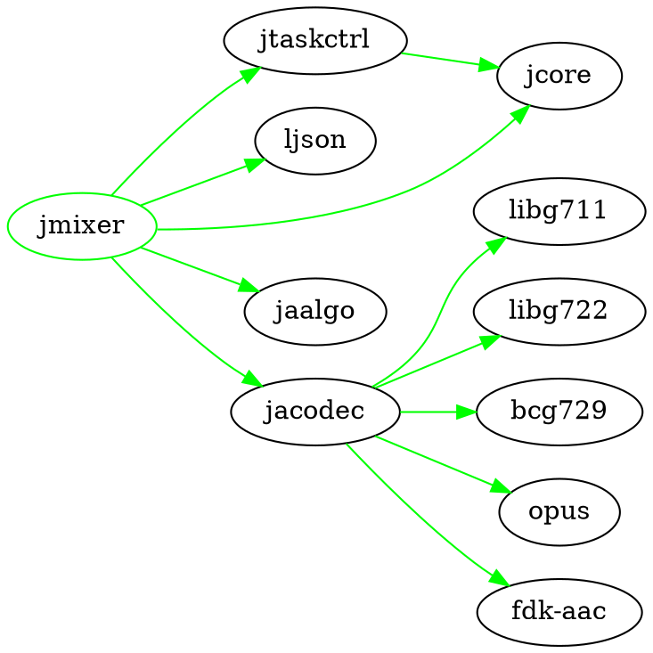
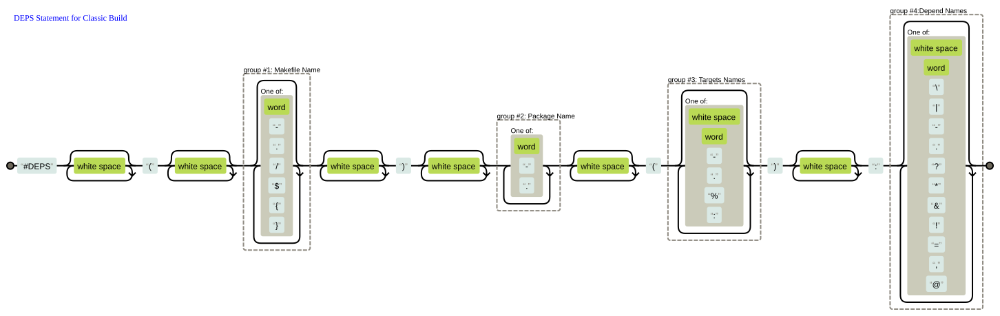
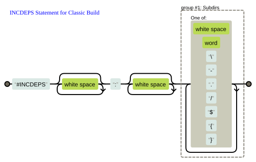
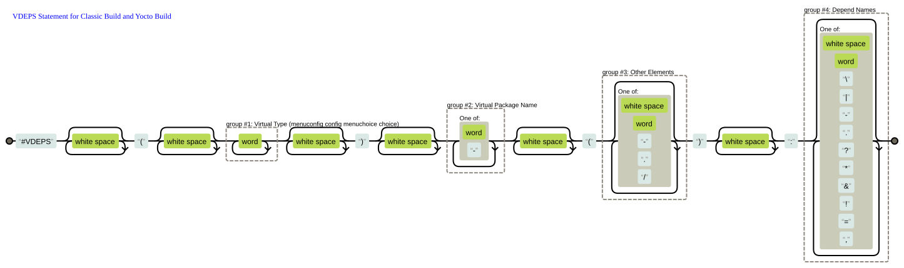
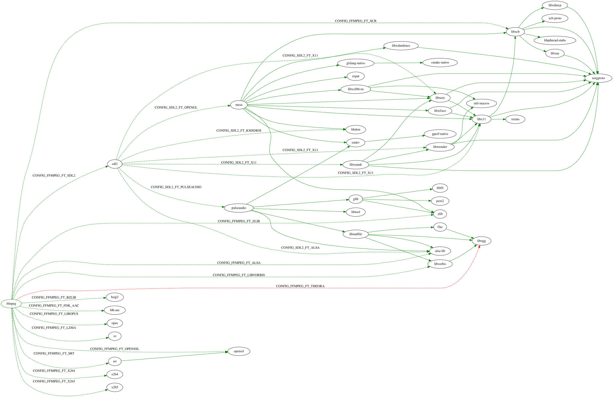

# CBuild-ng / IMake Build System


[中文版](./README_zh-cn.md)

> CBuild-ng is a package-level build platform for large Linux software projects and embedded rootfs development: it brings source fetching, dependency declaration, configuration, compilation, installation, sysroot organization, caching, compliance, and release into a single reproducible pipeline. IMake is the in-package compilation tool within it, describing "how this package gets built" with a set of readable Makefile templates.

> Buildroot, Yocto, and CBuild-ng all look as though they are "doing embedded builds," but what each is actually built for is fundamentally different: Buildroot builds images — "how to produce a rootfs in one shot"; Yocto builds distribution policy — "how to express the customization rules of any Linux distribution"; CBuild-ng builds a development platform and delivery pipeline — "when dozens of engineers, thousands of packages, cross-chip and cross-OS targets, air-gapped networks, and a product that eventually has to ship all come together, how to let everyone change one line and see the result right away, and still hand off a single package — or the entire rootfs — as a self-contained unit to another team or customer.

> **Why CBuild-ng**: Once a project grows to hundreds of packages and dozens of top-level applications, what slows a team down is rarely compilation speed. It is the inability to say exactly "who changed what will break whom", builds that cannot be reproduced on an air-gapped network, and dependencies discovered missing only just before shipment. CBuild-ng consolidates dependencies, isolation, caching, compliance, and release into one auditable pipeline—what a package can see is determined by what it declares, unchanged inputs produce unchanged artifacts, and build results can be delivered as-is.


## Table of Contents

- [1. System Overview](#1-system-overview)
  - [1.1 What Is CBuild-ng?](#11-what-is-cbuild-ng)
  - [1.2 What Problems Do CBuild-ng/IMake Solve?](#12-what-problems-do-cbuild-ngimake-solve)
  - [1.3 Layering the Project: Compilation Tool, Build Platform, and Resource Scripts](#13-layering-the-project-compilation-tool-build-platform-and-resource-scripts)
  - [1.4 Relationship with the Previous-Generation CBuild](#14-relationship-with-the-previous-generation-cbuild)
  - [1.5 Key Features](#15-key-features)
  - [1.6 Scenarios It Addresses](#16-scenarios-it-addresses)
- [2. System Advantages](#2-system-advantages)
  - [2.1 Advantage 1: Direct Build Model, No Configure Stage](#21-advantage-1-direct-build-model-no-configure-stage)
  - [2.2 Advantage 2: Package-Level Isolation and Explicit Dependencies](#22-advantage-2-package-level-isolation-and-explicit-dependencies)
  - [2.3 Advantage 3: Caching You Can Explain](#23-advantage-3-caching-you-can-explain)
  - [2.4 Advantage 4: Zero-Cost Mode Switching](#24-advantage-4-zero-cost-mode-switching)
  - [2.5 Advantage 5: Onboard the Existing Ecosystem Without Rewriting](#25-advantage-5-onboard-the-existing-ecosystem-without-rewriting)
  - [2.6 Advantage 6: Complete Delivery Forms, Compliance as a Natural Byproduct of Builds](#26-advantage-6-complete-delivery-forms-compliance-as-a-natural-byproduct-of-builds)
  - [2.7 Advantage 7: Auditable and Masterable](#27-advantage-7-auditable-and-masterable)
  - [2.8 Open-Source Contributions](#28-open-source-contributions)
  - [2.9 Industry Adoption](#29-industry-adoption)
- [3. Overall Architecture](#3-overall-architecture)
  - [3.1 Architecture at a Glance](#31-architecture-at-a-glance)
  - [3.2 Directory Layout](#32-directory-layout)
  - [3.3 Responsibility Boundaries of the Three Layers](#33-responsibility-boundaries-of-the-three-layers)
  - [3.4 The Core Trio: Top-Level Makefile, gen_build_chain.py, and inc.rule.mk](#34-the-core-trio-top-level-makefile-gen_build_chainpy-and-incrulemk)
  - [3.5 The Full Lifecycle of a Package](#35-the-full-lifecycle-of-a-package)
  - [3.6 The WORKDIR and sysroot Model](#36-the-workdir-and-sysroot-model)
  - [3.7 Output Directory Layout](#37-output-directory-layout)
  - [3.8 Generated Artifacts at a Glance](#38-generated-artifacts-at-a-glance)
  - [3.9 The Open-Source Software Layer and the System Package Layer](#39-the-open-source-software-layer-and-the-system-package-layer)
  - [3.10 Toolchain, Kernel, and Target Boards](#310-toolchain-kernel-and-target-boards)
  - [3.11 Key File Index and Compatibility Notes](#311-key-file-index-and-compatibility-notes)
- [4. Quick Start](#4-quick-start)
  - [4.1 Environment Setup](#41-environment-setup)
  - [4.2 Classic Build](#42-classic-build)
  - [4.3 Yocto Build](#43-yocto-build)
  - [4.4 End-to-End Walkthrough (Release and Verification)](#44-end-to-end-walkthrough-release-and-verification)
  - [4.5 Workflow Cheat Sheet](#45-workflow-cheat-sheet)
  - [4.6 Troubleshooting](#46-troubleshooting)
- [5. IMake Compilation Templates in Detail](#5-imake-compilation-templates-in-detail)
  - [5.1 Template System at a Glance](#51-template-system-at-a-glance)
  - [5.2 Environment Template inc.env.mk](#52-environment-template-incenvmk)
  - [5.3 Installation Template inc.ins.mk](#53-installation-template-incinsmk)
  - [5.4 Application Template inc.app.mk](#54-application-template-incappmk)
  - [5.5 Configuration Template inc.conf.mk](#55-configuration-template-incconfmk)
  - [5.6 Driver Template inc.mod.mk](#56-driver-template-incmodmk)
  - [5.7 Unified Template inc.makes](#57-unified-template-incmakes)
  - [5.8 A Real-World Case: The Audio Mixing System](#58-a-real-world-case-the-audio-mixing-system)
  - [5.9 Typical Integration Scenarios](#59-typical-integration-scenarios)
- [6. The CBuild Build System in Detail](#6-the-cbuild-build-system-in-detail)
  - [6.1 Dependency Rules](#61-dependency-rules)
  - [6.2 Combination Tokens and Implicit Inference in Dependency Statements](#62-combination-tokens-and-implicit-inference-in-dependency-statements)
  - [6.3 Environment Export: process_machine.sh](#63-environment-export-process_machinesh)
  - [6.4 Task Analysis](#64-task-analysis)
  - [6.5 Build Processing](#65-build-processing)
  - [6.6 Directory Syntax and Granularity Naming for Cache Verification Inputs](#66-directory-syntax-and-granularity-naming-for-cache-verification-inputs)
  - [6.7 Yocto Build in Detail](#67-yocto-build-in-detail)
- [7. Rule Build Wrapper in Detail](#7-rule-build-wrapper-in-detail)
  - [7.1 Where It Fits in the Overall System](#71-where-it-fits-in-the-overall-system)
  - [7.2 Source-Fetching Variables](#72-source-fetching-variables)
  - [7.3 Functions and Targets](#73-functions-and-targets)
  - [7.4 The Complete Flow of the build Target](#74-the-complete-flow-of-the-build-target)
  - [7.5 The Four Values of COMPILE_TOOL](#75-the-four-values-of-compile_tool)
  - [7.6 Other Build-Related Variables](#76-other-build-related-variables)
  - [7.7 CUSTOM_TARGETS in Practice](#77-custom_targets-in-practice)
  - [7.8 Cache-Related Variables](#78-cache-related-variables)
  - [7.9 A Complete Package Declaration Example](#79-a-complete-package-declaration-example)
  - [7.10 Anatomy of Representative Packages](#710-anatomy-of-representative-packages)
- [8. Comparison and Selection](#8-comparison-and-selection)
  - [8.1 Design Philosophy Compared](#81-design-philosophy-compared)
  - [8.2 Architecture Models Compared](#82-architecture-models-compared)
  - [8.3 Configuration and Visualization Compared](#83-configuration-and-visualization-compared)
  - [8.4 Build Performance and Incremental Capability Compared](#84-build-performance-and-incremental-capability-compared)
  - [8.5 Cross-Distribution Deployment Compared](#85-cross-distribution-deployment-compared)
  - [8.6 Ecosystem and Compliance Compared](#86-ecosystem-and-compliance-compared)
  - [8.7 Dependency Management Philosophies: Active Provisioning vs. Passive Lookup](#87-dependency-management-philosophies-active-provisioning-vs-passive-lookup)
  - [8.8 IMake vs. CMake, Item by Item](#88-imake-vs-cmake-item-by-item)
  - [8.9 Choosing by Scenario](#89-choosing-by-scenario)
  - [8.10 Hybrid Architecture Strategies](#810-hybrid-architecture-strategies)
  - [8.11 Honest Limitations](#811-honest-limitations)
  - [8.12 Migrating from Other Build Systems](#812-migrating-from-other-build-systems)
- [9. Design and Philosophy in Detail](#9-design-and-philosophy-in-detail)
  - [9.1 Ecosystem Compatibility: Inheriting the Past, Compatible with the Present](#91-ecosystem-compatibility-inheriting-the-past-compatible-with-the-present)
  - [9.2 Middle-Layer Isolation: Keeping the Top Stable and the Bottom Replaceable](#92-middle-layer-isolation-keeping-the-top-stable-and-the-bottom-replaceable)
  - [9.3 Layered Architecture: Mechanisms at the Bottom, Abstraction in the Middle, Policy at the Top](#93-layered-architecture-mechanisms-at-the-bottom-abstraction-in-the-middle-policy-at-the-top)
  - [9.4 Single Responsibility: One Module, One Reason to Change](#94-single-responsibility-one-module-one-reason-to-change)
  - [9.5 Data Flow First: Think Through How Things Flow](#95-data-flow-first-think-through-how-things-flow)
  - [9.6 Federated Microkernel: Packages Are Autonomous Units](#96-federated-microkernel-packages-are-autonomous-units)
  - [9.7 Declaring Intent Rather Than Describing Process](#97-declaring-intent-rather-than-describing-process)
  - [9.8 Fundamental Differences from Other Projects](#98-fundamental-differences-from-other-projects)
  - [9.9 Mechanism Q&A](#99-mechanism-qa)
  - [9.10 Abbreviations and External References](#910-abbreviations-and-external-references)
  - [9.11 Open-Source License](#911-open-source-license)
  - [9.12 Closing Words](#912-closing-words)
  - [9.13 Contact](#913-contact)

---

# 1. System Overview

## 1.1 What Is CBuild-ng?

CBuild-ng consists of three layers, and each layer can be used on its own:

| Layer | Directory | Responsibility | Key implementation |
| --- | --- | --- | --- |
| IMake compilation tool | `scripts/core/`, excluding `inc.rule.mk` | Describes how a single package is compiled internally: environment inference, directory layout, compiler and compiler flags, libraries and executables, kernel modules, installation, in-package Kconfig configuration | `inc.env.mk`, `inc.ins.mk`, `inc.app.mk`, `inc.conf.mk`, `inc.mod.mk`, `inc.makes` |
| CBuild build platform | Top-level `Makefile` plus everything under `scripts/` except the IMake compilation tool | Dependency analysis, automatic generation of the top-level Kconfig and scheduling scripts, configuration menus, source fetching and patches, caching and mirroring, sysroot and rootfs organization, release forms, compliance artifacts, SoC environment export, Yocto wrapping | Top-level `Makefile` (main entry point), `scripts/bin/gen_build_chain.py` (generates the top-level Kconfig and Makefile), `scripts/core/inc.rule.mk` (integrated build, invoking the various scripts and tools), plus `scripts/bin/`, `scripts/kconfig/`, `scripts/toolchain/`, `scripts/progress/`, `scripts/meta-cbuild/`, `scripts/*.env` |
| Resource scripts (packages) | `oss/`, `system/`, with `board/` and `examples/` alongside | Provides buildable content in the form of "one directory, one package": the open-source software layer, the platform's own system packages, board-level configuration, test cases | Each package directory's `mk.deps`, Makefile (or rules written directly inside `mk.deps`), patches, Kconfig fragments, and preset configurations |

The three layers communicate through three kinds of contracts—**environment variables, Make variables, and file artifacts**. There is no private binary format, no daemon, and no special-purpose DSL to learn. The implementation languages are Python, Shell, and Makefile, all tools Linux developers use every day.

One point deserves special mention: the ownership of `inc.rule.mk`. Physically it lives in `scripts/core/`, in the same directory as the IMake templates, but it does not answer "how to write compilation rules". It is part of the CBuild build platform: it chains the download, patch, cache, and install scripts into a single build pipeline, and invokes Autotools, CMake, Meson, a native Makefile, or IMake according to the package declaration. This document therefore lists it alongside the top-level `Makefile` and `gen_build_chain.py` as one of the platform layer's core trio, while the IMake compilation-tool layer consists only of the other five templates plus the unified template `inc.makes`.

The name IMake has two meanings: **Include Makefile** (building by including templates) and **I have the make** (anyone with a basic grasp of Makefiles can fully master and modify it). The second meaning is quite serious: the entire implementation of IMake is readable Makefile. If something does not fit, you can change it directly, and the change takes effect immediately—no waiting for a release.

## 1.2 What Problems Do CBuild-ng/IMake Solve?

The previous section was a feature list. What really decides whether CBuild-ng is worth adopting are two problems that almost every large Linux project runs into, yet which are rarely spelled out on their own.

### 1.2.1 Installation Creates Phantom Dependency Updates

The `install` step of Autotools, CMake, Meson, and similar build tools rewrites its target files every time: even if not a single byte of the build inputs changed, the mtime of the headers, libraries, and executables placed into the sysroot changes too. Any downstream package that judges "has the dependency been updated?" by timestamp will mistake "it was installed again" for "the dependency was changed", so a build in which nothing changed triggers a cascade of rebuilds.

For "unchanged inputs mean install only once" to hold, a verification layer must be added outside the build tool: remember the last input fingerprint and skip installation or reuse artifacts only when the comparison passes. This layer is not part of the build tool itself, yet it is a prerequisite for incremental builds in a large project. The verification rules have to cover sources, patches, configuration, compiler flags, and dependency-package artifacts; miss one item and you get an under-build, add one too many and you get a wasteful rebuild—and the rules themselves must be maintained over time.

This leads to a more practical consequence: to avoid the uncertainty of cross-package verification, many teams simply merge several upper-layer packages and the lower-layer packages they share into one large build unit. When several upper-layer packages of a top-level application depend on the same lower-layer packages, and differing versions of those lower-layer packages are awkward to maintain, the whole thing gets one configure, one make, and one install. This is the industry's familiar **monolithic build**: easier to maintain, at the price of packages losing their independence—no individual rebuild, no individual caching, no individual release, and a small change to a base library disturbs the entire application.

Splitting a project into packages is not hard; what is hard is making sure that after the split, no installation pollutes anyone else. Under a global sysroot a package can see the artifacts of every other package, so a missing dependency may happen to compile anyway; add shifting install timestamps and the dependency graph becomes both inaccurate and unstable. In practice, "package independence" and "reproducible incremental builds" often become an either-or choice.

### 1.2.2 How CBuild-ng Handles It

IMake starts at the installation action itself. Directory creation uses the idempotent `install -d`, but file copying uses neither the `install` command nor the installation rules generated by upstream build systems. Instead:

```makefile
cp -drf --preserve=mode,timestamps <src> <dst>
```

`-d` preserves symlinks themselves, `-r` recurses, `-f` overwrites, and `--preserve=mode,timestamps` keeps both permission bits and timestamps. **As long as the inputs do not change, every installation produces artifacts that are identical down to the bytes and the timestamps.** Downstream packages need no external verification: the plainest timestamp check gives the right answer—unchanged means unchanged, changed means changed. Package authors do not have to understand how a cache key is computed or maintain a list of "which files participate in verification", so the cognitive overhead is low.

There is a reason `cp -drfp` is not used: `-p` triggers warnings or even errors in Yocto build environments, so the templates spell out the attributes to preserve explicitly as `--preserve=mode,timestamps`, which behaves consistently across platforms.

The CBuild platform layer has not abolished verification because of this. `inc.rule.mk` provides complete input-fingerprint and cache-hit capability through `CACHE_CHECKSUM`, `CACHE_APPENDS`, and `process_cache.sh`, for packages that do not install via IMake. **For Autotools, CMake, Meson, upstream Makefiles, and custom build scripts, cache verification should always be enabled**: their install behavior is not constrained by IMake, timestamps will change, and only verification can guarantee "unchanged inputs mean install once and build once". The two paths coexist, each used where it fits.

### 1.2.3 Comparison with Other Systems

| System | Install behavior | External verification needed? | Cognitive overhead |
| --- | --- | --- | --- |
| IMake (in-package compilation in CBuild-ng) | `cp -drf --preserve=mode,timestamps`; unchanged inputs leave both artifacts and timestamps unchanged | No | Low |
| Third-party build systems managed by CBuild-ng | Upstream `install` refreshes timestamps | Recommended: always enable cache verification | Medium |
| Yocto | Every task's output goes into sstate; configuration, parameters, and dependencies all feed the signature | Always required; in complex cases the verification rules themselves can break down | High |
| Buildroot | Each package is installed once; "never install twice" sidesteps the problem | Never faces repeated installation | At the cost of no per-package rebuild or reuse |

Yocto makes verification the foundation of the whole system—the most capable approach, but the complexity of its signature rules grows with project size. Buildroot chooses to install once: simple, but it gives up package-level incrementality and standalone delivery. CBuild-ng's choice is: **let IMake packages need no verification by nature, and reserve verification for the packages that really need it**.

Together, these two problems explain why the designs in later chapters are what they are: WORKDIR isolation makes "what a package can see" a matter of declaration, and stable install timestamps make "has a dependency changed?" something you never have to guess. Only the two combined make packages first-class citizens—a lower-layer package maintains one version, upper-layer packages each declare their dependencies, and none of them have to be crammed into a monolithic build.

## 1.3 Layering the Project: Compilation Tool, Build Platform, and Resource Scripts

The fastest way to understand CBuild-ng is to look at which directories own what. The project does not conflate "platform" with "compilation tool", nor treat "packages" as an internal implementation of the platform; the three live in separate directories and can evolve independently.

### 1.3.1 Layer 1: The IMake Compilation Tool

Directory: `scripts/core/`, whose members are `inc.env.mk`, `inc.ins.mk`, `inc.app.mk`, `inc.conf.mk`, `inc.mod.mk`, and `inc.makes`.

This layer answers "how is one package compiled". It does not care where the package came from, who depends on it, which sysroot the results go into, or whether it enters the cache. It only turns source into artifacts: inferring directories and compilers, assembling compiler flags, generating rules for static libraries / shared libraries / executables / kernel modules, installing artifacts to a given prefix, and maintaining in-package Kconfig configuration.

- `inc.env.mk` is the foundation: it defines the family of `WORKDIR` directory variables, the family of compiler tool variables, and the family of optimization and hardening option variables; every other template builds on it.
- `inc.app.mk` provides three declarative build functions—`add-liba-build`, `add-libso-build`, `add-bin-build`—and collects sources, generates header dependencies, and validates compiler flags.
- `inc.ins.mk` generates installation targets according to the GNUInstallDirs directory variables.
- `inc.conf.mk` calls `conf` / `mconf` from `scripts/kconfig/` and manages `.config`, `config.h`, and `auto.conf`.
- `inc.mod.mk` has two branches: when `KERNELRELEASE` is empty it assembles external-module build commands; when it is set, it is included by the kernel build system as a Kbuild fragment.
- `inc.makes` is a concatenation of the above templates for standalone projects that do not use the platform; `INC_MAKES` selects which modules are enabled.

This layer can be used entirely outside CBuild-ng: export `ENV_MAKE_DIR` pointing at that directory, or simply carry `inc.makes` along, and an ordinary Makefile gains all of the above. The project's own `scripts/progress` is built exactly this way.

### 1.3.2 Layer 2: The CBuild Build Platform

Directory: the top-level `Makefile` plus everything under `scripts/` except the IMake compilation tool.

This layer answers "how is a system made of many packages organized". At its core are three things:

1. **Top-level `Makefile` (main entry point)**: every user-visible command enters here—`make menuconfig`, `make`, `make <package>`, `make <package>-dev/-pkg/-cpk/-eld`, `make <package>-deps`, `make time_statistics`, `make toolchain`, and so on. The Classic Build and Yocto Build target sets branch on `ENV_BUILD_MODE` inside the same file.
2. **`scripts/bin/gen_build_chain.py` (generates the top-level Kconfig and Makefile)**: scans every `mk.deps` dependency statement in the project, assembles a global dependency graph, and produces four artifacts: `Kconfig`, `auto.mk`, `Target`, and `info.txt`. `auto.mk` is included by the top-level Makefile, and only after that inclusion does each package become a callable make target.
3. **`scripts/core/inc.rule.mk` (integrated build)**: the adapter between package Makefiles and the platform pipeline. It calls `fetch_package.sh`, `exec_patch.sh`, `process_cache.sh`, `process_sysroot.sh`, `gen_package_infos.py`, and others, and uses `COMPILE_TOOL` to decide whether compilation is done by IMake, Autotools, CMake, Meson, or the upstream Makefile.

Around this trio, `scripts/` holds several supporting groups: `scripts/bin/` contains standalone tools for downloads, patches, mirrors, caching, sysroot, licenses, CPK, dependency graphs, and SoC descriptions; `scripts/kconfig/` is the Kconfig implementation taken from the Linux kernel and extended with output-path parameters; `scripts/toolchain/` builds cross toolchains from source; `scripts/progress/` is a build-progress program compiled with IMake; `scripts/meta-cbuild/` is the meta layer and classes used in Yocto mode; `build.env`, `clean.env`, and `yocto.env` are environment scripts.

The platform layer does not dictate how a package is compiled internally; it only dictates "which targets a package must provide and where its artifacts go". That boundary is what lets the same platform manage IMake packages as well as Autotools, CMake, Meson, and hand-written Makefile packages.

### 1.3.3 Layer 3: Resource Scripts (Packages)

Directories: `oss/`, `system/`, together with the accompanying `board/` and `examples/`.

This layer is content, not mechanism. `oss/` organizes open-source software into a two-level classification by domain, one package per directory; `system/` holds the platform's own system packages, including the kernel, rootfs assembly, the standalone-package launcher, and toolchain-related packages; `board/<soc>/configs/` stores full configurations and delta configurations per target board; `examples/` holds test applications, Kconfig examples, kernel-module examples, and a minimal Classic/Yocto project.

A package has a very fixed shape: one directory, one `mk.deps` dependency declaration, one Makefile (or rules written directly inside `mk.deps`), plus patches and Kconfig fragments as needed. The platform does not require source code inside the package directory—sources can be downloaded elsewhere, or `Makefile_Name` can point to a path outside the source directory.

The resource layer is replaceable: mount your own package directories, or keep only `system/` and supply your own open-source software layer; neither the platform layer nor the compilation-tool layer needs to change. This is also the basis for "the same source directory can be managed under different identities by different SDK projects".

### 1.3.4 The Call Chain Across the Three Layers

Take one `make <package>` in a Classic Build as an example. The three layers collaborate in this order:

1. `source scripts/build.env ...` exports the `ENV_*` directory variables and toolchain variables from the platform layer.
2. The `deps` target of the top-level `Makefile` calls `gen_build_chain.py` to scan `mk.deps` files under resource directories such as `oss/` and `system/`, generating `Kconfig`, `auto.mk`, `Target`, and `info.txt`.
3. `make menuconfig` has `inc.conf.mk` call `mconf` from `scripts/kconfig/`, presenting `Kconfig` as a menu and writing the result to `.config`.
4. The top-level Makefile includes `.config` and `auto.mk`, thereby learning "which packages are selected" and "the dependencies between each package's build, install, clean, and release targets".
5. The user runs `make <package>`; make schedules according to the dependency order in `auto.mk`. Each package's targets are generated by `auto.mk` and ultimately land in the package directory's Makefile.
6. If the package Makefile includes `inc.rule.mk`, the platform pipeline first prepares a private sysroot, fetches sources, applies patches, and consults the cache before entering compilation.
7. Compilation is performed by the IMake compilation tool (`inc.env.mk` / `inc.app.mk`, etc.) or by a third-party build system, with artifacts placed in `build` and `image` under `WORKDIR`.
8. The platform layer then uses `process_sysroot.sh` to install `image` into the global sysroot, the private sysroot, the rootfs, or a release package directory.

There is no hidden state anywhere in this chain: every step's inputs and outputs are files, and any layer can be removed or replaced on its own.

## 1.4 Relationship with the Previous-Generation CBuild

CBuild-ng is the next generation of [CBuild](https://github.com/lengjingzju/cbuild). The most essential difference is that the Classic Build introduces the **WORKDIR** concept. In CBuild all packages share one set of global output directories, dependencies are passed implicitly through a global sysroot, and a missing dependency may still "happen to compile". CBuild-ng lets each package prepare dependencies, compile, and install in its own working directory, with inter-package dependencies and sysroot organization handled explicitly by the auto-generated top-level Makefile—**what a package can see is entirely determined by what it declares** (looking up dependencies in the global sysroot is also supported).

This change brings three direct benefits: a missing dependency shows up immediately as a compile error rather than a runtime fault; packages with no dependency relationship share no write path and can safely run in parallel; and a single package can be built, cleaned, cached, and packaged on its own, or compiled with just the IMake templates outside the platform.

The full differences between the two generations are as follows:

| Dimension | CBuild (2022.5 – 2023.3) | CBuild-ng (2023.3 – present) |
| :--- | :--- | :--- |
| **Core build model** | **Hybrid build model**: Classic Build and Yocto Build share templates, but source compilation depends on global paths and lacks independent isolation. | **Classic Build introduces WORKDIR isolation**: each package prepares dependencies, compiles, and installs in its own `WORKDIR`, eliminating global contamination entirely. |
| **Open-source package (OSS) compilation** | Incomplete; downloading, isolation, and verification all had defects. | **Native, full-featured support**: `COMPILE_TOOL = autotools / cmake / meson / imake` takes over source compilation directly, removing the dependency on `prebuild` altogether. |
| **Network downloads and mirror caching** | Basic `http/git/svn` downloads and a simple cache were added, but they were **only a rudimentary half-finished feature**, with no mirror failover or verification. | **Mature enterprise-grade download and cache mechanism**: `wget` replaces `curl`, with intelligent mirror routing, precise `md5` and Git Rev verification (`process_cache.sh`), and built-in `flock` to resolve concurrent conflicts. |
| **Download progress bar** | A Python script displayed progress. | Implemented in **C code with pipes** for better performance, embedded deep in the lower layers of the build pipeline. |
| **Software packaging and release** | Only the overall `rootfs` could be built and packaged; no output for individual packages. | Supports **standalone software packaging** and **standalone release packages**, including `CPK` output with automatic dependency-library collection, for release across a large software ecosystem. |
| **License management** | **No support** for generating a license list on demand for selected packages. | Generates a **license list on demand for selected packages**. In `make menuconfig`, press `?` on a package to view its license details. At release time the system produces license manifests in **both HTML and TXT**, containing only the packages actually selected, for accurate and compliant license disclosure. |
| **Build template conventions and extensibility** | Templates were relatively fixed and lacked a standardized directory convention. | Templates **strictly follow GNUInstallDirs**, support `Clang` cross-compilation, and add the `imake` build method, unifying how multiple build tools are integrated. |
| **Upstream kernel and toolchain tracking** | Stuck on older versions and no longer maintained; driver templates broke on newer Linux kernels. | **Continuously tracks upstream**: Kconfig updated to Linux 6.18, toolchain to GCC 16.2.0, Yocto to Poky 5.0, plus new **RISC-V and LoongArch** architecture support. |
| **Conditional dependencies and configuration generation** | Conditional dependencies required manual edits in several places—tedious work. | **Automated conditional dependencies and configuration generation**: declare `featurecfg` once and the system fills in Kconfig declarations, dependency relationships, and compiler flags, removing the need to edit four places; `versioncfg` generates and populates version configuration automatically. |
| **Yocto recipe conversion** | No conversion tool; build scripts had to be rewritten by hand. | Provides a **recipe-to-`mk.deps` script** that converts Yocto recipes directly into CBuild-ng integration build descriptions. |
| **Application development** | `source` could only be empty; no application packaging. | CBuild-ng also supports application development: `source` can be empty, `app`, `host`, and so on, with a packaging mechanism. |
| **License** | Started as **GPLv2**, changed to MIT on 2022-12-18. | **MIT** from the very first commit on 2023-03-05, with no historical license baggage. |

## 1.5 Key Features

### 1.5.1 Declarative Dependencies and an Auto-Generated Configuration System

Each package uses one `mk.deps` file to declare its identity, dependencies, and build method; the core is usually a single line:

```makefile
#DEPS(mk.deps) tcpdump(native psysroot): unselect libpcap
```

`gen_build_chain.py` scans the whole project, merges every dependency statement into one global dependency graph, and from it generates four artifacts:

| Artifact | Contents | Purpose |
| --- | --- | --- |
| `Kconfig` | The configuration menu for the entire project, with hierarchy, selections, dependencies, and help text | Handed to `conf` / `mconf` to render `menuconfig` |
| `auto.mk` | Each package's build, install, clean, and release targets, plus the dependency relationships needed for parallel scheduling | Included by the top-level Makefile |
| `Target` | A list of `package="dependency list" # source path` entries | Cached dependency analysis and dependency-graph rendering |
| `info.txt` | A dictionary of package metadata (name, version, license, homepage, description) | Compliance manifests and menu help |

The supported dependency semantics are quite complete: hard dependencies, weak dependencies, conditional dependencies, strong selects, weak selects, conflicts, OR dependencies (choose one of several), explicit subtarget dependencies, and environment-variable-based dependencies. **Virtual packages** are also supported—they produce no build action at all and exist only to organize the menu structure, in four types: `menuconfig` / `config` / `choice` / `menuchoice`.

The `native` semantics: one declaration generates both a cross-compiled package and a native-compiled package; the native one automatically gets the `-native` suffix, and the cross package can depend on host tools supplied by the native package (for example, cross-compiling ncurses needs the native `tic` to generate the terminfo database).

### 1.5.2 Graphical Configuration with Kconfig

- A Kconfig implementation taken from the Linux kernel is built in, with the added ability to **separate configuration output from source**: `conf` / `mconf` accept `--configpath`, `--autoconfigpath`, `--autoheaderpath`, and `--rustccfgpath`, so `.config`, `auto.conf`, and `config.h` can all live in the output directory and the source tree stays clean.
- Top-level configuration and in-package configuration use the same mechanism: `make menuconfig` configures the whole system, `make <package>_menuconfig` configures a single package (busybox, linux, etc.).
- A complete family of configuration load/save targets: `loadconfig`, `defconfig`, `<name>_config`, `<name>_saveconfig`, `<name>_defconfig`, `<name>_savedefconfig`, `cleanconfig`.
- Configuration results are automatically synchronized into a C header with include guards; configuration changes trigger regeneration automatically.
- Configuration is linked to caching: configuration values enter cache verification, so **changing the configuration triggers a rebuild** instead of being masked by the cache.

The help text of each package entry in the menu shows its name, version, license, homepage, and description directly:

```
config GLIB
    bool "glib (oss/display/glib/glib)"
    default n
    depends on LIBFFI && ZLIB && PCRE2
    help
    Name        : glib
    Version     : 2.90.1
    License     : LGPL-2.1-or-later
    Homepage    : https://developer.gnome.org/glib/
    Description : GLib is a general-purpose, portable utility library, ...
```

This information comes from the metadata fields in each package's `mk.deps`. In other words, **you can do your selection research right in the configuration menu** instead of digging through every package's source. Local packages (those without `HOMEPAGE`) show a `Location` field instead.

### 1.5.3 IMake Compilation Templates

- Three declarative build functions: `add-liba-build` (static library), `add-libso-build` (shared library, with versioning and soname support), and `add-bin-build` (executable).
- One Makefile can produce several libraries and several executables at once, with each target given its own source set, link flags, private compiler flags, and extra dependencies.
- Automatic header dependency analysis: change a header and only the genuinely affected source files are rebuilt.
- Automatic **environment-sensing rebuild**: compiler, optimization level, security switches, user-defined flags, and similar settings are collected into `checkinfo`; a change in its contents triggers a rebuild, eliminating the classic "changed the compiler options but nothing was rebuilt" error.
- Separation of source and output (`make O=`), install location (`make DESTDIR=`), and dependency root (`make DEPDIR=`) all follow the common conventions of the GNU world.
- The installation system aligns with GNUInstallDirs and additionally provides `base_*dir` and `hdrdir`; it supports subdirectory installation, installation into arbitrary directories, and renamed installation.
- Preset families of compiler options: four optimization levels, link-time optimization, dead-section elimination, security hardening (stack protector / FORTIFY / RELRO / PIE / as-needed), four kinds of sanitizer, static analyzers, gprof, and SIMD instruction-set switches.
- Switchable between GCC and Clang toolchains; the header and library search-path problems of cross-compiling C++ with Clang are handled inside the templates.
- The kernel-module template supports external module builds, separation of output and source, multiple modules in one Makefile, and `Module.symvers` export, and adapts to the build-behavior changes in kernels 6.10 and 6.13.
- Third-party build-system adaptation: Autotools, CMake (including the Ninja backend), Meson (including cross ini generation), and native Makefiles, all scheduled uniformly by `inc.rule.mk`.

**The same Makefile works unchanged in six compilation modes**: native GCC, native Clang, cross GCC, cross Clang, Yocto target, Yocto native. Switching is driven by environment variables, with no need to rerun a configure stage.

### 1.5.4 Supply-Chain Capabilities

- **Source fetching**: four methods—tar / zip / git / svn—with md5, branch, tag, and revision pinning; git/svn downloads can be shared and reused, so there is no need to copy a source tree for every package.
- **Two-tier mirroring**: an internal mirror (one HTTP directory) is tried first, falling back to the original address on failure; external mirrors use a mapping table to redirect upstream addresses to domestic mirror sites.
- **Compilation cache**: local and network tiers; cache files are named at one of four granularity levels—"soc / cpu / arch / cpu family"—so the reuse scope can be tuned by policy; three manual interventions are supported—force build, force build once, and cancel force; on a miss, the log can be inspected to compare verification inputs field by field.
- **Concurrency safety**: downloads and cache operations use file locks, so multi-threaded builds never write the same archive concurrently.
- **Development mode**: once a package is put into development mode its sources are no longer overwritten, and code can be edited and debugged directly in the output directory.
- **Status query**: one command shows the branch, last commit, and working-tree changes of every git-type package.

### 1.5.5 Delivery and Compliance

- **sysroot organization**: five operations—link / install / release / replace / license.
- **Four release forms**:
  - `make <package>-dev`: a development package containing headers, static libraries, and the sysroot of all dependencies;
  - `make <package>-pkg`: a runtime package with headers and static libraries removed;
  - `make <package>-cpk`: a cross-distribution standalone package carrying its own C library and dynamic linker, in a single self-extracting file, installed in user space without root;
  - `make <package>-eld`: a standalone package in execld form that **modifies no ELF at all**, achieving the same cross-distribution capability with a static launcher and a configuration file.
- **Compliance output**: automatically generated license manifests (TXT + HTML), an SPDX index, and a package dependency graph (dot / svg / png), delivered together with the package.
- **Filesystem assembly**: the `rootfs` package installs every selected package into a fakeroot directory, appends glibc from the toolchain, removes headers and static libraries, and strips all ELF files, producing a root filesystem ready for image creation.

### 1.5.6 Toolchain and Target Boards

- `process_machine.sh` is the single convergence point for SoC differences: given an soc name, it outputs machine, cpu, arch, cpu family, endianness, SIMD, kernel arch, cross triplet, toolchain path, cross parameters for each build system, the cache granularity sequence, and a recommended parallelism level.
- `scripts/toolchain/Makefile` builds a complete, up-to-date cross toolchain from source (binutils, gcc, glibc, gdb, plus gmp / mpfr / mpc / isl and, when needed, libxcrypt); the result also enters the cache and is shared across the team.
- The `board/` directory organizes configuration by soc, and configuration follows the target board: switching the soc automatically loads the corresponding set.
- The `system/linux` package handles fetching, configuring, compiling, and installing the kernel, and can load customized configuration from a board-level directory.

### 1.5.7 Observability

- **Build progress**: `progress`, a C program compiled by IMake itself, talks to make over a socket and shows completion percentage, the current list of parallel tasks, and log paths in real time.
- **Detailed logs**: during parallel builds, the complete output of every package is written to its own log file.
- **Timing statistics**: `make time_statistics` builds serially and records the time each package spends in the three phases "prepare dependencies / compile / install".
- **Dependency graphs**: any package can produce a dot / svg / png dependency graph, with colors distinguishing selection state and line styles distinguishing hard, weak, and choose-one-of-several dependencies.
- **Command transparency**: at any moment `make PREAT= MFLAG=` shows the real command line passed to the compiler.

## 1.6 Scenarios It Addresses

### 1.6.1 Scenario 1: Large-Scale Linux Software Development

The typical predicament of a large C/C++ project is "one monolithic repository plus one set of build scripts": all code compiles together, so changing one module rebuilds a large swath; dependencies between modules are expressed implicitly through include paths and link order, and nobody can say exactly who depends on whom; delivering a single module to a customer means assembling a sysroot by hand.

CBuild-ng's answer is to split the project into a **federation of packages**:

- Each functional module is an independent package with its own version lifecycle, its own WORKDIR, and its own installation artifacts; it can be compiled, debugged, cached, packaged, and delivered on its own.
- Dependencies between modules are expressed in a single line; all declarations merge into one global dependency graph that determines the build order, and `make <package>-deps` visualizes it at any time.
- When a module needs to be delivered, `make <module>-dev` directly produces a development package containing headers, static libraries, and the sysroot of all dependencies—the customer can compile against it immediately.
- Third-party dependencies need no rewriting: Autotools / CMake / Meson projects are kept as-is, with only a `mk.deps` wrapper around them.
- Components can be reused by multiple projects: the same source directory can be managed under different identities by different SDK projects (dependency declarations and Makefiles may live outside the source directory).

In this project the model takes the form of the `oss/` open-source software layer and the `system/` system-package layer: from compression, parsing, logging, math, and network protocols to multimedia codecs, the graphics stack, and Qt, everything is organized as "one directory, one package", classified into two levels by domain, with the configuration menu's structure mirroring the directory structure one-to-one.

### 1.6.2 Scenario 2: Embedded rootfs Development

The typical predicaments of embedded development are: cross-compilation environments are hard to set up; the build relationships between kernel, drivers, and user space are hard to untangle; the target board's root filesystem is assembled by hand; nothing can be downloaded in an isolated network; and compliance manifests requested by customers are compiled manually.

CBuild-ng provides correspondingly:

- **Self-built toolchains**: `make toolchain` builds a complete cross toolchain tuned for the target CPU from source; the result goes into the cache and is shared by the team. Building a host toolchain to pin the compiler version is also supported.
- **Kernel and drivers as one system**: the kernel is an ordinary package and gets exactly the same treatment as any other; driver packages use a weak dependency `?linux` on the kernel, so they can compile against the kernel tree built by CBuild-ng, against host kernel headers, or against a vendor-supplied kernel tree. `inc.mod.mk` handles separation of output and source, cross-module symbol export, and behavior changes across kernel versions.
- **Automatic rootfs assembly**: select the packages you need and the `rootfs` package installs their release forms into fakeroot, appends the target C library, removes development files, and strips ELF files.
- **Target-board configuration management**: `board/<soc>/configs/` stores configurations per board, in both full and minimal-delta forms.
- **A complete air-gapped-network solution**: `make all_printurls` exports the address list, `make all_fetches` prefetches sources, and `make all_caches` pre-fills the cache; move the two directories into the isolated network as a whole and publish them with one HTTP service.
- **Compliance artifacts delivered with the package**: license manifests, SPDX index, and dependency graphs are generated automatically and placed in `usr/share/license/`.

### 1.6.3 Scenario 3 (Extended): Cross-Distribution Delivery

A program compiled on the newest distribution will not run on an older one, because glibc only guarantees backward compatibility. The usual countermeasure is to lock the development environment to the oldest supported distribution. CPK and execld offer another path: package the application together with its C library and dynamic linker, making "compile in a new environment, run in an old one" routine. See the standalone-package and launcher parts of the "Build Processing" section.

# 2. System Advantages

## 2.1 Advantage 1: Direct Build Model, No Configure Stage

IMake is a direct build model: the Makefile itself is what finally executes, with no intermediate generated artifacts and no separate configure stage. Compiler flags are assembled from variables each time `make` evaluates, so changing one option does not require rerunning configure first. Combined with the `CHECK_INFO` mechanism, changes to the compiler, optimization level, security switches, user-defined flags, and similar settings automatically trigger rebuilds of the affected source files, so you never get stale artifacts of the "changed the compiler options but the object files were not rebuilt" kind.

The origin of the flags is transparent too. At any time `make PREAT= MFLAG=` strips the command-echo prefix and shows the actual command line passed to the compiler; `TOLOG=` turns on full output when building third-party packages. When tracking down link errors, macros that did not take effect, or wrong library search paths, there is no need to trace flags backwards through a generated build system.

Because there is no probing stage, flags needed for cross-compilation such as `-L`, `-B`, and `--sysroot` go straight into the real compile command; there is no "the temporary project in the probing stage missed the user's flags and drew the wrong conclusion" scenario. When cross-compiling C++ with Clang requires extra LLVM standard-library paths, the templates use `USING_CLANG_CXX_BUILD` to fold header and library search flags into both compile and link commands, so native and cross, GCC and Clang all share the same Makefile.

For continuous integration, having one less layer of generated artifacts has a practical benefit as well: the build description is exactly the Makefile in version control, so incremental builds pay neither the cost of "the configure stage itself takes time" nor the cost of folding generated directories into the cache key.

There is one more easily overlooked difference: **when dependency analysis happens**. CBuild-ng has `gen_build_chain.py` scan all `mk.deps` files once and write the results to static files—the top-level `Kconfig` and `auto.mk` (plus `Target` and `info.txt`). Afterwards `make`, single-package builds, and menu configuration all read those files directly; the dependency graph is a visible, archivable, diffable file artifact, regenerated only when dependency declarations or configuration change. Yocto's BitBake, by contrast, dynamically parses all metadata and recipes on every build and recomputes the task graph, which can mean waiting a minute before compilation actually starts. Static generation buys more than skipping one analysis: it is extremely fast, `make` targets can be tab-completed, the artifacts can go into version control, be inspected offline, and be diffed between two CI runs; when something goes wrong you can open `auto.mk` and see exactly where a particular rule came from.

## 2.2 Advantage 2: Package-Level Isolation and Explicit Dependencies

With `WORKDIR` introduced in the Classic Build, every package prepares dependencies, compiles, and installs in its own working directory: compilation output goes to `build` (overridable with `O=`), the first installation goes to `image` (overridable with `DESTDIR=`), and dependency lookup goes to `sysroot` and `sysroot-native` (overridable with `DEPDIR=`). Which headers and libraries a package can see is entirely determined by the dependencies it declares in `mk.deps`—**what a package can see is determined by what it declares**.

This discipline pushes dependency errors forward to compile time: a missing dependency is a header not found or a library missing at link time, not "it compiles on the developer's machine but not in CI" or "it runs locally but crashes on the target board". Build order needs no manual maintenance either—the target dependencies in `auto.mk` are generated from the dependency graph and make schedules parallelism accordingly; adding a package does not require touching any ordering logic.

A single package can be operated on independently: `make <package>` builds it and its dependencies, `make <package>_single` builds only itself, and `make <package>_psysroot_single` prepares only its private sysroot; if the package uses the global sysroot, the standalone install command is `make <package>_install_single`. Running `make` directly inside the package directory works perfectly well too. Debugging one package does not disturb the whole system, and caching, cleaning, and packaging are likewise package-scoped.

Dependencies can be inspected at any time: `make <package>-deps` generates a dot / svg / png dependency graph, with colors distinguishing selection state and line styles distinguishing hard, weak, and choose-one-of-several dependencies. Questions like "why was this package built?" and "who is affected by a change to this base library?" have definite answers instead of being guessed from scripts.

## 2.3 Advantage 3: Caching You Can Explain

The biggest risk in "sharing compiled artifacts" is a loosely designed cache key—using an old artifact that should not have been used is an extremely hard problem to track down. CBuild-ng's cache mechanism imposes explicit constraints here:

- **The verification inputs are closed and enumerable**: build scripts, patches, dependency-package outputs, source archives or local source trees, explicitly declared extra verification items, and the values of dynamic configuration items.
- **The discipline is clear**: never add post-build output files to verification. Otherwise you create the dead loop of "output changes → checksum changes → cache never hits".
- **Sorting removes environmental differences**: verification details are sorted by column before the final md5 is computed, so identical inputs on different machines yield identical checksums and a cache pushed by machine A can be used by machine B.
- **Hits and misses are explainable**: `<WORKDIR>/<package>-cache.log` records the complete parameters of the invocation and the item-by-item verification details; on a miss, comparing two logs pinpoints exactly which item changed.
- **Three levels of manual intervention**: force build (persistent), force build once, and cancel force. Cancelling force deletes the package's local caches at every cache level, avoiding artifacts that no longer match the current intent.
- **Cache reuse granularity is adjustable**: the cache filename prefix is taken from one entry of the four-level "soc / cpu / arch / cpu family" sequence, selected by `CACHE_GRADE`. The default is cpu level; a pure algorithm library can move to arch level to widen reuse, while artifacts tightly coupled to an soc are narrowed to soc level.

The real effect of caching can be seen by comparing two builds with `make time_statistics`: for the same set of packages, building from source and hitting the cache differ markedly in elapsed time.

## 2.4 Advantage 4: Zero-Cost Mode Switching

Switching between the six compilation modes (native GCC / native Clang / cross GCC / cross Clang / Yocto target / Yocto native) requires no changes to any build file and no rerun of configuration:

```sh
make                                                       # native GCC
make CC_TOOL=clang                                         # native Clang
make CROSS_COMPILE=aarch64-linux-gnu-                      # cross GCC
make CROSS_COMPILE=aarch64-linux-gnu- CC_TOOL=clang USING_CLANG_CXX_BUILD=y   # cross Clang
```

A cross prefix that includes a path is passed as `ENV_BUILD_TOOL=/<toolchain-path>/aarch64-linux-gnu-`; the templates add the path portion to `PATH` and use the filename portion as `CROSS_COMPILE`.

In Yocto mode, `cbuild.bbclass` from `meta-cbuild` already wraps the export of `ENV_BUILD_MODE`, `NATIVE_BUILD`, `WORKDIR`, `ENV_MAKE_DIR`, and similar variables; a user recipe only needs `inherit cbuild` and then `oe_runmake` inside `do_compile`.

The practical value of this capability is obvious in CI and in heterogeneous teams: the same code is compiled natively on a developer machine for quick verification, cross-compiled in CI for target artifacts, and run under Clang with sanitizers in a third pipeline—all three use exactly the same build description. **"Develop quickly with the Classic Build first, then switch to Yocto for the official release"—or migrate in the opposite direction—costs almost nothing.**

## 2.5 Advantage 5: Onboard the Existing Ecosystem Without Rewriting

CBuild-ng does not ask anyone to start over:

- **Autotools / CMake / Meson / hand-written Makefile projects**: keep them as they are, add a `mk.deps` wrapper, and set the build method with `COMPILE_TOOL`. `inc.rule.mk` runs `configure` / `cmake` / `meson` for you and passes in the correct cross parameters, install prefix, and optimization options. The project's bundled `oss/` open-source software layer manages a large number of upstream projects this way, with most package declarations running only twenty or thirty lines.
- **Yocto assets**: meta layers, recipes, and bbappends are all used unchanged, and native `bitbake` commands still work. CBuild-ng merely adds one meta layer and a few classes that wire `menuconfig` and `make` in. It also provides `convert_recipe.py` to produce an initial `mk.deps` skeleton from a recipe as a migration starting point.
- **Linux conventions**: `O=` for output separation, `DESTDIR=` for install location, `CROSS_COMPILE=` for the cross prefix, `menuconfig` for configuration, GNUInstallDirs directory variables, and `Module.symvers` symbol export—all existing community conventions are kept; no new vocabulary is invented.

## 2.6 Advantage 6: Complete Delivery Forms, Compliance as a Natural Byproduct of Builds

Most build tools stop at "a pile of compiled artifacts", leaving a manual stretch between artifacts and something deliverable. CBuild-ng turns that stretch into four commands:

| Command | Artifact | Audience |
| --- | --- | --- |
| `make <package>-dev` | A development package with headers, static libraries, and the sysroot of all dependencies | Secondary developers |
| `make <package>-pkg` | A runtime package containing only runtime content | Deployment |
| `make <package>-cpk` | A cross-distribution standalone package: single self-extracting file with its own glibc and ld.so | Cross-distribution distribution |
| `make <package>-eld` | A standalone package in execld form that does not rewrite ELF files | Distribution where binaries must stay byte-identical |

All four forms automatically ship a license manifest (TXT + HTML), an SPDX index, and a dependency graph. Compliance is not an extra task outside the build; it is a natural byproduct of the build—customers receiving a package can check for themselves which open-source components were used, their versions, their licenses, and how they depend on each other.

License declarations support four forms, covering how upstream projects actually look in the wild: SPDX identifiers (linking to the SPDX page), URLs, references to a common license directory (`common://`, so a single text is stored in only one place), and source-file fragments (`file:xxx;line=m-n;dst=xxx`, for cases where license text is embedded in a large file—for example, lua's license sits in a specific line range of `doc/readme.html`).

## 2.7 Advantage 7: Auditable and Masterable

This one is not a feature but the design tone of the entire system, yet it has the greatest impact on long-term maintenance:

- **The whole implementation is readable scripts**: Python, Shell, Makefile, with no compiled black boxes. When a problem appears you can read the source directly and then change it.
- **Every step produces files**: `Kconfig`, `auto.mk`, `Target`, `info.txt`, `.config`, `config.h`, verification files, cache logs, dependency-graph dot sources—when something breaks there is no need to guess at internal state, just look at the corresponding file.
- **The regular expressions for the dependency syntax ship with the project as diagrams** (`regex_deps.svg`, `regex_incdeps.svg`, `regex_vdeps.svg` under `scripts/bin`), so the syntax boundaries are precisely checkable rather than guessed.
- **Command echo can be turned on at any time**: `make PREAT= MFLAG=` is the standard technique for diagnosing any compiler-flag problem.

## 2.8 Open-Source Contributions

Two Linux kernel build issues discovered during this project's development have been fixed and merged upstream:

**1. kconfig: fix failing to generate auto.conf**

[kernel.org commit page](https://git.kernel.org/pub/scm/linux/kernel/git/masahiroy/linux-kbuild.git/commit/?h=fixes&id=1b9e740a81f91ae338b29ed70455719804957b80)

```
commit 1b9e740a81f91ae338b29ed70455719804957b80
Author: Jing Leng <jleng@ambarella.com>
Date:   Fri Feb 11 17:27:36 2022 +0800

    kconfig: fix failing to generate auto.conf

    When the KCONFIG_AUTOCONFIG is specified (e.g. export \
    KCONFIG_AUTOCONFIG=output/config/auto.conf), the directory of
    include/config/ will not be created, so kconfig can't create deps
    files in it and auto.conf can't be generated.
```

This patch fixes precisely the prerequisite for "separating configuration output from source". CBuild-ng's `inc.conf.mk` needs to generate `auto.conf` into the output directory, but the upstream implementation does not create the `include/config/` directory once `KCONFIG_AUTOCONFIG` is specified, so dependency files cannot be written and `auto.conf` cannot be generated. Building on this, the project went further and turned those four paths from environment variables into command-line parameters (`--configpath`, `--autoconfigpath`, `--autoheaderpath`, `--rustccfgpath`), which are easier for Makefiles to organize and pass around and which avoid environment variables leaking unexpectedly into recursive make.

**2. kbuild: Fix include path in scripts/Makefile.modpost**

[kernel.org commit page](https://git.kernel.org/pub/scm/linux/kernel/git/masahiroy/linux-kbuild.git/commit/?h=fixes&id=23a0cb8e3225122496bfa79172005c587c2d64bf)

```
commit 23a0cb8e3225122496bfa79172005c587c2d64bf
Author: Jing Leng <jleng@ambarella.com>
Date:   Tue May 17 18:51:28 2022 +0800

    kbuild: Fix include path in scripts/Makefile.modpost

    When building an external module, if users don't need to separate the
    compilation output and source code, they run the following command:
    "make -C $(LINUX_SRC_DIR) M=$(PWD)". At this point, "$(KBUILD_EXTMOD)"
    and "$(src)" are the same.

    If they need to separate them, they run "make -C $(KERNEL_SRC_DIR)
    O=$(KERNEL_OUT_DIR) M=$(OUT_DIR) src=$(PWD)". Before running the
    command, they need to copy "Kbuild" or "Makefile" to "$(OUT_DIR)" to
    prevent compilation failure.

    So the kernel should change the included path to avoid the copy operation.
```

This patch removes the need to copy Kbuild files by hand when separating compilation output from source for external kernel modules. It was merged into Linux 5.19 and the LTS branches. `inc.mod.mk` still keeps the automatic copy step so that it works on any kernel version—a concrete instance of "compatibility with the past".

Both patches grew out of the same requirement: **keep configuration and build output out of the source tree**. CBuild-ng ran into two limitations of the kernel build system in practice, fixed them and contributed the fixes back to the community, and then handled backward compatibility in its own templates.

## 2.9 Industry Adoption

The most public implementation of this build system is the **Cooper™ Developer Platform**, launched by a US-listed chip vendor at CES 2024. At the bottom of the Cooper Foundry software stack sits **Cooper Core**—a Linux-based operating system, compiler, and SDK that adds an open-source software integration framework on top of the vendor's existing development tools. That core is a customization of CBuild, and the demo video in public materials calls it "a disruptive innovation". CBuild-ng is the next generation of CBuild, going further in standards conformance and feature completeness.

In earnings calls, investor meetings, and annual reports, the vendor mostly relays customer feedback under anonymized labels such as "a certain customer", "a software vendor (ISV)", and "a tier 1 supplier". Taken together, the conclusions are remarkably consistent:

- After five years of continuous investment, almost every customer uses the platform; feedback is described as "very positive" and the direction is considered the right one.
- Customers' biggest complaint used to be that "every new chip generation means porting the software all over again, costing time and wasting resources"; now the same product code moves between different SoCs and **runs after little more than a recompile**, with R&D investment dropping markedly and return on investment rising.
- A unified SDK offering "develop once, reuse across the whole chip family" is a key driver in customers choosing to partner: what they see is a mature software platform they can immediately rely on and build their own product lines on, not a half-finished kit that needs adapting from scratch.
- One software vendor (ISV) received the SDK three months before CES, ported its software from a competitor's platform in a few weeks, and demonstrated it at the show; the vendor uses this to illustrate the value of "a portable software platform" for rapidly enabling new applications.
- In annual reports and developer materials, the core SDK layer is labeled "developed by the vendor" and the application layer "developed by the customer"; the platform supplies toolchains, documentation, models, and community resources so that system integrators, module makers, and independent software vendors can build and deliver on their own.

These statements describe the Cooper platform as a whole, and the build system is responsible for the layer of capabilities covering "unified SDK, cross-chip software reuse, open-source tool integration, native compilation, and one-click installation". Public sources:

- [Platform launch press release](https://www.ambarella.com/news/ambarella-launches-comprehensive-edge-ai-developer-platform/)
- [Cooper official site](https://www.ambarella.com/cooper/)
- [WeChat official account article](https://mp.weixin.qq.com/s?__biz=MzUxNjUyNjAwNg==&mid=2247485681&idx=1&sn=a40da02663c6d27ea63eb28451095bbf)
- [Transcripts](https://stockanalysis.com/stocks/amba/transcripts/)
- [Filings](https://stockanalysis.com/stocks/amba/filings/)

CBuild-ng itself is also used in a large-scale conference image-communication system: hundreds of packages and dozens of top-level applications, all developed and delivered inside a physically isolated intranet. This kind of scenario stresses several capabilities at once: package-level isolation lets multiple teams make parallel changes without contaminating each other; moving the mirror directory and cache directory as a whole reproduces the build in a disconnected network; standalone packages and license manifests make delivery and compliance natural byproducts of the build. Supporting multiple chip families and many solutions with one build system, and bridging local and cloud builds, are also direct uses of this layered design.

# 3. Overall Architecture

## 3.1 Architecture at a Glance

```
┌──────────────────────────────────────────────────────────────────────┐
│  User interface: top-level Makefile                                  │
│  make menuconfig / make / make <pkg> / make <pkg>-dev|-pkg|-cpk|-eld │
│  make <pkg>-deps / make time_statistics / make toolchain             │
└───────────────────────────────┬──────────────────────────────────────┘
                                │
┌───────────────────────────────▼──────────────────────────────────────┐
│  Layer 2: CBuild build platform                                      │
│                                                                      │
│  Top-level Makefile ....... main entry; Classic/Yocto target branches │
│  gen_build_chain.py ....... scans mk.deps -> Kconfig / auto.mk /      │
│                             Target / info.txt                        │
│  inc.rule.mk .............. integrated build: fetch, patch, cache,    │
│                             install; calls IMake / Autotools /       │
│                             CMake / Meson                            │
│  scripts/bin/* ............ mirrors, fetch, patch, cache, sysroot,    │
│                             licenses, CPK, dep graphs, SoC data      │
│  scripts/kconfig .......... conf / mconf (output paths configurable)  │
│  scripts/toolchain ........ builds cross toolchains from source      │
│  scripts/progress ......... parallel build progress display           │
│  scripts/meta-cbuild ...... Yocto meta layer and cbuild.bbclass       │
│  build.env / yocto.env .... environment export                        │
└──────────────┬───────────────────────────────┬───────────────────────┘
               │ calls package Makefiles        │ reads dependency declarations and config
┌──────────────▼───────────────────┐  ┌────────▼──────────────────────┐
│  Layer 1: IMake compilation tool │  │  Layer 3: resource scripts     │
│  scripts/core/ excl. inc.rule.mk│  │  oss/     open-source layer     │
│  inc.env.mk   environment/dirs  │  │  system/  system package layer  │
│  inc.app.mk   libs/executables  │  │  board/   board configuration   │
│  inc.ins.mk   installation      │  │  examples/ test cases           │
│  inc.conf.mk  in-package config │  │  per pkg: mk.deps + Makefile    │
│  inc.mod.mk   kernel modules    │  │  (+ patches / Kconfig / configs)│
│  inc.makes    unified template  │  │                                 │
└────────────────────────────────┘  └───────────────────────────────┘
```

The three layers are not a one-way stack of "upper calls lower"; they are divided by responsibility: the platform layer handles system-level organization, the compilation-tool layer handles in-package rules, and the resource layer supplies the content being organized. The platform calls package Makefiles through rules generated in `auto.mk`; package Makefiles use the compilation-tool layer and script tools via `include` or `inc.rule.mk`; and the resource layer's `mk.deps` files are the input to the platform layer's dependency analysis.

The platform's core trio each performs an irreplaceable segment of work: the top-level `Makefile` defines user-visible commands and the two build modes; `gen_build_chain.py` turns declarations scattered across directories into an executable dependency graph; `inc.rule.mk` maps that graph onto the download, compile, and install actions of a concrete package. Without any one of the three, a package cannot go from "one line of declaration" to "one deliverable".

## 3.2 Directory Layout

```
├─Makefile                  // top-level Makefile: scheduling, config, release, clean
├─README.md / README_zh-cn.md
├─LICENSE
│
├─scripts                   // platform implementation
│  │  build.env             // Classic Build environment export script
│  │  yocto.env             // Yocto Build environment export and auto-init script
│  │  clean.env             // environment cleanup script (sourced by the two above)
│  │
│  ├─bin                    // tool script layer
│  │  gen_build_chain.py    // dependency analysis and Kconfig / Makefile generation (core)
│  │  convert_recipe.py     // initial Yocto recipe -> mk.deps conversion
│  │  fetch_package.sh      // source fetching: tar / zip / git / svn, mirror first
│  │  exec_patch.sh         // patch application and rollback
│  │  process_cache.sh      // build cache: verify, push, pull, force build
│  │  process_sysroot.sh    // sysroot organization: link / install / release / replace / license
│  │  process_machine.sh    // single entry point for SoC descriptions
│  │  process_mirror.py     // external mirror address mapping table
│  │  meson_cross.sh        // Meson cross ini generation
│  │  gen_depends_image.sh  // dependency graph rendering
│  │  gen_package_infos.py  // license and package information manifests
│  │  gen_cpk_package.py    // CPK dependency collection and ELF rewriting
│  │  gen_cpk_binary.sh     // CPK self-extracting packaging
│  │  setup_ld_cfg.sh       // execld configuration file generation
│  │  regex_deps.svg        // regex diagram for real dependency statements
│  │  regex_incdeps.svg     // regex diagram for subdirectory recursion statements
│  │  regex_vdeps.svg       // regex diagram for virtual dependency statements
│  │
│  ├─core                   // IMake template layer
│  │  inc.env.mk            // environment and directories
│  │  inc.app.mk            // application compilation (libraries and executables)
│  │  inc.ins.mk            // installation
│  │  inc.conf.mk           // Kconfig integration
│  │  inc.mod.mk            // kernel modules
│  │  inc.rule.mk           // pipeline and third-party build-system adaptation
│  │  inc.makes             // aggregate template for standalone projects
│  │
│  ├─kconfig                // Kconfig from the Linux kernel (with output-separation options)
│  ├─meta-cbuild            // meta layer used in Yocto mode
│  ├─progress               // build progress display program (itself built with IMake)
│  └─toolchain              // builds GCC cross/host toolchains from source
│
├─oss                       // open-source software layer: third-party packages by domain
│  ├─display                // display: glib, OpenGL/Vulkan, Qt, X Window
│  ├─media                  // multimedia: audio, video, image, text, i18n, frameworks
│  ├─network                // networking: debug, protocols, security, transport, misc
│  ├─system                 // system: audio, base, filesystems, graphics, hardware, network, security, SELinux
│  └─tools                  // tools: base, compression, database, debug, logging, math, parsing, toolchain, general
│
├─system                    // the platform's own system-level packages
│  ├─cbuild                 // installs configuration and headers into the sysroot for apps to use
│  ├─execld                 // cross-distribution program launcher
│  ├─linux                  // Linux kernel package
│  └─rootfs                 // root filesystem assembly and compliance manifests
│
├─board                     // target board configuration
│  ├─generic/configs        // for native builds: def_config / test_config / yocto_config
│  ├─cortex-a53/configs     // per-soc config directories (ARM / RISC-V / LoongArch variants)
│  └─(optional) <soc>/linux-configs   // kernel config files for that soc
│
└─examples                  // example projects
   ├─test-app               // application template examples (three)
   ├─test-mod               // driver template examples (four)
   ├─test-conf              // Kconfig template example (also a Kconfig syntax tutorial)
   ├─test-cbuild            // standalone SDK project example (with env scripts and top-level Makefile)
   ├─examples_zh-cn.md      // operation notes and output for all examples
   └─meta-example           // Yocto mode example layer (with the yoctoqa.md learning path)
```

## 3.3 Responsibility Boundaries of the Three Layers

| Layer | Owns | Does not own | Boundary test |
| --- | --- | --- | --- |
| IMake compilation tool (`scripts/core/`, excluding `inc.rule.mk`) | Directory and compiler variables, compile and link flags, rules for libraries / executables / kernel modules, install rules, in-package configuration | Where a package is downloaded from, who depends on it, which sysroot its results go into, caching and release | Take the package Makefile out on its own, `export ENV_MAKE_DIR`, and it still compiles |
| CBuild build platform (top-level `Makefile` + the rest of `scripts/`) | Dependency graph and configuration menu, build scheduling, source fetching and patches, caching and mirroring, sysroot/rootfs organization, release and compliance, SoC environment, Yocto wrapping | How a particular package's source is organized, which build system it uses, which internal targets it has | Swap in a different resource directory (your own package set); no platform script needs to change |
| Resource scripts (packages) (`oss/`, `system/`, `board/`, `examples/`) | Package identity, dependency declarations, build scripts, patches, and configuration | Global scheduling algorithms, cache verification algorithms, menu generation algorithms | The same source directory can be managed under different identities by different SDK projects |

`inc.rule.mk` is the point on this boundary most often misread. It sits in `scripts/core/` alongside the IMake templates, but its inputs are the attributes a package declares in `mk.deps` (`COMPILE_TOOL`, `SRC_PATH`, download method, patches, etc.) and its outputs are make rules of the form "call a script + call a build system". It provides no `add-*-build` compilation functions and infers no compiler flags. By responsibility it belongs to the platform layer's core trio, not to the IMake compilation tool. Conversely, although `inc.makes` concatenates all the IMake templates into one file, it contains no platform scheduling logic and can be distributed with a standalone project.

This boundary rule has two direct consequences: first, IMake can be used without the platform, and the platform can manage packages that do not use IMake; second, the resource layer is decoupled from the mechanism layer, so adding a package requires no change to any platform script, and adding a build method only requires extending the `COMPILE_TOOL` branches in `inc.rule.mk`.

## 3.4 The Core Trio: Top-Level Makefile, gen_build_chain.py, and inc.rule.mk

This section connects the platform layer's three core files, because almost every question about "integrated use" ultimately comes down to how they divide the work.

### 3.4.1 Top-Level Makefile: Main Entry Point

The top-level `Makefile` splits into two branches with `ifneq ($(ENV_BUILD_MODE), yocto)`. The Classic Build branch sets `WORKDIR` to `ENV_CFG_ROOT`, includes `.config`, `auto.mk`, and `inc.conf.mk`, and thereby obtains the configuration target family (`menuconfig`, `loadconfig`, `defconfig`, `xxx_config`, `xxx_saveconfig`, etc.) and all package targets; `all` first runs `loadconfig`, compiles `progress`, and then has `progress` forward a `make ... all_targets` to complete the parallel build. Release forms `%-dev`, `%-pkg`, `%-cpk`, `%-eld`, dependency graphs `%-deps` and `all-deps`, timing statistics `time_statistics`, toolchains `toolchain` / `host-toolchain`, and cleaning `clean` / `distclean` are also defined in this branch.

The Yocto branch is much thinner: `incs` calls `gen_build_chain.py` to translate `.config` into `cbuild-image.inc` and `prepare-patch.inc`; `all` runs `bitbake prepare-patch` and then `bitbake $(IMAGE_NAME)`; a `%` catch-all rule forwards any `make <target>` to `bitbake <target> -c <command>`. Both branches share the same `inc.conf.mk` configuration targets, so "change the configuration with `make menuconfig`" is the same action in both modes.

### 3.4.2 gen_build_chain.py: Generating the Top-Level Kconfig and Makefile

It is the platform layer's dependency analyzer. Under a Classic Build, the `deps` target of the top-level `Makefile` invokes it as `-m auto.mk -k Kconfig -t Target -d mk.deps -v mk.vdeps -c mk.kconf -s <source root> -i <ignore dirs> -l <max depth> -w <keywords>`; the script scans the resource-layer directories, collects three kinds of comment statements (real dependencies `#DEPS`, subpath inclusions `#INCDEPS`, and virtual dependencies `#VDEPS`), and generates four artifacts:

- `Kconfig`: the configuration menu for the whole project, with `depends on`, `select`, `imply`, and `choice` relationships between entries inferred from the dependency statements;
- `auto.mk`: each package's build, install, clean, and release targets and their make dependencies, included by the top-level Makefile;
- `Target`: a `package="dependency list" # source path` list used for cache analysis and dependency-graph rendering;
- `info.txt`: package name, version, license, homepage, and description, used for menu help and compliance manifests.

Under a Yocto Build the invocation happens in two steps: first `-k -t -v -c -u` generates `Kconfig` and `Target`, then `incs` uses `-c .config -o cbuild-image.inc -p prepare-patch.inc` to translate the configuration into recipe fragments BitBake can read. The same dependency declarations therefore serve both build modes.

### 3.4.3 inc.rule.mk: Integrated Build

A package Makefile only needs `include $(ENV_MAKE_DIR)/inc.rule.mk` to join the platform pipeline. From the attributes declared in `mk.deps` it generates targets such as `do_fetch`, `do_patch`, `build`, `install`, and `clean`, and calls script tools inside those targets:

- Source fetching and patches: `fetch_package.sh`, `exec_patch.sh`;
- Compilation cache: `process_cache.sh` and its verification files;
- Installation and sysroot: `process_sysroot.sh`;
- Third-party build systems: `COMPILE_TOOL` values `imake` / `autotools` / `cmake` / `meson` / empty each assemble the corresponding command, with cross parameters, install prefix, and optimization options injected uniformly by the templates;
- Custom extensions: `CUSTOM_TARGETS` lets a package insert its own steps before or after the standard flow (for example, busybox's configuration loading or tcpdump's symlink fixups).

The relationship among the three can be summed up in one sentence: **the top-level Makefile decides "which commands exist", gen_build_chain.py decides "how those commands depend on each other", and inc.rule.mk decides "what one package's commands actually do"**. The IMake compilation tool and the resource scripts sit at opposite ends of this chain: the former is called by `inc.rule.mk` or package Makefiles, and the latter feeds `gen_build_chain.py`.

## 3.5 The Full Lifecycle of a Package

The fastest way to understand CBuild-ng is to follow one package's data flow end to end.

```
Sources (network / local)
  ↓ fetch_package.sh (mirror first, md5 / rev verification)
Download directory ENV_DOWN_DIR
  ↓ extract / clone / shared reference
Package working directory WORKDIR/<source dir>
  ↓ exec_patch.sh (optional)
Patched sources
  ↓ configure / cmake / meson / make (decided by COMPILE_TOOL)
Compilation output OBJ_PREFIX
  ↓ make install (INS_TOPDIR)
Package install directory WORKDIR/image
  ↓ process_sysroot.sh link (per dependency list)
Private dependency directories WORKDIR/sysroot, WORKDIR/sysroot-native
  ↓ process_sysroot.sh install (scheduled by the top-level Makefile)
Global sysroot ENV_CROSS_ROOT/sysroot
  ↓ process_sysroot.sh release (headers and static libraries removed)
fakeroot directory ENV_CROSS_ROOT/fakeroot
  ↓ gen_package_infos.py + gen_depends_image.sh
Root filesystem with license manifests and dependency graphs
  ↓ gen_cpk_package.py + gen_cpk_binary.sh (optional)
Cross-distribution standalone package .cpk
```

Two more data flows run alongside it.

**Cache data flow**: the contents of `WORKDIR` and `INS_TOPDIR` are packed into `ENV_CACHE_DIR` with the checksum carried in the filename; the next build computes the checksum first and, on a hit, pulls the installation artifacts straight back, skipping the entire compilation chain.

**Configuration data flow**: `mk.deps` / `mk.vdeps` / `mk.kconf` → `gen_build_chain.py` → `Kconfig` + `Target` + `auto.mk` + `info.txt` → `conf` / `mconf` → `.config` + `config.h` + `auto.conf` → back into each package's Makefile to influence compilation.

Every layer's artifacts are files and are inspectable. That is what "auditable" concretely means: when something breaks, you do not have to guess at internal state—look at the corresponding file.

## 3.6 The WORKDIR and sysroot Model

This is the most important architectural change CBuild-ng made relative to its predecessor.

**Directory layout**. For a cross-compiled package, `WORKDIR` defaults to `$(ENV_CROSS_ROOT)/objects/$(PACKAGE_NAME)`; for a native package it is `$(ENV_NATIVE_ROOT)/objects/$(PACKAGE_NAME)`. WORKDIR has five fixed roles:

| Directory variable | Default location | Role |
| --- | --- | --- |
| `OBJ_PREFIX` | `$(WORKDIR)/build` | Compilation output. Overridable with `make O=xxx` |
| `INS_TOPDIR` | `$(WORKDIR)/image` | First install location, where the package's own artifacts land (the stable source) |
| `INS_PREFIX` | `$(WORKDIR)/image` | Current install location (a variable destination). Rewritten by the top level when delivering to the global sysroot / fakeroot / release directory |
| `DEP_PREFIX` | `$(WORKDIR)/sysroot` | Private cross dependency root. Overridable with `make DEPDIR=xxx` |
| `PATH_PREFIX` | `$(WORKDIR)/sysroot-native` | Private host-tool root, added to `PATH` and `LD_LIBRARY_PATH` |

`SYS_PREFIX` additionally points at the global sysroot (`$(ENV_CROSS_ROOT)/sysroot`).

**The difference between INS_TOPDIR and INS_PREFIX** is an easy-to-miss but elegantly designed point: a package's first installation always goes to `INS_TOPDIR`; later, when the top level needs to deliver those contents elsewhere, it rewrites `INS_PREFIX` and the package's `install` target copies from `INS_TOPDIR` to the new `INS_PREFIX`. **The same installation artifacts can be delivered to multiple places without recompiling.**

**Two sysroot strategies**:

- Declare `psysroot`: dependencies are prepared into a private sysroot before the build. This is the recommended approach, with the strictest dependency visibility.
- Do not declare it: the platform sets `GLOBAL_SYSROOT=y` for the package, and `DEP_PREFIX` and `PATH_PREFIX` point directly at the global sysroot. This saves one preparation step, but the package sees everything in the global sysroot and a missing dependency is not exposed immediately.

**Handling native dependencies**: when a cross package needs host tools, it depends on `<package>-native`. The platform sets `NATIVE_DEPEND=y` for the cross package, and the templates use that to add the bin directory under `PATH_PREFIX` to `PATH`.

## 3.7 Output Directory Layout

After one build (a native build as the example):

```
output/
├── mirror-cache/
│   ├── downloads/          # downloads: archives, git clone dirs, checksum records, lock dirs
│   │   ├── busybox-1.38.0.tar.bz2
│   │   ├── ljson/                          # git sources kept directly as a directory
│   │   ├── ljson-git-br.-rev.<rev>.tar.gz   # reusable archive packed from the git directory
│   │   ├── checksum/                       # checksum records for downloads
│   │   ├── lock/                           # concurrent download locks
│   │   └── devf/                           # development-mode markers
│   └── build-cache/        # compilation cache: one tar.gz per package
│       ├── x86_64-host--busybox--1.38.0--<md5>.tar.gz
│       ├── x86_64-host--tcpdump--4.99.7--<md5>.tar.gz
│       └── x86_64--ncurses-native--6.6--<md5>.tar.gz
├── x86_64-host/            # native/cross build output root (ENV_CROSS_ROOT)
│   ├── config/             # ENV_CFG_ROOT: generated artifacts and configuration
│   │   ├── Kconfig  .config  config.h  auto.conf
│   │   ├── auto.mk  Target  info.txt
│   │   ├── depends/        # dependency graph output (dot/svg/png)
│   │   ├── log/            # build logs and progress communication port
│   │   └── time_statistics/  # timing statistics files
│   ├── objects/            # each package's WORKDIR
│   │   ├── busybox/{busybox-1.38.0, build, image, sysroot, sysroot-native}
│   │   └── tcpdump/...
│   ├── sysroot/            # global sysroot (SYS_PREFIX)
│   ├── fakeroot/           # rootfs assembly directory
│   ├── packages/           # release artifacts for -dev / -pkg / -cpk / -eld
│   └── kernel/             # kernel sources (if the linux package was built)
├── x86_64-native/          # output root for native packages (ENV_NATIVE_ROOT)
│   ├── objects/            # WORKDIR of host tools, including kconfig, patchelf, etc.
│   └── sysroot/
└── toolchain/              # toolchains built by scripts/toolchain
    └── cortex-a53-toolchain-gcc<version>-linux<version>/
```

Three key points:

1. **Downloads and caches are shared globally** (under `mirror-cache`) and are target-agnostic; switching soc does not require downloading sources again.
2. **Each soc has its own independent output tree** (`output/<soc>`, `output/x86_64-host`) that does not interfere with the others; you can build for multiple targets at the same time.
3. **Native packages get a separate tree** (`output/<arch>-native`). Native packages are tools compiled for the host; their artifacts go into `sysroot-native` and are used by cross packages through `PATH_PREFIX`.

In Yocto mode the output root is `build/` instead of `output/`, the cache directory is `sstate-cache/` instead of `build-cache/`, and the configuration directory is `build/<machine>/config/`.

## 3.8 Generated Artifacts at a Glance

| File | Generated by | Contents | Purpose |
| --- | --- | --- | --- |
| `Kconfig` | `gen_build_chain.py` | Configuration menu for the whole project | Handed to `conf` / `mconf` |
| `auto.mk` | `gen_build_chain.py` | Scheduling targets and dependency relationships for all packages | Included by the top-level Makefile |
| `Target` | `gen_build_chain.py` | `package="dependencies" # source path` | Cached dependency analysis, dependency-graph rendering |
| `info.txt` | `gen_build_chain.py` | Dictionary of package metadata | License manifests, menu help |
| `.config` | `conf` / `mconf` | Current configuration | Decides which packages are built and each package's switches |
| `config.h` | `conf` | C header form of the configuration (with include guard) | Referenced by source code |
| `auto.conf` | `conf` | Make fragment form of the configuration | Referenced by Makefiles |
| `.config-md5-<hash>` | `inc.conf.mk` | Records which default configuration the current `.config` came from | Decides whether the default configuration needs to be reloaded |
| `depends/<package>.dot/.svg/.png` | `gen_depends_image.sh` | Dependency graph | Analysis and documentation |
| `log/<timestamp>/` | Top-level Makefile | Build logs | Troubleshooting |
| `time_statistics/<timestamp>` | Top-level Makefile | Three-phase elapsed time per package | Performance analysis |
| `packages/<package>/` | Release targets | Release artifact directory | Delivery |
| `fakeroot/` | `rootfs` package | Assembled root filesystem | Image creation |

---

## 3.9 The Open-Source Software Layer and the System Package Layer

The open-source software layer is the main body of the resource-script layer. Its directory structure maps one-to-one onto the configuration menu, and it is the most intuitive sample for understanding "one directory, one package".
### 3.9.1 Classification Structure

```
oss/
├── display/     display-related
│   ├── glib/          GLib and its networking modules
│   ├── gls/           OpenGL/Vulkan: glslang, spirv-headers, spirv-tools
│   ├── qt/            Qt: qt5, qt6, and a choose-one virtual package qt
│   └── x-windows/     X Window System: libX11, libxcb, xorgproto, etc.
├── media/       multimedia
│   ├── audio/         audio codecs and processing: opus, flac, libvorbis, bcg729, libg722,
│   │                  fdk-aac, speexdsp, rnnoise, spandsp, libsndfile, libogg,
│   │                  webrtc-audio-processing
│   ├── framework/     multimedia frameworks: ffmpeg, gstreamer, sdl2
│   ├── i18n/          internationalization: gettext, libiconv, libunistring, icu
│   ├── image/         imaging: libjpeg-turbo, libpng, libtiff, libyuv
│   ├── text/          text rendering: freetype, harfbuzz, fontconfig, ncurses
│   └── video/         video codecs: dav1d, dav2d, openh264, vvdec, vvenc, x264, x265
├── network/     networking
│   ├── debug/         diagnostic tools: iperf, libpcap, tcpdump
│   ├── misc/          libtasn1, etc.
│   ├── protocol/      protocols and async frameworks: asio, c-ares, libuv, pjproject,
│   │                  websocketpp, media-server, etc.
│   ├── security/      openssl
│   └── transmission/  transport-related
├── system/      system
│   ├── audio/         alsa-lib, tinyalsa, pulseaudio
│   ├── base/          busybox and other base components
│   ├── filesystem/    exfat-utils, etc.
│   ├── graphics/      libdrm
│   ├── hardware/      libusb, libperiphery, linuxptp, v4l-utils, uvc-gadget
│   ├── network/       libnl, wireless-tools
│   ├── security/      libcap, libcap-ng
│   └── selinux/       audit, libsepol, and the rest of the SELinux family
└── tools/       utility libraries and development tools
    ├── base/          abseil-cpp, concurrentqueue, cpp-ipc, gflags, jcore,
    │                  libffi, popt, tbb
    ├── compress/      bzip2, lz4, lzip, xz, zlib, zstd
    ├── database/      berkeleydb, sqlite
    ├── debug/         googletest, strace, valgrind
    ├── logger/        fmt, log4cplus, spdlog
    ├── math/          eigen, fp16, gmp
    ├── parser/        cjson, expat, flatbuffers, json-c, jsoncpp, ljson,
    │                  nlohmann-json, pcre2, rapidjson, tinyxml2
    ├── toolchain/     boost, cmake, gperf, kconfig, libtool, libunwind, lua,
    │                  orc, patchelf, pybind11, python3, readline
    └── utility/       indicators
```

Together with the four platform-owned packages under `system/` (cbuild, execld, linux, rootfs), the package definitions supplied by the project cover the full range from compression, parsing, logging, math, and network protocols to multimedia codecs, the graphics stack, and Qt. After dependency analysis these definitions expand into more actual packages (because the `native` attribute generates a natively compiled version for many packages).

### 3.9.2 How to Use This Layer

**Option 1: Build directly inside a CBuild-ng project**

```sh
$ source scripts/build.env cortex-a53
$ make menuconfig        # select the packages you need
$ make
```

`board/generic/configs/def_config` is a configuration with a large number of open-source packages selected; it can be used directly as a full-featured demonstration and verification.

**Option 2: Reference it from a standalone SDK project**

Put the `oss/` directory (or the subdirectories you need) into your own project as a submodule or a copy, and add the corresponding paths to `gen_build_chain.py`'s `-s` argument. `-s` accepts multiple colon-separated search directories, so you can bring in only the parts you need.

**Option 3: Use it as a writing reference**

Even if you do not use these packages directly, they are the most reliable templates—every one of them has actually been built.

### 3.9.3 Adding an Open-Source Package

Following this checklist gets a package onboarded in a few minutes:

1. Create a directory named after the package under the appropriate classification directory.
2. Write `mk.deps`—**start by copying one from a similar package and editing it** (the fastest route and the easiest way to stay consistent).
3. Fill in the metadata: `PACKAGE_NAME`, `LICENSE`, `LICFILE`, `HOMEPAGE`, `DESCRIPTION`. It is best to take `DESCRIPTION` straight from the upstream README, since it appears in both the configuration menu's help text and the compliance manifest.
4. Fill in the fetch information: `VERSION`, `SRC_DIR`, `SRC_NAME`, `SRC_URL`, plus `SRC_MD5` (for archives) or `SRC_REV` (for git).
5. Choose the build method: `COMPILE_TOOL` and the corresponding `*_FLAGS`.
6. Enable caching: `CACHE_BUILD = y`, and set `CACHE_DEPENDS` according to the actual situation (write `none` when there are no dependencies).
7. Declare dependencies and attributes: put `native`, `psysroot`, `unselect`, and the dependency list in the `#DEPS` statement.
8. If patches are needed, create a `patch/` directory and drop in `.patch` files (they take effect automatically).
9. Run `make deps`, select the package in the menu, and verify with `make <package>`.
10. Check the dependency graph with `make <package>-deps`, and check with `make <package>-pkg` that the installed artifacts look right (especially for packages with `/etc` or `/usr/share` content, where `INS_FULLER` should be considered).

**A note on version maintenance**: package versions in `oss/` follow upstream updates. When upgrading, update `SRC_MD5` or `SRC_REV` in sync and re-verify the build. If a package needs to switch between several versions, expose the version as a configuration item with the `versioncfg` attribute.

---

## 3.10 Toolchain, Kernel, and Target Boards

The toolchain, kernel, and target boards are the hardware-related parts of the platform layer. All of them are driven by `process_machine.sh` and the configurations under `board/`, using the same mechanisms as the pipeline described earlier.

### 3.10.1 Toolchain Build: scripts/toolchain

#### 3.10.1.1 What Gets Built

`scripts/toolchain/Makefile` builds a complete cross toolchain from source:

| Component | Role |
| --- | --- |
| gmp, mpfr, mpc, isl | Math library dependencies of GCC |
| binutils | Assembler, linker, binary utilities |
| gcc | Compiler (C and C++ enabled by default) |
| linux headers | Required to build glibc |
| glibc | C library for the target system |
| libxcrypt | Since glibc 2.38, crypt functionality was split out and must be built separately |
| gdb | Target debugger |

All version numbers are defined at the top of the Makefile with `?=` and can be overridden from the command line or the environment:

```sh
$ make -C scripts/toolchain GCC_VER=14.2.0 GLIBC_VER=2.40
```

The defaults for `GCC_VER` and `LINUX_VER` come from `process_machine.sh`, so **the standard way to upgrade toolchain versions is to change that script, not this Makefile**. Whether libxcrypt is enabled is determined automatically by `$(GLIBC_VER) > 2.38` (version comparison done with `bc`).

#### 3.10.1.2 Build Characteristics

- **Output separation**: extracted sources and intermediate build objects go to `$(ENV_NATIVE_ROOT)/toolchain/<dirname>/{srcs,objs}`, and the final artifacts are installed to `$(ENV_TOP_OUT)/toolchain/<dirname>`.
- **Patch support**: patches are stored under `patch/` in subdirectories per component and applied automatically during the build (for example, mpc needs a patch that fixes a GCC configure failure).
- **Enters the cache**: toolchain build results are packed into `build-cache` by `process_cache.sh` with the prefix `<arch>--<dirname>-native--<md5>`. Once one person on the team has built it, everyone else pulls it straight from the mirror, turning tens of minutes of waiting into a few seconds.
- **Cache verification includes configuration**: `CACHE_APPENDS` includes language options and each component's configure options, so changing GCC's build options invalidates the cache.
- **Host toolchain**: `make host-toolchain` (equivalent to `HOST_TOOLCHAIN=y`) builds a toolchain targeting `<uname -m>-linux-gnu` without glibc (it uses the host's), under the directory name `host-toolchain-gcc<version>`. It is for reproducible builds that need a pinned compiler version.

#### 3.10.1.3 Toolchain configure Options

The GCC configure options used for the toolchain build reflect several noteworthy choices:

- `--with-sysroot` and `--with-build-sysroot` point at the libc directory inside the toolchain, so **the toolchain is self-contained and can be moved as a whole**;
- `--with-toolexeclibdir` explicitly specifies where target libraries are installed, avoiding path ambiguity across multiple architectures;
- `--disable-multilib` + `--enable-multiarch`: no multilib, but the multiarch path layout is enabled, matching mainstream distributions;
- `--enable-lto` and `--enable-linker-build-id`: support for link-time optimization and build IDs;
- `--with-arch` / `--with-tune` / `--with-cpu` come from `process_machine.sh gcc_arch_option`, so **the resulting compiler generates code tuned for the target CPU by default—no need to pass `-mcpu` for every package**;
- `--disable-bootstrap`: a three-stage bootstrap is unnecessary when cross-compiling, saving a great deal of time;
- After the build, a batch of symlinks is tidied up (`<triplet>-c++` → `g++`, `<triplet>-gcc-<version>` → `gcc`, `ld.bfd` → `ld`, etc.) to accommodate the tool-name assumptions of various scripts.

`gcc_arch_option` per architecture in `process_machine.sh`:

| Architecture | Options |
| --- | --- |
| `armv8.2-a` | `--with-arch=armv8.2-a --with-tune=<cpu> --with-cpu=<cpu>` |
| `armv8-a` | `--with-arch=armv8-a --with-cpu=<cpu>` |
| `armv7-a` | `--with-arch=armv7-a --with-tune=<cpu> --with-fpu=neon --with-float=hard` |
| `rv64gc` | `--with-arch=rv64gc --with-abi=lp64d` |
| `rv32gc` | `--with-arch=rv32gc --with-abi=ilp32d` |
| `loongarch64` | `--with-arch=loongarch64 --with-abi=lp64d` |

The toolchain directory name follows the rule `<cpu>-toolchain-gcc<gcc-version>-linux<kernel-major-minor>`, and is produced by `process_machine.sh toolchain_dir`.

#### 3.10.1.4 Host Tool Dependencies

Building the toolchain has a few extra requirements on the host, documented in comments at the top of the Makefile: binutils needs `texinfo`, glibc needs `gawk`; the libxcrypt enable check uses `bc`. There is also one sed fix in the GCC sources (replacing `print-multi-os-directory` with `print-multi-directory`) to accommodate the multiarch path layout.

#### 3.10.1.5 What the Build Output Actually Looks Like

Toolchain build logs are long but clearly structured: each component goes through "download → extract → (patch) → configure → make → make install" in turn, and at the end symlinks are tidied up and the result is pushed into the cache. A typical beginning and end:

```
fetch_package.sh tar "http://ftp.gnu.org/gnu/gmp/gmp-<version>.tar.xz" gmp-<version>.tar.xz <srcs-path> gmp-<version>
wget http://ftp.gnu.org/gnu/gmp/gmp-<version>.tar.xz to <ENV_DOWN_DIR>/gmp-<version>.tar.xz
untar <ENV_DOWN_DIR>/gmp-<version>.tar.xz to <srcs-path>
...
exec_patch.sh patch patch/mpc <srcs-path>/mpc-<version>
patching file src/mpc.h
Patch patch/mpc/0001-mpc-Fix-configuring-gcc-failed.patch to <srcs-path>/mpc-<version> Done.
...
mkdir -p <objs-path>/gmp && cd <objs-path>/gmp; \
    <srcs-path>/gmp-<version>/configure --prefix=<toolchain-path>/host --disable-shared && \
    make -j8 && make -j8 install
checking build system type... nehalem-pc-linux-gnu
...
rm -f <toolchain-path>/bin/aarch64-linux-gnu-c++
ln -sf aarch64-linux-gnu-g++ <toolchain-path>/bin/aarch64-linux-gnu-c++
...
Push cortex-a78-toolchain-gcc<version>-linux<version> Cache to <ENV_CACHE_DIR>.
Build cortex-a78-toolchain-gcc<version>-linux<version> Done.
```

On the second build, the output is a single cache-hit line:

(Sample output omitted; see this section's explanation for the format and field meanings.)

### 3.10.2 Target Board Configuration: board/

Each directory under `board/` corresponds to one target board: in this project's examples the directory names are soc names (such as `cortex-a53`), while in a real project it is usually **one directory per development board**, with the name matching the `ENV_BUILD_SOC` passed to `source scripts/build.env <board>` (`generic` is the special case for native builds). The most important part of the directory is `configs/`, which the top-level Makefile sets as `CONF_SAVE_PATH`:

```makefile
CONF_SAVE_PATH := $(ENV_TOP_DIR)/board/$(if $(ENV_BUILD_SOC),$(ENV_BUILD_SOC),generic)/configs
```

So configuration follows the target board: the same project maintains one set of configurations per development board, and switching board names automatically loads the corresponding set. `board/<board>/` can also hold board-specific content, such as kernel configuration in `linux-configs/`.

`configs/` **must contain `def_config`**: the top-level Makefile sets `DEF_CONFIG` to `def_config`, and `loadconfig`, `defconfig`, and menu configuration all depend on it; if the file is missing, loading a configuration fails outright. The other configuration files are named by purpose:

| Filename | Corresponding target | Description |
| --- | --- | --- |
| `def_config` | `make defconfig` / `make def_config` | **Default configuration; must exist.** `DEF_CONFIG` is pointed at it by the top-level Makefile and it is the source loaded by `loadconfig` |
| `test_config` | `make test_config` | Test configuration, selecting a representative set of packages that covers various build paths |
| `yocto_config` | `DEF_CONFIG` in Yocto mode | The top-level Makefile switches the default configuration to this file in the Yocto branch |
| `<name>_config` | `make <name>_config` | Full configuration, suitable for exact reproduction |
| `<name>_defconfig` | `make <name>_defconfig` | Minimal delta configuration, suitable for version control |
| (save) | `make <name>_saveconfig` / `make <name>_savedefconfig` | Saves the current configuration in either of the two forms above |

### 3.10.3 The Four Platform Packages under system/

Besides open-source software, `system/` contains four special members that wrap the platform's own mechanisms as "packages". They likewise appear in the configuration menu, likewise have `mk.deps`, and likewise can be built on their own—but their artifacts are not ordinary software: they handle the kernel, the root filesystem, delivery of the global configuration, and the cross-distribution launcher respectively. Understand these four and you understand how CBuild-ng brings "the build system itself" into the same dependency model.

| Package | Role | Key implementation | Details |
| --- | --- | --- | --- |
| `linux` | Linux kernel | Standard source fetching + kernel build commands; automatically excluded when `KERNEL_SRC` is empty | See 3.10.3.1 |
| `rootfs` | Root filesystem assembly and compliance manifests | `finally` places it after all packages; artifact is the `fakeroot` directory | See 3.10.3.2 |
| `cbuild` | Installs the global configuration into the sysroot for applications to reference | `install_tofile` installs `.config` as `/usr/include/cbuild` and `config.h` as `/usr/include/cbuild.h` | See 3.10.3.3 |
| `execld` | Cross-distribution program launcher | A statically linked C program compiled with IMake (`LDFLAGS += -static`) | See 3.10.3.4 |

#### 3.10.3.1 The Linux Kernel Package system/linux

The kernel is implemented as an ordinary package, so it receives exactly the same treatment as any other: it appears in the configuration menu, can be built on its own, can be weakly depended on by driver packages, and has queryable status.

**Declaration characteristics**

```makefile
#DEPS(mk.deps) linux(singletask menuconfig defconfig %_defconfig): unselect KERNEL_SRC!=
```

- `singletask`: the kernel enables multi-threaded compilation internally, so an external `make -jn` is unnecessary;
- `menuconfig` `defconfig` `%_defconfig`: exposes three configuration-related targets;
- `unselect`: not selected by default;
- `KERNEL_SRC!=`: the package is excluded from the build when the `KERNEL_SRC` environment variable is empty (automatically excluded in native and application compilation modes).

Source fetching uses the standard `SRC_URL` + `SRC_MD5` mechanism, with both version and md5 coming from `process_machine.sh`:

```makefile
VERSION  = $(shell $(MACHINE_SCRIPT) linux_version)
SRC_URL  = https://www.kernel.org/pub/linux/kernel/v$(shell echo $(VERSION) | cut -d '.' -f 1).x/$(SRC_NAME)
SRC_MD5  = $(shell $(MACHINE_SCRIPT) linux_srchash)
```

**Configuration sources**

The kernel configuration has two possible sources, chosen by the `CONFIG_LINUX_CONFIG` Kconfig item:

- **Empty**: the kernel's own `defconfig` is run;
- **Non-empty**: first look for a file of the same name under `board/$(ENV_BUILD_SOC)/linux-configs/`; if found, copy it directly to `.config`; if not found, treat it as a kernel configuration target name (for example `multi_v7_defconfig`).

This two-level lookup lets "board-specific customized configuration" and "kernel-supplied configuration" coexist: put the customized configuration in `board/<board>/linux-configs/` and fill in its filename in the menu.

**Targets**

| Target | Behavior |
| --- | --- |
| `all` | Depends on `defconfig`; if the kernel `.config` or the source directory does not exist, load the default configuration first, then build everything |
| `clean` | Runs the kernel's `clean` and `mrproper` |
| `install` | Copies `arch/$(KERNEL_ARCH)/boot/*Image*` to `$(INS_PREFIX)/boot` and runs `modules_install` |
| `menuconfig` | Opens the kernel configuration UI (preparing sources and the default configuration first if necessary) |
| `defconfig` / `<name>_defconfig` | Loads a configuration |
| `getlinux` | Fetches the kernel sources (affected by the development-mode marker) |
| `dofetch` / `printurl` / `setdev` / `unsetdev` / `status` | Same as for other source packages |

The kernel is built with `make -C $(KERNEL_SRC) O=$(KERNEL_OUT)`, the standard way to separate output from source. This is the same directory as the driver template's `KERNEL_OUT` variable, so drivers compile correctly against the already-built kernel tree.

When `KERNEL_SRC` is empty, every target of the package is replaced by a catch-all rule that prints a message:

```makefile
%:
	$(PREAT)echo "KERNEL_SRC is not set, do nothing!"
```

So a mistaken invocation does not fail; it just gets a clear message.

**Relationship with driver packages**

A driver package's dependency on the kernel is usually written as the weak dependency `?linux`. A weak dependency fits perfectly here: a driver can be built against the kernel tree built by CBuild-ng, against kernel headers installed on the host (`/lib/modules/$(uname -r)/build`), or against a vendor-supplied kernel tree. A hard dependency would rule out all of those possibilities.

The default value of `KERNEL_SRC` in `inc.mod.mk` is exactly `/lib/modules/$(shell uname -r)/build`, while the environment script exports `KERNEL_SRC` pointing at the kernel tree built by CBuild-ng when cross-compiling—the two connect naturally through the default-value mechanism, so driver packages need no conditional logic at all.

#### 3.10.3.2 rootfs

`rootfs` is the last package in rootfs development. It compiles no source at all; instead it consumes the installation artifacts of all other packages, assembles a root filesystem ready for image creation, and produces license manifests and dependency graphs along the way. Its declaration:

```makefile
#DEPS(mk.deps) rootfs(finally noisysroot singletask packages licenses spdxlist:: elfs):
```

**`finally`: depends on every non-`finally` package**

The dependency analyzer keeps a counter for `finally` packages during topological sorting and only lets one through after all ordinary packages have been placed—effectively equivalent to "automatically depend on every non-`finally` package". This matters especially for rootfs: it should not, and could not, list every selected package in the project one by one; adding a new package does not require coming back to edit rootfs's declaration. Expressing "I come last" as an attribute is more accurate than hardcoding the order in the top-level Makefile.

`auto.mk` treats `finally` packages differently in one more place: what enters `ALL_TARGETS` is `<package>_install` rather than `<package>`, and no regular `_release` target is generated—because it delivers nothing into the global sysroot.

**`noisysroot`: do not install**

`noisysroot` means the top level only compiles this package and does not install it into `$(WORKDIR)/image`. In the default flow a package first installs its artifacts into its own `image`, and the platform then delivers them to the global sysroot; rootfs's artifact is the `$(ENV_CROSS_ROOT)/fakeroot` directory itself, not a conventional installation tree, so that step is skipped. Its `install` target is indeed empty:

```makefile
install:
	@
```

What actually takes effect is the `all` target, which depends on `elfs` and thereby chains together an assembly pipeline.

**Assembly pipeline**

| Target | Behavior |
| --- | --- |
| `cleanroot` | Empties `$(FAKEROOT_DIR)` so this assembly is not affected by leftovers from the last one |
| `licenses` | Depends on `cleanroot`; copies the common license directory, calls `$(call install_lics)`, then uses `gen_package_infos.py` to generate `index.txt` and `index.html` |
| `spdxlist` | Runs `gen_package_infos.py` with no arguments to generate the SPDX license manifest |
| `packages` | Depends on `cleanroot licenses`; with `CROSS_DESTDIR=<fakeroot> INSTALL_OPTION=release all_releases`, installs the runtime content of all selected packages into fakeroot, printing each package's name as it is installed; then checks `$(CC) -print-sysroot` and, if non-empty, installs the toolchain's glibc as well and prints its source |
| `elfs` | Depends on `packages`; deletes `include/`, `usr/include/`, `usr/local/include/` and all `.a` / `.la` files, finds every "not stripped" ELF and strips it (excluding files whose names contain `gdb`, because the debugger needs symbols) |

`singletask` keeps it from running in parallel with other packages—it comes after all of them anyway, so parallelism would be pointless.

The segment `packages licenses spdxlist:: elfs` is an explicit subtarget declaration in Other_Target_Names: `packages`, `licenses`, `elfs`, and `spdxlist::` all generate subtargets callable from the top level (`make rootfs_packages`, `make rootfs_licenses`, etc.). Among them `spdxlist::` uses the "subtarget:subtarget::dependency:dependency" syntax: to the left of the double colon is the list of subtargets, to the right the list of dependencies for those subtargets, and leaving it empty means no package-level dependencies are inherited; a default subtarget carries the same dependencies as the package, whereas `spdxlist` merely generates an SPDX manifest and needs no dependencies at all, hence `spdxlist::`. The ordering between stages is given by target dependencies in the package Makefile (`all: elfs`, `elfs: packages`, `packages: cleanroot licenses`).

Installing glibc from the toolchain sysroot into fakeroot is the key to "cross-compiled artifacts actually run on the target board": **the target board's C library must come from the toolchain, not from the host**. For the full scheduling of this pipeline, see "Build Processing → Build → rootfs assembly".

#### 3.10.3.3 cbuild

`cbuild` is a small but critical package: it performs no compilation at all (`all` just prints a single Done line) and only has an installation action.

```makefile
#DEPS(mk.deps) cbuild(native):

INSTALL_TOFILE_config = $(ENV_CFG_ROOT)/.config /usr/include/$(PACKAGE_NAME)
INSTALL_TOFILE_header = $(ENV_CFG_ROOT)/config.h /usr/include/$(PACKAGE_NAME).h
install: install_tofile_config install_tofile_header
```

`install_tofile_*` is generated dynamically by `inc.ins.mk` from the `INSTALL_TOFILE_*` variables: it installs `$(ENV_CFG_ROOT)/.config` verbatim as `/usr/include/cbuild` and `$(ENV_CFG_ROOT)/config.h` as `/usr/include/cbuild.h`. An application package only has to depend on `cbuild` to `#include <cbuild.h>` and obtain the whole system's configuration macros, and to read that `.config` at runtime.

**Why a dedicated package manages `.config`**

Under a Classic Build, `cbuild` is still useful—applications get `cbuild.h` and that `.config` through it—but "using a package to express configuration changes and trigger rebuilds of packages that depend on it" is not needed: `.config` sits under `ENV_CFG_ROOT`, the top-level Makefile reads it directly, and configuration changes are handled by cache verification and `CHECK_INFO`.

Yocto mode is different. BitBake's task signatures are determined by recipes, variables, and input files; it does not automatically read `.config` from the project directory. **There must be a real package that places the configuration into the sysroot as its own installation artifact, so that recipes depending on it are recompiled when the configuration changes.** That is exactly the role `cbuild` plays: once `.config` or `config.h` changes, `cbuild`'s output changes, every package depending on it notices in Yocto's task graph, and compilation is triggered correctly. Without this package, changing the menu configuration without any package being rebuilt is one of the hardest problems to diagnose in Yocto integration.

The `native` attribute makes the same declaration also generate a native version, so packages on the host toolchain can reference the same configuration.

#### 3.10.3.4 execld

`execld` shows the simplest form of "compiling a static tool with IMake":

```makefile
BIN_NAME         = $(PACKAGE_NAME)
LDFLAGS         += -static

include $(ENV_MAKE_DIR)/inc.env.mk
include $(ENV_MAKE_DIR)/inc.app.mk
include $(ENV_MAKE_DIR)/inc.ins.mk
```

It is a statically linked C program shipped with standalone packages as a cross-distribution program launcher: it prefers the linker and shared libraries bundled with the program and does not modify the target ELF. For how it works, how `ld.cfg` is generated, the statically linked case, and the trade-offs against CPK, see "Build Processing → Launcher system/execld/" (6.5.9).

---

## 3.11 Key File Index and Compatibility Notes

The files most often opened when reading or integrating the project are listed below, along with which interfaces can be relied on over the long term.
### 3.11.1 Key File Index

Organized as "I want to change X—which file do I touch?":

| I want to change… | File |
| --- | --- |
| Top-level commands, release forms, clean rules | `Makefile` |
| Environment variable export logic | `scripts/build.env`, `scripts/yocto.env`, `scripts/clean.env` |
| Dependency analysis rules and generation logic | `scripts/bin/gen_build_chain.py` |
| Download behavior, mirror priority | `scripts/bin/fetch_package.sh` |
| Domestic mirror mapping table | `scripts/bin/process_mirror.py` |
| Patch application and rollback | `scripts/bin/exec_patch.sh` |
| Cache verification items, naming, levels | `scripts/bin/process_cache.sh` |
| sysroot copy/link/filter rules | `scripts/bin/process_sysroot.sh` |
| SoC descriptions, toolchain parameters, cache granularity, parallelism | `scripts/bin/process_machine.sh` |
| Dependency graph colors and line styles | `scripts/bin/gen_depends_image.sh` |
| License manifest contents and styling | `scripts/bin/gen_package_infos.py` |
| CPK dependency collection and ELF rewriting | `scripts/bin/gen_cpk_package.py` |
| CPK self-extracting installation behavior | `scripts/bin/gen_cpk_binary.sh` |
| execld configuration generation rules | `scripts/bin/setup_ld_cfg.sh` |
| Meson cross ini contents | `scripts/bin/meson_cross.sh` |
| recipe-to-`mk.deps` mapping | `scripts/bin/convert_recipe.py` |
| Directory variables, compilers, compiler flags | `scripts/core/inc.env.mk` |
| The three build functions and source search | `scripts/core/inc.app.mk` |
| Installation directories and rules | `scripts/core/inc.ins.mk` |
| Kconfig integration and configuration targets | `scripts/core/inc.conf.mk` |
| Kernel module compilation and version adaptation | `scripts/core/inc.mod.mk` |
| Pipeline orchestration and third-party build-system adaptation | `scripts/core/inc.rule.mk` |
| Aggregate template for standalone use | `scripts/core/inc.makes` |
| The Kconfig tools themselves | `scripts/kconfig/` |
| Yocto wrapping | `scripts/meta-cbuild/` |
| Progress display | `scripts/progress/` |
| Toolchain build | `scripts/toolchain/Makefile` |
| Target board configuration | `board/<soc>/configs/` |
| Kernel configuration | `board/<soc>/linux-configs/` |
| Third-party package definitions | `oss/<domain>/<subcategory>/<package>/mk.deps` |
| The platform's own packages | `system/{cbuild,execld,linux,rootfs}/mk.deps` |
| Common license texts | `system/rootfs/licenses/common/` |
| SPDX index page | `system/rootfs/licenses/spdx-licenses.html` |

### 3.11.2 Compatibility Notes

#### 3.11.2.1 Linux Kernel Versions

| Kernel version | Notes |
| --- | --- |
| < 5.19 | Separating output from source for external modules requires the templates to copy Kbuild files automatically (handled by the templates) |
| ≥ 5.19 | The modpost include-path fix is already present; the copy step is redundant but harmless |
| ≥ 6.10 | Dependency rule forms changed; the templates adapt with symlink rules |
| ≥ 6.13 | `build-dir` and `extmod_prefix` changed; the templates pass `build-dir` explicitly and clean up `modules.order` |

The templates decide at runtime, based on the kernel version, whether to perform adaptation actions, so the same package definition works across different kernel versions.

#### 3.11.2.2 Yocto Versions

`LAYERSERIES_COMPAT_cbuild` in `scripts/meta-cbuild/conf/layer.conf` declares the compatible series; `POKY_BRANCH` and `POKY_REV` at the top of `scripts/yocto.env` pin the default poky version. When using another Yocto version, adjust both places accordingly and verify that APIs used in `kconfig.bbclass`, such as `bb.build.write_taint`, are available.

#### 3.11.2.3 Build Tool Versions

| Tool | Requirement |
| --- | --- |
| GNU Make | Needs target-specific variables and general GNU extensions beyond `$(file)`; 3.81 or newer is fine |
| Python | 3.6 or newer |
| GCC | The minimum version required by each upstream project itself |
| CMake | The minimum version required by each upstream project; no special requirement for the platform's `-DCMAKE_PREFIX_PATH` usage |
| Meson | A version supporting `--wrap-mode` and cross files |
| patchelf | The project builds a pinned version itself to avoid distribution differences |

#### 3.11.2.4 Host Distributions

Debian-family, RedHat-family, and Arch-family distributions have all been verified. Differences are concentrated in package names and ncurses static libraries, and are explained in the "Environment Setup" section.

### 3.11.3 Interface Stability Commitments

Following the principle "interfaces are promises, implementations are details", the three classes of interfaces rank as follows, from most to least stable:

1. **Dependency declaration syntax** (`#DEPS` / `#VDEPS` / `#INCDEPS` and all their tokens): stable over the long term. New semantics are added only through new symbols; the meaning of existing symbols never changes.
2. **Environment variable and Make variable names**: stable over the long term. Renaming is extremely costly, so new capabilities are preferably added through new variables.
3. **Script command-line arguments**: relatively stable. Changes come with a compatibility period.

The following are implementation details and may change without affecting users:

- The baseline kernel version of Kconfig;
- The contents of `inc.makes` (kept in sync with the five separate templates);
- The exact form of cache filenames (semantics unchanged);
- Package versions in `oss/`;
- The poky branch and revision;
- The exact format of generated artifacts (`auto.mk`, `Kconfig`, `Target`, `info.txt`)—**these files are for humans to inspect and internal tools to consume, not for users to parse**, so their format may be adjusted.

One interface is explicitly marked "may be removed in the future": the `PACKAGE_DEPS` variable. It is still the default-value source for `SEARCH_HDRS`, so its actual behavior is retained.

# 4. Quick Start

## 4.1 Environment Setup

CBuild-ng runs on a Linux host or inside a Linux container. It is not strongly tied to any distribution and has been verified on Debian-family systems (Ubuntu, Debian), RedHat-family systems (Fedora, AlmaLinux, RockyLinux), and Arch-family systems (Manjaro).


Three things to note:

- pip3 can be accelerated with a mirror, for example by appending `-i https://pypi.tuna.tsinghua.edu.cn/simple`
- On distributions using Python 3.11 or newer, such as Ubuntu 24.04 and Debian 13, `pip3 install` needs `--break-system-packages` or a virtual environment. This is the distribution's PEP 668 protection mechanism and has nothing to do with CBuild-ng.
- `clang llvm lld` are only needed when using the Clang toolchain (`CC_TOOL=clang`).


### 4.1.1 Dependency Overview

CBuild-ng itself depends on only three things: **GNU Make, Bash, and Python 3**. Unlocking its full capabilities requires a set of companion tools; the table below classifies them as "required / as needed" and explains which feature each serves.

| Category | Packages | Purpose | Required? |
| --- | --- | --- | --- |
| Build core | `gcc` `g++` `binutils` `make` | Compile C / C++ / assembly | Required |
| Build core | `python3` | All Python tools: dependency analysis, caching, licenses, CPK, etc. | Required |
| Build core | `bash` | All shell tools; the interactive shell must not be dash or zsh | Required |
| Configuration UI | `bison` `flex` | Build Kconfig's parser and lexer | Required |
| Configuration UI | `libncurses-dev` / `ncurses-devel` | Terminal UI for `mconf` | Needed for `menuconfig` |
| Downloads | `wget` `curl` `git` `subversion` | The four source-fetching methods | Install whichever you use |
| Extraction | `tar` `unzip` `xz-utils` | Extract tar / zip archives | Required |
| Dependency graphs | `graphviz` | Generate dot / svg / png dependency graphs | Needed for `make <package>-deps` |
| Third-party builds | `cmake` `ninja` `meson` `autoconf` `automake` `libtool` `pkg-config` | Manage open-source packages that use these systems | Depends on selected packages |
| Internationalization | `gettext` `autopoint` `texinfo` `gawk` | Build prerequisites for some GNU projects | As needed |
| Security | `openssl` `libssl-dev` | Packages that need OpenSSL | As needed |
| Toolchain build | `gawk` `texinfo` `bc` | Prerequisites for building a GCC toolchain from source | Needed for `make toolchain` |
| Multiarch | `gcc-multilib` `g++-multilib` `libc6-dev-i386` | Build packages needing 32-bit support, e.g. sdl / valgrind / util-linux | As needed |
| CPK | `patchelf` `file` `readelf` | CPK packaging rewrites interpreter and rpath | Needed for `make <package>-cpk` (the project builds patchelf itself) |
| Utilities | `time` `rsync` `vim` `tree` | Timing, syncing, editing, directory viewing | As needed |
| Python libraries | `meson` `ninja` `requests` | Meson builds and some scripts | As needed |

One important note about Kconfig and ncurses: on apt-based distributions, `scripts/kconfig/Makefile` adds `-static` to `conf` / `mconf`, producing static tools that do not depend on the host's ncurses version (useful for sharing build artifacts between containers and hosts). On RedHat-family and Arch-family systems, ncurses' static library uses dynamic-loading interfaces such as `dlopen` internally, so static linking fails; that Makefile therefore detects the distribution family with `command -v apt` and adds `-static` only on apt-based systems. If you hit kconfig link errors on another distribution, supply extra link flags through `EXTRA_LDFLAGS`—there is no need to modify the template.

### 4.1.2 Debian / Ubuntu

```sh
$ sudo apt install gcc binutils gdb clang llvm lld cmake automake autotools-dev autoconf \
    pkg-config bison flex yasm libncurses-dev libtool graphviz python3-pip \
    time git subversion curl wget rsync vim gawk texinfo gettext autopoint openssl libssl-dev
$ sudo apt install gcc-multilib g++-multilib libc6-dev-i386 # needed for sdl/valgrind/util-linux, etc.
$ sudo pip3 install meson
$ sudo pip3 install ninja
$ sudo pip3 install requests
```

### 4.1.3 Fedora / AlmaLinux / RockyLinux

AlmaLinux / RockyLinux need extra repositories enabled first (Fedora does not):

```sh
# Enable development and add-on repos
$ sudo dnf config-manager --set-enabled crb
$ sudo dnf install epel-release
$ sudo dnf config-manager --set-enabled epel

# Refresh the cache
sudo dnf clean all && sudo dnf makecache
```

Install the packages. RedHat-family package names differ from Debian-family ones, and extra static libraries are needed:

```sh
$ sudo dnf install glibc-static libstdc++-static \
    gcc gcc-c++ binutils gdb clang llvm lld cmake autoconf automake \
    pkg-config bison flex yasm ncurses-devel libtool graphviz python3-pip \
    time git subversion curl wget rsync vim gawk texinfo gettext gettext-devel openssl openssl-devel
$ sudo dnf install glibc-devel.i686 libstdc++-devel.i686 # needed for sdl/valgrind/util-linux, etc.
$ sudo pip3 install meson
$ sudo pip3 install ninja
$ sudo pip3 install requests
```

Package name differences:

| Debian family | RedHat family |
| --- | --- |
| `autotools-dev` | `autoconf` `automake` (already included) |
| `libncurses-dev` | `ncurses-devel` |
| `libssl-dev` | `openssl-devel` |
| `gettext` | `gettext` + `gettext-devel` |
| — (glibc static libs come with libc6-dev) | `glibc-static` `libstdc++-static` must be installed separately |
| `gcc-multilib` `g++-multilib` `libc6-dev-i386` | `glibc-devel.i686` `libstdc++-devel.i686` |

### 4.1.4 Manjaro / Arch Family

```sh
$ sudo pacman -Syu
$ sudo pacman -S --needed base-devel gcc binutils gdb clang llvm lld cmake automake autoconf \
    pkgconf bison flex yasm ncurses libtool graphviz python-pip \
    time git subversion curl wget rsync vim gawk texinfo gettext openssl  \
$ sudo pip3 install meson
$ sudo pip3 install ninja
$ sudo pip3 install requests
```

Manjaro's default interactive shell may be `zsh`. CBuild-ng's environment scripts use Bash syntax (`${BASH_SOURCE[0]}`, `read -p`, arrays, etc.) and must be run with Bash. Switching involves more than changing the default shell in `/etc/passwd`; some desktop environments (for example konsole) also need the startup shell specified separately in their configuration.

Package name differences: `pkg-config` is `pkgconf` on Arch-family systems; `base-devel` already includes `autoconf` `automake` `libtool` `bison` `flex` `make`.

### 4.1.5 Docker Environment

A container is the recommended way to unify the team's environment: build the image once, share it across the group, and avoid "it compiles on my machine".

- Install Docker (on the host)
    - Latest: https://get.docker.com
    - Test build: https://test.docker.com

    ```sh
    $ curl -fsSL https://get.docker.com -o get-docker.sh
    $ sudo sh get-docker.sh
    $ sudo usermod -aG docker $USER
    ```

- Configure domestic mirrors (on the host)

    ```sh
    $ cat /etc/docker/daemon.json  # the mirror settings are as follows
    {
      "registry-mirrors": [
        "https://docker.1ms.run"
      ]
    }
    $ sudo systemctl daemon-reload
    $ sudo systemctl restart docker
    ```

- Pull and test the Ubuntu 24.04 Docker image (on the host)
    - You can also just pull it with `sudo docker pull ubuntu:24.04`

    ```sh
    $ sudo docker run ubuntu:24.04 /bin/echo "Hello world"
    ```

- Enter an interactive Ubuntu 24.04 container (on the host)
    - -i: allows command interaction with the container
    - -t: allocates a pseudo-terminal or terminal
    - -v <host-dir>:<container-dir>: maps a host directory
    - -u <user>: runs the container as the specified user ID
    - --add-host=host.docker.internal:host-gateway: maps host networking (requires Docker v20.10 or newer)
        * The container's `/etc/hosts` will then contain `172.17.0.1      host.docker.internal`
    - --name "xxx": names the container
    - ubuntu:24.04: the `REPOSITORY` name and `TAG` of the Docker image; an `IMAGE ID` also works

    ```sh
    $ MAPDIR=`pwd` # root directory of the CBuild-ng build system
    $ sudo docker run -i -t -v $MAPDIR:$MAPDIR --add-host=host.docker.internal:host-gateway ubuntu:24.04 bash
    ```

- Set up a few conveniences inside the container
    - Create a user `cbuild` with id `1000` (1000 is usually the host user's id)

        ```sh
        $ groupadd -r -g 1000 cbuild
        $ useradd -r -m -g 1000 -u 1000 cbuild
        ```

        If the group and user already exist, you can rename them with:

        ```sh
        $ groupmod -n cbuild $(getent group 1000 | cut -d ':' -f 1)
        $ usermod -l cbuild $(getent passwd 1000 | cut -d ':' -f 1)
        $ usermod -d /home/cbuild -m cbuild
        ```

    - For tab completion, also search for bash-completion in `/etc/bash.bashrc` and uncomment it

        ```sh
        $ apt update
        $ apt install bash-completion
        ```

    - Fix garbled CJK text

        ```sh
        apt install locales
        locale-gen en_US.UTF-8
        locale-gen zh_CN.UTF-8
        echo "export LANG=en_US.UTF-8" >> ~/.bashrc
        ```

- Install the CBuild-ng build environment (inside the container)

    ```sh
    $ apt install gcc binutils gdb clang llvm lld cmake automake autotools-dev autoconf \
        pkg-config bison flex yasm libncurses-dev libtool graphviz time python3-pip \
        git subversion curl wget rsync vim gawk texinfo gettext openssl libssl-dev autopoint
    $ pip3 install meson -i https://pypi.tuna.tsinghua.edu.cn/simple
    $ pip3 install ninja -i https://pypi.tuna.tsinghua.edu.cn/simple
    $ pip3 install requests -i https://pypi.tuna.tsinghua.edu.cn/simple
    ```

- Commit and save the Docker image (on the host)
    - -a <name>: specifies the author
    - -m <message>: a description of this commit
    - 9b77aa1b620c: the container ID listed by `docker ps`
    - cbuild:0.0.1: the `REPOSITORY` and `TAG` to save as
    - Note: do not exit the container while committing

    ```sh
    $ sudo docker ps
    CONTAINER ID   IMAGE          COMMAND   CREATED          STATUS          PORTS     NAMES
    9b77aa1b620c   ubuntu:24.04   "bash"    25 minutes ago   Up 25 minutes             vigorous_engelbart
    $ sudo docker commit -a "lengjing" -m "cbuild based on Ubuntu 24.04" 9b77aa1b620c cbuild:0.0.1
    $ sudo docker images
    IMAGE          ID             DISK USAGE   CONTENT SIZE   EXTRA
    cbuild:0.0.1   ade60a43f6bf       2.37GB          569MB
    ubuntu:24.04   66460d557b25        117MB         29.7MB    U
    ```

- Exit the container and re-enter it (on the host)
    - To exit, type `exit` in the container or press `Ctrl+D`
    - This time Docker uses the `REPOSITORY` and `TAG` just committed

    ```sh
    $ MAPDIR=`pwd` # root directory of the CBuild-ng build system
    $ sudo docker run -i -t -v $MAPDIR:$MAPDIR --add-host=host.docker.internal:host-gateway -u cbuild cbuild:0.0.1 bash
    ```

- Test the CBuild-ng build system (inside the container)

    ```sh
    $ cd $MAPDIR
    $ source scripts/build.env
    $ make menuconfig
    ```

- Export and import the Docker image (on the host)
    - `docker save <REPOSITORY>:<TAG> -o <exported filename>`: export
    - `docker load -i <the exported Docker image file>`: import

    ```sh
    $ sudo docker save cbuild:0.0.1 -o cbuild_0.0.1.img
    $ sudo docker load -i cbuild_0.0.1.img
    ```

## 4.2 Classic Build

### 4.2.1 Six Ways to Export the Environment

The environment script is `scripts/build.env`, and it must be `source`d rather than executed directly (it modifies the current shell's environment variables). Its arguments consist of two parts: a **build category flag** and a **target board name**.

The build category flag has three values:

| Flag | Meaning | Exports cross compiler | Exports kernel variables |
| --- | --- | --- | --- |
| (no flag) | Cross build, full export | Yes | Yes |
| `app` | Cross build, for application development | Yes | No |
| `host` | Native build | No | No |

The target board name comes from the subdirectory names under `board/`. `generic` is a special board name: it is used only for native builds, has no corresponding soc configuration entry in `process_machine.sh`, but does have a configuration directory under `board/`. If no board name is given, the script lists all available board names and asks for a number.

That gives 3 × 2 = 6 combinations:

```sh
$ source scripts/build.env                    # cross build, choose the board interactively
$ source scripts/build.env <board>            # cross build, specify the board
$ source scripts/build.env app                # cross build (application), choose the board interactively
$ source scripts/build.env app <board>        # cross build (application), specify the board
$ source scripts/build.env host               # native build, choose the board interactively
$ source scripts/build.env host <board>       # native build, specify the board
```

### 4.2.2 Step 1: Export the Native Build Environment

```sh
lengjing@lengjing:~/data/cbuild-ng$ source scripts/build.env host generic
============================================================
ENV_BUILD_MODE   : classic
ENV_BUILD_JOBS   : -j8
ENV_SIMD_TYPE    :
ENV_TOP_DIR      : /home/lengjing/data/cbuild-ng
ENV_MAKE_DIR     : /home/lengjing/data/cbuild-ng/scripts/core
ENV_TOOL_DIR     : /home/lengjing/data/cbuild-ng/scripts/bin
ENV_DOWN_DIR     : /home/lengjing/data/cbuild-ng/output/mirror-cache/downloads
ENV_CACHE_DIR    : /home/lengjing/data/cbuild-ng/output/mirror-cache/build-cache
ENV_MIRROR_URL   : http://127.0.0.1:8888 # Example of starting http server: python3 -m http.server 8888
ENV_TOP_OUT      : /home/lengjing/data/cbuild-ng/output
ENV_CROSS_ROOT   : /home/lengjing/data/cbuild-ng/output/x86_64-host
ENV_CFG_ROOT     : /home/lengjing/data/cbuild-ng/output/x86_64-host/config
ENV_NATIVE_ROOT  : /home/lengjing/data/cbuild-ng/output/x86_64-native
============================================================
```

This echo is worth reading line by line, because every path that follows depends on it:

| Variable | Description |
| --- | --- |
| `ENV_BUILD_MODE` | `classic` means Classic Build mode |
| `ENV_BUILD_JOBS` | Parallelism; `process_machine.sh build_jobs` suggests a value based on the CPU core count |
| `ENV_SIMD_TYPE` | SIMD instruction-set switch; for native builds it takes the host's `HOST_SIMD_TYPE` |
| `ENV_TOP_DIR` | Project root directory |
| `ENV_MAKE_DIR` | IMake template directory, i.e. `scripts/core` |
| `ENV_TOOL_DIR` | Tool script directory, i.e. `scripts/bin` |
| `ENV_DOWN_DIR` | Directory where downloads are kept |
| `ENV_CACHE_DIR` | Compilation cache directory |
| `ENV_MIRROR_URL` | Internal mirror address. The script detects whether it is running inside a container and automatically chooses between `127.0.0.1` and `host.docker.internal` |
| `ENV_TOP_OUT` | Output root directory |
| `ENV_CROSS_ROOT` | Output root for cross builds (here, a native build), named `<soc-name>` or `<uname -m>-host` |
| `ENV_CFG_ROOT` | Directory for generated artifacts and configuration |
| `ENV_NATIVE_ROOT` | Output root for native packages (host tools), named `<uname -m>-native` |

### 4.2.3 Step 2: Load a Configuration

```sh
lengjing@lengjing:~/data/cbuild-ng$ make test_config
Generate /home/lengjing/data/cbuild-ng/output/x86_64-host/config/Kconfig OK.
Generate /home/lengjing/data/cbuild-ng/output/x86_64-host/config/Target OK.
Generate /home/lengjing/data/cbuild-ng/output/x86_64-host/config/auto.mk OK.
Generate /home/lengjing/data/cbuild-ng/output/x86_64-host/config/info.txt OK.
...
gcc	/home/lengjing/data/cbuild-ng/output/x86_64-native/objects/kconfig/build/conf
gcc	/home/lengjing/data/cbuild-ng/output/x86_64-native/objects/kconfig/build/mconf
Load /home/lengjing/data/cbuild-ng/board/generic/configs/test_config to /home/lengjing/data/cbuild-ng/output/x86_64-host/config/.config
```

Dependency analysis generates the four files `Kconfig`, `Target`, `auto.mk`, and `info.txt`; the selected configuration is then loaded as `.config`, with `config.h` and `auto.conf` generated in sync.

`test_config` is a preset configuration under `board/generic/configs/` that selects a representative set of packages specifically to verify that every kind of build path works:

| Package | Build path represented |
| --- | --- |
| busybox | Has its own menuconfig; needs prepend/append custom steps |
| cjson | CMake |
| libpcap | Autotools |
| ljson | IMake (git fetch + version decided by a configuration item) |
| lua | Patching the sources |
| tinyalsa | Meson |
| ncurses | Depends on its own native package for host tools |
| tcpdump | Depends on libpcap, verifying inter-package dependencies |
| cbuild / execld | The platform's own native packages |
| rootfs | Filesystem assembly and compliance manifests |

You can also load the full configuration (which selects a large number of open-source packages) with `make def_config`, or select packages interactively with `make menuconfig`.

### 4.2.4 Step 3: Build

```sh
lengjing@lengjing:~/data/cbuild-ng$ make
Generate /home/lengjing/data/cbuild-ng/output/x86_64-host/config/Kconfig OK.
Generate /home/lengjing/data/cbuild-ng/output/x86_64-host/config/Target OK.
Generate /home/lengjing/data/cbuild-ng/output/x86_64-host/config/auto.mk OK.
Generate /home/lengjing/data/cbuild-ng/output/x86_64-host/config/info.txt OK.
log path is /home/lengjing/data/cbuild-ng/output/x86_64-host/config/log/2026-11-13--09-02-25.660636483/
...
[50%]                                                  [  6/ 12] libpcap
[66%][8/12] jobs(3): ncurses ncurses-native busybox...
...
Install Packages:
----------------------------------------
    ncurses
    libpcap
    tcpdump
    tinyalsa
    busybox
    cjson
    ljson
    lua
    cbuild
    execld
----------------------------------------
[100%]                                                  [ 12/ 12] rootfs
Build done!
```

During the build, one progress line keeps refreshing on screen, showing completion percentage, packages completed, the number of parallel jobs, and the package currently being built. It is printed by the `progress` program compiled from `scripts/progress`, which also prints the log directory for this build. In parallel builds, full output goes into log files in that directory, so failures can be located directly.

When the build finishes, the rootfs package prints the list of packages installed into fakeroot, strips the ELF files, and finally outputs `Build done!`.


At this point the first complete build has run through. Artifact locations:

- Per-package compilation output: `output/x86_64-host/objects/<package>/build`
- Per-package installation output: `output/x86_64-host/objects/<package>/image`
- Global sysroot: `output/x86_64-host/sysroot`
- Assembled root filesystem: `output/x86_64-host/fakeroot`

### 4.2.5 Step 4: Second Build (Cache Hit)

Run `make` once more and almost every package finishes nearly instantly. To see the elapsed time of each package, use the serial statistics mode:

```sh
lengjing@lengjing:~/data/cbuild-ng$ make time_statistics
...
Build done!
time statistics file is /home/lengjing/data/cbuild-ng/output/x86_64-host/config/time_statistics/2026-11-13--09-06-02.398057238
lengjing@lengjing:~/data/cbuild-ng$ cat /home/lengjing/data/cbuild-ng/output/x86_64-host/config/time_statistics/2026-11-13--09-06-02.398057238
real		user		sys		package
0.07		0.06		0.00		deps
0.04		0.04		0.01		ncurses
0.05		0.04		0.01		ncurses-native
0.04		0.04		0.01		libpcap
0.04		0.04		0.00		tcpdump
0.05		0.04		0.01		tinyalsa
0.04		0.03		0.01		busybox
0.05		0.03		0.01		cjson
0.05		0.04		0.01		ljson
0.05		0.04		0.01		lua
0.03		0.03		0.00		cbuild
0.05		0.04		0.01		execld
7.71		7.76		2.25		rootfs
9.05		8.87		2.64		all
```

The statistics file has four columns: real / user / sys / package. Each package usually appears on three lines, corresponding to the three phases "prepare dependency sysroot", "compile", and "install into the global sysroot"; the final `all` line is the total elapsed time.

### 4.2.6 Step 5: Change the Configuration with the Menu

```sh
$ make menuconfig
```

The interface is exactly the Linux kernel's `menuconfig`: arrow keys move, space toggles selection, Enter enters a submenu, `/` searches, `H` shows help, and ESC goes back or exits.

The menu's organization mirrors the project's directory structure: `oss` → `media` → `audio` → a specific package. Each package entry's prompt line carries its relative path in the project. Select a package and press `H` to see its full metadata (name, version, license, homepage, description).

Dependencies are visible in the menu: a package can only be selected when all of its hard dependencies are selected; weak dependencies do not block selection; conflicting items are mutually exclusive; only one item in a `choice` group can be selected.

After saving and exiting, `.config` is written to `ENV_CFG_ROOT` and `config.h` and `auto.conf` are generated. The next `make` builds against the new configuration.

### 4.2.7 Single-Package Operations

| Goal | Command |
| --- | --- |
| Build a package (including its dependencies) | `make <package>` |
| Build only a package (not its dependencies) | `make <package>_single` |
| Install only one package into the global sysroot | `make <package>_install_single` |
| Prepare the private sysroot for only one package | `make <package>_psysroot_single` |
| Call a package's custom target | `make <package>_<target>` / `make <package>_<target>_single` |
| Configure a package | `make <package>_menuconfig` / `make <package>_defconfig` |
| Generate a package's dependency graph | `make <package>-deps` |
| Generate dependency graphs for all packages | `make all-deps` |
| Force building from source | `make <package>_setforce` |
| Force a single build | `make <package>_set1force` |
| Cancel forced build | `make <package>_unsetforce` |
| Enter development mode | `make <package>_setdev` |
| Exit development mode | `make <package>_unsetdev` |
| View package status | `make <package>_status` |

Note: during development use targets of the `make <package>_xxx_single` kind, and use `make <package>_setdev` when you want to pin the downloaded sources—this is an optimization that lets CBuild support both release and development.

### 4.2.8 Release Operations

| Goal | Command |
| --- | --- |
| Release a development package (headers, static libraries, dependency sysroot) | `make <package>-dev` |
| Release a runtime package | `make <package>-pkg` |
| Release a cross-distribution standalone package | `make <package>-cpk` |
| Release a standalone package in execld form | `make <package>-eld` |

Release artifacts are in `output/<soc>/packages/<package>/`; the standalone package is `<package>.cpk` in the same directory.

### 4.2.9 Supply-Chain Operations

| Goal | Command |
| --- | --- |
| Download all sources only | `make all_fetches` |
| Print all download addresses only | `make all_printurls` |
| View the status of all git packages | `make all_statuses` |
| Download and build all cache-enabled packages (fill the cache) | `make all_caches` |
| Build the cross toolchain | `make toolchain` |
| Build the host toolchain | `make host-toolchain` |
| Clean build output (keeping configuration, downloads, and cache) | `make clean` |
| Clean everything (including configuration) | `make distclean` |
| See the real compile commands | `make PREAT= MFLAG=` |

> **Practical advice**: before the first build, run `make all_fetches` to download all sources in one go. This avoids interruptions caused by "a download fails halfway through the build" and makes subsequent builds fully reproducible offline. `make all_printurls` exports a complete address list that can be used to prefetch on a networked machine and then move the whole set into an isolated network.

### 4.2.10 Cross-Compilation

Cross-compilation needs a toolchain, and there are two routes.

**Use an existing cross toolchain**: `process_machine.sh` derives the toolchain prefix from the soc name, defaulting to the toolchain built by CBuild-ng under `output/toolchain/`; to use a system toolchain instead, just set `ENV_BUILD_TOOL` (without a path it is looked up in `PATH`; with a path, the templates add the path portion to `PATH`).

**Have CBuild-ng build the toolchain**:

```sh
$ source scripts/build.env cortex-a53
$ make toolchain
```

The toolchain build is likewise a pipeline: download gmp / mpfr / mpc / isl / binutils / gcc / linux headers / glibc (with libxcrypt when needed) / gdb, patch the components that need it, configure + make + install each one, and finally tidy up symlinks and push the result into the cache. Verify it after the build:

```sh
$ ./output/toolchain/cortex-a53-toolchain-gcc<version>-linux<version>/bin/aarch64-linux-gnu-gcc -v
```

Building the same toolchain a second time hits the cache directly and finishes almost instantly.

Note that cross-compilation exports four additional kernel variables (`KERNEL_ARCH` / `KERNEL_VER` / `KERNEL_SRC` / `KERNEL_OUT`), which the driver templates use directly, so compiling external kernel modules needs no extra configuration. The `app` flag exists precisely to avoid exporting them—pure application development does not need kernel sources.

### 4.2.11 Basic Feature Walkthrough

This Classic Build section demonstrates the platform's basic functions: from environment export, dependency analysis, and configuration loading to full builds, caching, single-package operations, and release. Walk through the groups of commands below and you will have covered every entry point used in daily development (command output varies with the environment and selected packages, so it is not shown here).

**Full build and serial statistics**

- `make`: parallel across packages and parallel within a package; the build mode used day to day and in CI.
- `make time_statistics`: compiles packages one at a time, serially, and records elapsed time in `ENV_CFG_ROOT/time_statistics/`. Each package usually has three lines, corresponding to "prepare dependency sysroot", "compile", and "install into the global sysroot"; the last line is the total. It is for finding slow packages, not for everyday builds.

**Supply-chain commands**

| Command | Effect |
| --- | --- |
| `make all_fetches` | Downloads only packages that declare network sources (`SRC_URL`) |
| `make all_printurls` | Prints all download addresses only, for prefetching on a networked machine |
| `make all_caches` | Downloads and builds all selected, cache-enabled packages, to fill the cache |
| `make all_statuses` | Shows the path, branch, last commit, and current modification state of every git package |
| `make toolchain` / `make host-toolchain` | Builds a cross toolchain / host toolchain from source |

Before the first build, run `make all_fetches` to have all sources ready at once; this avoids "a download fails halfway through the build" and makes later builds fully reproducible offline. The address list exported by `make all_printurls` can be used directly for prefetching into an isolated network.


**Cache and verification interaction**

To demonstrate cache behavior, proceed in this order: modify a package's configuration and use `make <package>_setforce` to force building from source; after restoring the default configuration, use `make <package>_unsetforce` to cancel the force, and the build pulls artifacts straight from the cache without recompiling sources; then modify a file in a dependency package that is included in `CACHE_CHECKSUM`, and both that dependency and every package depending on it rebuild. Every step is driven by changes to verification inputs, not timestamps. `make <package>-deps` or `make all-deps` generates a dependency graph at any time to confirm "who is affected by a change to a base library".

**Cross-compilation toolchain**

After `source scripts/build.env <board>` exports the cross environment, run `make toolchain`; the toolchain is built as a pipeline: download gmp / mpfr / mpc / isl / binutils / gcc / kernel headers / glibc (with libxcrypt when needed) / gdb in turn, patch the components that need it, configure + make + install each one, then tidy up symlinks and push the result into the cache. Verify with `<target>-gcc -v` from the toolchain; building the same toolchain a second time hits the cache directly. The cross environment also exports the four kernel variables `KERNEL_ARCH` / `KERNEL_VER` / `KERNEL_SRC` / `KERNEL_OUT` for the driver templates, while `source scripts/build.env app <board>` does not export them—pure application development does not need kernel sources. To use a system toolchain, just set `ENV_BUILD_TOOL`: without a path it is looked up in `PATH`; with a path, the templates add the path portion to `PATH`.

### 4.2.12 Using IMake Standalone (Without the Platform)

The templates can be used entirely without the platform. The three packages under `examples/test-app/` demonstrate the complete sequence from environment preparation to dependency checking; the commands are as follows (output omitted):

```sh
$ export ENV_MAKE_DIR=<project-dir>/scripts/core
$ export outroot=$(pwd)/output/objects
$ export insroot=$(pwd)/output/sysroot
$ export deproot=$insroot
$ cd test-app1 && make O=$outroot/test-app1
$ make O=$outroot/test-app1 DESTDIR=$insroot install
$ cd ../test-app2 && make O=$outroot/test-app2 DEPDIR=$deproot
```

`test-app1` produces a static library, a versioned shared library with a three-level version number, and an executable, and installs headers, libraries, and programs under `DESTDIR`. `test-app2` deliberately provides a contrast: without `DEPDIR`, `#include "sub.h"` fails outright; with `DEPDIR` pointing at the sysroot containing `test-app1`, the very same Makefile compiles immediately—**the discipline that dependencies must be supplied explicitly holds just as true when IMake is used standalone**. `test-app3` demonstrates one Makefile producing several libraries, each with its own source set and version number.

After changing any header, rerunning the same `make` rebuilds only the source files that include it; changing a compiler option makes `CHECK_INFO` rebuild all objects.

## 4.3 Yocto Build

The commands below give the complete flow for initializing the Yocto environment, checking the auto-written configuration, building, and generating dependency graphs. Command output varies with the Poky version, mirror addresses, and the selected target board, so only the operations and explanations are kept here.

### 4.3.1 Step 1: Initialize the Environment

```sh
$ source scripts/yocto.env generic
```

This output is dense with information: it shows that `yocto.env` does not merely export variables, it automatically prepares the entire Yocto environment:

1. **Fetch poky**: clone the specified branch and revision with git (the version is pinned, so the same poky is obtained at different times on different machines). The clone first goes into the download directory and is then copied to `build/poky`, so it can be reused or fetched from a mirror next time.
2. **Initialize the build directory**: source poky's `oe-init-build-env`, generating `conf/local.conf` and `conf/bblayers.conf`.
3. **Append CBuild-ng configuration** to `local.conf`.
4. **Add the meta layer**: `bitbake-layers add-layer scripts/meta-cbuild`.
5. **Create a command entry point**: generate a Makefile in the build directory whose content is `include $(ENV_TOP_DIR)/Makefile`, activating the Yocto branch of the top-level Makefile.

If `local.conf` already exists, the script performs only step 2 and does not append configuration again. Repeated `source` is therefore safe.

### 4.3.2 Step 2: Check the Auto-Written Configuration

```sh
$ cat conf/local.conf | tail -20
# Setting the machine in the "meta-xxx/conf/machine/"
# Setting the save path of downloads and sstate-cache
# Setting the mirror of downloads and sstate-cache
# Do not create symlinks oe-workdir/oe-logs in the src dir
# Setting the customized envionment variables of Cbuild
```

```sh
$ cat conf/bblayers.conf
```

Two settings deserve explanation:

- `BB_HASHSERVE` is commented out. Enabling the local hash equivalence service makes the sstate mirror ineffective (BitBake emits a corresponding warning), so keep it commented when you need to use a mirror.
- `EXTERNALSRC_SYMLINKS = ""` prevents `oe-workdir` / `oe-logs` symlinks from being created in the source directory, keeping the source tree clean. This matters a great deal when using `externalsrc` to compile sources inside the project directly.

How `MACHINE` is determined: if an soc is specified, query `process_machine.sh machine` (for example `cortex-a53` → `qemuarm64`); otherwise default to `qemux86-64`.

### 4.3.3 Step 3: Verify a Basic Yocto Build

```sh
$ bitbake core-image-minimal
```

This step has nothing to do with CBuild-ng; it purely verifies that the poky environment is healthy. The first build takes a long time.

### 4.3.4 Step 4: Add Your Own Layer and Configure

```sh
$ bitbake-layers add-layer ${ENV_TOP_DIR}/examples/meta-example
$ make menuconfig
```

The output of `make menuconfig` splits into two parts, and understanding them means understanding how Yocto mode works:

- **The first half is BitBake parsing and execution**: `kconfig-native` has to be built first (the configuration tool is itself a Yocto package), and BitBake must supply information about each layer.
- **The second half is CBuild-ng's layer scan and Kconfig generation**: five `Search Layer:` lines show which layers were scanned, then Kconfig is generated and the default configuration loaded, and finally the menu pops up.

In the menu, select the packages you want installed into rootfs (for example busybox and the example packages), then save and exit.

### 4.3.5 Step 5: Inspect the Package List Generated from the Configuration

```sh
$ make incs
$ cat config/cbuild-image.inc
```

This is how "deciding rootfs contents with menuconfig" is implemented: `cbuild-image.inc` contains a single `IMAGE_INSTALL:append` line, included by `cbuild-image.bb` in `meta-cbuild`. `prepare-patch.inc` records the list of enabled patch/unpatch packages and is included by the `prepare-patch` recipe.

### 4.3.6 Step 6: Build

```sh
$ make
```

The eight `compiling from external source tree` lines show that these packages use `externalsrc` to compile the project's source directories directly—**the Makefiles they use are exactly the same ones as in Classic Build mode**.

Expanded, `make` becomes `bitbake prepare-patch` + `bitbake cbuild-image`.

### 4.3.7 Step 7: View the Dependency Graph

```sh
$ make test-app2-deps
```

In Yocto mode this target first runs `bitbake -g` to generate `pn-buildlist` and `task-depends.dot`, which `gen_depends_image.sh` then renders.

### 4.3.8 The Command Layer in Yocto Mode

| Target | Behavior |
| --- | --- |
| `make` | `incs` → `bitbake prepare-patch` → `bitbake $(IMAGE_NAME)` |
| `make deps` | Scans the layers to generate Kconfig and the Target list |
| `make incs` | Generates `cbuild-image.inc` and `prepare-patch.inc` from `.config` |
| `make buildkconfig` | Depends on `deps`; builds the Kconfig tools if `mconf` is missing |
| `make menuconfig` | Opens the configuration UI |
| `make clean` | `bitbake $(IMAGE_NAME) -c clean` |
| `make <package>_clean` | `bitbake <package> -c clean` |
| `make <package>_menuconfig` | `bitbake <package> -c menuconfig` |
| `make <package>_defconfig` | `bitbake <package> -c defconfig` |
| `make <package>-deps` | Generates that package's dependency graph |
| `make <any target>` | Catch-all rule: `bitbake <any target>`, optionally with `c=<task>`, e.g. `make busybox c=compile` |
| `IMAGE_NAME` | Set with `make i=<name>` or an environment variable; defaults to `cbuild-image` |
| `USER_METAS` | User layer list, defaults to `meta-example` |

The catch-all rule `%: bitbake $@ $(if $(c),-c $(c))` is very practical: it makes `make` a synonym for bitbake, so in Yocto mode you never have to remember "which operations use make and which use bitbake".

> **Note**: BitBake tasks run in a controlled environment and do not automatically inherit the current shell's environment variables. Therefore in Yocto mode you **do not need to source `build.env`**; the environment a package needs is exported by its recipe (through `cbuild.bbclass`). The variables exported by `yocto.env` serve only the `make` command layer and `gen_build_chain.py`.

---

## 4.4 End-to-End Walkthrough (Release and Verification)

Starting from the artifacts of a completed build, the following demonstrates the complete sequence of releasing, install verification, cross-distribution standalone packages, and using IMake standalone.

### 4.4.1 Release a Runtime Package

```sh
lengjing@lengjing:~/data/cbuild-ng$ make tcpdump-pkg
log path is /home/lengjing/data/cbuild-ng/output/x86_64-host/config/log/2026-11-13--09-14-42.014458154/
[100%]                                                  [  2/  2] tcpdump
----------------------------------------
    libpcap
    tcpdump
----------------------------------------
Generate /home/lengjing/data/cbuild-ng/output/x86_64-host/packages/tcpdump/usr/share/license/index.txt OK.
Generate /home/lengjing/data/cbuild-ng/output/x86_64-host/packages/tcpdump/usr/share/license/index.html OK.
Note: tcpdump.dot tcpdump.svg and tcpdump.png are generated in the /home/lengjing/data/cbuild-ng/output/x86_64-host/packages/tcpdump/usr/share/license folder.
lengjing@lengjing:~/data/cbuild-ng$ tree output/x86_64-host/packages/tcpdump
output/x86_64-host/packages/tcpdump
└── usr
    ├── bin
    │   ├── pcap-config
    │   ├── tcpdump
    │   └── tcpdump.4.99.7 -> tcpdump
    ├── lib
    │   ├── libpcap.so -> libpcap.so.1
    │   ├── libpcap.so.1 -> libpcap.so.1.11.0
    │   └── libpcap.so.1.11.0
    └── share
        └── license
            ├── common
            │   └── MIT-LENGJING
            │       └── LICENSE
            ├── index.html
            ├── index.txt
            ├── libpcap
            │   └── LICENSE
            ├── spdx-licenses.html
            ├── tcpdump
            │   └── LICENSE
            ├── tcpdump.dot
            ├── tcpdump.png
            └── tcpdump.svg

10 directories, 15 files
```

`libpcap` is brought in automatically (because tcpdump depends on it), headers and static libraries have been removed, and the compliance artifacts are complete.

### 4.4.2 Release a Cross-Distribution Standalone Package

```sh
lengjing@lengjing:~/data/cbuild-ng$ make tcpdump-cpk
Match patchelf-native Cache: x86_64--patchelf-native--0.19.3--426c5f3fdf2bb33b1abef65d686d00f4.tar.gz
Build patchelf-native Done.
Match patchelf Cache: x86_64-host--patchelf--0.19.3--426c5f3fdf2bb33b1abef65d686d00f4.tar.gz
Build patchelf Done.
log path is /home/lengjing/data/cbuild-ng/output/x86_64-host/config/log/2026-11-13--09-16-16.008766311/
[100%]                                                  [  2/  2] tcpdump
----------------------------------------
    libpcap
    tcpdump
----------------------------------------
Generate /home/lengjing/data/cbuild-ng/output/x86_64-host/packages/tcpdump/usr/share/license/index.txt OK.
Generate /home/lengjing/data/cbuild-ng/output/x86_64-host/packages/tcpdump/usr/share/license/index.html OK.
Note: tcpdump.dot tcpdump.svg and tcpdump.png are generated in the /home/lengjing/data/cbuild-ng/output/x86_64-host/packages/tcpdump/usr/share/license folder.
Interpreter path       : /home/lengjing/data/cbuild-ng/output/x86_64-host/packages/tcpdump/syslib/ld-linux-x86-64.so.2
ELFs with interpreter  : [('/home/lengjing/data/cbuild-ng/output/x86_64-host/packages/tcpdump/usr/bin', ['tcpdump']), ('/home/lengjing/data/cbuild-ng/output/x86_64-host/packages/tcpdump/syslib', ['libc.so.6'])]
ELFs with rpath        : [('/home/lengjing/data/cbuild-ng/output/x86_64-host/packages/tcpdump/usr/bin', ['tcpdump']), ('/home/lengjing/data/cbuild-ng/output/x86_64-host/packages/tcpdump/usr/lib', ['libpcap.so.1.11.0']), ('/home/lengjing/data/cbuild-ng/output/x86_64-host/packages/tcpdump/syslib', ['libcrypto.so.3', 'libc.so.6', 'libz.so.1.3.1', 'libzstd.so.1.5.7'])]
ELFs copied from system: ['libcrypto.so.3', 'libc.so.6', 'ld-linux-x86-64.so.2'] + ['libz.so.1', 'libzstd.so.1']
CPK SUCCESS: /home/lengjing/data/cbuild-ng/output/x86_64-host/packages/tcpdump
CPK is packed to /home/lengjing/data/cbuild-ng/output/x86_64-host/packages/tcpdump.cpk
```

Note that patchelf is built on demand: the native version rewrites ELF files during packaging, while the target version is copied into the package for use on the target machine.

### 4.4.3 Install and Verify

```sh
lengjing@lengjing:~/data/cbuild-ng$ ./output/x86_64-host/packages/tcpdump.cpk /tmp/cpkins/tcpdump y
Interpreter path       : /tmp/cpkins/tcpdump/syslib/ld-linux-x86-64.so.2
ELFs with interpreter  : [('/tmp/cpkins/tcpdump/syslib', ['libc.so.6']), ('/tmp/cpkins/tcpdump/usr/bin', ['tcpdump']), ('/tmp/cpkins/tcpdump/syslib', [])]
ELFs with rpath        : [('/tmp/cpkins/tcpdump/syslib', ['libc.so.6', 'libz.so.1.3.1', 'libzstd.so.1.5.7', 'libcrypto.so.3']), ('/tmp/cpkins/tcpdump/usr/bin', ['tcpdump']), ('/tmp/cpkins/tcpdump/usr/lib', ['libpcap.so.1.11.0']), ('/tmp/cpkins/tcpdump/syslib', [])]
ELFs copied from system: [] + []
CPK SUCCESS: /tmp/cpkins/tcpdump
-e Successfully installed to /tmp/cpkins/tcpdump

engjing@lengjing:~/data/cbuild-ng$ cd /tmp/cpkins/tcpdump
lengjing@lengjing:/tmp/cpkins/tcpdump$ tree
.
├── gen_cpk_package.py
├── patchelf
├── syslib
│   ├── ld-linux-x86-64.so.2
│   ├── libcrypto.so.3
│   ├── libc.so.6
│   ├── libz.so.1 -> libz.so.1.3.1
│   ├── libz.so.1.3.1
│   ├── libzstd.so.1 -> libzstd.so.1.5.7
│   └── libzstd.so.1.5.7
├── update.sh
└── usr
    ├── bin
    │   ├── pcap-config
    │   ├── tcpdump
    │   └── tcpdump.4.99.7 -> tcpdump
    ├── lib
    │   ├── libpcap.so -> libpcap.so.1
    │   ├── libpcap.so.1 -> libpcap.so.1.11.0
    │   └── libpcap.so.1.11.0
    └── share
        └── license
            ├── common
            │   └── MIT-LENGJING
            │       └── LICENSE
            ├── index.html
            ├── index.txt
            ├── libpcap
            │   └── LICENSE
            ├── spdx-licenses.html
            ├── tcpdump
            │   └── LICENSE
            ├── tcpdump.dot
            ├── tcpdump.png
            └── tcpdump.svg

11 directories, 25 files

lengjing@lengjing:/tmp/cpkins/tcpdump$ file ./usr/bin/tcpdump
./usr/bin/tcpdump: ELF 64-bit LSB pie executable, x86-64, version 1 (SYSV), dynamically linked, interpreter /tmp/cpkins/tcpdump/syslib/ld-linux-x86-64.so.2, for GNU/Linux 3.2.0, BuildID[sha1]=9b2d9b84fb52e4b5d98b09b057bfbc7d1ee89f29, with debug_info, not stripped
lengjing@lengjing:/tmp/cpkins/tcpdump$ readelf -d ./usr/bin/tcpdump | grep RUNPATH
 0x000000000000001d (RUNPATH)            Library runpath: [$ORIGIN/../../syslib:$ORIGIN/../lib]
lengjing@lengjing:/tmp/cpkins/tcpdump$ ./usr/bin/tcpdump --version
tcpdump version 4.99.7
libpcap version 1.11.0 (64-bit time_t, with TPACKET_V3)
OpenSSL 3.5.7 9 Jun 2026
64-bit build, 64-bit time_t
```

`interpreter` points inside the package, `RUNPATH` points to relative paths, and the program runs normally—this is the technical basis of the cross-distribution capability. Install this `.cpk` on a distribution with an older glibc and it runs just the same (see "Build Processing → Standalone packages" for the mechanism).

### 4.4.4 Release the execld Form

```sh
lengjing@lengjing:~/data/cbuild-ng$ make tcpdump-eld
Build execld Done.
Build execld Done.
log path is /home/lengjing/data/cbuild-ng/output/x86_64-host/config/log/2026-11-13--09-19-58.220454842/
[100%]                                                  [  2/  2] tcpdump
----------------------------------------
    libpcap
    tcpdump
----------------------------------------
Generate /home/lengjing/data/cbuild-ng/output/x86_64-host/packages/tcpdump/usr/share/license/index.txt OK.
Generate /home/lengjing/data/cbuild-ng/output/x86_64-host/packages/tcpdump/usr/share/license/index.html OK.
Note: tcpdump.dot tcpdump.svg and tcpdump.png are generated in the /home/lengjing/data/cbuild-ng/output/x86_64-host/packages/tcpdump/usr/share/license folder.
CPK SUCCESS: /home/lengjing/data/cbuild-ng/output/x86_64-host/packages/tcpdump
Found linker: /home/lengjing/data/cbuild-ng/output/x86_64-host/packages/tcpdump/syslib/ld-linux-x86-64.so.2
Linker relative path: syslib/ld-linux-x86-64.so.2
  Skipping non-existent rpath: ../../lib
Created /home/lengjing/data/cbuild-ng/output/x86_64-host/packages/tcpdump/usr/bin/ld.cfg
lengjing@lengjing:~/data/cbuild-ng$ cat output/x86_64-host/packages/tcpdump/usr/bin/ld.cfg
linker="../../syslib/ld-linux-x86-64.so.2"
rpath=".;../../syslib;../lib"
lengjing@lengjing:~/data/cbuild-ng$ file output/x86_64-host/packages/tcpdump/usr/bin/tcpdump
output/x86_64-host/packages/tcpdump/usr/bin/tcpdump: ELF 64-bit LSB pie executable, x86-64, version 1 (SYSV), dynamically linked, interpreter /lib64/ld-linux-x86-64.so.2, BuildID[sha1]=9b2d9b84fb52e4b5d98b09b057bfbc7d1ee89f29, for GNU/Linux 3.2.0, with debug_info, not stripped
lengjing@lengjing:~/data/cbuild-ng$ ./output/x86_64-host/packages/tcpdump/execld output/x86_64-host/packages/tcpdump/usr/bin/tcpdump --version
tcpdump version 4.99.7
libpcap version 1.11.0 (64-bit time_t, with TPACKET_V3)
OpenSSL 3.5.7 9 Jun 2026
64-bit build, 64-bit time_t
```

Compare this with the CPK installation in 4.4.3: here `interpreter` is still the system default `/lib64/ld-linux-x86-64.so.2` (**the ELF was not modified**), yet launching through `execld` actually uses the linker and libraries inside the package. Both forms achieve the same effect; see "Build Processing → Launcher" for the trade-offs.

### 4.4.5 Cleaning

```sh
$ make clean          # removes objects / sysroot / log / native root, keeping config, downloads, and cache
$ make distclean      # removes the entire ENV_CROSS_ROOT and ENV_NATIVE_ROOT
```

Note that neither command **deletes** `output/mirror-cache/`—downloads and caches are assets shared across targets, and deleting them means re-downloading and recompiling next time. If you really need to clean it, delete that directory manually.

### 4.4.6 What This Path Covers

| Step | Mechanisms involved |
| --- | --- |
| 1 | Environment export, the six export modes, the variable system |
| 2 | Dependency analysis, the four generated artifacts, the origin of menu hierarchy and help text |
| 3 | Building the Kconfig tools, configuration loading, board-level configuration directories |
| 4 | Parallel scheduling, progress display, build logs, rootfs assembly |
| 5 | Three layers of artifacts (package image / global sysroot / fakeroot) |
| 6 | Cache hits, timing statistics, the three-phase division |
| 7 | Dependency graph generation and the legend |
| 8 | `-pkg` release form, automatic dependency inclusion, compliance artifacts |
| 9 | CPK packaging, on-demand patchelf build, the four audit output lines |
| 10 | CPK installation, interpreter rewriting, cross-distribution capability |
| 11 | execld form, `ld.cfg` generation, ELF files left unmodified |
| 12 | Standalone use of IMake, `O=` / `DESTDIR=` |
| 13 | The difference between the two clean commands, and what to keep |

Walk this path and you will have personally verified every mechanism described in the main body of this document.

---

## 4.5 Workflow Cheat Sheet

Common actions are organized into command sequences by scenario for everyday reference. For the meaning of each command, see "The Complete make Command Landscape" and the template chapters.

### 4.5.1 Adding a Package

```sh
$ mkdir -p mylib && cd mylib
$ cp ../oss/tools/parser/cjson/mk.deps .        # copy from a similar package
$ vim mk.deps                                   # edit package name, metadata, fetch info, build method
$ cd ..
$ make deps                                     # rescan
$ make menuconfig                               # select mylib
$ make mylib                                    # build and verify
$ ls output/<soc>/objects/mylib/image/usr/      # inspect installed artifacts
$ make mylib-deps                               # check the dependency graph
$ make mylib-pkg                                # check the release artifacts
```

### 4.5.2 Delivery

```sh
# for secondary developers
$ make mylib-dev
$ ls output/<soc>/packages/mylib/sysroot/usr/{include,lib}

# for deployment
$ make mylib-pkg
$ du -sh output/<soc>/packages/mylib

# for cross-distribution distribution
$ make mylib-cpk
$ ls -lh output/<soc>/packages/mylib.cpk
$ ./output/<soc>/packages/mylib.cpk /tmp/test y     # test-install and verify
$ /tmp/test/usr/bin/myapp --version

# for cases where binaries must stay byte-identical
$ make mylib-eld
$ ./output/<soc>/packages/mylib/execld ./output/<soc>/packages/mylib/usr/bin/myapp

# complete system
$ make                                            # rootfs is in output/<soc>/fakeroot
$ ls output/<soc>/fakeroot/usr/share/license/     # compliance artifacts
```

### 4.5.3 Setting Up a Team Mirror and Migrating to an Isolated Network

These two jobs are really the same flow: on the networked side, prepare downloads, caches, and project sources into a mirror directory, then move the whole thing into the isolated network so build machines can consume it through the mirror address. Split by role into four parts:

```sh
# 1. Networked side: fill the content
$ make all_printurls > urls.txt          # export the address list for prefetching on a networked machine
$ make all_fetches                       # download all sources
$ make all_caches                        # build cache-enabled packages to fill the cache
$ make toolchain                         # if a cross toolchain is needed

# 2. Build the mirror directory
$ cp -rfp output/mirror-cache /srv/cbuild-mirror
$ cd /srv/cbuild-mirror && rm -rf downloads/lock downloads/checksum downloads/devf
$ python3 -m http.server 8888            # or point nginx at this directory

# 3. Isolated side: move and build
$ tar -czf cbuild-offline.tar.gz /srv/cbuild-mirror <project-dir>
$ # after bringing the archive into the intranet:
$ tar -xzf cbuild-offline.tar.gz
$ # start an HTTP server
$ python3 -m http.server -b a.b.c.d 8888

# 4. Any other working directory
$ source scripts/build.env <board>
$ export ENV_MIRROR_URL=http://a.b.c.d:8888
$ make
```

The mirror does not depend on a dedicated service: a directory reachable over HTTP, an NFS mount, or a portable drive all work. `ENV_DOWN_DIR` and `ENV_CACHE_DIR` decide the local landing spots, `ENV_MIRROR_URL` decides the network location tried first; both downloads and caches check the mirror first and fall back to upstream on a miss. Moving the entire directory reproduces the build—this is the most basic delivery method in physically isolated network scenarios.

## 4.6 Troubleshooting

The diagnostic paths below are grouped by symptom. Each points to a concrete file or variable and is meant to be used together with the "Common pitfalls" at the end of each chapter.

### 4.6.1 Environment Problems

| Symptom | Cause | Fix |
| --- | --- | --- |
| `source scripts/build.env` reports a syntax error | The interactive shell is not bash (zsh / dash) | Switch to bash; on Manjaro change both `/etc/passwd` and the terminal settings |
| `make menuconfig` cannot find mconf or ncurses headers | `bison` / `flex` / `libncurses-dev` missing | Install them as described in Chapter 5 |
| kconfig link fails with undefined symbols related to `dlopen` | ncurses static library issue on RedHat / Arch family systems | The template already avoids it with `command -v apt`; if it still fails, add link flags via `EXTRA_LDFLAGS` |
| `pip3 install` reports externally-managed-environment | PEP 668 protection on Python 3.11+ | Add `--break-system-packages` or use a virtual environment |
| Progress bar does not appear | `progress` was not built successfully, or `PGTOUT` is misconfigured | Run `make progress` alone first to see the error |
| `make <package>-deps` reports `Please install graphviz first` | graphviz missing | `sudo apt install graphviz` |
| Disk fills up | One full SDK build can take tens of GB | Clean `output/`; use `make clean` rather than manual `rm` |

### 4.6.2 Dependency and Configuration Problems

| Symptom | Cause | Fix |
| --- | --- | --- |
| A newly added package does not appear in the menu | `make deps` was not run; or the directory was skipped by ignore rules; or a parent directory already has `mk.deps` without declaring a continued search | Run `make deps` first; check `IGNORE_DIRS`; use `#INCDEPS` or a `continue` file |
| A package is greyed out in the menu | Hard dependencies are unsatisfied | Press `/` to search for the package and inspect its `depends on` line; or use `make <package>-deps` and look for red nodes |
| "Undefined package" reported | The dependency name is misspelled, or the depended-on package's directory was not scanned | Set `debug_mode` in `gen_build_chain.py` to True and inspect the parse log |
| Circular dependency reported | Two packages hard-depend on each other | Change one side to a weak dependency `?`, or introduce a lower-level common package |
| A package is built but not installed into rootfs | `norelease` was declared; or no `release`/`install` output exists | Check the attribute keywords and the install targets |
| A native package appears unexpectedly | The dependency includes the `native` attribute or a `-native` package name | Decide whether a host tool is really needed; if not, remove it |
| A native version was generated for an architecture-independent package | It was not listed among unique packages | Specify the package in `gen_build_chain.py`'s `-u` argument |
| Menu hierarchy is too deep to navigate | Many directory levels with `MAXLEVEL` set too high | Lower `-l`, or use `-w` to filter out uninformative directory names |
| The default configuration changed but the local `.config` did not update | The hash-marker mechanism was not triggered (for example, `.config` was edited directly) | Force a restore with `make def_config` |

### 4.6.3 Compilation Problems

`fatal error: xxx.h: No such file or directory` and a link-time `undefined reference` are two faces of the same problem. **The first step is always to check whether the dependency was declared**: does the `#DEPS` statement in `mk.deps` list the package that provides the header/library, does the package Makefile's `SEARCH_HDRS` list the corresponding package name, and when using IMake standalone, does `DEPDIR` point at the correct sysroot. If the error persists after the dependencies are complete, the problem lies in the package's own build script—especially when calling Autotools / CMake / Meson / an upstream Makefile directly. Add the following four lines to the build script as needed, explicitly passing the dependency sysroot's header and library search paths to the build system:

```makefile
CFLAGS          += $(call link_hdrs)
CPPFLAGS        += $(call link_hdrs)
CXXFLAGS        += $(call link_hdrs)
LDFLAGS         += $(call link_libs)
```

`link_hdrs` generates `-I` arguments from `SEARCH_HDRS`, and `link_libs` generates `-L` and `-Wl,-rpath-link=`; the latter resolves indirectly depended-on shared libraries at link time. The IMake templates already call both functions internally, so these four lines are only needed when you assemble compile commands yourself.

Other common compilation problems:

| Symptom | Cause | Fix |
| --- | --- | --- |
| Link fails to find an indirectly depended-on shared library | `-Wl,-rpath-link=` is missing | Use `$(call link_libs)` instead of hand-written `-L` |
| Compiler options changed but nothing rebuilt | The IMake templates were not used, or `CHECK_INFO` was bypassed | Run `make clean` manually; the long-term fix is to fold the option into `imake-config` |
| Upstream configure cannot find a dependency | The dependency did not enter the private sysroot, or pkg-config environment variables were overridden | Check the `psysroot` declaration and `DIS_PC_EXPORT`; if necessary, point `CPPFLAGS`/`LDFLAGS` explicitly at `$(DEP_PREFIX)` |
| A CMake project cannot find a dependency | `CMAKE_PREFIX_PATH` is missing | The platform passes it automatically; specify it manually when invoking cmake yourself |
| Meson tries to download dependencies | `MESON_WRAP_MODE` was changed | Restore the default `--wrap-mode=nodownload` |
| Clang fails to cross-compile C++ | LLVM's multiarch C++ libraries are missing | Install `libc++-dev:<arch>` `libc++abi-dev:<arch>`; override `clang_incdir` / `clang_libdir` if necessary |
| Kernel modules installed into a very deep directory | `extmod_prefix` was removed in kernel 6.13 | The template already handles this by version check; if it still happens, check whether the kernel version detection logic covers your case |
| Kernel module reports warnings related to `KBUILD_EXTRA_SYMBOLS` | The depended-on module's `Module.symvers` was not prepared | Put the depended-on module in hard dependencies and list its package name in `SEARCH_HDRS` |
| Compilation is extremely slow | Excessive parallelism causing I/O thrashing or memory pressure | Lower it with `ENV_BUILD_JOBS=-j<n>` |

### 4.6.4 Cache Problems

| Symptom | Cause | Fix |
| --- | --- | --- |
| Nothing changed but the cache is missed | A dependency package's artifacts changed; a configuration item changed; the source directory contains unignored generated files; `CACHE_CHECKSUM` includes something that changes | Compare the verification-details sections of two `-cache.log` files |
| The cache always hits but artifacts are stale | Some input affecting the artifacts was not included in verification | Add it with `CACHE_CHECKSUM` or `CACHE_APPENDS`; make sure outputs were not added to verification |
| The cache never hits | Build outputs were added to verification | Remove the output directory from `CACHE_CHECKSUM`; use the directory syntax's ignore field to exclude `.o`, `.d`, etc. |
| A cache pushed by machine A cannot be used by machine B | Verification details were not sorted (an older-version issue), or paths differ | Check the version; map paths inside and outside containers to the same path |
| Force a single rebuild | — | `make <package>_set1force` |
| Force rebuilds persistently | — | `make <package>_setforce` (prints `WARNING: Force Build <package>.`) |
| Still compiles from source after cancelling force | The local cache was deleted by `unsetforce` and there is no network cache | Normal behavior; it is pushed back into the cache after one build |

### 4.6.5 Download Problems

| Symptom | Cause | Fix |
| --- | --- | --- |
| `ERROR: failed to download <url>` | Network unreachable, address no longer valid, or md5 mismatch | `wget` the address manually to confirm; check that the md5 matches what upstream currently publishes |
| md5sum mismatch error | Upstream re-released a package under the same version number, or the download was incomplete | Recompute the md5 and update `SRC_MD5`; or delete the download and retry |
| The mirror has the package but it still downloads from the original address | `ENV_MIRROR_URL` is unset or detection failed | Check the variable value; confirm the mirror directory structure matches `downloads/<package>` |
| Download conflicts during a multi-threaded build | The lock directory is not writable | Check the permissions of `ENV_DOWN_DIR/lock` |
| Git packages are re-cloned every time | Development mode is active, or the download directory was cleaned | Check `make <package>_status`; keep `ENV_DOWN_DIR` |

### 4.6.6 Release Problems

| Symptom | Cause | Fix |
| --- | --- | --- |
| `-cpk` cannot find a shared library | The library is neither in rootfs nor in the compiler's search directories | Specify it with `CPK_EXTRA_PATH=<directory>` |
| A `-cpk` artifact does not run on another machine | The install directory was moved manually and the interpreter path is stale | Run `update.sh` inside the package |
| `-eld` prints `No ld*.so* found` | The program is statically linked and the package contains no ld.so | Normal behavior; use the `-pkg` form for static programs |
| `-dev` package has no `sysroot-native` | The package has no native dependencies | Normal behavior; empty directories are removed automatically |
| An entry in the license manifest is blank | The package did not declare `LICENSE` or `LICFILE` | Add the declarations |
| The CPK is too large | Unnecessary libraries or documentation were pulled in | Check the `-i` ignore-directory list; confirm `PKG_STRIP=y` |

### 4.6.7 Yocto Mode Problems

| Symptom | Cause | Fix |
| --- | --- | --- |
| `make menuconfig` cannot find kconfig | The `meta-cbuild` layer was not added | `bitbake-layers add-layer ${ENV_TOP_DIR}/scripts/meta-cbuild` (`yocto.env` does this automatically) |
| Warning "local hash equivalence server but ... sstate mirror" | `BB_HASHSERVE` and a mirror are enabled at the same time | Keep `BB_HASHSERVE` commented out in `local.conf` |
| Packages from your own layer do not appear in the menu | `USER_METAS` does not include that layer | Set `USER_METAS=<layer>` or use the `-u` argument |
| Sources changed but nothing rebuilt | `externalsrc`'s file watch does not cover some external files | Use `extrasrc.bbclass` to add them to `file-checksums` |
| Configuration changed but nothing rebuilt | The task signature was not invalidated | Use the `menuconfig` target provided by `kconfig.bbclass` (it writes a taint), or run `bitbake -c cleansstate` manually |
| A package is missing from rootfs | The recipe only declares `DEPENDS` and not `RDEPENDS:${PN}` | Add the runtime dependency |

### 4.6.8 General Troubleshooting Techniques

Work through these in order; the vast majority of problems are located within the first four steps:

1. **Turn on command echo**: `make PREAT= MFLAG=` shows the real compile command. When flags are not what you expected, this step alone pinpoints it.
2. **Read the build log**: `ENV_CFG_ROOT/log/<timestamp>`. During parallel builds, screen output is truncated and interleaved; the full information is in the log.
3. **Build the package alone**: `make <package>_single`. Removes interference from dependencies and parallelism.
4. **Enter the package directory and run make directly**: `cd <package-dir> && make -f mk.deps O=/tmp/xxx`. Verifies the package is self-contained (when preparing a sysroot alone, watch the dependency directory).
5. **Inspect generated artifacts**: `Kconfig` under `ENV_CFG_ROOT/` (is the menu correct), `Target` (are dependencies correct), `auto.mk` (is scheduling correct), `.config` (selection state).
6. **Read the cache log**: `<WORKDIR>/<package>-cache.log`. Look here for cache problems.
7. **Enable dependency-analysis debug mode**: set `debug_mode` in `gen_build_chain.py` to True. Look here for dependency parsing problems.
8. **Look at the dependency graph**: `make <package>-deps`. Colors and line styles directly reflect selection state and dependency strength.

---

# 5. IMake Compilation Templates in Detail

This chapter covers the integrated use of IMake: what each template provides, which functions and variables exist, how to write a real build script, and which patterns are error-prone. IMake can be used standalone outside CBuild-ng or as the in-package compilation layer of the platform; the templates behave identically in both cases, and the only difference is who supplies the environment variables.

While reading, keep `examples/test-app/`, `examples/test-conf/`, `examples/test-mod/`, and `system/linux/mk.deps` open alongside it. Each section follows "responsibility → functions and targets → variables → build script example → common pitfalls"; the "examples" are about how to write build scripts, not command-line operations.

## 5.1 Template System at a Glance

```
IMake architecture (declarative, layered)
├── Core layer: three declarative build functions
│   ├── add-liba-build     # static library
│   ├── add-libso-build    # shared library (versioning and soname support)
│   └── add-bin-build      # executable
├── Module layer: loaded on demand via INC_MAKES
│   ├── inc.env.mk         # environment, directories, compiler, compiler flags
│   ├── inc.conf.mk        # Kconfig configuration management
│   ├── inc.app.mk         # application and library compilation
│   ├── inc.mod.mk         # kernel module compilation
│   └── inc.ins.mk         # installation rules
└── Platform layer (not part of the IMake compilation tool)
    ├── inc.rule.mk        # integrated build entry point; belongs to the CBuild build platform
    ├── Top-level Makefile # main entry point
    ├── gen_build_chain.py # generates the top-level Kconfig and Makefile
    └── mk.deps            # dependency declarations, scanned by the platform
```

Dependencies between modules are one-way: `app` and `mod` depend on the directory and compiler variables provided by `env`; `ins` depends on the GNUInstallDirs variables provided by `env`; `conf` is relatively independent and depends on only a few path variables in `env`; `rule` depends on `env` and calls tools in the script layer. This one-way nature means any subset works correctly.

**Two ways to include them**

| Way | Suitable for |
| --- | --- |
| `include $(ENV_MAKE_DIR)/inc.xxx.mk` | The package lives inside a CBuild-ng project, or you want it to always track the platform version |
| Copy `inc.makes` into the source directory and `include inc.makes` | The package needs to be fully self-contained and compilable without CBuild-ng (for example, released as an independent open-source library) |

`scripts/progress` is an example of the latter: it keeps `inc.makes` in its own directory and uses `INC_MAKES := app` to compile an executable—**CBuild-ng builds its own components with its own templates**.

## 5.2 Environment Template inc.env.mk

The environment template is the foundation of all templates and is shared by application compilation and kernel-module compilation. It has three jobs: **determine directories, determine the compiler, and determine compiler flags**.

Under a Classic Build it sets the compilation output directory `WORKDIR` and exports the cross or native build environment; under a Yocto Build these are set and exported by BitBake and the template only fills in the remaining common parts. The whole template is guarded by `ifeq ($(KERNELRELEASE), )`, so in a Kbuild context it keeps only the few definitions that are strictly necessary.

### 5.2.1 Functions in the Environment Template

#### 5.2.1.1 get_version — Extracting a Version from a Header

```makefile
$(call get_version,<version-file>,<version-macro>,<separator>)
```

The file must contain a version definition of the form `#define <macro> 0xabcdef`; the function splits it into two-digit groups (dropping a leading zero) and joins them with the given separator.

For example, if `json.h` contains `#define JSON_VERSION 0x030305`, then:

```makefile
$(call get_version,json.h,JSON_VERSION, )
```

produces `5 0 6` (space-separated). This format matches the version argument convention of `add-libso-build`, so it can be spliced in directly:

```makefile
$(eval $(call add-libso-build,libjson.so $(call get_version,json.h,JSON_VERSION, ),$(SRCS)))
```

**The value of this function is eliminating double definition of the version**: the version number is written once, in the header; the library filename, soname, and version macro in the source always agree, so you never get "the header says 1.2.3 but the library is named 1.2.2".

#### 5.2.1.2 link_hdrs — Generating Header Search Flags

```makefile
$(call link_hdrs)
```

Generates `-I` flags from `SEARCH_HDRS`. It always includes `$(DEP_PREFIX)/include` and `$(DEP_PREFIX)/usr/include`, then appends corresponding paths for subdirectories in `SEARCH_HDRS` that **actually exist** (filtered with `wildcard`, so nonexistent directories produce no invalid flags).

#### 5.2.1.3 link_libs — Generating Library Search Flags

```makefile
$(call link_libs)
```

Generates `-L$(DEP_PREFIX)/lib`, `-L$(DEP_PREFIX)/usr/lib`, and the corresponding `-Wl,-rpath-link=`.

The latter resolves indirectly depended-on shared libraries at link time. Without it you get errors like this: when linking `libbar`, which depends on `libfoo`, the linker reports it cannot find `libfoo`—even though `libfoo` is in the same directory. `-rpath-link` tells the linker where to find those indirect dependencies (used only for link-time resolution; it is not written into the artifact's rpath).

#### 5.2.1.4 install_lics — Installing Licenses

```makefile
$(call install_lics)
```

Installs license files into `$(LICDEST)/usr/share/license/$(PACKAGE_NAME)`. When `LICFILE` is undefined, this function is defined as `true` (a no-op), so **packages can call it unconditionally** without checking whether a license was declared.

#### 5.2.1.5 ft-config / FT-CONFIG — Dynamic Feature Configuration (for Third-Party Build Systems)

```makefile
$(eval $(call ft-config,<CONFIG-name>,<config when value is y>,<config otherwise>,<set of dependency packages>,<extra dependent CONFIG>))
```

Based on the value of a specified configuration item in `.config`, it appends the corresponding content to the `FT_CONFIG` variable. `inc.rule.mk` passes `FT_CONFIG` to the `configure` / `cmake` / `meson` command line, making this the standard way to "control third-party build-system options with Kconfig switches".

The last two arguments establish conditional dependencies automatically:

- The **set of dependency packages** is space-separated; the special string `selected` means the option is selected by default; the same package may appear only once across all `ft-config` statements in one file.
- The **extra dependent CONFIG** is added to the option's `depends on`; subitems must start with `CONFIG_`, and combined expressions such as `(CONFIG_A && CONFIG_B) || CONFIG_C` are supported.
- The last two arguments are processed (generating conditional dependencies and Kconfig entries) only when the special `featurecfg` dependency is declared in `mk.deps`.

An empty item may be left blank; if the last items have no value, the trailing commas can be omitted:

```makefile
$(eval $(call ft-config,CONFIG_ENABLE_FOO,--enable-foo))
```

When caching is enabled, the configuration item's value is automatically appended to `CACHE_APPENDS` and thus enters cache verification—**changing the configuration triggers a rebuild**.

The only difference between `ft-config` and `FT-CONFIG`: when `NATIVE_BUILD=y`, the former replaces `CONFIG_XXX` with `CONFIG_XXX_NATIVE` (because the cross and native packages share one Kconfig but need different switches), while the latter does not.

#### 5.2.1.6 imake-config / IMAKE-CONFIG — Dynamic Feature Configuration (for IMake's Own Compilation)

```makefile
$(eval $(call imake-config,<CONFIG-name>,<CPFLAGS when value is y>,<LDFLAGS when value is y>))
```

Similar to the above, but it acts on compile and link flags: based on the configuration item's value it appends content to `CPFLAGS` and `LDFLAGS`, and appends `item=value` to `CHECK_INFO` (thereby entering the environment-sensing rebuild decision). It is for packages compiled by IMake itself. The difference between the lowercase and uppercase versions is the same as above.

### 5.2.2 Variables in the Environment Template

#### 5.2.2.1 Package Identity

| Variable | Meaning | Default |
| --- | --- | --- |
| `PACKAGE_NAME` | Package name; should match the name in the `#DEPS` statement; no `-native` suffix is needed for native builds | — (must be set) |
| `PACKAGE_ID` | **Read-only**, the package's actual identifier. Equal to `PACKAGE_NAME` for cross builds, `$(PACKAGE_NAME)-native` for native builds | Automatic |
| `INSTALL_HDR` | Subdirectory name for header installation | `$(PACKAGE_NAME)` |
| `PACKAGE_DEPS` | The package's dependency list | — |
| `SEARCH_HDRS` | List of subdirectories to search for headers | `$(PACKAGE_DEPS)` |

`INSTALL_HDR` and `SEARCH_HDRS` are a paired mechanism that solves header-name collisions in large projects:

- **At install time**, headers go into `$(DEP_PREFIX)/usr/include/$(INSTALL_HDR)/` rather than straight into `include/`. That way two libraries that both provide `json.h` do not overwrite each other.
- **At compile time**, `SEARCH_HDRS` lists the dependency package names to search, and the templates generate `-I$(DEP_PREFIX)/usr/include/<name>` accordingly. Source code can then write `#include "json.h"` instead of `#include "ljson/json.h"`.

This convention makes "namespaced install paths, non-namespaced reference paths" hold at the same time: collisions are avoided while source stays clean.

#### 5.2.2.2 Optimization Levels

| `ENV_BUILD_TYPE` | `OPTIMIZER_FLAG` default |
| --- | --- |
| `debug` | `-O0 -g -ggdb` |
| `minsize` | `-Os -g -ggdb` |
| `optimized` (default) | `-O2 -g -ggdb` |
| `release` | `-O3` |

`OPTIMIZER_FLAG` can be overridden directly for cases needing a special optimization combination.

#### 5.2.2.3 Directory System

| Variable | Meaning | Default (Classic, cross build) | Override |
| --- | --- | --- | --- |
| `WORKDIR` | Package working directory | `$(ENV_CROSS_ROOT)/objects/$(PACKAGE_NAME)` | Set by the platform |
| `OBJ_PREFIX` | Compilation output root | `$(WORKDIR)/build$(OBJ_SUBDIR)` | `make O=xxx` |
| `OBJ_SUBDIR` | Compilation output subdirectory, for one Makefile with several independent submodules | Empty | Set directly |
| `INS_PREFIX` | Current installation root | `$(WORKDIR)/image` | `make DESTDIR=xxx`; rewritten when the platform delivers |
| `INS_TOPDIR` | First installation directory (the stable source) | `$(WORKDIR)/image` | Set directly |
| `INS_SUBDIR` | Installation subdirectory when using CMake / Autotools / Meson | `/usr` | Set directly |
| `DEP_PREFIX` | Dependency lookup root | `$(WORKDIR)/sysroot` (private) or `$(SYS_PREFIX)` (global) | `make DEPDIR=xxx` |
| `PATH_PREFIX` | Root for finding native (host) tools | `$(WORKDIR)/sysroot-native` or `$(ENV_NATIVE_ROOT)/sysroot` | Set directly |
| `SYS_PREFIX` | Global compilation output and installation directory | `$(ENV_CROSS_ROOT)/sysroot` | Set by the platform |

Differences for native builds (`NATIVE_BUILD=y`): `WORKDIR` lives under `ENV_NATIVE_ROOT`, `DEP_PREFIX` defaults to `$(WORKDIR)/sysroot-native`, and `SYS_PREFIX` points at `$(ENV_NATIVE_ROOT)/sysroot`.

Differences in Yocto mode: `WORKDIR` is exported by the recipe; `INS_PREFIX` is `$(WORKDIR)/image`; `DEP_PREFIX` is `$(WORKDIR)/recipe-sysroot` (`recipe-sysroot-native` for native); `PATH_PREFIX` is `$(WORKDIR)/recipe-sysroot-native`; `SYS_PREFIX` / `INS_TOPDIR` / `INS_SUBDIR` do not exist.

The meaning of the three standard override variables deserves emphasis:

- **`make O=xxx`**: separation of source and output. The source tree stays clean, and several differently configured outputs can be maintained for the same source.
- **`make DESTDIR=xxx`**: install location redirection. A common convention in the GNU world, and the mechanism by which the platform delivers the same artifacts to multiple destinations.
- **`make DEPDIR=xxx`**: dependency root redirection. When using IMake standalone, point this at a sysroot you prepared yourself.

#### 5.2.2.4 Platform Cooperation Variables

These variables are normally set by the platform and need not be written by packages, but understanding them helps when troubleshooting:

| Variable | Meaning |
| --- | --- |
| `NATIVE_BUILD` | `y` means a native build. Set by `gen_build_chain.py` or exported by the recipe |
| `NATIVE_DEPEND` | `y` means a cross package depends on native packages and host tools must be added to `PATH` |
| `GLOBAL_SYSROOT` | `y` means the global dependency directory is used, with `DEP_PREFIX` and `PATH_PREFIX` pointing at `SYS_PREFIX` |
| `PREPARE_SYSROOT` | The complete make command line for preparing a private sysroot, assembled by the templates |
| `CROSS_DESTDIR` / `NATIVE_DESTDIR` | Target directories specified when the platform delivers artifacts; they override `INS_PREFIX` |
| `INSTALL_OPTION` | Delivery method: `link` / `install` / `release` |
| `DIS_PC_EXPORT` | Set to `y` to suppress exporting pkg-config environment variables |

#### 5.2.2.5 Compilers and Toolchains

| Variable | Meaning |
| --- | --- |
| `ENV_BUILD_TOOL` | Cross compiler prefix. With a path, the path portion joins `PATH` and the filename portion becomes `CROSS_COMPILE`; without a path it is used directly as `CROSS_COMPILE` |
| `KERNEL_ARCH` | When non-empty, `ARCH` is exported for kernel module compilation |
| `CC_TOOL` | Set to `clang` to switch to the LLVM toolchain; otherwise GCC is used |
| `USING_CLANG_CXX_BUILD` | Set to `y` when cross-compiling C++ with Clang (not needed for cross-compiling C) |
| `clang_incdir` / `clang_libdir` | Override the derived C++ standard-library header and library directories for Clang cross-compilation |

The templates export a complete set of tool variables: `CC` `CPP` `CXX` `AS` `LD` `AR` `RANLIB` `OBJCOPY` `STRIP`.

On the GCC path, `AR` and `RANLIB` use `gcc-ar` / `gcc-ranlib` rather than plain `ar` / `ranlib`. **The reason is LTO**: once LTO is enabled, archive operations need to load a plugin, and plain `ar` will not load it automatically, causing LTO information to be lost or linking to fail. This is a trap many hand-written Makefiles fall into; the templates already handle it.

For Clang cross-compilation the templates automatically handle three things:

1. Derive the sysroot with `<CROSS_COMPILE>gcc -print-sysroot` and assemble `--target=` and `--sysroot=`;
2. Find GCC's library directories with `<CROSS_COMPILE>gcc -print-search-dirs` and add `-L`, `-Wl,-rpath-link=`, and `-B` so Clang can find the startup files and libraries GCC provides;
3. When cross-compiling C++ (`USING_CLANG_CXX_BUILD=y`), add the LLVM C++ standard library's header and library directories and `-stdlib=libc++`.

Point 3 requires multiarch LLVM C++ runtime libraries on the host. Cross-compiling for arm64 on Debian 13, for example:

```sh
$ sudo dpkg --add-architecture arm64
$ sudo apt update && sudo apt install libc++-dev:arm64 libc++abi-dev:arm64
```

For native builds only `-fuse-ld=lld` is appended; none of the complexity above applies.

The native-build branch runs `undefine ARCH CROSS_COMPILE` and `unexport ARCH CROSS_COMPILE`, ensuring no variables linger when switching from a cross environment back to a native one.

#### 5.2.2.6 pkg-config Environment

Unless `DIS_PC_EXPORT=y` is set, the templates export:

- `PKG_CONFIG_LIBDIR = $(DEP_PREFIX)/usr/lib/pkgconfig`
- `PKG_CONFIG_PATH = $(DEP_PREFIX)/lib/pkgconfig:$(DEP_PREFIX)/usr/lib/pkgconfig` (only directories that actually exist)

The role of `PKG_CONFIG_LIBDIR` is to **replace** the default search path rather than append to it, so a package sees only the `.pc` files supplied by the dependencies it declared and never accidentally links against host libraries. This is what "strict dependency visibility" looks like at the pkg-config level.

#### 5.2.2.7 SIMD Instruction Sets

`ENV_SIMD_TYPE` is set by the environment script according to the soc; for native builds it takes the host's `HOST_SIMD_TYPE`. It takes effect only in cross builds:

| Value | Applicable architectures | Automatically added |
| --- | --- | --- |
| `neon` | aarch64 | `-DUSING_NEON` |
| `sse4` | x86 / x86_64 | `-DUSING_SSE128 -msse4` |
| `avx2` | x86_64 | `-DUSING_AVX256 -mavx2` |
| `avx512` | x86_64 (with AVX512BW) | `-DUSING_AVX512 -mavx512bw` |

Use macros such as `#ifdef USING_NEON` in source to separate SIMD code paths, and you get "the same source automatically enables the corresponding instruction set on different targets".

#### 5.2.2.8 GNUInstallDirs Directory Variables

The environment template also defines all standard installation directory variables for the installation template to use. They align with GNUInstallDirs, CMake's `GNUInstallDirs` module, Meson's built-in directory options, and Yocto's `bitbake.conf` definitions:

```makefile
base_bindir    := /bin              bindir         := /usr/bin
base_sbindir   := /sbin             sbindir        := /usr/sbin
base_libdir    := /lib              libdir         := /usr/lib
                                    libexecdir     := /usr/libexec
hdrdir         := /usr/include/$(INSTALL_HDR)
includedir     := /usr/include
datarootdir    := /usr/share        datadir        := $(datarootdir)
infodir        := $(datadir)/info   localedir      := $(datadir)/locale
mandir         := $(datadir)/man    docdir         := $(datadir)/doc
sysconfdir     := /etc              servicedir     := /srv
sharedstatedir := /com              localstatedir  := /var
runstatedir    := /run
```

Among these, `base_*dir` and `hdrdir` are not part of the GNU standard; they are extensions of this project: the former corresponds to "install into bin/sbin/lib under the root directory" (common in embedded systems), the latter to "install into an include subdirectory named after the package".

#### 5.2.2.9 Output Control

| Variable | Default | Meaning |
| --- | --- | --- |
| `MFLAG` | `-s` for full builds, empty when building a single package | make's quiet mode |
| `TOLOG` | `1>/dev/null` when `MFLAG` is `-s`, otherwise empty | Compile output redirection |
| `PREAT` | `@` | Command echo control. Set it empty to echo all commands |
| `COLORECHO` | Automatically chooses `echo` or `echo -e` based on whether `/bin/sh` is dash | Colored output compatibility |

`make PREAT= MFLAG=` is the standard technique for diagnosing compiler-flag problems: it turns on both command echo and full output, so what appears on screen is the real command line passed to the compiler.

### 5.2.3 Examples for the Environment Template

The typical example of the environment template is the project's own [system/linux/mk.deps](./system/linux/mk.deps): it is not an example of invoking commands, but a build script that "implements compilation itself". The kernel package does not go through `inc.rule.mk`; it only does `include $(ENV_MAKE_DIR)/inc.env.mk` and then uses its own rules to call the kernel build system:

What `inc.env.mk` provides here are variables already derived for the current environment—the `WORKDIR` family of directories, `INS_PREFIX`, `ENV_BUILD_JOBS`, `PREAT`, `TOLOG`, `KERNEL_ARCH`, and so on; the script is only responsible for assembling the kernel's own make command. Swap in any custom build system and the shape of the script is the same.

**When you implement a build script yourself, the targets must be complete** (the platform calls package Makefiles by these names):

| Target | Requirement |
| --- | --- |
| `all` | Required. Compiles the package, with artifacts under `WORKDIR`'s `build` and `image` |
| `install` | Required. Installs into `INS_PREFIX`; the platform rewrites this prefix when delivering to the global sysroot, a private sysroot, or rootfs |
| `clean` | Required. Cleans the package's compilation output without touching anything else |
| `install_lics` | A required installation action. `inc.env.mk` defines it as a function (`define install_lics`), and `inc.ins.mk`'s `license` target calls it with `$(call install_lics)`; when `LICFILE` is not declared it is a no-op, so the script can include it unconditionally |
| `prepare` | Required when the `prepare` attribute is declared in `#DEPS`; `auto.mk` calls it before compilation |
| `release` | Required when the `release` attribute is declared in `#DEPS`; `<package>_release` calls it, and when it is not declared the platform falls back to `install` |
| `dofetch` `setdev` `unsetdev` `status` `printurl` | Required when the package manages source downloads itself; used by `all_fetches`, development mode, status queries, and `all_printurls` respectively; the latter half of `linux/mk.deps` shows the complete implementation (including `flock` concurrent locking) |
| `psysroot` | Provided by `inc.rule.mk` when the `psysroot` attribute is declared; a script you implement yourself must either write this target or use `GLOBAL_SYSROOT` |

Packages that go through `inc.rule.mk` do not need to hand-write download targets—the templates already generate targets of the same names; only packages with a fully custom flow, like the kernel, need to implement them.

### 5.2.4 Common Pitfalls of the Environment Template

The most frequent items are listed as "symptom → cause and fix"; see the corresponding chapters for command meanings.

| Symptom | Cause and fix |
| --- | --- |
| Header not found | First confirm the dependency package has been `make install`ed into the sysroot pointed to by `DEPDIR`, then confirm `SEARCH_HDRS` lists the dependency package name, and finally use `make PREAT=` to see the actual `-I` flags. Check: `make DEPDIR=/opt/sysroot PREAT= foo` |
| `undefined reference` at link time | The dependency library was not installed into the sysroot, or the `-l` order in `LDFLAGS` is wrong. IMake's `add-*-build` third argument is the link flags, whose order matches the native linker. Check: `readelf -d libfoo.so` |
| No rebuild after a header change | Check whether `.d` dependency files were generated under `OBJ_PREFIX`; when specifying `SRCS` manually, also make sure `SRC_PATH` covers the directory containing the header. Check: `ls $(OBJ_PREFIX)/*.d` |
| Artifacts unchanged after switching compilers | `CHECK_INFO` records the compiler-flag combination; a change in flags should trigger a rebuild. If you manually cleared checkinfo under `OBJ_PREFIX`, restore it or clean and rebuild. Check: `make clean && make` |
| The directory given by `make O=` has no effect | `O=` rewrites the top level of `OBJ_PREFIX`, and `OBJ_SUBDIR` is still appended; also make sure the Makefile does not override `OBJ_PREFIX` again after the include. Check: `make O=/tmp/out PREAT= foo` |

## 5.3 Installation Template inc.ins.mk

The installation template is responsible for delivering artifacts into standard-conforming directories. It is shared by application compilation and kernel-module compilation, and likewise takes effect only when `KERNELRELEASE` is empty.

### 5.3.1 Targets and Variables of the Installation Template

#### 5.3.1.1 Standard Installation Directories at a Glance

The installation root is `$(INS_PREFIX)`.

| Directory name   | Directory definition (target folder) | Source file set to install | Makefile rule target |
| ---------------- | ----------------------------- | ------------------------- | ---------------------- |
| `base_bindir`    | `/bin`                        | `$(INSTALL_BASE_BINS)`    | `install_base_bins`    |
| `base_sbindir`   | `/sbin`                       | `$(INSTALL_BASE_SBINS)`   | `install_base_sbins`   |
| `base_libdir`    | `/lib`                        | `$(INSTALL_BASE_LIBS)`    | `install_base_libs`    |
| `bindir`         | `/usr/bin`                    | `$(INSTALL_BINS)`         | `install_bins`         |
| `sbindir`        | `/usr/sbin`                   | `$(INSTALL_SBINS)`        | `install_sbins`        |
| `libdir`         | `/usr/lib`                    | `$(INSTALL_LIBS)`         | `install_libs`         |
| `libexecdir`     | `/usr/libexec`                | `$(INSTALL_LIBEXECS)`     | `install_libexecs`     |
| `hdrdir`         | `/usr/include/$(INSTALL_HDR)` | `$(INSTALL_HDRS)`         | `install_hdrs`         |
| `includedir`     | `/usr/include`                | `$(INSTALL_INCLUDES)`     | `install_includes`     |
| `datadir`        | `/usr/share`                  | `$(INSTALL_DATAS)`        | `install_datas`        |
| `infodir`        | `$(datadir)/info`             | `$(INSTALL_INFOS)`        | `install_infos`        |
| `localedir`      | `$(datadir)/locale`           | `$(INSTALL_LOCALES)`      | `install_locales`      |
| `mandir`         | `$(datadir)/man`              | `$(INSTALL_MANS)`         | `install_mans`         |
| `docdir`         | `$(datadir)/doc`              | `$(INSTALL_DOCS)`         | `install_docs`         |
| `sysconfdir`     | `/etc`                        | `$(INSTALL_SYSCONFS)`     | `install_sysconfs`     |
| `servicedir`     | `/srv`                        | `$(INSTALL_SERVICES)`     | `install_services`     |
| `sharedstatedir` | `/com`                        | `$(INSTALL_SHAREDSTATES)` | `install_sharedstates` |
| `localstatedir`  | `/var`                        | `$(INSTALL_LOCALSTATES)`  | `install_localstates`  |
| `runstatedir`    | `/run`                        | `$(INSTALL_RUNSTATES)`    | `install_runstates`    |

The difference between `hdrdir` and `includedir` is exactly the namespacing mechanism mentioned earlier: a library's headers are installed with `install_hdrs` into a package-named subdirectory, while anything that must go directly under the `include` root (for example common protocol headers) uses `install_includes`.

#### 5.3.1.2 The Default Value Chain

The installation template defines a set of default assignments so that "build artifacts automatically become installation artifacts":

```makefile
INSTALL_BASE_BINARIES  ?= $(INSTALL_BINARIES)
INSTALL_BASE_BINS      ?= $(INSTALL_BASE_BINARIES)
INSTALL_BINS           ?= $(INSTALL_BINARIES)
INSTALL_BASE_LIBRARIES ?= $(INSTALL_LIBRARIES)
INSTALL_BASE_LIBS      ?= $(INSTALL_BASE_LIBRARIES)
INSTALL_LIBS           ?= $(INSTALL_LIBRARIES)
INSTALL_HDRS           ?= $(INSTALL_HEADERS)
```

And in the application template, `INSTALL_LIBRARIES ?= $(LIB_TARGETS)` and `INSTALL_BINARIES ?= $(BIN_TARGETS)`. The full chain is:

```
Build functions -> LIB_TARGETS / BIN_TARGETS -> INSTALL_LIBRARIES / INSTALL_BINARIES
        -> INSTALL_LIBS / INSTALL_BINS -> install_libs / install_bins
```

Because every link uses `?=`, any link can be overridden. To install an executable into `/bin` instead of `/usr/bin`, just clear `INSTALL_BINS`, set `INSTALL_BASE_BINS = $(BIN_TARGETS)`, and replace `install_bins` with `install_base_bins`.

#### 5.3.1.3 install_obj — Generating "Install into a Given Directory" Rules

```makefile
$(eval $(call install_obj,<ID>))
```

The ID is the directory variable name with `dir` removed. The generated target is `install_<lowercase-ID>s`, and the variable it reads is `INSTALL_<UPPERCASE-ID>S`. Every entry in "Standard installation directories at a glance" is derived from this function.

The installation action is `install -d` to create the directory, then `cp -drf --preserve=mode,timestamps` to copy. **It preserves mode and timestamps as well as symlinks** (`-d`), which is vital to the soname link structure of shared libraries—if you used a plain `cp` without `-d`, the link chain `libfoo.so → libfoo.so.1 → libfoo.so.1.2.3` would be flattened into three real files, wasting space and destroying soname semantics.

#### 5.3.1.4 install_ext — Generating "Install into a Given Subdirectory" Pattern Rules

```makefile
$(eval $(call install_ext,<ID>))
```

The generated pattern target is `install_<lowercase-ID>s_%`, where `%` matches a lowercase string; the corresponding variable is `INSTALL_<UPPERCASE-ID>S_<xxx>`, with `<xxx>` matching the pattern part of the target. The variable's value is "several source files + a final item starting with `/` that is the target subdirectory", and the template uses a sed snippet to split the two apart.

Registered pattern rules:


| Directory name   | Target folder                    | Variable to set              | Makefile rule pattern target |
| ---------------- | ----------------------------- | --------------------------- | ----------------------- |
| `includedir`     | `/usr/include<specified-subdir>` | `$(INSTALL_INCLUDES_<xxx>)` | `install_includes_%`    |
| `datadir`        | `/usr/share<specified-subdir>`   | `$(INSTALL_DATAS_<xxx>)`    | `install_datas_%`       |
| `sysconfdir`     | `/etc<specified-subdir>`         | `$(INSTALL_SYSCONFS_<xxx>)` | `install_sysconfs_%`    |
| ` `              | `<specified-subdir>`              | `$(INSTALL_TODIR_<xxx>)`    | `install_todir_%`       |
| ` `              | `<specified-target-file>`         | `$(INSTALL_TOFILE_<xxx>)`   | `install_tofile_%`      |

The last two are not generated by `install_ext`; they are special rules defined directly by the template. Their installation variable values are space-separated, with the preceding items as sources and the last item as the installation destination:

- `install_todir_xxx`: install into any subdirectory under the root;
- `install_tofile_xxx`: install as any file under the root, **which allows renaming**.

#### 5.3.1.5 License Installation

In non-Yocto modes and when `DIS_LICENSE=y` is not set, the installation template defines a `license` target and makes it a prerequisite of `install` and `release`. In other words, **license installation happens automatically**; a package only needs to declare `LICENSE` and `LICFILE`.

### 5.3.2 Example of the Installation Template (Header-Only)

A header-only project shows how the installation template is used: headers are installed into the `PACKAGE_NAME` subdirectory of `include`, preventing header-name collisions in large projects.

```makefile
PACKAGE_NAME    = xxx

INSTALL_HEADERS:= $(wildcard src/*.h)

.PHONY: all clean install
all:
	@echo "Build $(PACKAGE_NAME) Done!"

include inc.makes

clean:
	@echo "Clean $(PACKAGE_NAME) Done."

install: install_hdrs
	@echo "Install $(PACKAGE_NAME) to $(INS_PREFIX) Done."
```

### 5.3.5 Common Pitfalls of the Installation Template

The most frequent items are listed as "symptom → cause and fix"; see the corresponding chapters for command meanings.

| Symptom | Cause and fix |
| --- | --- |
| Added `mk.deps` but the package is invisible in menuconfig | `make deps` was not rerun. The task-analysis script only scans directories during generation, and the menu comes from the auto-generated Kconfig. Check: `make deps && make menuconfig` |
| Configuration changed but `config.h` did not update | `loadconfig` does not overwrite an existing `.config`; force a restore with `defconfig`, or load a specific configuration with the `xxx_config` family of targets. Check: `make defconfig` |
| `CONFIG_` prefix does not match | When `CONF_PREFIX` sets `CONFIG_=""`, prefix-free configuration is generated and `gen_build_chain.py`'s `-p` must be set to 1. Check: `gen_build_chain.py -p 1 ...` |
| A package is missing from the license manifest | The package has no `LICENSE`/`DESCRIPTION`, or is not selected in `.config`, or `-f 1:1` filtered it out. Check: `gen_package_infos.py -f 0:0 ...` |

## 5.4 Application Template inc.app.mk

The application template compiles static libraries, shared libraries, and executables, and supports mixed C, C++, and assembly compilation. The whole template takes effect only when `KERNELRELEASE` is empty.

### 5.4.1 Targets of the Application Template

If a Makefile produces only one target, you can skip the build functions and just set these three variables:

| Variable | Role |
| --- | --- |
| `LIBA_NAME` | Static library name. Its artifact path is added to `LIB_TARGETS` |
| `LIBSO_NAME` | Shared library name, supporting the format `libname major minor patch`. The artifact and symlink paths are added to `LIB_TARGETS` |
| `BIN_NAME` | Executable name. Its artifact path is added to `BIN_TARGETS` |

The version format of `LIBSO_NAME` determines the artifact shape:

| Declaration | Real file | Symlinks | soname |
| --- | --- | --- | --- |
| `libtest.so 1 2 3` | `libtest.so.1.2.3` | `libtest.so`, `libtest.so.1` | `libtest.so.1` |
| `libtest.so 1 2` | `libtest.so.1.2` | `libtest.so`, `libtest.so.1` | `libtest.so.1` |
| `libtest.so 1` | `libtest.so.1` | `libtest.so` | `libtest.so.1` |
| `libtest.so` | `libtest.so` | None | `libtest.so` |

The default soname rule is "library name + major version". To override it, give it explicitly in the link flags:

```makefile
LDFLAGS += -Wl,-soname=libxxxx.so
```

With `VERSION_FILE` and `VERSION_NAME`, the version can be extracted from a header automatically, in which case `LIBSO_NAME` needs no version numbers:

```makefile
VERSION_FILE   := xxx.hpp
VERSION_NAME   := XXX_VERSION
LIBSO_NAME     := libxxx.so
```

Internally the template is equivalent to:

```makefile
$(eval $(call add-libso-build,$(LIBSO_NAME) $(call get_version,$(VERSION_FILE),$(VERSION_NAME), ),$(SRCS)))
```

### 5.4.2 Functions of the Application Template

#### 5.4.2.1 add-liba-build — Static Library

```makefile
$(eval $(call add-liba-build,<static-lib-name>,<source-list>))
$(eval $(call add-liba-build,<static-lib-name>,<source-list>,<dependent-static-lib-paths>))
$(eval $(call add-liba-build,<static-lib-name>,<source-list>,<dependent-static-lib-paths>,<private-CFLAGS>))
$(eval $(call add-liba-build,<static-lib-name>,<source-list>,<dependent-static-lib-paths>,<private-CFLAGS>,<extra-deps>))
```

The third argument is a very useful feature: when packing a new static library, the dependent static libraries are **merged into** the new one. This is implemented by running an MRI script (`OPEN` / `ADDLIB` / `SAVE` / `END`) with `ar -M`, producing a self-contained static library so downstream links do not have to list a pile of `.a` files.

All sources of a static library get `-fPIC`, so the resulting `.a` can be used for static linking as well as linked into a shared library.

#### 5.4.2.2 add-libso-build — Shared Library

```makefile
$(eval $(call add-libso-build,<shared-lib-name>,<source-list>))
$(eval $(call add-libso-build,<shared-lib-name>,<source-list>,<link-flags>))
$(eval $(call add-libso-build,<shared-lib-name>,<source-list>,<link-flags>,<private-CFLAGS>))
$(eval $(call add-libso-build,<shared-lib-name>,<source-list>,<link-flags>,<private-CFLAGS>,<extra-deps>))
```

The shared library name supports the version format (see the table above); the template produces the real file and symlinks accordingly and sets the soname automatically.

> **Note that commas cannot be written directly inside `$(call ...)`**, because the comma is the argument separator. The template therefore defines a `comma` variable:
>
> ```makefile
> $(eval $(call add-libso-build,libadd2.so 1 2 3,$(add-srcs),-Wl$(comma)-soname=libadd2.so))
> ```

#### 5.4.2.3 add-bin-build — Executable

```makefile
$(eval $(call add-bin-build,<exe-name>,<source-list>))
$(eval $(call add-bin-build,<exe-name>,<source-list>,<link-flags>))
$(eval $(call add-bin-build,<exe-name>,<source-list>,<link-flags>,<private-CFLAGS>))
$(eval $(call add-bin-build,<exe-name>,<source-list>,<link-flags>,<private-CFLAGS>,<extra-deps>))
```

The fifth argument, "extra dependencies", is often used to express "this executable depends on a shared library just built by this Makefile":

```makefile
$(eval $(call add-bin-build,xxx_server,$(server_srcs),$(server_libs),,$(OBJ_PREFIX)/lib$(PACKAGE_NAME).so))
```

When security hardening is enabled, executables automatically get `-fPIE` and `-pie`, while libraries get `-fPIC`—the templates handle this distinction internally, so users need not worry about it.

**Common artifacts of the three functions**: built library paths accumulate into `LIB_TARGETS`, and executable paths into `BIN_TARGETS`. The installation template references these two variables by default, so `install: install_libs install_bins` installs everything.

#### 5.4.2.4 set_flags — Per-File Compile Flags

```makefile
$(call set_flags,<flag-name>,<source-list>,<flag-value>)
```

The flag name can be `CFLAGS` (C/C++) or `AFLAGS` (assembly). It is implemented by setting a target-specific variable on the `.o` target corresponding to each source file, so it is equivalent to the kernel's `CFLAGS_<file>.o := ...` mechanism. Typical uses:

```makefile
$(call set_flags,CFLAGS,main.c src/read.c src/write.c,-D_FILE_OFFSET_BITS=64 -D_LARGEFILE_SOURCE -D_LARGEFILE64_SOURCE)
$(call set_flags,CFLAGS,src/audio_message.cpp,-Wno-missing-field-initializers)
```

The first example is large-file support—enabled only for sources involving file I/O, so the type widths of other files are unaffected. The second suppresses a specific warning in one file without lowering the warning level globally.

#### 5.4.2.5 set_links — Controlling Static/Shared Link Selection

```makefile
$(call set_links,<static-lib-list>)
$(call set_links,<static-lib-list>,<shared-lib-list>)
```

It generates `-Wl,-Bstatic -l... -Wl,-Bdynamic -l...`, for the case where "a library provides both `.a` and `.so`, but I want to force linking the static version".

#### 5.4.2.6 translate_obj — Path Translation

```makefile
$(call translate_obj,<source-list>)
```

Converts source file paths into `.o` paths under `OBJ_PREFIX`, preserving the directory structure.

#### 5.4.2.7 compile_obj / compile_vobj / compile_oobj — Low-Level Rule Generation

```makefile
$(eval $(call compile_obj,<suffix>,<compiler>))
$(eval $(call compile_vobj,<suffix>,<compiler>,<virtual-source>,<real-source>))
$(eval $(call compile_oobj,<suffix>,<compiler>,<virtual-source-list>))
```

- **`compile_obj`**: creates a set of rules for compiling c/cxx/asm sources. The template already registers `c cc cp cxx cpp CPP c++ C S s asm`, so you generally do not need to call it manually (unless adding a new suffix); the rule it creates is `$(OBJ_PREFIX)/%.o : %.<suffix>`.
- **`compile_vobj`**: creates one custom source-file rule, for "compiling the same source into several `.o` files with different CFLAGS". Virtual sources must be added to `VSRCS`; the rule created is `$(OBJ_PREFIX)/<virtual-source>.o : <real-source>.<suffix>`. [JCore](https://github.com/lengjingzju/jcore)'s Makefile is a real example of this usage.
- **`compile_oobj`**: creates a set of rules for sources in a custom output directory, for the case where "the sources themselves are generated in the output directory"; the rule created is `$(OBJ_PREFIX)/%.o : $(OBJ_PREFIX)/%.<suffix>`.

If sources generated in the output directory need no special treatment, the `ASRCS` variable is simpler—just add them to the source list without calling `compile_oobj`.

### 5.4.3 Configurable Variables of the Application Template

#### 5.4.3.1 Source Discovery

| Variable | Default | Meaning |
| --- | --- | --- |
| `SRC_PATH` | `.` | Directories containing sources. Can be several non-overlapping directories, e.g. `SRC_PATH = src1 src2 src3` |
| `IGNORE_PATH` | `.git .pc scripts out output obj objects` | Directory names ignored when searching for sources |
| `REG_SUFFIX` | `c cc cxx cpp S` | Source suffixes included in the search |
| `CXX_SUFFIX` | `cc cp cxx cpp CPP c++ C` (plus `c` when `USING_CXX_BUILD_C=y`) | Set of C++ suffixes |
| `ASM_SUFFIX` | `S s asm` | Set of assembly suffixes |
| `SRCS` | Discovered from the variables above | All source files. Once set manually, `IGNORE_PATH` is ignored |
| `VSRCS` | Empty | Virtual sources, used with `compile_vobj` / `compile_oobj` |
| `ASRCS` | Empty | Additional sources (e.g. files generated in the output directory by a script); merged into `SRCS` |
| `USING_CXX_BUILD_C` | Empty | Set to `y` to compile `.c` files with the C++ compiler too; `$(CCC)` holds the actual C compiler |

The search is implemented as a `find` command: `-path ... -prune -o` excludes ignored directories, `-o -name "*.suffix" -print` matches suffixes, and the `./` prefix is stripped from the results. The resulting paths are relative to the package root, so joining them with `OBJ_PREFIX` preserves the directory structure.

Even when the user specifies `SRCS`, `SRC_PATH` can still be set—in that case `SRC_PATH` and the `include` directories beneath it are added to the header search path, but no longer take part in the source search.

**Extending to a new source file type** has two cases. If the new suffix is already in `CXX_SUFFIX` / `ASM_SUFFIX`, just add it to `REG_SUFFIX`:

```makefile
REG_SUFFIX = c cpp S cxx
include $(ENV_MAKE_DIR)/inc.app.mk
```

If it is not defined yet, extend the suffix set and register a compile rule too:

```makefile
REG_SUFFIX = c cpp S CXX
CXX_SUFFIX = cc cp cxx cpp CPP c++ C CXX
include $(ENV_MAKE_DIR)/inc.app.mk
$(eval $(call compile_obj,CXX,$$(CXX)))
```

Note the double dollar sign in `$$(CXX)` inside `$(eval $(call ...))`: `call` expands once first, and the double dollar sign ensures `CXX` is only evaluated at the `eval` stage.

#### 5.4.3.2 Compile and Link Flags

| Variable | Meaning |
| --- | --- |
| `CPFLAGS` | Global compile flags shared by C and C++ |
| `CFLAGS` | Global C compile flags |
| `CXXFLAGS` | Global C++ compile flags |
| `AFLAGS` | Global assembly flags |
| `LDFLAGS` | Global link flags |
| `IMAKE_CPFLAGS` | C/C++-shared compile flags passed in from the make command line or environment |
| `IMAKE_LDFLAGS` | Link flags passed in from the make command line or environment |
| `PRIOR_LDFLAGS` | Link flags that must appear first |

`IMAKE_CPFLAGS` and `IMAKE_LDFLAGS` exist so external parameters can be injected without conflicting with settings inside the package:

```sh
$ make IMAKE_CPFLAGS="-DDEBUG_FEATURE" IMAKE_LDFLAGS="-Wl,--print-gc-sections"
```

The driver template's counterpart is `IMAKE_CCFLAGS`.

#### 5.4.3.3 Flag Ordering

Understanding the flag order helps diagnose "why did a certain flag not take effect":

**Compile flags**: `$(CFLAGS or CXXFLAGS) $(imake_cpflags) $(CPFLAGS) $(CFLAGS_<target.o>) $(PRIVATE_CPFLAGS)`

**Link flags**: `$(prior_ldflags) $(LDFLAGS) $(imake_ldflags) <link-flags passed to the function>`

Where:

- `imake_cpflags` is assembled by the template and includes source search paths, dependency header paths, output directory, optimization options, section elimination, warnings, SIMD, security hardening, sanitizers, analyzers, and `IMAKE_CPFLAGS`;
- `imake_ldflags` likewise includes output directory, dependency library paths, rpath-link, `-Wl,-O1`, section elimination, LTO, SIMD, sanitizers, and `IMAKE_LDFLAGS`;
- `prior_ldflags` holds link flags that must appear first (the hardening `--as-needed` and RELRO belong here);
- `PRIVATE_CPFLAGS` is a target-private flag set by build functions (such as `-fPIC` for static libraries).

The meaning of the order: later flags have higher priority (for most compiler options the later overrides the earlier), so the user's `CPFLAGS` can override the template's defaults, and a function's private flags can override the user's global flags.

#### 5.4.3.4 Dependency Tracking and Environment-Sensing Rebuilds

Every source file's compile rule contains a dependency-generation command:

```
$(CC) ... -MM -MP -MT $@ -MF $(patsubst %.o,%.d,$@) $<
```

`-MM` generates Make-format dependencies, `-MP` generates an empty target for each header (avoiding "no rule" errors after a header is deleted), `-MT` specifies the target name, and `-MF` specifies the output file. The generated `.d` files are pulled in with `-include $(DEPS)`, so **changing a header rebuilds only the source files that actually include it**. Assembly files do not generate dependencies (preprocessor semantics differ).

Beyond file dependencies, the template implements **environment-sensing rebuilds**: all environment information that can affect artifacts is collected into `CHECK_INFO` and written to `$(OBJ_PREFIX)/checkinfo`. It contains `ENV_BUILD_TYPE`, `ENV_SECURITY`, `ENV_SANITIZER`, `ENV_ANALYZER`, `ENV_GPROF`, `USING_CXX_BUILD_C`, `CC`, the various FLAGS, and configuration items appended by `imake-config`. During a build it is first written to `.tmp` and compared by md5 with the existing file, and replaced only when different—since every `.o` depends on `checkinfo`, replacing it triggers a full rebuild.

This solves a very common problem: **you changed a compiler option but make thinks everything is up to date**. With this mechanism, switching from `-O2` to `-O0 -g`, turning on a sanitizer, or changing compilers all rebuild automatically.

Every `.o` also depends on `$(MAKEFILE_LIST)`, so changing the Makefile itself triggers a rebuild too.

#### 5.4.3.5 Compiler Option Switches

These switches are read and applied by the application template; they are part of "how to write an application build script".

**Link-time behavior**

| Variable | Effect | Default |
| --- | --- | --- |
| `ENV_LINK_SECTION` | Enables `-ffunction-sections -fdata-sections` and `-Wl,--gc-sections` to remove unused functions and variables at link time | `y` in non-debug modes |
| `ENV_LINK_LTO` | Enables link-time optimization `-flto` (cross-file global optimization) | `y` in release mode |

**Warning control**

| Variable | Effect |
| --- | --- |
| `object_byte_size` | Object size ceiling; exceeding it warns (`-Wlarger-than=`), default 8192 |
| `frame_byte_size` | Function stack-frame ceiling; exceeding it warns (`-Wframe-larger-than=`), default 65536 |
| `ENV_STRICT_WARN` | Enables stricter warnings (such as `-Wconversion`) |

These two size ceilings are very practical: they catch, at compile time, common embedded-development mistakes like "accidentally opening a large array on the stack". The defaults are already tuned tight for embedded scenarios and can be loosened or tightened by setting the variables.

**Security hardening**

`ENV_SECURITY=y` enables a whole set of hardening options at once, corresponding to the items checked by [checksec.sh](https://github.com/slimm609/checksec.sh/):

| Hardening item | Compile / link flags |
| --- | --- |
| Canary (stack overflow detection) | `-fstack-protector-strong` |
| Fortify (string function overflow detection) | `-D_FORTIFY_SOURCE=2 -Wformat -Werror=format-security` |
| PIE (with address randomization) | Libraries use `-fPIC`, executables use `-fPIE` and `-pie` (distinguished automatically by the build functions) |
| RELRO (read-only relocation sections) | `-Wl,-z,relro,-z,now` |
| Do not link unused shared libraries | `-Wl,--as-needed` |

NX (non-executable stack) is the linker's default behavior and needs no extra flags.

**Dynamic detection and static analysis**

| Variable | Values and effects |
| --- | --- |
| `ENV_SANITIZER` | `1` = AddressSanitizer (out-of-bounds and use-after-free); `2` = ThreadSanitizer (data races); `3` = LeakSanitizer (memory leaks); `4` = UndefinedBehaviorSanitizer (undefined behavior) |
| `ENV_ANALYZER` | `y` enables static analysis: `-fanalyzer` for GCC (10 and newer), `--analyze` for Clang |
| `ENV_GPROF` | `y` enables gprof profiling (`-pg`). Running the program produces `gmon.out`, which is analyzed with `gprof <bin> gmon.out > analysis.txt` |

`SANITIZER_FLAG` can be overridden, so other sanitizer combinations are possible too. For performance and memory analysis, external tools such as perf and valgrind are also options; the templates impose no restrictions.

### 5.4.4 Example of the Application Template (Single Library)

If a project produces only one library, you can specify the static library `LIBA_NAME` and the shared library `LIBSO_NAME`, extract the version automatically from a version macro `VERSION_NAME` in a given file `VERSION_FILE`, and produce a shared library named `libxxx.so.x.y.z`.

```makefile

PACKAGE_NAME    = xxx

VERSION_FILE   := xxx.hpp
VERSION_NAME   := XXX_VERSION

LIBA_NAME      := libxxx.a
LIBSO_NAME     := libxxx.so
CPFLAGS        += -I./src

INSTALL_HEADERS:= $(wildcard src/*.hpp)

.PHONY: all clean install
all:
	@echo "Build $(PACKAGE_NAME) Done!"

INC_MAKES      := app
include inc.makes

all: $(LIB_TARGETS)

clean: clean_objs
	@rm -f $(LIB_TARGETS)
	@echo "Clean $(PACKAGE_NAME) Done."

install: install_hdrs install_libs
	@echo "Install $(PACKAGE_NAME) to $(INS_PREFIX) Done."
```

### 5.4.5 Example of the Application Template (Multiple Targets)

A multi-target project calls the `add-xxx-build` family of functions to specify compilation rules explicitly.

- `SEARCH_HDRS` specifies header search subpaths, so source code can write `#include "aaa.h"` instead of `#include "mmm/aaa.h"`
- `object_byte_size` / `frame_byte_size` set maximum object and function frame sizes; exceeding them produces a compile warning, useful for debugging oversized local variables, and is not required
- Optional `ENV_BUILD_TYPE` sets the optimization level; `release` is `-O3`, and leaving it unset gives `-O2`
- `set_flags` sets compile flags for a single file, following the kernel's practice of setting per-file compile flags, whereas `CPFLAGS` is global

```makefile
PACKAGE_NAME    = xxx
SEARCH_HDRS    := mmm nnn

INSTALL_HEADERS:= $(wildcard src/*.hpp)

CPFLAGS        += -Isrc -Wno-unused-parameter

.PHONY: all clean install
all:
	@echo "Build $(PACKAGE_NAME) Done!"

INC_MAKES      := app
object_byte_size= 65536
frame_byte_size = 16384
ENV_BUILD_TYPE := release
include inc.makes

staticlib      := libxxx.a
sharedlib      := libxxx.so $(call get_version,src/xxx.hpp,JXXX_VERSION, )
libsrcs        := $(wildcard src/*.cpp)
$(call set_flags,CFLAGS,src/xxx_message.cpp,-Wno-missing-field-initializers)
LLIBS          := $(addprefix -l,jcore ljson g711 g722 bcg729 opus fdk-aac)
$(eval $(call add-liba-build,$(staticlib),$(libsrcs)))
$(eval $(call add-libso-build,$(sharedlib),$(libsrcs),$(LLIBS)))

server_srcs    := test/xxx_server.cpp
server_libs    := $(addprefix -l,jcore ljson $(PACKAGE_NAME))
$(eval $(call add-bin-build,xxx_server,$(server_srcs),$(server_libs),,$(OBJ_PREFIX)/lib$(PACKAGE_NAME).so))

client_srcs    := test/xxx_client.cpp
client_libs    := $(LLIBS) -l$(PACKAGE_NAME)
$(eval $(call add-bin-build,xxx_client,$(client_srcs),$(client_libs),,$(OBJ_PREFIX)/lib$(PACKAGE_NAME).so))

all: $(BIN_TARGETS) $(LIB_TARGETS)

clean: clean_objs
	@rm -f $(LIB_TARGETS) $(BIN_TARGETS)
	@echo "Clean $(PACKAGE_NAME) Done."

install: install_hdrs install_libs install_bins
	@echo "Install $(PACKAGE_NAME) to $(INS_PREFIX) Done."
```

### 5.4.6 Common Pitfalls

| Symptom | Cause and fix |
| --- | --- |
| `IGNORE_PATH` has no effect after `SRCS` is set manually | The template only collects sources automatically when `SRCS` is empty; once you list them manually, you own the completeness of the list |
| A newly added source suffix is not compiled or uses the wrong compiler | `REG_SUFFIX`, `CXX_SUFFIX`, and `ASM_SUFFIX` must all be updated together |
| Shared library version and soname disagree | Keep `add-libso-build`'s version arguments consistent with `-Wl,-soname=` in `LDFLAGS`; if you write the latter, the template no longer adds a default soname |
| Compiler options changed but nothing rebuilt | `CHECK_INFO` aggregates the compiler and options; a change rewrites `OBJ_PREFIX/checkinfo` and triggers a rebuild. Run `make clean` manually if necessary |
| Private compile flags had no effect | `CFLAGS_<relative-path>.o` and `PRIVATE_CPFLAGS` are named after the object file; a wrong filename is silently ignored |

## 5.5 Configuration Template inc.conf.mk

The configuration template wires Kconfig into any project, providing a graphical configuration interface and configuration file load/save. It is relatively independent and depends on only a few path variables from the environment template, so it can be used on its own in any Makefile project that needs configuration management.

### 5.5.1 Targets of the Configuration Template

| Target | Behavior |
| --- | --- |
| `buildkconfig` | Builds and installs the Kconfig tools if `$(CONF_PATH)/mconf` does not exist. A real build in Classic mode, empty in Yocto mode (handled by the recipe) |
| `cleankconfig` | Cleans the Kconfig tools' build output |
| `menuconfig` | Opens the graphical configuration interface. On exit, if `.config`'s modification time changed, regenerates `config.h` and `auto.conf`; otherwise it only performs a sync check. If `DEF_CONFIG` is set, this target depends on `loadconfig` |
| `loadconfig` | If `.config` does not exist, or the current default configuration's hash-marker file does not exist, loads `DEF_CONFIG`; otherwise it only syncs the header |
| `defconfig` | Forces the configuration back to `DEF_CONFIG` |
| `cleanconfig` | Deletes `.config`, `.config.old`, the hash marker, `config.h`, and the `autoconfig/` directory |
| `<name>_config` | Makes `CONF_SAVE_PATH/<name>_config` the current configuration |
| `<name>_saveconfig` | Saves the current configuration as `CONF_SAVE_PATH/<name>_config` |
| `<name>_defconfig` | Makes `CONF_SAVE_PATH/<name>_defconfig` the current configuration |
| `<name>_savedefconfig` | Saves the current configuration as `CONF_SAVE_PATH/<name>_defconfig` (only items differing from defaults) |

The difference between the `_config` and `_defconfig` families comes from Kconfig semantics: `--defconfig=<file>` clears everything first and then loads from the file, while `--savedefconfig=` saves only the minimal delta set. Therefore **`_defconfig` files are shorter, more stable, and better suited to version control**; the `_config` family stores the full configuration and is suited to reproducing a particular build exactly.

**The hash-marker mechanism** deserves its own explanation. Once `DEF_CONFIG` is set, loading the default configuration creates an empty marker file named `.config-md5-<md5 of the default config>`. Afterwards `loadconfig` checks whether this marker exists to decide "does the current `.config` still come from that default configuration?". If a maintainer updates `def_config`, the md5 changes, the marker filename changes with it, the old marker no longer matches, and the next build automatically reloads the new default configuration.

This solves the subtle problem of "the upstream default configuration was updated but the local `.config` is still old", while preserving the user's ability to change the configuration deliberately—a user edit to `.config` does not delete the marker, so it will not be overwritten.

The `menuconfig` target contains a modification-time comparison: it records `.config`'s mtime before entering the menu and compares again on exit, regenerating `config.h` and `auto.conf` only when something actually changed. This avoids the waste of "opened the menu, took a look, exited, and triggered a full rebuild".

### 5.5.2 Configurable Variables of the Configuration Template

| Variable | Default | Meaning |
| --- | --- | --- |
| `CONF_WORKDIR` | `$(ENV_NATIVE_ROOT)/objects/kconfig` | Build output directory for the Kconfig tools |
| `CONF_SRC` | `$(ENV_MAKE_DIR)/../kconfig` | Source directory of the Kconfig tools |
| `CONF_PATH` | `$(CONF_WORKDIR)/image/usr/bin` | Installation directory of the Kconfig tools (where `conf` and `mconf` live) |
| `CONF_OUT` | `$(OBJ_PREFIX)`, or `.` if unset | Configuration output directory (`.config`, `config.h`, `autoconfig/`) |
| `KCONFIG` | `Kconfig` | Configuration description file |
| `CONF_SAVE_PATH` | `config` | Directory from which preset configurations are read and to which they are saved |
| `CONF_PREFIX` | `srctree=$(shell pwd)` | Environment variable prefix when running `conf`/`mconf` |
| `CONF_HEADER` | `__<UPPERCASE-PACKAGE-NAME>_CONFIG_H__` | Include guard macro name for the generated `config.h` |
| `CONF_APPEND_CMD` | Empty | Commands appended after a configuration change |
| `CONF_MFLAG` | `-s` | make quiet flag when building the Kconfig tools |
| `CONF_MAKES` | Assembled from the items above | Complete make arguments for building the Kconfig tools |
| `DEF_CONFIG` | Empty | Default configuration filename (under `CONF_SAVE_PATH`). Setting it enables the `loadconfig` and `defconfig` targets |

Two typical uses of `CONF_PREFIX`:

- **`srctree=<path>`**: the relative base directory for `source` directives in Kconfig. When unset, it defaults to the directory in which `conf`/`mconf` is run.
- **`CONFIG_=""`**: removes the `CONFIG_` prefix from generated files. If you set this, `gen_build_chain.py` needs `-p 1` accordingly.

`CONF_HEADER` exists because Kconfig's native header output has no include guard; the template uses sed to insert `#ifndef` / `#define` / `#endif` at the beginning and end.

### 5.5.3 The scripts/kconfig Project

The sources of `scripts/kconfig` come from the Linux kernel (currently the 6.18 series baseline), with two changes made on top:

1. **Command-line arguments added**: `--configpath`, `--autoconfigpath`, `--autoheaderpath`, `--rustccfgpath`. Upstream requires these to be passed through the environment variables `CONFIG_PATH` / `AUTOCONFIG_PATH` / `AUTOHEADER_PATH` / `RUSTCCFG_PATH`, whereas command-line arguments are easier for Makefiles to organize and pass, and avoid environment variables leaking unexpectedly into recursive make.

   The templates assemble a unified argument string from them:

   ```makefile
   CONFIG_PATH      := $(CONF_OUT)/.config
   AUTOHEADER_PATH  := $(CONF_OUT)/config.h
   AUTOCONFIG_PATH  := $(CONF_OUT)/autoconfig/auto.conf
   RUSTCCFG_PATH    := $(CONF_OUT)/autoconfig/rustc.conf
   CONF_OPTIONS     := $(KCONFIG) --configpath $(CONFIG_PATH) \
                       --autoheaderpath $(AUTOHEADER_PATH) \
                       --autoconfigpath $(AUTOCONFIG_PATH) \
                       --rustccfgpath $(RUSTCCFG_PATH)
   ```

   When specifying `--autoconfigpath`, give it a path that includes a directory, because a series of files named after configuration items is generated in that directory (this is the kernel's incremental configuration detection mechanism).

2. **The Makefile was completely rewritten**, adopting an IMake-style organization:
   - `OBJ_PREFIX` / `INS_PREFIX` support separating output from installation (`make O=xxx DESTDIR=xxx`);
   - Intermediate files generated by bison / flex go into `$(OBJ_PREFIX)/autogen/`, separate from the `.o` files of hand-written sources;
   - `mconf-cfg.sh` detects ncurses compile and link flags;
   - `CONF_LDFLAGS = $(shell command -v apt > /dev/null && echo '-static')` performs static linking on apt-based distributions, avoiding the problem that ncurses static libraries cannot be linked on RedHat / Arch family systems; `EXTRA_LDFLAGS` is provided for users to append.

The resulting `conf` and `mconf` are native packages; built once and placed under `ENV_NATIVE_ROOT`, they are shared by top-level configuration and every in-package configuration.

### 5.5.4 Example of the Configuration Template

`examples/test-conf/Makefile` is the minimal form of using Kconfig inside a package: include `inc.env.mk` for directory variables, set `DEF_CONFIG`, and finally include `inc.conf.mk` to obtain all configuration targets.

```makefile
PACKAGE_NAME = test-conf

include $(ENV_MAKE_DIR)/inc.env.mk

-include $(OUT_PREFIX)/.config
DEF_CONFIG  = $(if $(CONFIG_DEF_TEST_CFG),$(CONFIG_DEF_TEST_CFG),def_config)

.PHONY: all clean install
all: defconfig
clean:
install:

include $(ENV_MAKE_DIR)/inc.conf.mk
```

`KCONFIG` points at the description file (by default the `Kconfig` in the package directory), `CONF_SAVE_PATH` points at the directory holding configurations (by default `config/`), and `CONF_OUT` decides where `.config`, `config.h`, and `autoconfig/auto.conf` are written. Once that is in place, `make menuconfig`, `make defconfig`, `make <name>_config`, and `make <name>_saveconfig` are all provided by the template—no need to reimplement them in the package.

The top-level project uses the same template, merely pointing `KCONFIG` at the auto-generated global `Kconfig` and `CONF_SAVE_PATH` at `board/<board>/configs`; so "configure the whole system" and "configure a single package" are the same mechanism.

### 5.5.5 Kconfig Syntax Quick Reference

`examples/test-conf/Kconfig` is a heavily commented tutorial document; this is a summary.

#### 5.5.5.1 Main Menu

```
mainmenu "Main Menu Name"
```

#### 5.5.5.2 config Blocks

```
config ITEM
    bool "Item Name"
    other options
```

Or write the `prompt` separately:

```
config ITEM
    bool
    prompt "Item Name"
    other options
```

How the five types are represented in `.config`:

| Type | Representation | Description |
| --- | --- | --- |
| `bool` | `y` / `n` | Boolean |
| `tristate` | `y` / `m` / `n` | Three-state. For kernel drivers, `y` builds into the image, `m` builds a module, `n` does not compile |
| `string` | `"as-is"` | String |
| `int` | As-is (decimal) | Integer |
| `hex` | As-is (hexadecimal) | Hexadecimal integer |

#### 5.5.5.3 Dependencies

```
depends on DEPENDENCY
visible if DEPENDENCY
```

`depends on` means the item is shown and can be set to y only when the condition is true; `visible if` means it is shown only when the condition is true, but even when hidden it can still be set to y by another item's `select`.

#### 5.5.5.4 Selections

```
select SELECTED_ITEM
imply SELECTED_ITEM
```

`select` forces y and cannot be changed back to n; `imply` sets y automatically but can be explicitly changed back to n.

#### 5.5.5.5 Defaults and Ranges

```
default VALUE
range MIN MAX
```

`range` constrains only `int` and `hex`; values outside the range are clamped. The type keyword / `prompt` / `default` / `select` / `imply` / `visible` / `range` can all carry an `if <expression>`.

#### 5.5.5.6 Help and Comments

```
help
    Help text line 1
    Help text line 2

comment "Comment text"
```

Help text is shown with `H` in the interface; `comment` is only displayed in the interface, and its text is written into `.config` as a comment.

#### 5.5.5.7 Expressions

| Form | Meaning |
| --- | --- |
| `ITEM` | bool / tristate convert to their value, other types convert to n |
| `ITEM = ITEM/VALUE` | y if equal, otherwise n. `!=` `<` `<=` `>` `>=` are also supported |
| `(expression)` | Changes precedence |
| `! expression` | Logical NOT |
| `expression && expression` | Logical AND |
| `expression \|\| expression` | Logical OR |

#### 5.5.5.8 Hierarchy

```
menu "Menu Name"
    child config blocks...
endmenu

menuconfig ITEM
    bool "Item Name"
if ITEM
    child config blocks...
endif

choice
    prompt "Choice Name"
    default SOME_CHILD
    bool child config blocks...
endchoice
```

Press Enter to enter a `menu`; select a `menuconfig` with Space and then press Enter; a `choice` allows only one child item to be selected (in the new syntax the first line cannot be `choice ITEM`).

#### 5.5.5.9 Including Other Configurations

```
source "path/to/Kconfig"
```

**Common pitfall**: relative paths in `source` are resolved against the directory in which `mconf`/`conf` is run, not the directory of the current Kconfig file. Change the base with `srctree=<path>`, for example `srctree=<path> mconf <top-level-Kconfig-path>`.

#### 5.5.5.10 Variables and Functions

```
val := value      # simple expansion, expanded immediately when the line is read
val  = value      # recursive expansion, expanded only when used
val += value      # append text without changing expansion behavior
$(val)            # reference a variable
$(func,arg1,arg2) # call a function; comma-separated, no spaces between commas
```

Built-in functions:

| Function | Effect |
| --- | --- |
| `$(shell,command)` | Expands to the standard output of the subcommand |
| `$(info,text)` | Sends text to standard output |
| `$(warning-if,condition,text)` | Sends text plus filename and line number to standard error when the condition is true |
| `$(error-if,condition,text)` | Same as above when the condition is true, and terminates parsing immediately |
| `$(filename)` | The file being parsed |
| `$(lineno)` | The line number being parsed |

A comma is always a function separator; to use a comma, substitute a variable:

```
comma := ,
$(shell, echo hello$(comma) world)
```

Variables cannot expand across tokens (for example, one variable as both arguments of `range`), nor can they expand into any Kconfig keyword.

#### 5.5.5.11 Common Runtime Arguments

```
CONF_OPTIONS = $(KCONFIG) \
    --configpath $(CONFIG_PATH) \
    --autoconfigpath $(AUTOCONFIG_PATH) \
    --autoheaderpath $(AUTOHEADER_PATH)

mconf $(CONF_OPTIONS)                        # open the menuconfig menu
conf $(CONF_OPTIONS) --silent --syncconfig   # generate conf files and the C header
conf $(CONF_OPTIONS) --silent --defconfig <name>     # load a specified configuration
conf $(CONF_OPTIONS) --savedefconfig <name>          # save a minimal delta configuration
```

`--configpath` / `--autoconfigpath` / `--autoheaderpath` / `--rustccfgpath` are parameters added by this project; upstream passes them through the environment variables `CONFIG_PATH` / `AUTOCONFIG_PATH` / `AUTOHEADER_PATH` / `RUSTCCFG_PATH`. When specifying `--autoconfigpath`, give it a path that includes a directory, since a series of files named after configuration items is generated there.

#### 5.5.5.12 menuconfig UI Keys

| Key | Action |
| --- | --- |
| Arrow keys | Move |
| Space | Toggle selection (bool switches y/n, tristate cycles y/m/n) |
| Enter | Enter a submenu |
| `Y` / `N` / `M` | Set directly to the corresponding value |
| `/` | Search for a config item |
| `H` or `?` | Show help for the current item |
| ESC | Go back or exit |
| `Z` | Toggle showing everything (including unselectable items) |

### 5.5.6 Common Pitfalls

| Symptom | Cause and fix |
| --- | --- |
| The menu saved but the build cannot read it | `CONF_OUT` is a directory and `CONFIG_PATH` is a file; the two must point at the same place |
| `source` in Kconfig cannot find a file | `CONF_PREFIX`'s `srctree=` determines the relative path base |
| `.config` names do not match the rules | When `CONFIG_=""` removes the prefix, `gen_build_chain.py`'s `-p` must be set to `1` as well |
| `make menuconfig` aborts partway | `scripts/kconfig/` compiles `mconf` on the spot and needs bison, flex, and ncurses development libraries |

## 5.6 Driver Template inc.mod.mk

The driver template compiles Linux external kernel modules. Its implementation is split in two, distinguished by whether `KERNELRELEASE` is empty: it is non-empty when the kernel build system calls back (Kbuild context), and empty when the user runs make directly (ordinary Makefile context).

### 5.6.1 The Makefile Part of the Driver Template (KERNELRELEASE empty)

#### 5.6.1.1 Supported Targets

| Target | Behavior |
| --- | --- |
| `modules` | Compiles modules. If `SEARCH_HDRS` is non-empty, the `Module.symvers` exported by dependency packages is passed to the kernel build system via `KBUILD_EXTRA_SYMBOLS`, so cross-module symbols resolve correctly |
| `modules_clean` | Cleans module compilation output; if the output directory differs from the source directory, the output directory is deleted too |
| `modules_install` | Installs modules. The install path is determined by `INSTALL_MOD_PATH=$(INS_PREFIX)`, ending up in `$(INS_PREFIX)/lib/modules/<kernel_release>/extra/` |
| `symvers_install` | Installs `Module.symvers` into `$(INS_PREFIX)/usr/include/$(INSTALL_HDR)` and strips absolute path prefixes from it. This target is already set as a dependency of `install_hdrs` |

#### 5.6.1.2 Configurable Variables

| Variable | Default | Meaning |
| --- | --- | --- |
| `KERNEL_SRC` | `/lib/modules/$(shell uname -r)/build` | Kernel source directory (must exist) |
| `KERNEL_OUT` | — | Kernel build output directory (must be set when the kernel separates output with `O=`) |
| `MOD_PATH` | Absolute path of the current directory | Path where the module's Kbuild file lives |
| `MOD_MAKES` | Assembled from the items above | Extra arguments passed to the kernel build system; users can append their own settings |
| `MOD_OPATH` | Absolute path of `$(OBJ_PREFIX)` | Module compilation output directory |

#### 5.6.1.3 Implementing Separation of Output and Source

Whether output is separated is decided by whether `OBJ_PREFIX` equals `.` or `MOD_PATH`; the arguments passed to the kernel differ between the two cases:

- **Not separated**: `M=$(MOD_PATH)`, output stays in the source directory;
- **Separated**: `M=$(MOD_OPATH) src=$(MOD_PATH) build-dir=$(MOD_OPATH)`, and the `Kbuild` file (if present) or `Makefile` in the source directory is automatically copied to the output directory.

That automatic copy is necessary: the kernel's `scripts/Makefile.modpost` historically included the Kbuild file from `$(KBUILD_EXTMOD)` rather than `$(src)`, so a separated build could not find the module description. This project submitted a patch fixing that include path to the kernel community, merged into Linux 5.19 and the LTS branches:

```makefile
-include $(if $(wildcard $(KBUILD_EXTMOD)/Kbuild), \
-             $(KBUILD_EXTMOD)/Kbuild, $(KBUILD_EXTMOD)/Makefile)
+include $(if $(wildcard $(src)/Kbuild), $(src)/Kbuild, $(src)/Makefile)
```

So the copy is unnecessary on a patched kernel; the template still performs it to work on any kernel version. If you want to avoid the copy, modify the kernel's `scripts/Makefile.modpost` as shown above.

The template also adapts to two newer kernel behavior changes:

**From kernel 6.10** (commit 9a0ebe5011f4) dependency rules changed from `$(obj)/%.o: $(src)/%.c` to `$(obj)/%.o: $(obj)/%.c`, breaking the old separation approach. The template adds three rules that create symlinks in the output directory pointing at sources for `.c` / `.rs` / `.S`:

```makefile
ifneq ($(obj), $(src))
$(obj)/%.c : $(src)/%.c
	$(PREAT)mkdir -p $(shell dirname $@)
	$(PREAT)ln -sfT $< $@
# .rs and .S follow the same pattern
endif
```

**From kernel 6.13** (commits 13b25489b6f8b, bad6beb2c0bb9) the value of `build-dir` changed from `$(KBUILD_EXTMOD)` to `.`, and `extmod_prefix` was removed, causing modules to be installed into deep directories such as `lib/modules/<version>/updates/<absolute output path>`. The template explicitly passes `build-dir=$(MOD_OPATH)`, and in `modules_install_prepend` it checks the kernel version and, when necessary, uses sed to clean up path prefixes in `modules.order`.

This kind of adaptation is the most valuable part of the driver template: **the kernel build system's behavior evolves, and the template absorbs that evolution internally while the way packages are written stays unchanged.**

### 5.6.2 The Kbuild Part of the Driver Template (KERNELRELEASE set)

#### 5.6.2.1 Supported Variables

| Variable | Default | Meaning |
| --- | --- | --- |
| `MOD_NAME` | `hello` | Module name; multiple modules are space-separated |
| `SRCS` | All `*.c` `*.S` in the current directory (excluding `*.mod.c` and `IGNORE_PATH`) | Source files |
| `IGNORE_PATH` | `.git .pc scripts out output obj objects` | Directories ignored during search |
| `REG_SUFFIX` | `c S` | Suffixes included in the search |
| `ccflags-y` | The template appends `-I$(src)`, `-I$(src)/include`, `-I$(obj)`, dependency header paths, optimization options, and `IMAKE_CCFLAGS` | Kernel module compile flags |

Kernel Kbuild also has `asflags-y` and `ldflags-y`; this template does not set them, so append them in the package Makefile when needed.

Note that in Kbuild context the template automatically sets `obj-m := $(patsubst %,%.o,$(MOD_NAME))`.

#### 5.6.2.2 Provided Functions

```makefile
$(call translate_obj,<source-file-set>)   # convert to the *.o form Kbuild needs, stripping the $(src)/ prefix automatically
$(call set_flags,<flag-name>,<source-list>,<flag-value>)   # per-file flags; flag name is CFLAGS or AFLAGS
```

`translate_obj` in Kbuild context has **different semantics** from the same-named function in the environment template: here it converts "source path → `.o` name relative to `$(src)`", because Kbuild requires object names without a source-directory prefix.

#### 5.6.2.3 Single Module and Multiple Modules

When `MOD_NAME` contains only one module name, the template automatically assigns the discovered source files to `<module-name>-y` (if there is exactly one source file and it shares the module's name, no assignment is made, since Kbuild handles it itself).

With multiple modules, the user must list the objects for each module:

```makefile
MOD_NAME = mod1 mod2
mod1-y = a1.o b1.o c1.o
mod2-y = a2.o b2.o c2.o
```

### 5.6.3 Example of the Driver Template (Single Driver)

```makefile
ifneq ($(KERNELRELEASE),)
MOD_NAME = xxx

INC_MAKES      := mod
include $(src)/inc.makes

else

PACKAGE_NAME    = xxx
SEARCH_HDRS     = mmm nnn

all: modules

clean: modules_clean

install: modules_install

INC_MAKES      := mod
include inc.makes
endif
```

### 5.6.4 Example of the Driver Template (Multiple Drivers)

```makefile
ifneq ($(KERNELRELEASE),)

MOD_NAME = mod1 mod2
mod1-y = a1.o b1.o c1.o
mod2-y = a2.o b2.o c2.o

INC_MAKES      := mod
include $(src)/inc.makes

else

PACKAGE_NAME    = xxx
SEARCH_HDRS     = mmm nnn

all: modules

clean: modules_clean

install: modules_install

INC_MAKES      := mod
include inc.makes
endif
```

### 5.6.5 Example of the Driver Template (with a Test Program)

* The `KERNELRELEASE` macro distinguishes the Kbuild compilation part from the application compilation part

```makefile
ifneq ($(KERNELRELEASE),)
MOD_NAME       := xxx
SRCS           := $(wildcard $(src)/src/*.c)

INC_MAKES      := mod
include $(src)/inc.makes
ccflags-y      += -I$(src)/src

else

PACKAGE_NAME    = xxx
CPFLAGS        += -Isrc
INSTALL_HEADERS:= src/xxx.h

all: modules

clean: modules_clean

install: modules_install

INC_MAKES      := app mod
include inc.makes

$(eval $(call add-bin-build,xxx_test,test/xxx_test.c))

all: $(BIN_TARGETS)

clean: clean_objs
	@rm -f $(BIN_TARGETS)
	@echo "Clean $(PACKAGE_NAME) Done."

install: install_bins install_hdrs
	@echo "Install $(PACKAGE_NAME) to $(INS_PREFIX) Done."

endif
```

### 5.6.6 Common Pitfalls of the Driver Template

The most frequent items are listed as "symptom → cause and fix"; see the corresponding chapters for command meanings.

| Symptom | Cause and fix |
| --- | --- |
| Driver targets no-op because `KERNEL_SRC` is unset | `system/linux/mk.deps` only prints a message for all targets when `KERNEL_SRC` is empty. Export the kernel variables with `source build.env <soc>`, or specify the source directory manually. Check: `source scripts/build.env cortex-a53` |

## 5.7 Unified Template inc.makes

When using IMake standalone, the unified template `inc.makes` is recommended. It is literally the contents of `inc.env.mk`, `inc.conf.mk`, `inc.app.mk`, `inc.mod.mk`, and `inc.ins.mk` concatenated in order, with one switch variable deciding which parts are enabled:

```makefile
# INC_MAKES can be a combination of `disenv` `conf` `app` `mod` `disins`
#   disenv: do not enable inc.env.mk
#   conf  : enable inc.conf.mk
#   app   : enable inc.app.mk
#   mod   : enable inc.mod.mk
#   disins: do not enable inc.ins.mk
INC_MAKES      := app
include inc.makes
```

By default (`INC_MAKES` empty) only `inc.env.mk` and `inc.ins.mk` are enabled—the minimal "environment + installation" combination, suitable for packages with no compilation action, such as header-only, data-only, and script-only packages.

Common combinations:

| Combination | Suitable for |
| --- | --- |
| (empty) | Header-only, data-only, script-only packages |
| `app` | Libraries and executables |
| `mod` | Kernel modules |
| `app mod` | Kernel modules + user-space test programs |
| `conf` | Packages with Kconfig configuration (usually combined with `app`) |
| `conf app` | Configurable applications/libraries |
| `disins` | No installation action needed (e.g. intermediate artifacts built but not released) |
| `disenv` | You manage environment variables yourself and only want the compile rules (rare) |

The aggregate template and the separate templates behave identically. Which to choose depends on how you like to organize a project: use `inc.makes` when a package needs to be fully self-contained and compilable without CBuild-ng (for example, released as an independent open-source library); use `$(ENV_MAKE_DIR)/inc.xxx.mk` when you want it to always track the platform version.

**One detail**: in the Kbuild branch of a driver project, the include path must be written as `$(src)/inc.makes`, because make's working directory at that point is the output directory, not the source directory.

## 5.8 A Real-World Case: The Audio Mixing System

This section ties the preceding mechanisms together with a real multi-package system: it has both in-house components and open-source codec libraries, both libraries and executables, and covers static libraries, shared libraries, header installation, and cross-package linking.



[jcore](./oss/tools/base/jcore/mk.deps) , [ljson](./oss/tools/parser/ljson/mk.deps] , [libg722](./oss/media/audio/libg722/mk.deps] , [bcg729](./oss/media/audio/bcg729/mk.deps] , [opus](./oss/media/audio/opus/mk.deps] , [fdk-aac](./oss/media/audio/fdk-aac/mk.deps]  are third-party libraries; each already carries `mk.deps` and build scripts in its GitHub project, so they can be managed directly without being rewritten here.

`jmixer`, `jtaskctrl`, `jaalgo`, `jacodec`, and `libg711` are in-house libraries; the `mk.deps` and Makefile of each are given below.

All five in-house packages declare `native psysroot`: `psysroot` means a private sysroot is prepared for them (they see the dependencies they declared and nothing else), and `native` means a natively compiled version is generated at the same time. They all use the `inc.makes` shipped with their sources, so they can be managed by CBuild-ng or taken out and compiled on their own.

### 5.8.1 jmixer

`mk.deps`:

```makefile
#DEPS() jmixer(native psysroot): jcore ljson jacodec jaalgo jtaskctrl
```

Makefile:

```makefile
PACKAGE_NAME    = jmixer
SEARCH_HDRS    := jcore

INSTALL_HEADERS:= $(wildcard src/*.hpp)

CPFLAGS        += -Isrc

.PHONY: all clean install
all:
	@echo "Build $(PACKAGE_NAME) Done!"

INC_MAKES      := app
ENV_BUILD_TYPE := release
object_byte_size := 65536
include inc.makes

staticlib      := libjmixer.a
sharedlib      := libjmixer.so $(call get_version,src/audio_control.hpp,JMIXER_VERSION, )
libsrcs        := $(wildcard src/*.cpp)
$(call set_flags,CFLAGS,src/audio_message.cpp,-Wno-missing-field-initializers)
LLIBS          := $(addprefix -l,jcore ljson jtaskctrl g711 g722 bcg729 opus fdk-aac)
$(eval $(call add-liba-build,$(staticlib),$(libsrcs)))
$(eval $(call add-libso-build,$(sharedlib),$(libsrcs),$(LLIBS)))

server_srcs    := test/jmixer_server.cpp
server_libs    := $(addprefix -l,jcore ljson $(PACKAGE_NAME))
$(eval $(call add-bin-build,jmixer_server,$(server_srcs),$(server_libs),,$(OBJ_PREFIX)/lib$(PACKAGE_NAME).so))

client_srcs    := test/jmixer_client.cpp
client_libs    := $(LLIBS) -l$(PACKAGE_NAME)
$(eval $(call add-bin-build,jmixer_client,$(client_srcs),$(client_libs),,$(OBJ_PREFIX)/lib$(PACKAGE_NAME).so))

command_srcs   := test/jmixer_command.cpp
command_libs   := $(addprefix -l,jcore ljson $(PACKAGE_NAME))
$(eval $(call add-bin-build,jmixer_command,$(command_srcs),$(command_libs),,$(OBJ_PREFIX)/lib$(PACKAGE_NAME).so))

all: $(BIN_TARGETS) $(LIB_TARGETS)

clean: clean_objs
	@rm -f $(LIB_TARGETS) $(BIN_TARGETS)
	@echo "Clean $(PACKAGE_NAME) Done."

install: install_hdrs install_libs install_bins
	@echo "Install $(PACKAGE_NAME) to $(INS_PREFIX) Done."
```

Several details come together here: `get_version` takes the version from a header macro, avoiding writing the version twice in the library name and the header; `set_flags` adds private compile flags to a single source file; the shared library links the codecs with `LLIBS`, and the three test programs use `add-bin-build`'s fifth argument to declare "link only after `libjmixer.so` exists"; the `ALL` target collects both `LIB_TARGETS` and `BIN_TARGETS`.

### 5.8.2 jtaskctrl

`mk.deps`:

```makefile
#DEPS() jtaskctrl(native psysroot): jcore
```

Makefile:

```makefile
PACKAGE_NAME    = jtaskctrl
SEARCH_HDRS     = jcore

VERSION_FILE   := src/jtaskctrl.hpp
VERSION_NAME   := JTASKCTRL_VERSION
LIBA_NAME      := libjtaskctrl.a
LIBSO_NAME     := libjtaskctrl.so
CPFLAGS        += -I./src

INSTALL_HEADERS:= $(wildcard src/*.hpp)

.PHONY: all clean install
all:
	@echo "Build $(PACKAGE_NAME) Done!"

INC_MAKES      := app
include inc.makes

all: $(LIB_TARGETS)

clean: clean_objs
	@rm -f $(LIB_TARGETS)
	@echo "Clean $(PACKAGE_NAME) Done."

install: install_hdrs install_libs
	@echo "Install $(PACKAGE_NAME) to $(INS_PREFIX) Done."
```

This package uses `VERSION_FILE` / `VERSION_NAME` to have the template fill in the shared library version automatically from a header macro; it is the representative of the shorthand form.

### 5.8.3 jaalgo

`mk.deps`:

```makefile
#DEPS() jaalgo(native psysroot):
```

Makefile:

```makefile
PACKAGE_NAME    = jaalgo

INSTALL_HEADERS:= $(wildcard src/*.hpp)

.PHONY: all clean install
all:
	@echo "Build $(PACKAGE_NAME) Done!"

include inc.makes

clean:
	@echo "Clean $(PACKAGE_NAME) Done."

install: install_hdrs
	@echo "Install $(PACKAGE_NAME) to $(INS_PREFIX) Done."
```

`jaalgo` provides only headers and algorithm interfaces, with no compiled artifacts, so `INC_MAKES` is not set (by default only the environment and installation templates are loaded), and `install` needs only `install_hdrs`.

### 5.8.4 jacodec

`mk.deps`:

```makefile
#DEPS() jacodec(native psysroot): libg711 libg722 bcg729 opus fdk-aac
```

Makefile:

```makefile
PACKAGE_NAME    = jacodec

INSTALL_HEADERS:= $(wildcard src/*.hpp)
CPFLAGS        += -Isrc -Wno-unused-parameter

.PHONY: all clean install
all:
	@echo "Build $(PACKAGE_NAME) Done!"

INC_MAKES      := app
object_byte_size := 16384
include inc.makes

BLIBS          := $(addprefix -l,g711 g722 bcg729 opus fdk-aac)
$(eval $(call add-bin-build,jacodec_test,test/jacodec_test.cpp,$(BLIBS)))

all: $(BIN_TARGETS)

clean: clean_objs
	@rm -f $(BIN_TARGETS)
	@echo "Clean $(PACKAGE_NAME) Done."

install: install_hdrs install_bins
	@echo "Install $(PACKAGE_NAME) to $(INS_PREFIX) Done."
```

`jacodec` wraps five codecs behind a unified interface: `jmixer` depends only on `jacodec`, not on any concrete codec. Adding a codec requires only one more entry in `jacodec`'s dependency declaration and link list; upper layers are unaffected—this is "middle-layer isolation" showing up in application architecture, and it matches the build system's own layering philosophy.

### 5.8.5 libg711

`mk.deps`:

```makefile
#DEPS() libg711(native psysroot):
```

Makefile:

```makefile
PACKAGE_NAME    = libg711

CPFLAGS        += -Isrc
INSTALL_HEADERS:= $(wildcard src/*.hpp)

.PHONY: all clean install
all:
	@echo "Build $(PACKAGE_NAME) Done!"

INC_MAKES      := app
object_byte_size := 16384
include inc.makes

staticlib      := $(PACKAGE_NAME).a
sharedlib      := $(PACKAGE_NAME).so $(call get_version,src/g711.hpp,G711_VERSION, )
libg711-srcs   := $(wildcard src/*.cpp)
$(eval $(call add-liba-build,$(staticlib),$(libg711-srcs)))
$(eval $(call add-libso-build,$(sharedlib),$(libg711-srcs)))

all: $(LIB_TARGETS)

clean: clean_objs
	@rm -f $(LIB_TARGETS)
	@echo "Clean $(PACKAGE_NAME) Done."

install: install_hdrs install_libs
	@echo "Install $(PACKAGE_NAME) to $(INS_PREFIX) Done."
```

A single-library package can also use the `add-xxx-build` style.

### 5.8.6 Building and Delivering This System

Put the five in-house packages and the six third-party libraries' directories into the project together (or let `mk.deps`'s `Makefile_Name` point at the paths where the sources live); after `make deps` rescans, the whole dependency graph appears in `menuconfig`. `make jmixer` builds in dependency order—jcore / ljson / codec libraries / jtaskctrl / jaalgo / jacodec first, then jmixer; `make jmixer-deps` generates a dependency graph to check against; `make jmixer-dev` / `make jmixer-pkg` / `make jmixer-cpk` produce a development package, a runtime package, and a cross-distribution standalone package respectively. Not a single line of the third-party libraries' build scripts changes, and each in-house library maintains only one Makefile—this is what "packages are first-class citizens" means.

## 5.9 Typical Integration Scenarios

The mechanisms described above are strung into action sequences by scenario; the command for each step is in the corresponding chapter.

**Onboard a new in-house library into a Classic Build**: create a package directory under `oss/` or your own directory, with sources and one `mk.deps`; write `#DEPS(mk.deps) <package>(): <dependency packages...>` as the first line of `mk.deps`, and use the IMake templates in the package Makefile; set `PACKAGE_NAME`, `INSTALL_HEADERS`, and `LIBA_NAME`/`LIBSO_NAME`, or call the `add-*-build` functions; write `LICENSE`, `VERSION`, `HOMEPAGE`, `DESCRIPTION`, and `LICFILE` so the license manifest can include it; run `source scripts/build.env host generic` to re-export the environment; run `make deps` so the task-analysis script discovers the new package and generates `Kconfig`/`Target`/`auto.mk`/`info.txt`; run `make menuconfig` to select the new package and save `.config`; run `make <package>` to compile dependencies first and then the package itself, and observe the directory structure under `WORKDIR`; run `make <package>-dev` to check that the development package carries headers, static libraries, licenses, and the dependency graph; once confirmed, commit `mk.deps` and the Makefile to version control and store the configuration in `board/<soc>/configs`; if the package needs network sources, switch to `inc.rule.mk` and fill in `SRC_URL`/`SRC_MD5`, verifying with `make dofetch` first; if the package has patches, create a `patch` directory, set `PATCH_FOLDER`, and check the application order with `make PREAT= build`.

**Bring an existing CMake project into the build**: leave the original `CMakeLists.txt` untouched and do not rewrite it as IMake; write `mk.deps` in the package directory with a dependency statement pointing at a wrapper Makefile; in the wrapper Makefile, `include inc.rule.mk` and set `COMPILE_TOOL=cmake`; pass project-specific switches with `CMAKE_FLAGS`, while `CMAKE_CROSS` is supplied automatically by the templates according to the chip; let the install directory be generated uniformly by `INS_CONFIG`—do not hardcode `CMAKE_INSTALL_PREFIX` in `CMakeLists.txt`; if the project installs files into `/etc`, set `INS_FULLER=y`; if it installs into `/run`, also set `INS_HASRUN=y`; when the Ninja backend is needed, set `CMAKE_NINJA=y` and make sure ninja is in `PATH`; compile with `make <package>` and check that the directories under `$(WORKDIR)/image` conform to GNUInstallDirs; dependencies are still declared by `#DEPS`—do not rely on CMake's `find_package` to get lucky finding things on the system; once caching is enabled, the CMake configure stage also enters cache verification, so changing `CMAKE_FLAGS` naturally invalidates it.

**Prepare a cross-compilation environment**: fill in the target SOC's architecture, CPU, cross target name, and gcc architecture parameters in `process_machine.sh`; create a same-named directory under `board/` with `configs/def_config` and any needed `linux-configs`; run `source scripts/build.env <soc>` and check the printed `ENV_BUILD_TOOL` and `KERNEL_*` variables; run `make toolchain` to build the cross toolchain, with artifacts in `output/toolchain`; use `<toolchain>/bin/<target>-gcc -v` to confirm the target triplet and configure parameters; re-source the same environment so `ENV_BUILD_TOOL` points at the toolchain just generated; use `make menuconfig` to select the target package set and save it as a board-level configuration; first run `make all_fetches` to prefetch sources and avoid network interruptions mid-build; run `make` or `make time_statistics` for a full build; inspect the directory structure and ELF architecture of `ENV_CROSS_ROOT/fakeroot` to confirm no host programs slipped in.

**Diagnose a package build failure**: use `make MFLAG= TOLOG= PREAT= <package>` for full output; confirm that all three things—sources, patches, and the dependency sysroot—are ready under `WORKDIR`; check whether `DEP_PREFIX` points at a sysroot with dependencies installed; rebuild the private sysroot alone with `make <package>_psysroot_single`; if a third-party build system errors, go into the source directory under `WORKDIR` and reproduce its configure/cmake command by hand; if artifacts are abnormal after a cache hit, run `make unsetforce` first, then turn on `CACHE_VERBOSE` and read the log; confirm `CACHE_CHECKSUM` does not mistakenly include compilation output files; run make alone in the package directory to verify its own Makefile and rule out top-level scheduling; after fixing, verify quickly with `make <package>_single`, then run one full build.

**Share compilation caches across a team**: pick one machine as the mirror root, with `downloads` and `build-cache` subdirectories; start an HTTP service at the mirror root with `python3 -m http.server`; point `ENV_MIRROR_URL` at that service address on every developer machine; complete one full build on one machine first, and cache packages will land in `ENV_CACHE_DIR`; sync the cache packages from `ENV_CACHE_DIR` into the mirror service's `build-cache` directory; on another machine, clean local output and rebuild, watching the log pull caches from the mirror; when sharing by architecture, raise `CACHE_GRADE` so the cache prefix uses `cpu_family` instead of a specific SOC; put source packages into `downloads` as well so offline machines can do a first build; periodically prune stale caches by checksum rather than blindly deleting by time.

**Do reproducible builds in a physically isolated network**: on the external-network side, export all download URLs with `make all_printurls`; download source archives per the list, keeping filenames consistent with `SRC_NAME`, and place them in the mirror's `downloads` directory; for git/svn packages, use the mirror script to generate `<package>-git-xxx.tar.gz` / `<package>-svn-xxx.tar.gz` forms; perform one complete build on the external-network side and collect artifact caches in `build-cache`; copy the entire mirror directory into the intranet and start an HTTP service; set `ENV_MIRROR_URL` on intranet machines and block external network access; clean local output and build from zero, verifying that all sources and artifacts come from the mirror; use `make all_statuses` to check git package versions and the license index to check the package set; archive `.config` and the board-level configuration together so the next build selects the same packages.

**Release an application that runs across distributions**: first get a clean runtime package directory with `make <package>-pkg`; confirm the ELF dependencies inside are clear and shared libraries were installed along with dependency packages; run `make <package>-cpk` and watch the system-library copy list printed by `gen_cpk_package.py`; if a library is reported missing, add a directory with `CPK_EXTRA_PATH` and retry; check that the package's `syslib` carries both libc and ld.so and that RPATH points inside the package; copy the generated `.cpk` to a target machine with an older glibc and run the self-extracting install; after installation, run `update.sh` first to refresh the interpreter's absolute path; run the program inside the package to confirm it uses the bundled C library rather than the system one; check that `index.html`/`index.txt` and the dependency graph under `usr/share/license` are complete; if you do not want to modify ELF files, use `<package>-eld` instead and confirm `ld.cfg` was generated.

**Distribute programs with execld without rewriting binaries**: compile `execld` to get a statically or lightly linked launcher; lay out the application, its bundled linker, and shared libraries as `bin/lib` or `usr/bin/syslib`; run `setup_ld_cfg.sh` to generate `ld.cfg` for each bin directory; check that the linker's relative path in `ld.cfg` resolves to an executable ld.so; check that rpath keeps only directories that actually exist—missing ones are skipped by the script; launch with `execld <program>` and confirm the bundled linker is preferred; package the launcher together with the program and do not set `LD_LIBRARY_PATH` on the target machine; if a program needs special paths, write a separate `<program>.ld.cfg` to override `ld.cfg`; symlink entries resolve to the real path first, and configuration is looked up by the directory of the real program.

**Migrate from Buildroot to CBuild-ng**: map Buildroot's `package` directories by category onto the directory structure under `oss/`; rewrite each package's `Config.in` into package-level Kconfig or leave it to the global auto-generated `Kconfig`; split each `.mk` file into a `mk.deps` dependency statement plus actual Makefile rules; move download and verification information into variables such as `SRC_URL`/`SRC_MD5`/`SRC_BRANCH`; keep patch directories as they are and point `PATCH_FOLDER` at them; express the original `Config.in` `select`/`depends on` with special dependency tokens such as `&`, `&&`, `?`, `|`; rootfs assembly logic corresponds to the `packages`/`elfs` targets of `system/rootfs/mk.deps`; put board-level defconfigs in `board/<soc>/configs` and switch with `make xxx_config`; after verifying the full build artifacts, enable caching and mirroring.

**Migrate from Yocto to Classic or run both tracks**: keep the existing layer/recipe, first onboard in Yocto mode and verify that menuconfig package selection and the make layer work; use `convert_recipe.py` for an initial conversion of recipes into Makefiles calling `inc.rule.mk`; map `DEPENDS`/`RDEPENDS` onto `#DEPS`'s `Depend_Names` and special dependencies; let source directories pointed at by `EXTERNALSRC` be carried by local package directories; when weak dependencies are needed, confirm `inherit weakdep` is in the recipe; gradually convert purely in-house packages to direct IMake compilation to remove a layer of wrapping; compare artifact directories in both modes to confirm headers and runtime libraries land in the same places; during the dual-track period, generate two `.config` files from the same board-level configuration to avoid package-selection drift.

**Add selectable patches to a batch of packages**: create IDs by patch purpose, e.g. `cve`, `feature`, `board`; for each patch class create two packages `<package>-patch-<ID>` and `<package>-unpatch-<ID>`; both packages share one Makefile, described with `PATCH_PACKAGE`/`PATCH_TOPATH`/`PATCH_NAME_<ID>`; write `<package>-patch-<ID>|<package>-unpatch-<ID>` in the source package's `Depend_Names`; write a `#VDEPS(choice)` virtual package, setting the default option to either "do not apply patch" or "apply patch"; switch the option in `menuconfig` and observe the double line in the dependency graph with `make <package>-deps`; in Yocto mode, `prepare-patch.inc` collects the selected patch/unpatch packages; patch application is idempotent, so repeated builds do not apply patches twice.

**Write a new kernel driver package**: put sources and `mk.deps` in the package directory, splitting out a Kbuild file if necessary; declare needed targets such as menuconfig/defconfig in `mk.deps`'s `Other_Target_Names`; split the Makefile into a Kbuild part and an outer part with `ifneq ($(KERNELRELEASE),)`; set `MOD_NAME`, `SEARCH_HDRS` in the outer part and include `inc.env.mk` and `inc.mod.mk`; set `SRCS`, `ccflags-y` in the Kbuild part and use `translate_obj` if needed; with multiple modules, write a `<module-name>-y` object list for each; run `source build.env <soc>` to export `KERNEL_SRC`/`KERNEL_OUT`; compile with `make modules` and install into `INS_PREFIX` with `make modules_install`; when depending on symbols exported by other modules, point `DEPDIR` at a sysroot with `Module.symvers` installed; when separating output from source, confirm a Kbuild/Makefile copy exists under `OBJ_PREFIX`, or use a kernel that has merged the patch.

# 6. The CBuild Build System in Detail

This chapter covers integrated use of the CBuild build platform: how to write dependency statements, how to export the environment, what dependency analysis generates, which scenario each class of `make` commands corresponds to, which tool is responsible for each stage of the build pipeline, and where Yocto mode differs from Classic mode.

Dependency rules are the platform's main input interface; environment export and task analysis explain what the platform does after reading those inputs; "The Complete make Command Landscape" groups the targets of the top-level Makefile and `auto.mk` by purpose; Build Processing goes through each script in pipeline order; and finally the steps for onboarding an existing project are given. Variables inside IMake or `inc.rule.mk` are not repeated here; see the preceding and following chapters respectively.

## 6.1 Dependency Rules

The dependency description language is CBuild-ng's most central interface. It consists of statements in three comment forms, written in fixed filenames in package directories (`mk.deps`, `mk.vdeps` by default) and scanned and parsed by `gen_build_chain.py`.

Choosing "statements in comment form" over a separate configuration file is a deliberate design: dependency declarations and the build script live in the same file, so opening `mk.deps` shows at once who this package is, what it depends on, and how it is built. Statements begin with `#`, so to Make they are comments and affect no compilation behavior—which means **`mk.deps` itself is a Makefile you can run directly with `make -f mk.deps`**.

The complete regular expressions for the three statements ship with the project as diagrams, so the syntax boundaries can be understood precisely:







### 6.1.1 Real Dependency Rules (Classic Build)

#### 6.1.1.1 Syntax

```
#DEPS(Makefile_Name) Target_Name(Other_Target_Names): Depend_Names
#INCDEPS: Subdir_Names
```

| Part | Meaning |
| --- | --- |
| `Makefile_Name` | The Makefile name make runs. May be empty (use the default Makefile); when non-empty the platform invokes `make -f <Makefile_Name>` |
| `Target_Name` | The package's name ID |
| `Other_Target_Names` | Package attributes, type, and extra target keywords; several are space-separated and it may be empty |
| `Depend_Names` | Name IDs of other depended-on packages or special dependency tokens; several are space-separated, it may be empty, and a trailing `\` continues the line |
| `Subdir_Names` | Subdirectories `#INCDEPS` says to keep searching; supports environment variable substitution |

Character set constraint on name IDs: **lowercase letters, digits, and hyphens**. `Other_Target_Names` has no such constraint and may use `%` as a wildcard (to declare a family of targets, e.g. `%_config`).

#### 6.1.1.2 Uses of Makefile_Name

When empty, the platform uses `mk.deps` in the current directory (this name is set by `gen_build_chain.py`'s `-d` argument, and is also the default of `MAKE_FNAME` in `inc.rule.mk`). The specified Makefile **must provide the three targets `all`, `clean`, and `install`**; the platform automatically adds scheduling rules for them.

`Makefile_Name` can include a path, to reference a package in a subdirectory directly:

```makefile
#DEPS(test1/) pkg1():
#DEPS(test2/wrapper.mk) pkg2():
```

Environment variable substitution is also supported, which lets dependency declaration files live outside the source directory:

```makefile
#DEPS(${ENV_TOP_DIR}/../test-app/test-app3/) test-app3(native):
```

The example above comes from `examples/test-cbuild`: that example project's `mk.deps` files are in its own directory, but the real Makefile and sources are one level up in `examples/test-app/test-app3`. This "declaration separated from implementation" capability lets the same source directory be managed under different identities by different projects, and spares example projects from copying sources.

#### 6.1.1.3 Directory Search Rules and #INCDEPS

By default, once the scanner finds `mk.deps` in a directory it stops descending into that directory's subdirectories. This rule matters for performance (it avoids scanning into huge source trees), but it also means "one directory containing several subpackages" needs an explicit declaration. Three ways:

1. **`#INCDEPS` statements**: explicitly list subdirectories to keep searching; supports recursion and environment variable substitution.

   ```makefile
   #INCDEPS: test1 test2/test22
   #INCDEPS: ${ENV_BUILD_SOC}
   ```

2. **A `continue` file**: put an empty file named `continue` in the directory and the scanner keeps searching all its subdirectories.

3. **The `-g` argument**: list directory names in `gen_build_chain.py`'s `GO_ON_DIRS`; matching directories are always searched further.

Working alongside these are the ignore directory names given by `-i` (the top-level Makefile ignores `.git`, `.svn`, `scripts`, `output`, `build`, `configs`, `examples`, `notes` by default), and the special package name ID `ignore`:

```makefile
#DEPS() ignore():
```

It means "this directory is not a package, and do not keep searching here", commonly used to mask off a subtree.

#### 6.1.1.4 Complete Table of Other_Target_Names Keywords

This field carries three kinds of semantics: package type, package targets, and package attributes. The parser recognizes keywords and performs the corresponding automatic handling.

**Package type keywords** (the three are mutually exclusive; default is `direct`)

| Keyword | Characteristic | Automatic behavior |
| --- | --- | --- |
| `unified` | The package's `all` target performs both compilation and installation | Added automatically when `include inc.rule.mk` is parsed, so you normally need not write it; automatically appends `singletask` and `distclean`; supports `cache` |
| `direct` | The package's `all` target only compiles (default type) | If `noisysroot` is not declared, automatically appends `isysroot` |
| `empty` | An empty package that only defines dependency relationships, with no compile/install/release actions | Must be written by hand |

**Package target keywords**

| Keyword | Meaning |
| --- | --- |
| `all` `install` `clean` | Required targets; writing them or not does not affect parsing results |
| `distclean` | Provides a full clean target (including configuration) |
| `prepare` | Runs `make prepare` before make, often used to load the default configuration when `.config` does not exist |
| `release` | Runs `make release` instead of `make install` when installing into fakeroot; the `release` target need not install headers and static libraries |
| Any other name | Declared as a pass-through custom target, callable with `make <package>_<target>` |
| `%` wildcard | Declares a family of targets, e.g. `%_config` matches `foo_config`, `bar_config` |

**Package attribute keywords**

| Keyword | Meaning |
| --- | --- |
| `norelease` | The package installs no files into fakeroot (e.g. a development package providing only headers and static libraries) |
| `psysroot` | Prepares a dependency sysroot in its own WORKDIR instead of using the global sysroot |
| `isysroot` | When the top level runs the package it also installs into `$(WORKDIR)/image`; using it requires `dis_isysroot` in `gen_build_chain.py` to be False |
| `noisysroot` | When the top level runs the package it only compiles and does not install into `$(WORKDIR)/image` |
| `finally` | The package's build order comes after all other packages (for wrap-up packages such as rootfs and system images) |
| `native` | One declaration defines both a cross-compiled package and a native-compiled package |
| `cache` | The package supports the cache mechanism; added automatically when `CACHE_BUILD=y` is parsed, no need to write it |
| `singletask` | Invokes the build single-threaded (the package already uses multiple threads internally or does not support them) |
| `union` | Several packages share one Makefile |

**`union` target naming rule**: when several packages share one Makefile, each package's target names get a package-name prefix to avoid conflicts:

```
Target_Name-prepare  Target_Name-all  Target_Name-install  Target_Name-clean  Target_Name-release
```

**Explicit subtarget dependency syntax**

```
subtarget1:subtarget2:...::dep1:dep2:...
```

A double colon separates the "subtarget list" from the "dependency list"; single colons separate items within each list, and the dependency list may be empty. `spdxlist::` in `system/rootfs/mk.deps` is exactly this usage: it specifies that spdxlist has no dependencies, whereas otherwise a subtarget inherits the same dependencies as the package.

#### 6.1.1.5 Examples

For how real dependency declarations are written in an actual project and a package-by-package analysis, see "7.10 Anatomy of Representative Packages".

#### 6.1.1.6 Commands the Platform Generates for Each Package

Once you understand the keywords, you can understand the command family the platform provides:

| Command | Behavior |
| --- | --- |
| `make <package>` | Builds its dependency packages first (if any), then this package |
| `make <package>_single` | Builds only this package (this target exists only if it has dependencies) |
| `make <package>_install_single` | Installs only this package into the global sysroot |
| `make <package>_psysroot_single` | Prepares the private sysroot for only this package (requires declaring `psysroot`) |
| `make <package>_<target>` | Builds dependencies first, then the package's specified target (the target must be declared in Other_Target_Names) |
| `make <package>_<target>_single` | Builds only the package's specified target |
| `make <package>-dev` | Builds and releases a development package (with dependencies, headers, static libraries) |
| `make <package>-pkg` | Builds and releases a runtime package (with dependencies, without headers and static libraries) |
| `make <package>-cpk` | Builds and releases a cross-distribution standalone package |
| `make <package>-eld` | Builds and releases a standalone package in execld form |
| `make <package>-deps` | Generates the package's dependency graph |

### 6.1.2 Real Dependency Rules (Yocto Build)

In Yocto mode, dependencies are defined in recipes using Yocto's native variables plus one variable CBuild-ng adds.

| Variable | Meaning | Notes |
| --- | --- | --- |
| `DEPENDS` | Package names depended on at compile time | Yocto uses some host commands, so you may also need to specify dependent host packages such as `<package>-native`, e.g. `bash-native` |
| `RDEPENDS:${PN}` | Package names depended on at runtime | **A dependency package with shared libraries must be added to this variable**, otherwise compilation errors or the depended-on package is not installed into rootfs |
| `EXTRADEPS` | Special dependencies added by CBuild-ng | Requires `inherit weakdep` when weak dependencies are involved |
| `PACKAGECONFIG` | Yocto's native mechanism, dynamically deciding whether to depend on a package that installed `xxx/usr/lib/pkgconfig/xxx.pc` | Does not interfere with CBuild-ng's extensions |

The `weakdep` class parses the `.config` file under `ENV_CFG_ROOT` and sets `DEPENDS` and `RDEPENDS:${PN}` according to whether an item is selected. Its tokens are exactly the same as Classic mode's `Depend_Names`, so the same dependency semantics can be expressed in both modes.

#### 6.1.2.1 Example: Application Package Recipe

```
LICENSE = "MIT"
LIC_FILES_CHKSUM = ""
SRC_URI = ""

DEPENDS += "test-app1"
RDEPENDS:${PN} += "test-app1"

inherit cbuild

do_configure () {
	:
}

do_compile () {
	oe_runmake
}

do_install () {
	oe_runmake install
}

FILES:${PN} = "${bindir}"

BBCLASSEXTEND = "native"
```

The accompanying bbappend uses `externalsrc` to point at the source directory inside the project:

```
inherit externalsrc
EXTERNALSRC = "${ENV_TOP_DIR}/examples/test-app/test-app2"
EXTERNALSRC_BUILD = "${ENV_TOP_DIR}/examples/test-app/test-app2"
```

Characteristics of this style:

- `SRC_URI = ""`: sources are not fetched from the network; the directory inside the project is used directly, corresponding to the "local package" concept in Classic mode;
- `do_configure` is empty: configuration is handled by the Makefile's internal Kconfig mechanism, with no BitBake involvement;
- `do_compile` / `do_install` are just `oe_runmake`: the real logic is all in the package's Makefile, so **the same Makefile works in both modes**;
- `DEPENDS` and `RDEPENDS:${PN}` declare compile-time and runtime dependencies respectively;
- `BBCLASSEXTEND = "native"` makes the same recipe provide both target and native versions, corresponding to Classic mode's `native` attribute.

#### 6.1.2.2 Example: Driver Package Recipe

```
LICENSE = "GPL-2.0-or-later"
LIC_FILES_CHKSUM = ""
SRC_URI = ""

DEPENDS += "test-hello-add test-hello-sub"

inherit cbuild
inherit module

do_configure () {
	:
}

do_compile () {
	oe_runmake
}

do_install () {
	oe_runmake install
}
```

The only difference from an application package is `inherit module`—it brings in Yocto's module class, which handles kernel module packaging and deployment rules.

#### 6.1.2.3 Example: Using Special Dependencies

```
EXTRADEPS = "??libfoo prebuild-libbar||libbar"
inherit cbuild
inherit weakdep
```

At parse time, `weakdep` reads `.config` and adds only the currently selected items to `DEPENDS` and `RDEPENDS:${PN}`.

### 6.1.3 Virtual Dependency Rules (Classic Build / Yocto Build)

#### 6.1.3.1 Syntax

```
#VDEPS(Virtual_Type) Target_Name(Other_Infos): Depend_Names
```

A virtual package is not a real package: it does not take part in the build and exists only to organize and manage real packages. The syntax and usage rules are identical in Classic and Yocto modes.

| Virtual_Type | Generated Kconfig structure | Scope |
| --- | --- | --- |
| `menuconfig` | A `menuconfig` entry | All packages in the current directory (including subdirectories) hard-depend on this virtual package and are grouped under its menu |
| `config` | A `config` entry | An ordinary organizing node |
| `menuchoice` | A `choice` structure | All packages in the current directory (including subdirectories) become child options of the choice |
| `choice` | A `choice` structure | The packages listed in `Other_Infos` become child options of the choice |

Field descriptions:

- **`Target_Name`**: virtual package name, required.
- **`Other_Infos`**: required for the `choice` type, optional for the others.
  - Every type may include one path item starting with `/`, meaning it applies to a specified subdirectory rather than the current directory;
  - For `config` and `choice` types, the path item may also be a virtual path (e.g. `/virtual`, any word), in which case the virtual item is shown in the current directory rather than the parent directory;
  - For the `choice` type, the space-separated package list becomes child options, with the first as the default selection;
  - For the `menuchoice` type, the default selected package can be specified.
- **`Depend_Names`**: optional, used much like `#DEPS` (for example, you can write `unselect`); `select` and `imply` are not supported for `choice` and `menuchoice` types. A trailing `\` continues the line.

#### 6.1.3.2 Typical Uses

**Use 1: A switch for a group of packages.** All packages in a functional domain hard-depend on one `menuconfig` virtual package; turn that virtual package off and the whole group disappears. This is far more efficient than deselecting them one by one, and it avoids the intermediate state where "half turned off leaves dependencies unsatisfied".

**Use 2: Mutually exclusive choices.** `choice` and `menuchoice` are for "only one of several implementations may be selected"—most typically choosing between a prebuilt package and a source package, and between "apply patch" and "do not apply patch".

**Use 3: Menu shaping.** When the directory structure does not match the ideal menu structure, use a `config` virtual package with a path item to adjust display position without moving source directories.

#### 6.1.3.3 Example: Choosing Between Qt Major Versions

How the `oss/display/qt` directory is organized in the project:

```
qt/
├── mk.vdeps        # #VDEPS(choice) qt(*build-qt qt5 qt6):
├── qt5/mk.deps     # #DEPS(mk.deps) qt5(native psysroot): ...
└── qt6/mk.deps     # #DEPS(mk.deps) qt6(native psysroot): ...
```

In the `Target` list, the `qt` line is `qt="?qt5 ?qt6"`, i.e. qt is a virtual package weakly depending on either qt5 or qt6, and the user chooses which major version to use in the menu. An upper-layer package depending on qt (for example a GUI application) only needs to write `qt` and does not care whether qt5 or qt6 is currently selected.

#### 6.1.3.4 Example: The Complete Pattern for Selectable Patches

"Whether a certain patch is applied" needs to be configurable in many projects (for example, a feature patch enabled only for a particular customer version). The standard approach is:

1. Create two packages for each patch class, named strictly `<source-package>-patch-<patch-ID>` and `<source-package>-unpatch-<patch-ID>`;
2. The source package weakly depends on these two, writing `xxx-patch-yyy|xxx-unpatch-yyy` in `Depend_Names`;
3. Create a `choice` virtual package with the two as child options:

   ```makefile
   #VDEPS(choice) xxx-patch-yyy-choice(xxx-unpatch-yyy xxx-patch-yyy):
   ```

4. All patch packages share one Makefile, handled with pattern rules:

```makefile
PATCH_SCRIPT        := $(ENV_TOOL_DIR)/exec_patch.sh
PATCH_PACKAGE       := xxx
PATCH_TOPATH        := xxx

PATCH_FOLDER        := xxx
PATCH_NAME_xxx      := 0001-xxx.patch
PATCH_NAME_yyy      := 0001-yyy.patch 0002-yyy.patch

$(PATCH_PACKAGE)-unpatch-all:
	@$(PATCH_SCRIPT) unpatch $(PATCH_FOLDER) $(PATCH_TOPATH)
	@echo "Unpatch $(PATCH_TOPATH) Done."

$(PATCH_PACKAGE)-patch-%-all:
	@$(PATCH_SCRIPT) patch "$(patsubst %,$(PATCH_FOLDER)/%,$(PATCH_NAME_$(patsubst $(PATCH_PACKAGE)-patch-%-all,%,$@)))" $(PATCH_TOPATH)
	@echo "Build $(patsubst %-all,%,$@) Done."

$(PATCH_PACKAGE)-unpatch-%-all:
	@$(PATCH_SCRIPT) unpatch "$(patsubst %,$(PATCH_FOLDER)/%,$(PATCH_NAME_$(patsubst $(PATCH_PACKAGE)-unpatch-%-all,%,$@)))" $(PATCH_TOPATH)
	@echo "Build $(patsubst %-all,%,$@) Done."

%-clean:
	@

%-install:
	@
```

The custom variables in the example Makefile: `PATCH_PACKAGE` (source package name), `PATCH_TOPATH` (source path), `PATCH_FOLDER` (patch storage path), and `PATCH_NAME_<patch-ID>` (patch filenames, possibly several).

The clever part of this pattern is that enabling a patch becomes an ordinary configuration item, so it automatically enters cache verification (a configuration change triggers a rebuild), automatically appears in the dependency graph, and is automatically recorded in the compliance manifest. **Patch management is no longer a manual process floating outside the build system.**

Patch IDs should be semantic (e.g. `cve-fixes`, `vendor-feature`) rather than `p1`, `p2`, because they appear in the configuration menu and dependency graphs and are meant for humans to read.

### 6.1.4 Special Dependency Rules

Besides ordinary package names, `Depend_Names` can use a set of special tokens to express richer semantics. This token set is the essence of CBuild-ng's dependency language and the reason one line of declaration can cover so many scenarios.

#### 6.1.4.1 Virtual Package Tokens

| Token | Meaning |
| --- | --- |
| `*depname` | Indicates depname is a virtual package. After removing `*`, depname may carry other symbols and parsing continues, e.g. `*&&depname` |

#### 6.1.4.2 Keyword Tokens

| Token | Meaning |
| --- | --- |
| `unselect` | The package is not selected by default (generates `default n`); omitting it means selected by default |
| `nokconfig` | The package has no Kconfig configuration. No need to set it when there is only one package in the directory; with several packages in the same directory, if others also have configuration, distinguish them by naming the config file `<package>.<config-suffix>`, otherwise set this token |
| `kconfig` | Several packages share one Kconfig; the typical use is the cross and native packages of the same software sharing it |
| `versioncfg` | Automatically generates three version-related Kconfig entries |
| `featurecfg` | Automatically parses `$(eval $(call ft-config,CONFIG_` statements in Makefiles, adds conditional dependency variables `depname@@condition`, and generates the corresponding Kconfig entries |

The three configuration items generated by `versioncfg` are `CONFIG_<PKG>_VERSION`, `CONFIG_<PKG>_BRANCH`, and `CONFIG_<PKG>_CHECKSUM`, where `<PKG>` is the package name with the `prebuild-` prefix and `-native` suffix removed, uppercased. The actual effect can be seen in the configuration file:

```
CONFIG_LJSON_VERCFG=y
CONFIG_LJSON_VERSION="5.0.6"
CONFIG_LJSON_BRANCH=""
CONFIG_LJSON_CHECKSUM="d2f329c504e01f44e3c2b127db25e8440d4bb5e7"
```

This makes "different versions of the same package" a switchable option in the configuration menu rather than a constant requiring code changes.

#### 6.1.4.3 Symbol Tokens

| Token | Kconfig semantics | Meaning |
| --- | --- | --- |
| `!depname` | `depends on !depname` | Conflicts with depname; the two cannot both be selected |
| `&depname` | `imply depname` | Weak select: when this package is selected, depname is also selected automatically, but the user can still deselect it manually |
| `&&depname` | `select depname` | Strong select: when this package is selected, depname is forced on and cannot be deselected |
| `?depname` | `if ... endif` | Weak dependency (compile time only): if depname is not selected or does not exist, this package can still be selected and built successfully |
| `??depname` | `if ... endif` | Weak dependency (compile time + runtime): depname supplies runtime content such as shared libraries |
| `depa\|depb` | — | OR dependency (compile time only): at least one in the list must be selected for this package to be selectable and buildable |
| `depa\|\|depb` | — | OR dependency (compile time + runtime) |
| `depname@condition` | — | Conditional dependency: this package depends on depname only when condition is y and depname is selected (Classic mode only) |
| `depname@@condition` | — | Same as above, but in the "compile time + runtime" category |

**The difference between single and double symbols** is whether they affect runtime dependencies:

- In Classic mode the two behave identically (`?` and `??`, `|` and `||`, `@` and `@@` make no difference);
- In Yocto mode the difference is substantive: single symbols write only to `DEPENDS`, while double symbols write to both `DEPENDS` and `RDEPENDS:${PN}`.

This way the same declaration yields correct semantics in both modes.

#### 6.1.4.4 Symbol Combinations

**Combinations of `&` and `?`** do not require a particular order:

- `&&??depname` or `??&&depname`: strong select + weak dependency (runtime)
- `&??depname` or `??&depname`: weak select + weak dependency (runtime)

**Combinations of `&` and `|`** are for "choose one of several candidates and weakly depend on all real packages", most typically choosing between a prebuilt package and a source package:

```makefile
&&||libtest
```

It is implicitly expanded to:

```makefile
&&*build-libtest||prebuild-libtest||libtest
```

Meaning: strongly select the first existing one among `*build-libtest` (a virtual package representing this choice group), `prebuild-libtest`, and `libtest`, and weakly depend on the latter two real packages.

Similarly, omitting the first item before `|` or `||` automatically infers a choice between the prebuilt and source packages:

```makefile
||libtest     # equivalent to prebuild-libtest||libtest
```

This implicit inference lets the common enterprise requirement of "one library available both as a prebuilt binary and as a source build" be expressed with an extremely short declaration.

#### 6.1.4.5 Environment Variable Tokens

| Token | Meaning |
| --- | --- |
| `ENVNAME=val1,val2` | This package depends on the environment variable ENVNAME being equal to val1 or val2 |
| `ENVNAME!=val1,val2` | This package depends on the environment variable ENVNAME being unequal to val1 and unequal to val2 |

`system/linux`'s declaration contains `KERNEL_SRC!=`, meaning "do not select this package when `KERNEL_SRC` is empty". This implements "configuration adapting to the environment": native builds (the `host` flag) do not export `KERNEL_SRC`, so the kernel package is automatically excluded from the menu; it appears only when cross-compiling, where the variable is exported.

#### 6.1.4.6 Where Special Dependencies Land in the Two Modes

The same token set is implemented in different places:

- **Classic mode**: tokens are written in the `Depend_Names` of a `#DEPS` statement, and `gen_build_chain.py` translates them into Kconfig's `depends on` / `select` / `imply` / `if...endif` and Makefile dependency rules.
- **Yocto mode**: tokens are written in the recipe's `EXTRADEPS` variable, and `weakdep.bbclass` reads `.config` at parse time and appends the results to `DEPENDS` and `RDEPENDS:${PN}` according to the current selection state.

`weakdep`'s translation logic is worth understanding, because it determines the exact behavior of tokens under Yocto:

1. Read `${TOPDIR}/config/.config`;
2. Iterate over each item of `EXTRADEPS`, classifying by prefix symbols:
   - Starting with `&` / `?`: parse the number of `&` and `?`, with the remainder being the package name. If it contains `|` or `||`, split into a candidate list by the separator; when the first item is empty, complete it into the `*build-<name>` / `prebuild-<name>` / `<name>` triple according to the "choose between prebuilt and source package" rule. Candidates of `||` also enter the runtime dependency list.
   - Only `?`: `??` enters both compile-time and runtime dependencies, `?` only compile-time dependencies.
   - Contains `|` but no `&`: split into a candidate list, all as weak dependencies, and also as runtime dependencies in the `||` case; when the first item is empty, prepend `prebuild-`.
   - Contains `@`: handled as a conditional dependency.
3. For each candidate, convert the package name into a Kconfig symbol name (`.` → `__dot__`, `+` → `__plus__`, `-` → `_`, uppercased), and look for `CONFIG_<name>=y` in `.config`; on a hit, add the actual dependency.
4. A conditional dependency requires both to hit: the package itself is selected, and the condition configuration item is `y`. The `@@` form also adds a runtime dependency.
5. Append the results to `DEPENDS` and `RDEPENDS:${PN}` respectively.

The package-name-to-Kconfig-symbol conversion rule matches the one in `gen_build_chain.py`; this is the basis on which both modes can share the same declaration.

#### 6.1.4.7 Example Roundup

```makefile
# Mutually exclusive with openssl (e.g. both provide crypto interfaces with the same names)
#DEPS(mk.deps) mycrypto(): !openssl

# Selecting this package also selects zlib automatically, but the user can deselect it
#DEPS(mk.deps) myapp(): &zlib

# Selecting this package forces zlib to be selected; cannot be deselected
#DEPS(mk.deps) myapp(): &&zlib

# Weak dependency on alsa (use it if present, otherwise build without audio support)
#DEPS(mk.deps) myplayer(): ??alsa-lib

# Choose one of prebuilt package or source package (implicit inference)
#DEPS(mk.deps) myapp(): ||libtest

# Choose one of prebuilt package or source package (explicit form, with strong select)
#DEPS(mk.deps) myapp(): &&*build-libtest||prebuild-libtest||libtest

# Conditional dependency: depend on mesa only when CONFIG_USE_GPU is y
#DEPS(mk.deps) myrender(featurecfg): mesa@CONFIG_USE_GPU

# Environment variable dependency: selectable only when ENV_BUILD_SOC is non-empty (i.e. cross build)
#DEPS(mk.deps) bsp-tools(): ENV_BUILD_SOC!=

# Multi-line continuation
#DEPS(mk.deps) bigapp(native psysroot): unselect \
    jcore ljson jacodec jaalgo jtaskctrl \
    ??opus ??fdk-aac ??bcg729
```

#### 6.1.4.8 Cooper Example Roundup

A US-listed chip vendor's public Cooper platform repositories contain a set of `amba.mk` files using the `&&??` combined token, environment variable dependencies, `jobserver`, and similar constructs; they can be used directly as a real-project reference:

- [cooper-shepherd](https://github.com/Ambarella-Inc/cooper-shepherd)
    - [libshepherd/amba.mk](https://github.com/Ambarella-Inc/cooper-shepherd/blob/main/libshepherd/amba.mk)
    - [regression_test/amba.mk](https://github.com/Ambarella-Inc/cooper-shepherd/blob/main/regression_test/amba.mk)
    - [rpc/amba.mk](https://github.com/Ambarella-Inc/cooper-shepherd/blob/main/rpc/amba.mk)
    - [unit_test/amba.mk](https://github.com/Ambarella-Inc/cooper-shepherd/blob/main/unit_test/amba.mk)
- [cooper-gst-plugin](https://github.com/Ambarella-Inc/cooper-gst-plugin)
    - [src/amba.mk](https://github.com/Ambarella-Inc/cooper-gst-plugin/blob/1.6.0_cooper_foundry_2.3/src/amba.mk)
    - [unit_test/amba.mk](https://github.com/Ambarella-Inc/cooper-gst-plugin/blob/1.6.0_cooper_foundry_2.3/unit_test/amba.mk)
- [cooper-gst-helper](https://github.com/Ambarella-Inc/cooper-gst-helper)
    - [source/amba.mk](https://github.com/Ambarella-Inc/cooper-gst-helper/blob/0.0.8_cooper_foundry_2.3/source/amba.mk)
    - [unit_test/amba.mk](https://github.com/Ambarella-Inc/cooper-gst-helper/blob/0.0.8_cooper_foundry_2.3/unit_test/amba.mk)

CBuild-ng split the templates into environment, application, and installation files and added a unified template. When migrating, package names, variables, functions, and target names need no changes at all; you only replace the single line above with one of the following three forms.

- A standalone released project (templates shipped with the sources) uses the unified template:

```makefile
INC_MAKES      := app
include inc.makes
```

- A package staying inside an SDK project uses the unified template:

```makefile
INC_MAKES      := app
include $(ENV_MAKE_DIR)/inc.makes
```

- A package staying inside an SDK project uses the three explicit templates:

```makefile
include $(ENV_MAKE_DIR)/inc.env.mk
include $(ENV_MAKE_DIR)/inc.app.mk
include $(ENV_MAKE_DIR)/inc.ins.mk
```

The dependency statement itself has nothing to do with the templates: the first parentheses of `#DEPS(...)` hold the declaration filename, and `gen_build_chain.py`'s `-d` argument specifies which file to scan. Keeping `amba.mk` works too; changing it to `mk.deps` matches the project default.

### 6.1.5 Generating Dependency Graphs (gen_depends_image.sh)

#### 6.1.5.1 Usage

```sh
$ make <package>-deps
```

`make all-deps` generates one graph for every package in the `Target` list. Generation depends on graphviz; if it is not installed, the script gives a clear message:

```
ERROR: Please install graphviz first (sudo apt install graphviz).
```

#### 6.1.5.2 Command Arguments

```sh
gen_depends_image.sh <package> <output-dir> <Target-list-path> <.config-path> [core-package-list]
```

The last argument is an optional core-package list used to mark core packages specially in the graph; it is supplied by the `CORE_PKGS` variable in the top-level Makefile and defaults to empty.

#### 6.1.5.3 What the Graph Contains

The generated dot source is readable:

```
digraph depends {
rankdir=LR
"ffmpeg" [color = green]
"ffmpeg" -> "alsa-lib" [style = dashed, color = green, label = "CONFIG_FFMPEG_FT_ALSA"]
"ffmpeg" -> "bzip2" [style = dashed, color = green, label = "CONFIG_FFMPEG_FT_BZLIB"]
"ffmpeg" -> "fdk-aac" [style = dashed, color = green, label = "CONFIG_FFMPEG_FT_FDK_AAC"]
"ffmpeg" -> "opus" [style = dashed, color = green, label = "CONFIG_FFMPEG_FT_LIBOPUS"]
"ffmpeg" -> "libvorbis" [style = dashed, color = green, label = "CONFIG_FFMPEG_FT_LIBVORBIS"]
"ffmpeg" -> "xz" [style = dashed, color = green, label = "CONFIG_FFMPEG_FT_LZMA"]
"ffmpeg" -> "openssl" [style = dashed, color = green, label = "CONFIG_FFMPEG_FT_OPENSSL"]
"ffmpeg" -> "sdl2" [style = dashed, color = green, label = "CONFIG_FFMPEG_FT_SDL2"]
"ffmpeg" -> "srt" [style = dashed, color = green, label = "CONFIG_FFMPEG_FT_SRT"]
"ffmpeg" -> "libogg" [style = dashed, color = red, label = "CONFIG_FFMPEG_FT_THEORA"]
"ffmpeg" -> "x264" [style = dashed, color = green, label = "CONFIG_FFMPEG_FT_X264"]
"ffmpeg" -> "x265" [style = dashed, color = green, label = "CONFIG_FFMPEG_FT_X265"]
"ffmpeg" -> "libxcb" [style = dashed, color = green, label = "CONFIG_FFMPEG_FT_XCB"]
"ffmpeg" -> "zlib" [style = dashed, color = green, label = "CONFIG_FFMPEG_FT_ZLIB"]
"libvorbis" -> "libogg" [style = solid, color = green]
"sdl2" -> "alsa-lib" [style = dashed, color = green, label = "CONFIG_SDL2_FT_ALSA"]
"sdl2" -> "mesa" [style = dashed, color = green, label = "CONFIG_SDL2_FT_OPENGL"]
"sdl2" -> "libdrm" [style = dashed, color = green, label = "CONFIG_SDL2_FT_KMSDRM"]
"sdl2" -> "pulseaudio" [style = dashed, color = green, label = "CONFIG_SDL2_FT_PULSEAUDIO"]
"sdl2" -> "libx11" [style = dashed, color = green, label = "CONFIG_SDL2_FT_X11"]
"sdl2" -> "libxext" [style = dashed, color = green, label = "CONFIG_SDL2_FT_X11"]
"sdl2" -> "libxrandr" [style = dashed, color = green, label = "CONFIG_SDL2_FT_X11"]
"sdl2" -> "libxrender" [style = dashed, color = green, label = "CONFIG_SDL2_FT_X11"]
"mesa" -> "expat" [style = solid, color = green]
"mesa" -> "zlib" [style = solid, color = green]
"mesa" -> "eudev" [style = solid, color = green]
"mesa" -> "libx11" [style = solid, color = green]
"mesa" -> "libdrm" [style = solid, color = green]
"mesa" -> "libxcb" [style = solid, color = green]
"mesa" -> "libxext" [style = solid, color = green]
"mesa" -> "libxfixes" [style = solid, color = green]
"mesa" -> "libxshmfence" [style = solid, color = green]
"mesa" -> "libxxf86vm" [style = solid, color = green]
"mesa" -> "glslang-native" [style = solid, color = green]
"eudev" -> "gperf-native" [style = solid, color = green]
"libx11" -> "xorgproto" [style = solid, color = green]
"libx11" -> "xtrans" [style = solid, color = green]
"libx11" -> "libxcb" [style = solid, color = green]
"libxcb" -> "xcb-proto" [style = solid, color = green]
"libxcb" -> "xorgproto" [style = solid, color = green]
"libxcb" -> "libxau" [style = solid, color = green]
"libxcb" -> "libpthread-stubs" [style = solid, color = green]
"libxcb" -> "libxdmcp" [style = solid, color = green]
"libxau" -> "xorgproto" [style = solid, color = green]
"libxdmcp" -> "xorgproto" [style = solid, color = green]
"libxext" -> "libx11" [style = solid, color = green]
"libxext" -> "xorgproto" [style = solid, color = green]
"libxfixes" -> "libx11" [style = solid, color = green]
"libxfixes" -> "xorgproto" [style = solid, color = green]
"libxshmfence" -> "xorgproto" [style = solid, color = green]
"libxxf86vm" -> "xorgproto" [style = solid, color = green]
"libxxf86vm" -> "libxext" [style = solid, color = green]
"libxxf86vm" -> "util-macros" [style = solid, color = green]
"glslang-native" -> "cmake-native" [style = solid, color = green]
"pulseaudio" -> "libsndfile" [style = solid, color = green]
"pulseaudio" -> "eudev" [style = solid, color = green]
"pulseaudio" -> "alsa-lib" [style = solid, color = green]
"pulseaudio" -> "glib" [style = solid, color = green]
"pulseaudio" -> "libtool" [style = solid, color = green]
"libsndfile" -> "libogg" [style = solid, color = green]
"libsndfile" -> "libvorbis" [style = solid, color = green]
"libsndfile" -> "flac" [style = solid, color = green]
"libsndfile" -> "alsa-lib" [style = solid, color = green]
"flac" -> "libogg" [style = solid, color = green]
"glib" -> "libffi" [style = solid, color = green]
"glib" -> "zlib" [style = solid, color = green]
"glib" -> "pcre2" [style = solid, color = green]
"libxrandr" -> "libx11" [style = solid, color = green]
"libxrandr" -> "xorgproto" [style = solid, color = green]
"libxrandr" -> "libxrender" [style = solid, color = green]
"libxrandr" -> "libxext" [style = solid, color = green]
"libxrender" -> "libx11" [style = solid, color = green]
"libxrender" -> "xorgproto" [style = solid, color = green]
"libxrender" -> "util-macros" [style = solid, color = green]
"srt" -> "openssl" [style = solid, color = green]
}
```

`rankdir=LR` makes the graph unfold left to right, matching the reading habit of "upstream on the left, downstream on the right".

The rendered dependency graph looks like this:



#### 6.1.5.4 Legend

**Classic mode**

| Visual element | Meaning |
| --- | --- |
| Solid line | Hard dependency |
| Dashed line | Weak dependency |
| Double line | Choose one of several (prebuilt vs. source build, or patch vs. unpatch) |
| Green edge | That dependency is selected in `.config` |
| Red edge | That dependency is not selected in `.config` |
| Green node border | The package is selected |
| Red node border | The package is not selected |

**Yocto mode**

| Visual element | Meaning |
| --- | --- |
| Green node border | A package in user layers, and selected |
| Red node border | A package in user layers, not selected |
| Blue node border | A package in community layers (Yocto, etc.), i.e. not in a layer given by `-u` |

#### 6.1.5.5 Practical Uses of Dependency Graphs

The value of dependency graphs goes beyond documentation. In real troubleshooting they are used to answer three kinds of questions:

- **Why was this package built**: follow the incoming edges to find who depends on it. A common cause is that some selected package used `select` (strong select), pulling its dependencies in along with it.
- **Why was this package not built**: see whether an unselected hard dependency makes it unselectable. A red incoming edge is the answer.
- **Who is affected by changing a base library**: look at the reach of its outgoing edges. This is very useful when evaluating a version upgrade.

Release targets (`-dev` / `-pkg` / `-cpk` / `-eld`) generate the dependency graph into the release directory's `usr/share/license/`, so the package a customer receives carries this graph with it.

## 6.2 Combination Tokens and Implicit Inference in Dependency Statements

Tokens in dependency statements can be combined. When `gen_build_chain.py` parses a dependency word, it strips prefixes first and then classifies by what remains; the items below follow the branches of the current implementation.

### 6.2.1 Select Tokens

- The prefix `&dep` generates `imply dep`: selecting this package suggests selecting `dep`, which the user can still deselect.
- The prefix `&&dep` generates `select dep`: selecting this package forces `dep` on, and it cannot be deselected.
- `&` and `?` in the prefix can be combined in any order, e.g. `&&??dep`, `??&&dep`, `&??dep`; the parser counts the occurrences of each token separately—the number of `&` decides `select` versus `imply`, and the presence of `?` decides whether it also enters the weak-dependency set.

### 6.2.2 Weak Dependency Tokens

- `?dep` puts `dep` into the weak-dependency set; when Kconfig is generated the package sits inside `if ... endif`, so it still compiles when the dependency is not selected.
- The current parser only checks "is a question mark present" and does not distinguish single from double question marks: both forms go into the weak-dependency set. Early project documentation used a single question mark for compile-time-only needs and a double one for runtime libraries too, but whether runtime artifacts are actually installed into this package's sysroot is determined by declared attributes such as `psysroot` and `release`, not by the number of question marks.

### 6.2.3 OR Dependencies and Implicit Inference

- `depa|depb` and `depa||depb` denote a group of choose-one dependencies: at least one package in the group must be selected for this package to be selectable and build successfully. In the generated Kconfig, both single and double bars appear as a `choice` or an equivalent choose-one constraint; the difference lies in dependency strength and the stage at which it applies.
- The word before the bar can be omitted, in which case the parser automatically supplies a prebuilt package. For example, `||libtest` is inferred as `prebuild-libtest||libtest`, i.e. choose one of "prebuilt package" and "build from source". This is where the `prebuild-` prefix in many third-party package declarations comes from.
- When `&` is combined with `|` and the part before the bar is empty, the parser supplies both the prebuilt and source package names and makes the whole group the target of `select` / `imply`, for "strongly select and weakly depend on one of the prebuilt and source packages".

### 6.2.4 Other Prefixes and Attributes

| Writing | Parse result |
| --- | --- |
| `!dep` | Conditional dependency; enters the conditional-dependency set |
| `dep@xxx` | Explicit subtarget dependency; split at `@` and handled separately by the script |
| `KEY=VALUE` | Environment-variable-based dependency; the package is selectable only when the variable's value matches |
| `nokconfig` | Do not generate a Kconfig entry for this package |
| `versioncfg` | This package's version is switched in the configuration menu |
| `featurecfg` | Handle `ft-config` conditional dependencies and options |
| `unselect` / `selected` | Not selected by default / selected by default in the menu |

The boundaries of combined tokens can be checked against the project's own `scripts/bin/regex_deps.svg`, `regex_incdeps.svg`, and `regex_vdeps.svg`; the syntax follows the generator's parsing branches, so do not guess from the note text.

### 6.2.5 Quick Reference of Dependency Declaration Variables

The dependency statements themselves are comments; the variables below appear in package Makefiles and companion rule files, supplying package metadata and patch selection.

| Variable | Default | Role | Common pitfall |
| --- | --- | --- | --- |
| `LICENSE` | Empty | The package's SPDX license identifier. | Goes into index.txt/index.html and is the basis of the compliance manifest. |
| `VERSION` | Empty | Package version; can be a literal string, a value from `process_machine.sh`, or a value from a menuconfig item. | The parsing script recognizes configuration-style versions by the VERSION keyword. |
| `HOMEPAGE` | Empty | Project homepage URL; when undefined the package is treated as local and the manifest shows a Location field. | A typo does not affect compilation, only the license index. |
| `DESCRIPTION` | Empty | Package description; Makefile line continuation is supported. | Appears in the help text of `menuconfig`. |
| `LICFILE` | Empty | License file location; supports four forms: SPDX direct link, http(s) URL, `common://`, and `file://`. | `file://` can carry `line=m-n` and `dst=xxx` parameters. |
| `LICPATH` | `$(SRC_PATH)` | Starting directory for finding `file://` type license files. | Relative paths are resolved against the package directory. |
| `LICDEST` | `$(INS_PREFIX)` | Root directory for license installation. | The rootfs package points it at the fakeroot directory. |
| `FAKEROOT_DIR` | `$(ENV_CROSS_ROOT)/fakeroot` | rootfs assembly directory. | The `packages` target clears it first and then installs one by one. |

Names with `<xxx>` are pattern variable families; the templates derive the actual variable name from the target name. Variables defined with `?=` inside the templates only take effect if written before the `include`; command-line assignments take priority over in-file assignments. Use `make PREAT= MFLAG= <target>` to print the actually expanded command for verification.

### 6.2.6 Common Pitfalls of Dependency Rules

The most frequent items are listed as "symptom → cause and fix"; see the corresponding chapters for command meanings.

| Symptom | Cause and fix |
| --- | --- |
| What are the restrictions on package names | `Target_Name` and `Depend_Names` may only use lowercase letters, digits, and hyphens. `Other_Target_Names` has no such restriction and can also use the `%` wildcard. Check: `#DEPS(mk.deps) my-pkg(): dep-a` |
| How to write several packages in one directory | Write several `#DEPS` statements in `mk.deps`, or use the `union` attribute so several packages share one Makefile, in which case target names become forms like `<package>-all`. Check: `#DEPS(mk.deps) a(b union):` |
| Want to choose by configuration whether to apply a patch | Create `<package>-patch-<ID>` and `<package>-unpatch-<ID>` packages, have the source package weakly depend on both, and use `#VDEPS(choice)` to make the menu choose one. Check: `#VDEPS(choice) foo-choice(foo-unpatch-cve foo-patch-cve):` |
| Classic packages contaminate each other | Check whether the global sysroot was used by mistake. The point of the WORKDIR mechanism is that each package prepares dependencies independently; `GLOBAL_SYSROOT` should only be set by the task-analysis script. Check: `make foo_psysroot_single` |
| Does an existing CMake project need reworking | No. Wrap it directly with `inc.rule.mk` and `COMPILE_TOOL=cmake`; dependencies are still declared in `mk.deps`. Check: `COMPILE_TOOL = cmake` |

## 6.3 Environment Export: process_machine.sh

### 6.3.1 The Single Entry Point for SoC Descriptions

`scripts/bin/process_machine.sh` is **the single convergence point for SoC differences**. Give it an soc name and it outputs every parameter related to that soc; no chip-specific hardcoding appears anywhere else in the build system.

#### 6.3.1.1 Supported Query Items

| Query item | Output | Purpose |
| --- | --- | --- |
| `machine` | Yocto's MACHINE name (e.g. `qemuarm64`) | Choosing the machine configuration in Yocto mode |
| `cpu` | CPU name (e.g. `cortex-a53`) | Cache level, GCC tuning |
| `arch` | Architecture name (e.g. `armv8-a`) | GCC's `--with-arch` |
| `cpu_family` | CPU family (e.g. `aarch64`) | Cache level, CMake's `CMAKE_SYSTEM_PROCESSOR` |
| `endian` | Endianness | Meson cross configuration |
| `simd` | SIMD type (e.g. `neon`) | Exporting `ENV_SIMD_TYPE` |
| `cross_target` | Cross compilation triplet (e.g. `aarch64-linux-gnu`) | Toolchain directory name, Meson configuration |
| `cross_compile` | Triplet plus a trailing hyphen | Toolchain prefix |
| `linux_arch` | Kernel ARCH (`arm64` / `arm` / `riscv` / `loongarch`) | Kernel and module compilation |
| `linux_version` | Kernel version | Kernel package, toolchain directory name |
| `linux_srchash` | md5 of the kernel source archive | Download verification |
| `linux_src` | Kernel source directory | Driver compilation |
| `linux_out` | Kernel build output directory | Driver compilation |
| `gcc_version` / `gcc_srchash` | GCC version and source md5 | Toolchain build |
| `gcc_arch_option` | GCC's architecture-related configure options | Toolchain build |
| `toolchain_dir` | Toolchain directory name | Toolchain build |
| `toolchain_path` | Toolchain root directory | Toolchain build |
| `toolchain` | Full path of the toolchain prefix | Exporting `ENV_BUILD_TOOL` |
| `autotools_cross` | `--host=<triplet>` | Autotools cross parameters |
| `cmake_cross` | `-DCMAKE_SYSTEM_PROCESSOR=... -DCMAKE_SYSTEM_NAME=Linux` | CMake cross parameters |
| `meson_cross` | `<triplet-> <family> <cpu> <endian>` | Meson cross configuration |
| `cache_grades` | The four-level cache granularity sequence | Cache levels |
| `build_jobs` | Recommended parallelism | Exporting `ENV_BUILD_JOBS` |

#### 6.3.1.2 Built-in SoC Support

| soc name | machine | arch | kernel ARCH | triplet |
| --- | --- | --- | --- | --- |
| `cortex-a55` `cortex-a75` `cortex-a76` `cortex-a77` `cortex-a78` `cortex-a75.cortex-a55` `cortex-a76.cortex-a55` | `qemuarm64` | `armv8.2-a` | `arm64` | `aarch64-linux-gnu` |
| `cortex-a35` `cortex-a53` `cortex-a57` `cortex-a72` `cortex-a73` `cortex-a57.cortex-a53` `cortex-a72.cortex-a35` `cortex-a72.cortex-a53` `cortex-a73.cortex-a53` | `qemuarm64` | `armv8-a` | `arm64` | `aarch64-linux-gnu` |
| `cortex-a5` `cortex-a7` `cortex-a9` `cortex-a15` `cortex-a17` `cortex-a15.cortex-a7` `cortex-a17.cortex-a7` | `qemuarm` | `armv7-a` | `arm` | `arm-linux-gnueabihf` |
| `riscv64` | `qemuriscv64` | `rv64gc` | `riscv` | `riscv64-linux-gnu` |
| `riscv32` | `qemuriscv32` | `rv32gc` | `riscv` | `riscv32-linux-gnu` |
| `loongarch64` | `qemuloongarch64` | `loongarch64` | `loongarch` | `loongarch64-linux-gnu` |

The `board/` directory has configuration directories corresponding one-to-one with these. `generic` is a special case: it has a directory under `board/` (holding configurations for native builds) but no soc entry in `process_machine.sh`, because it does not point at any real chip.

#### 6.3.1.3 Porting to a New Chip

Adding a new soc takes only two steps:

1. Add a branch to the first `case` in `process_machine.sh`, giving `machine`, `cpu`, `arch`, and `gcc_arch_option`; if its `arch` is new, also add `cpu_family`, `endian`, `simd`, `linux_arch`, and `cross_target` to the second `case`.
2. Create a same-named directory under `board/` and put `configs/` in it (with at least one `def_config`).

After that, `source scripts/build.env <new-soc>` works and every package automatically gets the correct cross parameters, cache levels, and toolchain path. **No package's `mk.deps` needs to change.**

If a vendor supplies its own toolchain, you can also override the output of the `toolchain` branch (when the script's `toolchain` variable is non-empty it is output directly), thereby using the vendor toolchain instead of the one CBuild-ng builds.

#### 6.3.1.4 Parallelism Recommendations

`build_jobs` is implemented as a tiered policy: with at least 32 cores take `(cores+3)/4`, with at least 16 take `(cores+1)/2`, with at least 8 fix it at 8, otherwise use the core count.

Not scaling parallelism linearly on high-core-count machines is deliberate: build bottlenecks are often disk I/O and memory bandwidth, and excessive parallelism causes thrashing or even OOM (especially when compiling several large C++ projects at once). This policy is a compromise tuned by practice and can be overridden with `ENV_BUILD_JOBS`.

### 6.3.2 Environment Variables Exported by build.env

`scripts/build.env` is for Classic Builds. Its flow is: source `clean.env` to clear old variables → compute project paths → parse the flag and board name (interactive selection if no board name is given) → query soc-related parameters through `process_machine.sh` → detect whether it is running in a container to decide the mirror address → print and export all variables.

| Variable | Meaning |
| --- | --- |
| `ENV_BUILD_MODE` | Build mode: `classic` (source and build output separated) or `yocto` |
| `ENV_BUILD_JOBS` | Number of build threads, e.g. `-j8` |
| `ENV_BUILD_SOC` | The soc for cross compilation. A series of parameters is derived from it via `process_machine.sh`. Not exported when `generic` |
| `ENV_BUILD_TOOL` | Cross compiler prefix. Not exported with the `host` flag |
| `ENV_SIMD_TYPE` | SIMD acceleration instructions. When soc is `generic`, takes the value of `HOST_SIMD_TYPE` |
| `KERNEL_ARCH` | ARCH for cross-compiling Linux modules |
| `KERNEL_VER` | Linux kernel version |
| `KERNEL_SRC` | Path of the unpacked Linux kernel directory |
| `KERNEL_OUT` | Path of the Linux kernel build output directory |
| `ENV_TOP_DIR` | Project root directory |
| `ENV_MAKE_DIR` | Compilation template directory (`scripts/core`) |
| `ENV_TOOL_DIR` | Script tool directory (`scripts/bin`) |
| `ENV_DOWN_DIR` | Path where downloaded packages are kept |
| `ENV_CACHE_DIR` | Path where compilation caches are kept |
| `ENV_MIRROR_URL` | Internal HTTP mirror URL. A service can be created quickly with `python3 -m http.server 8888` |
| `ENV_MIRROR_CFG` | Path of the external HTTP mirror configuration file; contents are JSON, see `process_mirror.py`'s `DEF_MIRROR_DICT` |
| `ENV_TOP_OUT` | Output root directory (`output`) |
| `ENV_CFG_ROOT` | Path where generated files are kept (global Kconfig, Makefile, statistics files, etc.) |
| `ENV_CROSS_ROOT` | Cross compilation output root |
| `ENV_NATIVE_ROOT` | Native compilation output root |

The four kernel variables are exported only in the "no flag" case; the `app` and `host` flags `unset` them. This keeps the environment clean: pure application development does not need kernel information, and the `system/linux` package senses "the current environment has no kernel" precisely through the `KERNEL_SRC!=` dependency token and excludes itself from the menu automatically.

The template layer also has three variables related to make behavior (not exported by build.env but set by Makefiles; users can override them):

| Variable | Default | Meaning |
| --- | --- | --- |
| `MFLAG` | `-s` for full builds, empty when compiling a single package | make quiet mode |
| `TOLOG` | `1>/dev/null` when `MFLAG` is `-s`, otherwise empty | Compile output redirection |
| `PREAT` | `@` | Command echo control; set empty to echo the commands being run |

### 6.3.3 Environment Variables Exported by yocto.env

`scripts/yocto.env` is for Yocto Builds. The variables it exports are a subset of Classic mode's plus Yocto-specific paths:

| Variable | Meaning |
| --- | --- |
| `ENV_BUILD_MODE` | Always `yocto` |
| `ENV_BUILD_SOC` | Exported when an soc is specified |
| `ENV_TOP_DIR` `ENV_MAKE_DIR` `ENV_TOOL_DIR` | Same as Classic mode |
| `ENV_DOWN_DIR` | `build/mirror-cache/downloads` |
| `ENV_CACHE_DIR` | `build/mirror-cache/sstate-cache` (note: sstate, not build-cache) |
| `ENV_MIRROR_URL` | Same as Classic mode |
| `ENV_TOP_OUT` | `build` (not `output`) |
| `ENV_CFG_ROOT` | `build/<machine>/config` |

It does not export `ENV_BUILD_JOBS` (BitBake decides parallelism itself), `ENV_BUILD_TOOL`, `ENV_CROSS_ROOT`, `ENV_NATIVE_ROOT`, or the four kernel variables (supplied by recipes and BitBake).

> **Note**: BitBake tasks run in a controlled environment and do not automatically inherit the current shell's environment variables. Therefore in Yocto mode custom environment variables should be exported by recipe files (`cbuild.bbclass` already does this), and **you do not need to source `build.env`**. The variables exported by `yocto.env` serve only the `make` command layer and `gen_build_chain.py`.

`yocto.env` also takes on environment preparation duties in addition to exporting variables; see the "Yocto Build" section for the full flow.

### 6.3.4 Common Pitfalls of Environment Export

The most frequent items are listed as "symptom → cause and fix"; see the corresponding chapters for command meanings.

| Symptom | Cause and fix |
| --- | --- |
| make cannot find `inc.env.mk` after sourcing build.env | `ENV_MAKE_DIR` was not exported or points at the wrong directory. Re-source the environment script; when using IMake standalone, export `ENV_MAKE_DIR` manually pointing at `scripts/core`. Check: `env \| grep ENV_MAKE_DIR` |
| Downloads always go to the original site | The HTTP service pointed to by `ENV_MIRROR_URL` does not provide a same-named file under `/downloads`, or `wget --spider` cannot see a 200. Check: `python3 -m http.server 8888` |
| How does the team share caches | Put `ENV_CACHE_DIR` on NFS, or provide a `/build-cache` directory on the mirror server; pointing `ENV_MIRROR_URL` at that service pulls remote caches automatically. Check: `python3 -m http.server 8888` |
| Sourcing hangs at cloning in Yocto mode | `yocto.env` fetches poky on first initialization. In an isolated network, prepare `build/poky` on the external network first, or change `POKY_URL` to a reachable mirror. Check: `source scripts/yocto.env generic` |

## 6.4 Task Analysis

### 6.4.1 gen_build_chain.py Command Arguments

#### 6.4.1.1 Three Working Modes

The script has three mutually exclusive working modes, determined by the combination of arguments supplied. Square brackets denote optional arguments; otherwise they are required.

```sh
# Classic Build: generate Kconfig and Makefile in one step
gen_build_chain.py -m MAKEFILE_OUT -k KCONFIG_OUT [-t TARGET_OUT] -d DEP_NAME [-v VIR_NAME] \
    [-c CONF_NAME] -s SEARCH_DIRS [-i IGNORE_DIRS] [-g GO_ON_DIRS] [-l MAX_DEPTH] \
    [-w KEYWORDS] [-p PREPEND_FLAG] [-u UNIQUE_PACKAGES]

# Yocto Build step 1: generate Kconfig and the Target list
gen_build_chain.py -k KCONFIG_OUT -t TARGET_OUT [-v VIR_NAME] [-c CONF_NAME] \
    [-i IGNORE_DIRS] [-l MAX_DEPTH] [-w KEYWORDS] [-p PREPEND_FLAG] [-u USER_METAS]

# Yocto Build step 2: generate the image recipe fragment from .config
gen_build_chain.py -t TARGET_PATH -c DOT_CONFIG_NAME -o RECIPE_IMAGE_NAME \
    [-p PATCH_PKG_PATH] [-i IGNORE_RECIPES]
```

The help text states the required/optional arguments for each of the three modes clearly:

- `do_normal_analysis` (Classic mode) requires `-m -k -d -s`, with optional `-v -c -t -i -g -l -w -p -u`;
- `do_yocto_analysis` (Yocto step 1) requires `-t -k`, with optional `-v -c -i -l -w -p -u`;
- `do_image_analysis` (Yocto step 2) requires `-o -t -c`, with optional `-i -p`.

Yocto mode needs two steps because: the first scans recipe files and recipe append files across layers (automatically analyzing `conf/local.conf` and `conf/bblayers.conf`) to generate the configuration menu; the second reads the choices the user made in that menu (`.config`) to generate the image recipe. Human interaction sits in between, so the two must be separate.

#### 6.4.1.2 Argument-by-Argument Description

| Argument | Long option | Description |
| --- | --- | --- |
| `-m <path>` | `--makefile` | Output path of the Makefile fragment (required in Classic mode). The generated file can be included by the top-level Makefile; the `all` target achieves multi-threaded builds with `make $(ENV_BUILD_JOBS) MAKEFLAGS= all_targets`; combined with `make time_statistics`, per-package elapsed time can be recorded |
| `-k <path>` | `--kconfig` | Output path of Kconfig |
| `-t <path>` | `--target` | Output path of the package list, in the format `package="dependency list" # source path`. Both cached dependency analysis and dependency-graph rendering read it |
| `-o <path>` | `--image` | Output path of the image recipe (Yocto step 2) |
| `-d <filename>` | `--dep` | Real dependency filename to search for. One dependency file may contain several dependency statements, but this is not recommended—one file per package is clearer |
| `-v <filename>` | `--virtual` | Virtual dependency filename to search for |
| `-c <filename or path>` | `--conf` | In Classic mode, the Kconfig configuration filename to search for; in Yocto step 2, the path of `.config` |
| `-s <dir list>` | `--search` | Starting directories for the search, colon-separated (required in Classic mode) |
| `-i <dir name list>` | `--ignore` | Directory names to ignore, colon-separated |
| `-g <dir name list>` | `--go-on` | Directory names that are always searched further, colon-separated |
| `-l <number>` | `--maxlayer` | Maximum number of menuconfig menu levels. 0 means flat, 1 means two levels, and so on |
| `-w <dir name list>` | `--keyword` | Menu-level ignore names: if a directory in the path matches one of these names, that path's level count is reduced by one. Used to remove meaningless intermediate levels |
| `-p <flag or path>` | `--prepend` | In Classic mode, the Kconfig item prefix flag (if you set prefix-free `CONFIG_=""` when running `conf`/`mconf`, set this to 1); in Yocto step 2, the output path of the patch package list |
| `-u <list>` | `--usermeta` | In Yocto mode, the user layer list; in Classic mode, the unique package list |

`-u` has different semantics in the two modes and must be understood separately:

- **Yocto mode (USER_METAS)**: specifies user layers, colon-separated. **Only packages in user layers**: have dependencies analyzed, are selected by default, have hosted Kconfig, and support `EXTRADEPS` special dependencies and virtual dependencies. Packages in community layers appear only as nodes in the dependency graph (shown with blue borders) and receive none of that processing.
- **Classic mode (UNIQUE_PACKAGES)**: specifies unique packages, i.e. these packages keep their form without `-native` even when depended on by native packages; they are generally architecture-independent packages (e.g. data-only or script-only packages).

#### 6.4.1.3 Configuration File Lookup Order

The configuration filename given by `-c` is not the only candidate. The lookup order is:

- **Classic mode**: in the same directory as the dependency file, first look for a file whose name equals the package name and whose suffix equals the configuration suffix (e.g. package `foo`, config suffix `kconf` → `foo.kconf`); only if not found is the name given by `-c` used. This lets each package have its own configuration when several packages share a directory.
- **Yocto mode**: first look for `<recipe-name>.bbconfig` in the current directory; only if not found look under the path given by `EXTERNALSRC` in the bbappend, following the same "package name first" rule.

#### 6.4.1.4 The Actual Invocation in the Top-Level Makefile

```makefile
IGNORE_DIRS    := .git:.svn:scripts:output:build:configs:examples:notes
KEYWORDS       := none
MAXLEVEL       := 3

deps:
	@mkdir -p $(WORKDIR)
	@$(PRECMD)python3 $(ENV_TOOL_DIR)/gen_build_chain.py -m $(WORKDIR)/auto.mk -k $(WORKDIR)/Kconfig -t $(WORKDIR)/Target \
		-d mk.deps -v mk.vdeps -c mk.kconf -s $(ENV_TOP_DIR) -i $(IGNORE_DIRS) -l $(MAXLEVEL) -w $(KEYWORDS)
```

`-l 3` combined with `oss/`'s two-level classification gives the menu hierarchy "domain → subcategory → package", neither too deep nor too flat. `KEYWORDS := none` means no level names are filtered; if the project has uninformative intermediate directories such as `src` or `pkg`, add them here to flatten the menu.

`$(PRECMD)` is a `/usr/bin/time` prefix injected in timing-statistics mode and is empty normally.

#### 6.4.1.5 Debugging

The script has a `debug_mode` variable; set it to True and it prints a great deal of diagnostic information, including circular dependencies, undefined packages, and the dependency parsing process. This is the first tool for dependency problems—especially "why is a package unselectable in the menu" and "why did an unexpected build order appear"; the answer is usually in the debug output.

#### 6.4.1.6 Common Errors

| Symptom | Cause | Fix |
| --- | --- | --- |
| A package does not appear in the menu | The directory was skipped by ignore rules; or a parent directory already has `mk.deps` without declaring a continued search | Check the `-i` list; use `#INCDEPS` or a `continue` file |
| A package is greyed out in the menu | Hard dependencies are unsatisfied | Press `/` to search for the package and inspect its `depends on` line; or generate a dependency graph and look for red nodes |
| "Undefined package" reported | The dependency name is misspelled, or the depended-on package's directory was not scanned | Enable `debug_mode` and inspect the parse log |
| Circular dependency | Two packages hard-depend on each other | Change one side to a weak dependency `?`, or introduce a lower-level common package |
| A package is built but not installed into rootfs | `norelease` was declared; or there is no `release`/`install` output | Check the attribute keywords and the install targets |
| A native package appears unexpectedly | The dependency includes the `native` attribute or a `-native` package name | Decide whether a host tool is really needed; if not, remove it |
| A native version was generated for an architecture-independent package | It was not listed among unique packages | Specify the package in the `-u` argument |
| Menu hierarchy is too deep to navigate | Many directory levels with `-l` set too high | Lower `-l`, or use `-w` to filter out uninformative directory names |

### 6.4.2 The Auto-Generated Kconfig

The generated structure maps one-to-one onto the project directories. Taking `oss/display/glib/glib` as an example:

```
mainmenu "Build Configuration"

menu "oss"
menu "display"
menu "glib"

config GLIB
	bool "glib (oss/display/glib/glib)"
	default n
	depends on LIBFFI && ZLIB && PCRE2
	help
	Name        : glib
	Version     : 2.90.1
	License     : LGPL-2.1-or-later
	Homepage    : https://developer.gnome.org/glib/
	Description : GLib is a general-purpose, portable utility library, ...

config GLIB_NATIVE
	bool "glib-native (oss/display/glib/glib)"
	default n
	depends on LIBFFI_NATIVE && ZLIB_NATIVE && PCRE2_NATIVE
	help
	...
```

Several things are visible here:

- The nesting of `menu` comes directly from the directory hierarchy;
- The prompt line `bool "glib (oss/display/glib/glib)"` carries the package's relative path, making it easy to locate sources from the menu;
- `depends on` is translated from `#DEPS`'s dependency list;
- `default n` comes from the `unselect` token;
- The `help` section's content comes from the package's metadata fields, aggregated by `info.txt`;
- A package declaring the `native` attribute generates two `config` entries, and the native version's dependencies automatically get the `-native` suffix too (which becomes `_NATIVE` when converted into Kconfig symbol names).

Local packages (without `HOMEPAGE`) show `Location` instead of `Homepage`:

```
config TEST_APP2_NATIVE
	bool "test-app2-native (test-app/test-app2)"
	default n
	depends on TEST_APP1_NATIVE
	help
	Name        : test-app2
	Location    : TOPDIR/test-app/test-app2
```

Package-level configuration files (`mk.kconf`) are wrapped in `if ... endif` before being sourced, so when a package is deselected its configuration items disappear along with it:

```
menuconfig TEST_CONF
	bool "test-conf (test-conf)"
	default y
	help
	Name        : test-conf
	Location    : TOPDIR/test-conf
if TEST_CONF
source "/.../examples/test-cbuild/test-conf/mk.kconf"
endif
```

Version configuration items generated by the `versioncfg` token are grouped in a `VERSION` menu at the end:

```
menu "VERSION"
config JCORE_VERCFG
	bool
	default y
config JCORE_VERSION
	string "jcore version"
	default "1.1.0"
...
endmenu
```

### 6.4.3 The Auto-Generated Makefile

`auto.mk` is the key to understanding the scheduling mechanism. It generates a set of targets for each package:

| Target | Role |
| --- | --- |
| `<package>` | Builds the package and all its dependencies |
| `<package>_single` | Builds only the package (generated only when it has dependencies, since otherwise the two are equivalent) |
| `<package>_isysroot` / `<package>_isysroot_single` | Installs into the global sysroot |
| `<package>_psysroot` / `<package>_psysroot_single` | Prepares the private sysroot |
| `<package>_release` | Installs into fakeroot (release form) |
| `<package>_<custom target>` | Passes through other targets declared by the package, e.g. `busybox_menuconfig`, `linux_defconfig` |
| `all_targets` | Aggregation of build targets for all selected packages |
| `all_releases` | Aggregation of release targets for all selected packages |
| `all_fetches` / `all_printurls` / `all_statuses` / `all_caches` | Aggregated targets related to the supply chain |
| `finaldeps` | Packages declaring `finally` (such as rootfs) hang here and come last |

The first few lines of the file define common variables related to delivery:

```makefile
INSTALL_OPTION ?= link
SYSROOT_SCRIPT := $(ENV_TOOL_DIR)/process_sysroot.sh
PREAT          ?= @
```

Dependency relationships show up as target prerequisites: the `tcpdump` target depends on `libpcap`'s build and install targets, so make automatically builds libpcap first. **This is precisely the basis of "package-level parallel safety"**—parallelism is determined by the real dependency graph, not by manual ordering.

Every package's targets are wrapped in `ifeq ($(CONFIG_<package>), y) ... endif`, so unselected packages produce no rules at all and configuration changes are reflected directly in the set of buildable targets.

### 6.4.4 Scheduling in the Top-Level Makefile

The actual command of the `all` target looks like this:

```makefile
all: export MFLAG ?= -s
all: loadconfig progress
	@$(PRECMD)$(PGPATH)/progress $(PGTOUT)$(WORKDIR)/log make $(MFLAG) $(if $(filter y,$(tsflag)),,$(ENV_BUILD_JOBS)) \
		MAKEFLAGS= PGCMD="$(PGPATH)/progress \$$(PGPORT)" all_targets
	@echo "Build done!"
```

Broken down:

- `loadconfig`: ensures `.config` exists and is in sync with the default configuration;
- `progress`: the build progress display program;
- The real build is done by one make invocation with `-j`, with the `progress` program wrapped around it to collect and display progress;
- `MAKEFLAGS=` clears make flags inherited from the parent, avoiding unexpected influence on nested make behavior;
- `PGCMD` passes the progress program's callback command to the child make; the `progress_init` and `all_targets` targets in `auto.mk` use it to report the total task count and completion status;
- When `tsflag` is `y` (timing-statistics mode), `-j` is not added, the build is serial instead, and a `/usr/bin/time` prefix is injected before each command.

The progress program's output form:

(Sample output omitted; see this section's explanation for the format and field meanings.)

It means: 45% complete, the 5th of 11 packages done, 2 tasks currently running in parallel, busybox and lua being built. The `PGTOUT` variable controls whether the child make's stdout is shown (`!` shows it, a space hides it).

The implementation of the `time_statistics` target:

```makefile
TIME_OUTPUT    := $(WORKDIR)/time_statistics/$(shell date +"%Y-%m-%d--%H-%M-%S.%N")
TIME_FORMAT    := /usr/bin/time -a -o $(TIME_OUTPUT) -f \"%e\\t\\t%U\\t\\t%S\\t\\t\$$@\"

time_statistics: export tsflag := y
time_statistics:
	@mkdir -p $(shell dirname $(TIME_OUTPUT))
	@$(COLORECHO) "real\t\tuser\t\tsys\t\tpackage" > $(TIME_OUTPUT)
	@make $(MFLAG) PRECMD="$(TIME_FORMAT) "
	@$(COLORECHO) "\033[34mtime statistics file is $(TIME_OUTPUT)\033[0m"
```

`-a` means append, so every command's elapsed time goes into the same file; `$@` is the current target name, so the last column is the package name (or phase name).

---

## 6.5 Build Processing

This section goes through the build pipeline in order, explaining which tool is responsible for each stage, how to configure it, and how to troubleshoot it. These capabilities apply only to Classic Builds; in Yocto mode downloads and caching are handled by BitBake's own mechanisms.

### 6.5.1 Mirrors: process_mirror.py

CBuild-ng distinguishes two kinds of mirrors with different responsibilities:

| Type | Environment variable | Contents | Role |
| --- | --- | --- | --- |
| **Internal mirror** | `ENV_MIRROR_URL` | One HTTP directory containing `downloads/` and `build-cache/` (`sstate-cache/` in Yocto mode) | Intranet acceleration and offline builds |
| **External mirror mapping** | `ENV_MIRROR_CFG` | A dictionary file mapping upstream address prefixes to mirror address prefixes | Domestic acceleration |

#### 6.5.1.1 The External Mirror Mapping Table

`process_mirror.py` has a built-in default mapping:

```python
DEF_MIRROR_DICT = {
    "https://ftp.gnu.org/gnu/": [
        "https://mirrors.aliyun.com/gnu/"
    ],
    "https://ftp.gnu.org/pub/gnu/": [
        "https://mirrors.aliyun.com/gnu/"
    ],
    "https://www.kernel.org/pub/linux/kernel/": [
        "https://mirrors.aliyun.com/linux-kernel/"
    ]
}
```

It works by prefix replacement: given a URL, find every matching prefix, generate the corresponding list of mirror URLs, and append the original URL at the end as a fallback. `fetch_package.sh` takes the list and tries them in order.

Custom mappings are specified by pointing `ENV_MIRROR_CFG` at a file whose contents are a dictionary in the same format. One key can map to several mirrors (a list), which are tried in order, so multi-level fallback can be configured.

Standalone use:

```sh
$ python3 scripts/bin/process_mirror.py https://ftp.gnu.org/gnu/glibc/glibc-2.44.tar.xz
```

#### 6.5.1.2 Building an Internal Mirror

An internal mirror needs no dedicated software: it is just a directory plus an HTTP service. The directory structure comes directly from build output:

```
mirror/
├── build-cache/
│   ├── x86_64-host--busybox--1.38.0--<md5>.tar.gz
│   ├── x86_64-host--cjson--1.7.19--<md5>.tar.gz
│   ├── x86_64-host--libpcap--1.11.0--<md5>.tar.gz
│   ├── x86_64-host--ljson--5.0.6--<md5>.tar.gz
│   ├── x86_64-host--ncurses--6.6--<md5>.tar.gz
│   ├── x86_64-host--tcpdump--4.99.7--<md5>.tar.gz
│   ├── x86_64--ncurses-native--6.6--<md5>.tar.gz
│   └── x86_64--patchelf-native--0.19.3--<md5>.tar.gz
└── downloads/
    ├── busybox-1.38.0.tar.bz2
    ├── cJSON-1.7.19.tar.gz
    ├── libpcap-1.11.0.tar.gz
    ├── ljson/                              # git clone directory
    ├── ljson-git-br.-rev.<rev>.tar.gz      # packed from the clone directory
    ├── ncurses-6.6.tar.gz
    ├── patchelf-0.19.3.tar.bz2
    └── tcpdump-4.99.7.tar.gz
```

The build-and-publish flow:

```sh
$ cd output
$ mv mirror-cache mirror        # or just copy it
$ cd mirror
$ rm -rf downloads/lock downloads/checksum downloads/devf   # clean up runtime state directories
$ python3 -m http.server 8888
```

Then set this on build machines:

```sh
$ export ENV_MIRROR_URL=http://<mirror-host>:8888
```

`build.env` already points this variable at `http://127.0.0.1:8888` by default (automatically changed to `http://host.docker.internal:8888` inside a container). This means **when developing on the same machine, simply starting a local HTTP service gives you mirror acceleration immediately**; a failed probe falls back to the original address automatically, so not starting the service causes no error—just one probe's overhead on the first attempt.

Cleaning up the `lock`, `checksum`, and `devf` directories is necessary: they record the build machine's runtime state (download locks, checksum records, development-mode markers), which is meaningless on a published mirror; worse, the presence of `devf` would make someone else's build enter development mode unexpectedly.

#### 6.5.1.3 A Complete Solution for Isolated Networks

Preparing a build for a physically isolated network can be done in these steps:

1. Prepare the project on a machine with internet access and select all needed packages;
2. Run `make all_printurls > urls.txt` to export the complete address list (including pinning information such as md5 / rev);
3. Run `make all_fetches` to download all sources into `ENV_DOWN_DIR`;
4. Run `make all_caches` to compile every cache-enabled package once and fill `ENV_CACHE_DIR`. This step is not mandatory, but builds inside the isolated network are much faster if you do it;
5. If a cross toolchain is also needed, run `make toolchain`; its build result likewise goes into `build-cache`;
6. Copy the `downloads/` and `build-cache/` directories into the isolated network as a whole and publish them with any HTTP service;
7. Inside the isolated network, set `ENV_MIRROR_URL` to point at it and build normally.

Actual output of `make all_printurls` (each line is a complete address with verification information):

(Sample output omitted; see this section's explanation for the format and field meanings.)

(ncurses appears twice because it has both a cross and a native package sharing the same download address.)

#### 6.5.1.4 Mirrors in Yocto Mode

Yocto has its own mirror mechanism, and `yocto.env` automatically writes CBuild-ng's mirror address into `conf/local.conf`:

```
SSTATE_MIRRORS = "file://.* ${ENV_MIRROR_URL}/sstate-cache/PATH;downloadfilename=PATH"
SOURCE_MIRROR_URL = "${ENV_MIRROR_URL}/downloads"
INHERIT += "own-mirrors"
```

So the same HTTP directory can serve both modes: `downloads/` is shared, while the cache directories are `build-cache/` and `sstate-cache/` respectively.

### 6.5.2 Downloads: fetch_package.sh

#### 6.5.2.1 Command-Line Form

```sh
fetch_package.sh <method> <urls> <package>                     # download only
fetch_package.sh <method> <urls> <package> <outdir> <outname>  # download and extract/copy to output
```

| Argument | Meaning |
| --- | --- |
| `method` | Download method: `tar` / `zip` / `git` / `svn` |
| `urls` | Download address, optionally with verification and version information |
| `package` | Save name. For tar / zip it is the filename; for git / svn the directory name; the save location is `ENV_DOWN_DIR` |
| `outdir` | Directory to extract or copy into, for compilation. If omitted, only the download happens |
| `outname` | Directory name inside `outdir` |

The four methods:

| method | Tools | Applicable suffixes |
| --- | --- | --- |
| `tar` | `wget` + `tar` | `tar.gz` `tar.bz2` `tar.xz` `tar`, and any format `tar` can extract |
| `zip` | `wget` + `unzip` | `zip` `gz`, etc. |
| `git` | `git clone` | — |
| `svn` | `svn checkout` | — |

#### 6.5.2.2 Additional Information in Addresses

Additional information is appended to the URL after semicolons, and the script parses it out:

| Method | Recommended extras | Example |
| --- | --- | --- |
| `tar` / `zip` | `md5` | `https://xxx/xxx.tar.xz;md5=yyy` |
| `git` | `branch` and `tag`, or `branch` and `rev` (do not give `tag` and `rev` together) | `https://xxx/xxx.git;branch=main;tag=v1.2.3`<br>`https://xxx/xxx.git;rev=abc123` |
| `svn` | `rev` | `https://xxx/xxx;rev=1234` |

Two typical forms actually used in the project:

```
https://www.tcpdump.org/release/tcpdump-4.99.7.tar.gz;md5=702921e7921a8f273235b0ced787e59a
https://github.com/lengjingzju/json.git;rev=d2f329c504e01f44e3c2b127db25e8440d4bb5e7
```

The former is "archive + md5", the latter "git + pinned revision". What they share is that **the version is fully pinned**: md5 guarantees identical archive contents, rev guarantees an identical git checkout point. This is a prerequisite for cache correctness—if versions were not pinned, the same declaration could yield different sources at different times and the cache would lose its meaning.

On an md5 mismatch the script reports the error clearly, giving both expected and actual values:

```
ERROR: md5sum of <package>: set(<expected>)!=actual(<actual>)
```

#### 6.5.2.3 Download Priority

The script's download order is:

1. **Already present and verified**: the file already exists under `ENV_DOWN_DIR` with an md5 matching the declaration, so it is reused directly with no network request.
2. **Internal mirror**: if `ENV_MIRROR_URL` is set, first use `wget --spider` to probe whether `<mirror>/downloads/<package>` exists (returns 200); if it does, download from the mirror.
3. **External mirror mapping**: call `process_mirror.py` to expand the original address into a set of candidate addresses (domestic mirrors first, original address last) and try them in order.
4. **Original address**: if all of the above fail, report an error and exit.

The design intent of this order is clear: **make offline and weak-network environments first-class citizens**. An internal mirror hit never touches the external network, so the whole build can be completed in a physically isolated network; the external mirror mapping solves the problem of slow access to sites such as GNU and kernel.org from domestic networks.

The `wget` invocation carries `-t 3 -T 15` (three retries, fifteen-second timeout) and a browser User-Agent (some sites restrict the default UA). After a git download completes, the clone directory is additionally packed into `<name>-git-br.-rev.<rev>.tar.gz` for inclusion in mirror distribution.

#### 6.5.2.4 Shared and Private Sources

`SRC_SHARED` decides whether sources need to be copied into the package's working directory:

| Download method | `SRC_SHARED` default | `SRC_PATH` default |
| --- | --- | --- |
| `git` / `svn` | `y` (can be set to `n`) | `$(ENV_DOWN_DIR)/$(SRC_DIR)` |
| `tar` / `zip` | Fixed at `n` | `$(WORKDIR)/$(SRC_DIR)` |
| Local sources (`SRC_URL` empty) | — | Current directory |

The point of shared mode: a git source tree can be used directly from the download directory by multiple packages (and even by builds for multiple socs) without copying it every time. This saves both disk and time, and also provides repo-like development management—developers can inspect git history and switch branches directly in the download directory. Archive types must be extracted, so they are fixed as private.

Actual output of `make all_statuses` (for git-type packages):

(Sample output omitted; see this section's explanation for the format and field meanings.)

One line contains the package name, source relative path, current branch, and last commit (short hash, title, date, author). When in development mode or forced-build mode, a red status line is printed first:

```
STATUS (ljson): dev force
```

### 6.5.3 Patches: exec_patch.sh

#### 6.5.3.1 Command-Line Form

```sh
exec_patch.sh <method> <patch_srcs> <patch_dst>
```

| Argument | Meaning |
| --- | --- |
| `method` | `patch` (apply) or `unpatch` (revert) |
| `patch_srcs` | Patch file or patch directory; may be several |
| `patch_dst` | Path of the sources being patched |

The existence of `unpatch` is this script's key design. Most patch tools can only apply forward, and once applied a patch is hard to undo cleanly; CBuild-ng supports "apply patch / do not apply patch" as a configurable two-way choice, so it must be able to revert reliably. The script therefore records the patches it has applied, and `unpatch` reverts them one by one in reverse order.

Output on success:

(Sample output omitted; see this section's explanation for the format and field meanings.)

#### 6.5.3.2 Pipeline Integration

| Variable | Default | Meaning |
| --- | --- | --- |
| `PATCH_FOLDER` | If `patch/*.patch` exists in the current directory, `patch` is taken automatically | Path where patches are stored |
| `SRC_PATH` | See the previous section | Path of the sources being patched |

| Function | Behavior |
| --- | --- |
| `do_patch` | If `PATCH_FOLDER` is set, patches are applied automatically before compilation |

**Convention over configuration**: as long as the package directory has a `patch/` subdirectory containing `.patch` files, it takes effect automatically—nothing needs to be written in `mk.deps`. The project's lua package is organized exactly this way; its patch directory holds both a functional patch (supporting shared-library builds) and a security patch (CVE-2022-28805).

Because the patch directory is included in `CACHE_CHECKSUM` by default, **changing patch contents automatically invalidates the cache**, so there is no "changed the patch but used an old cache" problem.

For the complete "selectable patch" pattern (two packages + one `choice` virtual package + one shared Makefile), see the example in the "Virtual Dependency Rules" section.

### 6.5.4 Build

#### 6.5.4.1 The Top-Level Auto-Generated Makefile and Kconfig

The generation mechanism was described in detail in the "Task Analysis" section; here are the points that matter from a user's perspective.

**Kconfig is the configuration entry point for the whole project.** The user faces one unified menu whose structure matches the directory structure, with version, license, homepage, and description visible in each entry's help. Dependencies are visible in the menu: an entry is unselectable when hard dependencies are unsatisfied, conflicting items are mutually exclusive, and a `choice` group allows only one selection.

**auto.mk is the scheduling script for the whole project.** It translates the dependency graph into make target dependencies, so parallelism is determined by real dependencies. Users do not need to know it exists, but should look at it when diagnosing "why didn't this package build in the expected order".

**Both are regenerated by `make deps`.** After adding or removing a package you must run `make deps` once, or the menu and scheduling script remain stale. Top-level targets such as `loadconfig`, `menuconfig`, and `all` depend on `deps` directly or indirectly, so a normal flow will not forget it—but calling `conf` / `mconf` directly requires care.

#### 6.5.4.2 The Complete Build Flow

The complete process behind one `make`:

1. **Dependency analysis and generation**: the `deps` target calls `gen_build_chain.py`, producing `Kconfig`, `auto.mk`, `Target`, and `info.txt`.
2. **Configuration loading**: `all` depends on `loadconfig`. If `.config` does not exist or does not match the current default configuration's hash, it is loaded from `board/<soc>/configs/def_config`; otherwise only `config.h` is synced. Loading is done by Kconfig's `conf` program, so it goes through full dependency solving—you never get a state where "the configuration selects a package whose dependencies are unsatisfied".
3. **Progress program build**: `all` also depends on `progress`, compiled natively from `scripts/progress` with IMake.
4. **Parallel scheduling**: one make invocation with `-j` runs `all_targets`, with the progress program wrapped around it to collect and display progress.
5. **Single-package pipeline**: see the next section.
6. **Installation into the global sysroot**: after a package is built, the `<package>_isysroot` target installs the contents of `INS_TOPDIR` into `ENV_CROSS_ROOT/sysroot`. The installation method is decided by `INSTALL_OPTION`, defaulting to `link`.
7. **rootfs assembly**: the `rootfs` package declares `finally`, so it comes last.
8. **Completion**: `Build done!` is printed.

#### 6.5.4.3 rootfs Assembly

The four subtargets of `system/rootfs` form a clear assembly pipeline:

- **`cleanroot`**: empties the fakeroot directory (`$(ENV_CROSS_ROOT)/fakeroot`).
- **`licenses`**: copies the common license directory, calls `gen_package_infos.py` to generate `index.txt` and `index.html`, and generates dependency graphs.
- **`packages`**: calls `all_releases` with `INSTALL_OPTION=release CROSS_DESTDIR=<fakeroot>`, installing each selected package's runtime content into fakeroot and printing each package's name as it is installed; then checks the compiler's sysroot (`$(CC) -print-sysroot`) and, if non-empty, installs glibc as well and prints its source.
- **`elfs`**: deletes everything under `include/`, `usr/include/`, and `usr/local/include/`; deletes all `.a` and `.la` files; finds every "not stripped" ELF and strips it (excluding files whose names contain `gdb`, because the debugger needs symbols).


Installing glibc from the toolchain sysroot into fakeroot is the key to "cross-compiled artifacts actually run on the target board": **the target board's C library must come from the toolchain, not from the host**.

**Why it is called fakeroot**: it does not depend on the `fakeroot` tool and does no permission masquerading; it is just an ordinary directory serving as "the staging area for the target board's root filesystem". This has three benefits: packages are decoupled from the final filesystem (they only install into `INS_PREFIX`); delivery is replayable (the same artifacts can be delivered to the global sysroot, fakeroot, and a release directory in turn without recompiling); and cleanup logic is centralized (removing headers, deleting static libraries, and stripping ELF files happens once, with consistent rules).

### 6.5.5 Installation: process_sysroot.sh

#### 6.5.5.1 Five Operations

```sh
process_sysroot.sh <opt> <src> <dst> [<pkg> <lic>]
```

| Operation | Behavior | Typical use |
| --- | --- | --- |
| `link` | Hard-links all files from src into dst | Preparing a package's private sysroot. Linking rather than copying saves space and makes builds faster |
| `install` | Copies all files from src into dst | Merging a package's installation artifacts into the global sysroot |
| `release` | Copies all files except headers and static libraries | Assembling rootfs, producing runtime packages |
| `replace` | Replaces the `${src}` prefix with `${DEP_PREFIX}` in every pkg-config file in src | Fixing absolute paths in `.pc` files |
| `license` | Copies license files into dst's `/usr/share/license/<pkg>` according to the `<lic>` description | Compliance artifacts. `<pkg>` and `<lic>` are used only by this operation |

#### 6.5.5.2 The Filtering Logic of link

`link` is not blind recursive linking; it treats several directories specially:

| Directory name | Handling |
| --- | --- |
| `locale` `man` `info` `doc` `license` | Skipped when the parent directory is `share`—this content is useless for compilation, and linking it into a private sysroot only slows preparation and consumes inodes |
| `Help` | Skipped when the parent directory is `share/cmake` (this is CMake's documentation directory) |
| `terminfo` | **Copied** rather than linked when the parent directory is `share` or `lib` (ncurses' `tic` needs to write to it) |
| Other directories | Processed recursively |
| Files and symlinks | Hard-linked with `ln -fT` |

This filtering reflects one principle: **the private sysroot serves compilation, not runtime**. Content needed at runtime goes through the `release` path into fakeroot; the two paths apply different criteria.

#### 6.5.5.3 Why the replace Operation Is Necessary

pkg-config's `.pc` files record absolute paths such as `prefix=`, `includedir=`, and `libdir=`. When a package is installed into its own `image` directory and then its contents are linked into another package's private sysroot, the paths in the `.pc` file still point at the original location—causing pkg-config to return wrong search paths.

The `replace` operation runs immediately after a package is built (called in `inc.rule.mk`'s `build` target), replacing `${src}` (i.e. `INS_TOPDIR`) with `${DEP_PREFIX}` in `.pc` files. That way, no matter which sysroot the artifacts are eventually delivered to, the relative structure inside `.pc` files is correct.

**This is one of the prerequisites that make "the same artifacts delivered to multiple destinations" possible.**

#### 6.5.5.4 Relationship with the Pipeline

| Call site | Operation | Description |
| --- | --- | --- |
| `<package>_psysroot` | `link` | Links dependencies from the global sysroot into the package's private sysroot, `INSTALL_OPTION=link` |
| End of the `build` target | `replace` | Fixes the path prefix of this package's `.pc` files |
| `<package>_isysroot` | `install` (default `link`) | Merges this package's artifacts into the global sysroot |
| `all_releases` / `-pkg` | `release` | Delivers runtime content into fakeroot or a release directory |
| `license` target | `license` | Installs licenses |

### 6.5.6 Cache: process_cache.sh

#### 6.5.6.1 Basic Principle

The central question of caching is "how do you decide that the artifacts of two builds are equivalent". CBuild-ng's answer: **compute one checksum over every input that can affect the artifacts, and make it part of the cache filename**.

Inputs that can affect the artifacts include:

- The build script itself (by default, `mk.deps` in the current directory);
- Patches (`PATCH_FOLDER` is included automatically);
- Dependency packages' outputs (the dependency list is derived automatically by analyzing the `Target` list and `.config`, and each dependency's installation artifacts enter verification);
- Sources (the archive file itself, or the contents of a local source tree);
- Explicitly declared extra verification items (`CACHE_CHECKSUM`) and appended strings (`CACHE_APPENDS`, e.g. dynamically changing configuration values).

**Never add post-build output files to verification**—this is the discipline you must observe when using the cache mechanism. Once outputs enter verification, you create the dead loop of "output changes → checksum changes → cache never hits".

#### 6.5.6.2 Cache File Naming and Levels

The cache filename format is:

```
<prefix>--<package>--<version>--<checksum>.tar.gz
```

Real examples:

```
x86_64-host--busybox--1.38.0--20f0396ef06660d8cbc46ed6d042cbe7.tar.gz
x86_64-host--tcpdump--4.99.7--475e230d714fcba49dff2485f07418ab.tar.gz
x86_64--ncurses-native--6.6--69f8db37c3c30ac4a2484bda17f1d936.tar.gz
```

How the prefix is determined:

- **native packages**: the prefix is `$(uname -m)`, because native packages relate only to the host architecture, not the target. So one `x86_64--ncurses-native--...` cache can be shared by builds for all targets on all x86_64 hosts.
- **Cross/native target packages**: the prefix is the entry of the "cache granularity sequence" selected by `CACHE_GRADE`; with no soc the sequence degenerates to `$(uname -m)-host`.

The cache granularity sequence is given by `process_machine.sh cache_grades` and is fixed at four levels:

```
<soc-name> <cpu-name> <arch-name> <cpu-family>
```

For example, a cortex-a55 chip named `v9` has the sequence `v9 cortex-a55 armv8-a aarch64`.

`CACHE_GRADE` defaults to 2 (the cpu level). The value of this design is that **the granularity of cache reuse can be tuned by policy**:

| Level | Prefix example | Reuse scope | Suitable for |
| --- | --- | --- | --- |
| 1 (soc) | `v9` | Only the same soc | Artifacts tightly coupled to the soc (e.g. soc-specific instructions enabled) |
| 2 (cpu, default) | `cortex-a55` | Different socs with the same cpu | Most cases: compile flags are decided by the cpu |
| 3 (arch) | `armv8-a` | Different cpus of the same architecture | Pure algorithm libraries independent of a specific cpu |
| 4 (cpu family) | `aarch64` | The same instruction-set family | Maximum reuse, possibly at the cost of targeted optimization |

When `CACHE_GRADE` exceeds the sequence length it automatically converges to the maximum level, so setting a conservatively large value is safe.

#### 6.5.6.3 Command-Line Form

```sh
process_cache.sh -m <method> [-r <result>] -p <package> [-v <version>] [-n] \
    [-s <srcname>] -o <outdir> -i <insdir> -g <grade> [-c <checksum>] \
    [-d <depends>] [-a <appends>] [-u <url>] [-V <verbose>]
```

| Argument | Meaning |
| --- | --- |
| `-m` | Operation: `check` / `pull` / `push` / `setforce` / `set1force` / `unsetforce` |
| `-r` | Result file path. On a `check` hit the cache filename is written there, as the criterion for later steps |
| `-p` | Package name (required) |
| `-v` | Package version; enters the cache filename |
| `-n` | Marks a native package, changing the prefix rule |
| `-s` | Saved filename or directory name of the download. When given, that download is verified automatically |
| `-o` | Output directory where verification files and logs are written (required) |
| `-i` | Installation directory, i.e. `INS_TOPDIR`. `push` packs it, `pull` restores it (required) |
| `-g` | Cache level (required) |
| `-c` | Additional files and directories to verify |
| `-d` | Manually specified dependency list; `none` means no dependencies; otherwise analyzed automatically |
| `-a` | Additional verification string |
| `-u` | Download address in the form `[type]address`, e.g. `[tar]https://...` |
| `-V` | Whether to generate a log file |

The six operations:

| Method | Behavior | Required arguments |
| --- | --- | --- |
| `check` | Computes the checksum and compares against local/network caches; on a hit creates the result file | `-m -p -o -i -g -r` |
| `pull` | Unpacks the cache package into the installation directory | `-m -p -o -i -g` |
| `push` | Packs the installation directory as a cache | `-m -p -o -i -g` |
| `setforce` | Sets forced building from source (persistent) | `-m -p -o` |
| `set1force` | Sets forced building from source once | `-m -p -o` |
| `unsetforce` | Cancels forced build (and deletes local caches) | `-m -p -o -i` |

`-c`'s directory syntax deserves its own explanation, because it decides "which parts of a source tree participate in verification":

```
<search-dir>:<search-pattern>:<ignore-dir>:<ignore-pattern>
```

Each of the four subitems can hold several values separated by bars. For example:

```
'srca|srcb:*.c|*.h|Makefile:test:*.o|*.d'
'src::.git:*.o|*.d'
'src:*.c|*.h|*.cpp|*.hpp'
```

The second line means: search the `src` directory, match all files, and ignore the `.git` subdirectory and all `.o` and `.d` files. Excluding build artifacts and version-control directories both guarantees verification correctness and avoids "git state changes invalidate the cache".

#### 6.5.6.4 Verification and Hit Flow

The complete `check` process:

1. Collect three kinds of verification inputs—source verification, dependency verification, and extra verification—into a temporary file.
2. Sort the temporary file by its first column (eliminating order differences), append the `appends` content, then md5 the whole file to get the final checksum written to `<package>-checksum`.
3. Assemble the cache filename from the checksum and check the local `ENV_CACHE_DIR` first; on a hit, write the filename into the result file.
4. On a local miss with `ENV_MIRROR_URL` set, use `wget --spider` to probe `<mirror>/build-cache/<cache filename>`; if present, delete old local caches for the same package (avoiding accumulation of caches with different checksums), clean the installation directory, download the new cache, and write the result file.
5. On a complete miss, record `UNMATCH` and (with verbose enabled) explain why in the log.

**The sorting step is easy to overlook but important**: filesystem traversal order can differ between machines, and without sorting identical inputs produce different checksums, leading to "a cache pushed by machine A cannot be used by machine B".

**Forced build is implemented** with a marker file `<outdir>/<package>-force` whose contents record the timestamp and reason. If `check` finds that file, it skips matching outright; if the contents contain `once`, the file is deleted after this skip (implementing "force only once"). Besides deleting the marker, `unsetforce` also deletes the package's local cache files at every cache level—because those caches are "artifacts from before the forced build" and may no longer match the current intent.

#### 6.5.6.5 Using Cache Logs for Troubleshooting

When "nothing changed but the cache is missed", look at `<WORKDIR>/<package>-cache.log`. It is divided into timestamped sections, each recording the complete parameters and verification details of that invocation:

```
==================== 2026-11-12 10:30:11 ====================
INFO: cmd: ...
method   = check
matchfile= .../MATCH.status
package  = tcpdump
version  = 4.99.7
native   =
srcname  = tcpdump-4.99.7.tar.gz
outdir   = .../objects/tcpdump
insdir   = .../objects/tcpdump/image
grade    = 2
checksum = ...
depends  = ...
-------------------------- md5sum --------------------------
<item-by-item verification inputs>
------------------------------------------------------------
INFO: cachefile: x86_64-host--tcpdump--4.99.7--<md5>.tar.gz
INFO: cachefile: UNMATCH, ... isn't existed.
```

Comparing the verification-details sections of two builds pinpoints exactly which item changed. The common causes, in order, are:

1. A dependency package's artifacts changed (the dependency was rebuilt);
2. A configuration item changed (values appended to `CACHE_APPENDS` by `ft-config` / `imake-config` changed);
3. The source directory contains unignored generated files;
4. `CACHE_CHECKSUM` contains something that changes (e.g. timestamps, build paths).

#### 6.5.6.6 Forced Build and Configuration Interaction

`inc.conf.mk`'s `menuconfig` / `defconfig` targets set or cancel forced builds when the configuration changes. busybox is an example: it adds its configuration file to verification:

```makefile
CACHE_CHECKSUM  += $(shell pwd)/config/$(CFG_NAME)
```

So the chain "change configuration → checksum changes → cache misses → rebuild" is automatic. But `make busybox_menuconfig` modifies the package's own `.config` in the output directory (not in `CACHE_CHECKSUM`), so it must explicitly set a forced build—the configuration target does this automatically at the end, with the on-screen message:

```
Set busybox Force Build.
```

Restoring the default configuration cancels it automatically:

```
Unset busybox Force Build.
```

Once forced build is set, every build prints a warning:

```
WARNING: Force Build busybox.
```

### 6.5.7 Licenses: gen_package_infos.py

#### 6.5.7.1 In-Package Declarations

Each package declares license information in `mk.deps`:

| Variable | Meaning |
| --- | --- |
| `PACKAGE_NAME` | Package name |
| `LICENSE` | License identifier; names from the [SPDX](https://spdx.org/licenses/) list are recommended |
| `VERSION` | Version, in one of three forms (see below) |
| `HOMEPAGE` | Homepage URL. Undefined means this is a local package, and the manifest shows `Location` instead of `Homepage` |
| `DESCRIPTION` | Description; multiple lines are supported (continue with `\`) |
| `LICFILE` | Source of the license text, in one of four forms (see below) |
| `LICPATH` | Starting directory for finding source files of the `file` type, default `$(SRC_PATH)` |
| `LICDEST` | Root directory for license installation, default `$(INS_PREFIX)` |

The three forms of `VERSION`:

```makefile
# 1. Write the version string directly
VERSION = 1.11.0

# 2. Take it from process_machine.sh (the keyword the parser looks for is <package>_version)
VERSION = $(shell $(MACHINE_SCRIPT) gcc_version)

# 3. Take it from menuconfig, supporting switching versions (the keyword the parser looks for is VERSION)
VERSION = $(shell echo $(CONFIG_JCORE_VERSION))
```

The third form, combined with the `versioncfg` special dependency, implements "choose the version in the configuration menu".

#### 6.5.7.2 The Four Forms of LICFILE

| Form | Writing | Effect |
| --- | --- | --- |
| SPDX identifier | Do not set `LICFILE`; `LICENSE` is a name in the SPDX list | The manifest links to the corresponding SPDX license page |
| URL | `https://xxx` or `http://xxx` | Links to the specified page |
| Common license directory | `common://xxx` | Links to an installed common license directory (`system/rootfs/licenses/common/xxx`) |
| Source file | `file://xxx` or `file:xxx;line=m-n;dst=xxx` | Installs the specified file from the sources into `/usr/share/license/$(PACKAGE_NAME)` |

The `file` form supports three optional refinements:

- Specifying several files at once (wildcards allowed, e.g. `file://LICENSE*`, `file://COPYING*`);
- `line=m-n`: extract only lines m through n (for "license text embedded in a large file");
- `dst=xxx`: rename after installation.

Real examples from the project:

```makefile
LICFILE = file://COPYING                       # glib
LICFILE = file://LICENSE                       # cjson
LICFILE = file://COPYING*                      # wildcard, matches several license files
LICFILE = file://LICENSE.txt                   # glslang
LICFILE = file://doc/readme.html;line=285-327  # lua (the license is embedded in an HTML document)
LICFILE = common://MIT-LENGJING                # cbuild, execld, rootfs
LICFILE = file://mk.deps;line=1-5;dst=LICENSE  # rootfs (uses the SPDX declaration in its own file header as the license)
```

The purpose of `common://` is worth explaining: the project's own components (cbuild, execld, rootfs) all use the same MIT license, whose text is stored under `system/rootfs/licenses/common/`. Referencing it through `common://` means the text is stored in only one place, and every package referencing it points at the same file in the manifest.

#### 6.5.7.3 Command-Line Form

```sh
gen_package_infos.py -c <.config-path> -i <info.txt-path> -t <Target-path> -p <package> \
    -s <spdx-index-page-path> -o <output-txt> -w <output-html> -f <filter-params>
```

| Argument | Meaning |
| --- | --- |
| `-c` | `.config` path, used to determine which packages are selected |
| `-i` | `info.txt` path, source of package metadata |
| `-t` | `Target` path, source of dependency relationships |
| `-p` | Target package name |
| `-s` | SPDX license index page path (the project provides `system/rootfs/licenses/spdx-licenses.html`) |
| `-o` | Output plain-text manifest |
| `-w` | Output HTML manifest |
| `-f` | Filter parameter of the form `m:n`, controlling what the manifest includes |

Run with no arguments and the script generates the SPDX license manifest (this is the form used by the `rootfs` package's `spdxlist` target).

Internally the script also maintains a license compatibility mapping table (normalizing spellings such as `GPLv2` / `GPL-2.0` / `GPL-2` / `GPL-2.0+`), so differences in how upstream projects spell licenses do not affect the consistency of the manifest.

#### 6.5.7.4 Artifact Shape

The generated `index.html` is an offline-browsable compliance document containing each selected package's name, version, license (with a link), homepage or location, description, and the dependencies between packages. `<package>.svg` / `.png` in the same directory are the dependency graphs.


The license directory structure inside a release artifact:

```
usr/share/license
├── common
│   └── MIT-LENGJING
│       └── LICENSE
├── index.html
├── index.txt
├── libpcap
│   └── LICENSE
├── spdx-licenses.html
├── tcpdump
│   └── LICENSE
├── tcpdump.dot
├── tcpdump.png
└── tcpdump.svg
```

The manifest is delivered with the package, so a customer receiving any of the release forms can check for themselves: which open-source components were used, their versions, their licenses, and their dependencies. **This is a hard requirement for products that must pass compliance review, and CBuild-ng makes it a natural byproduct of the build instead of an extra thing to maintain.**

### 6.5.8 Standalone Packages: gen_cpk_package.py, gen_cpk_binary.sh

#### 6.5.8.1 The Four Release Forms

The top-level Makefile provides four release forms with four pattern rules, all sharing this shape: **build the package and its dependencies first, then deliver artifacts into `$(ENV_CROSS_ROOT)/packages/<package>/`, and finally attach compliance artifacts**.

| Dimension | `-dev` | `-pkg` | `-cpk` | `-eld` |
| --- | --- | --- | --- | --- |
| Audience | Secondary developers | Target board deployment | Cross-distribution distribution | Cross-distribution distribution |
| Headers and static libraries included | Yes | No | No | No |
| Dependency libraries included | Yes | Yes | Yes | Yes |
| System C library and ld.so included | No (uses the toolchain's) | No | Yes | Yes |
| Modifies ELF | No | No | Yes (interpreter + rpath) | No |
| Single file | No | No | Yes (`.cpk`) | No (directory) |
| Installation | Reference directly | Copy to target | Run `.cpk`, user-space install | Run directly, with `execld` |
| Needs handling after moving | No | No | Run `update.sh` (non-EOS mode) | No |
| Required tools | — | — | `patchelf` (built by the project) | `execld` (statically linked) |

Control variables:

| Variable | Default | Meaning |
| --- | --- | --- |
| `PKG_BUILD` | `y` | Whether to build first. Set to `n` to package existing artifacts directly |
| `PKG_STRIP` | `n` (`y` when `ENV_BUILD_TOOL` is set) | Whether to strip. Cross builds strip by default, native builds do not (for easier debugging) |
| `PKG_EOS` | `y` when `ENV_BUILD_TOOL` is set | Embedded OS flag, affecting whether CPK generates `update.sh` |
| `CPK_EXTRA_PATH` | — | Extra shared-library search directory for CPK |

The `-dev` artifact structure:

```
packages/<package>/
├── sysroot/                 # for cross builds: headers, static libs, shared libs, pkg-config
│   └── usr/{include,lib,share/license}
└── sysroot-native/          # for host tools (if the package has native dependencies; removed automatically when empty)
```

After receiving it, a user only needs to point `DEPDIR` at `sysroot` to compile and link:

```sh
$ make DEPDIR=/path/to/packages/<package>/sysroot
```

Measured `-pkg` artifact (tcpdump):

```
packages/tcpdump
└── usr
    ├── bin
    │   ├── pcap-config
    │   ├── tcpdump
    │   └── tcpdump.4.99.7 -> tcpdump
    ├── lib
    │   ├── libpcap.so -> libpcap.so.1
    │   ├── libpcap.so.1 -> libpcap.so.1.11.0
    │   └── libpcap.so.1.11.0
    └── share
        └── license/...
```

`libpcap` was packaged along with it—because tcpdump depends on it. **Release packages are always self-contained**; users do not need to prepare dependencies separately.

#### 6.5.8.2 CPK's Design Motivation

An old problem in Linux application distribution: a program compiled on a newer distribution will not run on an older one, because glibc guarantees backward compatibility but not forward compatibility. The usual countermeasure is "compile on the oldest supported distribution", at the price of locking the development environment to an old release.

Snap, Flatpak, and AppImage each offer a solution, but all of them introduce a new abstraction layer: daemons, sandboxes, runtimes, stores. CPK takes another path—**it introduces no runtime at all; it simply packages the application together with its C library and dynamic linker, and points the binaries at the linker inside the package**.

#### 6.5.8.3 CPK's Format

CPK (Cbuild/Compressed Package) has an extremely plain file format:

```
+--------------------------------------------------+
| Self-extracting shell script (gen_cpk_binary.sh) |
+--------------------------------------------------+
| tar archive (all contents of packaged directory) |
+--------------------------------------------------+
```

It is produced by simply concatenating the script itself (with its `#pkgdir=sed_cmd` placeholder line replaced by the real package name) and a tar archive:

```sh
sed "s/^#pkgdir=sed_cmd$/pkgdir=$(basename $2)/g" $0 | cat - $2.tar > $2.cpk
chmod +x $2.cpk
```

Its entire set of dependencies is `sh`, `tar`, and `sed`; the packaging stage additionally needs `python3`, `file`, `readelf`, `gcc`, and `patchelf`. There is no daemon, no framework, no mounting. Users can open the installation logic directly in a text editor and unpack the contents with `tar` for audit—**all behavior is knowable, predictable, and auditable**.

#### 6.5.8.4 The Three Things gen_cpk_package.py Does

1. **Collect missing system libraries**: analyze all dynamically linked executables and shared libraries in the packaging directory, use `file` to determine types and `readelf` to extract dependencies, and for every library not present in the packaging directory, find it using `gcc`'s search paths and copy it into the package's `syslib/` directory.
2. **Rewrite rpath as relative paths**: use `patchelf` to change each ELF's rpath into a path relative to its own location, so the whole directory tree can be moved anywhere.
3. **Rewrite the interpreter as an absolute path**: Linux does not support relative paths for the dynamic linker, so the interpreter must be an absolute path pointing at `syslib/ld-*.so*` inside the package.

Point 3 has a consequence: **after the package is moved, the interpreter path becomes stale**. The solution is an `update.sh` shipped inside the package, which reruns `gen_cpk_package.py` once to fix the path. The install script runs it automatically after unpacking, so users do not notice the problem in a normal installation flow; it only needs to be run manually when you move an already-installed directory by hand.

In embedded scenarios (`PKG_EOS=y`), the install location is usually fixed, so `update.sh` is not generated and ld.so is not modified at packaging time—this avoids depending on python3 on the target board.

#### 6.5.8.5 gen_cpk_package.py Arguments

| Argument | Meaning |
| --- | --- |
| `-r <rootfs>` | The packaging directory to process (required) |
| `-n` | Do not use patchelf to modify ELF files (used by the `-eld` form) |
| `-i <ignore dirs>` | Directories that need no processing (i.e. containing no shared libraries or executables), colon-separated. Defaults to `include:share:etc:srv:com:var:run` |
| `-c <compiler>` | Compiler used to find system libraries, default `gcc` |
| `-t <elftool>` | Tool for reading ELF information, default `readelf` |
| `-e <extra>` | Extra shared-library search directories, colon-separated. Used when a library is found neither in rootfs nor in the compiler's search directories |
| `-o <y/n>` | Whether to generate `update.sh` instead of modifying ld.so immediately |

How `-e` is passed:

```sh
$ make <package>-cpk CPK_EXTRA_PATH=/opt/extra/lib:/another/lib
```

#### 6.5.8.6 Using gen_cpk_binary.sh

```sh
# pack
gen_cpk_binary.sh pack <rootfs-dir-to-pack>
CPK is packed to <dir>.cpk

# install (three forms)
<package>.cpk                              # interactively asks for the install directory and whether to delete existing content
<package>.cpk /path/to/install             # specifies the directory, still asks about deletion
<package>.cpk /path/to/install y           # everything specified, no interaction (suitable for scripts)
<package>.cpk default                      # uses the default directory ~/.cpk/<package>
```

The default install directory is `~/.cpk/<package>`, so **no root privileges are needed** and no files are scattered into system directories.

The self-extracting package's header script is `gen_cpk_binary.sh` itself, so **modifying that script modifies the installation behavior**—for example, creating a desktop shortcut after installation, adding a version check, or installing to a fixed path. This is a direct benefit of "the format is simple".

#### 6.5.8.7 Obtaining patchelf

Before performing CPK packaging, the top-level Makefile first builds two packages:

```makefile
@$(MAKE) $(MFLAG) CONFIG_PATCHELF_NATIVE=y patchelf-native
@$(MAKE) $(MFLAG) CONFIG_PATCHELF=y patchelf
```

It then adds the native `patchelf` to `PATH` for the Python script to call, and copies the target `patchelf` into the package (for use on the target board).

> **Special note**: a distribution's own `patchelf` may have version or behavioral differences, so the project chooses to build a pinned version itself (taken from an upstream release archive with md5 verification). If you call `gen_cpk_package.py` from your own flow, it is advisable to use this project-built one as well.

#### 6.5.8.8 Packaging and Installation Example

```sh
$ source scripts/build.env host generic
$ make tcpdump-cpk
```

The four lines `Interpreter path` / `ELFs with interpreter` / `ELFs with rpath` / `ELFs copied from system` are the key to auditing: they state respectively which linker is inside the package, which ELF files had their interpreter rewritten, which had their rpath rewritten, and which libraries were copied from the host. **Any line that does not match expectations is worth investigating.**

#### 6.5.8.9 Measured: Installation and Running

```sh
$ ./tcpdump.cpk /tmp/cpkins/tcpdump y
```

The install-time line `ELFs copied from system: ['ld-linux-x86-64.so.2']` shows that `update.sh` only supplied one linker—because all the other libraries were already in the package.

```sh
$ cd /tmp/cpkins/tcpdump && tree -L 2 .
$ file usr/bin/tcpdump
$ ./usr/bin/tcpdump --version
```

The `interpreter` in `file`'s output points inside the package; that is the technical basis of the cross-distribution capability.

For the full cross-distribution verification (compiled on a distribution with newer glibc, run on one with older glibc), see the verification record in "Build Processing → Standalone packages", which describes in full how tcpdump compiled on AlmaLinux 10 (glibc 2.41) ran successfully on Ubuntu 20.04 (glibc 2.31), including comparing the version output of the package's `./syslib/libc.so.6` with the system's `/usr/lib/x86_64-linux-gnu/libc.so.6`.

#### 6.5.8.10 Comparison with Other Distribution Schemes

| Dimension | CPK | Snap | Flatpak | AppImage | deb / rpm |
| --- | --- | --- | --- | --- | --- |
| Design philosophy | The application itself is the package, self-contained and portable | Sandboxed application container, store distribution | Desktop application sandbox with shared runtime | One file is the application | System integration |
| Format | Self-extracting shell + tar | Read-only SquashFS image | OCI image + metadata | ISO 9660 image | ar archive (deb), etc. |
| Dependency management | Strong isolation, bundled dependencies, interpreter and rpath rewritten | Strong isolation, bundled dependencies and base runtime | Strong isolation, shared common runtime | Optional isolation | No isolation, shared system libraries |
| Cross-distribution | Supported | Supported | Supported | Supported | Not supported |
| Install privileges | User space, no root | Needs root, needs snapd | User or system level, needs the flatpak framework | No installation needed | Needs root |
| Runtime overhead | Near-native, no resident service | Higher (mount namespace, AppArmor, decompression) | Medium (bubblewrap, OCI runtime) | Low (decompressed to tmpfs at startup) | Native |
| Security isolation | No sandbox, permissions equal to the launching user | Strong (AppArmor, seccomp, permission on demand) | Strong (bubblewrap, fine-grained permissions) | No sandbox | Depends on the system |
| Update mechanism | Developer distributes a new version | snapd updates automatically in the background | `flatpak` command updates | Manual re-download | Unified updates via the system package manager |
| Desktop integration | Handle it yourself | Excellent, automatic | Excellent, automatic | Good | Excellent |
| Runtime dependencies | Minimal (sh / tar / python3, etc.) | Heavy (snapd must be running) | Medium (needs the flatpak framework) | None | None |

**CPK's positioning** is therefore clear:

- **For developers and professional users**: transparent (the script is inspectable), controllable (you handle dependencies yourself), with minimal dependencies—suited to distributing complex toolchains, internal tools, CI artifacts, and commercial software pinned to a specific version.
- **For embedded and edge computing**: low overhead, no resident daemon, able to reliably deliver a whole runtime to any Linux device.
- **For teams that value simplicity and transparency**: no sandbox, no mandatory store, every step auditable and debuggable.

Choose Snap / Flatpak when security isolation is needed; choose deb / rpm for deep integration with the system package manager. CPK does not try to replace them—it solves a different set of problems.

#### 6.5.8.11 Using the CPK Tools Standalone

Both scripts can be used independently of CBuild-ng. As long as you have a rootfs directory following the GNU directory layout, you can turn it into a CPK:

```sh
$ python3 gen_cpk_package.py -r /path/to/rootfs \
$ bash gen_cpk_binary.sh pack /path/to/rootfs
```

`patchelf` needs to be in `PATH`.

### 6.5.9 Launcher: system/execld/

#### 6.5.9.1 Motivation

CPK achieves self-containment by rewriting ELF files, which requires `patchelf` and means the binaries have been modified. In some scenarios that is undesirable: binary integrity checks are required, the artifacts must stay byte-identical to the original build, or the target environment forbids modifying signed files.

`execld` offers another way to achieve the same goal: **use a statically linked launcher that specifies the linker and library search paths for the target program at runtime**. It is an ordinary package under `system/execld`, compiled with IMake, with `LDFLAGS += -static` ensuring the launcher itself depends on no library of the target system.

#### 6.5.9.2 Usage

```sh
execld <program> [args...]
```

`<program>` can be an absolute path, a relative path, or a program name (looked up in `PATH`); the remaining arguments are passed through to the target program unchanged.

Measured:

```sh
$ ./output/x86_64-host/packages/tcpdump/execld \
```

In the corresponding package, `usr/bin/tcpdump`'s interpreter is still the system default (unmodified):

```sh
$ file output/x86_64-host/packages/tcpdump/usr/bin/tcpdump
```

But at runtime the linker and libraries inside the package are actually used—`execld` does this by calling the package's `ld.so` directly with `execv`.

#### 6.5.9.3 How It Works

1. **Resolve the real path**: if `<program>` is a symlink, resolve it to the final target.
2. **Find the configuration file**: in the program's directory, look for `<program>.ld.cfg` first, then `ld.cfg`. The format is one `key="value"` per line (quotes optional):

   ```
   linker="../lib/ld.so"        # dynamic linker path, relative to the program directory
   rpath=".;./lib;../lib"       # library search paths, semicolon-separated, relative paths supported
   ```

3. **Fall back to default rules**: if there is no valid configuration but an executable `ld.so` exists in the program's directory, use it automatically and search the following directories (only when they exist): `.`, `./lib`, `../lib`, `../../lib` (the last enabled only when the parent directory of the program directory is named `usr`).
4. **Set library paths and launch**: generate `LD_LIBRARY_PATH` from the configuration or default rules (preserving the original value and appending new paths), then call the linker with `execv` to load the target program.
5. **Full fallback**: when none of the above conditions hold, run the original program directly with `execvp` (using the system linker and libraries).

#### 6.5.9.4 Configuration File Generation: setup_ld_cfg.sh

```sh
setup_ld_cfg.sh <rootfs>
```

The script:

1. Finds the first `ld*.so*` file under `<rootfs>/syslib`; if none is found it prints a message and exits (meaning the package carries no linker of its own, usually because the program is statically linked).
2. Works out its path relative to rootfs (e.g. `syslib/ld-linux-x86-64.so.2`).
3. Generates one `ld.cfg` for each of the four directories `bin`, `sbin`, `usr/bin`, `usr/sbin` (only those that exist), with `linker` using the appropriate number of `../` prefixes and `rpath` giving candidates according to directory position, **keeping only directories that actually exist**.

Candidate rpaths per directory:

| Directory | linker prefix | rpath candidates |
| --- | --- | --- |
| `bin` / `sbin` | `../` | `.` `../syslib` `../lib` `../usr/lib` |
| `usr/bin` / `usr/sbin` | `../../` | `.` `../../syslib` `../../lib` `../lib` |

The generated configuration file:

```
linker="../../syslib/ld-linux-x86-64.so.2"
rpath=".;../../syslib;../lib"
```

`Skipping non-existent rpath: ../../lib` says this package has no `../../lib` directory other than `usr/lib`, so that candidate was removed automatically—only paths that really exist remain in the configuration file.

The corresponding package structure:

```
packages/tcpdump
├── execld                       # statically linked launcher
├── syslib
│   ├── ld-linux-x86-64.so.2
│   ├── libc.so.6
│   └── libcrypto.so.3
└── usr
    ├── bin
    │   ├── ld.cfg               # generated by setup_ld_cfg.sh
    │   ├── pcap-config
    │   ├── tcpdump
    │   └── tcpdump.4.99.7 -> tcpdump
    ├── lib
    │   ├── libpcap.so -> libpcap.so.1
    │   ├── libpcap.so.1 -> libpcap.so.1.11.0
    │   └── libpcap.so.1.11.0
    └── share
        └── license/...
```

#### 6.5.9.5 The Statically Linked Case

For a statically linked program, `-eld` prints:

```
No ld*.so* found in .../packages/execld/syslib, exiting.
```

This is normal behavior: a static program needs no linker or shared libraries, `syslib` is empty, so there is no `ld.cfg` to generate. The `execld` in the package is then redundant; just use the `-pkg` form.

#### 6.5.9.6 Manual Configuration Example

Suppose there is a portable application:

```
/myapp/bin/myapp
/myapp/lib/ld-linux-x86-64.so.2
/myapp/lib/libfoo.so
```

Create `myapp.ld.cfg` under `/myapp/bin/`:

```
linker="../lib/ld-linux-x86-64.so.2"
rpath=".;../lib"
```

Then:

```sh
$ execld /myapp/bin/myapp
```

Notes:

- The linker path must be executable;
- Relative paths are based on the directory of the program's **real path** (symlinks are resolved), so put the configuration next to the real program, not next to the link;
- `execld` itself is statically linked, so it depends on no library of the target system.

#### 6.5.9.7 Choosing Between CPK and execld

| Consideration | Choose CPK | Choose execld |
| --- | --- | --- |
| Binary integrity requirements | — | The original binary must remain unmodified |
| Ease of use | One command runs it, no launcher needed | Must launch through `execld` (can be wrapped in a script) |
| Moving the directory | Requires running `update.sh` | Not needed (the configuration uses relative paths) |
| Target machine dependencies | None (interpreter already points inside the package) | `execld` must ship with the package (statically linked, no other dependencies) |
| Packaging tool dependencies | Requires patchelf | No patchelf needed |
| Compatibility with signing/verification | Must be re-signed after rewriting | Kept as-is, signatures unaffected |

---

## 6.6 Directory Syntax and Granularity Naming for Cache Verification Inputs

When `CACHE_BUILD=y`, `inc.rule.mk` assigns defaults to cache-related variables, and `process_cache.sh` computes the verification inputs into the final md5. The two pieces of implementation are connected below for reference when configuring caching.

### 6.6.1 Default Contents of CACHE_CHECKSUM and the Directory Syntax

The default verification items are appended by `inc.rule.mk`: the current directory's dependency declaration file (`MAKE_FNAME`, default `mk.deps`) and the patch directory (`PATCH_FOLDER`, by default a `patch/` directory containing `*.patch` under the package directory). In other words, changing a dependency declaration or a patch naturally changes the cache key, with no manual registration.

`CACHE_CHECKSUM` can also contain directory entries. `process_cache.sh` splits a directory entry into four segments at colons, with several values inside a segment separated by bars:

```
search-dir : filename patterns to verify : ignored directory names : ignored filename patterns
```

For example:

```makefile
CACHE_CHECKSUM += "srca|srcb:*.c|*.h|Makefile:test:*.o|*.d"
CACHE_CHECKSUM += "src:*.c|*.h|*.cpp|*.hpp"
```

The first entry verifies files matching `*.c`, `*.h`, and `Makefile` in the `srca` and `srcb` directories, ignoring the `test` directory and `*.o` / `*.d`; the second verifies C/C++ sources and headers under `src`. Directory entries let "local source trees without a separate archive" enter the cache key without listing the whole tree file by file.

### 6.6.2 Dependencies, Extra Verification, and Download Addresses

- When `CACHE_DEPENDS` is left empty, the script reads `Target` and `.config` to analyze dependency packages' outputs automatically; writing `none` explicitly means this package has no dependencies and no analysis is done.
- `CACHE_APPENDS` appends arbitrary verification strings, most commonly dynamic configuration items; when caching is enabled, `ft-config` appends configuration item values automatically, so "changing the configuration triggers a rebuild".
- When one of `SRC_MD5`, `SRC_TAG`, or `SRC_REV` is set, the script appends these pinning values to `CACHE_APPENDS` and clears `CACHE_SRCFILE` and `CACHE_URL`—the sources are precisely pinned, so the archive address need not enter verification.
- `CACHE_URL` has the format `[download-method]address-list`, with a default assembled from `[$(FETCH_METHOD)]$(SRC_URLS)`, e.g. `[tar]urls`, `[zip]urls`, `[git]urls`, `[svn]urls`. Network caches locate reusable artifacts by this name.

### 6.6.3 Cache Granularity and Logs

`CACHE_GRADE` defaults to 2, selecting one level from the four-level sequence given by the SoC description as the cache filename prefix. The four levels are `soc_name`, `cpu_name`, `arch_name`, `cpu_family`; for example, when a `cortex-a55` soc is named `v9`, the sequence is `v9 cortex-a55 armv8-a aarch64`. A pure algorithm library can choose a wider level to broaden reuse, while artifacts tightly coupled to a specific soc should be narrowed to the tightest one.

`CACHE_VERBOSE` defaults to 1 and generates `<CACHE_PACKAGE>-cache.log` under `CACHE_OUTPATH` (default `WORKDIR`), recording the complete parameters and item-by-item verification details of the invocation. On a miss, comparing two logs pinpoints which input changed. Verification details are sorted by column before the final md5 is computed, so identical inputs on different machines yield identical checksums.

One discipline always holds: **never add post-build output files to verification**, or "output changes → checksum changes → cache never hits" becomes a dead loop.

### 6.6.4 Common Pitfalls of Build Processing

The most frequent items are listed as "symptom → cause and fix"; see the corresponding chapters for command meanings.

| Symptom | Cause and fix |
| --- | --- |
| Download package MD5 verification fails | The md5 attribute in the URL does not match the actual file, or the mirror's file is an older version. Update the checksum or refresh the mirror file. Check: `md5sum foo.tar.xz` |
| Patch did not take effect | `PATCH_FOLDER` is unset, the patch file does not end in `.patch`, or the patch target directory is wrong. `exec_patch.sh` skips patches already applied. Check: `make PREAT= build` |
| Cache hit but artifacts are wrong | The verification set missed files that really affect the artifacts, such as a generation script or a patch. Add them explicitly with `CACHE_CHECKSUM`. Check: `CACHE_CHECKSUM = scripts:*.sh` |
| How to build on an offline network | First export the download list with `make all_printurls`, download into the mirror directory on the external-network side, then mount that directory on an intranet HTTP service; both sources and artifact caches go through the same service. Check: `make all_fetches` |
| CPK does not run after changing directories | Linux interpreters do not support relative paths. After unpacking or moving, run the package's `update.sh` first to rewrite the absolute path. Check: `sh update.sh` |

## 6.7 Yocto Build in Detail

Yocto mode's design goal is **to supply the two things Yocto lacks without losing any of Yocto's capabilities**: a unified graphical configuration entry point and a `make` command layer.

### 6.7.1 Boundaries of the Wrapping

CBuild-ng's wrapping of Yocto is "additive", not "replacement":

| Kept | Added |
| --- | --- |
| The writing and semantics of all meta layers, recipes, bbappends, and classes | One meta layer, `meta-cbuild`, providing five classes and three recipes |
| All native commands: `bitbake`, `bitbake-layers`, `devtool`, `recipetool`, `oe-pkgdata-util`, etc. | `make menuconfig` as a unified configuration interface |
| All mechanisms: sstate cache, task signatures, QA checks, etc. | A command layer: `make` / `make incs` / `make deps` / `make <package>-deps` / `make <package>_clean` / `make <package>_menuconfig`, etc. |
| poky's fetching and initialization flow | Automated environment initialization (clone poky, generate conf, add the layer, write the Makefile) |

This means: an existing Yocto project can be onboarded as-is; after onboarding, native bitbake commands can still be used; and you can leave the wrapping at any time and return to a pure Yocto workflow.

### 6.7.2 yocto.env Initialization Flow

After exporting variables, `scripts/yocto.env` automatically completes Yocto environment preparation with no manual intervention:

1. **Fetch poky**: if `build/poky` does not exist, use `fetch_package.sh` to clone the specified branch and revision with git. The `POKY_BRANCH` and `POKY_REV` variables at the top of the script pin the version, so different times and machines obtain the same poky. A clone failure reports a clear error with the url / branch / rev.
2. **Initialize the build directory**: source poky's `oe-init-build-env`, producing `conf/local.conf` and `conf/bblayers.conf`.
3. **Append CBuild-ng configuration** to `local.conf`: machine name, download and sstate directories, mirror settings, `EXTERNALSRC_SYMLINKS = ""`, and three custom environment variables `ENV_TOP_DIR` / `ENV_CFG_ROOT` / `ENV_BUILD_MODE`.
4. **Add the meta layer**: `bitbake-layers add-layer scripts/meta-cbuild`.
5. **Create a command entry point**: generate a Makefile in the build directory whose content is `include $(ENV_TOP_DIR)/Makefile`, activating the Yocto branch of the top-level Makefile.

If `local.conf` already exists, the script performs only step 2 and does not append configuration again. Repeated `source` is therefore safe.

### 6.7.3 Contents of the meta-cbuild Layer

```
scripts/meta-cbuild/
├── COPYING.MIT
├── README
├── classes/
│   ├── cbuild.bbclass        # exports the environment CBuild-ng needs
│   ├── weakdep.bbclass       # translates EXTRADEPS into DEPENDS / RDEPENDS
│   ├── kconfig.bbclass       # provides menuconfig / defconfig tasks for packages
│   ├── extrasrc.bbclass      # brings external source files into task signatures
│   └── externalpatch.bbclass # works with prepare-patch for selectable patches
├── conf/layer.conf
├── recipes-core/
│   ├── images/cbuild-image.bb
│   ├── ncurses/ncurses_%.bbappend
│   └── prepare-patch/prepare-patch.bb
└── recipes-devtools/kconfig/{kconfig.bb, kconfig.bbappend}
```

Key settings in `layer.conf`:

```
BBFILE_COLLECTIONS += "cbuild"
BBFILE_PATTERN_cbuild = "^${LAYERDIR}/"
BBFILE_PRIORITY_cbuild = "6"
LAYERDEPENDS_cbuild = "core"
LAYERSERIES_COMPAT_cbuild = "scarthgap"
```

`LAYERSERIES_COMPAT` declares the compatible Yocto release series, matching the poky branch pinned in `yocto.env`.

#### 6.7.3.1 cbuild.bbclass

Extremely short; its job is to hand the environment CBuild-ng needs to BitBake tasks:

```
export WORKDIR
export ENV_TOP_DIR
export ENV_MAKE_DIR = "${ENV_TOP_DIR}/scripts/core"
export ENV_TOOL_DIR = "${ENV_TOP_DIR}/scripts/bin"
export ENV_CFG_ROOT = "${TOPDIR}/config"

export ENV_BUILD_MODE = "yocto"
NATIVE_BUILD:class-target = "n"
NATIVE_BUILD:class-native = "y"
export NATIVE_BUILD
```

A user recipe only needs `inherit cbuild` and its `oe_runmake` will run under a variable environment exactly the same as in Classic mode—**this is where "one Makefile works in both modes" is implemented**. Note that `ENV_CFG_ROOT` points at `${TOPDIR}/config`, so `.config` and generated artifacts live in the build directory, playing the same role as Classic mode's `ENV_CFG_ROOT`.

#### 6.7.3.2 weakdep.bbclass

Translates the special tokens in `EXTRADEPS` into Yocto's dependency variables. It works as a Python anonymous function executed at parse time; for the detailed logic see the "Special Dependency Rules" section.

#### 6.7.3.3 kconfig.bbclass

Provides `menuconfig` and `defconfig` tasks for packages needing interactive configuration (kernel, busybox, etc.):

```
inherit terminal

export CONF_PATH = "${STAGING_BINDIR_NATIVE}"
DEPENDS:append = " coreutils-native kconfig-native"

KCONFIG_CONFIG_COMMAND ??= "menuconfig"
KCONFIG_DEFCONFIG_COMMAND ??= "defconfig"
KCONFIG_CONFIG_PATH ??= "${WORKDIR}/build/.config"
```

- Depends on `kconfig-native` (i.e. `conf`/`mconf` built by CBuild-ng itself), telling `inc.conf.mk` where the tools are through `CONF_PATH`;
- `do_menuconfig` uses `oe_terminal` to open a new terminal running the configuration command and compares `.config`'s modification time before and after; if it changed, it calls `bb.build.write_taint('do_compile', d)` to invalidate the compile task's signature, thereby **guaranteeing that configuration changes always trigger a rebuild**;
- `do_setrecompile` is a `nostamp` task whose purpose is likewise to write a taint, for externally triggered rebuilds;
- Both tasks declare `[nostamp] = "1"`, because they are interactive actions rather than build actions;
- `do_menuconfig` declares `[depends] += "kconfig-native:do_populate_sysroot"` and `[dirs] = "${B}"`.

This class solves a long-standing pain point with `menuconfig` under Yocto: **the configuration changed but the task signature did not, so no rebuild happened**.

#### 6.7.3.4 extrasrc.bbclass

Brings external source files into task signatures. It reads the three variables `EXTRASRC_CONFIGURE` / `EXTRASRC_COMPILE` / `EXTRASRC_INSTALL` and appends the listed files or directories to the corresponding tasks' `file-checksums` flags: directories are added as `<dir>/*:True`, files as `<file>:True`; a warning is given when a path does not exist.

Scenario: when a package's build depends on files outside the `EXTERNALSRC` directory (for example common scripts or configuration files in the project), BitBake does not watch them by default, so changing them does not trigger a rebuild. Declaring them with this class is enough.

#### 6.7.3.5 externalpatch.bbclass and prepare-patch

These work together to implement "apply patch / remove patch by configuration". `prepare-patch.inc` is generated by step two of `gen_build_chain.py` and contains the list of enabled patch packages; `prepare-patch.bb` includes that file and declares `EXTRADEPS = 'unselect'` (it is not selected by default and exists only as a carrier). Its three tasks are all empty implementations, and `ALLOW_EMPTY:${PN} = "1"`—it is purely a shell used to trigger dependency package builds.

#### 6.7.3.6 cbuild-image.bb

```
include recipes-core/images/core-image-minimal.bb
include ${TOPDIR}/config/cbuild-image.inc
```

It builds on `core-image-minimal` and then includes the package list generated from the configuration. This is how "deciding rootfs contents with menuconfig" is implemented: `cbuild-image.inc` contains a single `IMAGE_INSTALL:append` line.

#### 6.7.3.7 kconfig.bb / kconfig.bbappend

Builds the Kconfig project shipped with CBuild-ng as a native package. The bbappend uses `externalsrc` pointing at `${ENV_TOP_DIR}/scripts/kconfig`; `do_compile` passes `O=${WORKDIR}/build` and static-linking parameters, and distinguishes `DEP_PREFIX` by class:

```
DEP_PREFIX:class-target  = "${WORKDIR}/recipe-sysroot"
DEP_PREFIX:class-native  = "${WORKDIR}/recipe-sysroot-native"
```

`BBCLASSEXTEND = "native"` makes it provide both target and native versions; `INSANE_SKIP` skips a few QA checks that do not apply in this scenario.

#### 6.7.3.8 ncurses_%.bbappend

A demonstrative bbappend that adds the `--with-static --with-normal` configure arguments, showing how to adjust a community recipe from a CBuild-ng layer.

### 6.7.4 Migrating from Existing Recipes

`convert_recipe.py` performs an initial conversion of a Yocto recipe into Classic mode's `mk.deps`:

```sh
$ python3 scripts/bin/convert_recipe.py <recipe-path>
```

It parses the recipe's license, license file, homepage, description, `SRC_URI`, dependencies, pkgconfig, and other fields, producing a `mk.deps` skeleton with an SPDX header.

**This is an "initial conversion"**: the result needs human review and adjustment, especially the build method (`COMPILE_TOOL`), installation directory details, and special dependency semantics. Its value is eliminating mechanical copying so people can focus on the places that really require judgment.

### 6.7.5 Choosing Between the Two Modes

| Consideration | Choose Classic mode | Choose Yocto mode |
| --- | --- | --- |
| Time to get started | Fast, no new concepts | Slow, requires understanding the BitBake model |
| Build speed and artifact size | Faster, leaner | Slower, larger artifacts |
| Reuse of community BSPs and recipes | You must manage them yourself | Directly usable |
| Complex distribution customization (multiple images, multi-distribution policies) | You must organize it yourself | Mature ecosystem |
| Debugging transparency | High, commands are directly visible | Medium, requires understanding tasks and signatures |
| Compatibility with existing Yocto assets | — | Fully compatible |
| Isolated networks | Simple (one HTTP directory) | Requires preparing both an sstate mirror and a source mirror |

A common combined strategy is: **use Classic mode during development** (fast iteration, single-package debugging, transparent troubleshooting), **then switch to Yocto for official releases** (taking advantage of its mature distribution organization and QA checks). Because package Makefiles are shared, this switch costs almost nothing.

### 6.7.6 Yocto Learning Path

The project's `examples/meta-example/yoctoqa.md` organizes a reading route through the official Yocto documentation with priority markers, using star ratings to distinguish "study in detail", "skim", and "look up when needed". It covers introductory knowledge, the reference manual (directory structure, recipe classes, QA checks, task overview, variable glossary), the development manual (BSP, kernel, common tasks), and the syntax manual, plus recipe template notes (`recipetool create -o <xxx.bb> <package_src_dir>` generates a basic recipe, along with the items that must be filled in manually).

For readers who need to work deeply in Yocto mode, that file is closer to hands-on practice than this document.

---

# 7. Rule Build Wrapper in Detail

This chapter covers detailed use of `inc.rule.mk`: it is the platform layer's integrated build entry point, turning "one line of `mk.deps` declaration + one package Makefile" into a build unit that can be downloaded, patched, cached, installed, and released. Variables, targets, and command arguments follow the current implementations of `inc.rule.mk` and `gen_build_chain.py`.

## 7.1 Where It Fits in the Overall System

`inc.rule.mk` belongs to the CBuild build platform layer, not to the IMake compilation tool. Although the file sits in `scripts/core/`, in the same directory as templates like `inc.env.mk`, its responsibility is connecting the platform pipeline to concrete packages: it reads the attributes a package declares in `mk.deps`, calls the download, patch, cache, install, and license scripts under `scripts/bin/`, and then invokes the appropriate build system according to `COMPILE_TOOL`. The IMake templates answer "how to write compilation rules inside one package"; `inc.rule.mk` answers "how one package gets built inside the platform".

It cooperates with IMake in two forms:

- With `COMPILE_TOOL=imake` (or an empty value where the package Makefile includes IMake templates itself), the `build` target generated by `inc.rule.mk` calls `make -f <package Makefile>`, and the IMake templates in the package Makefile supply the actual rules;
- With `COMPILE_TOOL` set to `autotools` / `cmake` / `meson`, `inc.rule.mk` assembles the `configure` / `cmake` / `meson` command directly without going through IMake templates—but cross parameters, install prefix, and optimization options are still supplied by `inc.env.mk`'s variable system.

For integrators, there is a simple rule for "what to change": issues about compiler flags, source files, artifact names, and installation directories belong in the package Makefile and IMake variables; issues about where sources come from, whether to patch, how cache verification works, which sysroot to install into, and how to release belong in `mk.deps` attributes and `inc.rule.mk` variables. This chapter is organized around the latter category, giving variables, functions, targets, commands, and common pitfalls item by item.

## 7.2 Source-Fetching Variables

| Variable | Default | Meaning |
| --- | --- | --- |
| `FETCH_METHOD` | `tar` | Download method; one of `tar` `zip` `git` `svn` |
| `SRC_URL` | — | Bare address |
| `SRC_BRANCH` | — | git branch |
| `SRC_TAG` | — | git tag |
| `SRC_REV` | — | git or svn revision |
| `SRC_MD5` | — | MD5 for tar or zip |
| `SRC_URLS` | Assembled from the above | The complete address string with additional information |
| `SRC_NAME` | — | Filename or directory name under which the download is saved |
| `SRC_DIR` | — | Directory name after extraction |
| `SRC_PATH` | See the table below | Source path used during compilation |
| `SRC_SHARED` | `y` for git/svn, fixed `n` for tar/zip | Whether sources in the download directory are shared |
| `WORKDIR` | Set by the platform | Destination directory for extraction or copying |
| `FETCH_LOCK` | `$(ENV_DOWN_DIR)/lock/$(SRC_NAME).lock` | Download lock file |
| `BUILD_DEVF` | `$(ENV_DOWN_DIR)/devf/$(PACKAGE_NAME)-dev` | Development-mode marker file |
| `BUILD_MARK` | `$(PACKAGE_NAME)-$(VERSION)-mark` | Build-completion marker, used to avoid repeatedly clearing the output directory |

Defaults for `SRC_PATH`:

| Case | Default |
| --- | --- |
| git / svn download (`SRC_SHARED=y`) | `$(ENV_DOWN_DIR)/$(SRC_DIR)` |
| tar / zip download (`SRC_SHARED=n`) | `$(WORKDIR)/$(SRC_DIR)` |
| Local sources (`SRC_URL` empty) | Current directory |

When `SRC_URL` is set, `PATCH_FOLDER` is detected automatically: if `patch/*.patch` exists in the current directory, `patch` is used.

## 7.3 Functions and Targets

### 7.3.1 do_fetch

If `SRC_URL` is set, sources are pulled from the network and extracted into the output directory automatically when compilation starts. Implementation points:

- First check the development-mode marker: in development mode a yellow warning `WARNING: Develop Build <package>.` is printed;
- A download actually happens only when "not in development mode" or "the output directory has no sources yet";
- Before downloading, create a lock file and take a `flock` lock, guaranteeing that the same package is not downloaded concurrently in a multi-threaded build;
- With `SRC_SHARED=y`, download only into `ENV_DOWN_DIR` and do not copy into WORKDIR.

### 7.3.2 do_patch

If `PATCH_FOLDER` is set, patches are applied automatically before compilation.

### 7.3.3 Targets at a Glance

| Target | Behavior |
| --- | --- |
| `all` | Default target. Calls `cachebuild` or `nocachebuild` according to `CACHE_BUILD` |
| `nocachebuild` | No-cache path: calls `build` directly |
| `cachebuild` | Cache path: with no `CACHE_STATUS`, runs `build`, then pushes the cache and prints "Update cache"; with `CACHE_STATUS`, runs `pull` and prints "Match cache: <filename>" |
| `checksum` | Performs cache verification; on a hit creates `$(CACHE_STATUS)` |
| `psysroot` | Prepares the private sysroot. With caching enabled, skipped if already hit (because `pull` restores everything). It runs before `make all` only if `psysroot` is declared in `Other_Target_Names` |
| `build` | The whole process of download, patch, configure, compile, and install into `$(WORKDIR)/image` |
| `prepend` | Pre-compilation operation |
| `compile` | Compile-and-install operation |
| `append` | Post-compilation operation |
| `clean` | Deletes `OBJ_PREFIX` |
| `distclean` | Deletes the entire `WORKDIR` |
| `install` | Installs from `INS_TOPDIR` into `INS_PREFIX` |
| `dofetch` | Downloads sources only |
| `printurl` | Prints the complete address string only |
| `setdev` / `unsetdev` | Enter / exit development mode |
| `setforce` / `set1force` / `unsetforce` | The three forced-build interventions |
| `status` | Prints package status; for git types also prints the source path, branch, last commit, and working-tree changes |
| `%` (catch-all) | Passes through to `$(MAKE) $(MAKE_FLAGS) $@`, so any target in the package Makefile can be called through the platform |

These seven targets—`build`, `prepend`, `compile`, `append`, `clean`, `distclean`, `install`—are all controlled by `CUSTOM_TARGETS`: **if `CUSTOM_TARGETS` contains a target name, the template does not generate that target's default implementation and instead calls the same-named target defined in the package's own Makefile.** This is the most important extension point.

## 7.4 The Complete Flow of the build Target

`build` is the core of the whole pipeline; in order, it does the following:

1. **Clean old compilation output**: if `OBJ_DISRM != y`, `BUILD_MARK` does not exist, and `OBJ_PREFIX` is not inside `SRC_PATH`, delete and recreate `OBJ_PREFIX`; otherwise just delete `BUILD_MARK`. This logic guarantees "a changed source version causes a full clean rebuild, while an incremental build of the same version keeps the output".
2. **Fetch sources**: `$(if $(SRC_URLS),$(call do_fetch))`.
3. **Apply patches**: `$(if $(PATCH_FOLDER),$(call do_patch))`.
4. **Pre-operation**: if `CUSTOM_TARGETS` contains `prepend`, run `$(MAKE) -f $(MAKE_FNAME) prepend`.
5. **Configure**: run `configure` / `cmake` / `meson` according to `COMPILE_TOOL` (imake and the empty value need no configure stage).
6. **Empty the installation directory**: `rm -rf $(INS_TOPDIR)`.
7. **Compile and install**: if `CUSTOM_TARGETS` contains `compile`, run the user-defined target; otherwise execute the corresponding `make` / `ninja` + `install` according to `COMPILE_TOOL`.
8. **Install licenses**: `$(call install_lics)`.
9. **Fix pkg-config paths**: `$(SYSROOT_SCRIPT) replace $(INS_TOPDIR)`.
10. **Post-operation**: if `CUSTOM_TARGETS` contains `append`, run the user-defined target.
11. **Write the build marker**: `echo > $(OBJ_PREFIX)/$(BUILD_MARK)`.

Every step uses `$(PREAT)` and `$(TOLOG)`, so `make PREAT= MFLAG=` shows all real commands and `MFLAG=` shows all compilation output.

## 7.5 The Four Values of COMPILE_TOOL

### 7.5.1 imake

```makefile
COMPILE_TOOL = imake
```

CBuild-ng's official IMake compilation. The templates append `-C $(SRC_PATH) $(REL_CONFIG)` to `MAKE_FLAGS`, i.e. run make in the source directory and pass optimization options in through `REL_CONFIG`.

This is for packages whose sources are external (git or archive) but whose build scripts are written with IMake. The project's `jcore` and `ljson` are exactly this: sources come from git, and the repositories carry their own Makefiles written with `inc.makes`.

### 7.5.2 autotools

```makefile
COMPILE_TOOL     = autotools
AUTOTOOLS_FLAGS  = --disable-static --enable-shared
AUTOTOOLS_CROSS  = $(shell $(MACHINE_SCRIPT) autotools_cross)   # default
```

`configure` runs before the make command. The complete command looks like this:


Where:

- `AUTOTOOLS_CROSS` is added only for cross builds and contains `--host=<triplet>`;
- `INS_CONFIG` is the install prefix: with `INS_FULLER=n` (default) it is `--prefix=$(INS_TOPDIR)$(INS_SUBDIR)`, while `INS_FULLER=y` expands it into a full directory mapping;
- `FT_CONFIG` is the dynamic feature configuration accumulated by the `ft-config` function;
- `REL_CONFIG` carries optimization and link options:

  ```makefile
  rel_cpflags += $(OPTIMIZER_FLAG)
  # non-debug mode adds -ffunction-sections -fdata-sections and -Wl,--gc-sections
  # debug mode adds -Wl,-O1
  REL_CONFIG ?= CFLAGS="$(rel_cpflags) $(CFLAGS)" \
                CPPFLAGS="$(rel_cpflags) $(CPPFLAGS)" \
                CXXFLAGS="$(rel_cpflags) $(CXXFLAGS)" \
                LDFLAGS="$(rel_ldflags) $(LDFLAGS)"
  ```

  This means **upstream projects are compiled with CBuild-ng's optimization strategy too** (section elimination, optimization level), so artifact size and performance match in-house packages.

### 7.5.3 cmake

```makefile
COMPILE_TOOL = cmake
CMAKE_FLAGS  = -DENABLE_CJSON_UTILS=ON -DENABLE_CJSON_TEST=OFF
CMAKE_NINJA  = y            # optional: use the Ninja backend
CMAKE_CROSS  = $(shell $(MACHINE_SCRIPT) cmake_cross)   # default
```

The complete command looks like this:


Where:

- `CMAKE_CROSS` contains `-DCMAKE_SYSTEM_PROCESSOR=<family> -DCMAKE_SYSTEM_NAME=Linux`;
- `DEP_CONFIG` is `-DCMAKE_PREFIX_PATH="$(DEP_PREFIX);$(DEP_PREFIX)/usr"`—**this is the key to a CMake project finding its dependencies**;
- `INS_CONFIG` is `-DCMAKE_INSTALL_PREFIX=...`;
- `REL_CONFIG` maps `CMAKE_BUILD_TYPE` from `ENV_BUILD_TYPE`:

  | `ENV_BUILD_TYPE` | `CMAKE_BUILD_TYPE` |
  | --- | --- |
  | `debug` | `Debug` (plus `-DCMAKE_VERBOSE_MAKEFILE=ON --debug-output --trace --trace-expand`) |
  | `release` | `Release` |
  | `minsize` | `MinSizeRel` |
  | Other (default) | `RelWithDebInfo` |

  and maps `CFLAGS` / `CXXFLAGS` / `LDFLAGS` onto `CMAKE_C_FLAGS` / `CMAKE_CXX_FLAGS` / `CMAKE_SHARED_LINKER_FLAGS` + `CMAKE_EXE_LINKER_FLAGS`.

- With `CMAKE_NINJA=y`, `-G 'Ninja'` is appended, and compilation and installation switch to the `ninja` command with `BUILD_JOBS`.

The project's cjson is a CMake package whose declaration is only a few lines:

```makefile
COMPILE_TOOL     = cmake
CMAKE_FLAGS      = -DENABLE_CJSON_UTILS=ON -DENABLE_CJSON_TEST=OFF
```

### 7.5.4 meson

```makefile
COMPILE_TOOL     = meson
MESON_FLAGS      = -Dexamples=false
MESON_WRAP_MODE  = --wrap-mode=nodownload      # default
```

Meson cross-compilation needs an ini file; the templates generate it automatically into `$(OBJ_PREFIX)/cross.ini` with `meson_cross.sh`, whose contents come from the triplet, family, cpu, and endianness given by `process_machine.sh meson_cross`. The complete command looks like this:


To add or change cross configuration, simply define a `do_meson_cfg` function:

```makefile
define do_meson_cfg
	$(PREAT)echo "[built-in options]" >> $(OBJ_PREFIX)/cross.ini
	$(PREAT)echo "c_args = ['-DSOME_OPTION']" >> $(OBJ_PREFIX)/cross.ini
endef
```

`MESON_WRAP_MODE` defaults to `--wrap-mode=nodownload`, an important default: **it stops Meson from downloading dependencies itself through the wrap mechanism**, so all dependencies come from the platform's dependency graph and builds are reproducible and offline-capable.

`REL_CONFIG`'s build-type mapping:

| `ENV_BUILD_TYPE` | Meson `buildtype` |
| --- | --- |
| `debug` | `debug` (plus `--debug`) |
| `release` | `release` |
| `minsize` | `minsize` |
| Other (default) | `debugoptimized` |

Compilation and installation use `ninja $(BUILD_JOBS)`.

### 7.5.5 Empty (Upstream's Own Makefile)

When `COMPILE_TOOL` is left empty, the template simply runs `$(MAKE) $(MAKE_FLAGS)` + `$(MAKE) $(MAKE_FLAGS) install` with no configure command at all. Necessary parameters are passed through `MAKE_FLAGS`.

The project's lua package is a finely crafted example:

```makefile
MAKE_FLAGS       = INSTALL_TOP=$(INS_TOPDIR)$(INS_SUBDIR) \
                   INSTALL_MAN=$(INS_TOPDIR)$(INS_SUBDIR)/share/man/man1 \
                   INSTALL_DATA="cp -rfp" -C $(SRC_PATH)
MAKE_FLAGS      += $(if $(CROSS_COMPILE),CC=$(CC) AR="$(AR) rcs" RANLIB="$(RANLIB) -D")
```

It does three things: points the install location at `INS_TOPDIR`, passes in the cross compiler and archiver, and uses `-C` to switch to the source directory. The `$(if $(CROSS_COMPILE),...)` form makes the same declaration correct for both native and cross builds.

## 7.6 Other Build-Related Variables

| Variable | Default | Meaning |
| --- | --- | --- |
| `BUILD_JOBS` | `-j<n>` extracted from `MAKEFLAGS` | Multi-threaded compilation argument, used by ninja |
| `MAKE_FNAME` | `mk.deps` | The current package's Makefile name. `CUSTOM_TARGETS` subtargets are called with `make -f $(MAKE_FNAME) <target>` |
| `MAKE_FLAGS` | — | Extra `make` / `ninja` command arguments |
| `INS_FULLER` | `n` | Whether to set installation directories in detail. Set to `y` when a package installs things into directories other than `/usr`, such as `/etc` or `/usr/share` |
| `INS_HASRUN` | `n` | Whether to set the `runstate` directory. Set to `y` when a package installs things into `/run` |
| `OBJ_DISRM` | — | Set to `y` so `build` does not clean old compilation output |
| `CUSTOM_TARGETS` | — | List of target names that users need to define themselves |

With `INS_FULLER=y`, `INS_CONFIG` expands from a single `--prefix` into a full directory mapping. Each of the three build systems has its own form:

- **Autotools**: `--bindir=`, `--sbindir=`, `--libdir=`, `--libexecdir=`, `--includedir=`, `--datarootdir=`, and `--runstatedir=` when `INS_HASRUN=y`. Note that `bin` / `sbin` / `lib` get the `$(INS_SUBDIR)` prefix and use the `base_*dir` values (i.e. `/usr/bin` rather than `/bin`).
- **CMake**: the corresponding `-DCMAKE_INSTALL_<UPPERCASE>DIR=` forms.
- **Meson**: `--bindir=` and so on, additionally including `info`, `locale`, and `man`.

Under the Clang toolchain, the templates append `clang_cpflags` and `clang_ldflags` to `CFLAGS` / `CPPFLAGS` / `CXXFLAGS` / `LDFLAGS`, so upstream projects' configure / cmake probes also get the correct cross parameters.

## 7.7 CUSTOM_TARGETS in Practice

### 7.7.1 Example 1: busybox's Configuration Loading and Artifact Fixups

```makefile
CFG_NAME         = default_defconfig
MAKE_FLAGS       = -C $(SRC_PATH) O=$(OBJ_PREFIX) CONFIG_PREFIX=$(INS_TOPDIR)

CUSTOM_TARGETS   = prepend append
include $(ENV_MAKE_DIR)/inc.rule.mk

prepend:
	$(PREAT)if [ ! -f $(OBJ_PREFIX)/.config ]; then \
		cp -f config/$(CFG_NAME) $(SRC_PATH)/configs/$(CFG_NAME); \
		mkdir -p $(OBJ_PREFIX); \
		$(MAKE) $(MAKE_FLAGS) $(CFG_NAME) $(TOLOG); \
	fi

append:
	$(PREAT)rm -f $(INS_TOPDIR)/linuxrc $(INS_TOPDIR)/sbin/init
```

`prepend` runs before configure/compilation (here it loads busybox's own default configuration, and only once when `.config` does not exist, so it does not clobber the user's menuconfig result). `append` runs after installation (it removes two symlinks that would conflict with rootfs).

busybox also adds its configuration file to cache verification:

```makefile
CACHE_CHECKSUM  += $(shell pwd)/config/$(CFG_NAME)
```

So the chain "change configuration → checksum changes → cache misses → rebuild" is automatic.

It also declares two custom targets, `defconfig` and `menuconfig`, which load the default configuration and open the configuration UI respectively, and automatically set/cancel forced builds when they finish.

### 7.7.2 Example 2: tcpdump's Symlink Fix

```makefile
COMPILE_TOOL     = autotools
AUTOTOOLS_FLAGS  = PKG_CONFIG=pkg-config

CUSTOM_TARGETS   = append
include $(ENV_MAKE_DIR)/inc.rule.mk

append:
	$(PREAT)rm -f $(INS_TOPDIR)$(INS_SUBDIR)/bin/tcpdump.$(VERSION)
	$(PREAT)ln -sf tcpdump $(INS_TOPDIR)$(INS_SUBDIR)/bin/tcpdump.$(VERSION)
```

Upstream installs a real file named `tcpdump.4.99.7`; `append` turns it into a symlink pointing at `tcpdump`, saving space and keeping things consistent.

`AUTOTOOLS_FLAGS = PKG_CONFIG=pkg-config` is another practical trick: some upstream configure scripts try to use a triplet-prefixed pkg-config (`aarch64-linux-gnu-pkg-config`), while systems usually only have `pkg-config`; specifying it explicitly avoids a failed probe.

### 7.7.3 Example 3: A Package Needing a Fully Custom Build

With `CUSTOM_TARGETS = build`, the entire build process is taken over by the user and the template performs no default steps. `system/linux` is exactly this: it must handle fetching kernel sources, loading configuration, the `make -C ... O=...` invocation style, and the installation locations of Image and modules itself.

This is the most powerful extension point and also the most error-prone—taking over `build` means you must also handle downloading, patching, installing into `INS_TOPDIR`, license installation, pkg-config path fixing, and every other stage yourself. **Prefer the finer-grained `prepend` / `compile` / `append` extension points**, and take over `build` only when it truly cannot be expressed with them.

## 7.8 Cache-Related Variables

| Variable | Default | Meaning |
| --- | --- | --- |
| `CACHE_BUILD` | — | Set to `y` to indicate this package supports the cache mechanism |
| `CACHE_SRCFILE` | `$(SRC_NAME)` when a download is defined but no version information is | Name of the download participating in verification. Not set when `SRC_MD5` / `SRC_TAG` / `SRC_REV` is specified (because version information alone suffices) |
| `CACHE_OUTPATH` | `$(WORKDIR)` | Directory for verification files and logs |
| `CACHE_INSPATH` | `$(INS_TOPDIR)` | Installation directory packed/restored |
| `CACHE_STATUS` | `$(WORKDIR)/MATCH.status` | Result file created on a hit |
| `CACHE_GRADE` | `2` | Cache level |
| `CACHE_CHECKSUM` | Automatically includes the current directory's `$(MAKE_FNAME)` and `PATCH_FOLDER` | Extra verification items |
| `CACHE_DEPENDS` | Empty (automatically analyzes `Target` and `.config` in `$(ENV_CFG_ROOT)`) | Manually specified dependencies; `none` means no dependencies |
| `CACHE_APPENDS` | Automatically includes download verification attributes and `ft-config` configuration values | Additional verification strings |
| `CACHE_URL` | `[$(FETCH_METHOD)]$(SRC_URLS)` when `SRC_URLS` is set | Download address participating in verification |
| `CACHE_VERBOSE` | `1` | Whether to generate a log (`$(CACHE_OUTPATH)/$(CACHE_PACKAGE)-cache.log`) |

The template defines a corresponding `do_xxx` function for each operation (`do_checksum`, `do_pushcache`, `do_pullcache`, `do_setforce`, `do_set1force`, `do_unsetforce`), translating variables into `process_cache.sh` command lines. These functions can also be called directly by packages; busybox's `defconfig` target contains `$(call do_unsetforce)`.

The three values of `CACHE_DEPENDS` need to be clearly distinguished:

- **Left empty**: automatic analysis. Currently selected dependencies are derived from the `Target` list and `.config`, and their installation artifacts enter verification. **This is the recommended approach**, because dependency changes are automatically reflected in the cache key.
- **`none`**: explicitly declares no dependencies. For independent libraries that depend on no other package (e.g. cjson, libpcap, lua). This makes verification faster and more stable.
- **Explicit list**: specified by hand. For special cases where automatic analysis is inaccurate.

## 7.9 A Complete Package Declaration Example

Putting all the elements of this section together, a typical third-party source package declaration looks like this:

```makefile
#DEPS(mk.deps) tcpdump(native psysroot): unselect libpcap

PACKAGE_NAME     = tcpdump

LICENSE          = BSD-3-Clause
LICFILE          = file://LICENSE
HOMEPAGE         = https://www.tcpdump.org/
DESCRIPTION      = A tool for network monitoring and data acquisition.

include $(ENV_MAKE_DIR)/inc.env.mk

VERSION          = 4.99.7
SRC_DIR          = $(PACKAGE_NAME)-$(VERSION)
SRC_NAME         = $(SRC_DIR).tar.gz
SRC_URL          = https://www.tcpdump.org/release/$(SRC_NAME)
SRC_MD5          = 702921e7921a8f273235b0ced787e59a

CACHE_BUILD      = y
CACHE_DEPENDS    =

COMPILE_TOOL     = autotools
AUTOTOOLS_FLAGS  = PKG_CONFIG=pkg-config

CUSTOM_TARGETS   = append
include $(ENV_MAKE_DIR)/inc.rule.mk

append:
	$(PREAT)rm -f $(INS_TOPDIR)$(INS_SUBDIR)/bin/tcpdump.$(VERSION)
	$(PREAT)ln -sf tcpdump $(INS_TOPDIR)$(INS_SUBDIR)/bin/tcpdump.$(VERSION)
```

Not a single line in this declaration describes "how to compile"—it is all "what this is, where it comes from, what it depends on, which tool builds it, and what to fix afterward". The real compilation is done jointly by autotools' upstream scripts and `inc.rule.mk`'s scheduling.

`CACHE_DEPENDS` is left empty (rather than `none`) because it really does depend on libpcap: a change in libpcap's artifacts must invalidate tcpdump's cache.


## 7.10 Anatomy of Representative Packages

Once dependency rules and `inc.rule.mk`'s variables are covered, the place people get stuck is not "which variables exist" but "how is a real package actually written". Abstract rules can list twenty variables, yet cannot answer whether `CACHE_DEPENDS` should be left empty or set to `none`, why the path in `append` is `INS_TOPDIR`, or how one switch in the menu becomes both a configure parameter and a dependency relationship. These questions can only be explained by taking packages apart.

This section dissects nine real packages from the project. They are not nine parallel examples, but a spectrum arranged by "how much the platform does for you": at the far right is `libhv`, where hardly anything needs writing and the platform handles configure, compilation, installation, and the dependency sysroot entirely; at the far left are `ffmpeg`, `bzip2`, and `boost`, which take over the whole compilation process, leaving the templates with only the download, patch, cache, and installation skeleton. In the middle are `tcpdump`, `glib`, and `lz4`, which use one hook to fix upstream artifacts, `ljson`, which drives versions from configuration, and `busybox`, which connects in-package configuration targets to the top-level make. After reading this spectrum, you can judge where the package you want to onboard belongs.

All nine carry `native psysroot` (busybox carries only `psysroot`), so they build under private sysroots and the dependencies they can see are entirely determined by their `#DEPS` declarations. Their `mk.deps` files are all under `oss/` and can be opened for comparison at any time; only the key lines are quoted below, not the whole files:

| Package | Path |
| --- | --- |
| ffmpeg | [oss/media/framework/ffmpeg/mk.deps](./oss/media/framework/ffmpeg/mk.deps) |
| tcpdump | [oss/network/debug/tcpdump/mk.deps](./oss/network/debug/tcpdump/mk.deps) |
| glib | [oss/display/glib/glib/mk.deps](./oss/display/glib/glib/mk.deps) |
| libhv | [oss/network/protocol/libhv/mk.deps](./oss/network/protocol/libhv/mk.deps) |
| ljson | [oss/tools/parser/ljson/mk.deps](./oss/tools/parser/ljson/mk.deps) |
| lz4 | [oss/tools/compress/lz4/mk.deps](./oss/tools/compress/lz4/mk.deps) |
| bzip2 | [oss/tools/compress/bzip2/mk.deps](./oss/tools/compress/bzip2/mk.deps) |
| boost | [oss/tools/toolchain/boost/mk.deps](./oss/tools/toolchain/boost/mk.deps) |
| busybox | [oss/system/base/busybox/mk.deps](./oss/system/base/busybox/mk.deps) |

### 7.10.1 ffmpeg: One ft-config Generates Menu Items, Conditional Dependencies, and Compiler Flags

`ffmpeg` is the most complete sample of the conditional dependency mechanism. Besides `unselect`, its declaration contains one more keyword, `featurecfg`:

```makefile
#DEPS(mk.deps) ffmpeg(native psysroot): unselect featurecfg

-include $(ENV_CFG_ROOT)/.config
include $(ENV_MAKE_DIR)/inc.env.mk
```

`featurecfg` tells `gen_build_chain.py` that this package's `mk.deps` contains a batch of `ft-config` calls that must be scanned and turned into Kconfig items automatically. The parser uses the `FTHEAD` regex to find `$(eval $(call ft-config,CONFIG_XXX,...))` line by line, then uses `FTCFG` to split out the five arguments: config name, switch string when selected, switch string when not selected, dependency package list, and extra Kconfig condition. So this one line

```makefile
$(eval $(call ft-config,CONFIG_FFMPEG_FT_ALSA,--enable-alsa,--disable-alsa,alsa-lib selected))
```

has effects in three places. First, the generated Kconfig contains `config CONFIG_FFMPEG_FT_ALSA` with `depends on CONFIG_ALSA_LIB` and `default y`—the `alsa-lib` in the fourth argument is uppercased into a config item as a dependency, and `selected` is not a package name but a "selected by default" marker. Second, the dependency analyzer records `alsa-lib@@CONFIG_FFMPEG_FT_ALSA` in the conditional dependency table: ffmpeg depends on alsa-lib only when this feature is selected, so deselecting ALSA support in the menu does not pull alsa-lib into the build chain. Third, `ft-config` in `inc.env.mk` expands to `FT_CONFIG += $(if $(filter y,$(CONFIG_FFMPEG_FT_ALSA)),--enable-alsa,--disable-alsa)`, turning the menu value into a configure parameter.

The auto-generated Kconfig fragment:

```kconfig
menuconfig FFMPEG
	bool "ffmpeg (oss/media/framework/ffmpeg)"
	default n
	help
	Name        : ffmpeg
	Version     : 9.0.2
	License     : GPL-2.0-or-later & LGPL-2.1-or-later & ISC & MIT & BSD-2-Clause & BSD-3-Clause & IJG
	Homepage    : https://www.ffmpeg.org/
	Description : FFmpeg is the leading multimedia framework, able to decode, encode, transcode, mux, demux, stream,
	              filter and play pretty much anything that humans and machines have created. It supports the most
	              obscure ancient formats up to the cutting edge.

if FFMPEG

config FFMPEG_EN_AVDEVICE
	bool "Enable or Disable FFMPEG_EN_AVDEVICE"
	default y

config FFMPEG_EN_AVFILTER
	bool "Enable or Disable FFMPEG_EN_AVFILTER"
	default y

config FFMPEG_EN_AVCODEC
	bool "Enable or Disable FFMPEG_EN_AVCODEC"
	default y

config FFMPEG_EN_AVFORMAT
	bool "Enable or Disable FFMPEG_EN_AVFORMAT"
	default y

config FFMPEG_EN_SWRESAMPLE
	bool "Enable or Disable FFMPEG_EN_SWRESAMPLE"
	default y

config FFMPEG_EN_SWSCALE
	bool "Enable or Disable FFMPEG_EN_SWSCALE"
	default y

config FFMPEG_FT_ALSA
	bool "Enable or Disable FFMPEG_FT_ALSA"
	default y
	depends on ALSA_LIB

config FFMPEG_FT_ALTIVEC
	bool "Enable or Disable FFMPEG_FT_ALTIVEC"
	default n

config FFMPEG_FT_BZLIB
	bool "Enable or Disable FFMPEG_FT_BZLIB"
	default y
	depends on BZIP2

config FFMPEG_FT_FDK_AAC
	bool "Enable or Disable FFMPEG_FT_FDK_AAC"
	default y
	depends on FDK_AAC

config FFMPEG_FT_GPL
	bool "Enable or Disable FFMPEG_FT_GPL"
	default n

config FFMPEG_FT_GSM
	bool "Enable or Disable FFMPEG_FT_GSM"
	default n
	depends on LIBGSM

config FFMPEG_FT_JACK
	bool "Enable or Disable FFMPEG_FT_JACK"
	default n
	depends on JACK

config FFMPEG_FT_LIBOPUS
	bool "Enable or Disable FFMPEG_FT_LIBOPUS"
	default y
	depends on OPUS

config FFMPEG_FT_LIBVORBIS
	bool "Enable or Disable FFMPEG_FT_LIBVORBIS"
	default y
	depends on LIBVORBIS

config FFMPEG_FT_LZMA
	bool "Enable or Disable FFMPEG_FT_LZMA"
	default y
	depends on XZ

config FFMPEG_FT_MFX
	bool "Enable or Disable FFMPEG_FT_MFX"
	default n
	depends on INTEL_MEDIASDK

config FFMPEG_FT_MP3LAME
	bool "Enable or Disable FFMPEG_FT_MP3LAME"
	default n
	depends on LAME

config FFMPEG_FT_OPENSSL
	bool "Enable or Disable FFMPEG_FT_OPENSSL"
	default y
	depends on OPENSSL

config FFMPEG_FT_SDL2
	bool "Enable or Disable FFMPEG_FT_SDL2"
	default y
	depends on SDL2

config FFMPEG_FT_SPEEX
	bool "Enable or Disable FFMPEG_FT_SPEEX"
	default n
	depends on SPEEX

config FFMPEG_FT_SRT
	bool "Enable or Disable FFMPEG_FT_SRT"
	default y
	depends on SRT

config FFMPEG_FT_THEORA
	bool "Enable or Disable FFMPEG_FT_THEORA"
	default n
	depends on LIBTHEORA && LIBOGG

config FFMPEG_FT_VAAPI
	bool "Enable or Disable FFMPEG_FT_VAAPI"
	default n
	depends on LIBVA

config FFMPEG_FT_VDPAU
	bool "Enable or Disable FFMPEG_FT_VDPAU"
	default n
	depends on LIBVDPAU

config FFMPEG_FT_VPX
	bool "Enable or Disable FFMPEG_FT_VPX"
	default n
	depends on LIBVPX

config FFMPEG_FT_X264
	bool "Enable or Disable FFMPEG_FT_X264"
	default y
	depends on X264

config FFMPEG_FT_X265
	bool "Enable or Disable FFMPEG_FT_X265"
	default y
	depends on X265

config FFMPEG_FT_XCB
	bool "Enable or Disable FFMPEG_FT_XCB"
	default n
	depends on LIBXCB

config FFMPEG_FT_XV
	bool "Enable or Disable FFMPEG_FT_XV"
	default n
	depends on LIBXV

config FFMPEG_FT_ZLIB
	bool "Enable or Disable FFMPEG_FT_ZLIB"
	default y
	depends on ZLIB

endif
```

One easy-to-miss interaction: with `CACHE_BUILD=y`, `ft-config` also appends `CACHE_APPENDS += CONFIG_FFMPEG_FT_ALSA=$(CONFIG_FFMPEG_FT_ALSA)`. In other words, toggling a feature in the menu changes the cache key immediately and ffmpeg is certain to rebuild; otherwise "changed the configuration but hit an old cache" would make you think `--disable-alsa` did not take effect. This is also why `CACHE_DEPENDS` must be left empty rather than set to `none`: when empty, `process_cache.sh` reads `.config` and `Target` to compute the conditional dependency chain's checksum automatically; writing `none` skips that whole chain.

That explains the `-include $(ENV_CFG_ROOT)/.config` at the beginning. `inc.env.mk` does not load configuration itself, so someone has to supply the `$(CONFIG_FFMPEG_FT_*)` referenced when `ft-config` expands. `-include` rather than `include` keeps the package Makefile parseable even before `.config` has been generated. The native version is the same, except variable names carry the `_NATIVE` suffix and `ft-config` switches to them automatically.

On the compilation side, `ffmpeg` does not set `COMPILE_TOOL`; instead it declares `CUSTOM_TARGETS = compile` and writes the whole configure invocation itself:

```makefile
CUSTOM_TARGETS   = compile
include $(ENV_MAKE_DIR)/inc.rule.mk

compile:
	$(PREAT)sed -i 's@NULL, x265pic_lyrptr_out)@NULL, x265pic_lyrptr_out[i])@g' $(SRC_PATH)/libavcodec/libx265.c
	$(PREAT)cd $(OBJ_PREFIX) && $(SRC_PATH)/configure $(if $(CROSS_COMPILE),...) \
		$(INS_CONFIG) $(AUTOTOOLS_FLAGS) $(FT_CONFIG) $(TOLOG) && \
		$(MAKE) $(MAKE_FLAGS) $(TOLOG) && $(MAKE) $(MAKE_FLAGS) install $(TOLOG)
```

`CUSTOM_TARGETS = compile` means "do not generate the default compile rules; call the `compile` target I wrote". The template is still responsible for downloading, patching, emptying `INS_TOPDIR`, installing licenses, and `process_sysroot.sh replace`, with caching handled by the outer `cachebuild` target; but configure and make are entirely the package's own job. The cost should be clear too: with `COMPILE_TOOL` empty the template does not generate `REL_CONFIG`, so cross parameters such as CFLAGS, CXXFLAGS, and LDFLAGS are not injected automatically. ffmpeg adds them by hand in `AUTOTOOLS_FLAGS`:

```makefile
AUTOTOOLS_FLAGS += --extra-cflags="$(call link_hdrs)" --extra-ldflags="$(call link_libs)"
```

`link_hdrs` / `link_libs` expand into `-I`, `-L`, and `-Wl,-rpath-link=` pointing at `$(DEP_PREFIX)`. **Every package that takes over `compile` must wire in dependency paths itself**, otherwise it sees none of the headers or libraries in its private sysroot—and the resulting error is "xxx.h: No such file or directory", which is easily misdiagnosed as a missing dependency declaration. The `sed` line fixes a defect in upstream sources; it sits at the start of `compile` rather than in `prepend` because the patch directory is better suited to reusable modifications, while a one-off compatibility fix is more direct when it travels with compilation.

### 7.10.2 tcpdump: The Smallest Package with Dependencies, and Why append Modifies INS_TOPDIR

`tcpdump` is the shortest complete sample in the project: four lines of variables fully describe a third-party package:

```makefile
#DEPS(mk.deps) tcpdump(native psysroot): unselect libpcap

COMPILE_TOOL     = autotools
AUTOTOOLS_FLAGS  = PKG_CONFIG=pkg-config
CUSTOM_TARGETS   = append
include $(ENV_MAKE_DIR)/inc.rule.mk
```

`COMPILE_TOOL = autotools` makes `inc.rule.mk` generate the complete default actions: `cd $(OBJ_PREFIX)` and run `$(SRC_PATH)/configure`, passing `--prefix=$(INS_TOPDIR)$(INS_SUBDIR)`, the cross triplet, `AUTOTOOLS_FLAGS`, `FT_CONFIG`, and `REL_CONFIG`; then `make` and `make install`. `REL_CONFIG` packages the optimization level, `-ffunction-sections`, `-Wl,--gc-sections`, and CFLAGS/CPPFLAGS/CXXFLAGS/LDFLAGS into variable assignments passed to configure, so the package contains not one line of compile command.

`libpcap` is written in `#DEPS`'s dependency list; the platform builds it first, then hard-links its headers and libraries into tcpdump's private sysroot through the `psysroot` target. configure finds libpcap thanks to `inc.env.mk` exporting `PKG_CONFIG_LIBDIR` / `PKG_CONFIG_PATH` pointing at `$(DEP_PREFIX)`, not thanks to a development package that happens to be installed on the host—this is exactly the point of package-level isolation.

`AUTOTOOLS_FLAGS = PKG_CONFIG=pkg-config` uses `=` rather than `+=`, which is worth pausing over. Some upstream configure scripts try to call a `pkg-config` with a cross-compilation prefix, while build machines usually have only the bare `pkg-config`; specifying an argument in the form of a Make variable assignment makes configure treat it as an environment variable setting, so the probe succeeds. `+=` would work too, but there are no other flags here, and the author chose the overriding form for clearer semantics: this package's `AUTOTOOLS_FLAGS` has exactly this one item.

`append` fixes an upstream installation artifact:

```makefile
append:
	$(PREAT)rm -f $(INS_TOPDIR)$(INS_SUBDIR)/bin/tcpdump.$(VERSION)
	$(PREAT)ln -sf tcpdump $(INS_TOPDIR)$(INS_SUBDIR)/bin/tcpdump.$(VERSION)
```

Upstream installs the executable as a real file like `tcpdump.4.99.7` and then creates a `tcpdump` link. Here it is reversed: the unversioned real file is kept and the versioned name becomes a symlink. The key is that the path uses `$(INS_TOPDIR)` rather than `$(INS_PREFIX)`: `INS_TOPDIR` is this package's own installation tree (`$(WORKDIR)/image`), while `INS_PREFIX` is the delivery destination (global sysroot or fakeroot). `append` runs after compilation and `make install` (which writes artifacts into `INS_TOPDIR`) but before the template's `install` target performs delivery; fixing it here means everything later—whether it goes into the global sysroot, fakeroot, or a release package—sees the corrected form. Writing `INS_PREFIX` would modify someone else's directory, and `append` itself is called by `make -f $(MAKE_FNAME) append`, at which point the `INSTALL_OPTION` delivery logic has not run yet.

`CACHE_DEPENDS` is left empty here because there really is a dependency: a change in libpcap's artifacts must invalidate tcpdump's cache. Compare `lz4` later, which writes `none`; the difference is not a matter of habit but of whether there is a dependency chain to compute.

### 7.10.3 glib: Meson's Cross File and Fixing Upstream Install Paths

`glib` uses `COMPILE_TOOL = meson`, with three more things in its declaration than tcpdump:

```makefile
#DEPS(mk.deps) glib(native psysroot): unselect libffi zlib pcre2

COMPILE_TOOL     = meson
MESON_FLAGS     += -Dtests=false
LDFLAGS         += $(call link_libs)
CUSTOM_TARGETS   = prepend
```

In cross builds, `inc.rule.mk`'s meson branch first calls `$(MESON_SCRIPT) $(OBJ_PREFIX) $(CC_TOOL)`; `meson_cross.sh` generates `$(OBJ_PREFIX)/cross.ini` from the exported environment with target architecture, compiler, and pkg-config paths, and then `meson --cross-file $(OBJ_PREFIX)/cross.ini $(INS_CONFIG) ... $(MESON_FLAGS)` uses that file. The branch also leaves the `$(if $(do_meson_cfg),$(call do_meson_cfg))` hook, so a package needing extra custom cross content can define `do_meson_cfg`; glib does not use it. `MESON_FLAGS` holds options for meson itself—`-Dtests=false` turns off building tests—while `REL_CONFIG` handles platform-derived parameters such as `-Dbuildtype=...`, `-Dc_args`, `-Dcpp_args`, and `-Dc_link_args`. The two are kept separate so what is hardcoded in the package and what depends on the environment do not get mixed up.

`LDFLAGS += $(call link_libs)` is the line most worth remembering in this section. Meson does not casually inherit `-L` from the environment the way Autotools does; the platform passes link flags in through `REL_CONFIG`'s `-Dc_link_args="$(LDFLAGS)"`. If the package does not add `link_libs`, the link step cannot find libffi, zlib, and pcre2 in the private sysroot—even though all three have been prepared by `psysroot`.

`prepend` fixes another class of problem:

```makefile
prepend:
	$(PREAT)sed -i "s@^gdb_install_dir = join_paths.*@gdb_install_dir = join_paths(glib_datadir, 'gdb', 'auto-load')@g" $(SRC_PATH)/glib/meson.build
```

Upstream builds the installation directory for gdb auto-load scripts from an absolute path expression; after changing it to be relative to `glib_datadir`, installed content lands properly inside `INS_TOPDIR`. This is the most common kind of fix in third-party integration: the build system itself is fine, but upstream assumed its own installation location. `prepend` runs after download and patching and before configure, which is exactly right for modifying build descriptions in the source tree. A comment at the top of the file also reminds that the host needs `pip3 install packaging`—a Python dependency of the Meson build stage, belonging to environment preparation rather than anything a package declaration can solve.

`CUSTOM_TARGETS = prepend`, like `append`, is a hook that is "inserted only when declared"; the template does not call it by default. The three dependency packages are written on one line, `libffi zlib pcre2`; the dependency analyzer splits on whitespace and all three are built before glib and enter its private sysroot.

### 7.10.4 libhv: CMake Dependencies Are Not "Found", They Are Handed Over by the Platform

`libhv` is the one written with the least effort:

```makefile
#DEPS(mk.deps) libhv(native psysroot): unselect openssl

COMPILE_TOOL     = cmake
CMAKE_FLAGS     += -DWITH_OPENSSL=ON -DBUILD_EXAMPLES=OFF
include $(ENV_MAKE_DIR)/inc.rule.mk
```

No `CUSTOM_TARGETS`, no hooks, no hand-written compile commands. The most notable thing in the CMake branch is `DEP_CONFIG`:

```makefile
dep_config      ?= $(shell echo $(wildcard $(DEP_PREFIX) $(DEP_PREFIX)/usr) | sed 's@ @;@g')
DEP_CONFIG      ?= $(if $(dep_config),-DCMAKE_PREFIX_PATH="$(dep_config)")
```

`$(DEP_PREFIX)` is this package's private sysroot (`$(WORKDIR)/sysroot`), assembled by the `psysroot` target via hard links from dependency packages' installation trees. The platform turns it into a semicolon-separated `CMAKE_PREFIX_PATH` and passes it to cmake, so `find_package(OpenSSL)` hits the copy in the private sysroot directly instead of mistakenly using the host's libssl. The package declaration contains only the name `openssl`; everything else—"prepare → assemble → inject search path"—is done by the platform. This is the most essential division of labor between CBuild-ng and the `find_package` ecosystem: **dependencies are actively provisioned, not passively looked up**, with versions and isolation boundaries decided by `#DEPS`, not by what happens to be installed on the build machine.

`-DWITH_OPENSSL=ON` is therefore not a tentative probe: behind it sits an openssl with a definite version and path. In cross builds `CMAKE_CROSS` comes from `process_machine.sh cmake_cross`, `INS_CONFIG` supplies `-DCMAKE_INSTALL_PREFIX=$(INS_TOPDIR)$(INS_SUBDIR)`, and `REL_CONFIG` supplies `-DCMAKE_BUILD_TYPE=...` and the C/CXX/LD flags. The only judgment the package needs to make is "should this switch be on"; everything else belongs to the platform.

`CACHE_DEPENDS` is likewise left empty because openssl is a real dependency; after openssl is rebuilt, libhv must relink. If this were changed to `none`, an openssl upgrade could leave libhv hitting an old cache, and the resulting binary would still link against the old soname—a problem that only surfaces when running on the target board.

### 7.10.5 ljson: versioncfg Turns Version Selection into a Menu Item

`ljson` is compiled with IMake, but the most interesting part is how its sources are fetched:

```makefile
#DEPS(mk.deps) ljson(native psysroot): unselect versioncfg

-include $(ENV_CFG_ROOT)/.config
include $(ENV_MAKE_DIR)/inc.env.mk

FETCH_METHOD     = git
VERSION          = $(shell echo $(CONFIG_LJSON_VERSION))
SRC_URL          = https://github.com/lengjingzju/json.git
SRC_REV          = $(shell echo $(CONFIG_LJSON_CHECKSUM))

CACHE_BUILD      = y
CACHE_DEPENDS    = none
COMPILE_TOOL     = imake
```

`versioncfg` is a keyword in the dependency list. Once parsed, `gen_build_chain.py` adds `select <package>_VERCFG` to the package's configuration items and generates a version configuration menu at the end of Kconfig: `<package>_VERCFG` is a `menuconfig` with three string items beneath it, `<package>_VERSION`, `<package>_BRANCH`, and `<package>_CHECKSUM`. So "which version to use" no longer means editing `VERSION =` in a Makefile; it is filled in with `make menuconfig`. The package Makefile uses `-include .config` to read those three values as Make variables and feeds them into `VERSION` and `SRC_REV`.

Git fetching also changes where sources are stored. `inc.rule.mk` defaults `SRC_SHARED ?= y` for `git`/`svn`, so `SRC_PATH` points at the shared download directory rather than each package's `WORKDIR`; `SRC_URLS` gains `;rev=<revision>`, and `fetch_package.sh` checks out that commit accordingly, with multiple packages or builds sharing one repository. `COMPILE_TOOL = imake` makes the template set `MAKE_FLAGS` to `-C $(SRC_PATH) $(REL_CONFIG)` and call the Makefile shipped in that repository—which uses the IMake templates, so it connects directly.

`CACHE_DEPENDS = none` is correct here: ljson has no dependency packages, so skipping automatic dependency analysis saves a scan. But `none` does not mean "a version change will not rebuild": `process_cache.sh`'s `-v $(VERSION)` puts the version into the cache filename, and when `SRC_REV` is non-empty `inc.rule.mk` appends it to `CACHE_APPENDS` (the same treatment as `SRC_MD5` and `SRC_TAG`), so changing the revision still misses the old cache. What `none` actually disables is only the "compute checksums along the dependency chain" part.

The pitfall lies in the combination of `-include .config` and `$(shell echo $(CONFIG_...))`: if no version is filled in in the configuration, `VERSION` becomes an empty string, and both the cache filename and the download address become empty along with it. So a `versioncfg` package usually either presets a set of values in `def_config` or is filled in through the menu before the first build; you cannot expect "leave it blank and let the script guess".

### 7.10.6 lz4: Keeping the Upstream Makefile, and Making pkg-config Files Relocatable

`lz4` has no `COMPILE_TOOL` and no `CUSTOM_TARGETS = compile`, so the template takes the plainest default branch: `$(MAKE) $(MAKE_FLAGS)` followed by `$(MAKE) $(MAKE_FLAGS) install`. All the package's work goes into feeding parameters to the upstream Makefile:

```makefile
#DEPS(mk.deps) lz4(native psysroot): unselect

MAKE_FLAGS       = -C $(SRC_PATH) CC=$(CC) AR=$(AR) PREFIX=/usr DESTDIR=$(INS_TOPDIR)
CUSTOM_TARGETS   = append
```

`CC=$(CC) AR=$(AR)` passes the platform-selected cross compiler to upstream, `DESTDIR=$(INS_TOPDIR)` makes `make install` land in the private installation tree, and `PREFIX=/usr` determines that the installed paths follow the GNUInstallDirs layout of `usr/lib`, `usr/bin`, and so on. There is no `REL_CONFIG` here, because the template does not generate one when `COMPILE_TOOL` is empty; the upstream Makefile consumes its own variables, and the package is responsible for translating. Any package whose upstream variables are named unconventionally needs this translation layer—the only cost of leaving `COMPILE_TOOL` empty.

`append` solves a very subtle delivery problem:

```makefile
append:
	$(PREAT)sed -i 's@prefix=/usr@prefix=\$${pcfiledir}/../..@g' $(INS_TOPDIR)$(INS_SUBDIR)/lib/pkgconfig/*.pc
```

Upstream generates `.pc` files containing `prefix=/usr`. Once this package is released with `-dev` and installed under a non-standard prefix on someone else's machine, downstream `pkg-config --cflags` still returns the host's `/usr/include`. Changing it to `prefix=${pcfiledir}/../..` makes the `.pc` file derive its prefix from its own location, so it works wherever it is installed.

There is a detail here that can easily look like duplication: at the end of `build`, the platform already calls `process_sysroot.sh replace $(INS_TOPDIR)`, which scans the installation tree's `.pc` files and replaces occurrences of the `INS_TOPDIR` absolute path with `${pcfiledir}/` plus a relative path, with the same goal of making pkg-config files relocatable. But lz4's upstream writes `/usr`, which does not contain the string `INS_TOPDIR`, so `replace` cannot match and `append` has to fix it once more according to upstream's exact wording. **The platform fixes the class of "upstream writes build-time absolute paths into .pc", while the package itself fixes upstream's hardcoded prefix**; the two do not conflict and cannot replace each other.

In Make, `\$$` first collapses into one literal `$`, and the single quotes keep the shell from expanding it, so sed writes `${pcfiledir}` verbatim into the `.pc` file. When this escaping is wrong, sed reports no error—it simply changes prefix to an empty path, and the problem only appears when a downstream package compiles.

`CACHE_DEPENDS = none` matches having no dependencies, and when `SRC_MD5` exists `inc.rule.mk` appends it to `CACHE_APPENDS`, so changes in archive contents are guaranteed by verification.

### 7.10.7 bzip2: Fully Custom Compilation, with the Templates as Only a Skeleton

The difference between `bzip2` and `lz4` is a single `CUSTOM_TARGETS = compile`, but the meaning is entirely different:

```makefile
#DEPS(mk.deps) bzip2(native psysroot): unselect

MAKE_FLAGS       = -C $(SRC_PATH) PREFIX=$(INS_TOPDIR)$(INS_SUBDIR)
MAKE_FLAGS      += $(if $(CROSS_COMPILE),CC=$(CC) AR=$(AR) RANLIB=$(RANLIB))
CUSTOM_TARGETS   = compile

compile:
	$(PREAT)$(MAKE) $(MAKE_FLAGS) -f Makefile-libbz2_so $(TOLOG) && $(MAKE) $(MAKE_FLAGS) -f Makefile-libbz2_so install $(TOLOG)
	$(PREAT)$(MAKE) $(MAKE_FLAGS) $(TOLOG) && $(MAKE) $(MAKE_FLAGS) install $(TOLOG)
```

Upstream puts the shared library in a separate `Makefile-libbz2_so` and the static library and command-line tools in the ordinary Makefile, so both rounds of make must run. The template's default branch runs `$(MAKE) $(MAKE_FLAGS)` only once and cannot produce the shared library, so the whole segment has to be taken over. After declaring `compile`, the template no longer generates default compile rules—but downloading, patching, emptying `INS_TOPDIR`, installing licenses, `process_sysroot.sh replace`, and cache push/pull all still happen. This is exactly what "take over only the necessary segment" rather than "bypass the platform" means.

The cross `CC/AR/RANLIB` are appended conditionally with `$(if $(CROSS_COMPILE),...)`, so in native builds those three variables are not passed and the upstream Makefile uses its own defaults. This is safer than unconditional overriding: a native build should not be tied down by platform variables. Note that `PREFIX` is written directly as `$(INS_TOPDIR)$(INS_SUBDIR)` rather than `/usr`, because bzip2's Makefile does not support `DESTDIR` and the install prefix must point straight at the private installation tree; `lz4` supports `DESTDIR`, so it uses `PREFIX=/usr DESTDIR=...`. **The same goal of "install into INS_TOPDIR" is achieved with different variable combinations for different upstreams**—this is the trap custom-compilation packages fall into most easily, with no universal answer other than reading the upstream Makefile.

The `bzip2` directory also has a `patch/` with three patches (removing the test target, fixing symlinks, and adding shared-library install rules). `PATCH_FOLDER` is detected automatically by `inc.rule.mk` with `$(wildcard $(shell pwd)/patch/*.patch)`, so not a word needs to be written in `mk.deps`; the patch directory also enters `CACHE_CHECKSUM`, so changing patches always rebuilds.

### 7.10.8 boost: Custom b2 and Cross-Compiler Declaration

`boost` is likewise fully custom-compiled, but the difficulty is not "running the command twice" but telling b2 which compiler to use:

```makefile
#DEPS(mk.deps) boost(native psysroot): unselect

CUSTOM_TARGETS   = compile
include $(ENV_MAKE_DIR)/inc.rule.mk

compile:
	$(PREAT)cd $(SRC_PATH) && ./bootstrap.sh --prefix=$(INS_TOPDIR)$(INS_SUBDIR)
ifneq ($(CROSS_COMPILE), )
	$(PREAT)sed -i 's/using gcc ;/using gcc : : $(CXX) ;/g' $(SRC_PATH)/project-config.jam
endif
	$(PREAT)cd $(SRC_PATH) && ./b2 --build-dir=$(OBJ_PREFIX) && ./b2 --build-dir=$(OBJ_PREFIX) install
```

Boost.Build reads the toolset declaration from `project-config.jam`; the default line `using gcc ;` makes b2 look for `g++` in `PATH`—in a cross build this produces host-architecture artifacts and often only blows up at link time. Changing it to `using gcc : : $(CXX) ;` hardcodes the platform-selected cross compiler, and that is the key to this step. The condition is wrapped in `ifneq ($(CROSS_COMPILE), )`, so native builds keep upstream's default.

`--build-dir=$(OBJ_PREFIX)` puts all intermediate artifacts under `WORKDIR`, matching separation of output and source; the second `./b2 ... install` reuses the same build directory and only installs. `bootstrap.sh --prefix` and the install target prefix agree and point at `INS_TOPDIR`, with later delivery handled uniformly by the platform.

`SRC_DIR` uses `$(subst .,_,$(VERSION))` to turn dots in the version number into underscores when assembling Boost's release archive name. Handling of this "irregular upstream naming" belongs in the `SRC_*` variables using Make functions; do not push it into the download script. `SRC_MD5` exists, so `CACHE_APPENDS` carries it automatically; `CACHE_DEPENDS` is left empty, and after automatic analysis the script gets an empty dependency chain—the same result as writing `none`, just with one extra scan. Both forms are valid for this package; the project chose to leave it empty for consistency with other packages in the same directory.

### 7.10.9 busybox: Connecting In-Package Configuration Targets to Top-Level make and Forcing Rebuilds on Configuration Changes

`busybox` is the only one of the nine packages that writes configuration targets into `#DEPS`:

```makefile
#DEPS(mk.deps) busybox(psysroot defconfig menuconfig): unselect

CFG_NAME         = default_defconfig
MAKE_FLAGS       = -C $(SRC_PATH) O=$(OBJ_PREFIX) CONFIG_PREFIX=$(INS_TOPDIR)
CACHE_BUILD      = y
CACHE_CHECKSUM  += $(shell pwd)/config/$(CFG_NAME)
CACHE_DEPENDS    = none
CUSTOM_TARGETS   = prepend append
```

`defconfig` and `menuconfig` are written inside the parentheses, so the platform generates top-level targets `make busybox_defconfig` and `make busybox_menuconfig` for them. The package also defines targets of the same names, so they do not fall through to the `%:` catch-all rule at the end of `inc.rule.mk`—that rule forwards undefined targets to `$(MAKE) $(MAKE_FLAGS) $@`, which suits pass-through to upstream, but here the package needs to control the actions before and after.

`defconfig`'s action is a complete pipeline: first `$(call do_fetch)` to ensure sources are present, copy `config/$(CFG_NAME)` into upstream's `configs/` directory, create `OBJ_PREFIX`, then `$(MAKE) $(MAKE_FLAGS) $(CFG_NAME)` to generate the default configuration, and finally `$(call do_unsetforce)` to clear the forced-build marker. The explicit `do_fetch` is needed because `make busybox_defconfig` can be called on its own before this package has ever been built, when `WORKDIR` has no sources and the template's `build` flow has never run.

`menuconfig` is the place most worth studying in this section:

```makefile
menuconfig:
	$(PREAT)$(call do_fetch)
	$(PREAT)$(MAKE) -f $(MAKE_FNAME) prepend
	$(PREAT)mkdir -p $(OBJ_PREFIX)
	$(PREAT)$(MAKE) $(MAKE_FLAGS) menuconfig
	$(PREAT)$(call do_setforce)
```

The `do_setforce` at the end calls `process_cache.sh -m setforce` to mark this package for forced build. **If a user changes busybox's configuration in the menu and this step is missing, the next build hits the old cache and the changed options never take effect**—and the symptom is confusing: `.config` really did change, but the build log says Cache Match. This is an interaction that every package carrying its own configuration must handle; `CACHE_CHECKSUM += config/$(CFG_NAME)` brings the preset configuration file into verification, while the `.config` the user edits interactively lands in `OBJ_PREFIX` and is covered by the force marker; `CONFIG_PREFIX` points the installation tree at `INS_TOPDIR`.

`prepend` protects with `if [ ! -f $(OBJ_PREFIX)/.config ]`: only the first build copies `default_defconfig` in and generates a configuration, after which the user's edited copy is kept, avoiding a reset to defaults on every incremental build. Together with the explicit call inside `menuconfig`, this achieves "a default on first use, no overwriting afterwards".

`append` deletes `$(INS_TOPDIR)/linuxrc` and `$(INS_TOPDIR)/sbin/init`, because in rootfs scenarios those two entry points are arranged uniformly by the system and installing them from the package would conflict. `CACHE_CHECKSUM` appends the preset configuration path, and `CACHE_DEPENDS = none` says busybox has no dependency packages—it is a base system package that is depended on rather than depending on others. `O=$(OBJ_PREFIX)` follows the kernel's output separation, and `CONFIG_PREFIX=$(INS_TOPDIR)` makes `make install` land in the private installation tree.

### 7.10.10 Writing Rules Distilled from the Nine Packages

Put the nine packages together and the dual semantics of `CUSTOM_TARGETS` become clear. For the four targets `build`, `clean`, `distclean`, and `install`, the template's test is "generate the default implementation only if it is *not* in `CUSTOM_TARGETS`"—declaring one means "I will write it myself, do not generate it". For the three hooks `prepend`, `compile`, and `append`, the test is reversed: "insert the call only if it *is* in `CUSTOM_TARGETS`"—no declaration, no execution. One variable, two meanings, distinguished by target name; it is easy to read `inc.rule.mk` backwards at first: `ffmpeg` writing `CUSTOM_TARGETS = compile` does not mean "customize an extra target named compile" but "replace the template's default compilation"; `glib` writing `CUSTOM_TARGETS = prepend` means "insert a step before configure". None of the nine packages declares `build`, which shows that the default pipeline itself is reliable enough and the only things needing changes are the compilation segment and the two pinch points around it.

There are now criteria for the two forms of `CACHE_DEPENDS` as well. Leaving it empty means "compute dependency-chain checksums automatically from `#DEPS` and `.config`"; `ffmpeg`, `tcpdump`, `glib`, `libhv`, and `boost` all leave it empty—the first four really have dependencies, and the last does so for consistency within the project. `none` means "I have no dependency packages, skip that whole segment"; `ljson`, `lz4`, `bzip2`, and `busybox` use it. Note that `none` only disables the dependency chain: the version enters the cache name via `-v $(VERSION)`, `SRC_MD5` / `SRC_TAG` / `SRC_REV` are appended by `CACHE_APPENDS`, feature switches by `ft-config`, and preset configurations by `CACHE_CHECKSUM`. Understanding `none` as "the cache never invalidates" is wrong; conversely, writing `none` on a package that does have dependencies is what is truly dangerous.

Path choices run through all nine packages. `$(INS_TOPDIR)` is the package's own installation tree, and all fixes in `prepend` / `compile` / `append` land there; `$(INS_PREFIX)` is the delivery destination, used only by the template's `install` target through `process_sysroot.sh $(INSTALL_OPTION)`. There is also an intermediate step, `process_sysroot.sh replace $(INS_TOPDIR)`, which specifically scans `.pc` files in the installation tree and replaces hardcoded `INS_TOPDIR` absolute paths with `${pcfiledir}/` plus a relative path, so pkg-config files keep working after the package is moved. `$(DEP_PREFIX)` is the private sysroot, pointed at by `link_hdrs` / `link_libs` / `PKG_CONFIG_LIBDIR` / `CMAKE_PREFIX_PATH`; `$(OBJ_PREFIX)` is the compilation output directory. Each of the four directories owns one segment; mixing them does not produce an immediate error, but artifacts go wrong at packaging or cross-machine deployment—`lz4` changing `.pc` and `tcpdump` changing symlinks are both about holding that boundary.

The last rule is about the order of judgment in "how much the platform does for you". When onboarding a new package, first see which category upstream belongs to—Autotools / CMake / Meson / its own Makefile / its own build tool; if it maps to `COMPILE_TOOL`, let it map and write only `*_FLAGS` in the package. If it does not map, consider leaving `COMPILE_TOOL` empty and translating with `MAKE_FLAGS`. Only when upstream needs multiple rounds of building, special toolset declarations, or source fixes should you touch `CUSTOM_TARGETS = compile`. Once `compile` takes over, `REL_CONFIG` is no longer generated and dependency paths must be filled in yourself with `link_hdrs` / `link_libs`—the most costly tier among the nine packages. The whole spectrum has one principle from end to end: **let the platform own the reusable parts, and let the package describe only where it differs from everyone else**.


# 8. Comparison and Selection

This chapter brings together comparisons with other build systems, migration paths, and selection advice. It is placed in the penultimate chapter so that the mechanism descriptions earlier stand on their own without depending on objects of comparison. Before reading it, you may want to look at "System Advantages" and "Design and Philosophy in Detail", which discuss only what CBuild-ng itself does and why.

The comparison tables are grouped by purpose: design philosophy and architecture models, configuration and visualization, build performance and incremental capability, cross-distribution deployment, ecosystem and compliance, and dependency management philosophy; then comes an item-by-item comparison of IMake and CMake at the "in-package build script" layer. The end gives selection by scenario, hybrid architecture strategies, honest limitations, and operational paths for migrating from existing build systems.

## 8.1 Design Philosophy Compared

| Project | Core philosophy | Main cost |
| --- | --- | --- |
| **CBuild-ng** | Minimal kernel, mechanism and policy layered, package federation, dual modes, templated compilation, user-space packaging; pursues readability, auditability, and controllability | Focused on Linux; ecosystem still growing |
| **Yocto / OpenEmbedded** | A complete metadata system for embedded distribution customization, with extremely powerful layer + recipe + class composition | Steep BitBake DSL learning curve, heavy build overhead and large artifacts |
| **Buildroot** | The smallest usable combination of Makefile + Kconfig, producing rootfs quickly | Lacks package-level isolation and independent lifecycles; hard to support large componentized projects |
| **Bazel** | Reproducibility and large-scale distributed builds, Starlark rules + three-phase execution + strong sandboxing | Requires JVM/Go runtime and remote execution infrastructure; high barrier to writing rules |
| **Autotools** | The culmination of traditional Unix portability | Complicated scripts, hard-to-debug M4 macros, expensive configure stage |
| **CMake** | Unified cross-platform abstraction, mature IDE integration, broadest ecosystem | The generative model feels like a black box; cross-compilation needs toolchain files and reconfiguration |
| **Meson** | Python-style DSL + Ninja backend, concise configuration and fast | Focused on library and application builds; provides no system-level organization or deployment mechanisms |

## 8.2 Architecture Models Compared

| Dimension | CBuild-ng | Yocto | Buildroot | Bazel | CMake + Ninja | Meson |
| --- | --- | --- | --- | --- | --- | --- |
| Implementation language | Python + Shell + Makefile | BitBake (Python DSL) | Makefile + Kconfig | Java/Go + Starlark | CMake scripts + Ninja | Python DSL + Ninja |
| Execution flow | Generate scheduling script → make dependency graph drives it | BitBake engine schedules tasks | make schedules | Load → Analyze → Execution | configure → build | configure → build |
| Package isolation | Independent WORKDIR + private sysroot per package | Independent WORKDIR + recipe-sysroot per recipe | None (shared output tree) | Strong sandbox (namespace, exec root) | None | None |
| Extension | Make templates + Kconfig + Python scripts | layer / recipe / class | package mk files | Starlark rules + remote execution plugins | Modules and find scripts | Modular scripts |
| Runtime packaging | CPK / execld user-space closed loop | SDK (optional container) | None | Sandbox (build time) | None | None |

## 8.3 Configuration and Visualization Compared

| Dimension | CBuild-ng | Yocto | Buildroot | Bazel | CMake | Meson |
| --- | --- | --- | --- | --- | --- | --- |
| Interactive configuration | Auto-generated project-wide Kconfig, `make menuconfig` | No standard interactive UI | `make menuconfig` | None | `cmake-gui` / `ccmake` (optional) | Needs third-party tools |
| Package metadata display | Name, version, license, homepage, description right in the menu | recipe fields, requires lookup | LICENSE field + package selection | Declared in BUILD files | Hand-written `find_package` | Hand-written `dependency` |
| Dependency graph | One command generates dot / svg / png, colors distinguish selection state | layer dependency graphs | Simple list | `bazel query` (community tools) | No native support | External tools |
| Configuration–artifact linkage | Configuration changes automatically enter cache verification and can trigger forced rebuilds | Handled automatically by signatures | Partial | Strict declaration + cache | Timestamps | Timestamps |

## 8.4 Build Performance and Incremental Capability Compared

| Dimension | CBuild-ng | Yocto | Buildroot | Bazel | CMake + Ninja | Meson |
| --- | --- | --- | --- | --- | --- | --- |
| Build model | Direct build, no intermediate generated artifacts | Task scheduling + Python DSL overhead | Direct build | Three phases + sandbox | Generative, configure has overhead | Generative, configuration has Python overhead |
| In-package incrementality | Header-level dependencies + environment-sensing rebuilds | Task level | Target level | Action level (strict declarations) | Target level (timestamps) | Target level (timestamps) |
| Package-level incrementality | Cache hits reuse artifacts directly | sstate cache | Partial | Local + remote cache | None | None |
| Remote cache | Native support (one HTTP directory is enough; NFS and other shared storage also work) | sstate mirror | None | Native support (RBE) | Community solutions | Community solutions |
| Distributed execution | Not supported | Not supported | Not supported | Native support | Not supported | Not supported |
| Parallelism | Two layers: package level + in-package | Task level | Limited | Action level | Target level | Target level |

About "remote cache", one thing should be clear: CBuild-ng's network cache depends on no dedicated service—it is a directory reachable over HTTP. That means it can sit on any intranet machine, be an NFS mount, an object-storage static site, or even a portable drive. This plain design exists precisely for isolated network scenarios.

## 8.5 Cross-Distribution Deployment Compared

| Dimension | CBuild-ng | Yocto | Buildroot | Bazel | Autotools / CMake / Meson |
| --- | --- | --- | --- | --- | --- |
| Distribution compatibility | Bundles glibc and ld.so, naturally cross-distribution | Artifacts target the board | Artifacts target the board | Runtime must be installed on the target | Depends on the target environment's library versions |
| Distribution form | Single-file `.cpk`, or a directory in execld form | Image / SDK | Image / SDK | Requires secondary packaging | `make install` + system package manager |
| Install privileges | User-space install, no root | Needs root (image flashing) | Needs root | Depends on packaging | Needs root |
| Runtime overhead | Near-native, no resident service | — | — | Sandbox overhead (build time) | Native |
| Security isolation | No sandbox, permissions equal to the launching user | Depends on image configuration | — | Strong build-time sandbox | None |

For an item-by-item comparison of CPK with Snap / Flatpak / AppImage, see "Build Processing → Standalone packages". The point is: CPK does not provide a sandbox; what it provides is **determinism and portability**. Scenarios needing security isolation should choose Snap / Flatpak.

## 8.6 Ecosystem and Compliance Compared

| Dimension | CBuild-ng | Yocto | Buildroot | Bazel | CMake / Meson |
| --- | --- | --- | --- | --- | --- |
| License declaration | `LICENSE` + `LICFILE`, supporting four forms: SPDX identifiers, URLs, a common license directory, and source-file fragments | recipe requires the `LICENSE` field | Simple `LICENSE` field | Can be declared in BUILD files | No unified framework |
| Compliance artifacts | Automatically generates TXT + HTML manifests, an SPDX index page, and dependency graphs, delivered with the package | Community tools generate SPDX reports | Manually maintained | Requires your own integration | Maintained manually |
| Patch management | Built-in patch apply/revert scripts; "apply patch / do not apply patch" is a two-way choice in the configuration menu | Patches in the recipe's `SRC_URI` | patch in package directory | None | None |
| BOM base data | `info.txt` produced at the generation stage | pkgdata | Limited | Organize it yourself | None |

## 8.7 Dependency Management Philosophies: Active Provisioning vs. Passive Lookup

This is the fundamental divergence between CBuild-ng and CMake in "large-system dependency management".

| Management dimension | CMake (as a build tool) | CBuild-ng (as a build management platform) |
| --- | --- | --- |
| Core idea | **Lookup and use**: find existing dependencies in the current system or specified directories | **Declare and provision**: declare all dependencies and their exact versions at the top level; the platform provides them |
| Dependency sources | Scattered and uncertain: system paths, `CMAKE_PREFIX_PATH`, external package managers like vcpkg / conan | Centralized and definite: obtained uniformly from internal repositories, caches, or source builds, with a single controllable origin |
| Version control | Difficult: subprojects may find different versions through different paths, easily leading to "works on my machine" | Strictly pinned: exact versions or git commit hashes declared in `mk.deps` |
| Cross-project consistency | No native support: each project manages dependencies independently | A core design goal: dependencies of all projects (IMake / CMake / Autotools / Meson) are resolved, built, and provisioned uniformly |
| Enterprise support | Depends on combinations of external ecosystems; you must build private repositories, caches, and audit tooling | Built in: multi-level caching, isolated-network builds, and license manifest generation work out of the box |

What "active provisioning" concretely means: when building component A, the platform **actively prepares** the exact versions of libraries B and C that A depends on, according to A's `mk.deps` declaration (pulling from cache or building from source), and links them into A's private sysroot. Developers need not care where dependencies are or whether versions are right; the platform guarantees that what it provides is exactly the declared one.

## 8.8 IMake vs. CMake, Item by Item

This table targets the layer of "how to write the build script inside a single package". Five stars means outstanding performance in that dimension; one star means an obvious shortcoming or that it was never a design goal.

| Dimension | IMake | CMake | Advantage | Notes |
| --- | --- | --- | --- | --- |
| Core positioning | Linux-native deep optimization, transparent, controllable, declarative | Unified cross-platform abstraction | Divergence | IMake trades generality for the ultimate Linux experience |
| Build model | Direct build, no generation stage ★★★★★ | configure generates, then build ★★★☆☆ | IMake | The difference is marked in large-project incremental builds and configuration changes |
| Cross-compilation | Environment-variable driven ★★★★★ | Needs toolchain files and reconfiguration ★★☆☆☆ | IMake | Consistent with the kernel build workflow; scripts and CI integration are minimal |
| Configuration management | Built-in Kconfig, `make menuconfig` ★★★★★ | Variables and `option()`, no standard interactive UI ★★★☆☆ | IMake | The difference grows with the number of features |
| Description conciseness | Three functions cover the main scenarios ★★★★★ | Equivalent functionality usually takes several times the length ★★★☆☆ | IMake | The gap comes from the expressive density of declarative vs. imperative styles |
| Debugging transparency | `make PREAT= MFLAG=` shows real commands directly ★★★★★ | Must trace through the generated build system ★★☆☆☆ | IMake | A clear difference in how fast link errors and ineffective flags are located |
| Kernel modules | Deep support, output separated from source, innovations adopted by the kernel community ★★★★★ | Essentially no native support ★☆☆☆☆ | IMake | IMake's killer feature |
| Security and compliance | Built-in hardening, sanitizers, static analysis, gprof switches ★★★★☆ | Depends on external integration or manual setup ★★☆☆☆ | IMake | One switch enables a whole set of options vs. configuring each item |
| Learning curve | Based on existing Makefile knowledge ★★★★☆ | Requires proprietary syntax and generator expressions ★★☆☆☆ | IMake | Nearly zero onboarding cost for developers familiar with Linux |
| Ecosystem breadth | Focused on the Linux system layer ★★★☆☆ | Covers desktop, mobile, games, scientific computing ★★★★★ | CMake | CMake's absolute advantage, unmatched by IMake |
| Cross-platform | Not a primary goal ★★☆☆☆ | First-class support for Windows / macOS / iOS / Android ★★★★★ | CMake | Choose CMake for non-Linux desktop applications |
| IDE integration | Depends on the editor's Makefile support ★★★☆☆ | First-class citizen in mainstream IDEs ★★★★★ | CMake | Weigh this when a team relies heavily on IDE project files |
| Enterprise supply chain | Provided by the platform layer: multi-level caching, offline builds, compliance artifacts ★★★★☆ | Requires combining Conan / vcpkg, etc. ★★★☆☆ | IMake | Note that this capability comes from the platform layer, not the template layer |

## 8.9 Choosing by Scenario

| Scenario | Recommendation | Reason |
| --- | --- | --- |
| Embedded Linux distribution / SDK customization | CBuild-ng (Classic) or Yocto | The former is quick to start, has clear package isolation, and lean artifacts; the latter has broad ecosystem and BSP coverage. CBuild-ng's Yocto mode gives you both |
| Fast rootfs for resource-constrained devices | CBuild-ng (Classic) or Buildroot | Both are direct; CBuild-ng adds package-level isolation and caching |
| Large-scale SDK and multi-machine CI/CD | CBuild-ng (local + network cache) or Bazel (RBE) | The former shares caches with minimal infrastructure; the latter provides true distributed execution |
| Complete builds in physically isolated networks | CBuild-ng | Move the mirror directory and cache directory as a whole, no dedicated service needed |
| Cross-platform builds of pure applications/libraries with IDE integration | CMake + Ninja or Meson | Cross-platform is their native language |
| Very large multi-language distributed teams | Bazel | Strict declarations + remote execution were designed for this |
| Small C/C++ tools and script-style builds | CBuild-ng (IMake) | Less boilerplate than CMake, more complete capabilities than hand-written Makefiles |
| Linux kernel external modules | CBuild-ng (IMake driver template) | Output/source separation, cross-kernel-version adaptation, and symbol export in one |
| Strict hermetic builds and sandboxes required | Bazel | CBuild-ng's isolation is not namespace-level |
| Delivering a single installable file across distributions | CBuild-ng (CPK / execld) | Bundles glibc and ld.so, user-space install, no daemon |

## 8.10 Hybrid Architecture Strategies

Large projects are rarely a single-choice question. The pragmatic approach is to mix by layer:

- **Use IMake for the platform core**: algorithms, engines, and system services—platform-specific code benefits from the direct build model's performance and transparency, and from kernel module support.
- **Use CMake for upper-layer cross-platform parts**: clients, GUI tools, and parts that reuse ecosystems such as Qt.
- **Leave third-party sources as they are**: Autotools / Meson projects are not rewritten.
- **Manage everything uniformly with CBuild-ng**: all three categories register as "packages" in the same dependency graph, sharing one configuration menu, one cache, one compliance output, and one release pipeline.

This is exactly why `inc.rule.mk` exists: it makes "packages built by different build systems" look like the same thing to the platform.

## 8.11 Honest Limitations

1. **Windows is not supported** as either build host or target.
2. **The ecosystem is far smaller than CMake's**. Third-party libraries almost never ship IMake description files; onboarding them must go through `inc.rule.mk`'s native build-system path (that path is complete, but it is still an extra layer).
3. **Distributed execution is absent**. Parallelism is bounded by one machine's cores, and cross-machine acceleration is only indirect through shared caches; choose Bazel if this guarantee is needed.
4. **No sandbox isolation**. Build actions have the full permissions of the executing user, and malicious build scripts are not intercepted. Choose Bazel or containerized builds if this guarantee is needed.
5. **The community is small**. Troubleshooting relies more on documentation and reading source than on finding existing answers online. As compensation, this document tries to explain the mechanisms thoroughly, and the entire implementation is readable scripts.

## 8.12 Migrating from Other Build Systems

Migration is not a matter of translating scripts once; it begins by fixing package boundaries and dependencies, then choosing the corresponding onboarding method. Paths are given below by source system.

### 8.12.1 Migrating from CMake to IMake

| CMake | IMake |
| --- | --- |
| `cmake_minimum_required(VERSION 3.16)` | Not needed |
| `project(foo C CXX)` | `PACKAGE_NAME = foo` |
| `file(GLOB_RECURSE SRCS src/*.c)` | Automatic search, or hand-written `SRCS` |
| `add_library(foo STATIC ${SRCS})` | `$(eval $(call add-liba-build,libfoo.a,$(SRCS)))` |
| `add_library(foo SHARED ${SRCS})` | `$(eval $(call add-libso-build,libfoo.so,$(SRCS)))` |
| `set_target_properties(foo PROPERTIES VERSION 1.2.3 SOVERSION 1)` | Write `libfoo.so 1 2 3` as `add-libso-build`'s name argument |
| `add_executable(app ${SRCS})` | `$(eval $(call add-bin-build,app,$(SRCS)))` |
| `target_link_libraries(app foo)` | Write `-lfoo` as `add-bin-build`'s third argument |
| `target_include_directories(foo PUBLIC include)` | `CPFLAGS += -Iinclude`; use `SEARCH_HDRS` for dependency headers |
| `target_compile_definitions(foo PRIVATE DEBUG)` | `CPFLAGS += -DDEBUG` |
| `target_compile_options(...)` | `CPFLAGS` globally, or `set_flags` per file |
| `set_source_files_properties(a.c PROPERTIES COMPILE_FLAGS ...)` | `$(call set_flags,CFLAGS,a.c,...)` |
| `find_package(Bar REQUIRED)` | Declare dependency `bar` in `#DEPS`; templates prepare the sysroot |
| `include(GNUInstallDirs)` | Built in |
| `install(TARGETS foo DESTINATION ${CMAKE_INSTALL_LIBDIR})` | `INSTALL_LIBS = $(LIB_TARGETS)` + `install: install_libs` |
| `install(FILES ... DESTINATION ...)` | `INSTALL_DATAS_xxx` / `INSTALL_TODIR_xxx` / `INSTALL_TOFILE_xxx` |
| `option(ENABLE_X "..." ON)` | Kconfig entry + `imake-config` |
| `configure_file(config.h.in config.h)` | Kconfig generates `config.h` directly |
| `enable_testing()` / `add_test()` | Define targets yourself, expose them with `Other_Target_Names` |
| `cmake -B build` | `make O=build` |
| `cmake --install build --prefix /stage` | `make O=build DESTDIR=/stage install` |
| Toolchain file + reconfigure | `make CROSS_COMPILE=<prefix>` |
| `cmake --build build --verbose` | `make PREAT= MFLAG=` |

**When migration is unnecessary**: if the package is a third-party project whose build scripts you do not maintain, do not migrate it—just manage it with `COMPILE_TOOL = cmake`. Migration is only for code you maintain yourself, and is usually done to gain IMake's cross-compilation convenience, Kconfig configuration, and a more transparent build process.

### 8.12.2 Migrating from Autotools

Migrating an Autotools project to IMake usually yields less benefit than migrating from CMake (because Autotools projects are already managed well by `inc.rule.mk`), and it loses Autotools' feature-detection capability.

Correspondences: `AC_INIT` in `configure.ac` → `PACKAGE_NAME`; `AM_PROG_AR` / `AC_PROG_CC` → handled automatically by the templates; `AC_CHECK_HEADERS` / `AC_CHECK_LIBS` → the sysroot prepared by the platform guarantees existence, no probing needed; `lib_LTLIBRARIES` in `Makefile.am` → `add-libso-build`; `bin_PROGRAMS` → `add-bin-build`; `include_HEADERS` → `INSTALL_HDRS`; `pkgconfig_DATA` → `INSTALL_DATAS_pkgconfig` (use `INSTALL_TODIR_xxx` to install into `/usr/lib/pkgconfig`).

### 8.12.3 Migrating from Buildroot

Buildroot's package definitions live in `package/<name>/<name>.mk` and `Config.in`: the former is variable assignments (`FOO_VERSION`, `FOO_SOURCE`, `FOO_SITE`, `FOO_DEPENDENCIES`, `FOO_CONF_OPTS`, etc.), the latter Kconfig entries.

Correspondences:

| Buildroot | CBuild-ng |
| --- | --- |
| `FOO_VERSION` | `VERSION` |
| `FOO_SOURCE` | `SRC_NAME` |
| `FOO_SITE` | `SRC_URL` (assemble the full address) |
| `FOO_DEPENDENCIES` | `#DEPS` dependency list |
| `FOO_CONF_OPTS` | `AUTOTOOLS_FLAGS` |
| `FOO_LICENSE` / `FOO_LICENSE_FILES` | `LICENSE` / `LICFILE` |
| `FOO_INSTALL_TARGET_CMDS` | An `append` custom target, or rely on upstream's `make install` |
| `config BR2_PACKAGE_FOO` in `Config.in` | Generated automatically, no need to write it |
| `$(eval $(autotools-package))` | `COMPILE_TOOL = autotools` + `include inc.rule.mk` |
| `$(eval $(generic-package))` | `COMPILE_TOOL` left empty + `include inc.rule.mk` |

The biggest difference is that **Kconfig does not need to be hand-written**: in Buildroot every package maintains a `Config.in` (including dependencies and help text), whereas in CBuild-ng all of that is generated automatically from `#DEPS` and metadata. For projects with many packages, this one item eliminates a great deal of repetitive work and removes problems like "Config.in's dependencies disagree with the .mk file's dependencies".

### 8.12.4 Migrating from Yocto

Use `convert_recipe.py` to generate a skeleton, then fill in the gaps using the dependency rules in 6.1 and the build processing in 6.5:

```sh
$ python3 scripts/bin/convert_recipe.py path/to/foo_1.2.3.bb > foo/mk.deps
```

| Yocto | CBuild-ng |
| --- | --- |
| `LICENSE` / `LIC_FILES_CHKSUM` | `LICENSE` / `LICFILE` (no checksum needed) |
| `SRC_URI` | `SRC_URL` + `SRC_MD5` / `SRC_REV` |
| `DEPENDS` | `#DEPS` dependency list |
| `RDEPENDS:${PN}` | Keep in Yocto mode; handled automatically by fakeroot assembly in Classic mode |
| `PACKAGECONFIG` | `ft-config` + Kconfig entries |
| `EXTRA_OECONF` | `AUTOTOOLS_FLAGS` |
| `do_configure` / `do_compile` / `do_install` | `CUSTOM_TARGETS`' `prepend` / `compile` / `append`, or rely on the templates' default behavior |
| `inherit cbuild` | Not needed (Classic mode) |
| `BBCLASSEXTEND = "native"` | The `native` attribute in `#DEPS` |
| bbappend's `EXTERNALSRC` | `MAKE_FLAGS = -C <path>` or `#DEPS(<path>/)` |

**Not migrating at all is an entirely reasonable choice**: CBuild-ng's Yocto mode lets you keep every recipe and only gain `make menuconfig` and the `make` command layer.

### 8.12.5 Criteria for Deciding Whether to Migrate

Do not migrate for migration's sake. Migration is worthwhile in these cases:

- You need package-level isolation, individual debugging, and individual delivery, and your current build system cannot provide them;
- You switch cross-compilation targets frequently, and each switch currently requires rerunning configure;
- You need complete builds in an isolated network, while currently depending on an external package manager;
- You need automatic license manifests and dependency graphs;
- The build process is opaque and diagnosing flag problems is painful;
- You have kernel modules and need output separated from source.

Migration is not worthwhile in these cases:

- The project must be cross-platform (Windows / macOS);
- The team relies deeply on IDE project files;
- The existing build system works well and has none of the pain points above.

**A hybrid approach is usually optimal**: core in-house code uses IMake, cross-platform parts keep CMake, third-party sources are managed as-is, and CBuild-ng schedules everything uniformly. This gives you package-level isolation and unified configuration without bearing the cost of a full migration.

---

# 9. Design and Philosophy in Detail

This chapter explains why the mechanisms are designed this way and the trade-offs behind several implementation details. It focuses on mechanisms verifiable in the source: why dependency declarations are comments, why Kconfig is generated, why the top-level Makefile invokes make again, why installation uses `cp -drf --preserve=mode,timestamps`, why private sysroots use links, why the cache key is a closed set, and why CPK and execld are two separate forms. Each question gives implementation evidence; no inferences beyond the source are made.

The chapter is followed by a mechanism Q&A, a glossary of terms and abbreviations, and license and contact information; the key file index and compatibility notes are in the "Overall Architecture" chapter.

## 9.1 Ecosystem Compatibility: Inheriting the Past, Compatible with the Present

Compatibility design shows up in four areas: existing projects, Yocto assets, Linux conventions, and the kernel community.

### 9.1.1 Compatibility with Existing Projects

Autotools / CMake / Meson / hand-written Makefile projects are **kept exactly as they are**, with only a `mk.deps` added on the outside. This is the fundamental reason `inc.rule.mk` exists.

More importantly, `inc.rule.mk` does not simply "call the upstream build command"; it injects CBuild-ng's compilation strategy into the upstream build:

- Optimization level and section-elimination options are passed to configure / cmake / meson through `REL_CONFIG`;
- Installation directories are mapped precisely through `INS_CONFIG`, including the full GNUInstallDirs directory set when `INS_FULLER=y`;
- Dependency search paths are guaranteed through three channels: `DEP_CONFIG` (CMake's `CMAKE_PREFIX_PATH`), `PKG_CONFIG_LIBDIR` / `PKG_CONFIG_PATH`, and the private sysroot;
- Clang toolchain cross parameters are appended to `CFLAGS` / `CPPFLAGS` / `CXXFLAGS` / `LDFLAGS`, so upstream's probing stage also reaches the correct conclusions.

The result: **third-party libraries managed by CBuild-ng have artifacts whose optimization level and size characteristics match in-house packages**, so you never get the imbalance of "our code at -O3 + LTO, third-party libraries at -O0".

### 9.1.2 Compatibility with the Yocto Ecosystem

Yocto mode is an "additive" wrapping, as explained in "Yocto Build in Detail". Here are the design-level considerations:

**Why not rewrite a BitBake?** Because Yocto's value lies precisely in its ecosystem—thousands of recipes, mature BSP support, QA checks validated at scale. Rewriting means giving all of that up. CBuild-ng keeps all of BitBake's capabilities and supplies only the two things it lacks: a unified graphical configuration entry point and a `make` command layer.

**Why bbappend rather than modifying recipes?** The `externalsrc` + bbappend combination keeps sources in the project directory and recipes in the layer, with neither having to modify the other. This is the same idea as `inc.rule.mk`'s "declaration separated from implementation".

**Why provide `convert_recipe.py` instead of forcing a choice between the two?** Because many teams are in the situation of "we had a Yocto project first, and later wanted the Classic development experience". This tool lets migration start with the mechanical parts, leaving people to handle only what truly requires judgment.

### 9.1.3 Compatibility with Linux Conventions

This item is easily overlooked, yet it contributes the most to lowering the learning cost. Every convention CBuild-ng uses comes from existing practice:

| Convention | Source |
| --- | --- |
| `make O=<dir>` to separate output | Linux kernel |
| `make DESTDIR=<dir>` to specify install location | GNU standard |
| `CROSS_COMPILE=<prefix>` to specify the cross toolchain | Linux kernel |
| `make menuconfig` for graphical configuration | Linux kernel |
| Kconfig syntax and the `.config` / `auto.conf` / `config.h` trio | Linux kernel |
| GNUInstallDirs directory variable names | Common convention of GNU / CMake / Meson / Yocto |
| `Module.symvers` + `KBUILD_EXTRA_SYMBOLS` to export cross-module symbols | Linux kernel |
| soname and multi-level symlinks | ELF / GNU toolchain conventions |
| `--host=<triplet>` / `-DCMAKE_SYSTEM_NAME` / meson cross file | Each build system's standard cross-compilation method |
| Self-extracting shell + tar distribution format | Unix tradition (`.sh` installers) |

**No new vocabulary was invented.** An engineer familiar with Linux development sees `make O=build DESTDIR=/tmp/stage CROSS_COMPILE=arm-linux-gnueabihf-` and knows what it does without looking at the documentation.

### 9.1.4 Giving Back to the Kernel Community

Two kernel build limitations encountered during this project's development were fixed and submitted upstream, and have been merged into mainline (see "System Advantages → Open-Source Contributions" for details). Beyond the value of the contributions themselves, what matters more is the attitude they express: **when you hit an upstream limitation, fix upstream first, then handle backward compatibility on your own side.**

The automatic Kbuild file copying logic in `inc.mod.mk` is an example of that compatibility handling—a patched kernel does not need it, but the template still performs it to work on any kernel version. Likewise, for the behavior changes in kernels 6.10 and 6.13, the templates do version checks and adaptation instead of requiring users to upgrade their kernel.

## 9.2 Middle-Layer Isolation: Keeping the Top Stable and the Bottom Replaceable

CBuild-ng deliberately inserts middle layers along six dimensions:

| Middle layer | What it isolates | Capability gained |
| --- | --- | --- |
| `inc.env.mk` | Upper-layer Makefiles from concrete compilers and concrete build modes | The same Makefile works unchanged in all six compilation modes |
| `inc.rule.mk` | The platform from third-party build systems | Autotools / CMake / Meson / native Makefile projects can be managed without rewriting |
| `process_machine.sh` | Build logic from chip differences | Adding a new soc takes one `case` and the whole project supports it |
| `fetch_package.sh` + `process_mirror.py` | Package definitions from the network environment | The same package definition works on the public internet, intranet mirrors, and offline environments |
| `process_cache.sh` | Build flow from cache policy | Cache level, location, and forced builds can all be adjusted without touching packages |
| The Kconfig layer | User configuration from package implementation | Users face only the configuration menu, without needing to know how items affect compile commands |

The discipline of middle layers is: **upper layers depend on abstractions, not implementations**. Concretely, this is a series of "things packages should not do":

- Do not assume `CC` is `gcc` or `clang`; use `$(CC)`;
- Do not assume dependencies live in `/usr`; use `$(DEP_PREFIX)`;
- Do not assume how cross-compilation parameters are spelled; use `$(AUTOTOOLS_CROSS)` / `$(CMAKE_CROSS)`;
- Do not assume where output goes; use `$(OBJ_PREFIX)`;
- Do not assume where installation goes; use `$(INS_TOPDIR)` and `$(INS_PREFIX)`;
- Do not reference other packages' directories; declare a dependency and let the platform prepare the sysroot.

The payoff of this discipline arrives when switching scenarios: native to cross build, GCC to Clang, Classic to Yocto mode, dev machine to CI, public network to isolated network—**none of the six switches requires changing any package's build description**.

Middle layers have one more easily overlooked value: **they can be taken out and used on their own**. `inc.makes` lets IMake work entirely without the platform; `fetch_package.sh`, `process_cache.sh`, and `gen_cpk_package.py` are all independently callable scripts. This "detachability" is a natural consequence of clear layering, not a deliberately designed goal.

## 9.3 Layered Architecture: Mechanisms at the Bottom, Abstraction in the Middle, Policy at the Top

- **Bottom-layer mechanisms**: `fetch_package.sh` downloads one package, `exec_patch.sh` applies one patch, `process_sysroot.sh` copies one directory tree, `process_cache.sh` computes one checksum. Each is pure, independently testable, independently usable, and contains no business judgment.
- **Middle-layer abstractions**: `inc.rule.mk` abstracts "download → patch → configure → compile → install → cache" into one unified pipeline; `gen_build_chain.py` abstracts "a pile of scattered dependency declarations" into "a graph + a menu + a scheduling script"; `inc.env.mk` abstracts "six compilation modes" into a set of stable directory variables.
- **Top-layer policies**: the top-level Makefile provides user-intent-oriented targets such as `make`, `make <package>`, `make <package>-cpk`, `make menuconfig`, and `make time_statistics`; `board/<soc>/configs` provides product-oriented configuration policy; `oss/` provides ecosystem-oriented package-selection policy.

One concrete expression of this layering discipline: **the top-level Makefile contains almost no compilation logic**—it only schedules and organizes artifacts; conversely, a package's Makefile should not care about other packages, it only describes itself.

Layering has a practical benefit too: `progress`, the progress display program, is part of top-layer policy, yet it is itself compiled with middle-layer IMake templates (`scripts/progress/Makefile` uses `INC_MAKES := app`). CBuild-ng builds its own components with its own framework—this is both the most direct self-test and a guarantee that any regression in the framework shows up immediately in its own build.

## 9.4 Single Responsibility: One Module, One Reason to Change

Each template covers exactly one concern:

| Template | Sole responsibility | What it does not do |
| --- | --- | --- |
| `inc.env.mk` | Environment and directories | Produces no build rules |
| `inc.app.mk` | Application compilation | Does not handle installation |
| `inc.ins.mk` | Installation | Does not handle compilation |
| `inc.conf.mk` | Configuration | Decoupled from compilation |
| `inc.mod.mk` | Kernel modules | Does not handle user-space artifacts |
| `inc.rule.mk` | Connecting one package to the pipeline | How it is actually compiled is decided by `COMPILE_TOOL` |

Precisely because responsibilities are singular, they can be combined freely: application projects use `env + app + ins`, driver projects use `env + mod + ins`, projects with configuration add `conf`, and third-party source packages use `env + rule`. `inc.makes` condenses these combinations into one switch variable, `INC_MAKES`.

Tool scripts follow the same principle. `process_sysroot.sh` has five operations, but they are all variants of the single responsibility "deliver one directory tree into another according to some rule", not five unrelated jobs. `process_cache.sh` has six operations, all revolving around "cache verification, push, pull, and manual intervention".

The verifiable criterion for single responsibility is: **for how many different reasons would this module be modified?** `inc.env.mk` changes for "a new compilation mode" or "a directory layout adjustment", but not for "some package needs special handling". If the latter happens, the responsibility has overflowed and the problem should be solved in the package using extension points.

## 9.5 Data Flow First: Think Through How Things Flow

Many design problems stem from insufficient understanding of data flow. CBuild-ng's module boundaries were not drawn by first asking "which modules are needed", but by first asking "how does data flow"—the modules naturally landed at the transformation points in that flow.

The three main data flows were drawn in the "Overall Architecture" section; here are several design decisions derived directly from data-flow analysis:

**Decision 1: Why `INS_TOPDIR` and `INS_PREFIX` must be separate.** Data-flow analysis shows a package's installation artifacts have three consumers (global sysroot, fakeroot, release directory), while compilation should happen only once. With a single installation directory variable, every delivery would require recompiling. Separating them makes "compile once, deliver many places" possible.

**Decision 2: Why the `replace` operation is needed.** In the data flow there is a link path from "one package's installation directory" to "another package's private sysroot". `.pc` files record absolute paths, which become stale after linking. So a path fix must be inserted at exactly this transformation point. This is not "an extra feature" but a necessary consequence of the data flow.

**Decision 3: Why the cache packs `INS_TOPDIR` rather than `OBJ_PREFIX`.** Downstream consumers need installation artifacts (headers, libraries, executables), not intermediate object files. Caching `INS_TOPDIR` means a cache hit can `pull` usable artifacts directly; caching `OBJ_PREFIX` would still require an install step, and intermediate object files are worthless downstream.

**Decision 4: Why git sources are shared by default.** In the data flow, from the git clone directory to WORKDIR is a full copy, whereas extracting a tar archive inherently produces a new copy. When several packages (or builds for several socs) reference the same git repository, that copy is needless overhead. Hence `SRC_SHARED` defaults to `y` for git/svn and is fixed at `n` for tar/zip.

**Decision 5: Why rootfs is a `finally` package.** It consumes every other package's installation artifacts, so in the data flow it necessarily sits at the end. Expressing this with the `finally` attribute is more accurate than hardcoding the order in the top-level Makefile—because it also tells the dependency analyzer "this package does not take part in ordinary dependency ordering".

## 9.6 Federated Microkernel: Packages Are Autonomous Units

The complexity of traditional build systems comes from global coupling: dependencies between components form a web, one state change triggers unpredictable chain reactions, and system complexity grows superlinearly with scale.

CBuild-ng adopts a federated structure:

- **Each package is an autonomous unit**. It has its own WORKDIR, prepares dependencies in its own directory (`sysroot` / `sysroot-native`), compiles (`build`), and installs (`image`). It cannot see other packages' outputs unless it declared a dependency and the platform prepared that dependency into its working directory.
- **The platform only coordinates; it does not take over**. The top-level Makefile is generated by a script; it knows all dependency relationships, calls packages in the right order, and links or copies each package's installation artifacts to the places that need them. But it takes no part in any package's internal compilation logic.
- **Contractual interfaces**. The interface between package and platform is explicit: a package must provide the three targets `all` / `clean` / `install` (optionally `prepare` / `release` / `distclean`), must declare identity with `PACKAGE_NAME`, and must declare dependencies with one line in `mk.deps`. Beyond that, a package may compile however it likes internally.

This structure makes **on-demand system assembly** a reality: developers can pick the modules they need from a component repository like building blocks and quickly assemble a customized system. The project's own `oss/` layer is the prototype of that component repository—from compression, parsing, logging, math, and network protocols to multimedia codecs, the graphics stack, and Qt, everything organized as "one directory, one package", ready to use by selecting it.

## 9.7 Declaring Intent Rather Than Describing Process

Developers should describe "what is wanted", not "how to do it". This principle has three concentrated expressions in CBuild-ng.

**Dependency declaration**:

```makefile
#DEPS(mk.deps) tcpdump(native psysroot): unselect libpcap
```

One line contains: which Makefile to use, the package's name, which extra target semantics are needed, whether it is selected by default, and what it depends on. How those semantics are translated into Kconfig entries and Makefile rules is the script's business.

**Compilation declaration**:

```makefile
$(eval $(call add-libso-build,libtest.so 1 2 3,$(SRCS)))
```

One line contains: produce a shared library with soname `libtest.so.1`, real file `libtest.so.1.2.3`, and two levels of symlinks `libtest.so` and `libtest.so.1`. Compile rules, dependency file generation, and `-fPIC` handling are the template's business.

**Installation declaration**:

```makefile
INSTALL_BINS = $(BIN_TARGETS)
install: install_bins
```

This installs executables into `/usr/bin`. Directory names follow the GNU standard; there is no private convention to memorize.

The value of declaring intent is not just less typing. It concentrates "what changes" into the declarations and settles "what stays stable" into the platform. When the platform improves (for example, adding a new security compile option, fixing a soname detail, or adapting to a new kernel version), **every package benefits automatically, with no individual edits**.

`inc.mod.mk`'s adaptations for kernels 6.10 and 6.13 are the most direct proof of this value: the kernel build system changed behavior twice, the template absorbed both changes internally, and the way all driver packages are written stayed unchanged. If driver packages contained procedural descriptions of "how to call make -C", every kernel change would require editing every driver package.

## 9.8 Fundamental Differences from Other Projects

Applying the principles above to concrete comparisons, CBuild-ng's fundamental differences from other projects reduce to five points.

### 9.8.1 Difference 1: Packages Are First-Class Citizens, Not Build Targets

In Buildroot a package is a `.mk` file plus a download rule, and the whole system builds as one unit; in CMake there is no concept of "package" at all, only targets and `find_package`. In CBuild-ng a package is an entity with a full lifecycle: its own working directory, its own dependency sysroot, its own cache, its own state (development mode / forced build), its own release forms, and its own compliance information.

This difference determines whether you can "debug one package alone", "deliver one package to another team", or "let two teams maintain their own packages without interfering with each other".

### 9.8.2 Difference 2: Configuration Is Generated, Not Written

Buildroot's Kconfig needs its hierarchy and dependencies maintained by hand; Yocto has no unified configuration interface. CBuild-ng's project-wide Kconfig is **generated automatically from dependency declarations and package metadata**: directory structure decides menu hierarchy, dependency lists decide `depends on`, `unselect` decides defaults, metadata decides help text, and virtual packages decide choices and grouping.

This means **adding a package requires editing no configuration file at all**: it appears in the menu automatically, dependencies are automatically correct, and help text is automatically complete. Configuration and code can never disagree, because they are two presentations of the same declaration.

### 9.8.3 Difference 3: The Cache Key Is a Closed, Enumerable Set

Bazel's cache correctness comes from a strict declarative sandbox—it requires every input to be declared explicitly, which brings strong guarantees but also the strictness of "incomplete declarations fail the build". CBuild-ng's approach is **to enumerate the inputs affecting artifacts and verify them**: build scripts, patches, dependency artifacts, sources, explicitly declared extra items, and dynamic configuration items.

The correctness of this scheme depends on "the enumeration being complete", so it explicitly forbids including outputs in verification and provides `-cache.log` so the details of every verification are inspectable. It is less strict than a sandbox, but buys the practicality of "not having to declare every input for every package"—a necessary trade-off for a platform that must manage a large number of third-party projects.

### 9.8.4 Difference 4: Delivery Forms Are Part of the Build

For most build tools the endpoint is "a pile of compilation artifacts", and from artifacts to deliverables there is still a manual stretch: assemble a sysroot, remove development files, strip, organize licenses, package. CBuild-ng turns that stretch into four commands, and all four forms automatically carry compliance artifacts.

CPK and execld go further: they solve "how artifacts run in heterogeneous Linux environments", a problem normally outside a build system's remit. Distribution is folded into the build because **the distribution method feeds back into build decisions** (whether to keep symbols, whether to link statically, which glibc version to choose); separating the two inevitably produces inconsistency.

### 9.8.5 Difference 5: The Entire Implementation Is Readable Scripts

This hardly sounds like a technical advantage, but it has the greatest impact on long-term maintenance. CBuild-ng has no compiled binary core, no rule language to learn specially, and no daemon. When something breaks, the answer is "go read that script"—and the script is Python, Shell, or Makefile, which the reader already knows.

`progress` is the only compiled component, and it is a C program compiled by IMake itself, with sources under `scripts/progress/`.

## 9.9 Mechanism Q&A

The Q&A below explains several decisions that look "roundabout" in the implementation, each with source-level evidence.

This section answers a batch of questions that "did not get their own section in the documentation, but make everything clearer once understood".

### 9.9.1 Why Are Dependency Declarations Written as Comments?

Three reasons, in order of importance:

1. **Zero distance between declaration and implementation**. Opening `mk.deps` shows at once "who this package is, what it depends on, and how it is built", with no jumping back and forth between two files. When dependency declarations and build descriptions live in different places, disagreement between them is bound to happen.
2. **`mk.deps` itself is a runnable Makefile**. Because lines starting with `#` are comments to Make, `make -f mk.deps` can build the package directly. This makes "enter the package directory and build it alone" possible and lets the package's self-containment be verified.
3. **No need for new parsing infrastructure**. Matching comment lines with regular expressions is far simpler than designing a configuration file format plus a parser, and the syntax boundaries are precisely checkable (the project provides three regex diagrams).

The cost is that the statement is not editor-friendly (no syntax highlighting, no completion). This cost was deemed acceptable: the statement is only one line with a fixed format.

### 9.9.2 Why Is Kconfig Generated Rather Than Hand-Written?

Hand-written Kconfig has three problems:

- **Duplicated work**: dependencies were already written once in `#DEPS`; writing `depends on` again in Kconfig is a second source of truth.
- **Inevitable inconsistency**: change a dependency and forget to change Kconfig, and the menu allows selecting a package whose dependencies are unsatisfied, so the build fails later—the problem is deferred.
- **Nowhere to put metadata**: information such as version, license, homepage, and description is invisible to users at configuration time if it exists only in `mk.deps`; putting it in Kconfig as well creates a second source of truth again.

The generative approach makes `#DEPS` and metadata the single source of truth, with Kconfig merely one presentation of it. Adding a package touches no configuration file; the menu appears automatically, dependencies are automatically correct, and help text is automatically complete.

Buildroot is the representative of hand-written Kconfig, so every one of its packages maintains a `Config.in`. For projects with many packages, that workload and error rate cannot be ignored.

### 9.9.3 Why Does the Top-Level Makefile Invoke make Again?

The `all` target's command contains a seemingly redundant `make ... all_targets`:

```makefile
all: loadconfig progress
	@$(PRECMD)$(PGPATH)/progress $(PGTOUT)$(WORKDIR)/log make $(MFLAG) $(ENV_BUILD_JOBS) \
		MAKEFLAGS= PGCMD="..." all_targets
```

Three reasons:

1. **Progress display needs a wrapper process**. The `progress` program must collect the child make's reports and render the progress line, so it has to wrap around the outside.
2. **`MAKEFLAGS=` clears inherited flags**. The outer make may carry `-s`, `-j`, or other flags; inheriting them directly would make the inner behavior unpredictable. After clearing, the inner parallelism is entirely determined by `$(ENV_BUILD_JOBS)`.
3. **Timing statistics need a command prefix injected**. `PRECMD` is set in the outer layer, and every rule in the inner layer is wrapped by it, thereby recording elapsed time.

This pattern (outer shell + inner real build) is common in systems that need to wrap the build process. Understanding it helps explain why `make time_statistics` is serial—because it has to inject `PRECMD`, and parallelism would make timing meaningless.

### 9.9.4 Why Does install Use cp -drf --preserve=mode,timestamps Rather Than install?

The `install` command changes file permissions and ownership by default, which is inappropriate for cross-compiled artifacts (for example, executables on the target board should not carry the build machine's ownership information). The `cp -drf` combination:

- `-d`: preserves the symlink itself rather than dereferencing it. This is vital to the shared library's soname link structure.
- `-r`: recursive.
- `-f`: force overwrite when the target exists.
- `--preserve=mode,timestamps`: preserves permission bits and timestamps. Preserving timestamps matters for incremental builds—if installation changed timestamps, downstream might misjudge that "a dependency was updated".

Directories are created with `install -d` (idempotent and handles multi-level directories correctly), while files are copied with `cp`; the two work together.

### 9.9.5 Why Do Private Sysroots Use Hard Links Rather Than Symlinks?

Hard links and symlinks both achieve "make a file appear in two places", but hard links have two advantages:

- **Transparent to build systems**. Some configure scripts and CMake's `find_*` commands resolve symlinks, and the resulting real path may escape the sysroot, accidentally discovering other libraries on the system. Hard links have no such problem—they are just ordinary files.
- **More reliable path replacement for pkg-config**. Paths in `.pc` files need to point inside the sysroot, and hard links introduce no ambiguity about "the path pointing elsewhere".

The cost is that hard links cannot cross filesystems and cannot link directories (hence `link_sysroot` is recursive: directories are created with `mkdir -p`, files linked with `ln -fT`).

### 9.9.6 Why Does INS_SUBDIR Default to /usr?

Because third-party build systems (Autotools / CMake / Meson) interpret their default install prefix as "everything under prefix", i.e. `prefix/bin`, `prefix/lib`, `prefix/include`. CBuild-ng wants artifacts to follow GNUInstallDirs, i.e. `/usr/bin`, `/usr/lib`, `/usr/include`, with `/etc`, `/var`, etc. under the root.

`INS_SUBDIR = /usr` makes the form `--prefix=$(INS_TOPDIR)/usr` put the main artifacts in the right places; artifacts that need to land in `/etc` and similar locations are handled by the full directory mapping when `INS_FULLER = y` (`--sysconfdir=$(INS_TOPDIR)/etc`, etc., with no `/usr` prefix).

Packages compiled by IMake itself do not need `INS_SUBDIR`, because its install targets use GNUInstallDirs variables directly.

### 9.9.7 Why Do unified Packages Automatically Carry singletask?

`unified` means a package's `all` target performs both compilation and installation. Such packages' build processes usually include steps that "operate directly in the source directory" (because compilation and installation are coupled), so they are more sensitive to external state. Running them single-threaded is a conservative but safe default: it avoids races caused by parallelism.

If you are sure a `unified` package is parallel-safe, you can omit `unified` from the dependency declaration (implementing the separation of `all` / `install` yourself), thereby restoring parallelism.

### 9.9.8 When Is nokconfig Needed?

Only possibly when "one directory contains several packages". The rules are:

- Only one package in the directory: no need for `nokconfig`, even if it has no configuration file.
- Several packages in the directory, only one of which has configuration: the others do not need `nokconfig` (because the lookup rule first looks for `<package>.<suffix>` and does not source anything if it is not found).
- Several packages in the directory, several of which have configuration: name the configuration files `<package>.<config-suffix>` (e.g. `foo.mk.kconf`), or add `nokconfig` to the packages without configuration.

This rule exists so that the common case of "one directory, one package" needs no extra declaration at all.

### 9.9.9 Why Is all_fetches Recommended Before the First Build?

Three reasons:

1. **Avoid failing halfway**. In a parallel build, if some package aborts in minute 20 because of a download failure, the previous 20 minutes of work is not lost (completed packages have caches), but diagnosing and retrying costs more than "downloading all sources first".
2. **Verify addresses and checksum information**. Problems like a mistyped `SRC_URL` or an outdated `SRC_MD5` are exposed together during the download stage rather than scattered through the whole build.
3. **Prepare for offline builds**. Once downloads finish, `ENV_DOWN_DIR` is a complete source repository that can be moved straight into an isolated network.

`make all_printurls` is a precursor to this step: take a look at what will be downloaded first and confirm the address list makes sense.

### 9.9.10 Why Is progress Written in C Rather Than Shell?

What it needs to do is: listen on a socket, receive completion reports from multiple parallel make processes, maintain counts and the current task list, and redraw one progress line at a fixed frequency. This involves concurrent I/O and terminal control; writing it in Shell would be very awkward and slow (every progress line would fork several processes).

Another benefit of C is that it can be built by IMake itself (`INC_MAKES := app`), making it an example of "CBuild-ng builds its own components with its own framework". It is explicitly marked as "auxiliary functionality, not core code"—delete it and builds still work normally, just without progress display.

### 9.9.11 Why Does rootfs's elfs Stage Exclude Files Whose Names Contain gdb?

Because gdb needs symbol information to work properly. Stripping gdb's own symbols breaks its backtrace functionality. This is an exception for a specific tool, written in `system/rootfs/mk.deps` rather than in a template—because it belongs to "product policy", not "build mechanism".

### 9.9.12 Why Does CPK Package patchelf Too?

Because the package's `update.sh` needs to rerun `gen_cpk_package.py` on the target machine to fix the interpreter path (when the package is moved). That script needs patchelf. Packaging patchelf along with it makes `update.sh` independent of what is installed on the target machine.

This is also why the package contains both `gen_cpk_package.py` and `patchelf`—they are components of the "self-repair after moving" capability. In embedded scenarios (`PKG_EOS=y`), `update.sh` is not generated, so although both files are still in the package, they are never actually used.

### 9.9.13 Why Isn't execld a Shell Script?

Because its core action is an `execv` call to the package's `ld.so` to load the target program, with precise control of environment variables. Shell could do it, but it would add an extra process layer (shell → ld.so → program), and signal delivery, exit-code pass-through, and `$0` handling are all error-prone. Written in C and statically linked, the result is a launcher with zero dependencies, precise behavior, and negligible overhead.

### 9.9.14 Why Does make menuconfig in Yocto Mode Run BitBake First?

Because the Kconfig tools (`conf` / `mconf`) are themselves built as a native package by BitBake (`meta-cbuild/recipes-devtools/kconfig/`). The benefit is that all build artifacts in Yocto mode go through BitBake's task system and are therefore managed by sstate caching and signatures, with no need to maintain a second build path.

The cost is that the first `make menuconfig` shows a stretch of BitBake parsing and execution output. That output also conveniently verifies that the Yocto environment is healthy.

### 9.9.15 What Problem Does EXTERNALSRC_SYMLINKS = "" Solve?

The `externalsrc` class by default creates two symlinks, `oe-workdir` and `oe-logs`, in the source directory, pointing at BitBake's working directory. This is convenient for debugging but pollutes the source tree—two files not under version control appear in the source directory, `git status` keeps showing them, and in multi-person collaboration they may interfere with each other.

Setting it to an empty string forbids creating those two links. When you need to see the working directory, just use BitBake's `-c devshell` or look under `tmp/work/`.

### 9.9.16 Why PKG_CONFIG_LIBDIR Rather Than Only PKG_CONFIG_PATH?

`PKG_CONFIG_PATH` **appends** search paths, while `PKG_CONFIG_LIBDIR` **replaces** the default search path. If you set only the former, pkg-config still searches system directories such as `/usr/lib/pkgconfig`, so a package might link against libraries on the host—disastrous in cross builds (linking x86 libraries while producing ARM artifacts, with the error only surfacing at runtime).

Once `PKG_CONFIG_LIBDIR = $(DEP_PREFIX)/usr/lib/pkgconfig` is set, pkg-config sees only the private sysroot; if something is not there, it is not there, and the error surfaces during configuration. This is "strict dependency visibility" implemented at the pkg-config level.

Some packages' configure scripts handle pkg-config themselves; in that case use `DIS_PC_EXPORT=y` to disable the export and avoid conflicting with the package's logic.

### 9.9.17 Why Doesn't the Cache Distinguish debug from release Builds?

It does—because compiler options such as `ENV_BUILD_TYPE` and `OPTIMIZER_FLAG` enter verification through `CACHE_APPENDS` (appended by `ft-config` / `imake-config`) or `CACHE_CHECKSUM`. But `inc.rule.mk`'s default `CACHE_APPENDS` contains only the download's verification attributes and **does not include `REL_CONFIG`**.

This means: for third-party packages (going through `inc.rule.mk`), changing `ENV_BUILD_TYPE` does not necessarily invalidate the cache. If you need to maintain several build types in the same cache directory, append explicitly:

```makefile
CACHE_APPENDS += ENV_BUILD_TYPE=$(ENV_BUILD_TYPE)
```

For packages compiled by IMake itself, the `CHECK_INFO` mechanism triggers a rebuild inside the package, so they are unaffected.

This is a typical example of "the default covers most scenarios, with a clear extension point for special ones".

---

## 9.10 Abbreviations and External References

This section collects abbreviations and external standards appearing in the documentation and project, for easy reference.

| Abbreviation | Full name | Description |
| --- | --- | --- |
| CPK | Cbuild/Compressed Package | A cross-distribution standalone package format of self-extracting shell + tar |
| IMake | Include Makefile / I have the make | CBuild-ng's compilation template system |
| SBOM | Software Bill of Materials | CBuild-ng's `info.txt` and `index.html` form its base data |
| SPDX | Software Package Data Exchange | License identifier standard; the `LICENSE` field should use names from its list |
| sysroot | system root | A tree organized by the GNU directory layout, for finding dependencies at compile time |
| fakeroot | — | In this project, the staging directory for rootfs; unrelated to the tool of the same name, and does no permission masquerading |
| WORKDIR | working directory | A package's working directory |
| LTO | Link Time Optimization | Link-time optimization |
| PIE / PIC | Position Independent Executable / Code | Position-independent executable / code |
| RELRO | Relocation Read-Only | Read-only relocation sections, an ELF hardening measure |
| ASLR | Address Space Layout Randomization | Address space layout randomization |
| RBE | Remote Build Execution | Bazel's remote execution mechanism; CBuild-ng does not provide it |
| DSL | Domain Specific Language | CBuild-ng deliberately introduces none |
| BSP | Board Support Package | Board support package |
| EOS | Embedded OS | Embedded system flag, affecting whether CPK generates `update.sh` |

### 9.10.1 External Standards and Documentation

| Topic | Reference |
| --- | --- |
| GNUInstallDirs directory variables | https://www.gnu.org/prep/standards/html_node/Directory-Variables.html |
| CMake's GNUInstallDirs module | https://cmake.org/cmake/help/latest/module/GNUInstallDirs.html |
| Meson's built-in directory options | https://mesonbuild.com/Builtin-options.html#directories |
| Yocto's directory definitions | https://git.yoctoproject.org/poky/tree/meta/conf/bitbake.conf |
| Kconfig language | https://www.kernel.org/doc/html/latest/kbuild/kconfig-language.html |
| Kconfig macro language | https://www.kernel.org/doc/html/latest/kbuild/kconfig-macro-language.html |
| GCC instrumentation options (sanitizer / gprof) | https://gcc.gnu.org/onlinedocs/gcc/Instrumentation-Options.html |
| GCC static analyzer options | https://gcc.gnu.org/onlinedocs/gcc/Static-Analyzer-Options.html |
| Clang static analyzer | https://clang.llvm.org/docs/ClangStaticAnalyzer.html |
| gprof | https://sourceware.org/binutils/docs/gprof.html |
| RELRO hardening | https://www.redhat.com/en/blog/hardening-elf-binaries-using-relocation-read-only-relro |
| checksec | https://github.com/slimm609/checksec.sh/ |
| pkg-config | https://manpages.debian.org/testing/pkg-config/pkg-config.1.en.html |
| SPDX license list | https://spdx.org/licenses/ |
| Yocto documentation | https://docs.yoctoproject.org |
| OpenEmbedded | https://www.openembedded.org/ |

### 9.10.2 Related Projects

| Project | Relationship |
| --- | --- |
| [CBuild](https://github.com/lengjingzju/cbuild) | Predecessor. CBuild-ng introduced WORKDIR and package-level isolation on top of it |
| [LJSON](https://gitee.com/lengjingzju/json) | A JSON parsing library using IMake, managed as the `ljson` package |
| [JCore](https://github.com/lengjingzju/jcore) | A core framework library using IMake, managed as the `jcore` package; its Makefile is an example of `compile_vobj` |
| [notes](https://github.com/lengjingzju/notes) | The author's notes on Shell / GCC / Makefile / Kconfig |

---

## 9.11 Open-Source License


This project is released under the MIT license, see [LICENSE](./LICENSE). The components shipped with the project (cbuild, execld, rootfs) use the same license text, stored under `system/rootfs/licenses/common/` and referenced by packages through `common://`.

Third-party software managed in the `oss/` layer each follows its upstream license. At build time `gen_package_infos.py` automatically aggregates and generates license manifests (TXT and HTML), delivered with release artifacts into `usr/share/license/`, containing each package's name, version, license (with a link), homepage, and dependency graph.

The sources of `scripts/kconfig` come from the Linux kernel and follow GPL-2.0; it is a build-time tool, and its outputs (`.config`, `config.h`) are not subject to that license.

## 9.12 Closing Words

CBuild-ng's design goal can be summed up in one sentence: cover the build needs of large Linux projects and embedded rootfs while keeping the implementation simple.

It uses a familiar set of tools (Make, Shell, Python, Kconfig) and a clear layering to break "building a Linux system made of several hundred packages" into steps that can be understood, verified, and modified one at a time. There is no black box, no daemon, no language to learn specially; every layer's outputs are files, every action can be echoed, and every tool can be taken out on its own.

Its trade-offs are equally clear: give up cross-platform support in exchange for depth and transparency in Linux scenarios; give up distributed execution and strong sandboxes in exchange for minimal infrastructure (one HTTP directory is enough for a mirror); give up inventing a new paradigm in exchange for full compatibility with the existing ecosystem (no rewriting of third-party projects, all Yocto assets kept, all Linux conventions followed).

Whether those trade-offs suit you depends on your project. If all its target platforms are Linux, if you want the build process fully visible, controllable, and reproducible, if you want both Buildroot's directness and Yocto's isolation and ecosystem compatibility, if you need to work in an isolated network and deliver artifacts with compliance manifests—then this set of trade-offs pays off for you.

What remains is simple: `source scripts/build.env`, then `make`.

---

## 9.13 Contact

- Phone: +86 18368887550
- wx/qq: 1083936981
- Email: lengjingzju@163.com / 3090101217@zju.edu.cn
