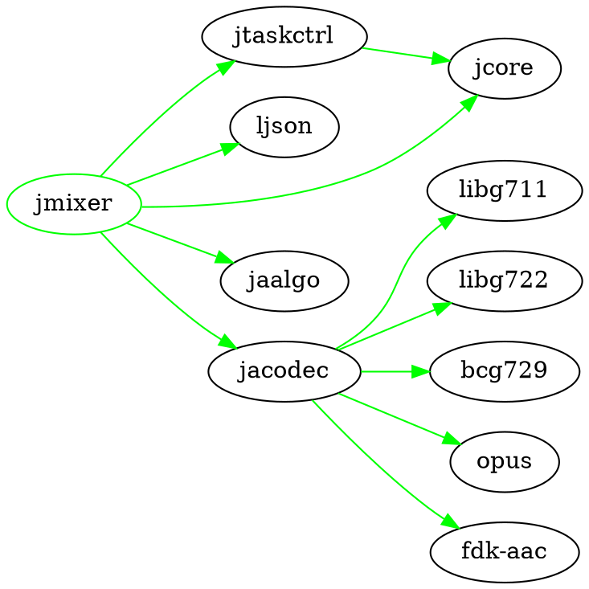
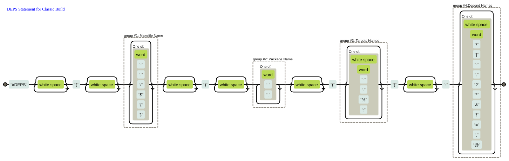
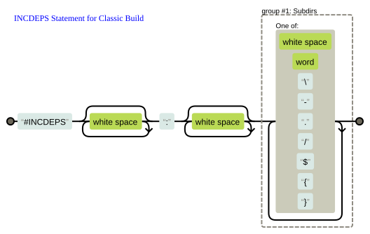
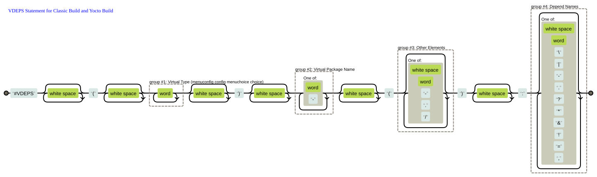
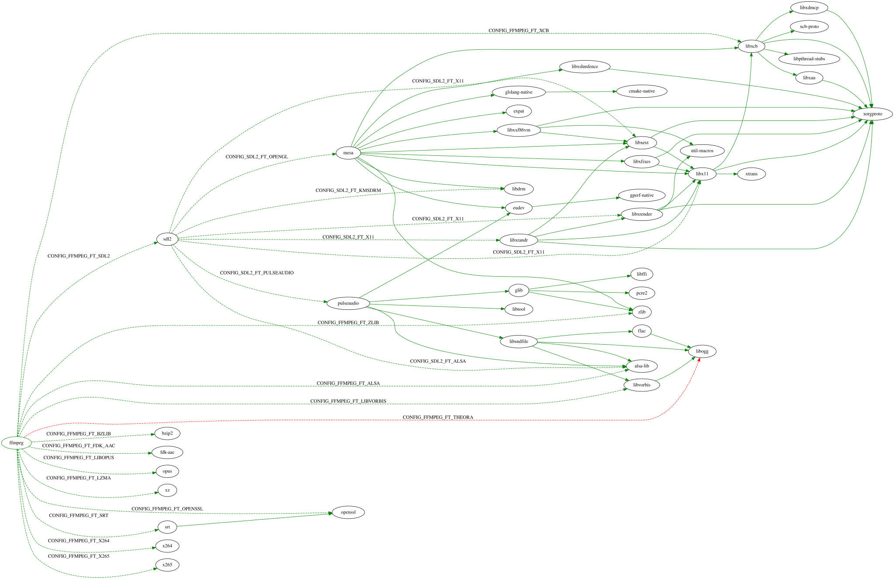

# CBuild-ng / IMake 构建系统


[English Edition](./README.md)

> CBuild-ng 是面向 Linux 大型软件工程与嵌入式 rootfs 开发的包级构建平台：把源码获取、依赖声明、配置、编译、安装、sysroot 组织、缓存、合规与发布收敛到同一条可复现的流水线中。IMake 是其中的包内编译工具，用一组可读的 Makefile 模板描述「这个包怎么编译」。

> Buildroot、Yocto、CBuild-ng 三家看上去都在「做嵌入式构建」，实际面向的物体根本不同：Buildroot 做镜像「怎么一次性把一套 rootfs 做出来」，Yocto 做发行版策略「怎么表达任意一种 Linux 发行版的定制策略」，CBuild-ng 做开发平台与交付流水线「几十个人、几千个包、跨芯片跨 OS、断网、最终要出货时，怎么让每个人每天改一行看一行，还能把一个包或整个 Rootfs 单独交给另一个团队/客户」。

> **为什么选择 CBuild-ng**：当工程长到上百个包、几十个顶层软件时，拖慢团队的往往不是编译速度，而是「谁改了什么会连累谁」说不清、断网环境下复现不出来、出货前才发现依赖漏写。CBuild-ng 把依赖、隔离、缓存、合规与发布收敛到一条可审计的流水线里——一个包能看见什么由它声明了什么决定，输入不变则产物不变，构建结果可以直接交付。

## 目录

- [1. 系统概述](#1-系统概述)
  - [1.1 CBuild-ng 是什么](#11-cbuild-ng-是什么)
  - [1.2 CBuild-ng/IMake 解决了什么问题](#12-cbuild-ngimake-解决了什么问题)
  - [1.3 工程分层：编译工具、构建平台与资源脚本](#13-工程分层编译工具-构建平台与资源脚本)
  - [1.4 与前代 CBuild 的关系](#14-与前代-cbuild-的关系)
  - [1.5 主要功能](#15-主要功能)
  - [1.6 应对的场景](#16-应对的场景)
- [2. 系统优势](#2-系统优势)
  - [2.1 优势一：直接构建模型，没有配置阶段](#21-优势一直接构建模型没有配置阶段)
  - [2.2 优势二：包级隔离与显式依赖](#22-优势二包级隔离与显式依赖)
  - [2.3 优势三：解释得清楚的缓存](#23-优势三解释得清楚的缓存)
  - [2.4 优势四：零成本的模式切换](#24-优势四零成本的模式切换)
  - [2.5 优势五：既有生态零改写接入](#25-优势五既有生态零改写接入)
  - [2.6 优势六：交付形态完整，合规是构建的自然产物](#26-优势六交付形态完整合规是构建的自然产物)
  - [2.7 优势七：可审计、可掌握](#27-优势七可审计-可掌握)
  - [2.8 开源贡献](#28-开源贡献)
  - [2.9 产业实践](#29-产业实践)
- [3. 总体架构](#3-总体架构)
  - [3.1 架构总览](#31-架构总览)
  - [3.2 目录结构](#32-目录结构)
  - [3.3 三层职责边界](#33-三层职责边界)
  - [3.4 核心三件套：顶层 Makefile、gen_build_chain.py 与 inc.rule.mk](#34-核心三件套顶层-makefile-gen_build_chainpy-与-incrulemk)
  - [3.5 一个包的完整生命周期](#35-一个包的完整生命周期)
  - [3.6 WORKDIR 与 sysroot 模型](#36-workdir-与-sysroot-模型)
  - [3.7 输出目录结构](#37-输出目录结构)
  - [3.8 生成物一览](#38-生成物一览)
  - [3.9 开源软件层与系统包层](#39-开源软件层与系统包层)
  - [3.10 工具链、内核与目标板](#310-工具链-内核与目标板)
  - [3.11 关键文件索引与兼容性说明](#311-关键文件索引与兼容性说明)
- [4. 快速使用](#4-快速使用)
  - [4.1 环境配置](#41-环境配置)
  - [4.2 经典编译](#42-经典编译)
  - [4.3 Yocto 编译](#43-yocto-编译)
  - [4.4 端到端实操演练（发布与验证）](#44-端到端实操演练发布与验证)
  - [4.5 工作流速查](#45-工作流速查)
  - [4.6 故障排查](#46-故障排查)
- [5. IMake 编译模板详解](#5-imake-编译模板详解)
  - [5.1 模板体系总览](#51-模板体系总览)
  - [5.2 环境模板 inc.env.mk](#52-环境模板-incenvmk)
  - [5.3 安装模板 inc.ins.mk](#53-安装模板-incinsmk)
  - [5.4 应用模板 inc.app.mk](#54-应用模板-incappmk)
  - [5.5 配置模板 inc.conf.mk](#55-配置模板-incconfmk)
  - [5.6 驱动模板 inc.mod.mk](#56-驱动模板-incmodmk)
  - [5.7 统一模板 inc.makes](#57-统一模板-incmakes)
  - [5.8 混音系统实际案例](#58-混音系统实际案例)
  - [5.9 典型集成场景](#59-典型集成场景)
- [6. CBuild 构建系统详解](#6-cbuild-构建系统详解)
  - [6.1 依赖规则](#61-依赖规则)
  - [6.2 依赖语句的组合记号与隐式推导](#62-依赖语句的组合记号与隐式推导)
  - [6.3 环境导出 process_machine.sh](#63-环境导出-process_machinesh)
  - [6.4 任务分析](#64-任务分析)
  - [6.5 编译处理](#65-编译处理)
  - [6.6 缓存校验输入的目录语法与粒度命名](#66-缓存校验输入的目录语法与粒度命名)
  - [6.7 Yocto 构建详解](#67-yocto-构建详解)
- [7. Rule 编译包装详解](#7-rule-编译包装详解)
  - [7.1 它在整个体系中的位置](#71-它在整个体系中的位置)
  - [7.2 源码获取相关的变量](#72-源码获取相关的变量)
  - [7.3 函数与目标](#73-函数与目标)
  - [7.4 build 目标的完整流程](#74-build-目标的完整流程)
  - [7.5 COMPILE_TOOL 的四种取值](#75-compile_tool-的四种取值)
  - [7.6 其他编译相关变量](#76-其他编译相关变量)
  - [7.7 CUSTOM_TARGETS 的实际用法](#77-custom_targets-的实际用法)
  - [7.8 缓存相关的变量](#78-缓存相关的变量)
  - [7.9 一个完整的包声明示例](#79-一个完整的包声明示例)
  - [7.10 代表性包剖析](#710-代表性包剖析)
- [8. 横向对比与选型](#8-横向对比与选型)
  - [8.1 设计哲学对照](#81-设计哲学对照)
  - [8.2 架构模型对照](#82-架构模型对照)
  - [8.3 配置与可视化对照](#83-配置与可视化对照)
  - [8.4 构建性能与增量能力对照](#84-构建性能与增量能力对照)
  - [8.5 跨发行版部署能力对照](#85-跨发行版部署能力对照)
  - [8.6 生态与合规对照](#86-生态与合规对照)
  - [8.7 依赖管理理念对照：主动供给 vs 被动查找](#87-依赖管理理念对照主动供给-vs-被动查找)
  - [8.8 IMake 与 CMake 的逐项对照](#88-imake-与-cmake-的逐项对照)
  - [8.9 场景选型建议](#89-场景选型建议)
  - [8.10 混合架构策略](#810-混合架构策略)
  - [8.11 客观的短板](#811-客观的短板)
  - [8.12 从其他构建系统迁移](#812-从其他构建系统迁移)
- [9. 设计和思想详解](#9-设计和思想详解)
  - [9.1 生态兼容：继承过去，兼容现在](#91-生态兼容继承过去兼容现在)
  - [9.2 中间层隔离：让顶层稳定，让底层可换](#92-中间层隔离让顶层稳定让底层可换)
  - [9.3 层次化架构：底层重机制，中层重抽象，顶层重策略](#93-层次化架构底层重机制中层重抽象顶层重策略)
  - [9.4 单一职责：一个模块，一个改变理由](#94-单一职责一个模块一个改变理由)
  - [9.5 数据流优先：先想清楚东西怎么流](#95-数据流优先先想清楚东西怎么流)
  - [9.6 联邦式微内核：包是自治单元](#96-联邦式微内核包是自治单元)
  - [9.7 意图声明而非过程描述](#97-意图声明而非过程描述)
  - [9.8 与其他工程的根本区别](#98-与其他工程的根本区别)
  - [9.9 机制问答](#99-机制问答)
  - [9.10 缩写与外部引用](#910-缩写与外部引用)
  - [9.11 开源许可](#911-开源许可)
  - [9.12 结语](#912-结语)
  - [9.13 联系方式](#913-联系方式)

---

# 1. 系统概述

## 1.1 CBuild-ng 是什么

CBuild-ng 由三层组成，每一层都可以单独拿出来使用：

| 层 | 目录 | 职责 | 关键实现 |
| --- | --- | --- | --- |
| IMake 编译工具 | `scripts/core/`，不含 `inc.rule.mk` | 描述单个包内部怎么编译：环境推导、目录布局、编译器与编译选项、库与可执行文件、内核模块、安装、包内 Kconfig 配置 | `inc.env.mk`、`inc.ins.mk`、`inc.app.mk`、`inc.conf.mk`、`inc.mod.mk`、`inc.makes` |
| CBuild 构建平台 | 顶层 `Makefile` 与 `scripts/` 下除 IMake 编译工具之外的全部内容 | 依赖分析、自动生成顶层 Kconfig 与调度脚本、配置菜单、源码获取与补丁、缓存与镜像、sysroot 与 rootfs 组织、发布形态、合规产物、芯片环境导出、Yocto 封装 | 顶层 `Makefile`（总入口）、`scripts/bin/gen_build_chain.py`（生成顶层 Kconfig 和 Makefile）、`scripts/core/inc.rule.mk`（集成编译，调用各种脚本和工具），以及 `scripts/bin/`、`scripts/kconfig/`、`scripts/toolchain/`、`scripts/progress/`、`scripts/meta-cbuild/`、`scripts/*.env` |
| 资源脚本（包） | `oss/`、`system/`，辅以 `board/`、`examples/` | 以「一个目录一个包」的形式提供可构建内容：开源软件层、平台自身的系统包、板级配置、测试用例 | 每个包目录下的 `mk.deps`、Makefile（或 `mk.deps` 内直接写规则）、补丁、Kconfig 片段与预置配置 |

三层之间通过**环境变量、Make 变量与文件产物**三种契约通信，没有私有二进制格式，没有守护进程，也没有需要专门学习的 DSL。实现语言是 Python、Shell 与 Makefile，都是 Linux 开发者日常使用的工具。

需要特别说明 `inc.rule.mk` 的归属：它在物理路径上位于 `scripts/core/`，与 IMake 模板放在同一目录，但它不承担「怎么写编译规则」的职责，而是 CBuild 构建平台的一部分——它把下载、补丁、缓存、安装这些脚本串成一条构建流水线，并按包声明调用 Autotools、CMake、Meson、原生 Makefile 或 IMake 完成编译。因此本文档把它与顶层 `Makefile`、`gen_build_chain.py` 并列为平台层的核心三件套，而 IMake 编译工具层只包括其余五份模板与统一模板 `inc.makes`。

IMake 的名字有两层含义：**Include Makefile**（包含模板的编译）与 **I have the make**（有一定 Makefile 基础的人都能完全掌握并修改它）。第二层含义是认真的：IMake 的全部实现都是可读的 Makefile，遇到不合适的地方可以直接改，改完立刻生效，不需要等待发版。

## 1.2 CBuild-ng/IMake 解决了什么问题

上一节列出的是能力清单。真正决定它值不值得引入的，是两个几乎每个大型 Linux 工程都会撞上、却很少被单独讲清楚的问题。

### 1.2.1 安装动作会制造假的依赖更新

Autotools、CMake、Meson 这些编译工具的 `install` 每次都会重写目标文件：即使编译输入一个字节没变，装进 sysroot 的头文件、库与可执行文件的 mtime 也会变。下游包只要按时间戳判断「依赖是否更新」，就会把「重新装了一遍」误当成「依赖改过了」，于是一次本来什么都没改的构建引起连锁重编。

要让「输入不变就只安装一次」成立，就必须在编译工具之外再架一层校验机制：记住上一次的输入指纹，比对通过才跳过安装或复用产物。这层机制不属于编译工具本身，却是大型工程能否增量构建的前提；校验规则要覆盖源码、补丁、配置、编译参数与依赖包产物，少算一项就会漏编，多算一项就会白编，规则本身还要持续维护。

由此牵出一个更现实的后果：为了避免跨包校验带来的不确定性，很多团队干脆把多个上层包与它们共用的下层包合成一个大的构建单元——某个顶层软件的多个上层包依赖同样的下层包，下层包版本不一致时不好统一维护，那就整体一次 configure、一次 make、一次 install。这就是业界常见的**单体巨构**：维护上省事，代价是包失去独立性，无法单独重编、单独缓存、单独发布，一个基础库的小改动也要惊动整个软件。

把工程拆成包并不难，难的是拆开之后每一次安装都不污染别人。全局 sysroot 下一个包能看见所有其他包的产物，漏写依赖也可能碰巧编过；再叠加安装时间戳变化，依赖图就既不准确也不稳定。于是「包级独立」与「可复现的增量构建」在实践中常常只能二选一。

### 1.2.2 CBuild-ng 的处理

IMake 从安装动作本身下手。目录创建用幂等的 `install -d`，但文件复制不用 `install` 命令、也不依赖上游构建系统生成的安装规则，而是：

```makefile
cp -drf --preserve=mode,timestamps <源> <目标>
```

`-d` 保留符号链接本身，`-r` 递归，`-f` 覆盖，`--preserve=mode,timestamps` 把权限位与时间戳一起保留下来。**只要输入不变，每次安装得到的产物连字节与时间戳都不变**。下游不需要任何外部校验，用最朴素的时间戳判断就能得到正确结论：没变就是没变，变了才是变了。写包的人不必理解校验键怎么算，也不必维护「哪些文件参与校验」的清单，使用心智负担很低。

这里不用 `cp -drfp` 是有原因的：`-p` 在 Yocto 的构建环境下会触发警告甚至报错，所以模板把要保留的属性显式写成 `--preserve=mode,timestamps`，跨平台行为一致。

CBuild 平台层并没有因此取消校验机制。`inc.rule.mk` 通过 `CACHE_CHECKSUM`、`CACHE_APPENDS` 与 `process_cache.sh` 提供完整的输入指纹与缓存命中能力，供那些不走 IMake 安装的包使用。**对于 Autotools、CMake、Meson、上游 Makefile 以及自定义构建脚本，建议总是启用缓存校验**：它们的安装行为不受 IMake 约束，时间戳会变，只有校验能保证「输入不变就只装一次、只编一次」。两条路并存，各自用在合适的地方。

### 1.2.3 与其它体系的对照

| 体系 | 安装行为 | 是否需要外部校验 | 使用心智负担 |
| --- | --- | --- | --- |
| IMake（CBuild-ng 包内编译） | `cp -drf --preserve=mode,timestamps`，输入不变则产物与时间戳都不变 | 不需要 | 低 |
| CBuild-ng 纳管的第三方构建系统 | 上游 `install` 会刷新时间戳 | 建议总是启用缓存校验 | 中 |
| Yocto | 每个任务的输出都进入 sstate，配置、参数、依赖都要进签名 | 永远需要；复杂情况下校验规则本身也会出问题 | 高 |
| Buildroot | 每个包只装一次，用「不重复安装」绕开问题 | 不面对重复安装 | 代价是包不能单独重编与复用 |

Yocto 把校验做成整套系统的基石，能力最强，但签名规则的复杂度也随工程规模增长；Buildroot 选择只装一次，简单，却放弃了包级增量与单独交付。CBuild-ng 的选择是：**让 IMake 包天然不需要校验，把校验留给确实需要的包**。

这两个问题合起来，才解释了后面各章的设计为什么是这样：WORKDIR 隔离让「一个包能看见什么」由声明决定，安装时间戳稳定让「依赖有没有变」不需要猜，两者一起才让包真正成为一等公民——下层包统一维护一个版本，上层包各自声明依赖，不必把它们塞进一个单体巨构里。

## 1.3 工程分层：编译工具、构建平台与资源脚本

理解 CBuild-ng 最快的方式是先看目录归属。工程没有把「平台」和「编译工具」混成一个概念，也没有把「包」当作平台的内部实现；三者分别落在不同的目录里，各自可以独立演进。

### 1.3.1 第一层：IMake 编译工具

目录：`scripts/core/`，成员为 `inc.env.mk`、`inc.ins.mk`、`inc.app.mk`、`inc.conf.mk`、`inc.mod.mk`、`inc.makes`。

这一层回答的是「一个包怎么编译」。它不关心包从哪里来、被谁依赖、编译结果装到哪个 sysroot、要不要进缓存，只负责把源码变成产物：推导目录与编译器、拼装编译参数、生成静态库/动态库/可执行文件/内核模块的规则、把产物安装到指定前缀、维护包内 Kconfig 配置。

- `inc.env.mk` 是基础：确定 `WORKDIR` 一族目录变量、编译器一族工具变量、优化与加固一族选项变量；其余模板都建立在它之上。
- `inc.app.mk` 提供三个声明式构建函数 `add-liba-build`、`add-libso-build`、`add-bin-build`，并搜集源码、生成头文件依赖与编译参数校验。
- `inc.ins.mk` 按 GNUInstallDirs 的目录变量生成安装目标。
- `inc.conf.mk` 调用 `scripts/kconfig/` 里的 `conf` / `mconf`，管理 `.config`、`config.h`、`auto.conf`。
- `inc.mod.mk` 分两支：`KERNELRELEASE` 为空时组织外部模块编译命令，有值时作为 Kbuild 片段被内核构建系统包含。
- `inc.makes` 是上述模板的拼接形式，供脱离平台的独立工程使用；用 `INC_MAKES` 选择启用哪些模块。

这一层可以完全脱离 CBuild-ng 使用：只要导出 `ENV_MAKE_DIR` 指向该目录或直接携带 `inc.makes`，一个普通的 Makefile 就能获得上述全部能力。工程自己的 `scripts/progress` 就是这样编译出来的。

### 1.3.2 第二层：CBuild 构建平台

目录：顶层 `Makefile` 与 `scripts/` 下除 IMake 编译工具之外的全部内容。

这一层回答的是「一个由很多包构成的系统怎么组织」。核心是三件东西：

1. **顶层 `Makefile`（总入口）**：`make menuconfig`、`make`、`make <包名>`、`make <包名>-dev/-pkg/-cpk/-eld`、`make <包名>-deps`、`make time_statistics`、`make toolchain` 等全部用户可见命令都从这里进入；经典编译与 Yocto 编译两套目标在同一个文件里按 `ENV_BUILD_MODE` 分支。
2. **`scripts/bin/gen_build_chain.py`（生成顶层 Kconfig 和 Makefile）**：扫描工程里全部 `mk.deps` 依赖语句，汇成全局依赖图，生成 `Kconfig`、`auto.mk`、`Target`、`info.txt` 四份产物。`auto.mk` 被顶层 Makefile 包含，包含之后每个包才成为一个可调用的 make 目标。
3. **`scripts/core/inc.rule.mk`（集成编译）**：包 Makefile 与平台流水线之间的适配层。它调用 `fetch_package.sh`、`exec_patch.sh`、`process_cache.sh`、`process_sysroot.sh`、`gen_package_infos.py` 等工具，并按 `COMPILE_TOOL` 决定用 IMake、Autotools、CMake、Meson 还是上游自带 Makefile 完成编译。

围绕这三件套，`scripts/` 下还有几组支撑内容：`scripts/bin/` 是下载、补丁、镜像、缓存、sysroot、许可证、CPK、依赖图、芯片描述等独立工具；`scripts/kconfig/` 是取自 Linux 内核并扩展了输出路径参数的 Kconfig 实现；`scripts/toolchain/` 从源码构建交叉工具链；`scripts/progress/` 是用 IMake 编译的构建进度程序；`scripts/meta-cbuild/` 是 Yocto 模式使用的 meta 层与 class；`build.env`、`clean.env`、`yocto.env` 是环境脚本。

平台层不规定包的内部编译方式，只规定「包必须提供哪些目标、把产物放到哪里」。这条边界使得同一个平台既能纳管 IMake 包，也能纳管 Autotools、CMake、Meson 与手写 Makefile 包。

### 1.3.3 第三层：资源脚本（包）

目录：`oss/`、`system/`，以及随附的 `board/`、`examples/`。

这一层是内容而不是机制。`oss/` 按领域两级分类收纳开源软件，每个目录一个包；`system/` 放平台自身的系统包，包括内核、rootfs 组装、独立包启动器与工具链相关包；`board/<soc>/configs/` 按目标板存放完整配置与差异配置；`examples/` 放测试应用、Kconfig 示例、内核模块示例与一个最小的 Classic/Yocto 工程。

包的形态很固定：一个目录、一份 `mk.deps` 依赖声明、一个 Makefile（或把规则直接写在 `mk.deps` 里）、按需附带的补丁与 Kconfig 片段。平台不要求包目录里有源码——源码可以在别处下载，也可以由 `Makefile_Name` 指向源码目录之外的路径。

资源层可以被替换：把自己的包目录挂进来，或者只保留 `system/` 而用自有的开源软件层，平台层与编译工具层都不需要改动。这也是「同一份源码目录可以被不同 SDK 工程以不同身份纳管」的实现基础。

### 1.3.4 三层之间的调用链

以经典编译里一次 `make <包名>` 为例，三层的协作顺序是：

1. `source scripts/build.env ...` 由平台层导出 `ENV_*` 目录变量与工具链变量。
2. 顶层 `Makefile` 的 `deps` 目标调用 `gen_build_chain.py` 扫描 `oss/`、`system/` 等资源目录下的 `mk.deps`，生成 `Kconfig`、`auto.mk`、`Target`、`info.txt`。
3. `make menuconfig` 由 `inc.conf.mk` 调用 `scripts/kconfig/` 的 `mconf`，把 `Kconfig` 呈现为菜单，配置结果写入 `.config`。
4. 顶层 Makefile 包含 `.config` 与 `auto.mk`，由此得到「哪些包被选中」以及「每个包的构建、安装、清理、发布目标之间的依赖」。
5. 用户执行 `make <包名>`，make 按 `auto.mk` 的依赖顺序调度；每个包的目标由 `auto.mk` 生成，最终落到包目录的 Makefile。
6. 包 Makefile 若包含 `inc.rule.mk`，平台流水线先准备私有 sysroot、下载源码、打补丁、查缓存，再进入编译。
7. 编译阶段由 IMake 编译工具（`inc.env.mk` / `inc.app.mk` 等）或第三方构建系统完成，产物落在 `WORKDIR` 下的 `build` 与 `image`。
8. 平台层再用 `process_sysroot.sh` 把 `image` 安装到全局 sysroot、私有 sysroot、rootfs 或发布包目录。

整个链条里没有隐藏状态：每一步的输入输出都是文件，任何一层都可以单独拿掉或替换。

## 1.4 与前代 CBuild 的关系

CBuild-ng 是 [CBuild](https://github.com/lengjingzju/cbuild) 的下一代。最本质的差别是经典编译（Classic Build）引入了 **WORKDIR** 概念：CBuild 的所有包共享同一套全局输出目录，依赖靠全局 sysroot 隐式传递，漏写依赖也可能「碰巧编过」；CBuild-ng 可以让每个包在自己的工作目录下准备依赖、编译、安装，包之间的依赖关系与 sysroot 组织由自动生成的顶层 Makefile 显式处理——**一个包能看见什么，完全由它声明了什么决定**（也支持全局 sysroot 查找依赖）。

这一改动带来三个直接收益：漏写依赖立刻表现为编译错误而不是运行期故障；无依赖关系的包之间没有共享写路径，可以安全并行；单个包可以单独构建、单独清理、单独缓存、单独打包，也可以脱离平台只用 IMake 模板编译。

两代工程的完整差别如下：

| 维度 | CBuild（2022.5 - 2023.3） | CBuild-ng（2023.3 - 至今） |
| :--- | :--- | :--- |
| **核心构建模式** | **混合编译模式**：经典编译与 Yocto 编译共享模板，但源码编译依赖全局路径，缺乏独立隔离。 | **经典编译引入 WORKDIR 隔离**：每个包在独立的 `WORKDIR` 下准备依赖、编译和安装，彻底消除全局污染。 |
| **开源包（OSS）编译** | 功能不完善，下载、隔离、校验等功能都有缺陷。 | **原生全功能支持**：通过 `COMPILE_TOOL = autotools / cmake / meson / imake` 直接接管源码编译，彻底摆脱对 `prebuild` 的依赖。 |
| **网络下载与镜像缓存** | 添加了基础 `http/git/svn` 下载和简易缓存，但**仅为基础半成品**，缺乏镜像容错和校验机制。 | **完善的企业级下载与缓存机制**：采用 `wget` 替代 `curl`，支持智能镜像路由、`md5` 及 Git Rev 精准校验（`process_cache.sh`），并内置 `flock` 解决并发冲突。 |
| **下载进度条** | 使用 Python 脚本实现进度显示。 | 采用 **C 代码与管道** 实现，性能更优，且深度内嵌到构建管道的底层。 |
| **软件打包与发布** | 仅支持对整体 `rootfs` 的构建和打包，缺乏对独立包的输出能力。 | 支持 **独立软件打包**和 **独立发布包**，支持 `CPK` 格式输出及依赖库自动收集，便于大型软件生态的发布。 |
| **许可证管理** | **不支持**针对选中包按需生成许可证列表。 | 支持针对**选中包按需生成许可证列表**。在 `make menuconfig` 中显示包时，按 `?` 可查看其许可证详情。发布时系统可生成 **HTML 和 TXT 双格式** 许可证清单文件，仅包含实际被选中的包，确保准确、合规的许可证披露。 |
| **构建模板规范与扩展性** | 模板相对固定，缺乏标准化目录规范。 | 模板**严格符合 GNUInstallDirs** 标准，支持 `Clang` 交叉编译，并新增 `imake` 编译方法，统一了多套构建工具的接入标准。 |
| **上游内核与工具链跟进** | 停留在较老版本，停止维护，高版本 Linux 驱动模板失效。 | **持续紧跟上游**：Kconfig 升级至 Linux 6.18，工具链升级至 GCC 16.2.0，Yocto 升级至 Poky 5.0，并新增 **RISC-V 和 LoongArch** 架构支持。 |
| **条件依赖与配置生成** | 条件依赖需要手动在多个位置修改，十分繁琐。 | **自动化条件依赖与配置生成**：只需声明 `featurecfg`，系统自动填充 Kconfig 声明、依赖关系和编译参数，消除了四处改动的繁琐操作；`versioncfg` 自动生成版本配置并填满。 |
| **Yocto 配方转换** | 无转换工具，需手工重写构建脚本。 | 提供 **Recipe 转 mk.deps 脚本**，可直接将 Yocto 配方转换为 CBuild-ng 的集成构建描述文件。 |
| **应用开发** | `source` 只有空，无应用打包。 | CBuild-ng 还支持应用开发，`source` 有空、`app`、`host` 等方式，提供打包机制。 |
| **许可证** | 起始为 **GPLv2**，2022-12-18 改为 MIT。 | 从 2023-03-05 首次提交即为 **MIT**，无任何历史许可证包袱。 |

## 1.5 主要功能

### 1.5.1 声明式依赖与自动生成的配置系统

每个包用一个 `mk.deps` 文件声明身份、依赖与构建方式，核心通常只有一行：

```makefile
#DEPS(mk.deps) tcpdump(native psysroot): unselect libpcap
```

`gen_build_chain.py` 扫描整个工程，把全部依赖语句汇成一张全局依赖图，据此自动生成四份产物：

| 产物 | 内容 | 用途 |
| --- | --- | --- |
| `Kconfig` | 整棵工程的配置菜单，含层次、选择、依赖与帮助信息 | 交给 `conf` / `mconf` 呈现 `menuconfig` |
| `auto.mk` | 每个包的构建、安装、清理、发布目标，以及并行调度所需的依赖关系 | 被顶层 Makefile include |
| `Target` | `包名="依赖列表" # 源码路径` 的清单 | 缓存的依赖分析、依赖图渲染 |
| `info.txt` | 包元信息字典（名称、版本、许可证、主页、描述） | 合规清单、菜单帮助 |

支持的依赖语义相当完整：强依赖、弱依赖、条件依赖、强选择、弱选择、冲突、或依赖（多选一）、显式子目标依赖、基于环境变量的依赖。还支持**虚包**——不产生任何构建动作，只用于组织菜单结构，有 `menuconfig` / `config` / `choice` / `menuchoice` 四种类型。

`native` 语义：一行声明同时生成交叉编译包与本地编译包，本地包自动带 `-native` 后缀，交叉包可以依赖本地包提供的宿主机工具（例如 ncurses 的交叉编译需要 native 版 `tic` 生成 terminfo 数据库）。

### 1.5.2 Kconfig 图形化配置

- 内置取自 Linux 内核的 Kconfig 实现，并增加了**配置输出与源码分离**的能力：`conf` / `mconf` 接受 `--configpath`、`--autoconfigpath`、`--autoheaderpath`、`--rustccfgpath` 参数，因此 `.config`、`auto.conf`、`config.h` 都能放到输出目录，源码树保持干净。
- 顶层配置与包内配置使用同一套机制：`make menuconfig` 配置整个系统，`make 包名_menuconfig` 配置单个包（busybox、linux 等）。
- 完整的配置存取目标族：`loadconfig`、`defconfig`、`<名>_config`、`<名>_saveconfig`、`<名>_defconfig`、`<名>_savedefconfig`、`cleanconfig`。
- 配置结果自动同步为带 include guard 的 C 头文件，配置变化自动触发重新生成。
- 配置与缓存联动：配置项取值会进入缓存校验，**改了配置就会重编**，不会被缓存掩盖。

菜单里每个包条目的帮助信息直接显示名称、版本、许可证、主页与描述：

```
config GLIB
    bool "glib (oss/display/glib/glib)"
    default n
    depends on LIBFFI && ZLIB && PCRE2
    help
    Name        : glib
    Version     : 2.90.1
    License     : LGPL-2.1-or-later
    Homepage    : https://developer.gnome.org/glib/
    Description : GLib is a general-purpose, portable utility library, ...
```

这些信息来自各包 `mk.deps` 里的元信息字段。也就是说**在配置菜单里就能完成选型调研**，不必去翻每个包的源码。本地包（无 `HOMEPAGE`）显示 `Location` 字段。

### 1.5.3 IMake 编译模板

- 三个声明式构建函数：`add-liba-build`（静态库）、`add-libso-build`（动态库，支持版本号与 soname）、`add-bin-build`（可执行文件）。
- 一个 Makefile 可同时产出多个库与多个可执行文件，并可为每个目标单独指定源文件集合、链接参数、私有编译标记与额外依赖。
- 自动头文件依赖分析，改头文件只重编真正受影响的源文件。
- 自动的**环境探测重编**：编译器、优化等级、安全开关、用户自定义标记等汇总成 checkinfo，内容变化即触发重编，杜绝「换了编译选项但没重编」这类经典错误。
- 源码与输出分离（`make O=`）、安装位置（`make DESTDIR=`）、依赖根目录（`make DEPDIR=`），全部沿用 GNU 世界的通用约定。
- 安装体系对齐 GNUInstallDirs，额外提供 `base_*dir` 与 `hdrdir`；支持子目录安装、任意目录安装、重命名安装。
- 预置编译选项族：四档优化等级、链接期优化、无用段裁剪、安全加固（stack protector / FORTIFY / RELRO / PIE / as-needed）、四类 sanitizer、静态分析器、gprof、SIMD 指令集开关。
- GCC 与 Clang 两套工具链可切换，Clang 交叉编译 C++ 的路径与库搜索问题已在模板内处理。
- 内核模块模板支持外部模块编译、输出与源码分离、多模块单 Makefile、`Module.symvers` 导出，并适配了内核 6.10 与 6.13 的构建行为变化。
- 第三方构建系统适配：Autotools、CMake（含 Ninja 后端）、Meson（含交叉 ini 生成）、原生 Makefile，由 `inc.rule.mk` 统一调度。

**同一个 Makefile 不需要任何修改就能在六种编译模式下工作**：本地 GCC、本地 Clang、交叉 GCC、交叉 Clang、Yocto target、Yocto native。切换靠环境变量，不需要重跑配置阶段。

### 1.5.4 供应链能力

- **源码获取**：tar / zip / git / svn 四种方式，支持 md5、branch、tag、revision 锁定；git / svn 下载物可共享复用，不必为每个包复制一份源码树。
- **两级镜像**：内部镜像（一个 HTTP 目录）优先，失败回退原始地址；外部镜像通过一份映射表把上游地址重定向到国内镜像源。
- **编译缓存**：本地与网络两级；缓存文件按「soc / cpu / arch / cpu family」四级粒度命名，因此缓存复用范围可以按策略调整；支持强制编译、强制编译一次、取消强制三种人工干预；未命中时可查日志逐字段比对校验输入。
- **并发安全**：下载与缓存操作使用文件锁，多线程构建不会出现同一压缩包被并发写入。
- **开发模式**：把某个包置为开发模式后源码不再被覆盖，可直接在输出目录改代码调试。
- **状态查询**：一条命令查看全部 git 类型包的分支、最后一次提交与工作区改动。

### 1.5.5 交付与合规

- **sysroot 组织**：link / install / release / replace / license 五种操作。
- **四种发布形态**：
  - `make 包名-dev`：开发包，含头文件、静态库与全部依赖的 sysroot；
  - `make 包名-pkg`：运行包，剔除头文件与静态库；
  - `make 包名-cpk`：跨发行版独立包，自带 C 库与动态链接器，单文件自解压，用户态安装，无需 root；
  - `make 包名-eld`：execld 形态独立包，**不修改任何 ELF**，靠一个静态启动器与配置文件实现同等的跨发行版能力。
- **合规输出**：自动生成许可证清单（TXT + HTML）、SPDX 索引、包依赖关系图（dot / svg / png），随包一起交付。
- **文件系统组装**：`rootfs` 包把所有选中的包安装到 fakeroot 目录，追加来自工具链的 glibc、剔除头文件与静态库、strip 全部 ELF，得到可直接制作镜像的根文件系统。

### 1.5.6 工具链与目标板

- `process_machine.sh` 是芯片差异的唯一收敛点：给定 soc 名字，输出 machine、cpu、arch、cpu family、字节序、SIMD、内核 arch、交叉三元组、工具链路径、各类构建系统的交叉参数、缓存粒度序列、并行度建议。
- `scripts/toolchain/Makefile` 可从源码构建一整套最新版本的交叉工具链（binutils、gcc、glibc、gdb 及 gmp / mpfr / mpc / isl，必要时含 libxcrypt），构建结果同样进入缓存，团队内共享。
- `board/` 目录按 soc 组织配置，配置随目标板走：切换 soc 时自动加载对应的那套配置。
- `system/linux` 包负责内核的获取、配置、编译与安装，支持从板级目录加载定制配置。

### 1.5.7 可观测性

- **构建进度**：一个用 IMake 自身编译出来的 C 程序 `progress`，通过 socket 与 make 通信，实时显示完成百分比、当前并行任务列表与日志路径。
- **详细日志**：并行构建时所有包的完整输出写入独立日志文件。
- **时间统计**：`make time_statistics` 串行构建并记录每包「准备依赖 / 编译 / 安装」三阶段耗时。
- **依赖图**：任意包都能生成 dot / svg / png 依赖图，颜色区分选中状态，线型区分强依赖、弱依赖与多选一依赖。
- **命令透明**：任何时刻都可以用 `make PREAT= MFLAG=` 看到传给编译器的真实命令行。

## 1.6 应对的场景

### 1.6.1 场景一：Linux 大型软件开发

大型 C/C++ 工程的典型困境是「单体仓库 + 一套构建脚本」：所有代码在一起编译，改一个模块要重编一大片；模块之间的依赖靠 include 路径与链接顺序隐式表达，谁也说不清到底谁依赖谁；想把某个模块单独交付给客户，需要手工拼一份 sysroot。

CBuild-ng 的做法是把工程拆成**包的联邦**：

- 每个功能模块是一个独立的包，有自己的版本生命周期、自己的 WORKDIR、自己的安装产物，可以单独编译、单独调试、单独缓存、单独打包交付。
- 模块之间的依赖用一行声明表达，全部声明汇成一张全局依赖图，构建顺序由图决定，`make 包名-deps` 随时可视化。
- 需要交付某个模块时，`make 模块名-dev` 直接产出一个含头文件、静态库与全部依赖 sysroot 的开发包，客户拿到就能编译。
- 第三方依赖不必改写：Autotools / CMake / Meson 工程原样保留，只在外面包一层 `mk.deps`。
- 组件可以被多个工程复用：同一份源码目录可以被不同的 SDK 工程以不同身份纳管（依赖声明与 Makefile 可以放在源码目录之外）。

这套模式在工程里的体现是 `oss/` 开源软件层与 `system/` 系统包层：从压缩、解析、日志、数学、网络协议到多媒体编解码、图形栈、Qt，全部以「一个目录一个包」的形式组织，按领域两级分类，配置菜单的结构与目录结构一一对应。

### 1.6.2 场景二：嵌入式 rootfs 开发

嵌入式开发的典型困境是：交叉编译环境难搭、内核与驱动与用户态之间的构建关系难理顺、目标板的根文件系统靠手工拼装、隔离网络里什么都下不下来、客户要合规清单要人工整理。

CBuild-ng 对应地提供：

- **工具链自建**：`make toolchain` 从源码构建一整套针对目标 CPU 调优的交叉工具链，结果进缓存，团队共享；也支持构建宿主机工具链以固定编译器版本。
- **内核与驱动一体化**：内核是一个普通的包，享有与其他包一致的待遇；驱动包用 `?linux` 弱依赖内核，既能针对 CBuild-ng 构建的内核树编译，也能针对宿主机内核头文件或厂商内核树编译。`inc.mod.mk` 处理了输出与源码分离、跨模块符号导出、以及内核版本演进带来的行为变化。
- **rootfs 自动组装**：勾选需要的包，`rootfs` 包负责把它们以 release 形态装入 fakeroot，追加目标 C 库，剔除开发文件，strip ELF。
- **目标板配置管理**：`board/<soc>/configs/` 下按板存放配置，支持完整配置与最小差异配置两种形式。
- **隔离网络完整方案**：`make all_printurls` 导出地址清单，`make all_fetches` 预取源码，`make all_caches` 预填缓存，把两个目录整体搬进隔离网，用一个 HTTP 服务发布即可。
- **合规产物随包交付**：许可证清单、SPDX 索引、依赖图自动生成并放进 `usr/share/license/`。

### 1.6.3 场景三（延伸）：跨发行版交付

在最新发行版上编译的程序拿到旧发行版跑不起来，因为 glibc 只保证向后兼容。常规对策是把开发环境锁死在最老的受支持发行版上。CPK 与 execld 提供了另一条路：把应用连同它的 C 库与动态链接器一起打包，让「在新环境编译、在旧环境运行」成为常规操作。详见「编译处理」一节的独立包与启动器部分。

# 2. 系统优势

## 2.1 优势一：直接构建模型，没有配置阶段

IMake 是直接构建模型：Makefile 本身就是最终执行的东西，没有中间生成物，也没有独立的配置阶段。编译参数在每次 `make` 求值时由变量拼装，因此改一个选项不需要先重跑一次 configure；配合 `CHECK_INFO` 机制，编译器、优化等级、安全开关、自定义标记等参数的变化会自动触发相关源文件重编，不会出现「换了编译选项但目标文件没重编」这类陈旧产物。

参数来源也是透明的。任何时候都可以用 `make PREAT= MFLAG=` 去掉命令回显前缀，看到真正传给编译器的命令行；`TOLOG=` 可以打开第三方包构建时的完整输出。排查链接错误、宏未生效、库搜索路径不对一类问题时，不需要在生成的构建系统里反向追踪参数来源。

因为没有探测阶段，交叉编译所需的 `-L`、`-B`、`--sysroot` 等参数会直接进入真实编译命令，不存在「探测阶段的临时工程没带上用户参数、得出错误结论」的情况。Clang 交叉编译 C++ 需要额外指定 LLVM 标准库路径时，模板通过 `USING_CLANG_CXX_BUILD` 把头文件与库搜索参数一起拼进编译与链接命令，本地与交叉、GCC 与 Clang 共用同一份 Makefile。

对持续集成而言，少一层生成物还有一层实际意义：构建描述文件就是版本库里的那份 Makefile，增量构建时不需要为「配置阶段本身耗时」付出代价，也不需要把生成目录纳入缓存键。

还有一层容易忽略的差别：**依赖分析的时机**。CBuild-ng 由 `gen_build_chain.py` 一次性扫描全部 `mk.deps`，把结果写成静态文件——顶层 `Kconfig` 与 `auto.mk`（以及 `Target`、`info.txt`）。之后 `make`、单包构建、菜单配置都直接读这些文件，依赖图是可见、可归档、可比对的文件产物，只有依赖声明或配置变化时才重新生成。Yocto 的 BitBake 则在每次构建时动态解析全部元数据与配方，重新计算任务图，可能要等一分钟才能真正启动编译。静态生成的好处不只是省一次分析：速度极快，make可以命令补全，产物可以进版本库、可以离线检查、可以在 CI 里对比两次生成的差异，出问题也能直接打开 `auto.mk` 看某一行规则是怎么来的。

## 2.2 优势二：包级隔离与显式依赖

经典编译引入 `WORKDIR` 之后，每个包都在自己的工作目录下准备依赖、编译、安装：编译输出在 `build`（可由 `O=` 改写），首次安装在 `image`（可由 `DESTDIR=` 改写），依赖查找在 `sysroot` 与 `sysroot-native`（可由 `DEPDIR=` 改写）。包能看见的头文件和库，完全由它在 `mk.deps` 里声明的依赖决定——**一个包能看见什么，由它声明了什么决定**。

这条纪律把依赖错误提前到编译期：漏写依赖就是头文件找不到或链接期缺库，而不是「开发机能编、CI 不能编」或「本地能跑、目标板崩溃」。构建顺序也不需要人工维护，`auto.mk` 里的目标依赖由依赖图生成，make 据此安排并行；新增一个包不需要修改任何排序逻辑。

单包可以独立操作：`make <包名>` 构建它和它的依赖，`make <包名>_single` 只构建它本身，`make <包名>_psysroot_single` 只准备它的私有 sysroot；如果包使用全局 sysroot，单独安装命令是 `make <包名>_install_single`。直接进入包目录 `make` 也完全可以。调试一个包不需要牵动整个系统，缓存、清理、打包同样以包为单位。

依赖关系随时可查：`make <包名>-deps` 生成 dot / svg / png 依赖图，颜色区分是否选中，线型区分强依赖、弱依赖与多选一依赖。「为什么这个包被构建了」「改动一个基础库会影响谁」这类问题有确定答案，而不是靠翻脚本猜测。

## 2.3 优势三：解释得清楚的缓存

「共享编译产物」的最大风险是缓存键设计不严——用了不该用的旧产物，是极难定位的问题。CBuild-ng 的缓存机制在这点上做了明确约束：

- **校验输入是封闭且可枚举的**：编译脚本、补丁、依赖包的输出、源码压缩包或本地源码树、显式声明的额外校验项、动态配置项的取值。
- **纪律明确**：绝不把编译后输出的文件加入校验。否则形成「输出变→校验变→缓存永不命中」的死循环。
- **排序消除环境差异**：校验明细在计算最终 md5 前先按列排序，因此不同机器上同样的输入得到同样的校验和，A 机器推的缓存 B 机器能用。
- **命中与否可解释**：`<WORKDIR>/<包名>-cache.log` 记录了本次调用的完整参数与逐项校验明细，未命中时对比两次日志就能定位到究竟哪一项变了。
- **人工干预有三档**：强制编译（持续）、强制编译一次、取消强制。取消强制时会删除该包在各缓存级别下的本地缓存，避免留下与当前意图不符的产物。
- **缓存复用粒度可调**：缓存文件名前缀取自「soc / cpu / arch / cpu family」四级序列中由 `CACHE_GRADE` 指定的一项。默认是 cpu 级；纯算法库可以放到 arch 级以扩大复用范围，与 soc 强相关的产物则收到 soc 级。

缓存的实际效果可以用 `make time_statistics` 对比两次构建看到：同一组包，从源码编译与命中缓存的耗时相差明显。

## 2.4 优势四：零成本的模式切换

六种编译模式（本地 GCC / 本地 Clang / 交叉 GCC / 交叉 Clang / Yocto target / Yocto native）之间切换，不需要修改任何构建文件，也不需要重跑配置：

```sh
make                                                       # 本地 GCC
make CC_TOOL=clang                                         # 本地 Clang
make CROSS_COMPILE=aarch64-linux-gnu-                      # 交叉 GCC
make CROSS_COMPILE=aarch64-linux-gnu- CC_TOOL=clang USING_CLANG_CXX_BUILD=y   # 交叉 Clang
```

带路径的交叉前缀用 `ENV_BUILD_TOOL=/<工具链路径>/aarch64-linux-gnu-` 传入，模板会把路径部分加进 `PATH`、文件名部分作为 `CROSS_COMPILE`。

Yocto 模式下，`meta-cbuild` 提供的 `cbuild.bbclass` 已经把 `ENV_BUILD_MODE`、`NATIVE_BUILD`、`WORKDIR`、`ENV_MAKE_DIR` 等变量的导出封装好了，用户的 recipe 只需 `inherit cbuild`，然后在 `do_compile` 里 `oe_runmake`。

这条能力的实际价值在 CI 与异构团队协作中很明显：同一份代码，开发机上本地编译做快速验证，CI 里交叉编译出目标产物，另一条流水线用 Clang 跑 sanitizer，三者的构建描述文件完全相同。**「先用经典编译快速开发，后期切到 Yocto 出正式版本」或反向迁移，成本接近于零。**

## 2.5 优势五：既有生态零改写接入

CBuild-ng 不要求任何人推倒重来：

- **Autotools / CMake / Meson / 手写 Makefile 工程**：原样保留，只在外层加一个 `mk.deps`，用 `COMPILE_TOOL` 指定构建方式。`inc.rule.mk` 会替你跑 `configure` / `cmake` / `meson`，并把正确的交叉参数、安装前缀、优化选项传进去。工程自带的 `oss/` 开源软件层就是这样纳管了大量上游项目，绝大多数包的声明只有二三十行。
- **Yocto 资产**：meta 层、recipe、bbappend 全部照用，`bitbake` 原生命令依然可用。CBuild-ng 只是额外提供了一个 meta 层与几个 class，把 `menuconfig` 与 `make` 接进去。还提供 `convert_recipe.py` 把 recipe 初步转换成 `mk.deps` 骨架，作为迁移起点。
- **Linux 惯例**：`O=` 分离输出、`DESTDIR=` 指定安装位置、`CROSS_COMPILE=` 指定交叉前缀、`menuconfig` 配置、GNUInstallDirs 目录变量、`Module.symvers` 符号导出——全部沿用社区既有约定，不发明新词。

## 2.6 优势六：交付形态完整，合规是构建的自然产物

多数构建工具的终点是「一堆编译产物」，从产物到可交付物之间还有一段手工路程。CBuild-ng 把这段路程做成了四条命令：

| 命令 | 产物 | 面向 |
| --- | --- | --- |
| `make 包名-dev` | 含头文件、静态库与全部依赖 sysroot 的开发包 | 二次开发者 |
| `make 包名-pkg` | 只含运行期内容的运行包 | 部署 |
| `make 包名-cpk` | 单文件自解压、自带 glibc 与 ld.so 的跨发行版独立包 | 跨发行版分发 |
| `make 包名-eld` | 不改写 ELF 的 execld 形态独立包 | 需要保持二进制原样的分发 |

四种形态都自动附带许可证清单（TXT + HTML）、SPDX 索引与依赖关系图。合规不是构建之外的一项额外工作，而是构建流程的自然产物——客户拿到包就能自查用了哪些开源组件、各自什么版本、什么许可证、依赖关系如何。

许可证声明支持四种形态，覆盖上游项目的各种实际情况：SPDX 标识（链接到 SPDX 页面）、URL、公共许可目录引用（`common://`，同一份文本只存一处）、源文件片段（`file:xxx;line=m-n;dst=xxx`，用于许可证文本嵌在大文件里的情形，例如 lua 的许可证在 `doc/readme.html` 的特定行范围内）。

## 2.7 优势七：可审计、可掌握

这一条不是功能，而是整个系统的设计基调，但它对长期维护的影响最大：

- **全部实现都是可读脚本**。Python、Shell、Makefile，没有编译后的黑盒。遇到问题可以直接读源码，读完就能改。
- **每一步的产物都是文件**。`Kconfig`、`auto.mk`、`Target`、`info.txt`、`.config`、`config.h`、校验文件、缓存日志、依赖图 dot 源文件——出问题时不需要猜测内部状态，去看对应的文件。
- **依赖语法的正则表达式以示意图形式随工程提供**（`scripts/bin` 下的 `regex_deps.svg`、`regex_incdeps.svg`、`regex_vdeps.svg`），语法边界是精确可查的，不靠猜。
- **命令可以随时打开回显**。`make PREAT= MFLAG=` 是排查一切编译参数问题的标准手法。

## 2.8 开源贡献

本工程的开发过程中发现的两个 Linux 内核构建问题已修复并合入主线：

**一、kconfig: fix failing to generate auto.conf**

[kernel.org 提交页面](https://git.kernel.org/pub/scm/linux/kernel/git/masahiroy/linux-kbuild.git/commit/?h=fixes&id=1b9e740a81f91ae338b29ed70455719804957b80)

```
commit 1b9e740a81f91ae338b29ed70455719804957b80
Author: Jing Leng <jleng@ambarella.com>
Date:   Fri Feb 11 17:27:36 2022 +0800

    kconfig: fix failing to generate auto.conf

    When the KCONFIG_AUTOCONFIG is specified (e.g. export \
    KCONFIG_AUTOCONFIG=output/config/auto.conf), the directory of
    include/config/ will not be created, so kconfig can't create deps
    files in it and auto.conf can't be generated.
```

这个补丁解决的正是「配置输出与源码分离」的前提问题。CBuild-ng 的 `inc.conf.mk` 需要把 `auto.conf` 生成到输出目录，而上游实现在指定 `KCONFIG_AUTOCONFIG` 后不会创建 `include/config/` 目录，导致依赖文件无法写入、`auto.conf` 生成失败。本工程在此基础上进一步把这四个路径从环境变量改为命令行参数（`--configpath`、`--autoconfigpath`、`--autoheaderpath`、`--rustccfgpath`），更适合被 Makefile 组织与传递，也避免了环境变量在递归 make 中意外泄漏。

**二、kbuild: Fix include path in scripts/Makefile.modpost**

[kernel.org 提交页面](https://git.kernel.org/pub/scm/linux/kernel/git/masahiroy/linux-kbuild.git/commit/?h=fixes&id=23a0cb8e3225122496bfa79172005c587c2d64bf)

```
commit 23a0cb8e3225122496bfa79172005c587c2d64bf
Author: Jing Leng <jleng@ambarella.com>
Date:   Tue May 17 18:51:28 2022 +0800

    kbuild: Fix include path in scripts/Makefile.modpost

    When building an external module, if users don't need to separate the
    compilation output and source code, they run the following command:
    "make -C $(LINUX_SRC_DIR) M=$(PWD)". At this point, "$(KBUILD_EXTMOD)"
    and "$(src)" are the same.

    If they need to separate them, they run "make -C $(KERNEL_SRC_DIR)
    O=$(KERNEL_OUT_DIR) M=$(OUT_DIR) src=$(PWD)". Before running the
    command, they need to copy "Kbuild" or "Makefile" to "$(OUT_DIR)" to
    prevent compilation failure.

    So the kernel should change the included path to avoid the copy operation.
```

这个补丁让外部内核模块的「编译输出与源码分离」不再需要手工复制 Kbuild 文件。它已合入 Linux 5.19 与各 LTS 分支。`inc.mod.mk` 仍然保留自动复制的动作，以保证在任意内核版本上都能工作——这是「兼容过去」的一个具体体现。

这两个补丁都源于同一个需求：**让配置与编译输出离开源码树**。CBuild-ng 在实践中撞上了内核构建系统的两处限制，修复后回馈给社区，然后在自己的模板里做了向后兼容处理。

## 2.9 产业实践

某美股芯片厂商在 CES 2024 发布的 **Cooper™ 开发者平台**是这套构建体系最公开的实践。Cooper Foundry 软件栈的最底层是 **Cooper Core**——包含基于 Linux 的操作系统、编译器与 SDK，并在该厂商既有开发工具之上引入开源软件集成框架；这一核心即基于 CBuild 定制，公开材料中的展示视频将其称为「颠覆性的创新」。CBuild-ng 是 CBuild 的下一代，在标准符合度与功能完整度上更进一步。

该厂商在财报电话会议、投资者会议与年报中，多以「某客户」「某软件供应商（ISV）」「一级供应商（tier 1）」等代称转述客户反馈，归纳起来是几条很一致的结论：

- 平台经过五年持续投入，几乎全部客户都在使用；客户反馈「非常积极」，认为这是正确的方向。
- 客户过去最大的抱怨是「每次换一代芯片都要重新移植软件，既耗时又浪费资源」；现在同一套产品代码在不同 SoC 之间迁移，**几乎重新编译就能运行**，研发投入显著下降、投资回报率提高。
- 「一次开发、全系列芯片复用」的统一 SDK 是客户选择合作的关键驱动：客户看到的是一个可以立即依托、直接在其上构建自有产品线的成熟软件平台，而不是需要从头适配的半成品。
- 某软件供应商（ISV）在 CES 前三个月拿到 SDK，用几周时间把软件从竞争对手平台移植过来并在展会上演示；该厂商由此说明「可移植的软件平台」对快速启用新应用的价值。
- 在年报与开发者材料里，核心 SDK 层标注为「该厂商开发」、应用层标注为「客户开发」，平台提供工具链、文档、模型与社区资源，让系统集成商、模组厂与独立软件供应商能够自行构建与交付。

这些陈述描述的是 Cooper 平台整体，其中构建系统承担的是「统一 SDK、跨芯片软件复用、开源工具集成、本地编译与一键安装」这一层能力。公开来源：

- [平台发布新闻](https://www.ambarella.com/news/ambarella-launches-comprehensive-edge-ai-developer-platform/)
- [Cooper 官网](https://www.ambarella.com/cooper/)
- [微信公众号](https://mp.weixin.qq.com/s?__biz=MzUxNjUyNjAwNg==&mid=2247485681&idx=1&sn=a40da02663c6d27ea63eb28451095bbf)
- [Transcripts](https://stockanalysis.com/stocks/amba/transcripts/)
- [Filings](https://stockanalysis.com/stocks/amba/filings/)

CBuild-ng 自身也已用于大型会议图像通信系统：上百个包、几十个最顶层软件，全部在物理隔离的内网环境下开发与交付。这类场景同时压到了几项能力：包级隔离让多个团队并行改动互不污染；镜像目录与缓存目录整体搬运即可在断网环境复现构建；独立包与许可证清单让交付与合规成为构建的自然产物。此外，一套构建系统支撑多个芯片系列与大量方案、支持本地与云端构建的衔接，也是这套分层设计的直接用途。

# 3. 总体架构

## 3.1 架构总览

```
┌──────────────────────────────────────────────────────────────────────┐
│  使用者接口：顶层 Makefile                                            │
│  make menuconfig / make / make <包名> / make <包名>-dev|-pkg|-cpk|-eld │
│  make <包名>-deps / make time_statistics / make toolchain             │
└───────────────────────────────┬──────────────────────────────────────┘
                                │
┌───────────────────────────────▼──────────────────────────────────────┐
│  第二层：CBuild 构建平台                                              │
│                                                                      │
│  顶层 Makefile ............ 总入口，经典/Yocto 两套目标分支           │
│  gen_build_chain.py ....... 扫描 mk.deps → Kconfig / auto.mk /         │
│                             Target / info.txt                        │
│  inc.rule.mk .............. 集成编译：下载、补丁、缓存、安装、          │
│                             调用 IMake / Autotools / CMake / Meson    │
│  scripts/bin/* ............ 镜像、下载、补丁、缓存、sysroot、许可证、  │
│                             CPK、依赖图、芯片描述                     │
│  scripts/kconfig .......... conf / mconf（输出路径可指定）             │
│  scripts/toolchain ........ 从源码构建交叉工具链                      │
│  scripts/progress ......... 并行构建进度显示                          │
│  scripts/meta-cbuild ...... Yocto meta 层与 cbuild.bbclass            │
│  build.env / yocto.env .... 环境导出                                   │
└──────────────┬───────────────────────────────┬───────────────────────┘
               │ 调用包 Makefile                 │ 读取依赖声明与配置
┌──────────────▼───────────────────┐  ┌────────▼──────────────────────┐
│  第一层：IMake 编译工具          │  │  第三层：资源脚本（包）       │
│  scripts/core/ 不含 inc.rule.mk │  │  oss/     开源软件层          │
│  inc.env.mk   环境与目录        │  │  system/  系统包层            │
│  inc.app.mk   库与可执行文件    │  │  board/   板级配置            │
│  inc.ins.mk   安装              │  │  examples/ 测试用例           │
│  inc.conf.mk  包内配置          │  │  每包：mk.deps + Makefile     │
│  inc.mod.mk   内核模块          │  │  （+ 补丁 / Kconfig / configs）│
│  inc.makes    统一模板          │  │                               │
└────────────────────────────────┘  └───────────────────────────────┘
```

三层不是「上层调用下层」的单向堆叠，而是按职责切分：平台层负责系统级组织，编译工具层负责包内规则，资源层提供被组织的内容。平台通过 `auto.mk` 生成的规则调用包 Makefile，包 Makefile 通过 `include` 或 `inc.rule.mk` 使用编译工具层与脚本工具；资源层的 `mk.deps` 则是平台层做依赖分析的输入。

平台层的三件套各自承担一段不可替代的工作：顶层 `Makefile` 定义用户可见的命令与两种构建模式；`gen_build_chain.py` 把分散在各目录的声明变成一张可执行的依赖图；`inc.rule.mk` 把这张图落到具体包的下载、编译、安装动作上。三者缺一，包就无法从「一行声明」变成「一个可交付物」。

## 3.2 目录结构

```
├─Makefile                  // 顶层 Makefile：调度、配置、发布、清理
├─README.md / README_zh-cn.md
├─LICENSE
│
├─scripts                   // 平台实现
│  │  build.env             // 经典编译环境导出脚本
│  │  yocto.env             // Yocto 编译环境导出与自动初始化脚本
│  │  clean.env             // 环境变量清理脚本（被前两者 source）
│  │
│  ├─bin                    // 工具脚本层
│  │  gen_build_chain.py    // 依赖分析与 Kconfig / Makefile 生成（核心）
│  │  convert_recipe.py     // Yocto recipe → mk.deps 的初步转换
│  │  fetch_package.sh      // 源码获取：tar / zip / git / svn，镜像优先
│  │  exec_patch.sh         // 补丁应用与回退
│  │  process_cache.sh      // 编译缓存：校验、推入、拉取、强制编译
│  │  process_sysroot.sh    // sysroot 组织：link / install / release / replace / license
│  │  process_machine.sh    // 芯片描述单一入口
│  │  process_mirror.py     // 外部镜像地址映射表
│  │  meson_cross.sh        // Meson 交叉编译 ini 生成
│  │  gen_depends_image.sh  // 依赖图渲染
│  │  gen_package_infos.py  // 许可证与包信息清单生成
│  │  gen_cpk_package.py    // CPK 依赖收集与 ELF 改写
│  │  gen_cpk_binary.sh     // CPK 自解压封装
│  │  setup_ld_cfg.sh       // execld 配置文件生成
│  │  regex_deps.svg        // 实依赖语句的正则示意图
│  │  regex_incdeps.svg     // 子目录递归语句的正则示意图
│  │  regex_vdeps.svg       // 虚依赖语句的正则示意图
│  │
│  ├─core                   // IMake 模板层
│  │  inc.env.mk            // 环境与目录
│  │  inc.app.mk            // 应用编译（库与可执行文件）
│  │  inc.ins.mk            // 安装
│  │  inc.conf.mk           // Kconfig 集成
│  │  inc.mod.mk            // 内核模块
│  │  inc.rule.mk           // 流水线与第三方构建系统适配
│  │  inc.makes             // 聚合模板，供独立工程使用
│  │
│  ├─kconfig                // 取自 Linux 内核的 Kconfig 实现（增加输出分离参数）
│  ├─meta-cbuild            // Yocto 模式下使用的 meta 层
│  ├─progress               // 构建进度显示程序（自身用 IMake 构建）
│  └─toolchain              // 从源码构建 GCC 交叉/宿主工具链
│
├─oss                       // 开源软件层：按领域分类的第三方包
│  ├─display                // 显示：glib、OpenGL/Vulkan、Qt、X Window
│  ├─media                  // 多媒体：音频、视频、图像、文本、国际化、框架
│  ├─network                // 网络：调试、协议、安全、传输、杂项
│  ├─system                 // 系统：音频、基础、文件系统、图形、硬件、网络、安全、SELinux
│  └─tools                  // 工具：基础、压缩、数据库、调试、日志、数学、解析、工具链、通用
│
├─system                    // 平台自身的系统级包
│  ├─cbuild                 // 把配置与头文件安装进 sysroot，供应用引用
│  ├─execld                 // 跨发行版程序启动器
│  ├─linux                  // Linux 内核包
│  └─rootfs                 // 根文件系统组装与合规清单
│
├─board                     // 目标板配置
│  ├─generic/configs        // 本地编译用：def_config / test_config / yocto_config
│  ├─cortex-a53/configs     // 各 soc 的配置目录（含 ARM / RISC-V / LoongArch 多种）
│  └─（可选）<soc>/linux-configs   // 该 soc 的内核配置文件
│
└─examples                  // 示例工程
   ├─test-app               // 应用模板示例（三个）
   ├─test-mod               // 驱动模板示例（四个）
   ├─test-conf              // Kconfig 模板示例（同时是 Kconfig 语法教学文档）
   ├─test-cbuild            // 独立 SDK 工程示例（自带环境脚本与顶层 Makefile）
   ├─examples_zh-cn.md      // 全部示例的操作记录与输出
   └─meta-example           // Yocto 模式示例层（含 yoctoqa.md 学习路线）
```

## 3.3 三层职责边界

| 层 | 管什么 | 不管什么 | 边界判据 |
| --- | --- | --- | --- |
| IMake 编译工具（`scripts/core/`，不含 `inc.rule.mk`） | 目录与编译器变量、编译与链接参数、库/可执行文件/内核模块规则、安装规则、包内配置 | 包从哪里下载、被谁依赖、编译结果装到哪个 sysroot、缓存与发布 | 把包 Makefile 单独拿出去，`export ENV_MAKE_DIR` 后仍能编译 |
| CBuild 构建平台（顶层 `Makefile` + `scripts/` 其余部分） | 依赖图与配置菜单、构建调度、源码获取与补丁、缓存与镜像、sysroot/rootfs 组织、发布与合规、芯片环境、Yocto 封装 | 某个包的源码怎么组织、用哪个构建系统、内部有哪些目标 | 换一套资源目录（自有包集合），平台脚本不需要改 |
| 资源脚本（包）（`oss/`、`system/`、`board/`、`examples/`） | 提供包的身份、依赖声明、构建脚本、补丁与配置 | 全局调度算法、缓存校验算法、菜单生成算法 | 同一份源码目录可以被不同 SDK 工程以不同身份纳管 |

`inc.rule.mk` 是这条边界上最容易被误读的一处。它与 IMake 模板同在 `scripts/core/`，但它的输入是包在 `mk.deps` 里声明的属性（`COMPILE_TOOL`、`SRC_PATH`、下载方式、补丁等），输出是「调用脚本 + 调用构建系统」的 make 规则；它不提供 `add-*-build` 这类编译函数，也不推导编译器参数。按职责划分，它属于平台层的核心三件套，而不是 IMake 编译工具。反过来，`inc.makes` 虽然把所有 IMake 模板拼在一个文件里，也不包含任何平台调度逻辑，可以随独立工程一起分发。

边界规则带来两个直接结果：其一，IMake 可以脱离平台单独使用，平台也可以纳管不使用 IMake 的包；其二，资源层与机制层解耦，新增一个包不需要改动任何平台脚本，新增一种构建方式只需要扩展 `inc.rule.mk` 的 `COMPILE_TOOL` 分支。

## 3.4 核心三件套：顶层 Makefile、gen_build_chain.py 与 inc.rule.mk

这一节把平台层的三个核心文件串起来讲，因为「集成使用」的绝大多数疑问最终都落到它们的分工上。

### 3.4.1 顶层 Makefile：总入口

顶层 `Makefile` 用 `ifneq ($(ENV_BUILD_MODE), yocto)` 分成两支。经典编译分支把 `WORKDIR` 设为 `ENV_CFG_ROOT`，包含 `.config`、`auto.mk` 与 `inc.conf.mk`，由此获得配置目标族（`menuconfig`、`loadconfig`、`defconfig`、`xxx_config`、`xxx_saveconfig` 等）和全部包目标；`all` 先 `loadconfig`、编译 `progress`，再由 `progress` 转发一次 `make ... all_targets` 完成并行构建。发布形态 `%-dev`、`%-pkg`、`%-cpk`、`%-eld`、依赖图 `%-deps`、`all-deps`、耗时统计 `time_statistics`、工具链 `toolchain` / `host-toolchain`、清理 `clean` / `distclean` 也在这一支定义。

Yocto 分支则薄得多：`incs` 调用 `gen_build_chain.py` 把 `.config` 转成 `cbuild-image.inc` 与 `prepare-patch.inc`，`all` 依次执行 `bitbake prepare-patch` 与 `bitbake $(IMAGE_NAME)`；`%` 兜底规则把任意 `make <目标>` 转发为 `bitbake <目标> -c <命令>`。两分支共享同一套 `inc.conf.mk` 配置目标，因此「`make menuconfig` 改配置」在两种模式下是同一个动作。

### 3.4.2 gen_build_chain.py：生成顶层 Kconfig 和 Makefile

它是平台层的依赖分析器。经典编译下，顶层 `Makefile` 的 `deps` 目标以 `-m auto.mk -k Kconfig -t Target -d mk.deps -v mk.vdeps -c mk.kconf -s 源码根 -i 忽略目录 -l 最大层级 -w 关键字` 调用它；脚本扫描资源层目录，收集三种注释语句（实依赖 `#DEPS`、包含子路径 `#INCDEPS`、虚依赖 `#VDEPS`），生成四份产物：

- `Kconfig`：整棵工程的配置菜单，条目之间的 `depends on`、`select`、`imply`、`choice` 关系由依赖语句推导；
- `auto.mk`：每个包的构建、安装、清理、发布目标及其 make 依赖，被顶层 Makefile 包含；
- `Target`：`包名="依赖列表" # 源码路径` 清单，供缓存分析与依赖图渲染使用；
- `info.txt`：包的名称、版本、许可证、主页、描述，供菜单帮助与合规清单使用。

Yocto 编译下调用方式分两步：先用 `-k -t -v -c -u` 生成 Kconfig 与 Target，再由 `incs` 用 `-c .config -o cbuild-image.inc -p prepare-patch.inc` 把配置翻译成 BitBake 能读的配方片段。同一份依赖声明因此同时服务于两种构建模式。

### 3.4.3 inc.rule.mk：集成编译

包 Makefile 只要 `include $(ENV_MAKE_DIR)/inc.rule.mk`，就接入了平台流水线。它按 `mk.deps` 里声明的属性生成 `do_fetch`、`do_patch`、`build`、`install`、`clean` 等目标，并在这些目标里调用脚本工具：

- 源码获取与补丁：`fetch_package.sh`、`exec_patch.sh`；
- 编译缓存：`process_cache.sh` 及其校验文件；
- 安装与 sysroot：`process_sysroot.sh`；
- 第三方构建系统：`COMPILE_TOOL` 取 `imake` / `autotools` / `cmake` / `meson` / 空值时分别拼出对应命令，交叉参数、安装前缀、优化选项由模板统一注入；
- 自定义扩展：`CUSTOM_TARGETS` 让包在标准流程的前后插入自己的步骤（例如 busybox 的配置加载、tcpdump 的符号链接修正）。

三者的关系可以概括成一句话：**顶层 Makefile 决定「有哪些命令」，gen_build_chain.py 决定「命令之间怎么依赖」，inc.rule.mk 决定「一个包的命令具体做什么」**。IMake 编译工具与资源脚本分别处在这条链的两端，前者被 `inc.rule.mk` 或包 Makefile 调用，后者为 `gen_build_chain.py` 提供输入。

## 3.5 一个包的完整生命周期

理解 CBuild-ng 最快的方式是跟着一个包的数据流走一遍。

```
源码（网络 / 本地）
  ↓ fetch_package.sh（镜像优先，md5 / rev 校验）
下载目录 ENV_DOWN_DIR
  ↓ 解压 / 克隆 / 共享引用
包工作目录 WORKDIR/<源码目录>
  ↓ exec_patch.sh（可选）
打好补丁的源码
  ↓ configure / cmake / meson / make（由 COMPILE_TOOL 决定）
编译输出 OBJ_PREFIX
  ↓ make install（INS_TOPDIR）
包安装目录 WORKDIR/image
  ↓ process_sysroot.sh link（按依赖清单）
私有依赖目录 WORKDIR/sysroot、WORKDIR/sysroot-native
  ↓ process_sysroot.sh install（顶层 Makefile 调度）
全局 sysroot ENV_CROSS_ROOT/sysroot
  ↓ process_sysroot.sh release（剔除头文件与静态库）
fakeroot 目录 ENV_CROSS_ROOT/fakeroot
  ↓ gen_package_infos.py + gen_depends_image.sh
带许可证清单与依赖图的根文件系统
  ↓ gen_cpk_package.py + gen_cpk_binary.sh（可选）
跨发行版独立包 .cpk
```

与此并行的还有两条数据流。

**缓存数据流**：`WORKDIR` 与 `INS_TOPDIR` 的内容被打包进 `ENV_CACHE_DIR`，文件名中携带校验和；下一次构建先算校验和，命中则直接拉回安装产物，跳过整条编译链路。

**配置数据流**：`mk.deps` / `mk.vdeps` / `mk.kconf` → `gen_build_chain.py` → `Kconfig` + `Target` + `auto.mk` + `info.txt` → `conf` / `mconf` → `.config` + `config.h` + `auto.conf` → 回到各包的 Makefile 影响编译。

每一层的产物都是文件，都是可检查的。这是「可审计」的具体含义：出问题时不需要猜测内部状态，去看对应的文件即可。

## 3.6 WORKDIR 与 sysroot 模型

这是 CBuild-ng 相对于前代最重要的架构改动。

**目录布局**。交叉编译包的 `WORKDIR` 默认是 `$(ENV_CROSS_ROOT)/objects/$(PACKAGE_NAME)`；native 包是 `$(ENV_NATIVE_ROOT)/objects/$(PACKAGE_NAME)`。WORKDIR 下有五个固定角色：

| 目录变量 | 默认位置 | 角色 |
| --- | --- | --- |
| `OBJ_PREFIX` | `$(WORKDIR)/build` | 编译输出。`make O=xxx` 可覆盖 |
| `INS_TOPDIR` | `$(WORKDIR)/image` | 首次安装位置，包自己的产物落地处（稳定的源） |
| `INS_PREFIX` | `$(WORKDIR)/image` | 当前安装位置（可变的目的地）。投递到全局 sysroot / fakeroot / 发布目录时被顶层改写 |
| `DEP_PREFIX` | `$(WORKDIR)/sysroot` | 私有交叉依赖根。`make DEPDIR=xxx` 可覆盖 |
| `PATH_PREFIX` | `$(WORKDIR)/sysroot-native` | 私有宿主工具根，会被加进 `PATH` 与 `LD_LIBRARY_PATH` |

另有 `SYS_PREFIX` 指向全局 sysroot（`$(ENV_CROSS_ROOT)/sysroot`）。

**INS_TOPDIR 与 INS_PREFIX 的区别**是一个容易混淆但设计精妙的点：包第一次安装总是装到 `INS_TOPDIR`；之后当顶层需要把这些内容投递到别处时，它改写 `INS_PREFIX`，包的 `install` 目标就从 `INS_TOPDIR` 复制到新的 `INS_PREFIX`。**同一份安装产物可以被投递到多个地方而不需要重新编译。**

**两种 sysroot 策略**：

- 声明 `psysroot`：构建前先把依赖准备到私有 sysroot。推荐做法，依赖可见性最严格。
- 不声明：平台为该包设置 `GLOBAL_SYSROOT=y`，`DEP_PREFIX` 与 `PATH_PREFIX` 直接指向全局 sysroot。少一次准备动作，但包会看到全局 sysroot 里的所有内容，依赖漏写不会立刻暴露。

**native 依赖的处理**：交叉包需要用宿主机工具时，依赖 `包名-native`。平台为交叉包设置 `NATIVE_DEPEND=y`，模板据此把 `PATH_PREFIX` 下的 bin 目录加进 `PATH`。

## 3.7 输出目录结构

一次构建之后（以本地编译为例）：

```
output/
├── mirror-cache/
│   ├── downloads/          # 下载物：压缩包、git 克隆目录、校验记录、锁目录
│   │   ├── busybox-1.38.0.tar.bz2
│   │   ├── ljson/                          # git 类型直接以目录形式保存
│   │   ├── ljson-git-br.-rev.<rev>.tar.gz   # git 目录打包成的可复用压缩包
│   │   ├── checksum/                       # 下载物校验记录
│   │   ├── lock/                           # 并发下载锁
│   │   └── devf/                           # 开发模式标记
│   └── build-cache/        # 编译缓存：每个包一个 tar.gz
│       ├── x86_64-host--busybox--1.38.0--<md5>.tar.gz
│       ├── x86_64-host--tcpdump--4.99.7--<md5>.tar.gz
│       └── x86_64--ncurses-native--6.6--<md5>.tar.gz
├── x86_64-host/            # 本地/交叉编译输出根（ENV_CROSS_ROOT）
│   ├── config/             # ENV_CFG_ROOT：自动生成物与配置
│   │   ├── Kconfig  .config  config.h  auto.conf
│   │   ├── auto.mk  Target  info.txt
│   │   ├── depends/        # 依赖图输出（dot/svg/png）
│   │   ├── log/            # 构建日志与进度通信端口
│   │   └── time_statistics/  # 时间统计文件
│   ├── objects/            # 各包的 WORKDIR
│   │   ├── busybox/{busybox-1.38.0, build, image, sysroot, sysroot-native}
│   │   └── tcpdump/...
│   ├── sysroot/            # 全局 sysroot（SYS_PREFIX）
│   ├── fakeroot/           # rootfs 组装目录
│   ├── packages/           # -dev / -pkg / -cpk / -eld 的发布产物
│   └── kernel/             # 内核源码（如构建过 linux 包）
├── x86_64-native/          # native 包输出根（ENV_NATIVE_ROOT）
│   ├── objects/            # 宿主机工具的 WORKDIR，含 kconfig、patchelf 等
│   └── sysroot/
└── toolchain/              # 由 scripts/toolchain 构建的工具链
    └── cortex-a53-toolchain-gcc<版本>-linux<版本>/
```

三个要点：

1. **下载物与缓存全局共享**（在 `mirror-cache` 下），不区分目标；切换 soc 不需要重新下载源码。
2. **每个 soc 一棵独立的输出树**（`output/<soc>`、`output/x86_64-host`），互不干扰；可以同时为多个目标构建。
3. **native 包单独一棵树**（`output/<arch>-native`）。native 包是为宿主机编译的工具，其产物进入 `sysroot-native`，被交叉包通过 `PATH_PREFIX` 使用。

Yocto 模式下输出根目录是 `build/` 而不是 `output/`，缓存目录是 `sstate-cache/` 而不是 `build-cache/`，配置目录是 `build/<machine>/config/`。

## 3.8 生成物一览

| 文件 | 生成者 | 内容 | 用途 |
| --- | --- | --- | --- |
| `Kconfig` | `gen_build_chain.py` | 整棵工程的配置菜单 | 交给 `conf` / `mconf` |
| `auto.mk` | `gen_build_chain.py` | 全部包的调度目标与依赖关系 | 被顶层 Makefile include |
| `Target` | `gen_build_chain.py` | `包名="依赖" # 源码路径` | 缓存的依赖分析、依赖图渲染 |
| `info.txt` | `gen_build_chain.py` | 包元信息字典 | 许可证清单、菜单帮助 |
| `.config` | `conf` / `mconf` | 当前配置 | 决定构建哪些包、各包的开关 |
| `config.h` | `conf` | 配置的 C 头文件形式（带 include guard） | 源码引用 |
| `auto.conf` | `conf` | 配置的 Make 片段形式 | Makefile 引用 |
| `.config-md5-<哈希>` | `inc.conf.mk` | 记录当前 `.config` 来自哪份默认配置 | 判断是否需要重新加载默认配置 |
| `depends/<包>.dot/.svg/.png` | `gen_depends_image.sh` | 依赖关系图 | 分析与文档 |
| `log/<时间戳>/` | 顶层 Makefile | 构建日志 | 排错 |
| `time_statistics/<时间戳>` | 顶层 Makefile | 每包三阶段耗时 | 性能分析 |
| `packages/<包>/` | 发布目标 | 发布产物目录 | 交付 |
| `fakeroot/` | `rootfs` 包 | 组装好的根文件系统 | 制作镜像 |

---

## 3.9 开源软件层与系统包层

开源软件层是资源脚本层的主体。它的目录结构与配置菜单一一对应，也是理解「一个目录一个包」最直观的样本。
### 3.9.1 分类结构

```
oss/
├── display/     显示相关
│   ├── glib/          GLib 及其网络模块
│   ├── gls/           OpenGL/Vulkan 相关：glslang、spirv-headers、spirv-tools
│   ├── qt/            Qt：qt5、qt6 与一个二选一的虚包 qt
│   └── x-windows/     X Window 系统：libX11、libxcb、xorgproto 等
├── media/       多媒体
│   ├── audio/         音频编解码与处理：opus、flac、libvorbis、bcg729、libg722、
│   │                  fdk-aac、speexdsp、rnnoise、spandsp、libsndfile、libogg、
│   │                  webrtc-audio-processing
│   ├── framework/     多媒体框架：ffmpeg、gstreamer、sdl2
│   ├── i18n/          国际化：gettext、libiconv、libunistring、icu
│   ├── image/         图像：libjpeg-turbo、libpng、libtiff、libyuv
│   ├── text/          文本渲染：freetype、harfbuzz、fontconfig、ncurses
│   └── video/         视频编解码：dav1d、dav2d、openh264、vvdec、vvenc、x264、x265
├── network/     网络
│   ├── debug/         诊断工具：iperf、libpcap、tcpdump
│   ├── misc/          libtasn1 等
│   ├── protocol/      协议与异步框架：asio、c-ares、libuv、pjproject、
│   │                  websocketpp、media-server 等
│   ├── security/      openssl
│   └── transmission/  传输相关
├── system/      系统
│   ├── audio/         alsa-lib、tinyalsa、pulseaudio
│   ├── base/          busybox 等基础组件
│   ├── filesystem/    exfat-utils 等
│   ├── graphics/      libdrm
│   ├── hardware/      libusb、libperiphery、linuxptp、v4l-utils、uvc-gadget
│   ├── network/       libnl、wireless-tools
│   ├── security/      libcap、libcap-ng
│   └── selinux/       audit、libsepol 等 SELinux 组件族
└── tools/       工具库与开发工具
    ├── base/          abseil-cpp、concurrentqueue、cpp-ipc、gflags、jcore、
    │                  libffi、popt、tbb
    ├── compress/      bzip2、lz4、lzip、xz、zlib、zstd
    ├── database/      berkeleydb、sqlite
    ├── debug/         googletest、strace、valgrind
    ├── logger/        fmt、log4cplus、spdlog
    ├── math/          eigen、fp16、gmp
    ├── parser/        cjson、expat、flatbuffers、json-c、jsoncpp、ljson、
    │                  nlohmann-json、pcre2、rapidjson、tinyxml2
    ├── toolchain/     boost、cmake、gperf、kconfig、libtool、libunwind、lua、
    │                  orc、patchelf、pybind11、python3、readline
    └── utility/       indicators
```

加上 `system/` 下的四个平台自身包（cbuild、execld、linux、rootfs），整个工程提供的包定义覆盖了从压缩、解析、日志、数学、网络协议到多媒体编解码、图形栈、Qt 的完整范围。这些包定义在依赖分析后会展开成更多的实际包（因为 `native` 属性会为许多包生成本地编译版本）。

### 3.9.2 如何使用这一层

**方式一：直接在 CBuild-ng 工程内构建**

```sh
$ source scripts/build.env cortex-a53
$ make menuconfig        # 勾选需要的包
$ make
```

`board/generic/configs/def_config` 是一份选中了大量开源包的配置，可以直接作为完整功能的演示与验证。

**方式二：在独立 SDK 工程中引用**

把 `oss/` 目录（或其中需要的子目录）以子模块或复制的方式放进自己的工程，并在 `gen_build_chain.py` 的 `-s` 参数里加上对应路径。`-s` 支持冒号分隔的多个搜索目录，因此可以只引入需要的部分。

**方式三：作为写法参考**

即使不直接使用这些包，它们也是最可靠的模板——每一个都实际构建过。

### 3.9.3 新增一个开源包

按下面的清单操作，可以在几分钟内完成一个包的纳管：

1. 在合适的分类目录下建立以包名命名的目录。
2. 写 `mk.deps`，**从同类包复制一份改起**（这是最快的方式，也最容易保证一致性）。
3. 填写元信息：`PACKAGE_NAME`、`LICENSE`、`LICFILE`、`HOMEPAGE`、`DESCRIPTION`。`DESCRIPTION` 建议直接从上游的 README 摘取，因为它会出现在配置菜单的帮助信息与合规清单里。
4. 填写获取信息：`VERSION`、`SRC_DIR`、`SRC_NAME`、`SRC_URL`，以及 `SRC_MD5`（压缩包）或 `SRC_REV`（git）。
5. 选择构建方式：`COMPILE_TOOL` 与对应的 `*_FLAGS`。
6. 启用缓存：`CACHE_BUILD = y`，并按实际情况设置 `CACHE_DEPENDS`（无依赖时写 `none`）。
7. 声明依赖与属性：`#DEPS` 语句里写 `native`、`psysroot`、`unselect` 与依赖列表。
8. 若需要打补丁，建立 `patch/` 目录并放入 `.patch` 文件（自动生效）。
9. `make deps` 后在菜单里勾选，`make 包名` 验证。
10. 用 `make 包名-deps` 检查依赖图，用 `make 包名-pkg` 检查安装产物是否符合预期（尤其是有 `/etc`、`/usr/share` 内容的包，需要考虑 `INS_FULLER`）。

**版本号维护的建议**：`oss/` 中各包的版本会随上游更新。升级版本时需要同步更新 `SRC_MD5` 或 `SRC_REV`，并重新验证构建。若某个包需要在多个版本间切换，用 `versioncfg` 属性把版本暴露为配置项。

---

## 3.10 工具链、内核与目标板

工具链、内核与目标板是平台层里与硬件相关的部分。它们都由 `process_machine.sh` 与 `board/` 下的配置驱动，机制与前面的流水线一致。

### 3.10.1 工具链构建 scripts/toolchain

#### 3.10.1.1 构建内容

`scripts/toolchain/Makefile` 从源码构建一套完整的交叉工具链：

| 组件 | 作用 |
| --- | --- |
| gmp、mpfr、mpc、isl | GCC 的数学库依赖 |
| binutils | 汇编器、链接器、二进制工具 |
| gcc | 编译器（默认启用 C 与 C++） |
| linux 头文件 | glibc 构建所需 |
| glibc | 目标系统的 C 库 |
| libxcrypt | glibc 2.38 之后 crypt 功能被拆出，需要单独构建 |
| gdb | 目标调试器 |

版本号都在 Makefile 顶部以 `?=` 形式定义，可以通过命令行或环境覆盖：

```sh
$ make -C scripts/toolchain GCC_VER=14.2.0 GLIBC_VER=2.40
```

`GCC_VER` 与 `LINUX_VER` 的默认值来自 `process_machine.sh`，因此**升级工具链版本的标准做法是改那个脚本，而不是改这里的 Makefile**。libxcrypt 的启用由 `$(GLIBC_VER) > 2.38` 自动判断（用 `bc` 做版本比较）。

#### 3.10.1.2 构建特点

- **输出分离**：源码解压与编译中间物放在 `$(ENV_NATIVE_ROOT)/toolchain/<目录名>/{srcs,objs}`，最终产物安装到 `$(ENV_TOP_OUT)/toolchain/<目录名>`。
- **补丁支持**：`patch/` 目录下按组件分子目录存放补丁，构建时自动应用（例如 mpc 需要一个修正 GCC configure 失败的补丁）。
- **进入缓存**：工具链构建结果被 `process_cache.sh` 打包进 `build-cache`，前缀是 `<arch>--<目录名>-native--<md5>`。团队里一个人构建过，其他人直接从镜像拉取，几十分钟的等待变成几秒钟。
- **缓存校验包含配置**：`CACHE_APPENDS` 包含语言选项与各组件的 configure 选项，因此改了 GCC 的编译选项会使缓存失效。
- **宿主机工具链**：`make host-toolchain`（等价于 `HOST_TOOLCHAIN=y`）构建 `<uname -m>-linux-gnu` 目标的工具链，不含 glibc（使用宿主的），目录名为 `host-toolchain-gcc<版本>`。用于需要固定编译器版本的可复现构建。

#### 3.10.1.3 工具链的 configure 选项

工具链构建使用的 GCC configure 选项体现了几个值得注意的选择：

- `--with-sysroot` 与 `--with-build-sysroot` 指向工具链内部的 libc 目录，因此**工具链是自包含的，可以整体搬迁**；
- `--with-toolexeclibdir` 明确指定目标库的安装位置，避免多架构下的路径歧义；
- `--disable-multilib` + `--enable-multiarch`：不做多库，但启用 multiarch 路径布局，与主流发行版一致；
- `--enable-lto` 与 `--enable-linker-build-id`：支持链接期优化与构建 ID；
- `--with-arch` / `--with-tune` / `--with-cpu` 来自 `process_machine.sh gcc_arch_option`，因此**产出的编译器默认就针对目标 CPU 生成代码，不需要每个包再传 `-mcpu`**；
- `--disable-bootstrap`：交叉编译时不需要三阶段自举，节省大量时间；
- 构建完成后会整理一批符号链接（`<三元组>-c++` → `g++`、`<三元组>-gcc-<版本>` → `gcc`、`ld.bfd` → `ld` 等），以兼容各种脚本对工具名的假设。

`process_machine.sh` 里各架构的 `gcc_arch_option`：

| 架构 | 选项 |
| --- | --- |
| `armv8.2-a` | `--with-arch=armv8.2-a --with-tune=<cpu> --with-cpu=<cpu>` |
| `armv8-a` | `--with-arch=armv8-a --with-cpu=<cpu>` |
| `armv7-a` | `--with-arch=armv7-a --with-tune=<cpu> --with-fpu=neon --with-float=hard` |
| `rv64gc` | `--with-arch=rv64gc --with-abi=lp64d` |
| `rv32gc` | `--with-arch=rv32gc --with-abi=ilp32d` |
| `loongarch64` | `--with-arch=loongarch64 --with-abi=lp64d` |

工具链目录名的构成规则是 `<cpu>-toolchain-gcc<gcc版本>-linux<内核主次版本>`，由 `process_machine.sh toolchain_dir` 给出。

#### 3.10.1.4 主机工具依赖

工具链构建对宿主机有几个额外要求，Makefile 顶部有注释说明：binutils 需要 `texinfo`，glibc 需要 `gawk`；libxcrypt 的启用判断用到了 `bc`。GCC 源码里还有一处 sed 修正（把 `print-multi-os-directory` 替换为 `print-multi-directory`），用于兼容多架构路径布局。

#### 3.10.1.5 构建过程的实际输出形态

工具链构建的日志较长，其结构是清晰的：每个组件依次经历「下载 → 解压 → （打补丁）→ configure → make → make install」，最后统一整理符号链接并推入缓存。典型的首尾片段：

```
fetch_package.sh tar "http://ftp.gnu.org/gnu/gmp/gmp-<版本>.tar.xz" gmp-<版本>.tar.xz <srcs路径> gmp-<版本>
wget http://ftp.gnu.org/gnu/gmp/gmp-<版本>.tar.xz to <ENV_DOWN_DIR>/gmp-<版本>.tar.xz
untar <ENV_DOWN_DIR>/gmp-<版本>.tar.xz to <srcs路径>
...
exec_patch.sh patch patch/mpc <srcs路径>/mpc-<版本>
patching file src/mpc.h
Patch patch/mpc/0001-mpc-Fix-configuring-gcc-failed.patch to <srcs路径>/mpc-<版本> Done.
...
mkdir -p <objs路径>/gmp && cd <objs路径>/gmp; \
    <srcs路径>/gmp-<版本>/configure --prefix=<工具链路径>/host --disable-shared && \
    make -j8 && make -j8 install
checking build system type... nehalem-pc-linux-gnu
...
rm -f <工具链路径>/bin/aarch64-linux-gnu-c++
ln -sf aarch64-linux-gnu-g++ <工具链路径>/bin/aarch64-linux-gnu-c++
...
Push cortex-a78-toolchain-gcc<版本>-linux<版本> Cache to <ENV_CACHE_DIR>.
Build cortex-a78-toolchain-gcc<版本>-linux<版本> Done.
```

第二次构建时的输出只有一行缓存命中提示：

（示例输出不列出，格式与字段含义见本节说明。）

### 3.10.2 目标板配置 board/

`board/` 下的每个目录对应一块目标板：本工程示例里目录名用的是 soc 名（如 `cortex-a53`），实际工程中通常是**每块开发板一个目录**，目录名与 `source scripts/build.env <板名>` 传入的 `ENV_BUILD_SOC` 一致（`generic` 是本地编译的特例）。目录里最关键的是 `configs/`，顶层 Makefile 把它设为 `CONF_SAVE_PATH`：

```makefile
CONF_SAVE_PATH := $(ENV_TOP_DIR)/board/$(if $(ENV_BUILD_SOC),$(ENV_BUILD_SOC),generic)/configs
```

因此配置是随目标板走的：同一工程为不同开发板各维护一套配置，切换板名时自动加载对应的那套。`board/<板名>/` 下还可以放该板特有的内容，例如内核配置 `linux-configs/`。

`configs/` 里**必须要有 `def_config`**：顶层 Makefile 把 `DEF_CONFIG` 设为 `def_config`，`loadconfig`、`defconfig` 与菜单配置都依赖它；文件缺失时加载配置会直接失败。其余配置文件按用途命名：

| 文件名 | 对应目标 | 说明 |
| --- | --- | --- |
| `def_config` | `make defconfig` / `make def_config` | **默认配置，必须存在**；`DEF_CONFIG` 由顶层 Makefile 指向它，是 `loadconfig` 的加载来源 |
| `test_config` | `make test_config` | 测试配置，选中一组覆盖各类构建路径的代表性包 |
| `yocto_config` | Yocto 模式下的 `DEF_CONFIG` | 顶层 Makefile 在 Yocto 分支里把默认配置改为此文件 |
| `<名>_config` | `make <名>_config` | 完整配置，适合精确复现 |
| `<名>_defconfig` | `make <名>_defconfig` | 最小差异配置，适合版本管理 |
| （保存） | `make <名>_saveconfig` / `make <名>_savedefconfig` | 把当前配置存成上述两种形式 |

### 3.10.3 system/ 下的四个平台包

`system/` 里除了开源软件，还有四个把平台自身机制包装成「包」的特殊成员。它们同样出现在配置菜单里、同样有 `mk.deps`、同样可以单独构建，但产物不是普通软件：分别负责内核、根文件系统、全局配置的投递，以及跨发行版启动器。理解这四个包，就理解了 CBuild-ng 怎么把「构建系统自己」也纳入同一套依赖模型。

| 包 | 作用 | 关键实现 | 详解 |
| --- | --- | --- | --- |
| `linux` | Linux 内核 | 标准源码获取 + 内核构建命令；`KERNEL_SRC` 为空时自动排除 | 见 3.10.3.1 |
| `rootfs` | 根文件系统组装与合规清单 | `finally` 排在所有包之后；产物是 `fakeroot` 目录 | 见 3.10.3.2 |
| `cbuild` | 把全局配置装进 sysroot，供应用引用 | `install_tofile` 把 `.config` 装成 `/usr/include/cbuild`、`config.h` 装成 `/usr/include/cbuild.h` | 见 3.10.3.3 |
| `execld` | 跨发行版程序启动器 | 用 IMake 编译的静态链接 C 程序（`LDFLAGS += -static`） | 见 3.10.3.4 |

#### 3.10.3.1 Linux 内核包 system/linux

内核被实现为一个普通的包，因此享有与其他包完全一致的待遇：出现在配置菜单里、可以单独构建、可以被驱动包弱依赖、可以查看状态。

**声明特点**

```makefile
#DEPS(mk.deps) linux(singletask menuconfig defconfig %_defconfig): unselect KERNEL_SRC!=
```

- `singletask`：内核内部启用了多线程编译，无需外部 `make -jn`；
- `menuconfig` `defconfig` `%_defconfig`：暴露三个配置相关目标；
- `unselect`：默认不选中；
- `KERNEL_SRC!=`：环境变量 `KERNEL_SRC` 为空时不参与构建（本地编译与应用编译模式下自动排除）。

源码获取使用标准的 `SRC_URL` + `SRC_MD5` 机制，版本与 md5 都来自 `process_machine.sh`：

```makefile
VERSION  = $(shell $(MACHINE_SCRIPT) linux_version)
SRC_URL  = https://www.kernel.org/pub/linux/kernel/v$(shell echo $(VERSION) | cut -d '.' -f 1).x/$(SRC_NAME)
SRC_MD5  = $(shell $(MACHINE_SCRIPT) linux_srchash)
```

**配置来源**

内核配置的来源有两种，由 Kconfig 配置项 `CONFIG_LINUX_CONFIG` 决定：

- **为空**：执行内核自己的 `defconfig`；
- **非空**：先在 `board/$(ENV_BUILD_SOC)/linux-configs/` 下查找同名文件，找到就直接复制为 `.config`；找不到就当作内核的配置目标名执行（例如 `multi_v7_defconfig`）。

这个两级查找让「板级定制配置」与「内核自带配置」可以共存：把定制配置放进 `board/<板名>/linux-configs/`，在菜单里填上文件名即可。

**目标**

| 目标 | 行为 |
| --- | --- |
| `all` | 依赖 `defconfig`；若内核 `.config` 不存在或源码目录不存在则先加载默认配置，然后编译全部 |
| `clean` | 执行内核的 `clean` 与 `mrproper` |
| `install` | 把 `arch/$(KERNEL_ARCH)/boot/*Image*` 复制到 `$(INS_PREFIX)/boot`，并执行 `modules_install` |
| `menuconfig` | 打开内核配置界面（必要时先准备源码与默认配置） |
| `defconfig` / `<名>_defconfig` | 加载配置 |
| `getlinux` | 获取内核源码（受开发模式标记影响） |
| `dofetch` / `printurl` / `setdev` / `unsetdev` / `status` | 与其他源码包一致 |

内核构建使用 `make -C $(KERNEL_SRC) O=$(KERNEL_OUT)`，即标准的输出分离方式。这与驱动模板的 `KERNEL_OUT` 变量是同一个目录，因此驱动能正确地针对已构建的内核树编译。

`KERNEL_SRC` 为空时，包的所有目标都被一个兜底规则替换为提示信息：

```makefile
%:
	$(PREAT)echo "KERNEL_SRC is not set, do nothing!"
```

因此误操作不会导致失败，只会得到明确的提示。

**与驱动包的关系**

驱动包对内核的依赖通常写成弱依赖 `?linux`。弱依赖在这里非常贴切：驱动既可以针对 CBuild-ng 构建的内核编译，也可以针对宿主机已安装的内核头文件（`/lib/modules/$(uname -r)/build`）编译，还可以针对厂商提供的内核树编译。用强依赖会把这些可能性都排除掉。

`inc.mod.mk` 中 `KERNEL_SRC` 的默认值就是 `/lib/modules/$(shell uname -r)/build`，而环境脚本在交叉编译时会导出 `KERNEL_SRC` 指向 CBuild-ng 构建的内核树——两者通过默认值机制自然衔接，驱动包不需要写任何条件判断。

#### 3.10.3.2 rootfs

`rootfs` 是 rootfs 开发的最后一个包。它不编译任何源码，而是消费所有其他包的安装产物，组装出可以直接制作镜像的根文件系统，并顺带产出许可证清单与依赖图。声明如下：

```makefile
#DEPS(mk.deps) rootfs(finally noisysroot singletask packages licenses spdxlist:: elfs):
```

**`finally`：依赖所有非 finally 的包**

依赖分析器在拓扑排序时给 `finally` 包保留一个计数，只有所有普通包都排完才把它放行，效果上等价于「自动依赖所有非 `finally` 的包」。这一点对 rootfs 特别重要：它不该、也不可能逐个列出工程里所有被选中的包；新增一个包时也不需要回来改 rootfs 的声明。用属性表达「我排在最后」，比在顶层 Makefile 里硬编码顺序更准确。

`auto.mk` 对 `finally` 包还有一处区别对待：它进入 `ALL_TARGETS` 的是 `<包名>_install` 而不是 `<包名>`，并且不生成常规的 `_release` 目标——因为它不往全局 sysroot 投递内容。

**`noisysroot`：不安装**

`noisysroot` 表示顶层运行该包时只编译，不安装到 `$(WORKDIR)/image`。默认流程里包会先把产物装进自己的 `image`，再由平台投递到全局 sysroot；rootfs 的产物是 `$(ENV_CROSS_ROOT)/fakeroot` 这个目录本身，不是一棵常规安装树，因此要跳过这一步。它的 `install` 目标也确实是空的：

```makefile
install:
	@
```

真正生效的是 `all` 目标，它依赖 `elfs`，由此串起一条组装流水线。

**组装流水线**

| 目标 | 行为 |
| --- | --- |
| `cleanroot` | 清空 `$(FAKEROOT_DIR)`，保证本次组装不受上次残留影响 |
| `licenses` | 依赖 `cleanroot`；复制公共许可证目录，调用 `$(call install_lics)`，再用 `gen_package_infos.py` 生成 `index.txt` 与 `index.html` |
| `spdxlist` | 不带参数运行 `gen_package_infos.py`，生成 SPDX 许可证清单 |
| `packages` | 依赖 `cleanroot licenses`；以 `CROSS_DESTDIR=<fakeroot> INSTALL_OPTION=release all_releases` 把所有选中包的运行期内容装进 fakeroot，每个包安装时打印自己的名字；随后检查 `$(CC) -print-sysroot`，非空则把工具链的 glibc 也安装进去并打印来源 |
| `elfs` | 依赖 `packages`；删除 `include/`、`usr/include/`、`usr/local/include/` 与全部 `.a` / `.la`，找出所有「not stripped」的 ELF 并 strip（排除名字含 `gdb` 的文件，调试器需要符号） |

`singletask` 让它不与其他包并行——它本来就在所有包之后，并行没有意义。

`packages licenses spdxlist:: elfs` 这一段是 Other_Target_Names 里的显式子目标声明：`packages`、`licenses`、`elfs` 与 `spdxlist::` 都会生成可从顶层调用的子目标（`make rootfs_packages`、`make rootfs_licenses` 等）。其中 `spdxlist::` 用的是「子目标:子目标::依赖:依赖」语法：双冒号左边是子目标列表，右边是这些子目标的依赖列表，留空表示不继承包级依赖；默认子目标会带上与包相同的依赖，而 `spdxlist` 只是生成一份 SPDX 清单，不需要任何依赖，所以写成 `spdxlist::`。各阶段之间的先后关系由包 Makefile 里的目标依赖给出（`all: elfs`、`elfs: packages`、`packages: cleanroot licenses`）。

把 glibc 从工具链 sysroot 装进 fakeroot 这一步，是「交叉编译产物能在目标板上跑起来」的关键：**目标板的 C 库必须来自工具链，而不是宿主机**。流水线的完整调度见「编译处理 → 构建 → rootfs 的组装」。

#### 3.10.3.3 cbuild

`cbuild` 是一个小而关键的包：它没有任何编译动作（`all` 只打印一行 Done），只有安装动作。

```makefile
#DEPS(mk.deps) cbuild(native):

INSTALL_TOFILE_config = $(ENV_CFG_ROOT)/.config /usr/include/$(PACKAGE_NAME)
INSTALL_TOFILE_header = $(ENV_CFG_ROOT)/config.h /usr/include/$(PACKAGE_NAME).h
install: install_tofile_config install_tofile_header
```

`install_tofile_*` 由 `inc.ins.mk` 依据 `INSTALL_TOFILE_*` 变量动态生成：把 `$(ENV_CFG_ROOT)/.config` 原样装成 `/usr/include/cbuild`，把 `$(ENV_CFG_ROOT)/config.h` 装成 `/usr/include/cbuild.h`。应用包只要依赖 `cbuild`，就能 `#include <cbuild.h>` 拿到全系统的配置宏，也能在运行时读取那份 `.config`。

**为什么要专门用一个包来管理 `.config`**

经典编译下 `cbuild` 依然有用——应用通过它拿到 `cbuild.h` 与那份 `.config`；但「用一个包来表达配置更新、触发依赖它的包重编」并不需要：`.config` 就在 `ENV_CFG_ROOT` 下，顶层 Makefile 直接读取，配置变化由缓存校验与 `CHECK_INFO` 处理。

Yocto 模式不一样。BitBake 的任务签名由 recipe、变量与输入文件决定，它不会自动去读工程目录里的 `.config`。**必须有一个真实的包，把配置作为自己的安装产物放进 sysroot，依赖这个包的配方才会因为配置变化而触发重新编译**。`cbuild` 承担的就是这个角色：`.config` 与 `config.h` 一旦变化，`cbuild` 的输出变化，所有依赖它的包在 Yocto 的任务图里就能感知到，编译被正确触发。少了这个包，改了菜单配置却没有任何包重编，是 Yocto 集成里最难查的一类问题。

`native` 属性让同一份声明同时生成本地版本，供宿主机工具链上的包引用同一套配置。

#### 3.10.3.4 execld

`execld` 展示了「用 IMake 编译一个静态工具」的最简形式：

```makefile
BIN_NAME         = $(PACKAGE_NAME)
LDFLAGS         += -static

include $(ENV_MAKE_DIR)/inc.env.mk
include $(ENV_MAKE_DIR)/inc.app.mk
include $(ENV_MAKE_DIR)/inc.ins.mk
```

它是一个静态链接的 C 程序，作为跨发行版程序启动器随独立包一起发布：优先使用程序自带的链接器与动态库，不修改目标 ELF。工作原理、`ld.cfg` 的生成、静态链接程序的情形以及与 CPK 的取舍，见「编译处理 → 启动器 system/execld/」（6.5.9）。

---

## 3.11 关键文件索引与兼容性说明

下面列出阅读与集成时最常打开的文件，以及哪些接口是可以长期依赖的。
### 3.11.1 关键文件索引

按「我想改 X，该动哪个文件」组织：

| 我想改… | 文件 |
| --- | --- |
| 顶层命令、发布形态、清理规则 | `Makefile` |
| 环境变量的导出逻辑 | `scripts/build.env`、`scripts/yocto.env`、`scripts/clean.env` |
| 依赖分析的规则与生成逻辑 | `scripts/bin/gen_build_chain.py` |
| 下载行为、镜像优先级 | `scripts/bin/fetch_package.sh` |
| 国内镜像映射表 | `scripts/bin/process_mirror.py` |
| 补丁应用与回退 | `scripts/bin/exec_patch.sh` |
| 缓存的校验项、命名、级别 | `scripts/bin/process_cache.sh` |
| sysroot 的复制/链接/筛选规则 | `scripts/bin/process_sysroot.sh` |
| 芯片描述、工具链参数、缓存粒度、并行度 | `scripts/bin/process_machine.sh` |
| 依赖图的颜色与线型 | `scripts/bin/gen_depends_image.sh` |
| 许可证清单的内容与样式 | `scripts/bin/gen_package_infos.py` |
| CPK 的依赖收集与 ELF 改写 | `scripts/bin/gen_cpk_package.py` |
| CPK 的自解压安装行为 | `scripts/bin/gen_cpk_binary.sh` |
| execld 配置的生成规则 | `scripts/bin/setup_ld_cfg.sh` |
| Meson 交叉编译 ini 的内容 | `scripts/bin/meson_cross.sh` |
| recipe 转 mk.deps 的映射 | `scripts/bin/convert_recipe.py` |
| 目录变量、编译器、编译选项 | `scripts/core/inc.env.mk` |
| 三个构建函数与源码搜索 | `scripts/core/inc.app.mk` |
| 安装目录与安装规则 | `scripts/core/inc.ins.mk` |
| Kconfig 集成与配置目标 | `scripts/core/inc.conf.mk` |
| 内核模块编译与版本适配 | `scripts/core/inc.mod.mk` |
| 流水线编排与第三方构建系统适配 | `scripts/core/inc.rule.mk` |
| 独立使用的聚合模板 | `scripts/core/inc.makes` |
| Kconfig 工具本身 | `scripts/kconfig/` |
| Yocto 封装 | `scripts/meta-cbuild/` |
| 进度显示 | `scripts/progress/` |
| 工具链构建 | `scripts/toolchain/Makefile` |
| 目标板配置 | `board/<soc>/configs/` |
| 内核配置 | `board/<soc>/linux-configs/` |
| 第三方包定义 | `oss/<领域>/<子类>/<包>/mk.deps` |
| 平台自身的包 | `system/{cbuild,execld,linux,rootfs}/mk.deps` |
| 公共许可证文本 | `system/rootfs/licenses/common/` |
| SPDX 索引页 | `system/rootfs/licenses/spdx-licenses.html` |

### 3.11.2 兼容性说明

#### 3.11.2.1 对 Linux 内核版本

| 内核版本 | 说明 |
| --- | --- |
| < 5.19 | 外部模块的输出与源码分离需要模板自动复制 Kbuild 文件（模板已处理） |
| ≥ 5.19 | 已包含 modpost 包含路径的修正补丁，复制动作是冗余但无害的 |
| ≥ 6.10 | 依赖规则形式变化，模板用符号链接规则适配 |
| ≥ 6.13 | `build-dir` 与 `extmod_prefix` 变化，模板显式传入 `build-dir` 并清理 `modules.order` |

模板通过运行时判断内核版本来决定是否执行适配动作，因此同一份包定义可以在不同内核版本上工作。

#### 3.11.2.2 对 Yocto 版本

`scripts/meta-cbuild/conf/layer.conf` 中的 `LAYERSERIES_COMPAT_cbuild` 声明了兼容的系列；`scripts/yocto.env` 顶部的 `POKY_BRANCH` 与 `POKY_REV` 锁定了默认的 poky 版本。使用其他 Yocto 版本时需要相应调整这两处，并验证 `kconfig.bbclass` 中用到的 `bb.build.write_taint` 等 API 是否可用。

#### 3.11.2.3 对构建工具版本

| 工具 | 要求 |
| --- | --- |
| GNU Make | 需要支持目标私有变量与 `$(file)` 之外的一般 GNU 扩展；3.81 以上均可 |
| Python | 3.6 以上 |
| GCC | 上游项目自身的最低版本要求 |
| CMake | 上游项目自身的最低版本要求；平台的 `-DCMAKE_PREFIX_PATH` 用法无特殊要求 |
| Meson | 需要支持 `--wrap-mode` 与 cross file 的版本 |
| patchelf | 工程自行构建确定版本，避免发行版差异 |

#### 3.11.2.4 对宿主机发行版

Debian 系、RedHat 系、Arch 系均已验证。差异集中在包名与 ncurses 静态库两点，已在「环境配置」一节说明。

### 3.11.3 接口的稳定性承诺

按「接口是承诺，实现是细节」的原则，以下三类接口的稳定性由高到低：

1. **依赖声明语法**（`#DEPS` / `#VDEPS` / `#INCDEPS` 及其全部记号）：长期稳定。新增语义只通过新增符号实现，不改变既有符号的含义。
2. **环境变量与 Make 变量名**：长期稳定。重命名的代价极大，因此新增能力优先通过新增变量实现。
3. **脚本命令行参数**：相对稳定。变更会提供兼容期。

以下属于实现细节，可能在不影响使用者的前提下变化：

- Kconfig 的基线内核版本；
- `inc.makes` 的内容（它与五个分散模板保持同步）；
- 缓存文件命名的具体形式（语义不变）；
- `oss/` 中各包的版本；
- poky 的分支与 revision；
- 生成物（`auto.mk`、`Kconfig`、`Target`、`info.txt`）的具体格式——**这些文件是给人查看与给内部工具消费的，不是给使用者解析的**，因此格式可能调整。

已知标注为「未来可能删除」的接口：`PACKAGE_DEPS` 变量。它目前仍然是 `SEARCH_HDRS` 的默认值来源，因此实际行为保留。

# 4. 快速使用

## 4.1 环境配置

CBuild-ng 的运行环境是一台 Linux 主机或一个 Linux 容器。它对发行版没有强绑定，已在 Debian 系（Ubuntu、Debian）、RedHat 系（Fedora、AlmaLinux、RockyLinux）与 Arch 系（Manjaro）上验证。


三点注意：

- pip3 可以使用镜像加速，例如尾部加上 `-i https://pypi.tuna.tsinghua.edu.cn/simple`
- Ubuntu 24.04、Debian 13 等使用 Python 3.11 及以上的发行版，`pip3 install` 需要追加 `--break-system-packages`，或改用虚拟环境。这是发行版的 PEP 668 保护机制，与 CBuild-ng 无关。
- `clang llvm lld` 只有在使用 Clang 工具链（`CC_TOOL=clang`）时才需要。


### 4.1.1 依赖总览

CBuild-ng 本体只依赖三样东西：**GNU Make、Bash、Python 3**。要发挥全部能力还需要一批配套工具，下表按「必需 / 按需」分类并说明各自服务于哪个功能。

| 类别 | 软件包 | 用途 | 是否必需 |
| --- | --- | --- | --- |
| 构建核心 | `gcc` `g++` `binutils` `make` | 编译 C / C++ / 汇编 | 必需 |
| 构建核心 | `python3` | 依赖分析、缓存、许可证、CPK 等全部 Python 工具 | 必需 |
| 构建核心 | `bash` | 全部 shell 工具；交互 shell 不能是 dash 或 zsh | 必需 |
| 配置界面 | `bison` `flex` | 构建 Kconfig 的语法与词法分析器 | 必需 |
| 配置界面 | `libncurses-dev` / `ncurses-devel` | `mconf` 的终端界面 | `menuconfig` 需要 |
| 下载 | `wget` `curl` `git` `subversion` | 四种源码获取方式 | 用到哪种装哪种 |
| 解压 | `tar` `unzip` `xz-utils` | tar / zip 包解压 | 必需 |
| 依赖图 | `graphviz` | 生成 dot / svg / png 依赖图 | `make 包名-deps` 需要 |
| 第三方构建 | `cmake` `ninja` `meson` `autoconf` `automake` `libtool` `pkg-config` | 纳管使用这些系统的开源包 | 取决于选中的包 |
| 国际化 | `gettext` `autopoint` `texinfo` `gawk` | 部分 GNU 项目的构建前置条件 | 按需 |
| 安全 | `openssl` `libssl-dev` | 需要 OpenSSL 的包 | 按需 |
| 工具链构建 | `gawk` `texinfo` `bc` | 从源码构建 GCC 工具链的前置条件 | `make toolchain` 需要 |
| 多架构 | `gcc-multilib` `g++-multilib` `libc6-dev-i386` | 编译 sdl / valgrind / util-linux 等需要 32 位支持的包 | 按需 |
| CPK | `patchelf` `file` `readelf` | CPK 打包修改 interpreter 与 rpath | `make 包名-cpk` 需要（工程会自行构建 patchelf） |
| 辅助 | `time` `rsync` `vim` `tree` | 时间统计、同步、编辑、目录查看 | 按需 |
| Python 库 | `meson` `ninja` `requests` | Meson 构建与部分脚本 | 按需 |

关于 Kconfig 与 ncurses 的一条重要说明：在 apt 系发行版上，`scripts/kconfig/Makefile` 会给 `conf` / `mconf` 加 `-static`，得到不依赖宿主 ncurses 版本的静态工具（这对在容器与主机之间共享构建产物很有用）。在 RedHat 系与 Arch 系上，ncurses 的静态库内部使用了 `dlopen` 一类动态加载接口，静态链接会失败，因此该 Makefile 通过 `command -v apt` 判断发行版族，只在 apt 系上加 `-static`。若在其他发行版上遇到 kconfig 链接错误，可通过 `EXTRA_LDFLAGS` 补充链接参数，不必修改模板。

### 4.1.2 Debian / Ubuntu

```sh
$ sudo apt install gcc binutils gdb clang llvm lld cmake automake autotools-dev autoconf \
    pkg-config bison flex yasm libncurses-dev libtool graphviz python3-pip \
    time git subversion curl wget rsync vim gawk texinfo gettext autopoint openssl libssl-dev
$ sudo apt install gcc-multilib g++-multilib libc6-dev-i386 # 编译 sdl/valgrind/util-linux 等需要
$ sudo pip3 install meson
$ sudo pip3 install ninja
$ sudo pip3 install requests
```

### 4.1.3 Fedora / AlmaLinux / RockyLinux

AlmaLinux / RockyLinux 需要先启用额外仓库（Fedora 不需要）：

```sh
# 启用开发和附加仓库
$ sudo dnf config-manager --set-enabled crb
$ sudo dnf install epel-release
$ sudo dnf config-manager --set-enabled epel

# 替换基础源(AlmaLinux)
$ sudo sed -i -e 's|^mirrorlist=|#mirrorlist=|g' \
    -e 's|^# *baseurl=https://repo.almalinux.org|baseurl=https://mirrors.aliyun.com|g' \
    /etc/yum.repos.d/almalinux*.repo

# 替换基础源(RockyLinux)
$ sudo sed -i -e 's|^mirrorlist=|#mirrorlist=|g' \
    -e 's|^# *baseurl=http://dl.rockylinux.org/$contentdir|baseurl=https://mirrors.aliyun.com/rockylinux|g' \
    /etc/yum.repos.d/[Rr]ocky*.repo

# 替换EPEL源(AlmaLinux/RockyLinux)
$ sudo sed -i -e 's|^metalink=|#metalink=|g' \
    -e 's|^# *baseurl=https://download.example/pub|baseurl=https://mirrors.aliyun.com|g' \
    /etc/yum.repos.d/epel*.repo

# 刷新缓存
sudo dnf clean all && sudo dnf makecache
```

安装软件包。RedHat 系的包名与 Debian 系有差异，且需要额外的静态库：

```sh
$ sudo dnf install glibc-static libstdc++-static \
    gcc gcc-c++ binutils gdb clang llvm lld cmake autoconf automake \
    pkg-config bison flex yasm ncurses-devel libtool graphviz python3-pip \
    time git subversion curl wget rsync vim gawk texinfo gettext gettext-devel openssl openssl-devel
$ sudo dnf install glibc-devel.i686 libstdc++-devel.i686 # 编译 sdl/valgrind/util-linux 等需要
$ sudo pip3 install meson
$ sudo pip3 install ninja
$ sudo pip3 install requests
```

包名差异对照：

| Debian 系 | RedHat 系 |
| --- | --- |
| `autotools-dev` | `autoconf` `automake`（已含） |
| `libncurses-dev` | `ncurses-devel` |
| `libssl-dev` | `openssl-devel` |
| `gettext` | `gettext` + `gettext-devel` |
| —（glibc 静态库随 libc6-dev） | 需单独安装 `glibc-static` `libstdc++-static` |
| `gcc-multilib` `g++-multilib` `libc6-dev-i386` | `glibc-devel.i686` `libstdc++-devel.i686` |

### 4.1.4 Manjaro / Arch 系

```sh
$ sudo pacman -Syu
$ sudo pacman -S --needed base-devel gcc binutils gdb clang llvm lld cmake automake autoconf \
    pkgconf bison flex yasm ncurses libtool graphviz python-pip \
    time git subversion curl wget rsync vim gawk texinfo gettext openssl  \
$ sudo pip3 install meson
$ sudo pip3 install ninja
$ sudo pip3 install requests
```

Manjaro 的默认交互 shell 可能是 `zsh`。CBuild-ng 的环境脚本使用 Bash 语法（`${BASH_SOURCE[0]}`、`read -p`、数组等），必须以 Bash 运行。切换方式不止修改 `/etc/passwd` 中的默认 shell，某些桌面环境（例如 konsole）还需在其配置里单独指定启动 shell。

包名差异：`pkg-config` 在 Arch 系为 `pkgconf`；`base-devel` 已包含 `autoconf` `automake` `libtool` `bison` `flex` `make`。

### 4.1.5 Docker 环境

容器是推荐的团队统一环境方案：一次构建镜像，全组共享，避免「在我的机器上能编过」。

- 安装 docker(宿主机)
    - 最新版：https://get.docker.com
    - 测试版：https://test.docker.com

    ```sh
    $ curl -fsSL https://get.docker.com -o get-docker.sh
    $ sudo sh get-docker.sh
    $ sudo usermod -aG docker $USER
    ```

- 设置国内镜像(宿主机)

    ```sh
    $ cat /etc/docker/daemon.json  # 镜像设置内容如下
    {
      "registry-mirrors": [
        "https://docker.1ms.run"
      ]
    }
    $ sudo systemctl daemon-reload
    $ sudo systemctl restart docker
    ```

- 拉取并测试 Ubuntu 24.04 的 docker(宿主机)
    - 也可以使用命令 `sudo docker pull ubuntu:24.04` 只拉取

    ```sh
    $ sudo docker run ubuntu:24.04 /bin/echo "Hello world"
    ```

- 进入交互式 Ubuntu 24.04 的 docker(宿主机)
    - -i：允许和容器进行命令交互
    - -t：指定一个伪终端或终端
    - -v <主机目录>:<容器目录>：映射主机目录
    - -u <用户名>：以指定用户ID运行 docker
    - --add-host=host.docker.internal:host-gateway：映射主机网络（需要 Docker v20.10 及更高版本）
        * 此时 docker 系统的 `/etc/hosts` 可以看到 `172.17.0.1      host.docker.internal`
    - --name "xxx"：指定 docker 中容器的名字
    - ubuntu:24.04：docker 镜像的 `REPOSITORY` 名和 `TAG`，也可以使用`IMAGE ID`

    ```sh
    $ MAPDIR=`pwd` # cbuild编译系统根目录
    $ sudo docker run -i -t -v $MAPDIR:$MAPDIR --add-host=host.docker.internal:host-gateway ubuntu:24.04 bash
    ```

- 配置docker机一些便利的操作(docker机)
    - 建立id为 `1000` 的用户 `cbuild`(1000通常是主机设置用户的id)

        ```sh
        $ groupadd -r -g 1000 cbuild
        $ useradd -r -m -g 1000 -u 1000 cbuild
        ```

        如果组和用户已经建立，可以使用下面命令修改组名和用户名

        ```sh
        $ groupmod -n cbuild $(getent group 1000 | cut -d ':' -f 1)
        $ usermod -l cbuild $(getent passwd 1000 | cut -d ':' -f 1)
        $ usermod -d /home/cbuild -m cbuild
        ```

    - tab命令补全，还需要在 `/etc/bash.bashrc` 中搜索bash-completion，去掉注释

        ```sh
        $ apt update
        $ apt install bash-completion
        ```

    - 解决中文乱码

        ```sh
        apt install locales
        locale-gen en_US.UTF-8
        locale-gen zh_CN.UTF-8
        echo "export LANG=en_US.UTF-8" >> ~/.bashrc
        ```

- 安装 CBuild-ng 编译环境(docker机)

    ```sh
    $ apt install gcc binutils gdb clang llvm lld cmake automake autotools-dev autoconf \
        pkg-config bison flex yasm libncurses-dev libtool graphviz time python3-pip \
        git subversion curl wget rsync vim gawk texinfo gettext openssl libssl-dev autopoint
    $ pip3 install meson -i https://pypi.tuna.tsinghua.edu.cn/simple
    $ pip3 install ninja -i https://pypi.tuna.tsinghua.edu.cn/simple
    $ pip3 install requests -i https://pypi.tuna.tsinghua.edu.cn/simple
    ```

- 提交保存 docker 镜像(宿主机)
    - -a 名字：指定提交者的名字
    - -m 信息：填写本次提交的描述信息
    - 9b77aa1b620c：运行 `docker ps` 列出的容器ID
    - cbuild:0.0.1：保存的 `REPOSITORY` 和 `TAG`
    - 注：保存时 docker 机不要退出

    ```sh
    $ sudo docker ps
    CONTAINER ID   IMAGE          COMMAND   CREATED          STATUS          PORTS     NAMES
    9b77aa1b620c   ubuntu:24.04   "bash"    25 minutes ago   Up 25 minutes             vigorous_engelbart
    $ sudo docker commit -a "lengjing" -m "cbuild based on Ubuntu 24.04" 9b77aa1b620c cbuild:0.0.1
    $ sudo docker images
    IMAGE          ID             DISK USAGE   CONTENT SIZE   EXTRA
    cbuild:0.0.1   ade60a43f6bf       2.37GB          569MB
    ubuntu:24.04   66460d557b25        117MB         29.7MB    U
    ```

- 退出 docker 机再次进入(宿主机)
    - 退出 docker机，在 docker 机输入 `exit` 或使用快捷键 `Ctrl+D`
    - 此时 docker 使用刚才提交的 `REPOSITORY` 和 `TAG`

    ```sh
    $ MAPDIR=`pwd` # cbuild编译系统根目录
    $ sudo docker run -i -t -v $MAPDIR:$MAPDIR --add-host=host.docker.internal:host-gateway -u cbuild cbuild:0.0.1 bash
    ```

- 测试 CBuild-ng 编译系统(docker机)

    ```sh
    $ cd $MAPDIR
    $ source scripts/build.env
    $ make menuconfig
    ```

- 导出导入 docker 镜像(宿主机)
    - `docker save <REPOSITORY>:<TAG> -o <导出的文件名>`：导出
    - `docker load -i <前面导出的docker镜像文件>`：导入

    ```sh
    $ sudo docker save cbuild:0.0.1 -o cbuild_0.0.1.img
    $ sudo docker load -i cbuild_0.0.1.img
    ```

## 4.2 经典编译

### 4.2.1 六种环境导出方式

环境脚本是 `scripts/build.env`，必须用 `source` 而不是直接执行（它要修改当前 shell 的环境变量）。参数由两部分组成：**编译类别标志**与**目标板名**。

编译类别标志有三种取值：

| 标志 | 含义 | 导出交叉编译器 | 导出内核变量 |
| --- | --- | --- | --- |
| （无标志） | 交叉编译，完整导出 | 是 | 是 |
| `app` | 交叉编译，用于应用开发 | 是 | 否 |
| `host` | 本地编译 | 否 | 否 |

目标板名来自 `board/` 下的子目录名。`generic` 是一个特殊板名：只用于本地编译，在 `process_machine.sh` 中没有对应 soc 配置项，但在 `board/` 下有配置目录。若不指定板名，脚本会列出全部可选板名并要求输入序号。

因此共有 3 × 2 = 6 种组合：

```sh
$ source scripts/build.env                    # 交叉编译，交互选择目标板
$ source scripts/build.env <board>            # 交叉编译，指定目标板
$ source scripts/build.env app                # 交叉编译（应用），交互选择目标板
$ source scripts/build.env app <board>        # 交叉编译（应用），指定目标板
$ source scripts/build.env host               # 本地编译，交互选择目标板
$ source scripts/build.env host <board>       # 本地编译，指定目标板
```

### 4.2.2 第一步：导出本地编译环境

```sh
lengjing@lengjing:~/data/cbuild-ng$ source scripts/build.env host generic
============================================================
ENV_BUILD_MODE   : classic
ENV_BUILD_JOBS   : -j8
ENV_SIMD_TYPE    :
ENV_TOP_DIR      : /home/lengjing/data/cbuild-ng
ENV_MAKE_DIR     : /home/lengjing/data/cbuild-ng/scripts/core
ENV_TOOL_DIR     : /home/lengjing/data/cbuild-ng/scripts/bin
ENV_DOWN_DIR     : /home/lengjing/data/cbuild-ng/output/mirror-cache/downloads
ENV_CACHE_DIR    : /home/lengjing/data/cbuild-ng/output/mirror-cache/build-cache
ENV_MIRROR_URL   : http://127.0.0.1:8888 # Example of starting http server: python3 -m http.server 8888
ENV_TOP_OUT      : /home/lengjing/data/cbuild-ng/output
ENV_CROSS_ROOT   : /home/lengjing/data/cbuild-ng/output/x86_64-host
ENV_CFG_ROOT     : /home/lengjing/data/cbuild-ng/output/x86_64-host/config
ENV_NATIVE_ROOT  : /home/lengjing/data/cbuild-ng/output/x86_64-native
============================================================
```

这段回显值得逐行看懂，后面所有路径都由它决定：

| 变量 | 说明 |
| --- | --- |
| `ENV_BUILD_MODE` | `classic` 表示经典编译模式 |
| `ENV_BUILD_JOBS` | 并行度，由 `process_machine.sh build_jobs` 依据 CPU 核数给出建议值 |
| `ENV_SIMD_TYPE` | SIMD 指令集开关，本地编译时取宿主的 `HOST_SIMD_TYPE` |
| `ENV_TOP_DIR` | 工程根目录 |
| `ENV_MAKE_DIR` | IMake 模板目录，即 `scripts/core` |
| `ENV_TOOL_DIR` | 工具脚本目录，即 `scripts/bin` |
| `ENV_DOWN_DIR` | 下载物保存目录 |
| `ENV_CACHE_DIR` | 编译缓存目录 |
| `ENV_MIRROR_URL` | 内部镜像地址。脚本会检测是否运行在容器内，自动在 `127.0.0.1` 与 `host.docker.internal` 之间选择 |
| `ENV_TOP_OUT` | 输出根目录 |
| `ENV_CROSS_ROOT` | 交叉编译（此处为本地编译）输出根目录，命名规则是 `<soc名>` 或 `<uname -m>-host` |
| `ENV_CFG_ROOT` | 自动生成物与配置的存放目录 |
| `ENV_NATIVE_ROOT` | native 包（宿主机工具）输出根目录，命名规则是 `<uname -m>-native` |

### 4.2.3 第二步：加载配置

```sh
lengjing@lengjing:~/data/cbuild-ng$ make test_config
Generate /home/lengjing/data/cbuild-ng/output/x86_64-host/config/Kconfig OK.
Generate /home/lengjing/data/cbuild-ng/output/x86_64-host/config/Target OK.
Generate /home/lengjing/data/cbuild-ng/output/x86_64-host/config/auto.mk OK.
Generate /home/lengjing/data/cbuild-ng/output/x86_64-host/config/info.txt OK.
...
gcc	/home/lengjing/data/cbuild-ng/output/x86_64-native/objects/kconfig/build/conf
gcc	/home/lengjing/data/cbuild-ng/output/x86_64-native/objects/kconfig/build/mconf
Load /home/lengjing/data/cbuild-ng/board/generic/configs/test_config to /home/lengjing/data/cbuild-ng/output/x86_64-host/config/.config
```

依赖分析会生成 `Kconfig`、`Target`、`auto.mk`、`info.txt` 四份文件，随后把选中的配置加载为 `.config`，并同步生成 `config.h` 与 `auto.conf`。

`test_config` 是 `board/generic/configs/` 下的一份预置配置，选中了一组有代表性的包，专门用于验证各类构建路径是否都通：

| 包 | 代表的构建路径 |
| --- | --- |
| busybox | 自带 menuconfig 配置、需要 prepend/append 自定义步骤 |
| cjson | CMake |
| libpcap | Autotools |
| ljson | IMake（git 获取 + 版本由配置项决定） |
| lua | 对源码打补丁 |
| tinyalsa | Meson |
| ncurses | 依赖自身 native 包提供宿主工具 |
| tcpdump | 依赖 libpcap，验证包间依赖 |
| cbuild / execld | 平台自身的本地包 |
| rootfs | 文件系统组装与合规清单 |

也可以用 `make def_config` 加载完整配置（选中大量开源包），或用 `make menuconfig` 交互式勾选。

### 4.2.4 第三步：构建

```sh
lengjing@lengjing:~/data/cbuild-ng$ make
Generate /home/lengjing/data/cbuild-ng/output/x86_64-host/config/Kconfig OK.
Generate /home/lengjing/data/cbuild-ng/output/x86_64-host/config/Target OK.
Generate /home/lengjing/data/cbuild-ng/output/x86_64-host/config/auto.mk OK.
Generate /home/lengjing/data/cbuild-ng/output/x86_64-host/config/info.txt OK.
log path is /home/lengjing/data/cbuild-ng/output/x86_64-host/config/log/2026-11-13--09-02-25.660636483/
...
[50%]                                                  [  6/ 12] libpcap
[66%][8/12] jobs(3): ncurses ncurses-native busybox...
...
Install Packages:
----------------------------------------
    ncurses
    libpcap
    tcpdump
    tinyalsa
    busybox
    cjson
    ljson
    lua
    cbuild
    execld
----------------------------------------
[100%]                                                  [ 12/ 12] rootfs
Build done!
```

构建过程中屏幕上会持续刷新一行进度信息，包含完成百分比、已完成包数、并行任务数与正在构建的包名。它由 `scripts/progress` 编译出的 `progress` 程序输出，同时打印本次构建的日志目录。并行构建时完整输出写入该目录下的日志文件，失败时可直接定位。

构建结束时，rootfs 包打印装入 fakeroot 的包清单并完成 ELF 剥离，最后输出 `Build done!`。


到这里第一个完整构建就跑通了。产物位置：

- 各包编译输出：`output/x86_64-host/objects/<包名>/build`
- 各包安装输出：`output/x86_64-host/objects/<包名>/image`
- 全局 sysroot：`output/x86_64-host/sysroot`
- 组装好的根文件系统：`output/x86_64-host/fakeroot`

### 4.2.5 第四步：第二次构建（缓存命中）

再执行一次 `make`，绝大多数包几乎瞬间完成。想看每个包的耗时，用串行统计模式：

```sh
lengjing@lengjing:~/data/cbuild-ng$ make time_statistics
...
Build done!
time statistics file is /home/lengjing/data/cbuild-ng/output/x86_64-host/config/time_statistics/2026-11-13--09-06-02.398057238
lengjing@lengjing:~/data/cbuild-ng$ cat /home/lengjing/data/cbuild-ng/output/x86_64-host/config/time_statistics/2026-11-13--09-06-02.398057238
real		user		sys		package
0.07		0.06		0.00		deps
0.04		0.04		0.01		ncurses
0.05		0.04		0.01		ncurses-native
0.04		0.04		0.01		libpcap
0.04		0.04		0.00		tcpdump
0.05		0.04		0.01		tinyalsa
0.04		0.03		0.01		busybox
0.05		0.03		0.01		cjson
0.05		0.04		0.01		ljson
0.05		0.04		0.01		lua
0.03		0.03		0.00		cbuild
0.05		0.04		0.01		execld
7.71		7.76		2.25		rootfs
9.05		8.87		2.64		all
```

统计文件是四列：real / user / sys / package。每个包通常出现三行，分别对应「准备依赖 sysroot」「编译」「安装到全局 sysroot」三个阶段；最后的 `all` 行是总耗时。

### 4.2.6 第五步：用菜单改配置

```sh
$ make menuconfig
```

界面与 Linux 内核的 `menuconfig` 完全一致：方向键移动，空格切换选中状态，回车进入子菜单，`/` 搜索，`H` 查看帮助，ESC 返回或退出。

菜单的组织结构与工程目录结构一致：`oss` → `media` → `audio` → 具体的包。每个包条目的提示行带有它在工程中的相对路径。选中一个包后按 `H` 可看到完整元信息（名称、版本、许可证、主页、描述）。

依赖关系在菜单里是可见的：一个包只有在其全部强依赖被选中时才可勾选；弱依赖不阻止勾选；冲突项互斥；`choice` 组内只能选一个。

保存退出后，`.config` 写入 `ENV_CFG_ROOT`，同时生成 `config.h` 与 `auto.conf`。下一次 `make` 按新配置构建。

### 4.2.7 单包操作

| 目的 | 命令 |
| --- | --- |
| 构建某个包（含其依赖） | `make 包名` |
| 只构建某个包（不构建依赖） | `make 包名_single` |
| 只把某个包安装到全局 sysroot | `make 包名_install_single` |
| 只为某个包准备私有 sysroot | `make 包名_psysroot_single` |
| 调用某个包的自定义目标 | `make 包名_目标名` / `make 包名_目标名_single` |
| 配置某个包 | `make 包名_menuconfig` / `make 包名_defconfig` |
| 生成某个包的依赖图 | `make 包名-deps` |
| 生成全部包的依赖图 | `make all-deps` |
| 设置强制从源码编译 | `make 包名_setforce` |
| 设置强制编译一次 | `make 包名_set1force` |
| 取消强制编译 | `make 包名_unsetforce` |
| 进入开发模式 | `make 包名_setdev` |
| 退出开发模式 | `make 包名_unsetdev` |
| 查看包状态 | `make 包名_status` |

注：开发时使用 `make 包名_xxx_single` 类目标，锁定下载源码不变时使用 `make 包名_setdev` ，这也是 CBuild 既支持发布也支持开发的优化。

### 4.2.8 发布操作

| 目的 | 命令 |
| --- | --- |
| 发布开发包（含头文件、静态库、依赖 sysroot） | `make 包名-dev` |
| 发布运行包 | `make 包名-pkg` |
| 发布跨发行版独立包 | `make 包名-cpk` |
| 发布 execld 形态独立包 | `make 包名-eld` |

发布产物在 `output/<soc>/packages/<包名>/`，独立包是同目录下的 `<包名>.cpk`。

### 4.2.9 供应链操作

| 目的 | 命令 |
| --- | --- |
| 只下载全部源码 | `make all_fetches` |
| 只打印全部下载地址 | `make all_printurls` |
| 查看全部 git 包状态 | `make all_statuses` |
| 下载并构建全部支持缓存的包（填充缓存） | `make all_caches` |
| 构建交叉工具链 | `make toolchain` |
| 构建宿主机工具链 | `make host-toolchain` |
| 清理编译输出（保留配置、下载物与缓存） | `make clean` |
| 彻底清理（含配置） | `make distclean` |
| 看到真实的编译命令 | `make PREAT= MFLAG=` |

> **实践建议**：第一次构建前先执行 `make all_fetches` 把全部源码一次性下载下来。这样避免「编译到一半某个包下载失败」导致的中断，也让后续构建完全离线可复现。`make all_printurls` 可以导出完整地址清单，用于在能上网的机器上预取，再整体搬进隔离网络。

### 4.2.10 交叉编译

交叉编译需要一套工具链，有两条路。

**用已有的交叉工具链**：`process_machine.sh` 会根据 soc 名推导工具链前缀，默认指向 `output/toolchain/` 下由 CBuild-ng 构建的工具链；要改用系统工具链，设置 `ENV_BUILD_TOOL` 即可（不带路径时按 `PATH` 查找，带路径时模板会把路径部分加进 `PATH`）。

**让 CBuild-ng 构建工具链**：

```sh
$ source scripts/build.env cortex-a53
$ make toolchain
```

工具链构建过程同样是流水线式的：下载 gmp / mpfr / mpc / isl / binutils / gcc / linux 头文件 / glibc（必要时含 libxcrypt）/ gdb，对需要的组件打补丁，逐个 configure + make + install，最后整理符号链接并把结果推入缓存。构建完成后验证：

```sh
$ ./output/toolchain/cortex-a53-toolchain-gcc<版本>-linux<版本>/bin/aarch64-linux-gnu-gcc -v
```

第二次构建同一条工具链会直接命中缓存，几乎瞬时完成。

注意交叉编译时会额外导出四个内核变量（`KERNEL_ARCH` / `KERNEL_VER` / `KERNEL_SRC` / `KERNEL_OUT`），它们被驱动模板直接使用，因此外部内核模块的编译不需要额外配置。`app` 标志的作用就是不导出它们——纯应用开发不需要内核源码。

### 4.2.11 基本功能演示

经典编译这一节演示的是平台的基本功能：从环境导出、依赖分析、配置加载，到全量构建、缓存、单包操作与发布。把下面几组命令走一遍，就覆盖了日常开发会用到的全部入口（命令输出随环境与选包变化，文中不列出）。

**全量构建与串行统计**

- `make`：包间并行，包内也可并行，是日常与 CI 使用的构建方式。
- `make time_statistics`：一个包一个包地串行编译并统计耗时，结果写入 `ENV_CFG_ROOT/time_statistics/`。每个包通常有三行，分别对应「准备依赖 sysroot」「编译」「安装到全局 sysroot」；最后一行是总耗时。它用于排查慢包，不适合做日常构建。

**供应链命令**

| 命令 | 作用 |
| --- | --- |
| `make all_fetches` | 只下载所有声明了网络源码（`SRC_URL`）的包 |
| `make all_printurls` | 只打印全部下载地址，供能上网的机器预取 |
| `make all_caches` | 下载并构建所有选中的、支持缓存的包，用于填充缓存 |
| `make all_statuses` | 查看所有 git 包的路径、分支、最后提交与当前修改状态 |
| `make toolchain` / `make host-toolchain` | 从源码构建交叉工具链 / 宿主机工具链 |

第一次构建前先执行 `make all_fetches` 把源码一次性备齐，可以避免「编译到一半某个包下载失败」，也让后续构建完全离线可复现；`make all_printurls` 导出的地址清单可直接用于隔离网络的预取。


**缓存与校验联动**

演示缓存行为时可以按这个顺序操作：修改某个包的配置并用 `make <包名>_setforce` 设置强制从源码编译；还原默认配置后 `make <包名>_unsetforce` 取消强制，构建会直接从缓存取回产物而不再编译源码；再修改依赖包中已纳入 `CACHE_CHECKSUM` 的文件，依赖包与所有依赖它的包都会重新编译。每一步的依据都是校验输入的变化，而不是时间戳。`make <包名>-deps` 或 `make all-deps` 随时可生成依赖图，用来确认「改动一个基础库会影响谁」。

**交叉编译工具链**

`source scripts/build.env <板名>` 导出交叉环境后执行 `make toolchain`，工具链会按流水线方式构建：依次下载 gmp / mpfr / mpc / isl / binutils / gcc / 内核头文件 / glibc（必要时含 libxcrypt）/ gdb，对需要的组件打补丁，逐个 configure + make + install，最后整理符号链接并把结果推入缓存。构建完成后用工具链里的 `<target>-gcc -v` 验证；第二次构建同一条工具链直接命中缓存。交叉环境还会额外导出 `KERNEL_ARCH` / `KERNEL_VER` / `KERNEL_SRC` / `KERNEL_OUT` 四个内核变量供驱动模板使用，`source scripts/build.env app <板名>` 则不导出它们——纯应用开发不需要内核源码。改用系统工具链时设置 `ENV_BUILD_TOOL` 即可：不带路径时按 `PATH` 查找，带路径时模板会把路径部分加进 `PATH`。

### 4.2.12 独立使用 IMake（不经过平台）

模板可以完全脱离平台使用。`examples/test-app/` 下的三个包演示了从环境准备到依赖检查的完整动作，命令如下（输出留空）：

```sh
$ export ENV_MAKE_DIR=<工程目录>/scripts/core
$ export outroot=$(pwd)/output/objects
$ export insroot=$(pwd)/output/sysroot
$ export deproot=$insroot
$ cd test-app1 && make O=$outroot/test-app1
$ make O=$outroot/test-app1 DESTDIR=$insroot install
$ cd ../test-app2 && make O=$outroot/test-app2 DEPDIR=$deproot
```

`test-app1` 生成静态库、带三级版本号的动态库与可执行文件，并把头文件、库、程序装到 `DESTDIR` 下。`test-app2` 刻意给出一组对照：不带 `DEPDIR` 时 `#include "sub.h"` 直接失败，带上 `DEPDIR` 指向装有 `test-app1` 的 sysroot 后，同一份 Makefile 立刻编译通过——**依赖必须显式提供**这条纪律在独立使用 IMake 时同样成立。`test-app3` 演示一个 Makefile 产出多个库，每个库有独立的源文件集合与版本号。

修改任一头文件后重新执行同一条 `make`，只有包含它的源文件会重编；改了编译选项则由 `CHECK_INFO` 触发全部对象重编。

## 4.3 Yocto 编译

下列命令给出 Yocto 环境初始化、检查自动写入的配置、构建与依赖图的完整流程。命令输出随 Poky 版本、镜像地址与所选目标板变化，文中只保留操作与讲解。

### 4.3.1 第一步：初始化环境

```sh
$ source scripts/yocto.env generic
```

这一段输出信息量很大，它表明 `yocto.env` 不只是导出变量，还自动完成了整个 Yocto 环境的准备：

1. **获取 poky**：以 git 方式克隆指定分支与 revision（版本被锁定，因此不同时间、不同机器得到同一份 poky）。克隆物先进下载目录再复制到 `build/poky`，因此下次可以直接复用或从镜像获取。
2. **初始化构建目录**：source poky 的 `oe-init-build-env`，生成 `conf/local.conf` 与 `conf/bblayers.conf`。
3. **追加 CBuild-ng 配置**到 `local.conf`。
4. **添加 meta 层**：`bitbake-layers add-layer scripts/meta-cbuild`。
5. **建立命令入口**：在构建目录下生成一个 Makefile，内容是 `include $(ENV_TOP_DIR)/Makefile`，让顶层 Makefile 的 Yocto 分支生效。

若 `local.conf` 已存在，脚本只做第 2 步，不重复追加配置。因此反复 source 是安全的。

### 4.3.2 第二步：检查自动写入的配置

```sh
$ cat conf/local.conf | tail -20
# Setting the machine in the "meta-xxx/conf/machine/"
# Setting the save path of downloads and sstate-cache
# Setting the mirror of downloads and sstate-cache
# Do not create symlinks oe-workdir/oe-logs in the src dir
# Setting the customized envionment variables of Cbuild
```

```sh
$ cat conf/bblayers.conf
```

两处设置值得解释：

- `BB_HASHSERVE` 被注释掉了。启用本地哈希等价服务会导致 sstate mirror 失效（BitBake 会给出相应警告），因此需要使用镜像时保持注释。
- `EXTERNALSRC_SYMLINKS = ""` 禁止在源码目录里创建 `oe-workdir` / `oe-logs` 符号链接，保持源码树干净。这对使用 `externalsrc` 直接编译工程内源码的做法很重要。

`MACHINE` 的确定方式：若指定了 soc，用 `process_machine.sh machine` 查询（例如 `cortex-a53` → `qemuarm64`）；否则默认 `qemux86-64`。

### 4.3.3 第三步：验证 Yocto 基础构建

```sh
$ bitbake core-image-minimal
```

这一步与 CBuild-ng 无关，纯粹是验证 poky 环境正常。首次构建耗时较长。

### 4.3.4 第四步：添加自己的层并配置

```sh
$ bitbake-layers add-layer ${ENV_TOP_DIR}/examples/meta-example
$ make menuconfig
```

`make menuconfig` 的输出分成两段，理解这两段就理解了 Yocto 模式的工作方式：

- **前半段是 BitBake 的解析与执行**：因为要先构建 `kconfig-native`（配置工具本身是一个 Yocto 包），并需要 BitBake 提供各层的信息。
- **后半段是 CBuild-ng 的层扫描与 Kconfig 生成**：五行 `Search Layer:` 说明扫描了哪些层，随后生成 Kconfig 并加载默认配置，最后弹出菜单。

在菜单里勾选需要装进 rootfs 的包（例如 busybox 与示例包），保存退出。

### 4.3.5 第五步：查看配置生成的包列表

```sh
$ make incs
$ cat config/cbuild-image.inc
```

这就是「用 menuconfig 决定 rootfs 内容」的实现：`cbuild-image.inc` 里是一行 `IMAGE_INSTALL:append`，被 `meta-cbuild` 的 `cbuild-image.bb` include。`prepare-patch.inc` 则记录被启用的打/去补丁包列表，由 `prepare-patch` 配方 include。

### 4.3.6 第六步：构建

```sh
$ make
```

八行 `compiling from external source tree` 说明这些包用 `externalsrc` 直接编译工程内的源码目录——**它们用的 Makefile 与经典编译模式下完全是同一份**。

`make` 展开后是 `bitbake prepare-patch` + `bitbake cbuild-image`。

### 4.3.7 第七步：查看依赖图

```sh
$ make test-app2-deps
```

Yocto 模式下这个目标会先运行 `bitbake -g` 生成 `pn-buildlist` 与 `task-depends.dot`，再由 `gen_depends_image.sh` 渲染。

### 4.3.8 Yocto 模式的命令层

| 目标 | 行为 |
| --- | --- |
| `make` | `incs` → `bitbake prepare-patch` → `bitbake $(IMAGE_NAME)` |
| `make deps` | 扫描各层生成 Kconfig 与 Target 清单 |
| `make incs` | 由 `.config` 生成 `cbuild-image.inc` 与 `prepare-patch.inc` |
| `make buildkconfig` | 依赖 `deps`；若 `mconf` 不存在则构建 Kconfig 工具 |
| `make menuconfig` | 打开配置界面 |
| `make clean` | `bitbake $(IMAGE_NAME) -c clean` |
| `make 包名_clean` | `bitbake 包名 -c clean` |
| `make 包名_menuconfig` | `bitbake 包名 -c menuconfig` |
| `make 包名_defconfig` | `bitbake 包名 -c defconfig` |
| `make 包名-deps` | 生成该包的依赖图 |
| `make 任意目标` | 兜底规则：`bitbake 任意目标`，可带 `c=<task>`，例如 `make busybox c=compile` |
| `IMAGE_NAME` | 通过 `make i=<名字>` 或环境变量指定，默认 `cbuild-image` |
| `USER_METAS` | 用户层列表，默认 `meta-example` |

兜底规则 `%: bitbake $@ $(if $(c),-c $(c))` 很实用：它让 `make` 成为 bitbake 的同义词，因此在 Yocto 模式下不必记忆「哪些操作用 make、哪些用 bitbake」。

> **注意**：BitBake 任务运行在受控环境中，不会自动继承当前 shell 的环境变量。因此 Yocto 模式下**不需要 source `build.env`**，包所需的环境由 recipe（通过 `cbuild.bbclass`）导出。`yocto.env` 导出的变量只服务于 `make` 命令层与 `gen_build_chain.py`。

---

## 4.4 端到端实操演练（发布与验证）

下面从构建完成后的产物出发，演示发布、安装验证、跨发行版独立包与独立使用 IMake 的完整动作。

### 4.4.1 发布运行包

```sh
lengjing@lengjing:~/data/cbuild-ng$ make tcpdump-pkg
log path is /home/lengjing/data/cbuild-ng/output/x86_64-host/config/log/2026-11-13--09-14-42.014458154/
[100%]                                                  [  2/  2] tcpdump
----------------------------------------
    libpcap
    tcpdump
----------------------------------------
Generate /home/lengjing/data/cbuild-ng/output/x86_64-host/packages/tcpdump/usr/share/license/index.txt OK.
Generate /home/lengjing/data/cbuild-ng/output/x86_64-host/packages/tcpdump/usr/share/license/index.html OK.
Note: tcpdump.dot tcpdump.svg and tcpdump.png are generated in the /home/lengjing/data/cbuild-ng/output/x86_64-host/packages/tcpdump/usr/share/license folder.
lengjing@lengjing:~/data/cbuild-ng$ tree output/x86_64-host/packages/tcpdump
output/x86_64-host/packages/tcpdump
└── usr
    ├── bin
    │   ├── pcap-config
    │   ├── tcpdump
    │   └── tcpdump.4.99.7 -> tcpdump
    ├── lib
    │   ├── libpcap.so -> libpcap.so.1
    │   ├── libpcap.so.1 -> libpcap.so.1.11.0
    │   └── libpcap.so.1.11.0
    └── share
        └── license
            ├── common
            │   └── MIT-LENGJING
            │       └── LICENSE
            ├── index.html
            ├── index.txt
            ├── libpcap
            │   └── LICENSE
            ├── spdx-licenses.html
            ├── tcpdump
            │   └── LICENSE
            ├── tcpdump.dot
            ├── tcpdump.png
            └── tcpdump.svg

10 directories, 15 files
```

`libpcap` 被自动带入（因为 tcpdump 依赖它），头文件与静态库已被剔除，合规产物齐全。

### 4.4.2 发布跨发行版独立包

```sh
lengjing@lengjing:~/data/cbuild-ng$ make tcpdump-cpk
Match patchelf-native Cache: x86_64--patchelf-native--0.19.3--426c5f3fdf2bb33b1abef65d686d00f4.tar.gz
Build patchelf-native Done.
Match patchelf Cache: x86_64-host--patchelf--0.19.3--426c5f3fdf2bb33b1abef65d686d00f4.tar.gz
Build patchelf Done.
log path is /home/lengjing/data/cbuild-ng/output/x86_64-host/config/log/2026-11-13--09-16-16.008766311/
[100%]                                                  [  2/  2] tcpdump
----------------------------------------
    libpcap
    tcpdump
----------------------------------------
Generate /home/lengjing/data/cbuild-ng/output/x86_64-host/packages/tcpdump/usr/share/license/index.txt OK.
Generate /home/lengjing/data/cbuild-ng/output/x86_64-host/packages/tcpdump/usr/share/license/index.html OK.
Note: tcpdump.dot tcpdump.svg and tcpdump.png are generated in the /home/lengjing/data/cbuild-ng/output/x86_64-host/packages/tcpdump/usr/share/license folder.
Interpreter path       : /home/lengjing/data/cbuild-ng/output/x86_64-host/packages/tcpdump/syslib/ld-linux-x86-64.so.2
ELFs with interpreter  : [('/home/lengjing/data/cbuild-ng/output/x86_64-host/packages/tcpdump/usr/bin', ['tcpdump']), ('/home/lengjing/data/cbuild-ng/output/x86_64-host/packages/tcpdump/syslib', ['libc.so.6'])]
ELFs with rpath        : [('/home/lengjing/data/cbuild-ng/output/x86_64-host/packages/tcpdump/usr/bin', ['tcpdump']), ('/home/lengjing/data/cbuild-ng/output/x86_64-host/packages/tcpdump/usr/lib', ['libpcap.so.1.11.0']), ('/home/lengjing/data/cbuild-ng/output/x86_64-host/packages/tcpdump/syslib', ['libcrypto.so.3', 'libc.so.6', 'libz.so.1.3.1', 'libzstd.so.1.5.7'])]
ELFs copied from system: ['libcrypto.so.3', 'libc.so.6', 'ld-linux-x86-64.so.2'] + ['libz.so.1', 'libzstd.so.1']
CPK SUCCESS: /home/lengjing/data/cbuild-ng/output/x86_64-host/packages/tcpdump
CPK is packed to /home/lengjing/data/cbuild-ng/output/x86_64-host/packages/tcpdump.cpk
```

注意 patchelf 是按需构建的：native 版本用于打包时改写 ELF，target 版本被复制进包里供目标机使用。

### 4.4.3 安装并验证

```sh
lengjing@lengjing:~/data/cbuild-ng$ ./output/x86_64-host/packages/tcpdump.cpk /tmp/cpkins/tcpdump y
Interpreter path       : /tmp/cpkins/tcpdump/syslib/ld-linux-x86-64.so.2
ELFs with interpreter  : [('/tmp/cpkins/tcpdump/syslib', ['libc.so.6']), ('/tmp/cpkins/tcpdump/usr/bin', ['tcpdump']), ('/tmp/cpkins/tcpdump/syslib', [])]
ELFs with rpath        : [('/tmp/cpkins/tcpdump/syslib', ['libc.so.6', 'libz.so.1.3.1', 'libzstd.so.1.5.7', 'libcrypto.so.3']), ('/tmp/cpkins/tcpdump/usr/bin', ['tcpdump']), ('/tmp/cpkins/tcpdump/usr/lib', ['libpcap.so.1.11.0']), ('/tmp/cpkins/tcpdump/syslib', [])]
ELFs copied from system: [] + []
CPK SUCCESS: /tmp/cpkins/tcpdump
-e Successfully installed to /tmp/cpkins/tcpdump

engjing@lengjing:~/data/cbuild-ng$ cd /tmp/cpkins/tcpdump
lengjing@lengjing:/tmp/cpkins/tcpdump$ tree
.
├── gen_cpk_package.py
├── patchelf
├── syslib
│   ├── ld-linux-x86-64.so.2
│   ├── libcrypto.so.3
│   ├── libc.so.6
│   ├── libz.so.1 -> libz.so.1.3.1
│   ├── libz.so.1.3.1
│   ├── libzstd.so.1 -> libzstd.so.1.5.7
│   └── libzstd.so.1.5.7
├── update.sh
└── usr
    ├── bin
    │   ├── pcap-config
    │   ├── tcpdump
    │   └── tcpdump.4.99.7 -> tcpdump
    ├── lib
    │   ├── libpcap.so -> libpcap.so.1
    │   ├── libpcap.so.1 -> libpcap.so.1.11.0
    │   └── libpcap.so.1.11.0
    └── share
        └── license
            ├── common
            │   └── MIT-LENGJING
            │       └── LICENSE
            ├── index.html
            ├── index.txt
            ├── libpcap
            │   └── LICENSE
            ├── spdx-licenses.html
            ├── tcpdump
            │   └── LICENSE
            ├── tcpdump.dot
            ├── tcpdump.png
            └── tcpdump.svg

11 directories, 25 files

lengjing@lengjing:/tmp/cpkins/tcpdump$ file ./usr/bin/tcpdump
./usr/bin/tcpdump: ELF 64-bit LSB pie executable, x86-64, version 1 (SYSV), dynamically linked, interpreter /tmp/cpkins/tcpdump/syslib/ld-linux-x86-64.so.2, for GNU/Linux 3.2.0, BuildID[sha1]=9b2d9b84fb52e4b5d98b09b057bfbc7d1ee89f29, with debug_info, not stripped
lengjing@lengjing:/tmp/cpkins/tcpdump$ readelf -d ./usr/bin/tcpdump | grep RUNPATH
 0x000000000000001d (RUNPATH)            Library runpath: [$ORIGIN/../../syslib:$ORIGIN/../lib]
lengjing@lengjing:/tmp/cpkins/tcpdump$ ./usr/bin/tcpdump --version
tcpdump version 4.99.7
libpcap version 1.11.0 (64-bit time_t, with TPACKET_V3)
OpenSSL 3.5.7 9 Jun 2026
64-bit build, 64-bit time_t
```

`interpreter` 指向包内路径，`RUNPATH` 指向相对路径，程序正常运行——这就是跨发行版能力的技术根据。把这个 `.cpk` 拿到一个 glibc 更旧的发行版上安装，同样能运行（相关机制见「编译处理 → 独立包」一节）。

### 4.4.4 发布 execld 形态

```sh
lengjing@lengjing:~/data/cbuild-ng$ make tcpdump-eld
Build execld Done.
Build execld Done.
log path is /home/lengjing/data/cbuild-ng/output/x86_64-host/config/log/2026-11-13--09-19-58.220454842/
[100%]                                                  [  2/  2] tcpdump
----------------------------------------
    libpcap
    tcpdump
----------------------------------------
Generate /home/lengjing/data/cbuild-ng/output/x86_64-host/packages/tcpdump/usr/share/license/index.txt OK.
Generate /home/lengjing/data/cbuild-ng/output/x86_64-host/packages/tcpdump/usr/share/license/index.html OK.
Note: tcpdump.dot tcpdump.svg and tcpdump.png are generated in the /home/lengjing/data/cbuild-ng/output/x86_64-host/packages/tcpdump/usr/share/license folder.
CPK SUCCESS: /home/lengjing/data/cbuild-ng/output/x86_64-host/packages/tcpdump
Found linker: /home/lengjing/data/cbuild-ng/output/x86_64-host/packages/tcpdump/syslib/ld-linux-x86-64.so.2
Linker relative path: syslib/ld-linux-x86-64.so.2
  Skipping non-existent rpath: ../../lib
Created /home/lengjing/data/cbuild-ng/output/x86_64-host/packages/tcpdump/usr/bin/ld.cfg
lengjing@lengjing:~/data/cbuild-ng$ cat output/x86_64-host/packages/tcpdump/usr/bin/ld.cfg
linker="../../syslib/ld-linux-x86-64.so.2"
rpath=".;../../syslib;../lib"
lengjing@lengjing:~/data/cbuild-ng$ file output/x86_64-host/packages/tcpdump/usr/bin/tcpdump
output/x86_64-host/packages/tcpdump/usr/bin/tcpdump: ELF 64-bit LSB pie executable, x86-64, version 1 (SYSV), dynamically linked, interpreter /lib64/ld-linux-x86-64.so.2, BuildID[sha1]=9b2d9b84fb52e4b5d98b09b057bfbc7d1ee89f29, for GNU/Linux 3.2.0, with debug_info, not stripped
lengjing@lengjing:~/data/cbuild-ng$ ./output/x86_64-host/packages/tcpdump/execld output/x86_64-host/packages/tcpdump/usr/bin/tcpdump --version
tcpdump version 4.99.7
libpcap version 1.11.0 (64-bit time_t, with TPACKET_V3)
OpenSSL 3.5.7 9 Jun 2026
64-bit build, 64-bit time_t
```

对比 4.4.3 的 CPK 安装：这里 `interpreter` 仍是系统默认的 `/lib64/ld-linux-x86-64.so.2`（**ELF 未被修改**），但通过 `execld` 启动时实际使用的是包内的链接器与库。两种形态达到同样的效果，取舍见「编译处理 → 启动器」。

### 4.4.5 清理

```sh
$ make clean          # 删除 objects / sysroot / log / native root，保留配置、下载物与缓存
$ make distclean      # 删除整个 ENV_CROSS_ROOT 与 ENV_NATIVE_ROOT
```

注意两者都**不会**删除 `output/mirror-cache/`——下载物与缓存是跨目标共享的资产，删除它们意味着下次要重新下载与重新编译。确实需要清理时手工删除该目录。

### 4.4.6 这条路径覆盖了什么

| 步骤 | 涉及的机制 |
| --- | --- |
| 1 | 环境导出、六种导出方式、变量体系 |
| 2 | 依赖分析、四个生成物、菜单层次与帮助信息的来源 |
| 3 | Kconfig 工具的构建、配置加载、板级配置目录 |
| 4 | 并行调度、进度显示、构建日志、rootfs 组装 |
| 5 | 三层产物（包 image / 全局 sysroot / fakeroot） |
| 6 | 缓存命中、时间统计、三阶段划分 |
| 7 | 依赖图生成与图例 |
| 8 | `-pkg` 发布形态、依赖自动带入、合规产物 |
| 9 | CPK 打包、patchelf 的按需构建、四行审计输出 |
| 10 | CPK 安装、interpreter 改写、跨发行版能力 |
| 11 | execld 形态、ld.cfg 生成、ELF 不被修改 |
| 12 | IMake 的独立使用、`O=` / `DESTDIR=` |
| 13 | 两种清理的差别、什么该保留 |

走完这条路径，本文档正文里描述的机制就都亲手验证过一遍了。

---

## 4.5 工作流速查

把常见动作按场景整理成命令序列，供日常查阅。命令的含义见「make 命令全景」与各模板章节。

### 4.5.1 新增一个包

```sh
$ mkdir -p mylib && cd mylib
$ cp ../oss/tools/parser/cjson/mk.deps .        # 从同类包复制
$ vim mk.deps                                   # 改包名、元信息、获取信息、构建方式
$ cd ..
$ make deps                                     # 重新扫描
$ make menuconfig                               # 勾选 mylib
$ make mylib                                    # 构建验证
$ ls output/<soc>/objects/mylib/image/usr/      # 检查安装产物
$ make mylib-deps                               # 检查依赖图
$ make mylib-pkg                                # 检查发布产物
```

### 4.5.2 交付

```sh
# 给二次开发者
$ make mylib-dev
$ ls output/<soc>/packages/mylib/sysroot/usr/{include,lib}

# 给部署
$ make mylib-pkg
$ du -sh output/<soc>/packages/mylib

# 给跨发行版分发
$ make mylib-cpk
$ ls -lh output/<soc>/packages/mylib.cpk
$ ./output/<soc>/packages/mylib.cpk /tmp/test y     # 试装并验证
$ /tmp/test/usr/bin/myapp --version

# 给需要保持二进制原样的场合
$ make mylib-eld
$ ./output/<soc>/packages/mylib/execld ./output/<soc>/packages/mylib/usr/bin/myapp

# 完整系统
$ make                                            # rootfs 在 output/<soc>/fakeroot
$ ls output/<soc>/fakeroot/usr/share/license/     # 合规产物
```

### 4.5.3 搭建团队镜像与隔离网络迁移

这两件事其实是同一条流程：在联网侧把下载物、缓存与工程源码备齐，做成镜像目录，再整体搬到隔离网络，让构建机通过镜像地址取用。按角色分成三段：

```sh
# 一、联网侧：填充内容
$ make all_printurls > urls.txt          # 导出地址清单，便于在能上网的机器上预取
$ make all_fetches                       # 下载全部源码
$ make all_caches                        # 构建支持缓存的包，填充缓存
$ make toolchain                         # 如需交叉工具链

# 二、制作镜像目录
$ cp -rfp output/mirror-cache /srv/cbuild-mirror
$ cd /srv/cbuild-mirror && rm -rf downloads/lock downloads/checksum downloads/devf
$ python3 -m http.server 8888            # 或配置 nginx 指向该目录

# 三、隔离侧：搬运并构建
$ tar -czf cbuild-offline.tar.gz /srv/cbuild-mirror <工程目录>
$ # 把压缩包带入内网后：
$ tar -xzf cbuild-offline.tar.gz
$ # 建立http服务器
$ python3 -m http.server -b a.b.c.d 8888

# 四、其他任何工作目录
$ source scripts/build.env <板名>
$ export ENV_MIRROR_URL=http://a.b.c.d:8888
$ make
```

镜像不依赖专用服务：一个可通过 HTTP 访问的目录、NFS 挂载点或一块移动硬盘都可以。`ENV_DOWN_DIR` 与 `ENV_CACHE_DIR` 决定本地落点，`ENV_MIRROR_URL` 决定优先访问的网络位置；下载与缓存都先查镜像，未命中再回退到上游。整个目录搬走即可复现构建，这也是物理隔离网络场景下最基本的交付方式。

## 4.6 故障排查

下面按现象归类给出排查路径。每条都指向具体的文件或变量，配合各章末的「易错点」使用。

### 4.6.1 环境问题

| 症状 | 原因 | 处理 |
| --- | --- | --- |
| `source scripts/build.env` 报语法错误 | 交互 shell 不是 bash（zsh / dash） | 改用 bash；Manjaro 需同时改 `/etc/passwd` 与终端设置 |
| `make menuconfig` 报找不到 mconf 或 ncurses 头 | 缺 `bison` / `flex` / `libncurses-dev` | 按第五章安装 |
| kconfig 链接失败，报 `dlopen` 相关未定义符号 | RedHat / Arch 系的 ncurses 静态库问题 | 模板已用 `command -v apt` 规避；仍失败时用 `EXTRA_LDFLAGS` 补充链接参数 |
| `pip3 install` 报 externally-managed-environment | Python 3.11+ 的 PEP 668 保护 | 加 `--break-system-packages` 或用虚拟环境 |
| 进度条不显示 | `progress` 未构建成功，或 `PGTOUT` 设置不当 | 先单独执行 `make progress` 查看错误 |
| `make 包名-deps` 报 `Please install graphviz first` | 缺 graphviz | `sudo apt install graphviz` |
| 磁盘写满 | 一次完整 SDK 构建可能占用数十 GB | 清理 `output/`；用 `make clean` 而不是手工 `rm` |

### 4.6.2 依赖与配置问题

| 症状 | 原因 | 处理 |
| --- | --- | --- |
| 新增的包没出现在菜单里 | 没跑 `make deps`；或目录被忽略规则跳过；或上层目录已有 `mk.deps` 且未声明继续搜索 | 先 `make deps`；检查 `IGNORE_DIRS`；用 `#INCDEPS` 或 `continue` 文件 |
| 菜单里包是灰色不可选 | 强依赖未满足 | 用 `/` 搜索该包查看 `depends on` 行；或 `make 包名-deps` 看红色节点 |
| 报「未定义包」 | 依赖名写错，或被依赖包所在目录未被扫描到 | 把 `gen_build_chain.py` 的 `debug_mode` 置为 True 查看解析日志 |
| 报循环依赖 | 两个包互相强依赖 | 把其中一方改为弱依赖 `?`，或引入一个更底层的公共包 |
| 包被构建但没装进 rootfs | 声明了 `norelease`；或没有 `release`/`install` 产出 | 检查属性关键字与安装目标 |
| native 包意外出现 | 依赖里写了 `native` 属性或 `-native` 包名 | 明确是否需要宿主工具；不需要就去掉 |
| 与架构无关的包被生成了 native 版本 | 未列入唯一包列表 | 在 `gen_build_chain.py` 的 `-u` 参数中指定该包 |
| 菜单层次过深难以导航 | 目录层级多而 `MAXLEVEL` 过大 | 调小 `-l`，或用 `-w` 过滤无信息量的目录名 |
| 改了默认配置但本地 `.config` 没更新 | 哈希标记机制未触发（例如直接编辑了 `.config`） | 用 `make def_config` 强制还原 |

### 4.6.3 编译问题

`fatal error: xxx.h: No such file or directory` 与链接报 `undefined reference` 是同一类问题的两种表现。**第一步先检查依赖有没有填**：`mk.deps` 的 `#DEPS` 语句是否列出了提供该头文件/库的包，包 Makefile 里的 `SEARCH_HDRS` 是否列出对应包名，独立使用 IMake 时 `DEPDIR` 是否指向正确的 sysroot。依赖补齐后仍然报错，就是本包自己提供的编译脚本有问题——尤其是直接调用 Autotools / CMake / Meson / 上游 Makefile 时，按需在编译脚本里补上下面四件套，把依赖 sysroot 的头文件与库搜索路径显式传给构建系统：

```makefile
CFLAGS          += $(call link_hdrs)
CPPFLAGS        += $(call link_hdrs)
CXXFLAGS        += $(call link_hdrs)
LDFLAGS         += $(call link_libs)
```

`link_hdrs` 依据 `SEARCH_HDRS` 生成 `-I` 参数，`link_libs` 生成 `-L` 与 `-Wl,-rpath-link=`；后者用于链接期解析间接依赖的动态库。IMake 模板内部已经调用了这两个函数，因此只有自己拼装编译命令时才需要这四行。

其余常见编译问题：

| 症状 | 原因 | 处理 |
| --- | --- | --- |
| 链接报找不到间接依赖的动态库 | 缺 `-Wl,-rpath-link=` | 用 `$(call link_libs)` 而不是手写 `-L` |
| 换了编译选项但没重编 | 未使用 IMake 模板，或绕过了 `CHECK_INFO` | 手工 `make clean`；长期方案是把选项纳入 `imake-config` |
| 上游 configure 报找不到依赖 | 依赖没进私有 sysroot，或 pkg-config 环境变量被覆盖 | 检查 `psysroot` 声明与 `DIS_PC_EXPORT`；必要时用 `CPPFLAGS`/`LDFLAGS` 显式指向 `$(DEP_PREFIX)` |
| CMake 工程找不到依赖 | 缺 `CMAKE_PREFIX_PATH` | 平台会自动传；自行调用 cmake 时需手工指定 |
| Meson 试图下载依赖 | `MESON_WRAP_MODE` 被改掉了 | 恢复默认 `--wrap-mode=nodownload` |
| Clang 交叉编译 C++ 失败 | 缺 LLVM 的多架构 C++ 库 | 安装 `libc++-dev:<arch>` `libc++abi-dev:<arch>`；必要时覆盖 `clang_incdir` / `clang_libdir` |
| 内核模块安装到了很深的目录 | 内核 6.13 起 `extmod_prefix` 被移除 | 模板已做版本判断处理；仍出现时检查内核版本判断逻辑是否覆盖 |
| 内核模块报 `KBUILD_EXTRA_SYMBOLS` 相关警告 | 依赖模块的 `Module.symvers` 没准备好 | 把依赖模块写进强依赖，并在 `SEARCH_HDRS` 里列出它的包名 |
| 编译极慢 | 并行度过高导致 IO 抖动或内存不足 | 用 `ENV_BUILD_JOBS=-j<n>` 调低 |

### 4.6.4 缓存问题

| 症状 | 原因 | 处理 |
| --- | --- | --- |
| 什么都没改却不命中缓存 | 依赖包产物变了；配置项变了；源码目录有未忽略的生成物；`CACHE_CHECKSUM` 含会变的内容 | 对比两次 `-cache.log` 的校验明细段落 |
| 总是命中缓存但产物是旧的 | 某个影响产物的输入未纳入校验 | 用 `CACHE_CHECKSUM` 或 `CACHE_APPENDS` 补上；确认没有把输出加入校验 |
| 缓存永不命中 | 把编译输出加入了校验 | 从 `CACHE_CHECKSUM` 中移除输出目录；用目录语法的忽略字段排除 `.o`、`.d` 等 |
| A 机器推的缓存 B 机器用不上 | 校验明细未排序（旧版本问题）或路径不同 | 确认版本；容器内外映射为同一路径 |
| 想强制重编一次 | — | `make 包名_set1force` |
| 想持续强制重编 | — | `make 包名_setforce`（会打印 `WARNING: Force Build <包名>.`） |
| 取消强制后仍从源码编译 | 本地缓存已被 `unsetforce` 删除，且没有网络缓存 | 正常行为，编译一次后会重新推入缓存 |

### 4.6.5 下载问题

| 症状 | 原因 | 处理 |
| --- | --- | --- |
| `ERROR: failed to download <url>` | 网络不通、地址失效、或 md5 不匹配 | 手工 `wget` 该地址确认；检查 md5 是否与上游当前发布一致 |
| md5sum 不匹配报错 | 上游重新发布了同版本号的包，或下载不完整 | 重新计算 md5 并更新 `SRC_MD5`；或删除下载物重试 |
| 镜像里有包却仍从原始地址下载 | `ENV_MIRROR_URL` 未设置或探测失败 | 检查变量值；确认镜像目录结构与 `downloads/<包名>` 一致 |
| 多线程构建时下载冲突 | 锁目录不可写 | 检查 `ENV_DOWN_DIR/lock` 的权限 |
| git 包每次都重新克隆 | 处于开发模式，或下载目录被清理 | 检查 `make 包名_status`；保留 `ENV_DOWN_DIR` |

### 4.6.6 发布问题

| 症状 | 原因 | 处理 |
| --- | --- | --- |
| `-cpk` 报找不到某个动态库 | 该库既不在 rootfs 里也不在编译器搜索目录里 | 用 `CPK_EXTRA_PATH=<目录>` 指定 |
| `-cpk` 产物在其他机器上跑不起来 | 手工移动了安装目录，interpreter 路径失效 | 运行包内的 `update.sh` |
| `-eld` 打印 `No ld*.so* found` | 程序是静态链接的，包内没有 ld.so | 正常行为；静态程序直接用 `-pkg` 形态 |
| `-dev` 包里没有 `sysroot-native` | 该包没有 native 依赖 | 正常行为，空目录会被自动删除 |
| 许可证清单里某项为空 | 包没声明 `LICENSE` 或 `LICFILE` | 补齐声明 |
| CPK 体积过大 | 带进了不必要的库或文档 | 检查 `-i` 的忽略目录列表；确认 `PKG_STRIP=y` |

### 4.6.7 Yocto 模式问题

| 症状 | 原因 | 处理 |
| --- | --- | --- |
| `make menuconfig` 报找不到 kconfig | `meta-cbuild` 层未添加 | `bitbake-layers add-layer ${ENV_TOP_DIR}/scripts/meta-cbuild`（`yocto.env` 会自动做） |
| 警告「local hash equivalence server but ... sstate mirror」 | `BB_HASHSERVE` 与镜像同时启用 | `local.conf` 中保持 `BB_HASHSERVE` 注释状态 |
| 自己层的包没出现在菜单里 | `USER_METAS` 没包含该层 | 设置 `USER_METAS=<层名>` 或用 `-u` 参数 |
| 改了源码但没重编 | `externalsrc` 的文件监视未覆盖到某些外部文件 | 用 `extrasrc.bbclass` 把它们加进 `file-checksums` |
| 配置改了但没重编 | 任务签名未失效 | 用 `kconfig.bbclass` 提供的 `menuconfig` 目标（它会写 taint），或手工 `bitbake -c cleansstate` |
| rootfs 里缺了某个包 | recipe 只写了 `DEPENDS` 没写 `RDEPENDS:${PN}` | 补齐运行期依赖 |

### 4.6.8 排错的通用手法

按以下顺序排查，绝大多数问题都能在前四步定位：

1. **打开命令回显**：`make PREAT= MFLAG=`，看到真实的编译命令。参数不符合预期时，这一步就能定位。
2. **看构建日志**：`ENV_CFG_ROOT/log/<时间戳>`。并行构建时屏幕上的输出是被截断与交错的，完整信息在日志里。
3. **单独构建这个包**：`make 包名_single`。排除依赖与并行的干扰。
4. **进入包目录直接 make**：`cd <包目录> && make -f mk.deps O=/tmp/xxx`。验证包的自包含性（单独准备sysroot注意依赖目录）。
5. **看生成物**：`ENV_CFG_ROOT/` 下的 `Kconfig`（菜单是否正确）、`Target`（依赖是否正确）、`auto.mk`（调度是否正确）、`.config`（选中状态）。
6. **看缓存日志**：`<WORKDIR>/<包名>-cache.log`。缓存问题看这里。
7. **开依赖分析的调试模式**：把 `gen_build_chain.py` 的 `debug_mode` 置为 True。依赖解析问题看这里。
8. **看依赖图**：`make 包名-deps`。颜色与线型直接反映选中状态与依赖强度。

---

# 5. IMake 编译模板详解

本章讲 IMake 的集成使用：每份模板提供什么、有哪些函数与变量、怎么写一个真实的编译脚本、哪些写法容易出错。IMake 可以脱离 CBuild-ng 独立使用，也可以作为平台的包内编译层使用；模板本身的行为完全一致，差别只在于环境变量由谁提供。

阅读时建议对照 `examples/test-app/`、`examples/test-conf/`、`examples/test-mod/` 与 `system/linux/mk.deps`。每节按「职责 → 函数与目标 → 变量 → 编译脚本示例 → 易错点」展开；「例子」讲的是怎么写编译脚本，不是命令行操作。

## 5.1 模板体系总览

```
IMake 架构（声明式、分层）
├── 核心层：三个声明式构建函数
│   ├── add-liba-build     # 静态库
│   ├── add-libso-build    # 动态库（支持版本号与 soname）
│   └── add-bin-build      # 可执行文件
├── 模块层：INC_MAKES 按需加载
│   ├── inc.env.mk         # 环境、目录、编译器、编译选项
│   ├── inc.conf.mk        # Kconfig 配置管理
│   ├── inc.app.mk         # 应用与库编译
│   ├── inc.mod.mk         # 内核模块编译
│   └── inc.ins.mk         # 安装规则
└── 平台层（不属于 IMake 编译工具）
    ├── inc.rule.mk        # 集成编译入口，属于 CBuild 构建平台
    ├── 顶层 Makefile      # 总入口
    ├── gen_build_chain.py # 生成顶层 Kconfig 与 Makefile
    └── mk.deps            # 依赖声明，由平台扫描
```

模块之间是单向依赖：`app` 与 `mod` 依赖 `env` 提供的目录与编译器变量；`ins` 依赖 `env` 提供的 GNUInstallDirs 变量；`conf` 相对独立，只依赖 `env` 中的少量路径变量；`rule` 依赖 `env` 并调用工具层脚本。这种单向性使得任意子集都能正常工作。

**两种引用方式**

| 方式 | 适用 |
| --- | --- |
| `include $(ENV_MAKE_DIR)/inc.xxx.mk` | 包在 CBuild-ng 工程内，或希望始终跟随平台版本 |
| 复制 `inc.makes` 到源码目录后 `include inc.makes` | 包需要完全自包含，能脱离 CBuild-ng 独立编译（例如作为独立开源库发布） |

`scripts/progress` 就是后一种用法的例子：它把 `inc.makes` 放在自己目录里，用 `INC_MAKES := app` 编译出一个可执行程序——**CBuild-ng 用自己的模板构建自己的组件**。

## 5.2 环境模板 inc.env.mk

环境模板是全部模板的基础，被应用编译与内核模块编译共用。它的职责是三件事：**确定目录、确定编译器、确定编译选项**。

在经典编译下，它设置编译输出目录 `WORKDIR` 并导出交叉或本地编译环境；在 Yocto 编译下，这些由 BitBake 设置并导出，模板只补充剩余的通用部分。整个模板被 `ifeq ($(KERNELRELEASE), )` 保护，因此在 Kbuild 上下文里它只保留极少数必要定义。

### 5.2.1 环境模板的函数说明

#### 5.2.1.1 get_version — 从头文件提取版本号

```makefile
$(call get_version,<版本所在文件>,<版本宏名>,<分隔符>)
```

要求文件中版本定义形如 `#define <宏名> 0xabcdef`，函数把它拆成每两位一组（首位为 0 时去掉），用指定分隔符连接。

例如 `json.h` 中有 `#define JSON_VERSION 0x030305`，则：

```makefile
$(call get_version,json.h,JSON_VERSION, )
```

得到 `5 0 6`（空格分隔）。这个格式正好符合 `add-libso-build` 的版本参数约定，因此可以直接拼接：

```makefile
$(eval $(call add-libso-build,libjson.so $(call get_version,json.h,JSON_VERSION, ),$(SRCS)))
```

**这个函数的价值在于消除版本的双处定义**：版本号只在头文件里写一次，库文件名、soname 与源码里的版本宏永远一致，不会出现「头文件说 1.2.3，库名叫 1.2.2」的情况。

#### 5.2.1.2 link_hdrs — 生成头文件搜索参数

```makefile
$(call link_hdrs)
```

依据 `SEARCH_HDRS` 生成 `-I` 参数。它总是包含 `$(DEP_PREFIX)/include` 与 `$(DEP_PREFIX)/usr/include`，再为 `SEARCH_HDRS` 中**实际存在**的子目录追加对应路径（用 `wildcard` 过滤，因此不存在的目录不会产生无效参数）。

#### 5.2.1.3 link_libs — 生成库搜索参数

```makefile
$(call link_libs)
```

生成 `-L$(DEP_PREFIX)/lib`、`-L$(DEP_PREFIX)/usr/lib`，以及对应的 `-Wl,-rpath-link=`。

后者用于链接期解析间接依赖的动态库。缺少它会出现这类错误：链接一个依赖了 `libfoo` 的 `libbar` 时，链接器报找不到 `libfoo`——即使 `libfoo` 就在同一个目录里。`-rpath-link` 告诉链接器去哪里找这些间接依赖（只用于链接期解析，不写入产物的 rpath）。

#### 5.2.1.4 install_lics — 安装许可证

```makefile
$(call install_lics)
```

把许可证文件安装到 `$(LICDEST)/usr/share/license/$(PACKAGE_NAME)`。当 `LICFILE` 未定义时，这个函数被定义为 `true`（空操作），因此**包可以无条件调用它**，不需要判断是否声明了许可证。

#### 5.2.1.5 ft-config / FT-CONFIG — 动态特性配置（用于第三方构建系统）

```makefile
$(eval $(call ft-config,<CONFIG名>,<值为y时的配置>,<值不为y时的配置>,<依赖的包集合>,<附加依赖CONFIG>))
```

它根据 `.config` 中指定配置项的值，向 `FT_CONFIG` 变量追加相应内容。`FT_CONFIG` 会被 `inc.rule.mk` 传给 `configure` / `cmake` / `meson` 命令行，因此这是「用 Kconfig 开关控制第三方构建系统选项」的标准手段。

后两个参数用于自动建立条件依赖：

- **依赖的包集合**以空格分隔，特殊字符串 `selected` 表示默认选中该选项；同一个包在一个文件的所有 `ft-config` 语句中只能出现一次。
- **附加依赖 CONFIG** 会被加到该选项的 `depends on` 上，子项必须以 `CONFIG_` 开头，支持组合表达式如 `(CONFIG_A && CONFIG_B) || CONFIG_C`。
- 只有在 `mk.deps` 中声明了 `featurecfg` 特殊依赖，后两个参数才会被处理（生成条件依赖与 Kconfig 条目）。

某项没有值可以为空，最后没有值可以省略逗号：

```makefile
$(eval $(call ft-config,CONFIG_ENABLE_FOO,--enable-foo))
```

启用缓存时，配置项的值会被自动追加进 `CACHE_APPENDS`，从而进入缓存校验——**改了配置就会重编**。

`ft-config` 与 `FT-CONFIG` 的唯一区别：在 `NATIVE_BUILD=y` 时，前者会把 `CONFIG_XXX` 替换为 `CONFIG_XXX_NATIVE`（因为交叉包与 native 包共享一份 Kconfig 但需要不同开关），后者不会。

#### 5.2.1.6 imake-config / IMAKE-CONFIG — 动态特性配置（用于 IMake 自身编译）

```makefile
$(eval $(call imake-config,<CONFIG名>,<值为y时的CPFLAGS>,<值为y时的LDFLAGS>))
```

与上类似，但作用对象是编译与链接参数：根据配置项的值向 `CPFLAGS` 与 `LDFLAGS` 追加内容，并把 `配置项=值` 追加进 `CHECK_INFO`（从而进入环境探测重编的判断）。用于 IMake 自己编译的包。大小写两个版本的区别同上。

### 5.2.2 环境模板的变量说明

#### 5.2.2.1 包身份

| 变量 | 含义 | 默认值 |
| --- | --- | --- |
| `PACKAGE_NAME` | 包名，应与 `#DEPS` 语句中的名字一致；本地编译时不需要加 `-native` 后缀 | —（必须设置） |
| `PACKAGE_ID` | **只读**，包的实际标识。交叉编译时等于 `PACKAGE_NAME`，本地编译时为 `$(PACKAGE_NAME)-native` | 自动 |
| `INSTALL_HDR` | 头文件安装的子目录名 | `$(PACKAGE_NAME)` |
| `PACKAGE_DEPS` | 包的依赖列表 | — |
| `SEARCH_HDRS` | 头文件搜索的子目录列表 | `$(PACKAGE_DEPS)` |

`INSTALL_HDR` 与 `SEARCH_HDRS` 是一对配合使用的机制，解决大型工程的头文件重名问题：

- **安装时**，头文件装到 `$(DEP_PREFIX)/usr/include/$(INSTALL_HDR)/` 而不是直接装到 `include/` 下。这样两个都提供 `json.h` 的库不会互相覆盖。
- **编译时**，`SEARCH_HDRS` 列出需要搜索的依赖包名，模板据此生成 `-I$(DEP_PREFIX)/usr/include/<名>`。于是源码里可以写 `#include "json.h"` 而不是 `#include "ljson/json.h"`。

这套约定让「安装路径带命名空间、引用路径不带命名空间」同时成立，既避免冲突，又保持源码整洁。

#### 5.2.2.2 优化等级

| `ENV_BUILD_TYPE` | `OPTIMIZER_FLAG` 默认值 |
| --- | --- |
| `debug` | `-O0 -g -ggdb` |
| `minsize` | `-Os -g -ggdb` |
| `optimized`（默认） | `-O2 -g -ggdb` |
| `release` | `-O3` |

`OPTIMIZER_FLAG` 可以直接覆盖，用于需要特殊优化组合的场合。

#### 5.2.2.3 目录体系

| 变量 | 含义 | 默认值（经典，交叉编译） | 覆盖方式 |
| --- | --- | --- | --- |
| `WORKDIR` | 包工作目录 | `$(ENV_CROSS_ROOT)/objects/$(PACKAGE_NAME)` | 由平台设置 |
| `OBJ_PREFIX` | 编译输出根目录 | `$(WORKDIR)/build$(OBJ_SUBDIR)` | `make O=xxx` |
| `OBJ_SUBDIR` | 编译输出子目录，用于一个 Makefile 含多个独立子模块的情形 | 空 | 直接设置 |
| `INS_PREFIX` | 当前安装根目录 | `$(WORKDIR)/image` | `make DESTDIR=xxx`；平台投递时改写 |
| `INS_TOPDIR` | 首次安装目录（稳定的源） | `$(WORKDIR)/image` | 直接设置 |
| `INS_SUBDIR` | 使用 CMake / Autotools / Meson 时的安装子目录 | `/usr` | 直接设置 |
| `DEP_PREFIX` | 依赖查找根目录 | `$(WORKDIR)/sysroot`（私有）或 `$(SYS_PREFIX)`（全局） | `make DEPDIR=xxx` |
| `PATH_PREFIX` | 本地（宿主）工具查找根目录 | `$(WORKDIR)/sysroot-native` 或 `$(ENV_NATIVE_ROOT)/sysroot` | 直接设置 |
| `SYS_PREFIX` | 全局编译输出与安装目录 | `$(ENV_CROSS_ROOT)/sysroot` | 由平台设置 |

native 编译（`NATIVE_BUILD=y`）时的差异：`WORKDIR` 位于 `ENV_NATIVE_ROOT` 下，`DEP_PREFIX` 默认是 `$(WORKDIR)/sysroot-native`，`SYS_PREFIX` 指向 `$(ENV_NATIVE_ROOT)/sysroot`。

Yocto 模式下的差异：`WORKDIR` 由 recipe 导出；`INS_PREFIX` 为 `$(WORKDIR)/image`；`DEP_PREFIX` 为 `$(WORKDIR)/recipe-sysroot`（native 时为 `recipe-sysroot-native`）；`PATH_PREFIX` 为 `$(WORKDIR)/recipe-sysroot-native`；不存在 `SYS_PREFIX` / `INS_TOPDIR` / `INS_SUBDIR`。

三个标准覆盖变量的意义值得强调：

- **`make O=xxx`**：源码与输出分离。源码树保持干净，可以为同一份源码维护多套不同配置的输出。
- **`make DESTDIR=xxx`**：安装位置重定向。GNU 世界的通用约定，也是平台把同一份产物投递到多个目的地的机制。
- **`make DEPDIR=xxx`**：依赖根目录重定向。独立使用 IMake 时，用它指向自己准备的 sysroot。

#### 5.2.2.4 平台协作变量

这几个变量通常由平台设置，包不需要手写，但理解它们有助于排查问题：

| 变量 | 含义 |
| --- | --- |
| `NATIVE_BUILD` | `y` 表示本地编译。由 `gen_build_chain.py` 设置，或由 recipe 导出 |
| `NATIVE_DEPEND` | `y` 表示交叉包依赖 native 包，需要把宿主工具加进 `PATH` |
| `GLOBAL_SYSROOT` | `y` 表示使用全局依赖目录，`DEP_PREFIX` 与 `PATH_PREFIX` 指向 `SYS_PREFIX` |
| `PREPARE_SYSROOT` | 准备私有 sysroot 的完整 make 命令行，由模板拼装 |
| `CROSS_DESTDIR` / `NATIVE_DESTDIR` | 平台投递产物时指定的目标目录，会覆盖 `INS_PREFIX` |
| `INSTALL_OPTION` | 投递方式：`link` / `install` / `release` |
| `DIS_PC_EXPORT` | 设为 `y` 禁止导出 pkg-config 环境变量 |

#### 5.2.2.5 编译器与工具链

| 变量 | 含义 |
| --- | --- |
| `ENV_BUILD_TOOL` | 交叉编译器前缀。带路径时路径部分加入 `PATH`，文件名部分作为 `CROSS_COMPILE`；不带路径时直接作为 `CROSS_COMPILE` |
| `KERNEL_ARCH` | 非空时导出 `ARCH`，供内核模块编译使用 |
| `CC_TOOL` | 设为 `clang` 切换到 LLVM 工具链，否则使用 GCC |
| `USING_CLANG_CXX_BUILD` | 用 Clang 交叉编译 C++ 时设为 `y`（交叉编译 C 不需要） |
| `clang_incdir` / `clang_libdir` | 覆盖 Clang 交叉编译时 C++ 标准库的头文件与库目录推导结果 |

模板导出的工具变量是一整套：`CC` `CPP` `CXX` `AS` `LD` `AR` `RANLIB` `OBJCOPY` `STRIP`。

GCC 路径下 `AR` 与 `RANLIB` 使用 `gcc-ar` / `gcc-ranlib` 而不是普通的 `ar` / `ranlib`。**原因是 LTO**：启用 LTO 后归档操作需要加载插件，普通的 `ar` 不会自动加载，会导致 LTO 信息丢失或链接失败。这是很多手写 Makefile 会踩的坑，模板已经处理。

Clang 交叉编译时模板自动处理三件事：

1. 通过 `<CROSS_COMPILE>gcc -print-sysroot` 推导 sysroot，拼出 `--target=` 与 `--sysroot=`；
2. 通过 `<CROSS_COMPILE>gcc -print-search-dirs` 找到 GCC 的库目录，补上 `-L`、`-Wl,-rpath-link=`、`-B`，让 Clang 能找到 GCC 提供的启动文件与库；
3. 交叉编译 C++ 时（`USING_CLANG_CXX_BUILD=y`）补上 LLVM C++ 标准库的头文件与库目录，并加 `-stdlib=libc++`。

第 3 点需要在宿主机安装多架构的 LLVM C++ 运行库。以 Debian 13 上交叉编译 arm64 为例：

```sh
$ sudo dpkg --add-architecture arm64
$ sudo apt update && sudo apt install libc++-dev:arm64 libc++abi-dev:arm64
```

本地编译时只需追加 `-fuse-ld=lld`，不涉及上述复杂处理。

本地编译分支会执行 `undefine ARCH CROSS_COMPILE` 与 `unexport ARCH CROSS_COMPILE`，确保从交叉环境切回本地环境时不残留变量。

#### 5.2.2.6 pkg-config 环境

除非设置 `DIS_PC_EXPORT=y`，模板会导出：

- `PKG_CONFIG_LIBDIR = $(DEP_PREFIX)/usr/lib/pkgconfig`
- `PKG_CONFIG_PATH = $(DEP_PREFIX)/lib/pkgconfig:$(DEP_PREFIX)/usr/lib/pkgconfig`（只包含实际存在的目录）

`PKG_CONFIG_LIBDIR` 的作用是**替换**默认搜索路径而不是追加，因此包只会看到自己声明的依赖所提供的 `.pc` 文件，不会意外链接到宿主机的库。这是「依赖可见性严格」在 pkg-config 层面的体现。

#### 5.2.2.7 SIMD 指令集

`ENV_SIMD_TYPE` 由环境脚本依据 soc 设置，本地编译时取宿主的 `HOST_SIMD_TYPE`。仅在交叉编译时生效：

| 取值 | 适用架构 | 自动添加 |
| --- | --- | --- |
| `neon` | aarch64 | `-DUSING_NEON` |
| `sse4` | x86 / x86_64 | `-DUSING_SSE128 -msse4` |
| `avx2` | x86_64 | `-DUSING_AVX256 -mavx2` |
| `avx512` | x86_64（支持 AVX512BW） | `-DUSING_AVX512 -mavx512bw` |

源码里用 `#ifdef USING_NEON` 一类宏分离 SIMD 代码路径，就能得到「同一份源码在不同目标上自动启用对应指令集」的效果。

#### 5.2.2.8 GNUInstallDirs 目录变量

环境模板还定义了全部标准安装目录变量，供安装模板使用。它们对齐了 GNUInstallDirs、CMake 的 `GNUInstallDirs` 模块、Meson 的内置目录选项与 Yocto 的 `bitbake.conf` 定义：

```makefile
base_bindir    := /bin              bindir         := /usr/bin
base_sbindir   := /sbin             sbindir        := /usr/sbin
base_libdir    := /lib              libdir         := /usr/lib
                                    libexecdir     := /usr/libexec
hdrdir         := /usr/include/$(INSTALL_HDR)
includedir     := /usr/include
datarootdir    := /usr/share        datadir        := $(datarootdir)
infodir        := $(datadir)/info   localedir      := $(datadir)/locale
mandir         := $(datadir)/man    docdir         := $(datadir)/doc
sysconfdir     := /etc              servicedir     := /srv
sharedstatedir := /com              localstatedir  := /var
runstatedir    := /run
```

其中 `base_*dir` 与 `hdrdir` 不属于 GNU 标准，是本工程的扩展：前者对应「装到根目录下的 bin/sbin/lib」（嵌入式系统常用），后者对应「装到带包名子目录的 include」。

#### 5.2.2.9 输出控制

| 变量 | 默认值 | 含义 |
| --- | --- | --- |
| `MFLAG` | 全量构建时为 `-s`，单独构建某包时为空 | make 的安静模式 |
| `TOLOG` | `MFLAG` 为 `-s` 时是 `1>/dev/null`，否则为空 | 编译输出重定向 |
| `PREAT` | `@` | 命令回显控制。设为空则回显所有命令 |
| `COLORECHO` | 依据 `/bin/sh` 是否为 dash 自动选择 `echo` 或 `echo -e` | 彩色输出兼容处理 |

`make PREAT= MFLAG=` 是排查编译参数问题的标准手法：同时打开命令回显与完整输出，屏幕上出现的就是传给编译器的真实命令行。

### 5.2.3 环境模板的例子

环境模板的典型例子是工程自己的 [system/linux/mk.deps](./system/linux/mk.deps) ：它不是调用命令的示例，而是一份「自己实现编译」的编译脚本。内核包没有走 `inc.rule.mk`，只 `include $(ENV_MAKE_DIR)/inc.env.mk`，然后用自己的规则调用内核构建系统：

`inc.env.mk` 在这里提供的是 `WORKDIR` 一族目录、`INS_PREFIX`、`ENV_BUILD_JOBS`、`PREAT`、`TOLOG`、`KERNEL_ARCH` 等已按当前环境推导好的变量；脚本只负责把内核自己的 make 命令拼出来。换成任何自建构建系统，写法都是这个形态。

**自己实现编译脚本时，目标必须齐备**（平台按这些名字调用包 Makefile）：

| 目标 | 要求 |
| --- | --- |
| `all` | 必选。编译本包，产物落在 `WORKDIR` 下的 `build` 与 `image` |
| `install` | 必选。安装到 `INS_PREFIX`；发布到全局 sysroot、私有 sysroot 或 rootfs 时平台会改写这个前缀 |
| `clean` | 必选。清理本包的编译输出，不波及别处 |
| `install_lics` | 必选的安装动作。`inc.env.mk` 把它定义成函数（`define install_lics`），`inc.ins.mk` 的 `license` 目标用 `$(call install_lics)` 调用；未声明 `LICFILE` 时它是空操作，所以脚本可以无条件带上 |
| `prepare` | 在 `#DEPS` 里声明了 `prepare` 属性时必选；`auto.mk` 会在编译前调用它 |
| `release` | 在 `#DEPS` 里声明了 `release` 属性时必选；`<包名>_release` 会调用它，未声明时平台退回调用 `install` |
| `dofetch` `setdev` `unsetdev` `status` `printurl` | 包自己管理源码下载时必选，分别供 `all_fetches`、开发模式、状态查询与 `all_printurls` 调用；`linux/mk.deps` 后半段给出了完整写法（含 `flock` 并发加锁） |
| `psysroot` | 声明了 `psysroot` 属性时由 `inc.rule.mk` 提供，自己实现的脚本要么写这个目标，要么使用 `GLOBAL_SYSROOT` |

走 `inc.rule.mk` 的包不需要手写下载类目标——模板已经生成了同名目标；只有像内核这样完全自定义流程的包才需要自己实现。

### 5.2.4 环境模板易错点

按「现象 → 原因与处理」列出最常见的几项；命令含义见对应章节。

| 现象 | 原因与处理 |
| --- | --- |
| 头文件找不到 | 先确认依赖包已 `make install` 到 `DEPDIR` 指向的 sysroot，再确认 `SEARCH_HDRS` 写了依赖包名，最后用 `make PREAT=` 看实际 `-I` 参数。；核对：`make DEPDIR=/opt/sysroot PREAT= foo` |
| 链接时报 `undefined reference` | 依赖库没装到 sysroot，或 `LDFLAGS` 里 `-l` 顺序不对。IMake 的 `add-*-build` 第三参数是链接参数，顺序与原生链接器一致。；核对：`readelf -d libfoo.so` |
| 修改头文件后没有重新编译 | 检查 `.d` 依赖文件是否生成在 `OBJ_PREFIX` 下；手工指定 `SRCS` 时也要保证 `SRC_PATH` 覆盖了头文件所在目录。；核对：`ls $(OBJ_PREFIX)/*.d` |
| 换编译器后产物没变化 | CHECK_INFO 记录了编译参数组合，参数变化应触发重编。若手工清空了 `OBJ_PREFIX` 里的 checkinfo，把它恢复或 clean 后重编。；核对：`make clean && make` |
| `make O=` 指定的目录不生效 | `O=` 改写的是 `OBJ_PREFIX` 顶层，`OBJ_SUBDIR` 仍会拼在后面；同时确认 Makefile 里没有在 include 之后再次覆盖 `OBJ_PREFIX`。；核对：`make O=/tmp/out PREAT= foo` |

## 5.3 安装模板 inc.ins.mk

安装模板负责把产物投递到符合标准的目录。它被应用编译与内核模块编译共用，同样以 `KERNELRELEASE` 为空作为生效条件。

### 5.3.1 安装模板的目标和变量说明

#### 5.3.1.1 标准安装目录一览

安装根目录是 `$(INS_PREFIX)`。

| 目录名           | 目录定义(目标文件夹)          | 要安装的源文件集          | Makefile 规则的目标    |
| ---------------- | ----------------------------- | ------------------------- | ---------------------- |
| `base_bindir`    | `/bin`                        | `$(INSTALL_BASE_BINS)`    | `install_base_bins`    |
| `base_sbindir`   | `/sbin`                       | `$(INSTALL_BASE_SBINS)`   | `install_base_sbins`   |
| `base_libdir`    | `/lib`                        | `$(INSTALL_BASE_LIBS)`    | `install_base_libs`    |
| `bindir`         | `/usr/bin`                    | `$(INSTALL_BINS)`         | `install_bins`         |
| `sbindir`        | `/usr/sbin`                   | `$(INSTALL_SBINS)`        | `install_sbins`        |
| `libdir`         | `/usr/lib`                    | `$(INSTALL_LIBS)`         | `install_libs`         |
| `libexecdir`     | `/usr/libexec`                | `$(INSTALL_LIBEXECS)`     | `install_libexecs`     |
| `hdrdir`         | `/usr/include/$(INSTALL_HDR)` | `$(INSTALL_HDRS)`         | `install_hdrs`         |
| `includedir`     | `/usr/include`                | `$(INSTALL_INCLUDES)`     | `install_includes`     |
| `datadir`        | `/usr/share`                  | `$(INSTALL_DATAS)`        | `install_datas`        |
| `infodir`        | `$(datadir)/info`             | `$(INSTALL_INFOS)`        | `install_infos`        |
| `localedir`      | `$(datadir)/locale`           | `$(INSTALL_LOCALES)`      | `install_locales`      |
| `mandir`         | `$(datadir)/man`              | `$(INSTALL_MANS)`         | `install_mans`         |
| `docdir`         | `$(datadir)/doc`              | `$(INSTALL_DOCS)`         | `install_docs`         |
| `sysconfdir`     | `/etc`                        | `$(INSTALL_SYSCONFS)`     | `install_sysconfs`     |
| `servicedir`     | `/srv`                        | `$(INSTALL_SERVICES)`     | `install_services`     |
| `sharedstatedir` | `/com`                        | `$(INSTALL_SHAREDSTATES)` | `install_sharedstates` |
| `localstatedir`  | `/var`                        | `$(INSTALL_LOCALSTATES)`  | `install_localstates`  |
| `runstatedir`    | `/run`                        | `$(INSTALL_RUNSTATES)`    | `install_runstates`    |

`hdrdir` 与 `includedir` 的区别就是前面提到的命名空间机制：库的头文件用 `install_hdrs` 装到带包名子目录的位置，需要直接装到 `include` 根下的（例如公共协议头）用 `install_includes`。

#### 5.3.1.2 默认值传递链

安装模板定义了一组默认赋值，使得「构建产物自动成为安装产物」：

```makefile
INSTALL_BASE_BINARIES  ?= $(INSTALL_BINARIES)
INSTALL_BASE_BINS      ?= $(INSTALL_BASE_BINARIES)
INSTALL_BINS           ?= $(INSTALL_BINARIES)
INSTALL_BASE_LIBRARIES ?= $(INSTALL_LIBRARIES)
INSTALL_BASE_LIBS      ?= $(INSTALL_BASE_LIBRARIES)
INSTALL_LIBS           ?= $(INSTALL_LIBRARIES)
INSTALL_HDRS           ?= $(INSTALL_HEADERS)
```

而应用模板中 `INSTALL_LIBRARIES ?= $(LIB_TARGETS)`、`INSTALL_BINARIES ?= $(BIN_TARGETS)`。完整链条是：

```
构建函数 → LIB_TARGETS / BIN_TARGETS → INSTALL_LIBRARIES / INSTALL_BINARIES
        → INSTALL_LIBS / INSTALL_BINS → install_libs / install_bins
```

由于全部使用 `?=`，任何一环都可以被覆盖。想把可执行文件装到 `/bin` 而不是 `/usr/bin`，只需清空 `INSTALL_BINS`、设置 `INSTALL_BASE_BINS = $(BIN_TARGETS)`，然后把 `install_bins` 换成 `install_base_bins`。

#### 5.3.1.3 install_obj — 生成「安装到指定目录」的规则

```makefile
$(eval $(call install_obj,<ID名>))
```

ID 名是目录变量名去掉 `dir`。生成的目标名是 `install_<小写ID>s`，读取的变量名是 `INSTALL_<大写ID>S`。“标准安装目录一览” 都是由此函数派生的。

安装动作是 `install -d` 建目录，然后 `cp -drf --preserve=mode,timestamps` 复制。**保留模式与时间戳，也保留符号链接**（`-d`），这对动态库的 soname 链接结构至关重要——如果用普通的 `cp` 而不加 `-d`，`libfoo.so → libfoo.so.1 → libfoo.so.1.2.3` 的链接链会被展平成三个实体文件，既浪费空间又破坏了 soname 语义。

#### 5.3.1.4 install_ext — 生成「安装到指定子目录」的模式规则

```makefile
$(eval $(call install_ext,<ID名>))
```

生成的模式目标是 `install_<小写ID>s_%`，`%` 匹配小写字符串；对应变量名是 `INSTALL_<大写ID>S_<xxx>`，其中 `<xxx>` 与目标中的模式部分相同。变量的值是「若干源文件 + 最后一项以 `/` 开头的目标子目录」，模板用一段 sed 把两者拆开。

已注册的模式规则：


| 目录名           | 目标文件夹                    | 设置安装的变量名            | Makefile 规则的模式目标 |
| ---------------- | ----------------------------- | --------------------------- | ----------------------- |
| `includedir`     | `/usr/include<指定子目录>`    | `$(INSTALL_INCLUDES_<xxx>)` | `install_includes_%`    |
| `datadir`        | `/usr/share<指定子目录>`      | `$(INSTALL_DATAS_<xxx>)`    | `install_datas_%`       |
| `sysconfdir`     | `/etc<指定子目录>`            | `$(INSTALL_SYSCONFS_<xxx>)` | `install_sysconfs_%`    |
| ` `              | `<指定子目录>`                | `$(INSTALL_TODIR_<xxx>)`    | `install_todir_%`       |
| ` `              | `<指定子文件>`                | `$(INSTALL_TOFILE_<xxx>)`   | `install_tofile_%`      |

后两条不是由 `install_ext` 生成的，而是模板直接定义的特殊规则，安装变量值使用空格分隔，前面项的值是源，最后一项为安装的目的地：

- `install_todir_xxx`：安装到根目录下的任意子目录；
- `install_tofile_xxx`：安装为根目录下的任意文件，**可用于重命名**。

#### 5.3.1.5 许可证安装

在非 Yocto 模式、且未设置 `DIS_LICENSE=y` 时，安装模板会定义一个 `license` 目标，并把它设为 `install` 与 `release` 的前置依赖。也就是说**许可证安装是自动发生的**，包只需要声明 `LICENSE` 与 `LICFILE`。

### 5.3.2 安装模板的例子（纯头文件）

纯头文件工程展示了安装模板的用法，头文件是安装在 `include` 的 `PACKAGE_NAME` 子目录下，防止大工程头文件重名。

```makefile
PACKAGE_NAME    = xxx

INSTALL_HEADERS:= $(wildcard src/*.h)

.PHONY: all clean install
all:
	@echo "Build $(PACKAGE_NAME) Done!"

include inc.makes

clean:
	@echo "Clean $(PACKAGE_NAME) Done."

install: install_hdrs
	@echo "Install $(PACKAGE_NAME) to $(INS_PREFIX) Done."
```

### 5.3.5 安装模板易错点

按「现象 → 原因与处理」列出最常见的几项；命令含义见对应章节。

| 现象 | 原因与处理 |
| --- | --- |
| 新增了 mk.deps 但 menuconfig 里看不到包 | 没有重新运行 make deps。任务分析脚本只在生成阶段扫描目录，菜单来自自动生成的 Kconfig。；核对：`make deps && make menuconfig` |
| 配置改了但 config.h 没更新 | `loadconfig` 在 `.config` 已存在时不会覆盖；用 `defconfig` 强制还原，或用 `xxx_config` 系列目标加载指定配置。；核对：`make defconfig` |
| CONFIG_ 前缀对不上 | CONF_PREFIX 里设置 CONFIG_="" 时生成无前缀配置，gen_build_chain.py 的 -p 必须设为 1。；核对：`gen_build_chain.py -p 1 ...` |
| 许可证清单里缺包 | 包没有写 LICENSE/DESCRIPTION，或 .config 里未选中，或 -f 1:1 把它过滤掉了。；核对：`gen_package_infos.py -f 0:0 ...` |

## 5.4 应用模板 inc.app.mk

应用模板负责编译静态库、动态库与可执行文件，支持 C、C++、汇编混合编译。整个模板以 `KERNELRELEASE` 为空作为生效条件。

### 5.4.1 应用模板的目标说明

如果一个 Makefile 只产出一个目标，可以不用构建函数，直接设置这三个变量：

| 变量 | 作用 |
| --- | --- |
| `LIBA_NAME` | 静态库名。产物路径加入 `LIB_TARGETS` |
| `LIBSO_NAME` | 动态库名，支持 `库名 主版本号 次版本号 补丁版本号` 格式。产物与符号链接路径加入 `LIB_TARGETS` |
| `BIN_NAME` | 可执行文件名。产物路径加入 `BIN_TARGETS` |

`LIBSO_NAME` 的版本号格式决定了产物形态：

| 声明 | 实体文件 | 符号链接 | soname |
| --- | --- | --- | --- |
| `libtest.so 1 2 3` | `libtest.so.1.2.3` | `libtest.so`、`libtest.so.1` | `libtest.so.1` |
| `libtest.so 1 2` | `libtest.so.1.2` | `libtest.so`、`libtest.so.1` | `libtest.so.1` |
| `libtest.so 1` | `libtest.so.1` | `libtest.so` | `libtest.so.1` |
| `libtest.so` | `libtest.so` | 无 | `libtest.so` |

soname 的默认规则是「库名 + 主版本号」。需要覆盖时在链接参数里显式给出：

```makefile
LDFLAGS += -Wl,-soname=libxxxx.so
```

配合 `VERSION_FILE` 与 `VERSION_NAME`，版本号可以自动从头文件提取，此时 `LIBSO_NAME` 不用写版本号：

```makefile
VERSION_FILE   := xxx.hpp
VERSION_NAME   := XXX_VERSION
LIBSO_NAME     := libxxx.so
```

模板内部等价于执行：

```makefile
$(eval $(call add-libso-build,$(LIBSO_NAME) $(call get_version,$(VERSION_FILE),$(VERSION_NAME), ),$(SRCS)))
```

### 5.4.2 应用模板的函数说明

#### 5.4.2.1 add-liba-build — 静态库

```makefile
$(eval $(call add-liba-build,<静态库名>,<源文件列表>))
$(eval $(call add-liba-build,<静态库名>,<源文件列表>,<依赖的静态库路径列表>))
$(eval $(call add-liba-build,<静态库名>,<源文件列表>,<依赖的静态库路径列表>,<私有CFLAGS>))
$(eval $(call add-liba-build,<静态库名>,<源文件列表>,<依赖的静态库路径列表>,<私有CFLAGS>,<额外依赖列表>))
```

第三个参数是一个很有用的特性：打包新静态库时会把依赖的静态库**合并进**新库。实现方式是用 `ar -M` 执行一段 MRI 脚本（`OPEN` / `ADDLIB` / `SAVE` / `END`），产出一个自包含的静态库，下游链接时不需要再罗列一堆 `.a`。

静态库的所有源文件都会加上 `-fPIC`，因此产出的 `.a` 既能用于静态链接也能被链进动态库。

#### 5.4.2.2 add-libso-build — 动态库

```makefile
$(eval $(call add-libso-build,<动态库名>,<源文件列表>))
$(eval $(call add-libso-build,<动态库名>,<源文件列表>,<链接参数>))
$(eval $(call add-libso-build,<动态库名>,<源文件列表>,<链接参数>,<私有CFLAGS>))
$(eval $(call add-libso-build,<动态库名>,<源文件列表>,<链接参数>,<私有CFLAGS>,<额外依赖列表>))
```

动态库名支持版本号格式（见上表），模板据此产出实体文件与符号链接并自动设置 soname。

> **注意 `$(call ...)` 中不能直接写逗号**，因为逗号是函数参数分隔符。模板为此定义了 `comma` 变量：
>
> ```makefile
> $(eval $(call add-libso-build,libadd2.so 1 2 3,$(add-srcs),-Wl$(comma)-soname=libadd2.so))
> ```

#### 5.4.2.3 add-bin-build — 可执行文件

```makefile
$(eval $(call add-bin-build,<可执行文件名>,<源文件列表>))
$(eval $(call add-bin-build,<可执行文件名>,<源文件列表>,<链接参数>))
$(eval $(call add-bin-build,<可执行文件名>,<源文件列表>,<链接参数>,<私有CFLAGS>))
$(eval $(call add-bin-build,<可执行文件名>,<源文件列表>,<链接参数>,<私有CFLAGS>,<额外依赖列表>))
```

第五个参数「额外依赖列表」常用于表达「这个可执行文件依赖本 Makefile 里刚构建出来的动态库」：

```makefile
$(eval $(call add-bin-build,xxx_server,$(server_srcs),$(server_libs),,$(OBJ_PREFIX)/lib$(PACKAGE_NAME).so))
```

启用安全加固时，可执行文件自动获得 `-fPIE` 与 `-pie`，库获得 `-fPIC`——这个区分由模板内部处理，使用者不需要关心。

**三个函数的共同产物**：构建出的库路径累加进 `LIB_TARGETS`，可执行文件路径累加进 `BIN_TARGETS`。这两个变量随后被安装模板默认引用，因此 `install: install_libs install_bins` 就能装好全部产物。

#### 5.4.2.4 set_flags — 单文件编译标记

```makefile
$(call set_flags,<标记名>,<源文件列表>,<标记值>)
```

标记名可以是 `CFLAGS`（C/C++）或 `AFLAGS`（汇编）。实现方式是给每个源文件对应的 `.o` 目标设置一个目标私有变量，因此它与内核的 `CFLAGS_文件.o := ...` 机制等价。典型用途：

```makefile
$(call set_flags,CFLAGS,main.c src/read.c src/write.c,-D_FILE_OFFSET_BITS=64 -D_LARGEFILE_SOURCE -D_LARGEFILE64_SOURCE)
$(call set_flags,CFLAGS,src/audio_message.cpp,-Wno-missing-field-initializers)
```

第一例是大文件支持——只对涉及文件 IO 的源文件开启，避免影响其他文件的类型宽度。第二例是抑制某个文件的特定告警，而不必全局降低告警等级。

#### 5.4.2.5 set_links — 控制静态/动态链接选择

```makefile
$(call set_links,<静态库列表>)
$(call set_links,<静态库列表>,<动态库列表>)
```

它生成 `-Wl,-Bstatic -l... -Wl,-Bdynamic -l...`，用于「某个库同时提供了 `.a` 和 `.so`，但我希望强制链接静态版本」的场景。

#### 5.4.2.6 translate_obj — 路径转换

```makefile
$(call translate_obj,<源文件列表>)
```

把源文件路径转换为 `OBJ_PREFIX` 下的 `.o` 路径，保持目录结构。

#### 5.4.2.7 compile_obj / compile_vobj / compile_oobj — 底层规则生成

```makefile
$(eval $(call compile_obj,<源文件后缀>,<编译器>))
$(eval $(call compile_vobj,<源文件后缀>,<编译器>,<虚拟源文件>,<真实源文件>))
$(eval $(call compile_oobj,<源文件后缀>,<编译器>,<虚拟源文件列表>))
```

- **`compile_obj`** ：创建一组编译c/cxx/asm源文件规则。模板已为 `c cc cp cxx cpp CPP c++ C S s asm` 全部注册，一般不需要手动调用（除非新增后缀），此时建立的编译规则是 `$(OBJ_PREFIX)/%.o : %.<源文件后缀>`。
- **`compile_vobj`** ：创建一条自定义编译源文件规则，用于「同一个源文件按不同 CFLAGS 编译出多个 `.o`」。虚拟源文件需加入 `VSRCS`，此时建立的编译规则是 `$(OBJ_PREFIX)/<虚拟源文件名>.o : <真实源文件名>.<源文件后缀>`。[JCore](https://github.com/lengjingzju/jcore) 的 Makefile 是这种用法的实例。
- **`compile_oobj`** ：创建一组自定义编译输出目录的源文件规则，用于「源文件本身就生成在输出目录」的情形，此时建立的编译规则是 `$(OBJ_PREFIX)/%.o : $(OBJ_PREFIX)/%.<源文件后缀>`。

如果生成在输出目录的源文件不需要特殊处理，用 `ASRCS` 变量更简单——直接把它们加进源文件列表，不必调用 `compile_oobj`。

### 5.4.3 应用模板的可设置变量说明

#### 5.4.3.1 源文件发现

| 变量 | 默认值 | 含义 |
| --- | --- | --- |
| `SRC_PATH` | `.` | 源码所在目录。可以是多个不交叉的目录，如 `SRC_PATH = src1 src2 src3` |
| `IGNORE_PATH` | `.git .pc scripts out output obj objects` | 搜索源码时忽略的目录名 |
| `REG_SUFFIX` | `c cc cxx cpp S` | 参与搜索的源码后缀 |
| `CXX_SUFFIX` | `cc cp cxx cpp CPP c++ C`（`USING_CXX_BUILD_C=y` 时额外含 `c`） | C++ 后缀集合 |
| `ASM_SUFFIX` | `S s asm` | 汇编后缀集合 |
| `SRCS` | 由上述变量搜索得到 | 全部源文件。手动指定后 `IGNORE_PATH` 被忽略 |
| `VSRCS` | 空 | 虚拟源文件，配合 `compile_vobj` / `compile_oobj` 使用 |
| `ASRCS` | 空 | 附加源文件（例如由脚本生成在输出目录的文件），会被并入 `SRCS` |
| `USING_CXX_BUILD_C` | 空 | 设为 `y` 时 `.c` 文件也用 C++ 编译器编译；`$(CCC)` 保存了实际的 C 编译器 |

搜索的实现是一条 `find` 命令，配合 `-path ... -prune -o` 排除忽略目录、`-o -name "*.后缀" -print` 匹配后缀，并把结果里的 `./` 前缀去掉。这样得到的路径相对于包根目录，与 `OBJ_PREFIX` 拼接后能保持目录结构。

如果用户指定了 `SRCS`，仍然可以设置 `SRC_PATH`——此时 `SRC_PATH` 及其下的 `include` 会被加入头文件搜索目录，但不再参与源文件搜索。

**扩展新的源文件类型**分两种情况。若新后缀已在 `CXX_SUFFIX` / `ASM_SUFFIX` 中定义，只需加进 `REG_SUFFIX`：

```makefile
REG_SUFFIX = c cpp S cxx
include $(ENV_MAKE_DIR)/inc.app.mk
```

若尚未定义，还需扩展后缀集合并注册编译规则：

```makefile
REG_SUFFIX = c cpp S CXX
CXX_SUFFIX = cc cp cxx cpp CPP c++ C CXX
include $(ENV_MAKE_DIR)/inc.app.mk
$(eval $(call compile_obj,CXX,$$(CXX)))
```

注意 `$(eval $(call ...))` 里的 `$$(CXX)` 用了双美元符：`call` 会先展开一次，双美元符保证 `CXX` 在 `eval` 阶段才被求值。

#### 5.4.3.2 编译与链接标记

| 变量 | 含义 |
| --- | --- |
| `CPFLAGS` | C 与 C++ 共有的全局编译标记 |
| `CFLAGS` | C 的全局编译标记 |
| `CXXFLAGS` | C++ 的全局编译标记 |
| `AFLAGS` | 全局汇编标记 |
| `LDFLAGS` | 全局链接标记 |
| `IMAKE_CPFLAGS` | 从 make 命令行或环境传入的 C/C++ 共有编译标记 |
| `IMAKE_LDFLAGS` | 从 make 命令行或环境传入的链接标记 |
| `PRIOR_LDFLAGS` | 需要出现在最前面的链接参数 |

`IMAKE_CPFLAGS` 与 `IMAKE_LDFLAGS` 的存在是为了让外部注入参数而不与包内设置冲突：

```sh
$ make IMAKE_CPFLAGS="-DDEBUG_FEATURE" IMAKE_LDFLAGS="-Wl,--print-gc-sections"
```

驱动模板对应的是 `IMAKE_CCFLAGS`。

#### 5.4.3.3 参数组织顺序

理解参数顺序有助于排查「为什么某个参数没生效」：

**编译参数**：`$(CFLAGS 或 CXXFLAGS) $(imake_cpflags) $(CPFLAGS) $(CFLAGS_<目标.o>) $(PRIVATE_CPFLAGS)`

**链接参数**：`$(prior_ldflags) $(LDFLAGS) $(imake_ldflags) <函数传入的链接参数>`

其中：

- `imake_cpflags` 由模板拼装，包含源码搜索路径、依赖头文件路径、输出目录、优化选项、段裁剪、告警、SIMD、安全加固、sanitizer、分析器，以及 `IMAKE_CPFLAGS`；
- `imake_ldflags` 同理，包含输出目录、依赖库路径、rpath-link、`-Wl,-O1`、段裁剪、LTO、SIMD、sanitizer，以及 `IMAKE_LDFLAGS`；
- `prior_ldflags` 存放需要出现在最前面的链接参数（安全加固的 `--as-needed` 与 RELRO 属于此类）；
- `PRIVATE_CPFLAGS` 是构建函数设置的目标私有参数（如静态库的 `-fPIC`）。

顺序的意义：越靠后的参数优先级越高（对多数编译器选项而言后者覆盖前者），因此用户的 `CPFLAGS` 能覆盖模板的默认选项，而函数的私有参数能覆盖用户的全局参数。

#### 5.4.3.4 依赖追踪与环境探测重编

每个源文件的编译规则里都包含一条依赖生成命令：

```
$(CC) ... -MM -MP -MT $@ -MF $(patsubst %.o,%.d,$@) $<
```

`-MM` 生成 Make 格式的依赖，`-MP` 为每个头文件生成一个空目标（避免删除头文件后报「没有规则」），`-MT` 指定目标名，`-MF` 指定输出文件。生成的 `.d` 文件通过 `-include $(DEPS)` 引入，因此**改头文件只会重编真正包含它的源文件**。汇编文件不生成依赖（预处理器语义不同）。

除文件依赖外，模板还实现了**环境探测重编**：所有会影响产物的环境信息被汇总成 `CHECK_INFO`，写入 `$(OBJ_PREFIX)/checkinfo`。它包含 `ENV_BUILD_TYPE`、`ENV_SECURITY`、`ENV_SANITIZER`、`ENV_ANALYZER`、`ENV_GPROF`、`USING_CXX_BUILD_C`、`CC`、各类 FLAGS，以及 `imake-config` 追加的配置项。构建时先写入 `.tmp`，与现有文件比对 md5，不同才替换——由于所有 `.o` 都依赖 `checkinfo`，替换即触发全量重编。

这解决了一个非常常见的问题：**换了编译选项但 make 认为一切都是最新的**。有了这个机制，从 `-O2` 切到 `-O0 -g`、打开 sanitizer、切换编译器，都会自动重编。

所有 `.o` 还依赖 `$(MAKEFILE_LIST)`，因此改了 Makefile 本身也会触发重编。

#### 5.4.3.5 编译选项开关

这些开关由应用模板读取并生效，属于「怎么写应用编译脚本」的一部分。

**链接期行为**

| 变量 | 作用 | 默认 |
| --- | --- | --- |
| `ENV_LINK_SECTION` | 启用 `-ffunction-sections -fdata-sections` 与 `-Wl,--gc-sections`，链接时移除未使用的函数与变量 | 非 debug 模式下为 `y` |
| `ENV_LINK_LTO` | 启用链接期优化 `-flto`（跨文件全局优化） | release 模式下为 `y` |

**警告控制**

| 变量 | 作用 |
| --- | --- |
| `object_byte_size` | 对象大小上限，超过则告警（`-Wlarger-than=`），默认 8192 |
| `frame_byte_size` | 函数栈帧上限，超过则告警（`-Wframe-larger-than=`），默认 65536 |
| `ENV_STRICT_WARN` | 启用更严格的告警（如 `-Wconversion`） |

这两个大小上限非常实用：能在编译期发现「不小心在栈上开了个大数组」这类嵌入式开发的常见错误。默认值已按嵌入式场景调紧，可通过设置变量放宽或收紧。

**安全加固**

`ENV_SECURITY=y` 一次启用一整套加固选项，对应 [checksec.sh](https://github.com/slimm609/checksec.sh/) 检查的各项：

| 加固项 | 编译 / 链接参数 |
| --- | --- |
| Canary（栈溢出检测） | `-fstack-protector-strong` |
| Fortify（字符串函数溢出检测） | `-D_FORTIFY_SOURCE=2 -Wformat -Werror=format-security` |
| PIE（配合地址随机化） | 库用 `-fPIC`，可执行文件用 `-fPIE` 与 `-pie`（由构建函数自动区分） |
| RELRO（重定位段只读） | `-Wl,-z,relro,-z,now` |
| 不链接未使用的共享库 | `-Wl,--as-needed` |

NX（不可执行栈）是链接器默认行为，无需额外参数。

**动态检测与静态分析**

| 变量 | 取值与作用 |
| --- | --- |
| `ENV_SANITIZER` | `1` = AddressSanitizer（越界与 use-after-free）；`2` = ThreadSanitizer（数据竞争）；`3` = LeakSanitizer（内存泄漏）；`4` = UndefinedBehaviorSanitizer（未定义行为） |
| `ENV_ANALYZER` | `y` 启用静态分析：GCC（10 及以上）用 `-fanalyzer`，Clang 用 `--analyze` |
| `ENV_GPROF` | `y` 启用 gprof 性能分析（`-pg`）。运行程序生成 `gmon.out`，再用 `gprof <bin> gmon.out > analysis.txt` 分析 |

`SANITIZER_FLAG` 可被覆盖，因此也可以使用其他 sanitizer 组合。性能与内存分析还可以选用 perf、valgrind 等外部工具，模板不限制。

### 5.4.4 应用模板的例子（单库）

如果工程只生成一个库，可以指定生成的静态库 `LIBA_NAME` 和动态库 `LIBSO_NAME`，从指定文件 `VERSION_FILE` 的指定版本宏 `VERSION_NAME` 自动提取版本，生成的动态库为 `libxxx.so.x.y.z` 。

```makefile

PACKAGE_NAME    = xxx

VERSION_FILE   := xxx.hpp
VERSION_NAME   := XXX_VERSION

LIBA_NAME      := libxxx.a
LIBSO_NAME     := libxxx.so
CPFLAGS        += -I./src

INSTALL_HEADERS:= $(wildcard src/*.hpp)

.PHONY: all clean install
all:
	@echo "Build $(PACKAGE_NAME) Done!"

INC_MAKES      := app
include inc.makes

all: $(LIB_TARGETS)

clean: clean_objs
	@rm -f $(LIB_TARGETS)
	@echo "Clean $(PACKAGE_NAME) Done."

install: install_hdrs install_libs
	@echo "Install $(PACKAGE_NAME) to $(INS_PREFIX) Done."
```

### 5.4.5 应用模板的例子（多目标）

多目标工程调用 `add-xxx-build` 类函数显式指定编译规则。

- `SEARCH_HDRS` 指定头文件搜索的子路径，这样源代码可以写成 `#include "aaa.h"` 而不是 `#include "mmm/aaa.h"`
- `object_byte_size/frame_byte_size` 是指定最大对象和函数帧大小，大于该值时有编译警告，用于调试过大的局部变量，不是必需
- 可选 `ENV_BUILD_TYPE` 指定优化等级，`release` 是 `-O3`，不指定时是 `-O2`
- `set_flags` 是设置单个文件的编译标志，参考内核编译指定单文件的编译编译标志设置，而 `CPFLAGS` 是全局的

```makefile
PACKAGE_NAME    = xxx
SEARCH_HDRS    := mmm nnn

INSTALL_HEADERS:= $(wildcard src/*.hpp)

CPFLAGS        += -Isrc -Wno-unused-parameter

.PHONY: all clean install
all:
	@echo "Build $(PACKAGE_NAME) Done!"

INC_MAKES      := app
object_byte_size= 65536
frame_byte_size = 16384
ENV_BUILD_TYPE := release
include inc.makes

staticlib      := libxxx.a
sharedlib      := libxxx.so $(call get_version,src/xxx.hpp,JXXX_VERSION, )
libsrcs        := $(wildcard src/*.cpp)
$(call set_flags,CFLAGS,src/xxx_message.cpp,-Wno-missing-field-initializers)
LLIBS          := $(addprefix -l,jcore ljson g711 g722 bcg729 opus fdk-aac)
$(eval $(call add-liba-build,$(staticlib),$(libsrcs)))
$(eval $(call add-libso-build,$(sharedlib),$(libsrcs),$(LLIBS)))

server_srcs    := test/xxx_server.cpp
server_libs    := $(addprefix -l,jcore ljson $(PACKAGE_NAME))
$(eval $(call add-bin-build,xxx_server,$(server_srcs),$(server_libs),,$(OBJ_PREFIX)/lib$(PACKAGE_NAME).so))

client_srcs    := test/xxx_client.cpp
client_libs    := $(LLIBS) -l$(PACKAGE_NAME)
$(eval $(call add-bin-build,xxx_client,$(client_srcs),$(client_libs),,$(OBJ_PREFIX)/lib$(PACKAGE_NAME).so))

all: $(BIN_TARGETS) $(LIB_TARGETS)

clean: clean_objs
	@rm -f $(LIB_TARGETS) $(BIN_TARGETS)
	@echo "Clean $(PACKAGE_NAME) Done."

install: install_hdrs install_libs install_bins
	@echo "Install $(PACKAGE_NAME) to $(INS_PREFIX) Done."
```

### 5.4.6 易错点

| 现象 | 原因与处理 |
| --- | --- |
| 手工指定 `SRCS` 后 `IGNORE_PATH` 不生效 | 模板只在 `SRCS` 为空时自动搜集源码；手工列出后自己保证清单完整 |
| 新增源码后缀没被编译或用错编译器 | `REG_SUFFIX`、`CXX_SUFFIX`、`ASM_SUFFIX` 要同步补齐 |
| 动态库版本号与 soname 不一致 | `add-libso-build` 的版本参数与 `LDFLAGS` 里的 `-Wl,-soname=` 保持一致；写了后者模板不再补默认 soname |
| 改了编译选项没重编 | `CHECK_INFO` 汇总编译器与选项，变化会重写 `OBJ_PREFIX/checkinfo` 并触发重编；必要时手工 `make clean` |
| 私有编译参数没生效 | `CFLAGS_<相对路径>.o` 与 `PRIVATE_CPFLAGS` 按目标文件命名，写错文件名会被静默忽略 |

## 5.5 配置模板 inc.conf.mk

配置模板把 Kconfig 接进任意工程，提供图形化配置与配置文件的存取。它相对独立，只依赖环境模板中的少量路径变量，因此可以单独用于任何需要配置管理的 Makefile 工程。

### 5.5.1 配置模板的目标说明

| 目标 | 行为 |
| --- | --- |
| `buildkconfig` | 若 `$(CONF_PATH)/mconf` 不存在则构建并安装 Kconfig 工具。经典模式下真实构建，Yocto 模式下为空（由 recipe 负责） |
| `cleankconfig` | 清理 Kconfig 工具的构建输出 |
| `menuconfig` | 打开图形配置界面。退出时若 `.config` 的修改时间变了，重新生成 `config.h` 与 `auto.conf`；否则只做同步检查。若设置了 `DEF_CONFIG`，本目标依赖 `loadconfig` |
| `loadconfig` | 若 `.config` 不存在，或当前默认配置的哈希标记文件不存在，则加载 `DEF_CONFIG`；否则只同步头文件 |
| `defconfig` | 强制把配置还原为 `DEF_CONFIG` |
| `cleanconfig` | 删除 `.config`、`.config.old`、哈希标记、`config.h` 与 `autoconfig/` 目录 |
| `<名>_config` | 把 `CONF_SAVE_PATH/<名>_config` 作为当前配置 |
| `<名>_saveconfig` | 把当前配置保存为 `CONF_SAVE_PATH/<名>_config` |
| `<名>_defconfig` | 把 `CONF_SAVE_PATH/<名>_defconfig` 作为当前配置 |
| `<名>_savedefconfig` | 把当前配置保存为 `CONF_SAVE_PATH/<名>_defconfig`（只保存与默认值不同的项） |

`_config` 与 `_defconfig` 两族的区别来自 Kconfig 的语义：`--defconfig=<文件>` 会先清空再从文件加载，而 `--savedefconfig=` 只保存最小差异集。因此 **`_defconfig` 族的文件更短、更稳定、更适合版本管理**；`_config` 族保存完整配置，适合精确复现某次构建。

**哈希标记机制**值得单独说明。设置了 `DEF_CONFIG` 后，加载默认配置时会创建一个名为 `.config-md5-<默认配置的md5>` 的空标记文件。之后 `loadconfig` 通过检查这个标记是否存在来判断「当前 `.config` 是否还来自那份默认配置」。如果维护者更新了 `def_config`，md5 变化，标记文件名随之变化，旧标记不再匹配，于是下一次构建会自动重新加载新的默认配置。

这解决了「上游默认配置更新了但本地 `.config` 还是旧的」这个隐蔽问题，同时保留了用户主动修改配置的能力——用户修改 `.config` 不会删除标记，因此不会被覆盖。

`menuconfig` 目标里有一段修改时间比较逻辑：进入菜单前记录 `.config` 的 mtime，退出后再比较，只有真的改了才重新生成 `config.h` 与 `auto.conf`。这避免了「打开菜单看了一眼就退出也触发全量重编」的浪费。

### 5.5.2 配置模板的可设置变量说明

| 变量 | 默认值 | 含义 |
| --- | --- | --- |
| `CONF_WORKDIR` | `$(ENV_NATIVE_ROOT)/objects/kconfig` | Kconfig 工具的构建输出目录 |
| `CONF_SRC` | `$(ENV_MAKE_DIR)/../kconfig` | Kconfig 工具源码目录 |
| `CONF_PATH` | `$(CONF_WORKDIR)/image/usr/bin` | Kconfig 工具的安装目录（`conf` 与 `mconf` 所在处） |
| `CONF_OUT` | `$(OBJ_PREFIX)`，无则 `.` | 配置输出目录（`.config`、`config.h`、`autoconfig/`） |
| `KCONFIG` | `Kconfig` | 配置描述文件 |
| `CONF_SAVE_PATH` | `config` | 预置配置的读取与保存目录 |
| `CONF_PREFIX` | `srctree=$(shell pwd)` | 运行 `conf`/`mconf` 时的环境变量前缀 |
| `CONF_HEADER` | `__<大写包名>_CONFIG_H__` | 生成的 `config.h` 的 include guard 宏名 |
| `CONF_APPEND_CMD` | 空 | 配置变化后追加执行的命令 |
| `CONF_MFLAG` | `-s` | 构建 Kconfig 工具时的 make 静默标志 |
| `CONF_MAKES` | 由上面几项拼装 | 构建 Kconfig 工具的完整 make 参数 |
| `DEF_CONFIG` | 空 | 默认配置文件名（在 `CONF_SAVE_PATH` 下）。设置后启用 `loadconfig` 与 `defconfig` 目标 |

`CONF_PREFIX` 的两个典型用法：

- **`srctree=<路径>`**：Kconfig 中 `source` 其他文件的相对基准目录。不设置时默认是运行 `conf`/`mconf` 的当前目录。
- **`CONFIG_=""`**：去掉生成文件里的 `CONFIG_` 前缀。若这样设置，`gen_build_chain.py` 需要相应地设置 `-p 1`。

`CONF_HEADER` 的存在是因为 Kconfig 原生输出的头文件不含 include guard，模板用 sed 在首尾插入 `#ifndef` / `#define` / `#endif`。

### 5.5.3 scripts/kconfig 工程说明

`scripts/kconfig` 的源码取自 Linux 内核（当前基线为 6.18 系列），在此基础上做了两处改动：

1. **增加了命令行参数**：`--configpath`、`--autoconfigpath`、`--autoheaderpath`、`--rustccfgpath`。上游实现要求通过环境变量 `CONFIG_PATH` / `AUTOCONFIG_PATH` / `AUTOHEADER_PATH` / `RUSTCCFG_PATH` 传入，而命令行参数更适合被 Makefile 组织与传递，也避免了环境变量在递归 make 中意外泄漏。

   模板据此拼出统一的参数串：

   ```makefile
   CONFIG_PATH      := $(CONF_OUT)/.config
   AUTOHEADER_PATH  := $(CONF_OUT)/config.h
   AUTOCONFIG_PATH  := $(CONF_OUT)/autoconfig/auto.conf
   RUSTCCFG_PATH    := $(CONF_OUT)/autoconfig/rustc.conf
   CONF_OPTIONS     := $(KCONFIG) --configpath $(CONFIG_PATH) \
                       --autoheaderpath $(AUTOHEADER_PATH) \
                       --autoconfigpath $(AUTOCONFIG_PATH) \
                       --rustccfgpath $(RUSTCCFG_PATH)
   ```

   指定 `--autoconfigpath` 时应给一个带目录的路径，因为它会在该目录下生成一系列以配置项命名的文件（这是内核增量配置检测的机制）。

2. **Makefile 完全重写**，改用 IMake 风格的组织方式：
   - 用 `OBJ_PREFIX` / `INS_PREFIX` 支持输出与安装分离（`make O=xxx DESTDIR=xxx`）；
   - bison / flex 生成的中间文件放在 `$(OBJ_PREFIX)/autogen/`，与手写源码的 `.o` 分开；
   - 通过 `mconf-cfg.sh` 探测 ncurses 的编译与链接参数；
   - 用 `CONF_LDFLAGS = $(shell command -v apt > /dev/null && echo '-static')` 在 apt 系发行版上做静态链接，规避 RedHat / Arch 系 ncurses 静态库无法链接的问题；提供 `EXTRA_LDFLAGS` 供用户追加。

产出的 `conf` 与 `mconf` 是 native 包，构建一次后放在 `ENV_NATIVE_ROOT` 下，被顶层配置与所有包内配置共用。

### 5.5.4 配置模板的例子

`examples/test-conf/Makefile` 是包内使用 Kconfig 的最小形态：包含 `inc.env.mk` 拿到目录变量，设置 `DEF_CONFIG`，最后包含 `inc.conf.mk` 获得全部配置目标。

```makefile
PACKAGE_NAME = test-conf

include $(ENV_MAKE_DIR)/inc.env.mk

-include $(OUT_PREFIX)/.config
DEF_CONFIG  = $(if $(CONFIG_DEF_TEST_CFG),$(CONFIG_DEF_TEST_CFG),def_config)

.PHONY: all clean install
all: defconfig
clean:
install:

include $(ENV_MAKE_DIR)/inc.conf.mk
```

`KCONFIG` 指向描述文件（默认是包目录下的 `Kconfig`），`CONF_SAVE_PATH` 指向配置存放目录（默认是 `config/`），`CONF_OUT` 决定 `.config`、`config.h`、`autoconfig/auto.conf` 的输出位置。写好之后，`make menuconfig`、`make defconfig`、`make <名>_config`、`make <名>_saveconfig` 都由模板提供，不需要在包里重复实现。

顶层工程用的是同一份模板，只是把 `KCONFIG` 指向自动生成的全局 `Kconfig`、`CONF_SAVE_PATH` 指向 `board/<板名>/configs`；因此「配置整个系统」与「配置单个包」是同一套机制。

### 5.5.5 Kconfig 语法速查

`examples/test-conf/Kconfig` 是一份带详尽注释的教学文档，此处摘要。

#### 5.5.5.1 主菜单

```
mainmenu "主菜单名"
```

#### 5.5.5.2 config 模块

```
config 配置项
    配置项类型 "配置项名"
    其它选项
```

或用 `prompt` 分开写：

```
config 配置项
    配置项类型
    prompt "配置项名"
    其它选项
```

五种类型在 `.config` 中的表示：

| 类型 | 表示 | 说明 |
| --- | --- | --- |
| `bool` | `y` / `n` | 布尔 |
| `tristate` | `y` / `m` / `n` | 三态。内核驱动中 `y` 编进镜像，`m` 编成模块，`n` 不编译 |
| `string` | `"原样"` | 字符串 |
| `int` | 原样（十进制） | 整数 |
| `hex` | 原样（十六进制） | 十六进制整数 |

#### 5.5.5.3 依赖项

```
depends on 依赖的配置项
visible if 依赖的配置项
```

`depends on` 条件为真时该项才显示、才可被设为 y；`visible if` 条件为真时才显示，但即使不显示也可以被其他项 `select` 设为 y。

#### 5.5.5.4 选择项

```
select 被选择的配置项
imply 被选择的配置项
```

`select` 强制设为 y 且不可修改为 n；`imply` 自动设为 y 但可以显式改回 n。

#### 5.5.5.5 默认值与范围

```
default 配置项值
range 值1 值2
```

`range` 只约束 `int` 与 `hex`，超出范围会被收敛。类型关键字 / `prompt` / `default` / `select` / `imply` / `visible` / `range` 都可以带 `if 表达式`。

#### 5.5.5.6 帮助与注释

```
help
    帮助信息语句1
    帮助信息语句2

comment "注释信息"
```

帮助信息在界面中按 `H` 显示；`comment` 只显示在界面上，其文本会作为注释写入 `.config`。

#### 5.5.5.7 表达式

| 形式 | 含义 |
| --- | --- |
| `配置项` | bool / tristate 转换为相应值，其他类型转换为 n |
| `配置项 = 配置项/值` | 相等返回 y，否则 n。还支持 `!=` `<` `<=` `>` `>=` |
| `(表达式)` | 改变优先级 |
| `! 表达式` | 逻辑非 |
| `表达式 && 表达式` | 逻辑与 |
| `表达式 \|\| 表达式` | 逻辑或 |

#### 5.5.5.8 层次结构

```
menu "配置项名"
    子配置模块...
endmenu

menuconfig 配置项
    bool "配置项名"
if 配置项
    子配置模块...
endif

choice
    prompt "配置项名"
    default 某子项
    bool子配置模块...
endchoice
```

`menu` 按回车进入子菜单；`menuconfig` 用空格选中后按回车进入；`choice` 只能选中其中一个子项（新语法第一行不能写「choice 配置项」）。

#### 5.5.5.9 包含其他配置

```
source "Kconfig文件路径名"
```

**易错点**：`source` 的相对路径默认是 `mconf`/`conf` 运行时的目录，而不是当前 Kconfig 文件所在目录。用 `srctree=<路径>` 修改基准，例如 `srctree=路径名 mconf 顶层Kconfig路径名`。

#### 5.5.5.10 变量与函数

```
val := value      # 简单扩展，读到该行时立即扩展
val  = value      # 递归扩展，使用时才扩展
val += value      # 追加文本，不改变扩展属性
$(val)            # 调用变量
$(func,arg1,arg2) # 调用函数，逗号分隔，逗号之间无空格
```

内建函数：

| 函数 | 作用 |
| --- | --- |
| `$(shell,command)` | 扩展为子命令的标准输出 |
| `$(info,text)` | 发送文本到标准输出 |
| `$(warning-if,condition,text)` | 条件为真时发送文本与文件名行号到标准错误 |
| `$(error-if,condition,text)` | 条件为真时同上，并立即终止解析 |
| `$(filename)` | 被解析的文件名 |
| `$(lineno)` | 被解析的行号 |

逗号始终是函数分隔符，要使用逗号请用变量替换：

```
comma := ,
$(shell, echo hello$(comma) world)
```

变量不能跨标记扩展（例如一个变量作为 `range` 的两个参数），也不能扩展为 Kconfig 中的任何关键字。

#### 5.5.5.11 常用运行参数

```
CONF_OPTIONS = $(KCONFIG) \
    --configpath $(CONFIG_PATH) \
    --autoconfigpath $(AUTOCONFIG_PATH) \
    --autoheaderpath $(AUTOHEADER_PATH)

mconf $(CONF_OPTIONS)                        # 打开 menuconfig 菜单
conf $(CONF_OPTIONS) --silent --syncconfig   # 生成 conf 文件与 C 头文件
conf $(CONF_OPTIONS) --silent --defconfig <名>     # 加载指定配置
conf $(CONF_OPTIONS) --savedefconfig <名>          # 保存最小差异配置
```

`--configpath` / `--autoconfigpath` / `--autoheaderpath` / `--rustccfgpath` 是本工程增加的参数，上游实现通过环境变量 `CONFIG_PATH` / `AUTOCONFIG_PATH` / `AUTOHEADER_PATH` / `RUSTCCFG_PATH` 传入。指定 `--autoconfigpath` 时应给一个带目录的路径，它会在该目录下生成一系列以配置项命名的文件。

#### 5.5.5.12 menuconfig 界面操作

| 按键 | 作用 |
| --- | --- |
| 方向键 | 移动 |
| 空格 | 切换选中状态（bool 在 y/n 间切换，tristate 在 y/m/n 间循环） |
| 回车 | 进入子菜单 |
| `Y` / `N` / `M` | 直接设为对应值 |
| `/` | 搜索配置项 |
| `H` 或 `?` | 查看当前项的帮助 |
| ESC | 返回上级或退出 |
| `Z` | 切换是否显示全部（含不可选项） |

### 5.5.6 易错点

| 现象 | 原因与处理 |
| --- | --- |
| 菜单保存了但编译读不到 | `CONF_OUT` 是目录，`CONFIG_PATH` 是文件，两者要指向同一处 |
| Kconfig 里 `source` 找不到文件 | `CONF_PREFIX` 的 `srctree=` 决定相对路径基准 |
| `.config` 名字与规则对不上 | `CONFIG_=""` 去掉前缀时，`gen_build_chain.py` 的 `-p` 要同步设为 `1` |
| `make menuconfig` 阶段中止 | `scripts/kconfig/` 现场编译 `mconf`，需要 bison、flex 与 ncurses 开发库 |

## 5.6 驱动模板 inc.mod.mk

驱动模板用于编译 Linux 外部内核模块。它的实现分成两半，由 `KERNELRELEASE` 是否为空区分：内核构建系统回调时该变量非空（处于 Kbuild 上下文），用户直接 make 时为空（处于普通 Makefile 上下文）。

### 5.6.1 驱动模板的 Makefile 部分说明（KERNELRELEASE 为空时）

#### 5.6.1.1 支持的目标

| 目标 | 行为 |
| --- | --- |
| `modules` | 编译模块。若 `SEARCH_HDRS` 非空，会把依赖包导出的 `Module.symvers` 通过 `KBUILD_EXTRA_SYMBOLS` 传给内核构建系统，从而正确解析跨模块符号 |
| `modules_clean` | 清理模块编译输出；若输出目录不等于源码目录，连输出目录一起删除 |
| `modules_install` | 安装模块。安装路径由 `INSTALL_MOD_PATH=$(INS_PREFIX)` 决定，最终落在 `$(INS_PREFIX)/lib/modules/<kernel_release>/extra/` |
| `symvers_install` | 把 `Module.symvers` 安装到 `$(INS_PREFIX)/usr/include/$(INSTALL_HDR)`，并去掉其中的绝对路径前缀。此目标已被设为 `install_hdrs` 的依赖 |

#### 5.6.1.2 可设置的变量

| 变量 | 默认值 | 含义 |
| --- | --- | --- |
| `KERNEL_SRC` | `/lib/modules/$(shell uname -r)/build` | 内核源码目录（必须存在） |
| `KERNEL_OUT` | — | 内核编译输出目录（内核以 `O=` 分离输出时必须设置） |
| `MOD_PATH` | 当前目录的绝对路径 | 模块 Kbuild 文件所在路径 |
| `MOD_MAKES` | 由上面几项拼装 | 传给内核构建系统的额外参数，用户可以追加自己的设置 |
| `MOD_OPATH` | `$(OBJ_PREFIX)` 的绝对路径 | 模块的编译输出目录 |

#### 5.6.1.3 输出与源码分离的实现

分离与否由 `OBJ_PREFIX` 是否等于 `.` 或 `MOD_PATH` 决定，两种情况下传给内核的参数不同：

- **不分离**：`M=$(MOD_PATH)`，输出就在源码目录；
- **分离**：`M=$(MOD_OPATH) src=$(MOD_PATH) build-dir=$(MOD_OPATH)`，并自动把源码目录下的 `Kbuild`（若存在）或 `Makefile` 复制到输出目录。

自动复制这一步是必要的：内核的 `scripts/Makefile.modpost` 历史上从 `$(KBUILD_EXTMOD)` 而不是 `$(src)` 包含 Kbuild 文件，导致分离构建时找不到模块描述。本工程向内核社区提交了修正该包含路径的补丁，已合入 Linux 5.19 与各 LTS 分支：

```makefile
-include $(if $(wildcard $(KBUILD_EXTMOD)/Kbuild), \
-             $(KBUILD_EXTMOD)/Kbuild, $(KBUILD_EXTMOD)/Makefile)
+include $(if $(wildcard $(src)/Kbuild), $(src)/Kbuild, $(src)/Makefile)
```

因此在打过补丁的内核上不需要复制；模板仍然执行复制，以保证在任意内核版本上都能工作。如果希望避免复制，可以按上面的说明修改内核的 `scripts/Makefile.modpost`。

模板还对两个更新的内核行为变化做了适配：

**内核 6.10 起**（提交 9a0ebe5011f4）依赖规则从 `$(obj)/%.o: $(src)/%.c` 变为 `$(obj)/%.o: $(obj)/%.c`，原有的分离方式失效。模板补充了三条规则，在输出目录里为 `.c` / `.rs` / `.S` 建立指向源码的符号链接：

```makefile
ifneq ($(obj), $(src))
$(obj)/%.c : $(src)/%.c
	$(PREAT)mkdir -p $(shell dirname $@)
	$(PREAT)ln -sfT $< $@
# .rs 与 .S 同理
endif
```

**内核 6.13 起**（提交 13b25489b6f8b、bad6beb2c0bb9）`build-dir` 的取值从 `$(KBUILD_EXTMOD)` 变为 `.`，且 `extmod_prefix` 被移除，导致模块被安装到 `lib/modules/<版本>/updates/<输出目录绝对路径>` 这样的深层目录。模板一方面显式传入 `build-dir=$(MOD_OPATH)`，另一方面在 `modules_install_prepend` 里判断内核版本，必要时用 sed 清理 `modules.order` 中的路径前缀。

这类适配是驱动模板最有价值的部分：**内核构建系统的行为在演进，模板把演进吸收在自己内部，包的写法保持不变。**

### 5.6.2 驱动模板的 Kbuild 部分说明（KERNELRELEASE 有值时）

#### 5.6.2.1 支持的变量

| 变量 | 默认值 | 含义 |
| --- | --- | --- |
| `MOD_NAME` | `hello` | 模块名，多个模块以空格分隔 |
| `SRCS` | 当前目录下全部 `*.c` `*.S`（排除 `*.mod.c` 与 `IGNORE_PATH`） | 源文件 |
| `IGNORE_PATH` | `.git .pc scripts out output obj objects` | 搜索忽略目录 |
| `REG_SUFFIX` | `c S` | 参与搜索的后缀 |
| `ccflags-y` | 模板追加 `-I$(src)`、`-I$(src)/include`、`-I$(obj)`、依赖头文件路径、优化选项与 `IMAKE_CCFLAGS` | 内核模块编译参数 |

内核 Kbuild 另有 `asflags-y` 与 `ldflags-y`，本模板不设置，需要时在包 Makefile 里自行追加。

注意 Kbuild 上下文中模板会自动设置 `obj-m := $(patsubst %,%.o,$(MOD_NAME))`。

#### 5.6.2.2 提供的函数

```makefile
$(call translate_obj,<源码文件集>)   # 转换为 Kbuild 需要的 *.o 形式，自动去掉 $(src)/ 前缀
$(call set_flags,<标记名>,<源文件列表>,<标记值>)   # 单文件标记，标记名为 CFLAGS 或 AFLAGS
```

Kbuild 上下文里的 `translate_obj` 与环境模板里的同名函数**语义不同**：这里做的是「源码路径 → 相对于 `$(src)` 的 `.o` 名」的转换，因为 Kbuild 要求对象名不带源码目录前缀。

#### 5.6.2.3 单模块与多模块

当 `MOD_NAME` 只有一个模块名时，模板自动把搜索到的源文件赋给 `<模块名>-y`（若源文件恰好只有一个且与模块同名，则不赋值，因为 Kbuild 会自行处理）。

当有多个模块时，需要用户自己列出每个模块的对象：

```makefile
MOD_NAME = mod1 mod2
mod1-y = a1.o b1.o c1.o
mod2-y = a2.o b2.o c2.o
```

### 5.6.3 驱动模板的例子（单驱动）

```makefile
ifneq ($(KERNELRELEASE),)
MOD_NAME = xxx

INC_MAKES      := mod
include $(src)/inc.makes

else

PACKAGE_NAME    = xxx
SEARCH_HDRS     = mmm nnn

all: modules

clean: modules_clean

install: modules_install

INC_MAKES      := mod
include inc.makes
endif
```

### 5.6.4 驱动模板的例子（多驱动）

```makefile
ifneq ($(KERNELRELEASE),)

MOD_NAME = mod1 mod2
mod1-y = a1.o b1.o c1.o
mod2-y = a2.o b2.o c2.o

INC_MAKES      := mod
include $(src)/inc.makes

else

PACKAGE_NAME    = xxx
SEARCH_HDRS     = mmm nnn

all: modules

clean: modules_clean

install: modules_install

INC_MAKES      := mod
include inc.makes
endif
```

### 5.6.5 驱动模板的例子（含测试程序）

* 通过KERNELRELEASE宏区分是Kbuild编译部分和应用编译部分

```makefile
ifneq ($(KERNELRELEASE),)
MOD_NAME       := xxx
SRCS           := $(wildcard $(src)/src/*.c)

INC_MAKES      := mod
include $(src)/inc.makes
ccflags-y      += -I$(src)/src

else

PACKAGE_NAME    = xxx
CPFLAGS        += -Isrc
INSTALL_HEADERS:= src/xxx.h

all: modules

clean: modules_clean

install: modules_install

INC_MAKES      := app mod
include inc.makes

$(eval $(call add-bin-build,xxx_test,test/xxx_test.c))

all: $(BIN_TARGETS)

clean: clean_objs
	@rm -f $(BIN_TARGETS)
	@echo "Clean $(PACKAGE_NAME) Done."

install: install_bins install_hdrs
	@echo "Install $(PACKAGE_NAME) to $(INS_PREFIX) Done."

endif
```

### 5.6.6 驱动模板易错点

按「现象 → 原因与处理」列出最常见的几项；命令含义见对应章节。

| 现象 | 原因与处理 |
| --- | --- |
| KERNEL_SRC 未设置导致驱动目标空转 | system/linux/mk.deps 在 KERNEL_SRC 为空时所有目标只打印提示。用 source build.env <soc> 导出内核变量，或手工指定源码目录。；核对：`source scripts/build.env cortex-a53` |

## 5.7 统一模板 inc.makes

单独使用 IMake 时推荐使用统一模板 `inc.makes`。它实际上是把 `inc.env.mk`、`inc.conf.mk`、`inc.app.mk`、`inc.mod.mk`、`inc.ins.mk` 五个文件的内容按顺序拼接到一起，通过一个开关变量决定启用哪些部分：

```makefile
# INC_MAKES 可以是 `disenv` `conf` `app` `mod` `disins` 的组合
#   disenv: 不启用 inc.env.mk
#   conf  : 启用 inc.conf.mk
#   app   : 启用 inc.app.mk
#   mod   : 启用 inc.mod.mk
#   disins: 不启用 inc.ins.mk
INC_MAKES      := app
include inc.makes
```

默认（`INC_MAKES` 为空）只启用 `inc.env.mk` 与 `inc.ins.mk`，即「环境 + 安装」这个最小组合——适合纯头文件包、纯脚本包这类没有编译动作的包。

常用组合：

| 组合 | 适用 |
| --- | --- |
| （空） | 纯头文件包、纯数据包、纯脚本包 |
| `app` | 库与可执行文件 |
| `mod` | 内核模块 |
| `app mod` | 内核模块 + 用户态测试程序 |
| `conf` | 带 Kconfig 配置的包（通常与 `app` 组合） |
| `conf app` | 可配置的应用/库 |
| `disins` | 不需要安装动作（例如只构建不发布的中间产物） |
| `disenv` | 自己管理环境变量，只要编译规则（罕见） |

聚合模板与分散模板的行为完全一致。选择哪种取决于工程组织偏好：需要包完全自包含、能脱离 CBuild-ng 独立编译（例如作为独立开源库发布）时用 `inc.makes`；希望始终跟随平台版本时用 `$(ENV_MAKE_DIR)/inc.xxx.mk`。

**一个细节**：在驱动工程的 Kbuild 分支里，include 的路径要写成 `$(src)/inc.makes`，因为此时 make 的工作目录在输出目录而不是源码目录。

## 5.8 混音系统实际案例

这一节用一个真实的多包系统把前面的机制串起来：它既有自研组件，也有开源编解码库，既有库也有可执行程序，同时覆盖静态库、动态库、头文件安装与跨包链接。



[jcore](./oss/tools/base/jcore/mk.deps) 、 [ljson](./oss/tools/parser/ljson/mk.deps] 、 [libg722](./oss/media/audio/libg722/mk.deps] 、 [bcg729](./oss/media/audio/bcg729/mk.deps] 、 [opus](./oss/media/audio/opus/mk.deps] 、 [fdk-aac](./oss/media/audio/fdk-aac/mk.deps]  是三方库，各自在 GitHub 上的工程中已经带有 `mk.deps` 与编译脚本，直接纳管即可，不需要在这里重新编写。

`jmixer`、`jtaskctrl`、`jaalgo`、`jacodec` 、`libg711` 是自研库，下面给出每个包的 `mk.deps` 与 `Makefile`。

五个自研包都声明了 `native psysroot`：`psysroot` 表示为它准备私有 sysroot（能看到自己声明的依赖，看不到别的包），`native` 表示同时生成本地编译版本。它们都用随源码携带的 `inc.makes`，因此既能被 CBuild-ng 纳管，也能单独取出来编译。

### 5.8.1 jmixer

`mk.deps`：

```makefile
#DEPS() jmixer(native psysroot): jcore ljson jacodec jaalgo jtaskctrl
```

Makefile：

```makefile
PACKAGE_NAME    = jmixer
SEARCH_HDRS    := jcore

INSTALL_HEADERS:= $(wildcard src/*.hpp)

CPFLAGS        += -Isrc

.PHONY: all clean install
all:
	@echo "Build $(PACKAGE_NAME) Done!"

INC_MAKES      := app
ENV_BUILD_TYPE := release
object_byte_size := 65536
include inc.makes

staticlib      := libjmixer.a
sharedlib      := libjmixer.so $(call get_version,src/audio_control.hpp,JMIXER_VERSION, )
libsrcs        := $(wildcard src/*.cpp)
$(call set_flags,CFLAGS,src/audio_message.cpp,-Wno-missing-field-initializers)
LLIBS          := $(addprefix -l,jcore ljson jtaskctrl g711 g722 bcg729 opus fdk-aac)
$(eval $(call add-liba-build,$(staticlib),$(libsrcs)))
$(eval $(call add-libso-build,$(sharedlib),$(libsrcs),$(LLIBS)))

server_srcs    := test/jmixer_server.cpp
server_libs    := $(addprefix -l,jcore ljson $(PACKAGE_NAME))
$(eval $(call add-bin-build,jmixer_server,$(server_srcs),$(server_libs),,$(OBJ_PREFIX)/lib$(PACKAGE_NAME).so))

client_srcs    := test/jmixer_client.cpp
client_libs    := $(LLIBS) -l$(PACKAGE_NAME)
$(eval $(call add-bin-build,jmixer_client,$(client_srcs),$(client_libs),,$(OBJ_PREFIX)/lib$(PACKAGE_NAME).so))

command_srcs   := test/jmixer_command.cpp
command_libs   := $(addprefix -l,jcore ljson $(PACKAGE_NAME))
$(eval $(call add-bin-build,jmixer_command,$(command_srcs),$(command_libs),,$(OBJ_PREFIX)/lib$(PACKAGE_NAME).so))

all: $(BIN_TARGETS) $(LIB_TARGETS)

clean: clean_objs
	@rm -f $(LIB_TARGETS) $(BIN_TARGETS)
	@echo "Clean $(PACKAGE_NAME) Done."

install: install_hdrs install_libs install_bins
	@echo "Install $(PACKAGE_NAME) to $(INS_PREFIX) Done."
```

这里集中体现了几处细节：`get_version` 从头文件宏取版本号，避免库名与头文件各写一份；`set_flags` 给单个源文件加私有编译参数；动态库用 `LLIBS` 链接编解码器，三个测试程序用 `add-bin-build` 的第五参数声明「等 `libjmixer.so` 生成后再链接」；`ALL` 目标同时收集 `LIB_TARGETS` 与 `BIN_TARGETS`。

### 5.8.2 jtaskctrl

`mk.deps`：

```makefile
#DEPS() jtaskctrl(native psysroot): jcore
```

Makefile：

```makefile
PACKAGE_NAME    = jtaskctrl
SEARCH_HDRS     = jcore

VERSION_FILE   := src/jtaskctrl.hpp
VERSION_NAME   := JTASKCTRL_VERSION
LIBA_NAME      := libjtaskctrl.a
LIBSO_NAME     := libjtaskctrl.so
CPFLAGS        += -I./src

INSTALL_HEADERS:= $(wildcard src/*.hpp)

.PHONY: all clean install
all:
	@echo "Build $(PACKAGE_NAME) Done!"

INC_MAKES      := app
include inc.makes

all: $(LIB_TARGETS)

clean: clean_objs
	@rm -f $(LIB_TARGETS)
	@echo "Clean $(PACKAGE_NAME) Done."

install: install_hdrs install_libs
	@echo "Install $(PACKAGE_NAME) to $(INS_PREFIX) Done."
```

这个包用 `VERSION_FILE` / `VERSION_NAME` 让模板自动从头文件宏补齐动态库版本，是简写形态的代表。

### 5.8.3 jaalgo

`mk.deps`：

```makefile
#DEPS() jaalgo(native psysroot):
```

Makefile：

```makefile
PACKAGE_NAME    = jaalgo

INSTALL_HEADERS:= $(wildcard src/*.hpp)

.PHONY: all clean install
all:
	@echo "Build $(PACKAGE_NAME) Done!"

include inc.makes

clean:
	@echo "Clean $(PACKAGE_NAME) Done."

install: install_hdrs
	@echo "Install $(PACKAGE_NAME) to $(INS_PREFIX) Done."
```

`jaalgo` 只提供头文件与算法接口，没有编译产物，因此不设置 `INC_MAKES`（默认只加载环境与安装模板），`install` 只需 `install_hdrs`。

### 5.8.4 jacodec

`mk.deps`：

```makefile
#DEPS() jacodec(native psysroot): libg711 libg722 bcg729 opus fdk-aac
```

Makefile：

```makefile
PACKAGE_NAME    = jacodec

INSTALL_HEADERS:= $(wildcard src/*.hpp)
CPFLAGS        += -Isrc -Wno-unused-parameter

.PHONY: all clean install
all:
	@echo "Build $(PACKAGE_NAME) Done!"

INC_MAKES      := app
object_byte_size := 16384
include inc.makes

BLIBS          := $(addprefix -l,g711 g722 bcg729 opus fdk-aac)
$(eval $(call add-bin-build,jacodec_test,test/jacodec_test.cpp,$(BLIBS)))

all: $(BIN_TARGETS)

clean: clean_objs
	@rm -f $(BIN_TARGETS)
	@echo "Clean $(PACKAGE_NAME) Done."

install: install_hdrs install_bins
	@echo "Install $(PACKAGE_NAME) to $(INS_PREFIX) Done."
```

`jacodec` 把五种编解码器封装在统一接口后面：`jmixer` 只依赖 `jacodec`，不直接依赖任何具体编解码器。增加一种编解码器时，只需在 `jacodec` 的依赖声明与链接列表里加一项，上层不受影响——这是「中间层隔离」在应用架构里的体现，也与构建系统自身的分层思路一致。

### 5.8.5 libg711

`mk.deps`：

```makefile
#DEPS() libg711(native psysroot):
```

Makefile：

```makefile
PACKAGE_NAME    = libg711

CPFLAGS        += -Isrc
INSTALL_HEADERS:= $(wildcard src/*.hpp)

.PHONY: all clean install
all:
	@echo "Build $(PACKAGE_NAME) Done!"

INC_MAKES      := app
object_byte_size := 16384
include inc.makes

staticlib      := $(PACKAGE_NAME).a
sharedlib      := $(PACKAGE_NAME).so $(call get_version,src/g711.hpp,G711_VERSION, )
libg711-srcs   := $(wildcard src/*.cpp)
$(eval $(call add-liba-build,$(staticlib),$(libg711-srcs)))
$(eval $(call add-libso-build,$(sharedlib),$(libg711-srcs)))

all: $(LIB_TARGETS)

clean: clean_objs
	@rm -f $(LIB_TARGETS)
	@echo "Clean $(PACKAGE_NAME) Done."

install: install_hdrs install_libs
	@echo "Install $(PACKAGE_NAME) to $(INS_PREFIX) Done."
```

单库包也可以使用 `add-xxx-build` 的写法。

### 5.8.6 构建与交付这个系统

把五个自研包与六个三方库的目录一起放进工程（或让 `mk.deps` 的 `Makefile_Name` 指向源码所在路径），`make deps` 重新扫描后就能在 `menuconfig` 里看到整张依赖图。`make jmixer` 会按依赖顺序先构建 jcore / ljson / 编解码库 / jtaskctrl / jaalgo / jacodec，再构建 jmixer；`make jmixer-deps` 生成依赖图核对；`make jmixer-dev` / `make jmixer-pkg` / `make jmixer-cpk` 分别产出开发包、运行包与跨发行版独立包。三方库一行编译脚本都不用改，自研库各自只维护一份 Makefile——这就是「包是一等公民」的含义。

## 5.9 典型集成场景

把前面讲过的机制按场景串成动作序列，每一步的命令见对应章节。

**把一个新的自研库接入 Classic Build**：在 oss/ 或自有目录下建包目录，放源码与一个 mk.deps 文件；mk.deps 第一行写 #DEPS(mk.deps) <包名>(): <依赖包名...>，包内 Makefile 用 IMake 模板；设置 PACKAGE_NAME、INSTALL_HEADERS、LIBA_NAME/LIBSO_NAME 或调用 add-*-build 函数；写 LICENSE、VERSION、HOMEPAGE、DESCRIPTION、LICFILE，保证许可证清单能收录；运行 source scripts/build.env host generic 重新导出环境；运行 make deps 让任务分析脚本扫描到新包并生成 Kconfig/Target/auto.mk/info.txt；运行 make menuconfig 选中新包，保存 .config；运行 make <包名> 先编译依赖再编译本包，观察 WORKDIR 下的目录结构；运行 make <包名>-dev 检查开发包是否带齐头文件、静态库、许可证与依赖图；确认无误后把 mk.deps 与 Makefile 提交到版本库，配置存到 board/<soc>/configs；若包需要网络源码，改用 inc.rule.mk 并填 SRC_URL/SRC_MD5，先 make dofetch 验证；若包有补丁，建 patch 目录并设 PATCH_FOLDER，用 make PREAT= build 核对应用顺序。

**把一个已有 CMake 项目纳入构建**：保持原有 CMakeLists.txt 不动，不重写为 IMake；在包目录写 mk.deps，依赖语句指向一个包装用 Makefile；包装 Makefile 里 include inc.rule.mk，设置 COMPILE_TOOL=cmake；用 CMAKE_FLAGS 传项目特有开关，CMAKE_CROSS 由模板按芯片自动给出；安装目录由 INS_CONFIG 统一生成，不要在 CMakeLists.txt 里写死 CMAKE_INSTALL_PREFIX；如果项目往 /etc 装文件，设 INS_FULLER=y；往 /run 装文件再加 INS_HASRUN=y；需要 Ninja 后端时设 CMAKE_NINJA=y，并确认 ninja 在 PATH 里；用 make <包名> 编译，检查 $(WORKDIR)/image 下的目录是否符合 GNUInstallDirs；依赖仍由 #DEPS 声明，不要依赖 CMake 的 find_package 去系统里碰运气；缓存开启后，CMake configure 阶段也被纳入缓存校验，改 CMAKE_FLAGS 会自然失效。

**准备一套交叉编译环境**：在 process_machine.sh 里补齐目标 SOC 的架构、CPU、交叉目标名与 gcc 架构参数；在 board/ 下建同名目录，放 configs/def_config 与需要的 linux-configs；运行 source scripts/build.env <soc>，核对打印的 ENV_BUILD_TOOL 与 KERNEL_* 变量；运行 make toolchain 构建交叉工具链，产物落在 output/toolchain；用 <工具链>/bin/<target>-gcc -v 确认目标三元组与 configure 参数；重新 source 同一环境，让 ENV_BUILD_TOOL 指向刚生成的工具链；用 make menuconfig 选择目标包集合，保存为板级配置；先跑 make all_fetches 预下载源码，避免编译中途因网络中断；跑 make 或 make time_statistics 完成全量构建；检查 ENV_CROSS_ROOT/fakeroot 的目录结构与 ELF 架构，确认没有主机程序混入。

**排查一个包编译失败**：用 make MFLAG= TOLOG= PREAT= <包名> 打开完整输出；确认 WORKDIR 下源码、补丁、依赖 sysroot 三件事都就绪；检查 DEP_PREFIX 是否指向已安装依赖的 sysroot；用 make <包名>_psysroot_single 单独重建私有 sysroot；若是第三方构建系统报错，进 WORKDIR 下的源码目录手工复现其 configure/cmake 命令；若是缓存命中后产物异常，先 make unsetforce，再打开 CACHE_VERBOSE 看日志；确认 CACHE_CHECKSUM 里没有误加编译输出文件；在包目录单独 make 验证包自身 Makefile 是否正确，排除顶层调度因素；修复后 make <包名>_single 快速验证，再跑一次全量构建。

**让团队共享编译缓存**：选一台机器建立镜像根目录，下建 downloads 与 build-cache 两个子目录；用 python3 -m http.server 在镜像根目录启动 HTTP 服务；各开发机把 ENV_MIRROR_URL 指向该服务地址；先在一台机器上完成一次全量构建，缓存包会自动落在 ENV_CACHE_DIR；把 ENV_CACHE_DIR 中的缓存包同步到镜像服务的 build-cache 目录；另一台机器清理本地输出后重新编译，观察从镜像拉取缓存的日志；按架构共享时把 CACHE_GRADE 调大，让缓存前缀取 cpu_family 而不是具体 SOC；源码包同样放进 downloads 目录，离线机器也能完成首次构建；定期按校验和清理过期缓存，不要按时间盲目删除。

**在物理隔离网络里做可复现构建**：在外网侧用 make all_printurls 导出所有下载 URL；按清单下载源码包，保持与 SRC_NAME 一致的文件名放进镜像 downloads 目录；如有 git/svn 包，用镜像脚本生成 <包名>-git-xxx.tar.gz / <包名>-svn-xxx.tar.gz 形式；在外网侧先完整构建一次，收集 build-cache 里的产物缓存；把镜像目录整体拷入内网并启动 HTTP 服务；内网机器设置 ENV_MIRROR_URL，禁止外部网络访问；清理本地输出后从零构建，验证所有源码与产物都来自镜像；用 make all_statuses 核对 git 包版本，用许可证索引核对包集合；把 .config 与板级配置一并归档，保证下次构建选包一致。

**发布一个可跨发行版运行的应用**：先 make <包名>-pkg 得到干净的运行包目录；确认包内 ELF 依赖清晰，动态库已随依赖包安装；运行 make <包名>-cpk，观察 gen_cpk_package.py 打印的系统库复制列表；若报缺库，用 CPK_EXTRA_PATH 补目录后重试；检查包内 syslib 是否带齐 libc 与 ld.so，以及 RPATH 是否指向包内；把生成的 .cpk 拷到 glibc 更旧的目标机，运行自解压安装；安装后先运行 update.sh 刷新 interpreter 绝对路径；运行包内程序确认使用的是自带 C 库而不是系统 C 库；检查 usr/share/license 下的 index.html/index.txt 与依赖图是否齐全；若不想修改 ELF，改用 <包名>-eld 并确认 ld.cfg 已生成。

**用 execld 分发不改写二进制的程序**：编译 execld 得到静态或轻依赖的启动器；把应用、自带链接器与动态库按 bin/lib 或 usr/bin/syslib 布局放好；运行 setup_ld_cfg.sh 为各 bin 目录生成 ld.cfg；检查 ld.cfg 里 linker 的相对路径能解析到可执行的 ld.so；检查 rpath 只保留真实存在的目录，缺失目录会被脚本跳过；用 execld <程序> 启动，确认优先使用自带链接器；把启动器与程序一起打包，目标机不设置 LD_LIBRARY_PATH；若某个程序需要特殊路径，单独写 <程序名>.ld.cfg 覆盖 ld.cfg；符号链接入口会先解析真实路径，配置按真实程序所在目录查找。

**从 Buildroot 迁移到 CBuild-ng**：把 Buildroot 的 package 目录按类别映射到 oss/ 下的目录结构；每个 package 的 Config.in 改写成包级 Kconfig 或交给全局 Kconfig 自动生成；每个 .mk 文件拆成 mk.deps 依赖语句加实际 Makefile 规则；下载与校验信息迁到 SRC_URL/SRC_MD5/SRC_BRANCH 等变量；补丁目录保持原样，改由 PATCH_FOLDER 指向；原 Config.in 里的 select/depends on 用 &、&&、?、| 等特殊依赖表达；rootfs 组装逻辑对应 system/rootfs/mk.deps 的 packages/elfs 目标；板级 defconfig 放到 board/<soc>/configs，用 make xxx_config 切换；验证全量构建产物后，再启用缓存与镜像。

**从 Yocto 迁移到 Classic 或双轨运行**：保留现有 layer/recipe，先以 Yocto 模式接入，验证 menuconfig 选包与 make 层可用；用 convert_recipe.py 把 recipe 初步转换成调用 inc.rule.mk 的 Makefile；把 DEPENDS/RDEPENDS 映射到 #DEPS 的 Depend_Names 与特殊依赖；EXTERNALSRC 指向的源码目录改由本地包目录承载；需要弱依赖时确认 inherit weakdep 已在 recipe 中；逐步把纯自研包改成 IMake 直接编译，减少一层包装；对比两种模式的产物目录，确认头文件与运行库的安装位置一致；双轨期间用同一份板级配置生成两套 .config，避免选包漂移。

**给一批包加选择式补丁**：按补丁用途建 ID，例如 cve、feature、board；为每类补丁建 <包名>-patch-<ID> 与 <包名>-unpatch-<ID> 两个包；两个包共用一份 Makefile，用 PATCH_PACKAGE/PATCH_TOPATH/PATCH_NAME_<ID> 描述；在源码包的 Depend_Names 里写 <包名>-patch-<ID>|<包名>-unpatch-<ID>；写 #VDEPS(choice) 虚包，把默认选项设为不应用补丁或应用补丁；在 menuconfig 里切换选项，用 make <包名>-deps 观察依赖图上的双线；Yocto 模式下由 prepare-patch.inc 收集选中的打/去补丁包；补丁应用是幂等的，重复构建不会重复打补丁。

**写一个新的内核驱动包**：包目录里放源码与 mk.deps，必要时拆出 Kbuild 文件；mk.deps 的 Other_Target_Names 里声明需要的 menuconfig/defconfig 等目标；Makefile 用 ifneq ($(KERNELRELEASE),) 分成 Kbuild 部分与外层部分；外层设置 MOD_NAME、SEARCH_HDRS，包含 inc.env.mk 与 inc.mod.mk；Kbuild 部分设置 SRCS、ccflags-y，必要时用 translate_obj；多模块时逐个写 <模块名>-y 对象列表；用 source build.env <soc> 导出 KERNEL_SRC/KERNEL_OUT；make modules 编译，make modules_install 安装到 INS_PREFIX；依赖其它模块导出的符号时，用 DEPDIR 指向已安装 Module.symvers 的 sysroot；源码输出分离时确认 OBJ_PREFIX 下有 Kbuild/Makefile 副本，或使用已合并补丁的内核。

# 6. CBuild 构建系统详解

本章讲 CBuild 构建平台的集成使用：怎么写依赖语句、怎么导出环境、依赖分析生成什么、`make` 的每一类命令对应什么场景、构建流水线的每个环节由哪个工具负责、Yocto 模式与经典模式的差别在哪里。

依赖规则是平台最主要的输入接口；环境导出与任务分析解释平台读到这些输入之后做了什么；「make 命令全景」把顶层 Makefile 与 `auto.mk` 的目标按用途归类；编译处理按流水线顺序讲每个脚本；最后给出接入既有工程的步骤。IMake 或 `inc.rule.mk` 内部的变量不在这里重复，分别见前后两章。

## 6.1 依赖规则

依赖描述语言是 CBuild-ng 最核心的接口。它由三种注释形式的语句构成，写在包目录下的固定文件名里（默认 `mk.deps`、`mk.vdeps`），由 `gen_build_chain.py` 扫描解析。

选择「注释形式的语句」而不是独立配置文件是一个刻意的设计：依赖声明与编译脚本共处一个文件，打开 `mk.deps` 就能同时看到这个包是谁、依赖谁、怎么编。语句以 `#` 开头，因此对 Make 而言是注释，不影响任何编译行为——这意味着 **`mk.deps` 本身就是一个可以直接 `make -f mk.deps` 运行的 Makefile**。

三条语句的完整正则表达式以示意图形式随工程提供，便于精确理解语法边界：







### 6.1.1 实依赖规则（Classic Build）

#### 6.1.1.1 语法

```
#DEPS(Makefile_Name) Target_Name(Other_Target_Names): Depend_Names
#INCDEPS: Subdir_Names
```

| 部分 | 含义 |
| --- | --- |
| `Makefile_Name` | make 运行的 Makefile 名。可以为空（用默认的 Makefile）；不为空时平台以 `make -f <Makefile_Name>` 调用 |
| `Target_Name` | 包的名称 ID |
| `Other_Target_Names` | 包的属性、类型与额外目标关键字，多个以空格分隔，可以为空 |
| `Depend_Names` | 依赖的其他包的名称 ID 或特殊依赖记号，多个以空格分隔，可以为空，支持行尾 `\` 续行 |
| `Subdir_Names` | `#INCDEPS` 指定要继续搜索的子目录，支持环境变量替换 |

名称 ID 的字符集约束：**小写字母、数字、短划线**。`Other_Target_Names` 无此约束，且可以使用 `%` 作为通配符（用于声明一族目标，例如 `%_config`）。

#### 6.1.1.2 Makefile_Name 的用法

为空时平台使用当前目录下的 `mk.deps`（这个名字由 `gen_build_chain.py` 的 `-d` 参数指定，也即 `inc.rule.mk` 里 `MAKE_FNAME` 的默认值）。指定的 Makefile **必须提供 `all`、`clean`、`install` 三个目标**；平台会自动为它们补充调度规则。

`Makefile_Name` 可以包含路径，用于直接引用子目录中的包：

```makefile
#DEPS(test1/) pkg1():
#DEPS(test2/wrapper.mk) pkg2():
```

也支持环境变量替换，这让依赖声明文件可以放在源码目录之外：

```makefile
#DEPS(${ENV_TOP_DIR}/../test-app/test-app3/) test-app3(native):
```

上例来自 `examples/test-cbuild`：这个示例工程的 `mk.deps` 都在自己的目录里，但真正的 Makefile 与源码在上一级的 `examples/test-app/test-app3`。这种「声明与实现分离」的能力让同一份源码目录可以被多个不同工程以不同身份纳管，也让示例工程不必复制源码。

#### 6.1.1.3 目录搜索规则与 #INCDEPS

默认情况下，扫描器在某个目录里找到 `mk.deps` 后就停止深入其子目录。这一规则对性能很重要（避免扫进庞大的源码树），但也意味着「一个目录下有多个子包」时需要显式声明。三种方式：

1. **`#INCDEPS` 语句**：显式列出需要继续搜索的子目录，支持递归与环境变量替换。

   ```makefile
   #INCDEPS: test1 test2/test22
   #INCDEPS: ${ENV_BUILD_SOC}
   ```

2. **`continue` 文件**：在目录下放一个名为 `continue` 的空文件，扫描器继续搜索其全部子目录。

3. **`-g` 参数**：在 `gen_build_chain.py` 的 `GO_ON_DIRS` 中列出目录名，命中的目录总是继续向下搜索。

与之配合的还有 `-i` 指定的忽略目录名（顶层 Makefile 默认忽略 `.git`、`.svn`、`scripts`、`output`、`build`、`configs`、`examples`、`notes`），以及 `ignore` 这个特殊的包名 ID：

```makefile
#DEPS() ignore():
```

它表示「这个目录不是一个包，且不要在此处继续搜索」，常用于屏蔽某个子树。

#### 6.1.1.4 Other_Target_Names 关键字全表

这个字段承担三类语义：包类型、包目标、包属性。解析器按关键字识别并做相应的自动处理。

**包类型关键字**（三者互斥，默认是 `direct`）

| 关键字 | 特征 | 自动行为 |
| --- | --- | --- |
| `unified` | 包的 `all` 目标同时完成编译与安装 | 解析到 `include inc.rule.mk` 时自动添加，一般无需手写；自动附加 `singletask` 与 `distclean`；支持 `cache` |
| `direct` | 包的 `all` 目标只完成编译（默认类型） | 若未声明 `noisysroot`，自动附加 `isysroot` |
| `empty` | 空包，只定义依赖关系，没有编译/安装/发布动作 | 需手写 |

**包目标关键字**

| 关键字 | 含义 |
| --- | --- |
| `all` `install` `clean` | 必需目标，写不写都不影响解析结果 |
| `distclean` | 提供完全清理目标（含配置） |
| `prepare` | 在 make 前先运行 `make prepare`，常用于 `.config` 不存在时加载默认配置 |
| `release` | 安装进 fakeroot 时运行 `make release` 而不是 `make install`；`release` 目标不需要安装头文件与静态库 |
| 其他任意名字 | 声明为可透传的自定义目标，可通过 `make 包名_<目标名>` 调用 |
| `%` 通配 | 声明一族目标，例如 `%_config` 匹配 `foo_config`、`bar_config` |

**包属性关键字**

| 关键字 | 含义 |
| --- | --- |
| `norelease` | 该包没有文件安装到 fakeroot（例如只提供头文件与静态库的开发包） |
| `psysroot` | 在自己的 WORKDIR 里准备依赖 sysroot，而不是使用全局 sysroot |
| `isysroot` | 顶层运行该包时同时安装到 `$(WORKDIR)/image`；使用它时 `gen_build_chain.py` 中的 `dis_isysroot` 需为 False |
| `noisysroot` | 顶层运行该包时只编译，不安装到 `$(WORKDIR)/image` |
| `finally` | 该包的构建顺序排在所有其他包之后（用于 rootfs、系统镜像一类收尾包） |
| `native` | 一行声明同时定义交叉编译包与本地编译包 |
| `cache` | 该包支持缓存机制；解析到 `CACHE_BUILD=y` 时自动添加，无需手写 |
| `singletask` | 单线程调用构建（该包构建时内部已有多线程或不支持多线程） |
| `union` | 多个包共享同一个 Makefile |

**`union` 的目标命名规则**：当多个包共享一个 Makefile 时，各包的目标名会加上包名前缀以避免冲突：

```
Target_Name-prepare  Target_Name-all  Target_Name-install  Target_Name-clean  Target_Name-release
```

**显式子目标依赖语法**

```
subtarget1:subtarget2:...::dep1:dep2:...
```

双冒号分隔「子目标列表」与「依赖列表」，两个列表内部用单冒号分隔，依赖列表可以为空。`system/rootfs/mk.deps` 中的 `spdxlist::` 就是这种用法：指定 spdxlist 无任何依赖，否则子目标的依赖和包相同。

#### 6.1.1.5 例子

实依赖声明在真实工程中的写法与逐包剖析，见 “7.10 代表性包剖析”。

#### 6.1.1.6 平台为每个包生成的命令

理解了关键字，就能理解平台提供的命令族：

| 命令 | 行为 |
| --- | --- |
| `make 包名` | 先构建它的依赖包（若有），再构建这个包 |
| `make 包名_single` | 只构建这个包（仅当它有依赖时才存在此目标） |
| `make 包名_install_single` | 只把这个包安装到全局 sysroot |
| `make 包名_psysroot_single` | 只为这个包准备私有 sysroot（需声明 `psysroot`） |
| `make 包名_目标名` | 先构建依赖，再构建该包的指定目标（目标需在 Other_Target_Names 中声明） |
| `make 包名_目标名_single` | 只构建该包的指定目标 |
| `make 包名-dev` | 构建并发布开发包（含依赖、头文件、静态库） |
| `make 包名-pkg` | 构建并发布运行包（含依赖，不含头文件与静态库） |
| `make 包名-cpk` | 构建并发布跨发行版独立包 |
| `make 包名-eld` | 构建并发布 execld 形态独立包 |
| `make 包名-deps` | 生成该包的依赖关系图 |

### 6.1.2 实依赖规则（Yocto Build）

Yocto 模式的依赖定义在 recipe 中，使用 Yocto 原生的变量，加上 CBuild-ng 扩展的一个变量。

| 变量 | 含义 | 注意点 |
| --- | --- | --- |
| `DEPENDS` | 编译时依赖的包名 | Yocto 使用一些主机命令，还可能需要指定依赖主机包 `包名-native`，例如 `bash-native` |
| `RDEPENDS:${PN}` | 运行时依赖的包名 | **有动态库的依赖包必须加到此变量**，否则编译报错或依赖的包未安装到 rootfs |
| `EXTRADEPS` | CBuild-ng 扩展的特殊依赖 | 含弱依赖时需要 `inherit weakdep` |
| `PACKAGECONFIG` | Yocto 原生机制，动态设置是否依赖安装了 `xxx/usr/lib/pkgconfig/xxx.pc` 的依赖包 | 与 CBuild-ng 的扩展互不干扰 |

`weakdep` 类会解析 `ENV_CFG_ROOT` 目录下的 `.config` 文件，根据某项是否被选中来设置 `DEPENDS` 与 `RDEPENDS:${PN}`。它支持的记号与经典模式的 `Depend_Names` 完全一致，因此同一套依赖语义在两种模式下都能表达。

#### 6.1.2.1 例子：应用包 recipe

```
LICENSE = "MIT"
LIC_FILES_CHKSUM = ""
SRC_URI = ""

DEPENDS += "test-app1"
RDEPENDS:${PN} += "test-app1"

inherit cbuild

do_configure () {
	:
}

do_compile () {
	oe_runmake
}

do_install () {
	oe_runmake install
}

FILES:${PN} = "${bindir}"

BBCLASSEXTEND = "native"
```

配套的 bbappend 用 `externalsrc` 指向工程内的源码目录：

```
inherit externalsrc
EXTERNALSRC = "${ENV_TOP_DIR}/examples/test-app/test-app2"
EXTERNALSRC_BUILD = "${ENV_TOP_DIR}/examples/test-app/test-app2"
```

这套写法的特点：

- `SRC_URI = ""`：源码不从网络获取，直接用工程内的目录，对应经典模式的「本地包」概念；
- `do_configure` 为空：配置由 Makefile 内部的 Kconfig 机制处理，不需要 BitBake 介入；
- `do_compile` / `do_install` 只是 `oe_runmake`：真正的逻辑全在包的 Makefile 里，因此**同一份 Makefile 在两种模式下都能工作**；
- `DEPENDS` 与 `RDEPENDS:${PN}` 分别声明编译期与运行期依赖；
- `BBCLASSEXTEND = "native"` 让同一个 recipe 同时提供 target 与 native 两个版本，对应经典模式的 `native` 属性。

#### 6.1.2.2 例子：驱动包 recipe

```
LICENSE = "GPL-2.0-or-later"
LIC_FILES_CHKSUM = ""
SRC_URI = ""

DEPENDS += "test-hello-add test-hello-sub"

inherit cbuild
inherit module

do_configure () {
	:
}

do_compile () {
	oe_runmake
}

do_install () {
	oe_runmake install
}
```

与应用包的差别只有 `inherit module`——它引入 Yocto 的模块类，负责内核模块的打包与部署规则。

#### 6.1.2.3 例子：使用特殊依赖

```
EXTRADEPS = "??libfoo prebuild-libbar||libbar"
inherit cbuild
inherit weakdep
```

`weakdep` 在解析阶段读取 `.config`，只把当前被选中的项加入 `DEPENDS` 与 `RDEPENDS:${PN}`。

### 6.1.3 虚依赖规则（Classic Build / Yocto Build）

#### 6.1.3.1 语法

```
#VDEPS(Virtual_Type) Target_Name(Other_Infos): Depend_Names
```

虚包不是真实的包，不参与构建，只用于组织与管理实包。经典模式与 Yocto 模式的写法与使用规则完全相同。

| Virtual_Type | 生成的 Kconfig 结构 | 作用范围 |
| --- | --- | --- |
| `menuconfig` | `menuconfig` 条目 | 当前目录（含子目录）下的所有包强依赖此虚包，并归入它的菜单下 |
| `config` | `config` 条目 | 一个普通的组织节点 |
| `menuchoice` | `choice` 结构 | 当前目录（含子目录）下的所有包成为 choice 的子选项 |
| `choice` | `choice` 结构 | `Other_Infos` 里列出的包成为 choice 的子选项 |

字段说明：

- **`Target_Name`**：虚包名，必选。
- **`Other_Infos`**：对 `choice` 类型必选，其他类型可选。
  - 所有类型都可以出现一个以 `/` 开头的路径项，表示作用于指定子目录而非当前目录；
  - 对 `config` 与 `choice` 类型，路径项还可以是一个虚拟路径（例如 `/virtual`，单词任意），此时虚拟项显示在当前目录而不是上层目录；
  - 对 `choice` 类型，空格分隔的包列表成为子选项，其中第一个是默认选中项；
  - 对 `menuchoice` 类型，可以指定默认选中的包。
- **`Depend_Names`**：可选，用法与 `#DEPS` 基本相同（例如可以写 `unselect`）；`choice` 与 `menuchoice` 类型不支持 `select` 与 `imply`。支持行尾 `\` 续行。

#### 6.1.3.2 典型用途

**用途一：为一组包建立开关。** 一个功能域下的所有包都强依赖一个 `menuconfig` 虚包，用户关掉这个虚包，整组包一起消失。这比逐个取消勾选高效得多，也避免了「关了一半导致依赖不满足」的中间状态。

**用途二：互斥选择。** `choice` 与 `menuchoice` 用于「多个实现只能选一个」的场景，最典型的就是预编译包与源码包二选一，以及「打补丁 / 不打补丁」二选一。

**用途三：菜单整形。** 当目录结构与理想的菜单结构不一致时，用 `config` 虚包加路径项来调整显示位置，而不必移动源码目录。

#### 6.1.3.3 例子：Qt 大版本二选一

工程里 `oss/display/qt` 目录的组织方式：

```
qt/
├── mk.vdeps        # #VDEPS(choice) qt(*build-qt qt5 qt6):
├── qt5/mk.deps     # #DEPS(mk.deps) qt5(native psysroot): ...
└── qt6/mk.deps     # #DEPS(mk.deps) qt6(native psysroot): ...
```

`Target` 清单里 `qt` 这一行是 `qt="?qt5 ?qt6"`，即 qt 是一个虚包，弱依赖 qt5 或 qt6，由用户在菜单里选择用哪个大版本。依赖 qt 的上层包（例如某个 GUI 应用）只需要写 `qt`，不必关心当前选的是 qt5 还是 qt6。

#### 6.1.3.4 例子：补丁可选的完整模式

「某个补丁是否应用」在很多项目里需要可配置（例如一个功能补丁只在特定客户版本上启用）。标准做法是：

1. 为每类补丁建立两个包，命名必须遵循 `<源码包名>-patch-<补丁ID>` 与 `<源码包名>-unpatch-<补丁ID>`；
2. 源码包弱依赖这两个包，在 `Depend_Names` 里写 `xxx-patch-yyy|xxx-unpatch-yyy`；
3. 建立一个 `choice` 虚包，把这两个包作为子选项：

   ```makefile
   #VDEPS(choice) xxx-patch-yyy-choice(xxx-unpatch-yyy xxx-patch-yyy):
   ```

4. 所有补丁包共用一个 Makefile，用模式规则处理：

```makefile
PATCH_SCRIPT        := $(ENV_TOOL_DIR)/exec_patch.sh
PATCH_PACKAGE       := xxx
PATCH_TOPATH        := xxx

PATCH_FOLDER        := xxx
PATCH_NAME_xxx      := 0001-xxx.patch
PATCH_NAME_yyy      := 0001-yyy.patch 0002-yyy.patch

$(PATCH_PACKAGE)-unpatch-all:
	@$(PATCH_SCRIPT) unpatch $(PATCH_FOLDER) $(PATCH_TOPATH)
	@echo "Unpatch $(PATCH_TOPATH) Done."

$(PATCH_PACKAGE)-patch-%-all:
	@$(PATCH_SCRIPT) patch "$(patsubst %,$(PATCH_FOLDER)/%,$(PATCH_NAME_$(patsubst $(PATCH_PACKAGE)-patch-%-all,%,$@)))" $(PATCH_TOPATH)
	@echo "Build $(patsubst %-all,%,$@) Done."

$(PATCH_PACKAGE)-unpatch-%-all:
	@$(PATCH_SCRIPT) unpatch "$(patsubst %,$(PATCH_FOLDER)/%,$(PATCH_NAME_$(patsubst $(PATCH_PACKAGE)-unpatch-%-all,%,$@)))" $(PATCH_TOPATH)
	@echo "Build $(patsubst %-all,%,$@) Done."

%-clean:
	@

%-install:
	@
```

示例 Makefile 里自定义的变量：`PATCH_PACKAGE`（源码包名）、`PATCH_TOPATH`（源码路径）、`PATCH_FOLDER`（补丁存放路径）、`PATCH_NAME_<补丁ID>`（补丁文件名，可以是多个）。

这个模式的巧妙之处在于：补丁的启用与否变成了一个普通的配置项，因此它自动进入缓存校验（配置变化会导致重编）、自动出现在依赖图里、自动被合规清单记录。**补丁管理从此不是一条游离于构建系统之外的手工流程。**

补丁 ID 名建议有语义（例如 `cve-fixes`、`vendor-feature`），而不是 `p1`、`p2`，因为它会出现在配置菜单与依赖图里，是给人看的。

### 6.1.4 特殊依赖规则

`Depend_Names` 里除了普通包名，还可以使用一套特殊记号表达更丰富的语义。这套记号是 CBuild-ng 依赖语言的精华，也是它能用一行声明覆盖大量场景的原因。

#### 6.1.4.1 虚拟包记号

| 记号 | 含义 |
| --- | --- |
| `*depname` | 表示 depname 是虚包。去掉 `*` 后 depname 还可以带其他符号，会继续解析，例如 `*&&depname` |

#### 6.1.4.2 关键字记号

| 记号 | 含义 |
| --- | --- |
| `unselect` | 该包默认不选中（生成 `default n`）；不写则默认选中 |
| `nokconfig` | 该包不含 Kconfig 配置。同目录只有一个包时无需设置；同目录有多个包时，若其他包也有配置，可把配置文件命名为 `<包名>.<配置后缀>` 来区分，否则需要设置本记号 |
| `kconfig` | 多个包共享同一份 Kconfig，典型用法是同一软件的交叉包与 native 包共享 |
| `versioncfg` | 自动生成版本相关的三个 Kconfig 条目 |
| `featurecfg` | 自动解析 Makefile 中的 `$(eval $(call ft-config,CONFIG_` 语句，添加条件依赖变量 `depname@@condition` 并生成对应的 Kconfig 条目 |

`versioncfg` 生成的三个配置项是 `CONFIG_<PKG>_VERSION`、`CONFIG_<PKG>_BRANCH`、`CONFIG_<PKG>_CHECKSUM`，其中 `<PKG>` 是包名去掉 `prebuild-` 前缀与 `-native` 后缀并转大写。实际效果可以在配置文件里看到：

```
CONFIG_LJSON_VERCFG=y
CONFIG_LJSON_VERSION="5.0.6"
CONFIG_LJSON_BRANCH=""
CONFIG_LJSON_CHECKSUM="d2f329c504e01f44e3c2b127db25e8440d4bb5e7"
```

这让「同一个包的不同版本」成为配置菜单里可切换的选项，而不是需要改代码的常量。

#### 6.1.4.3 符号记号

| 记号 | Kconfig 语义 | 含义 |
| --- | --- | --- |
| `!depname` | `depends on !depname` | 与 depname 冲突，两者不能同时选中 |
| `&depname` | `imply depname` | 弱选中：本包选中时 depname 也被自动选中，但用户仍可手动取消 |
| `&&depname` | `select depname` | 强选中：本包选中时 depname 被强制选中，不可取消 |
| `?depname` | `if ... endif` | 弱依赖（仅编译期）：depname 未选中或不存在时，本包仍可选中并成功构建 |
| `??depname` | `if ... endif` | 弱依赖（编译期 + 运行期）：depname 提供了动态库等运行期内容 |
| `depa\|depb` | — | 或依赖（仅编译期）：列表中至少一个被选中，本包才可选中并成功构建 |
| `depa\|\|depb` | — | 或依赖（编译期 + 运行期） |
| `depname@condition` | — | 条件依赖：condition 为 y 且 depname 被选中时，本包才依赖它（仅经典模式） |
| `depname@@condition` | — | 同上，但属于「编译期 + 运行期」类别 |

**单双符号的区别**在于是否影响运行期依赖：

- 经典模式下两者行为相同（`?` 与 `??`、`|` 与 `||`、`@` 与 `@@` 无差别）；
- Yocto 模式下区别是实质的：单符号只写入 `DEPENDS`，双符号同时写入 `DEPENDS` 与 `RDEPENDS:${PN}`。

这样同一份声明在两种模式下都能得到正确的语义。

#### 6.1.4.4 符号组合

**`&` 与 `?` 的组合**不要求顺序：

- `&&??depname` 或 `??&&depname`：强选中 + 弱依赖（运行期）
- `&??depname` 或 `??&depname`：弱选中 + 弱依赖（运行期）

**`&` 与 `|` 的组合**用于「从多个候选中选一个并弱依赖全部实包」的场景，最典型的用途是预编译包与源码包二选一：

```makefile
&&||libtest
```

它会被隐式展开为：

```makefile
&&*build-libtest||prebuild-libtest||libtest
```

含义是：强选中 `*build-libtest`（虚包，代表这个选择组）、`prebuild-libtest`、`libtest` 三者中第一个存在的，并弱依赖后两个实包。

类似地，省略 `|` 或 `||` 前面的第一项时会自动推导为预编译包与源码包的二选一：

```makefile
||libtest     # 等价于 prebuild-libtest||libtest
```

这套隐式推导让「同一个库既提供预编译二进制又提供源码构建」这种常见的企业需求，可以用极短的声明表达。

#### 6.1.4.5 环境变量记号

| 记号 | 含义 |
| --- | --- |
| `ENVNAME=val1,val2` | 本包依赖环境变量 ENVNAME 的值等于 val1 或 val2 |
| `ENVNAME!=val1,val2` | 本包依赖环境变量 ENVNAME 的值不等于 val1 且不等于 val2 |

`system/linux` 的声明里就有 `KERNEL_SRC!=`，含义是「当 `KERNEL_SRC` 为空时不选中本包」。这实现了「配置随环境自适应」：本地编译（`host` 标志）不导出 `KERNEL_SRC`，因此内核包自动从菜单中排除；交叉编译时导出，内核包才出现。

#### 6.1.4.6 特殊依赖在两种模式下的落点

同一套记号，实现位置不同：

- **经典模式**：记号写在 `#DEPS` 语句的 `Depend_Names` 里，由 `gen_build_chain.py` 翻译成 Kconfig 的 `depends on` / `select` / `imply` / `if...endif` 与 Makefile 的依赖规则。
- **Yocto 模式**：记号写在 recipe 的 `EXTRADEPS` 变量里，由 `weakdep.bbclass` 在解析阶段读取 `.config`，据当前选中状态把结果追加到 `DEPENDS` 与 `RDEPENDS:${PN}`。

`weakdep` 的翻译逻辑值得了解，因为它决定了记号在 Yocto 下的确切行为：

1. 读取 `${TOPDIR}/config/.config`；
2. 遍历 `EXTRADEPS` 的每一项，按前缀符号分类：
   - `&` / `?` 开头：解析出 `&` 与 `?` 的个数，剩下部分是包名。若含 `|` 或 `||`，按分隔符拆成候选列表；首项为空时按「预编译包与源码包二选一」的规则补全为 `*build-<名>` / `prebuild-<名>` / `<名>` 三元组。`||` 的候选同时进入运行期依赖列表。
   - 只有 `?`：`??` 进入编译期与运行期依赖，`?` 只进入编译期依赖。
   - 含 `|` 但无 `&`：拆成候选列表全部作为弱依赖，`||` 时同时作为运行期依赖；首项为空时补 `prebuild-` 前缀。
   - 含 `@`：作为条件依赖处理。
3. 对每个候选，把包名转换成 Kconfig 符号名（`.` → `__dot__`、`+` → `__plus__`、`-` → `_`，转大写），在 `.config` 中查找 `CONFIG_<名>=y`；命中则加入实际依赖。
4. 条件依赖需要两项都命中：包本身被选中，且条件配置项为 `y`。`@@` 形式同时加入运行期依赖。
5. 把结果分别追加到 `DEPENDS` 与 `RDEPENDS:${PN}`。

包名到 Kconfig 符号名的转换规则与 `gen_build_chain.py` 中的规则一致，这是两种模式能共用同一份声明的基础。

#### 6.1.4.7 例子汇总

```makefile
# 与 openssl 互斥（例如两者都提供同名的加密接口）
#DEPS(mk.deps) mycrypto(): !openssl

# 选中本包时自动选中 zlib，但用户可以取消
#DEPS(mk.deps) myapp(): &zlib

# 选中本包时强制选中 zlib，不可取消
#DEPS(mk.deps) myapp(): &&zlib

# 弱依赖 alsa（有则用，无则编译成不含音频支持的版本）
#DEPS(mk.deps) myplayer(): ??alsa-lib

# 预编译包与源码包二选一（隐式推导）
#DEPS(mk.deps) myapp(): ||libtest

# 预编译包与源码包二选一（显式写法，带强选中）
#DEPS(mk.deps) myapp(): &&*build-libtest||prebuild-libtest||libtest

# 条件依赖：仅当 CONFIG_USE_GPU 为 y 时才依赖 mesa
#DEPS(mk.deps) myrender(featurecfg): mesa@CONFIG_USE_GPU

# 环境变量依赖：仅当 ENV_BUILD_SOC 不为空（即交叉编译）时才可选中
#DEPS(mk.deps) bsp-tools(): ENV_BUILD_SOC!=

# 多行续行写法
#DEPS(mk.deps) bigapp(native psysroot): unselect \
    jcore ljson jacodec jaalgo jtaskctrl \
    ??opus ??fdk-aac ??bcg729
```

#### 6.1.4.8 Cooper 例子汇总

某美股芯片企业的 Cooper 平台的公开仓库里有一组 `amba.mk`，使用了 `&&??` 组合记号、环境变量依赖、`jobserver` 等写法，可以直接作为真实工程的对照：

- [cooper-shepherd](https://github.com/Ambarella-Inc/cooper-shepherd)
    - [libshepherd/amba.mk](https://github.com/Ambarella-Inc/cooper-shepherd/blob/main/libshepherd/amba.mk)
    - [regression_test/amba.mk](https://github.com/Ambarella-Inc/cooper-shepherd/blob/main/regression_test/amba.mk)
    - [rpc/amba.mk](https://github.com/Ambarella-Inc/cooper-shepherd/blob/main/rpc/amba.mk)
    - [unit_test/amba.mk](https://github.com/Ambarella-Inc/cooper-shepherd/blob/main/unit_test/amba.mk)
- [cooper-gst-plugin](https://github.com/Ambarella-Inc/cooper-gst-plugin)
    - [src/amba.mk](https://github.com/Ambarella-Inc/cooper-gst-plugin/blob/1.6.0_cooper_foundry_2.3/src/amba.mk)
    - [unit_test/amba.mk](https://github.com/Ambarella-Inc/cooper-gst-plugin/blob/1.6.0_cooper_foundry_2.3/unit_test/amba.mk)
- [cooper-gst-helper](https://github.com/Ambarella-Inc/cooper-gst-helper)
    - [source/amba.mk](https://github.com/Ambarella-Inc/cooper-gst-helper/blob/0.0.8_cooper_foundry_2.3/source/amba.mk)
    - [unit_test/amba.mk](https://github.com/Ambarella-Inc/cooper-gst-helper/blob/0.0.8_cooper_foundry_2.3/unit_test/amba.mk)

CBuild-ng 把模板拆成环境、应用、安装三份，并增加了统一模板。迁移时包名、变量、函数与目标名都不用改，只需把上面这一行换成下面三种写法之一。

- 独立发布的工程（模板随源码携带）用统一模板：

```makefile
INC_MAKES      := app
include inc.makes
```

- 留在 SDK 工程内的包用统一模板：

```makefile
INC_MAKES      := app
include $(ENV_MAKE_DIR)/inc.makes
```

- 留在 SDK 工程内的包用显式三份模板：

```makefile
include $(ENV_MAKE_DIR)/inc.env.mk
include $(ENV_MAKE_DIR)/inc.app.mk
include $(ENV_MAKE_DIR)/inc.ins.mk
```

依赖语句本身与模板无关：`#DEPS(...)` 的第一个括号写的是声明文件名，`gen_build_chain.py` 用 `-d` 参数指定扫描哪个文件。沿用 `amba.mk` 也能工作，改成 `mk.deps` 则与工程默认一致。

### 6.1.5 生成依赖关系图（gen_depends_image.sh）

#### 6.1.5.1 使用方式

```sh
$ make 包名-deps
```

`make all-deps` 会为 `Target` 清单里的每一个包都生成一张图。生成依赖 graphviz，未安装时脚本会给出明确提示：

```
ERROR: Please install graphviz first (sudo apt install graphviz).
```

#### 6.1.5.2 命令参数

```sh
gen_depends_image.sh <包名> <输出目录> <Target清单路径> <.config路径> [核心包列表]
```

最后一个参数是可选的核心包列表，用于在图中对核心包做特殊标记；顶层 Makefile 中由 `CORE_PKGS` 变量提供，默认为空。

#### 6.1.5.3 图的内容

生成的 dot 源文件是可读的：

```
digraph depends {
rankdir=LR
"ffmpeg" [color = green]
"ffmpeg" -> "alsa-lib" [style = dashed, color = green, label = "CONFIG_FFMPEG_FT_ALSA"]
"ffmpeg" -> "bzip2" [style = dashed, color = green, label = "CONFIG_FFMPEG_FT_BZLIB"]
"ffmpeg" -> "fdk-aac" [style = dashed, color = green, label = "CONFIG_FFMPEG_FT_FDK_AAC"]
"ffmpeg" -> "opus" [style = dashed, color = green, label = "CONFIG_FFMPEG_FT_LIBOPUS"]
"ffmpeg" -> "libvorbis" [style = dashed, color = green, label = "CONFIG_FFMPEG_FT_LIBVORBIS"]
"ffmpeg" -> "xz" [style = dashed, color = green, label = "CONFIG_FFMPEG_FT_LZMA"]
"ffmpeg" -> "openssl" [style = dashed, color = green, label = "CONFIG_FFMPEG_FT_OPENSSL"]
"ffmpeg" -> "sdl2" [style = dashed, color = green, label = "CONFIG_FFMPEG_FT_SDL2"]
"ffmpeg" -> "srt" [style = dashed, color = green, label = "CONFIG_FFMPEG_FT_SRT"]
"ffmpeg" -> "libogg" [style = dashed, color = red, label = "CONFIG_FFMPEG_FT_THEORA"]
"ffmpeg" -> "x264" [style = dashed, color = green, label = "CONFIG_FFMPEG_FT_X264"]
"ffmpeg" -> "x265" [style = dashed, color = green, label = "CONFIG_FFMPEG_FT_X265"]
"ffmpeg" -> "libxcb" [style = dashed, color = green, label = "CONFIG_FFMPEG_FT_XCB"]
"ffmpeg" -> "zlib" [style = dashed, color = green, label = "CONFIG_FFMPEG_FT_ZLIB"]
"libvorbis" -> "libogg" [style = solid, color = green]
"sdl2" -> "alsa-lib" [style = dashed, color = green, label = "CONFIG_SDL2_FT_ALSA"]
"sdl2" -> "mesa" [style = dashed, color = green, label = "CONFIG_SDL2_FT_OPENGL"]
"sdl2" -> "libdrm" [style = dashed, color = green, label = "CONFIG_SDL2_FT_KMSDRM"]
"sdl2" -> "pulseaudio" [style = dashed, color = green, label = "CONFIG_SDL2_FT_PULSEAUDIO"]
"sdl2" -> "libx11" [style = dashed, color = green, label = "CONFIG_SDL2_FT_X11"]
"sdl2" -> "libxext" [style = dashed, color = green, label = "CONFIG_SDL2_FT_X11"]
"sdl2" -> "libxrandr" [style = dashed, color = green, label = "CONFIG_SDL2_FT_X11"]
"sdl2" -> "libxrender" [style = dashed, color = green, label = "CONFIG_SDL2_FT_X11"]
"mesa" -> "expat" [style = solid, color = green]
"mesa" -> "zlib" [style = solid, color = green]
"mesa" -> "eudev" [style = solid, color = green]
"mesa" -> "libx11" [style = solid, color = green]
"mesa" -> "libdrm" [style = solid, color = green]
"mesa" -> "libxcb" [style = solid, color = green]
"mesa" -> "libxext" [style = solid, color = green]
"mesa" -> "libxfixes" [style = solid, color = green]
"mesa" -> "libxshmfence" [style = solid, color = green]
"mesa" -> "libxxf86vm" [style = solid, color = green]
"mesa" -> "glslang-native" [style = solid, color = green]
"eudev" -> "gperf-native" [style = solid, color = green]
"libx11" -> "xorgproto" [style = solid, color = green]
"libx11" -> "xtrans" [style = solid, color = green]
"libx11" -> "libxcb" [style = solid, color = green]
"libxcb" -> "xcb-proto" [style = solid, color = green]
"libxcb" -> "xorgproto" [style = solid, color = green]
"libxcb" -> "libxau" [style = solid, color = green]
"libxcb" -> "libpthread-stubs" [style = solid, color = green]
"libxcb" -> "libxdmcp" [style = solid, color = green]
"libxau" -> "xorgproto" [style = solid, color = green]
"libxdmcp" -> "xorgproto" [style = solid, color = green]
"libxext" -> "libx11" [style = solid, color = green]
"libxext" -> "xorgproto" [style = solid, color = green]
"libxfixes" -> "libx11" [style = solid, color = green]
"libxfixes" -> "xorgproto" [style = solid, color = green]
"libxshmfence" -> "xorgproto" [style = solid, color = green]
"libxxf86vm" -> "xorgproto" [style = solid, color = green]
"libxxf86vm" -> "libxext" [style = solid, color = green]
"libxxf86vm" -> "util-macros" [style = solid, color = green]
"glslang-native" -> "cmake-native" [style = solid, color = green]
"pulseaudio" -> "libsndfile" [style = solid, color = green]
"pulseaudio" -> "eudev" [style = solid, color = green]
"pulseaudio" -> "alsa-lib" [style = solid, color = green]
"pulseaudio" -> "glib" [style = solid, color = green]
"pulseaudio" -> "libtool" [style = solid, color = green]
"libsndfile" -> "libogg" [style = solid, color = green]
"libsndfile" -> "libvorbis" [style = solid, color = green]
"libsndfile" -> "flac" [style = solid, color = green]
"libsndfile" -> "alsa-lib" [style = solid, color = green]
"flac" -> "libogg" [style = solid, color = green]
"glib" -> "libffi" [style = solid, color = green]
"glib" -> "zlib" [style = solid, color = green]
"glib" -> "pcre2" [style = solid, color = green]
"libxrandr" -> "libx11" [style = solid, color = green]
"libxrandr" -> "xorgproto" [style = solid, color = green]
"libxrandr" -> "libxrender" [style = solid, color = green]
"libxrandr" -> "libxext" [style = solid, color = green]
"libxrender" -> "libx11" [style = solid, color = green]
"libxrender" -> "xorgproto" [style = solid, color = green]
"libxrender" -> "util-macros" [style = solid, color = green]
"srt" -> "openssl" [style = solid, color = green]
}
```

`rankdir=LR` 让图从左到右展开，符合「上游在左、下游在右」的阅读习惯。

渲染出的依赖图如下：



#### 6.1.5.4 图例

**经典模式**

| 视觉元素 | 含义 |
| --- | --- |
| 实线 | 强依赖 |
| 虚线 | 弱依赖 |
| 双线 | 多选一（prebuild 与 srcbuild 二选一，或 patch 与 unpatch 二选一） |
| 绿色边 | `.config` 中该依赖被选中 |
| 红色边 | `.config` 中该依赖未被选中 |
| 绿色节点框 | 该包被选中 |
| 红色节点框 | 该包未被选中 |

**Yocto 模式**

| 视觉元素 | 含义 |
| --- | --- |
| 绿色节点框 | 用户层的包，且被选中 |
| 红色节点框 | 用户层的包，未被选中 |
| 蓝色节点框 | 社区层（Yocto 等）的包，即不在 `-u` 指定的层中 |

#### 6.1.5.5 依赖图的实际用途

依赖图的价值不止于文档。实际排错中它常用于回答三类问题：

- **为什么这个包被构建了**：顺着入边找是谁依赖它。常见原因是某个被选中的包用了 `select`（强选中），把它的依赖一并拉了进来。
- **为什么这个包没被构建**：看它是否因为某个未选中的强依赖而不可选。红色的入边就是答案。
- **改动一个基础库会影响谁**：看它的出边辐射范围。这在做版本升级评估时非常有用。

发布目标（`-dev` / `-pkg` / `-cpk` / `-eld`）会把依赖图生成到发布目录的 `usr/share/license/` 下，因此客户拿到的包里就带着这张图。

## 6.2 依赖语句的组合记号与隐式推导

依赖语句里的记号可以组合使用。`gen_build_chain.py` 解析一个依赖词时，先剥离前缀，再按剩余内容分类；下面按当前实现的分支逐项说明。

### 6.2.1 选中记号

- 前缀 `&dep` 生成 `imply dep`：选中本包时建议选中 `dep`，用户仍可取消。
- 前缀 `&&dep` 生成 `select dep`：选中本包时强制选中 `dep`，不可取消。
- 前缀中的 `&` 与 `?` 可以任意顺序组合，例如 `&&??dep`、`??&&dep`、`&??dep`；解析器分别统计两种记号的出现次数，`&` 的数量决定 `select` 还是 `imply`，`?` 的存在决定是否同时进入弱依赖集合。

### 6.2.2 弱依赖记号

- `?dep` 把 `dep` 放入弱依赖集合，生成 Kconfig 时包在 `if ... endif` 里，依赖未选中时本包仍可编译。
- 当前解析器只判断「问号是否存在」，不区分单问号与双问号：两种写法都归入弱依赖集合。工程早期文档用单问号表示仅编译期需要、双问号表示同时需要运行期库，实际是否把运行期产物装进本包 sysroot，由包声明的 `psysroot`、`release` 等属性决定，不取决于问号个数。

### 6.2.3 或依赖与隐式推导

- `depa|depb` 与 `depa||depb` 表示一组多选一依赖：组内至少有一个包被选中，本包才可选中并编译成功。单竖线与双竖线在生成的 Kconfig 都表现为 `choice` 或等价的多选一约束，差别在于依赖强度与作用阶段。
- 竖线前的词可以省略，此时解析器自动补出预编译包。例如 `||libtest` 会被推导为 `prebuild-libtest||libtest`，即「预编译包」与「从源码构建的包」二选一。这是大量第三方包声明里 `prebuild-` 前缀的来源。
- `&` 与 `|` 组合时，若竖线前为空，解析器会补出预编译包与源码包两个名字，再把整组作为 `select` / `imply` 的目标，用于「强选中并弱依赖预编译包与源码包二选一」。

### 6.2.4 其它前缀与属性

| 写法 | 解析结果 |
| --- | --- |
| `!dep` | 条件依赖，进入条件依赖集合 |
| `dep@xxx` | 显式子目标依赖，由脚本按 `@` 切分后单独处理 |
| `KEY=VALUE` | 基于环境变量的依赖，只有变量取值匹配时本包才可选中 |
| `nokconfig` | 不为本包生成 Kconfig 条目 |
| `versioncfg` | 本包版本由配置菜单切换 |
| `featurecfg` | 处理 `ft-config` 的条件依赖与选项 |
| `unselect` / `selected` | 菜单中默认不选中 / 默认选中 |

组合记号的边界可以用工程自带的 `scripts/bin/regex_deps.svg`、`regex_incdeps.svg`、`regex_vdeps.svg` 核对；语法以生成器的解析分支为准，不要按备注文字猜测。

### 6.2.5 依赖声明相关变量速查表

依赖语句本身是注释；下面这些变量出现在包 Makefile 与配套规则文件里，用于补充包的元信息与补丁选择。

| 变量 | 默认值 | 作用 | 易错点 |
| --- | --- | --- | --- |
| `LICENSE` | 空 | 包的 SPDX 许可证标识。 | 进入 index.txt/index.html，是合规清单的基础。 |
| `VERSION` | 空 | 包版本，可直接写字符串、从 process_machine.sh 取值，或从 menuconfig 配置项取值。 | 解析脚本按 VERSION 关键字识别配置式版本。 |
| `HOMEPAGE` | 空 | 项目官网 URL；未定义时视为本地包，清单显示 Location 栏。 | 写错不影响编译，只影响许可证索引。 |
| `DESCRIPTION` | 空 | 包描述，支持 Makefile 续行。 | 会出现在 menuconfig 的 help 文本里。 |
| `LICFILE` | 空 | 许可证文件位置，支持 SPDX 直链、http(s) URL、common://、file:// 四种形式。 | file:// 可带 line=m-n 与 dst=xxx 参数。 |
| `LICPATH` | $(SRC_PATH) | file:// 类型许可证文件的查找起始目录。 | 相对路径按包目录解析。 |
| `LICDEST` | $(INS_PREFIX) | 许可证安装的根目录。 | rootfs 包把它指向 fakeroot 目录。 |
| `FAKEROOT_DIR` | $(ENV_CROSS_ROOT)/fakeroot | rootfs 组装目录。 | packages 目标会先清理它再逐个安装。 |

带 `<xxx>` 的名字是模式变量族，由模板按目标名拼出实际变量名。模板内以 `?=` 定义的变量，写在 `include` 之前才会生效；命令行赋值优先于文件内赋值。用 `make PREAT= MFLAG= <目标>` 可打印实际展开的命令核对。

### 6.2.6 依赖规则易错点

按「现象 → 原因与处理」列出最常见的几项；命令含义见对应章节。

| 现象 | 原因与处理 |
| --- | --- |
| 包名命名有什么限制 | Target_Name 与 Depend_Names 只能用小写字母、数字、短划线。Other_Target_Names 无此限制，还可用 % 通配符。；核对：`#DEPS(mk.deps) my-pkg(): dep-a` |
| 一个目录下有多个包怎么写 | 在 mk.deps 里写多条 #DEPS 语句，或用 union 属性让多个包共享一个 Makefile，此时目标名变成 <包名>-all 等形式。；核对：`#DEPS(mk.deps) a(b union):` |
| 想按配置选择是否打补丁 | 建立 <包名>-patch-<ID> 与 <包名>-unpatch-<ID> 两个包，源码包弱依赖二者，再用 #VDEPS(choice) 让菜单二选一。；核对：`#VDEPS(choice) foo-choice(foo-unpatch-cve foo-patch-cve):` |
| Classic 包之间互相污染 | 检查是否误用了全局 sysroot。WORKDIR 机制的要点就是每包独立准备依赖，GLOBAL_SYSROOT 只应由任务分析脚本设置。；核对：`make foo_psysroot_single` |
| 已有 CMake 项目要改造吗 | 不需要。用 inc.rule.mk 设 COMPILE_TOOL=cmake 直接包装，依赖仍由 mk.deps 声明。；核对：`COMPILE_TOOL = cmake` |

## 6.3 环境导出 process_machine.sh

### 6.3.1 芯片描述的唯一入口

`scripts/bin/process_machine.sh` 是**芯片差异的唯一收敛点**。给它一个 soc 名字，它输出与该 soc 相关的全部参数；构建系统的其余部分不出现任何芯片专属的硬编码。

#### 6.3.1.1 支持的查询项

| 查询项 | 输出 | 用途 |
| --- | --- | --- |
| `machine` | Yocto 的 MACHINE 名（如 `qemuarm64`） | Yocto 模式选择机器配置 |
| `cpu` | CPU 名（如 `cortex-a53`） | 缓存级别、GCC 调优 |
| `arch` | 架构名（如 `armv8-a`） | GCC 的 `--with-arch` |
| `cpu_family` | CPU 家族（如 `aarch64`） | 缓存级别、CMake 的 `CMAKE_SYSTEM_PROCESSOR` |
| `endian` | 字节序 | Meson 交叉配置 |
| `simd` | SIMD 类型（如 `neon`） | 导出 `ENV_SIMD_TYPE` |
| `cross_target` | 交叉编译三元组（如 `aarch64-linux-gnu`） | 工具链目录名、Meson 配置 |
| `cross_compile` | 三元组加短横线 | 工具链前缀 |
| `linux_arch` | 内核 ARCH（`arm64` / `arm` / `riscv` / `loongarch`） | 内核与模块编译 |
| `linux_version` | 内核版本 | 内核包、工具链目录名 |
| `linux_srchash` | 内核源码包 md5 | 下载校验 |
| `linux_src` | 内核源码目录 | 驱动编译 |
| `linux_out` | 内核编译输出目录 | 驱动编译 |
| `gcc_version` / `gcc_srchash` | GCC 版本与源码 md5 | 工具链构建 |
| `gcc_arch_option` | GCC 的架构相关 configure 选项 | 工具链构建 |
| `toolchain_dir` | 工具链目录名 | 工具链构建 |
| `toolchain_path` | 工具链根目录 | 工具链构建 |
| `toolchain` | 工具链前缀完整路径 | 导出 `ENV_BUILD_TOOL` |
| `autotools_cross` | `--host=<三元组>` | Autotools 交叉参数 |
| `cmake_cross` | `-DCMAKE_SYSTEM_PROCESSOR=... -DCMAKE_SYSTEM_NAME=Linux` | CMake 交叉参数 |
| `meson_cross` | `<三元组-> <family> <cpu> <endian>` | Meson 交叉配置 |
| `cache_grades` | 四级缓存粒度序列 | 缓存级别 |
| `build_jobs` | 建议并行度 | 导出 `ENV_BUILD_JOBS` |

#### 6.3.1.2 内置的 soc 支持

| soc 名 | machine | arch | 内核 ARCH | 三元组 |
| --- | --- | --- | --- | --- |
| `cortex-a55` `cortex-a75` `cortex-a76` `cortex-a77` `cortex-a78` `cortex-a75.cortex-a55` `cortex-a76.cortex-a55` | `qemuarm64` | `armv8.2-a` | `arm64` | `aarch64-linux-gnu` |
| `cortex-a35` `cortex-a53` `cortex-a57` `cortex-a72` `cortex-a73` `cortex-a57.cortex-a53` `cortex-a72.cortex-a35` `cortex-a72.cortex-a53` `cortex-a73.cortex-a53` | `qemuarm64` | `armv8-a` | `arm64` | `aarch64-linux-gnu` |
| `cortex-a5` `cortex-a7` `cortex-a9` `cortex-a15` `cortex-a17` `cortex-a15.cortex-a7` `cortex-a17.cortex-a7` | `qemuarm` | `armv7-a` | `arm` | `arm-linux-gnueabihf` |
| `riscv64` | `qemuriscv64` | `rv64gc` | `riscv` | `riscv64-linux-gnu` |
| `riscv32` | `qemuriscv32` | `rv32gc` | `riscv` | `riscv32-linux-gnu` |
| `loongarch64` | `qemuloongarch64` | `loongarch64` | `loongarch` | `loongarch64-linux-gnu` |

`board/` 目录下有与之一一对应的配置目录。`generic` 是特例：它在 `board/` 下有目录（存放本地编译的配置），但在 `process_machine.sh` 里没有 soc 项，因为它不指向任何真实芯片。

#### 6.3.1.3 移植到新芯片

增加一种新 soc 只需两步：

1. 在 `process_machine.sh` 的第一个 `case` 中添加一个分支，给出 `machine`、`cpu`、`arch` 与 `gcc_arch_option`；如果它的 `arch` 是新的，还需在第二个 `case` 中补充 `cpu_family`、`endian`、`simd`、`linux_arch`、`cross_target`。
2. 在 `board/` 下建立同名目录，放入 `configs/`（至少一份 `def_config`）。

之后 `source scripts/build.env <新soc>` 就能工作，全部包自动获得正确的交叉参数、缓存级别与工具链路径。**不需要修改任何包的 `mk.deps`。**

若厂商提供了自己的工具链，还可以覆盖 `toolchain` 分支的输出（脚本里 `toolchain` 变量非空时直接输出它），从而使用厂商工具链而不是 CBuild-ng 构建的工具链。

#### 6.3.1.4 并行度建议

`build_jobs` 的实现是一段分档策略：核数不少于 32 时取 `(核数+3)/4`，不少于 16 时取 `(核数+1)/2`，不少于 8 时固定为 8，否则等于核数。

高核数机器上不线性放大并行度是有意为之：构建的瓶颈常常在磁盘 IO 与内存带宽，过高的并行度会导致抖动甚至 OOM（尤其是同时编译多个 C++ 大型项目时）。这个策略是一个经过实践调整的折中，可以通过 `ENV_BUILD_JOBS` 覆盖。

### 6.3.2 build.env 导出的环境变量

`scripts/build.env` 用于经典编译。它的执行流程是：source `clean.env` 清理旧变量 → 计算工程路径 → 解析标志与板名（未指定板名时交互选择）→ 通过 `process_machine.sh` 查询 soc 相关参数 → 检测是否在容器内以决定镜像地址 → 打印并导出全部变量。

| 变量 | 含义 |
| --- | --- |
| `ENV_BUILD_MODE` | 编译模式：`classic`（源码与编译输出分离）或 `yocto` |
| `ENV_BUILD_JOBS` | 编译线程数，形如 `-j8` |
| `ENV_BUILD_SOC` | 交叉编译的 soc。据此从 `process_machine.sh` 得到一系列参数。`generic` 时不导出 |
| `ENV_BUILD_TOOL` | 交叉编译器前缀。`host` 标志时不导出 |
| `ENV_SIMD_TYPE` | SIMD 加速指令。soc 为 `generic` 时取 `HOST_SIMD_TYPE` 的值 |
| `KERNEL_ARCH` | 交叉编译 Linux 模块的 ARCH |
| `KERNEL_VER` | Linux 内核版本 |
| `KERNEL_SRC` | Linux 内核解压后的目录路径 |
| `KERNEL_OUT` | Linux 内核编译输出的目录路径 |
| `ENV_TOP_DIR` | 工程根目录 |
| `ENV_MAKE_DIR` | 编译模板目录（`scripts/core`） |
| `ENV_TOOL_DIR` | 脚本工具目录（`scripts/bin`） |
| `ENV_DOWN_DIR` | 下载包的保存路径 |
| `ENV_CACHE_DIR` | 编译缓存保存路径 |
| `ENV_MIRROR_URL` | 内部 HTTP 镜像 URL。可用 `python3 -m http.server 8888` 快速创建服务 |
| `ENV_MIRROR_CFG` | 外部 HTTP 镜像配置文件路径，内容为 JSON，参考 `process_mirror.py` 的 `DEF_MIRROR_DICT` |
| `ENV_TOP_OUT` | 输出根目录（`output`） |
| `ENV_CFG_ROOT` | 自动生成文件的保存路径（全局 Kconfig、Makefile、统计文件等） |
| `ENV_CROSS_ROOT` | 交叉编译输出根目录 |
| `ENV_NATIVE_ROOT` | 本地编译输出根目录 |

内核四个变量只在「无标志」导出时出现，`app` 与 `host` 标志会 `unset` 它们。这个设计让环境变量保持干净：纯应用开发不需要内核信息，而 `system/linux` 包正是通过 `KERNEL_SRC!=` 这个依赖记号感知到「当前环境没有内核」从而自动从菜单中排除。

模板层还有三个与 make 行为相关的变量（不由 build.env 导出，而是由 Makefile 设置，用户可以覆盖）：

| 变量 | 默认值 | 含义 |
| --- | --- | --- |
| `MFLAG` | 全部编译时 `-s`，单独编译某包时为空 | make 安静模式 |
| `TOLOG` | `MFLAG` 为 `-s` 时 `1>/dev/null`，否则为空 | 编译输出重定向 |
| `PREAT` | `@` | 命令回显控制，设为空则回显运行的命令 |

### 6.3.3 yocto.env 导出的环境变量

`scripts/yocto.env` 用于 Yocto 编译。导出的变量是经典模式的一个子集，加上 Yocto 特有的路径：

| 变量 | 含义 |
| --- | --- |
| `ENV_BUILD_MODE` | 固定为 `yocto` |
| `ENV_BUILD_SOC` | 指定了 soc 时导出 |
| `ENV_TOP_DIR` `ENV_MAKE_DIR` `ENV_TOOL_DIR` | 同经典模式 |
| `ENV_DOWN_DIR` | `build/mirror-cache/downloads` |
| `ENV_CACHE_DIR` | `build/mirror-cache/sstate-cache`（注意是 sstate 而不是 build-cache） |
| `ENV_MIRROR_URL` | 同经典模式 |
| `ENV_TOP_OUT` | `build`（而不是 `output`） |
| `ENV_CFG_ROOT` | `build/<machine>/config` |

不导出 `ENV_BUILD_JOBS`（由 BitBake 自己决定并行度）、`ENV_BUILD_TOOL`、`ENV_CROSS_ROOT`、`ENV_NATIVE_ROOT` 与内核四变量（由 recipe 与 BitBake 提供）。

> **注意**：BitBake 任务运行在受控环境中，不会自动继承当前 shell 的环境变量。因此 Yocto 模式下自定义环境变量应由配方文件导出（`cbuild.bbclass` 已经做了这件事），**不需要 source `build.env`**。`yocto.env` 导出的变量只服务于 `make` 命令层与 `gen_build_chain.py`。

`yocto.env` 除了导出变量还承担环境准备职责，完整流程见「Yocto 编译」一节。

### 6.3.4 环境导出易错点

按「现象 → 原因与处理」列出最常见的几项；命令含义见对应章节。

| 现象 | 原因与处理 |
| --- | --- |
| source build.env 后 make 报找不到 inc.env.mk | ENV_MAKE_DIR 没有导出或指向错误目录。重新 source 环境脚本；单独使用 IMake 时手工 export ENV_MAKE_DIR 指向 scripts/core。；核对：`env \| grep ENV_MAKE_DIR` |
| 下载总是走原始站点 | ENV_MIRROR_URL 指向的 HTTP 服务没有在 /downloads 下提供同名文件，或 wget --spider 探测不到 200。；核对：`python3 -m http.server 8888` |
| 团队缓存怎么共享 | 把 ENV_CACHE_DIR 放到 NFS，或在镜像服务器提供 /build-cache 目录；ENV_MIRROR_URL 指向该服务即可自动拉取远端缓存。；核对：`python3 -m http.server 8888` |
| Yocto 模式下 source 之后卡在克隆 | yocto.env 会在首次初始化时拉取 poky。隔离网络下先在外网准备好 build/poky，或把 POKY_URL 改成可达镜像。；核对：`source scripts/yocto.env generic` |

## 6.4 任务分析

### 6.4.1 gen_build_chain.py 命令参数

#### 6.4.1.1 三种工作模式

脚本有三种互斥的工作模式，由提供的参数组合决定。带中括号表示可选项，否则是必选项。

```sh
# Classic Build：一步生成 Kconfig 和 Makefile
gen_build_chain.py -m MAKEFILE_OUT -k KCONFIG_OUT [-t TARGET_OUT] -d DEP_NAME [-v VIR_NAME] \
    [-c CONF_NAME] -s SEARCH_DIRS [-i IGNORE_DIRS] [-g GO_ON_DIRS] [-l MAX_DEPTH] \
    [-w KEYWORDS] [-p PREPEND_FLAG] [-u UNIQUE_PACKAGES]

# Yocto Build 第一步：生成 Kconfig 与 Target 清单
gen_build_chain.py -k KCONFIG_OUT -t TARGET_OUT [-v VIR_NAME] [-c CONF_NAME] \
    [-i IGNORE_DIRS] [-l MAX_DEPTH] [-w KEYWORDS] [-p PREPEND_FLAG] [-u USER_METAS]

# Yocto Build 第二步：由 .config 生成 image 配方片段
gen_build_chain.py -t TARGET_PATH -c DOT_CONFIG_NAME -o RECIPE_IMAGE_NAME \
    [-p PATCH_PKG_PATH] [-i IGNORE_RECIPES]
```

帮助信息中对三种模式的必选/可选参数有明确说明：

- `do_normal_analysis`（经典模式）必选 `-m -k -d -s`，可选 `-v -c -t -i -g -l -w -p -u`；
- `do_yocto_analysis`（Yocto 第一步）必选 `-t -k`，可选 `-v -c -i -l -w -p -u`；
- `do_image_analysis`（Yocto 第二步）必选 `-o -t -c`，可选 `-i -p`。

Yocto 模式需要两步的原因：第一步要扫描各层的配方文件与配方附加文件（会自动分析 `conf/local.conf`、`conf/bblayers.conf`），生成配置菜单；第二步要读取用户在菜单里做出的选择（`.config`），生成 image 配方。中间隔着人的交互，因此必须分开。

#### 6.4.1.2 参数逐项说明

| 参数 | 长选项 | 说明 |
| --- | --- | --- |
| `-m <路径>` | `--makefile` | 输出的 Makefile 片段路径（经典模式必选）。生成的文件可被顶层 Makefile include；`all` 目标通过 `make $(ENV_BUILD_JOBS) MAKEFLAGS= all_targets` 实现多线程构建；配合 `make time_statistics` 可统计每包耗时 |
| `-k <路径>` | `--kconfig` | 输出的 Kconfig 路径 |
| `-t <路径>` | `--target` | 输出的包清单路径，格式为 `包名="依赖列表" # 源码路径`。缓存的依赖分析与依赖图渲染都读它 |
| `-o <路径>` | `--image` | 输出的 image 配方路径（Yocto 第二步） |
| `-d <文件名>` | `--dep` | 要搜索的实依赖文件名。一个依赖文件里可以包含多条依赖语句，但不建议这么做——一个文件一个包更清晰 |
| `-v <文件名>` | `--virtual` | 要搜索的虚依赖文件名 |
| `-c <文件名或路径>` | `--conf` | 经典模式下是要搜索的 Kconfig 配置文件名；Yocto 第二步下是 `.config` 的路径 |
| `-s <目录列表>` | `--search` | 搜索起始目录，多个以冒号分隔（经典模式必选） |
| `-i <目录名列表>` | `--ignore` | 忽略的目录名，多个以冒号分隔 |
| `-g <目录名列表>` | `--go-on` | 总是继续向下搜索的目录名，多个以冒号分隔 |
| `-l <数字>` | `--maxlayer` | menuconfig 菜单的最大层数。0 表示平铺，1 表示两层，依此类推 |
| `-w <目录名列表>` | `--keyword` | 菜单层级的忽略名：路径中的目录若匹配这些名字，该路径的层数减一。用于消除无意义的中间层级 |
| `-p <标志或路径>` | `--prepend` | 经典模式下是 Kconfig 配置项的前缀标志（若运行 `conf`/`mconf` 时设置了无前缀 `CONFIG_=""`，此处需设为 1）；Yocto 第二步下是补丁包列表的输出路径 |
| `-u <列表>` | `--usermeta` | Yocto 模式下是用户层列表；经典模式下是唯一包列表 |

`-u` 在两种模式下语义不同，需要分别理解：

- **Yocto 模式（USER_METAS）**：指定用户层，多个以冒号分隔。**只有用户层的包才会**：分析依赖关系、默认选中、托管 Kconfig、支持 `EXTRADEPS` 特殊依赖与虚依赖。社区层的包只作为依赖图的节点出现（在图中显示为蓝框），不做这些处理。
- **经典模式（UNIQUE_PACKAGES）**：指定唯一包，即这些包作为 native 包的依赖时仍保持不含 `-native` 的形式，一般是与架构无关的包（例如纯数据包、纯脚本包）。

#### 6.4.1.3 配置文件的查找顺序

`-c` 指定的配置文件名并不是唯一候选。查找顺序是：

- **经典模式**：在与依赖文件同目录下，优先查找「文件名等于包名、后缀等于配置文件后缀」的文件（例如包名 `foo`、配置后缀 `kconf` → `foo.kconf`）；找不到才使用 `-c` 指定的名字。这让同目录多包时每个包能有自己的配置。
- **Yocto 模式**：优先查找当前目录下的 `<配方名>.bbconfig`；找不到才到 bbappend 中 `EXTERNALSRC` 指定的路径下查找，同样遵循「包名优先」规则。

#### 6.4.1.4 顶层 Makefile 中的实际调用

```makefile
IGNORE_DIRS    := .git:.svn:scripts:output:build:configs:examples:notes
KEYWORDS       := none
MAXLEVEL       := 3

deps:
	@mkdir -p $(WORKDIR)
	@$(PRECMD)python3 $(ENV_TOOL_DIR)/gen_build_chain.py -m $(WORKDIR)/auto.mk -k $(WORKDIR)/Kconfig -t $(WORKDIR)/Target \
		-d mk.deps -v mk.vdeps -c mk.kconf -s $(ENV_TOP_DIR) -i $(IGNORE_DIRS) -l $(MAXLEVEL) -w $(KEYWORDS)
```

`-l 3` 配合 `oss/` 的两级分类目录，得到的菜单层次是「领域 → 子类 → 包」，既不过深也不过平。`KEYWORDS := none` 表示不过滤任何层级名；如果工程里有 `src`、`pkg` 这类无信息量的中间目录，可以把它们填进去以压平菜单。

`$(PRECMD)` 是时间统计模式下注入的 `/usr/bin/time` 前缀，平时为空。

#### 6.4.1.5 调试

脚本内有一个 `debug_mode` 变量，置为 True 后会打印大量诊断信息，包括循环依赖、未定义的包、依赖解析过程等。排查依赖问题时这是第一手段——尤其是「菜单里某个包为什么不可选」「为什么出现了意外的构建顺序」这类问题，答案通常就在调试输出里。

#### 6.4.1.6 常见错误

| 症状 | 原因 | 处理 |
| --- | --- | --- |
| 包没有出现在菜单里 | 目录被忽略规则跳过；或上层目录已有 `mk.deps` 且未声明继续搜索 | 检查 `-i` 列表；用 `#INCDEPS` 或 `continue` 文件 |
| 菜单里包是灰色不可选 | 强依赖未满足 | 用 `/` 搜索该包查看 `depends on` 行；或生成依赖图看红色节点 |
| 报未定义包 | 依赖名写错，或被依赖的包所在目录未被扫描到 | 开启 `debug_mode` 查看解析日志 |
| 循环依赖 | 两个包互相强依赖 | 把其中一方改为弱依赖 `?`，或引入一个更底层的公共包 |
| 包被构建但没装进 rootfs | 声明了 `norelease`；或没有 `release`/`install` 产出 | 检查属性关键字与安装目标 |
| native 包意外出现 | 依赖里写了 `native` 属性或 `-native` 包名 | 明确是否需要宿主工具；不需要就去掉 |
| 与架构无关的包被生成了 native 版本 | 未列入唯一包列表 | 在 `-u` 参数中指定该包 |
| 菜单层次过深难以导航 | 目录层级多而 `-l` 设置过大 | 调小 `-l`，或用 `-w` 过滤无信息量的目录名 |

### 6.4.2 自动生成的 Kconfig

生成结果的结构与工程目录一一对应。以 `oss/display/glib/glib` 为例：

```
mainmenu "Build Configuration"

menu "oss"
menu "display"
menu "glib"

config GLIB
	bool "glib (oss/display/glib/glib)"
	default n
	depends on LIBFFI && ZLIB && PCRE2
	help
	Name        : glib
	Version     : 2.90.1
	License     : LGPL-2.1-or-later
	Homepage    : https://developer.gnome.org/glib/
	Description : GLib is a general-purpose, portable utility library, ...

config GLIB_NATIVE
	bool "glib-native (oss/display/glib/glib)"
	default n
	depends on LIBFFI_NATIVE && ZLIB_NATIVE && PCRE2_NATIVE
	help
	...
```

可以看到几件事：

- `menu` 的嵌套直接来自目录层次；
- 提示行 `bool "glib (oss/display/glib/glib)"` 里带有包的相对路径，便于从菜单定位源码；
- `depends on` 由 `#DEPS` 的依赖列表翻译而来；
- `default n` 来自 `unselect` 记号；
- `help` 段的内容来自包的元信息字段，由 `info.txt` 汇总；
- 声明了 `native` 属性的包会生成两个 `config` 条目，native 版本的依赖也自动带 `-native` 后缀（转换成 Kconfig 符号名时是 `_NATIVE`）。

本地包（无 `HOMEPAGE`）显示 `Location` 而不是 `Homepage`：

```
config TEST_APP2_NATIVE
	bool "test-app2-native (test-app/test-app2)"
	default n
	depends on TEST_APP1_NATIVE
	help
	Name        : test-app2
	Location    : TOPDIR/test-app/test-app2
```

包级配置文件（`mk.kconf`）会被 `if ... endif` 包裹后 source 进来，因此包被取消选中时它的配置项也一并消失：

```
menuconfig TEST_CONF
	bool "test-conf (test-conf)"
	default y
	help
	Name        : test-conf
	Location    : TOPDIR/test-conf
if TEST_CONF
source "/.../examples/test-cbuild/test-conf/mk.kconf"
endif
```

`versioncfg` 记号生成的版本配置项集中在菜单末尾的一个 `VERSION` 分组里：

```
menu "VERSION"
config JCORE_VERCFG
	bool
	default y
config JCORE_VERSION
	string "jcore version"
	default "1.1.0"
...
endmenu
```

### 6.4.3 自动生成的 Makefile

`auto.mk` 是理解调度机制的关键。它为每个包生成一组目标：

| 目标 | 作用 |
| --- | --- |
| `<包>` | 构建该包及其全部依赖 |
| `<包>_single` | 只构建该包（仅当它有依赖时才生成，因为没有依赖时两者等价） |
| `<包>_isysroot` / `<包>_isysroot_single` | 安装到全局 sysroot |
| `<包>_psysroot` / `<包>_psysroot_single` | 准备私有 sysroot |
| `<包>_release` | 安装到 fakeroot（发布形态） |
| `<包>_<自定义目标>` | 透传包内声明的其他目标，例如 `busybox_menuconfig`、`linux_defconfig` |
| `all_targets` | 全部选中包的构建目标聚合 |
| `all_releases` | 全部选中包的 release 目标聚合 |
| `all_fetches` / `all_printurls` / `all_statuses` / `all_caches` | 供应链相关的聚合目标 |
| `finaldeps` | 声明了 `finally` 的包（如 rootfs）挂在这里，排在最后 |

文件开头几行定义了投递相关的公共变量：

```makefile
INSTALL_OPTION ?= link
SYSROOT_SCRIPT := $(ENV_TOOL_DIR)/process_sysroot.sh
PREAT          ?= @
```

依赖关系体现在目标的前置依赖上：`tcpdump` 目标依赖 `libpcap` 的构建与安装目标，因此 make 会自动先构建 libpcap。**这正是「包级并行安全」的实现基础**——并行度由真实的依赖图决定，而不是靠人工排序。

每个包的目标都被 `ifeq ($(CONFIG_<包名>), y) ... endif` 包裹，因此未选中的包不产生任何规则，配置的变化直接反映为可构建目标集合的变化。

### 6.4.4 顶层 Makefile 的调度

`all` 目标的实际命令形如：

```makefile
all: export MFLAG ?= -s
all: loadconfig progress
	@$(PRECMD)$(PGPATH)/progress $(PGTOUT)$(WORKDIR)/log make $(MFLAG) $(if $(filter y,$(tsflag)),,$(ENV_BUILD_JOBS)) \
		MAKEFLAGS= PGCMD="$(PGPATH)/progress \$$(PGPORT)" all_targets
	@echo "Build done!"
```

拆开看：

- `loadconfig`：确保 `.config` 存在且与默认配置同步；
- `progress`：构建进度显示程序；
- 真正的构建由一次带 `-j` 的 make 完成，`progress` 程序包在外面负责收集与显示进度；
- `MAKEFLAGS=` 清空从上层继承的 make 标志，避免嵌套 make 的行为被意外影响；
- `PGCMD` 把进度程序的回传命令传给子 make，`auto.mk` 里的 `progress_init` 与 `all_targets` 目标据此报告任务总数与完成状态；
- `tsflag` 为 `y` 时（时间统计模式）不加 `-j`，改为串行构建，并在每条命令前注入 `/usr/bin/time` 前缀。

进度程序的输出形式：

（示例输出不列出，格式与字段含义见本节说明。）

含义是：完成 45%，第 5 个（共 11 个）包完成，当前有 2 个任务在并行，正在构建 busybox 与 lua。`PGTOUT` 变量控制是否显示子 make 的 stdout（设为 `!` 显示，设为空格不显示）。

`time_statistics` 目标的实现：

```makefile
TIME_OUTPUT    := $(WORKDIR)/time_statistics/$(shell date +"%Y-%m-%d--%H-%M-%S.%N")
TIME_FORMAT    := /usr/bin/time -a -o $(TIME_OUTPUT) -f \"%e\\t\\t%U\\t\\t%S\\t\\t\$$@\"

time_statistics: export tsflag := y
time_statistics:
	@mkdir -p $(shell dirname $(TIME_OUTPUT))
	@$(COLORECHO) "real\t\tuser\t\tsys\t\tpackage" > $(TIME_OUTPUT)
	@make $(MFLAG) PRECMD="$(TIME_FORMAT) "
	@$(COLORECHO) "\033[34mtime statistics file is $(TIME_OUTPUT)\033[0m"
```

`-a` 表示追加，因此每条命令的耗时都写入同一个文件；`$@` 是当前目标名，因此最后一列是包名（或阶段名）。

---

## 6.5 编译处理

本节按构建流水线的顺序，逐个说明每个环节由哪个工具负责、如何配置、如何排错。这些能力仅适用于经典编译；Yocto 模式下下载与缓存由 BitBake 自己的机制负责。

### 6.5.1 镜像 process_mirror.py

CBuild-ng 区分两类镜像，职责不同：

| 类型 | 环境变量 | 内容 | 作用 |
| --- | --- | --- | --- |
| **内部镜像** | `ENV_MIRROR_URL` | 一个 HTTP 目录，含 `downloads/` 与 `build-cache/`（Yocto 模式下是 `sstate-cache/`） | 内网加速与离线构建 |
| **外部镜像映射** | `ENV_MIRROR_CFG` | 一份字典文件，把上游地址前缀映射到镜像地址前缀 | 国内加速 |

#### 6.5.1.1 外部镜像映射表

`process_mirror.py` 内置了一份默认映射：

```python
DEF_MIRROR_DICT = {
    "https://ftp.gnu.org/gnu/": [
        "https://mirrors.aliyun.com/gnu/"
    ],
    "https://ftp.gnu.org/pub/gnu/": [
        "https://mirrors.aliyun.com/gnu/"
    ],
    "https://www.kernel.org/pub/linux/kernel/": [
        "https://mirrors.aliyun.com/linux-kernel/"
    ]
}
```

工作方式是前缀替换：给定一个 URL，找出所有匹配的前缀，生成对应的镜像 URL 列表，并把原始 URL 追加在最后作为兜底。`fetch_package.sh` 拿到列表后依次尝试。

自定义映射通过 `ENV_MIRROR_CFG` 指定一个文件路径，文件内容是与上同格式的字典。一个键可以对应多个镜像（列表），它们会按顺序尝试，因此可以配置多级兜底。

单独使用：

```sh
$ python3 scripts/bin/process_mirror.py https://ftp.gnu.org/gnu/glibc/glibc-2.44.tar.xz
```

#### 6.5.1.2 内部镜像的搭建

内部镜像没有任何专用软件，它就是一个目录加一个 HTTP 服务。目录结构直接来自构建输出：

```
mirror/
├── build-cache/
│   ├── x86_64-host--busybox--1.38.0--<md5>.tar.gz
│   ├── x86_64-host--cjson--1.7.19--<md5>.tar.gz
│   ├── x86_64-host--libpcap--1.11.0--<md5>.tar.gz
│   ├── x86_64-host--ljson--5.0.6--<md5>.tar.gz
│   ├── x86_64-host--ncurses--6.6--<md5>.tar.gz
│   ├── x86_64-host--tcpdump--4.99.7--<md5>.tar.gz
│   ├── x86_64--ncurses-native--6.6--<md5>.tar.gz
│   └── x86_64--patchelf-native--0.19.3--<md5>.tar.gz
└── downloads/
    ├── busybox-1.38.0.tar.bz2
    ├── cJSON-1.7.19.tar.gz
    ├── libpcap-1.11.0.tar.gz
    ├── ljson/                              # git 克隆目录
    ├── ljson-git-br.-rev.<rev>.tar.gz      # 由克隆目录打包而成
    ├── ncurses-6.6.tar.gz
    ├── patchelf-0.19.3.tar.bz2
    └── tcpdump-4.99.7.tar.gz
```

制作与发布流程：

```sh
$ cd output
$ mv mirror-cache mirror        # 或直接复制一份
$ cd mirror
$ rm -rf downloads/lock downloads/checksum downloads/devf   # 清理运行时状态目录
$ python3 -m http.server 8888
```

然后在构建机上设置：

```sh
$ export ENV_MIRROR_URL=http://<镜像主机>:8888
```

`build.env` 已经把这个变量默认指向 `http://127.0.0.1:8888`（容器内自动改为 `http://host.docker.internal:8888`）。这意味着**在同一台机器上开发时，只要起一个本地 HTTP 服务就能立即享受镜像加速**；探测失败会自动回退到原始地址，因此没起服务也不会出错，只是首次尝试会有一次探测开销。

清理 `lock`、`checksum`、`devf` 这几个目录是必要的：它们记录的是构建机的运行时状态（下载锁、校验记录、开发模式标记），发布到镜像上没有意义，且 `devf` 的存在会让别人的构建意外进入开发模式。

#### 6.5.1.3 隔离网络的完整方案

物理隔离网络的构建准备可以按以下步骤完成：

1. 在能上网的机器上准备好工程，选中全部需要的包；
2. 执行 `make all_printurls > urls.txt` 导出完整地址清单（含 md5 / rev 等锁定信息）；
3. 执行 `make all_fetches` 把全部源码下载到 `ENV_DOWN_DIR`；
4. 执行 `make all_caches` 把所有支持缓存的包编译一遍，填充 `ENV_CACHE_DIR`。这一步不是必需的，但做了之后隔离网内的构建会快得多；
5. 若还需要交叉工具链，执行 `make toolchain`，工具链的构建结果同样进入 `build-cache`；
6. 把 `downloads/` 与 `build-cache/` 两个目录整体拷进隔离网络，用任意 HTTP 服务发布；
7. 隔离网内设置 `ENV_MIRROR_URL` 指向它，正常构建。

`make all_printurls` 的实际输出（每行是一个完整地址，含校验信息）：

（示例输出不列出，格式与字段含义见本节说明。）

（ncurses 出现两次是因为它有交叉与 native 两个包，共用同一个下载地址。）

#### 6.5.1.4 Yocto 模式下的镜像

Yocto 有自己的镜像机制，`yocto.env` 会自动把 CBuild-ng 的镜像地址写进 `conf/local.conf`：

```
SSTATE_MIRRORS = "file://.* ${ENV_MIRROR_URL}/sstate-cache/PATH;downloadfilename=PATH"
SOURCE_MIRROR_URL = "${ENV_MIRROR_URL}/downloads"
INHERIT += "own-mirrors"
```

因此同一个 HTTP 目录可以同时服务两种模式：`downloads/` 共用，缓存目录则分别是 `build-cache/` 与 `sstate-cache/`。

### 6.5.2 下载 fetch_package.sh

#### 6.5.2.1 命令行形式

```sh
fetch_package.sh <method> <urls> <package>                     # 只下载
fetch_package.sh <method> <urls> <package> <outdir> <outname>  # 下载并解压/复制到输出
```

| 参数 | 含义 |
| --- | --- |
| `method` | 下载方式：`tar` / `zip` / `git` / `svn` |
| `urls` | 下载地址，可附带校验与版本信息 |
| `package` | 保存名。tar / zip 是文件名，git / svn 是目录名；保存位置是 `ENV_DOWN_DIR` |
| `outdir` | 解压或复制到的目录，用于编译。不指定时只下载 |
| `outname` | 在 `outdir` 中的目录名 |

四种方式的说明：

| method | 工具 | 适用后缀 |
| --- | --- | --- |
| `tar` | `wget` + `tar` | `tar.gz` `tar.bz2` `tar.xz` `tar` 等一切 `tar` 能解压的格式 |
| `zip` | `wget` + `unzip` | `zip` `gz` 等 |
| `git` | `git clone` | — |
| `svn` | `svn checkout` | — |

#### 6.5.2.2 地址中的附加信息

附加信息以分号追加在 URL 之后，脚本会解析出来：

| 方式 | 推荐附加项 | 示例 |
| --- | --- | --- |
| `tar` / `zip` | `md5` | `https://xxx/xxx.tar.xz;md5=yyy` |
| `git` | `branch` 与 `tag`，或 `branch` 与 `rev`（`tag` 与 `rev` 不要同时给） | `https://xxx/xxx.git;branch=main;tag=v1.2.3`<br>`https://xxx/xxx.git;rev=abc123` |
| `svn` | `rev` | `https://xxx/xxx;rev=1234` |

工程里实际使用的两种典型形态：

```
https://www.tcpdump.org/release/tcpdump-4.99.7.tar.gz;md5=702921e7921a8f273235b0ced787e59a
https://github.com/lengjingzju/json.git;rev=d2f329c504e01f44e3c2b127db25e8440d4bb5e7
```

前者是「压缩包 + md5」，后者是「git + 固定 revision」。两者的共同点是**版本被完全锁定**：md5 保证压缩包内容一致，rev 保证 git 检出点一致。这是缓存正确性的前提——如果版本不锁定，同样的声明在不同时间可能得到不同源码，缓存就失去了意义。

md5 不匹配时脚本会明确报错并给出期望值与实际值：

```
ERROR: md5sum of <package>: set(<期望>)!=actual(<实际>)
```

#### 6.5.2.3 下载优先级

脚本的下载顺序是：

1. **已存在且校验通过**：`ENV_DOWN_DIR` 下已有该文件且 md5 与声明一致，直接复用，不发起网络请求。
2. **内部镜像**：若设置了 `ENV_MIRROR_URL`，先用 `wget --spider` 探测 `<镜像>/downloads/<包名>` 是否存在（返回 200），存在则从镜像下载。
3. **外部镜像映射**：调用 `process_mirror.py` 把原始地址展开成一组候选地址（国内镜像在前，原始地址在最后），依次尝试。
4. **原始地址**：以上都失败时报错退出。

这套顺序的设计意图很明确：**让离线与弱网环境成为一等公民**。内部镜像命中时完全不访问外网，因此整个构建可以在物理隔离网络中完成；外部镜像映射则解决了国内访问 GNU、kernel.org 等站点慢的问题。

`wget` 调用带了 `-t 3 -T 15`（重试三次、超时十五秒）与浏览器 User-Agent（部分站点对默认 UA 有限制）。git 类型的下载完成后会额外把克隆目录打包成 `<名>-git-br.-rev.<rev>.tar.gz`，便于纳入镜像分发。

#### 6.5.2.4 共享源码与私有源码

`SRC_SHARED` 决定源码是否需要复制到包的工作目录：

| 下载方式 | `SRC_SHARED` 默认值 | `SRC_PATH` 默认值 |
| --- | --- | --- |
| `git` / `svn` | `y`（可设为 `n`） | `$(ENV_DOWN_DIR)/$(SRC_DIR)` |
| `tar` / `zip` | 固定 `n` | `$(WORKDIR)/$(SRC_DIR)` |
| 本地源码（`SRC_URL` 为空） | — | 当前目录 |

共享模式的意义：git 类型的源码树可以直接在下载目录里被多个包（乃至多个 soc 的构建）共用，不必每次复制一份。这既省磁盘也省时间，同时提供了类似 repo 的开发管理手段——开发者可以在下载目录里直接查看 git 历史、切换分支。压缩包类型必须解压，因此固定为私有。

`make all_statuses` 的实际输出（对 git 类型的包）：

（示例输出不列出，格式与字段含义见本节说明。）

一行里包含了包名、源码相对路径、当前分支、最后一次提交（短哈希、标题、日期、作者）。处于开发模式或强制编译模式时，会先打印一行红色状态提示：

```
STATUS (ljson): dev force
```

### 6.5.3 补丁 exec_patch.sh

#### 6.5.3.1 命令行形式

```sh
exec_patch.sh <method> <patch_srcs> <patch_dst>
```

| 参数 | 含义 |
| --- | --- |
| `method` | `patch`（打补丁）或 `unpatch`（去补丁） |
| `patch_srcs` | 补丁文件或补丁目录，可以是多个 |
| `patch_dst` | 被打补丁的源码路径 |

`unpatch` 的存在是这个脚本的关键设计。大多数补丁工具只能正向应用，一旦打上就难以干净地撤销；而 CBuild-ng 支持「打补丁 / 不打补丁」作为配置项二选一，就必须能够可靠地回退。脚本因此记录了应用过的补丁，`unpatch` 时按相反顺序逐个回退。

成功时的输出：

（示例输出不列出，格式与字段含义见本节说明。）

#### 6.5.3.2 流水线接入

| 变量 | 默认值 | 含义 |
| --- | --- | --- |
| `PATCH_FOLDER` | 若当前目录下存在 `patch/*.patch` 则自动取 `patch` | 补丁存放路径 |
| `SRC_PATH` | 见前节 | 被打补丁的源码路径 |

| 函数 | 行为 |
| --- | --- |
| `do_patch` | 若设置了 `PATCH_FOLDER`，在编译前自动打补丁 |

**约定优于配置**：只要包目录下有 `patch/` 子目录且里面有 `.patch` 文件，就自动生效，不需要在 `mk.deps` 里写任何东西。工程中的 lua 包就是这样组织的，它的补丁目录里既有功能性补丁（支持动态库编译），也有安全补丁（CVE-2022-28805）。

由于补丁目录默认被纳入 `CACHE_CHECKSUM`，**改补丁内容会自动使缓存失效**，不会出现「改了补丁但用了旧缓存」的问题。

「可选补丁」的完整模式（两个包 + 一个 choice 虚包 + 一个共用 Makefile）见「虚依赖规则」一节的例子。

### 6.5.4 构建

#### 6.5.4.1 顶层自动生成的 Makefile 与 Kconfig

生成机制已在「任务分析」一节详述，这里补充使用者视角的要点。

**Kconfig 是整棵工程的配置入口。** 用户面对的是一份统一的菜单，菜单结构与目录结构一致，每个条目的帮助信息里能看到版本、许可证、主页与描述。依赖关系在菜单里可见：强依赖未满足时条目不可选，冲突项互斥，choice 组内单选。

**auto.mk 是整棵工程的调度脚本。** 它把依赖图翻译成 make 的目标依赖，因此并行度由真实依赖决定。用户不需要知道它的存在，但排查「为什么这个包没有按预期顺序构建」时应该去看它。

**两者都由 `make deps` 重新生成。** 新增或删除包之后必须先跑一次 `make deps`，否则菜单与调度脚本还是旧的。顶层的 `loadconfig`、`menuconfig`、`all` 等目标都直接或间接依赖 `deps`，因此正常流程下不会忘记；但直接调用 `conf` / `mconf` 时需要注意。

#### 6.5.4.2 构建的完整流程

一次 `make` 背后发生的完整过程：

1. **依赖分析与生成**：`deps` 目标调用 `gen_build_chain.py`，产出 `Kconfig`、`auto.mk`、`Target`、`info.txt`。
2. **配置加载**：`all` 依赖 `loadconfig`。若 `.config` 不存在，或与当前默认配置的哈希不匹配，则从 `board/<soc>/configs/def_config` 加载；否则只做 `config.h` 的同步。加载动作由 Kconfig 的 `conf` 程序完成，因此会经过完整的依赖求解——不会出现「配置里选中了一个依赖不满足的包」这种状态。
3. **进度程序构建**：`all` 还依赖 `progress`，用 IMake 以 native 方式编译 `scripts/progress`。
4. **并行调度**：一次带 `-j` 的 make 执行 `all_targets`，进度程序包在外面收集与显示进度。
5. **单包流水线**：见下节。
6. **安装到全局 sysroot**：包构建完成后，`<包>_isysroot` 目标把 `INS_TOPDIR` 的内容安装到 `ENV_CROSS_ROOT/sysroot`。安装方式由 `INSTALL_OPTION` 决定，默认是 `link`。
7. **rootfs 组装**：`rootfs` 包声明了 `finally`，因此排在最后。
8. **完成**：打印 `Build done!`。

#### 6.5.4.3 rootfs 的组装

`system/rootfs` 的四个子目标构成一条清晰的组装流水线：

- **`cleanroot`**：清空 fakeroot 目录（`$(ENV_CROSS_ROOT)/fakeroot`）。
- **`licenses`**：复制公共许可证目录，调用 `gen_package_infos.py` 生成 `index.txt` 与 `index.html`，并生成依赖图。
- **`packages`**：以 `INSTALL_OPTION=release CROSS_DESTDIR=<fakeroot>` 调用 `all_releases`，把每个选中包的运行期内容安装进 fakeroot，每个包安装时打印自己的名字；随后检查编译器的 sysroot（`$(CC) -print-sysroot`），若非空则把 glibc 也安装进去并打印来源。
- **`elfs`**：删除 `include/`、`usr/include/`、`usr/local/include/` 下的全部内容；删除全部 `.a` 与 `.la`；找出所有「not stripped」的 ELF 并 strip（排除名字含 `gdb` 的文件，调试器需要符号）。


把 glibc 从工具链 sysroot 装进 fakeroot 这一步是「交叉编译产物能在目标板上跑起来」的关键：**目标板的 C 库必须来自工具链，而不是宿主机**。

**为什么叫 fakeroot**：它不依赖 `fakeroot` 这个工具，也不做任何权限伪装，就是一个普通目录，充当「目标板根文件系统的暂存区」。这样做的价值是三点：包与最终文件系统解耦（包只管装到 `INS_PREFIX`）；投递可重放（同一份产物可以先后投递到全局 sysroot、fakeroot、发布目录，不需要重新编译）；整理逻辑集中（剔除头文件、删除静态库、strip ELF 只做一次，规则一致）。

### 6.5.5 安装 process_sysroot.sh

#### 6.5.5.1 五种操作

```sh
process_sysroot.sh <opt> <src> <dst> [<pkg> <lic>]
```

| 操作 | 行为 | 典型用途 |
| --- | --- | --- |
| `link` | 把 src 中的所有文件以硬链接方式建立到 dst | 准备包的私有 sysroot。链接而非复制，节省空间且构建更快 |
| `install` | 把 src 中的所有文件复制到 dst | 把包的安装产物汇入全局 sysroot |
| `release` | 复制除头文件与静态库之外的所有文件 | 组装 rootfs、生成运行包 |
| `replace` | 把 src 中所有 pkg-config 文件里的 `${src}` 前缀替换为 `${DEP_PREFIX}` | 修正 `.pc` 文件中的绝对路径 |
| `license` | 按 `<lic>` 描述把许可证文件复制到 dst 的 `/usr/share/license/<pkg>` | 合规产物。`<pkg>` 与 `<lic>` 仅用于此操作 |

#### 6.5.5.2 link 操作的筛选逻辑

`link` 不是无脑递归链接，它对若干目录做了特殊处理：

| 目录名 | 处理 |
| --- | --- |
| `locale` `man` `info` `doc` `license` | 当父目录是 `share` 时跳过——这些内容对编译没有用，链接进私有 sysroot 只会拖慢准备速度并占用 inode |
| `Help` | 当父目录是 `share/cmake` 时跳过（这是 CMake 的文档目录） |
| `terminfo` | 当父目录是 `share` 或 `lib` 时**复制**而不是链接（ncurses 的 `tic` 需要写入） |
| 其他目录 | 递归处理 |
| 文件与符号链接 | `ln -fT` 硬链接 |

这套筛选体现了一个原则：**私有 sysroot 是为编译服务的，不是为运行服务的**。运行期需要的内容走 `release` 路径进入 fakeroot，两条路径的取舍标准不同。

#### 6.5.5.3 replace 操作的必要性

pkg-config 的 `.pc` 文件里记录了 `prefix=`、`includedir=`、`libdir=` 等绝对路径。当一个包被安装到自己的 `image` 目录，然后其内容被链接进另一个包的私有 sysroot 时，`.pc` 文件里的路径还指向原来的位置——这会导致 pkg-config 返回错误的搜索路径。

`replace` 操作在包构建完成后立即执行（`inc.rule.mk` 的 `build` 目标里调用），把 `.pc` 文件中的 `${src}`（即 `INS_TOPDIR`）替换为 `${DEP_PREFIX}`。这样无论产物最终被投递到哪个 sysroot，`.pc` 文件里的相对结构都是正确的。

**这是「同一份产物投递到多个目的地」这个设计能成立的前提之一。**

#### 6.5.5.4 与流水线的关系

| 调用点 | 操作 | 说明 |
| --- | --- | --- |
| `<包>_psysroot` | `link` | 把依赖从全局 sysroot 链接进包的私有 sysroot，`INSTALL_OPTION=link` |
| `build` 目标末尾 | `replace` | 修正本包 `.pc` 文件的路径前缀 |
| `<包>_isysroot` | `install`（默认 `link`） | 把本包产物汇入全局 sysroot |
| `all_releases` / `-pkg` | `release` | 把运行期内容投递到 fakeroot 或发布目录 |
| `license` 目标 | `license` | 安装许可证 |

### 6.5.6 缓存 process_cache.sh

#### 6.5.6.1 基本原理

缓存的核心问题是「怎么判断两次构建的产物是等价的」。CBuild-ng 的答案是：**把所有会影响产物的输入做一次校验和，把它作为缓存文件名的一部分**。

会影响产物的输入包括：

- 编译脚本本身（默认包含当前目录的 `mk.deps`）；
- 补丁（`PATCH_FOLDER` 自动纳入）；
- 依赖包的输出（通过分析 `Target` 清单与 `.config` 自动得到依赖列表，把各依赖的安装产物纳入校验）；
- 源码（压缩包文件本身，或本地源码树的内容）；
- 显式声明的额外校验项（`CACHE_CHECKSUM`）与附加字符串（`CACHE_APPENDS`，例如动态变化的配置项取值）。

**绝不要把编译后输出的文件加入校验**——这是使用缓存机制时必须遵守的纪律。一旦把输出纳入校验，就会形成「输出变→校验变→缓存永不命中」的死循环。

#### 6.5.6.2 缓存文件的命名与级别

缓存文件名的格式是：

```
<前缀>--<包名>--<版本>--<校验和>.tar.gz
```

真实例子：

```
x86_64-host--busybox--1.38.0--20f0396ef06660d8cbc46ed6d042cbe7.tar.gz
x86_64-host--tcpdump--4.99.7--475e230d714fcba49dff2485f07418ab.tar.gz
x86_64--ncurses-native--6.6--69f8db37c3c30ac4a2484bda17f1d936.tar.gz
```

前缀的确定规则：

- **native 包**：前缀是 `$(uname -m)`，因为 native 包只与宿主机架构相关，与目标无关。所以一份 `x86_64--ncurses-native--...` 缓存可以被所有 x86_64 宿主机上的所有目标构建共享。
- **交叉/本地目标包**：前缀取自「缓存粒度序列」中由 `CACHE_GRADE` 指定的那一项；无 soc 时序列退化为 `$(uname -m)-host`。

缓存粒度序列由 `process_machine.sh cache_grades` 给出，固定为四级：

```
<soc名> <cpu名> <arch名> <cpu_family>
```

例如一颗名为 `v9` 的 cortex-a55 芯片，序列是 `v9 cortex-a55 armv8-a aarch64`。

`CACHE_GRADE` 默认为 2（即 cpu 级别）。这个设计的价值在于**缓存复用的粒度可以按策略调整**：

| 级别 | 前缀示例 | 复用范围 | 适用 |
| --- | --- | --- | --- |
| 1（soc） | `v9` | 仅同一 soc | 产物与 soc 强相关（例如启用了 soc 专有指令） |
| 2（cpu，默认） | `cortex-a55` | 同 cpu 的不同 soc | 大多数情况：编译参数由 cpu 决定 |
| 3（arch） | `armv8-a` | 同架构的不同 cpu | 与具体 cpu 无关的纯算法库 |
| 4（cpu family） | `aarch64` | 同指令集家族 | 最大化复用，但可能损失针对性优化 |

`CACHE_GRADE` 超过序列长度时会自动收敛到最大级别，因此设置一个保守的大值是安全的。

#### 6.5.6.3 命令行形式

```sh
process_cache.sh -m <method> [-r <result>] -p <package> [-v <version>] [-n] \
    [-s <srcname>] -o <outdir> -i <insdir> -g <grade> [-c <checksum>] \
    [-d <depends>] [-a <appends>] [-u <url>] [-V <verbose>]
```

| 参数 | 含义 |
| --- | --- |
| `-m` | 操作方式：`check` / `pull` / `push` / `setforce` / `set1force` / `unsetforce` |
| `-r` | 结果文件路径。`check` 命中时把缓存文件名写入该文件，作为后续步骤的判据 |
| `-p` | 包名（必选） |
| `-v` | 包版本，进入缓存文件名 |
| `-n` | 标记为 native 包，改变前缀规则 |
| `-s` | 下载保存的文件名或目录名。指定后会自动对该下载物做校验 |
| `-o` | 输出目录，校验文件与日志文件写在这里（必选） |
| `-i` | 安装目录，即 `INS_TOPDIR`。`push` 打包它，`pull` 恢复它（必选） |
| `-g` | 缓存级别（必选） |
| `-c` | 额外校验的文件与目录 |
| `-d` | 手工指定依赖列表；`none` 表示无依赖；不指定则自动分析 |
| `-a` | 附加校验字符串 |
| `-u` | 下载地址，格式为 `[类型]地址`，例如 `[tar]https://...` |
| `-V` | 是否生成日志文件 |

六种操作方式：

| 方式 | 行为 | 必需参数 |
| --- | --- | --- |
| `check` | 计算校验和并与本地/网络缓存比对，命中则创建结果文件 | `-m -p -o -i -g -r` |
| `pull` | 把缓存包解压到安装目录 | `-m -p -o -i -g` |
| `push` | 把安装目录打包为缓存 | `-m -p -o -i -g` |
| `setforce` | 置为强制从源码编译（持续生效） | `-m -p -o` |
| `set1force` | 置为强制从源码编译一次 | `-m -p -o` |
| `unsetforce` | 取消强制编译（并删除本地缓存） | `-m -p -o -i` |

`-c` 的目录语法值得单独说明，因为它决定了「源码树的哪些内容参与校验」：

```
<搜索目录>:<搜索模式>:<忽略目录>:<忽略模式>
```

四个子项内部都可以用竖线分隔多个值。例如：

```
'srca|srcb:*.c|*.h|Makefile:test:*.o|*.d'
'src::.git:*.o|*.d'
'src:*.c|*.h|*.cpp|*.hpp'
```

第二条的含义是：搜索 `src` 目录，匹配全部文件，忽略 `.git` 子目录与所有 `.o`、`.d` 文件。排除构建产物与版本控制目录，既保证校验的正确性，也避免了「git 状态变化导致缓存失效」。

#### 6.5.6.4 校验与命中流程

`check` 的完整过程：

1. 收集三类校验输入：源码校验、依赖校验、额外校验，写入临时文件。
2. 把临时文件按第一列排序（消除顺序差异），追加 `appends` 内容，再对整个文件做一次 md5，得到最终校验和写入 `<包名>-checksum`。
3. 用校验和拼出缓存文件名，先查本地 `ENV_CACHE_DIR`；命中则把文件名写入结果文件。
4. 本地未命中且设置了 `ENV_MIRROR_URL` 时，用 `wget --spider` 探测 `<镜像>/build-cache/<缓存文件名>`；存在则删除本地的同包旧缓存（避免不同校验和的缓存堆积）、清理安装目录、下载新缓存，再写结果文件。
5. 都未命中时记录 `UNMATCH` 并（若开启 verbose）在日志中说明原因。

**排序这一步容易被忽视但很重要**：文件系统的遍历顺序可能因机器而异，不排序会导致同样的输入产生不同的校验和，从而出现「A 机器推的缓存 B 机器用不上」。

**强制编译的实现**是一个标记文件 `<outdir>/<包名>-force`，内容是设置时间戳与原因。`check` 时若发现该文件存在，直接跳过匹配；若文件内容含 `once`，则本次跳过后删除该文件（实现「只强制一次」）。`unsetforce` 除了删除标记，还会删除该包在各缓存级别下的本地缓存文件——因为这些缓存是「被强制编译前的产物」，可能已经与当前意图不符。

#### 6.5.6.5 缓存日志的排错用法

当「明明什么都没改却不命中缓存」时，看 `<WORKDIR>/<包名>-cache.log`。它以时间戳分段，每段记录了本次调用的完整参数与校验明细：

```
==================== 2026-11-12 10:30:11 ====================
INFO: cmd: ...
method   = check
matchfile= .../MATCH.status
package  = tcpdump
version  = 4.99.7
native   =
srcname  = tcpdump-4.99.7.tar.gz
outdir   = .../objects/tcpdump
insdir   = .../objects/tcpdump/image
grade    = 2
checksum = ...
depends  = ...
-------------------------- md5sum --------------------------
<逐项校验输入>
------------------------------------------------------------
INFO: cachefile: x86_64-host--tcpdump--4.99.7--<md5>.tar.gz
INFO: cachefile: UNMATCH, ... isn't existed.
```

对比两次构建的校验明细段落，就能定位到究竟是哪一项变了。常见原因依次是：

1. 依赖包的产物变了（依赖被重编）；
2. 配置项变了（`ft-config` / `imake-config` 追加进 `CACHE_APPENDS` 的值变了）；
3. 源码目录里有未忽略的生成物；
4. `CACHE_CHECKSUM` 里包含了会变的内容（例如时间戳、构建路径）。

#### 6.5.6.6 强制编译与配置联动

`inc.conf.mk` 的 `menuconfig` / `defconfig` 目标在配置变化时会触发强制编译的设置或取消。以 busybox 为例，它把配置文件加入了校验：

```makefile
CACHE_CHECKSUM  += $(shell pwd)/config/$(CFG_NAME)
```

于是「改配置 → 校验变 → 缓存不命中 → 重编」这条链路是自动的。而 `make busybox_menuconfig` 修改的是包自己在输出目录里的 `.config`（不在 `CACHE_CHECKSUM` 内），因此需要显式置为强制编译——配置目标结束时会自动做这件事，屏幕上的提示是：

```
Set busybox Force Build.
```

还原默认配置时则自动取消：

```
Unset busybox Force Build.
```

被置为强制编译后，每次构建都会打印警告：

```
WARNING: Force Build busybox.
```

### 6.5.7 许可证 gen_package_infos.py

#### 6.5.7.1 包内声明

每个包在 `mk.deps` 中声明许可证信息：

| 变量 | 含义 |
| --- | --- |
| `PACKAGE_NAME` | 包名 |
| `LICENSE` | 许可证标识，建议使用 [SPDX](https://spdx.org/licenses/) 列表中的名称 |
| `VERSION` | 版本，三种写法（见下） |
| `HOMEPAGE` | 官网 URL。未定义时表示这是本地包，清单中显示 `Location` 而不是 `Homepage` |
| `DESCRIPTION` | 描述，支持多行（用 `\` 续行） |
| `LICFILE` | 许可证文本的来源，四种形态（见下） |
| `LICPATH` | `file` 类型查找源文件的起始目录，默认 `$(SRC_PATH)` |
| `LICDEST` | 许可证安装根目录，默认 `$(INS_PREFIX)` |

`VERSION` 的三种写法：

```makefile
# 1. 直接写版本字符串
VERSION = 1.11.0

# 2. 从 process_machine.sh 取（解析时判断的关键字是 `包名_version`）
VERSION = $(shell $(MACHINE_SCRIPT) gcc_version)

# 3. 从 menuconfig 配置取，从而支持多版本切换（解析时判断的关键字是 `VERSION`）
VERSION = $(shell echo $(CONFIG_JCORE_VERSION))
```

第三种与 `versioncfg` 特殊依赖配合，就能实现「在配置菜单里选择版本」。

#### 6.5.7.2 LICFILE 的四种形态

| 形态 | 写法 | 效果 |
| --- | --- | --- |
| SPDX 标识 | 不设置 `LICFILE`，`LICENSE` 是 SPDX 列表中的名称 | 清单中链接到 SPDX 对应的许可证页面 |
| URL | `https://xxx` 或 `http://xxx` | 链接到指定页面 |
| 公共许可目录 | `common://xxx` | 链接到已安装的公共许可证目录（`system/rootfs/licenses/common/xxx`） |
| 源文件 | `file://xxx` 或 `file:xxx;line=m-n;dst=xxx` | 把源码中的指定文件安装到 `/usr/share/license/$(PACKAGE_NAME)` |

`file` 形态支持三个可选细化：

- 同时指定多个文件（可用通配，例如 `file://LICENSE*`、`file://COPYING*`）；
- `line=m-n`：只提取第 m 到 n 行（用于「许可证文本嵌在一个大文件里」的情形）；
- `dst=xxx`：安装后重命名。

工程中的真实示例：

```makefile
LICFILE = file://COPYING                       # glib
LICFILE = file://LICENSE                       # cjson
LICFILE = file://COPYING*                      # 通配，匹配多个许可文件
LICFILE = file://LICENSE.txt                   # glslang
LICFILE = file://doc/readme.html;line=285-327  # lua（许可证嵌在 HTML 文档中）
LICFILE = common://MIT-LENGJING                # cbuild、execld、rootfs
LICFILE = file://mk.deps;line=1-5;dst=LICENSE  # rootfs（把自己文件头的 SPDX 声明作为许可证）
```

`common://` 的用途值得说明：工程自带的组件（cbuild、execld、rootfs）都用同一份 MIT 许可，其文本存放在 `system/rootfs/licenses/common/` 下。通过 `common://` 引用，这份文本只存一处，所有引用它的包在清单里都指向同一份文件。

#### 6.5.7.3 命令行形式

```sh
gen_package_infos.py -c <.config路径> -i <info.txt路径> -t <Target路径> -p <包名> \
    -s <spdx索引页路径> -o <输出txt> -w <输出html> -f <过滤参数>
```

| 参数 | 含义 |
| --- | --- |
| `-c` | `.config` 路径，用于确定哪些包被选中 |
| `-i` | `info.txt` 路径，包元信息来源 |
| `-t` | `Target` 路径，依赖关系来源 |
| `-p` | 目标包名 |
| `-s` | SPDX 许可证索引页路径（工程提供 `system/rootfs/licenses/spdx-licenses.html`） |
| `-o` | 输出的纯文本清单 |
| `-w` | 输出的 HTML 清单 |
| `-f` | 过滤参数，形如 `m:n`，用于控制清单内容的取舍 |

不带参数直接运行时，脚本生成 SPDX 许可证清单（`rootfs` 包的 `spdxlist` 目标使用的就是这个形式）。

脚本内部还维护了一份许可证兼容性映射表（例如 `GPLv2` / `GPL-2.0` / `GPL-2` / `GPL-2.0+` 等写法归一），因此不同上游项目的许可证写法差异不会影响清单的一致性。

#### 6.5.7.4 产物形态

生成的 `index.html` 是一份可离线浏览的合规文档，包含每个被选中包的名称、版本、许可证（带链接）、主页或位置、描述，以及包之间的依赖关系。同目录下的 `<包名>.svg` / `.png` 是依赖图。


发布产物里的许可目录结构：

```
usr/share/license
├── common
│   └── MIT-LENGJING
│       └── LICENSE
├── index.html
├── index.txt
├── libpcap
│   └── LICENSE
├── spdx-licenses.html
├── tcpdump
│   └── LICENSE
├── tcpdump.dot
├── tcpdump.png
└── tcpdump.svg
```

清单随包一起交付，因此客户拿到任一形态的产物时都能自查：用了哪些开源组件、各自什么版本、什么许可证、依赖关系如何。**这对需要通过合规审查的产品是硬需求，而 CBuild-ng 把它做成了构建流程的自然产物，不需要额外维护。**

### 6.5.8 独立包 gen_cpk_package.py gen_cpk_binary.sh

#### 6.5.8.1 四种发布形态

顶层 Makefile 用四个模式规则提供四种发布形态，共同点是：**先构建包及其依赖，再把产物投递到 `$(ENV_CROSS_ROOT)/packages/<包名>/`，最后附加合规产物**。

| 维度 | `-dev` | `-pkg` | `-cpk` | `-eld` |
| --- | --- | --- | --- | --- |
| 面向对象 | 二次开发者 | 目标板部署 | 跨发行版分发 | 跨发行版分发 |
| 含头文件与静态库 | 是 | 否 | 否 | 否 |
| 含依赖库 | 是 | 是 | 是 | 是 |
| 含系统 C 库与 ld.so | 否（用工具链的） | 否 | 是 | 是 |
| 修改 ELF | 否 | 否 | 是（interpreter + rpath） | 否 |
| 单文件 | 否 | 否 | 是（`.cpk`） | 否（目录） |
| 安装方式 | 直接引用 | 复制到目标 | 运行 `.cpk`，用户态安装 | 直接运行，配合 `execld` |
| 移动后是否需要处理 | 否 | 否 | 需要运行 `update.sh`（非 EOS 模式） | 否 |
| 依赖工具 | — | — | `patchelf`（工程自行构建） | `execld`（静态链接） |

控制变量：

| 变量 | 默认值 | 含义 |
| --- | --- | --- |
| `PKG_BUILD` | `y` | 是否先构建。设为 `n` 时直接用现有产物打包 |
| `PKG_STRIP` | `n`（设置了 `ENV_BUILD_TOOL` 时为 `y`） | 是否 strip。交叉编译默认 strip，本地编译默认不 strip（便于调试） |
| `PKG_EOS` | 设置了 `ENV_BUILD_TOOL` 时为 `y` | Embedded OS 标志，影响 CPK 是否生成 `update.sh` |
| `CPK_EXTRA_PATH` | — | CPK 额外的动态库搜索目录 |

`-dev` 的产物结构：

```
packages/<包名>/
├── sysroot/                 # 交叉编译用：含头文件、静态库、动态库、pkg-config
│   └── usr/{include,lib,share/license}
└── sysroot-native/          # 宿主工具用（若该包有 native 依赖，为空时自动删除）
```

使用者拿到它之后，只需把 `DEPDIR` 指向 `sysroot` 就能编译链接：

```sh
$ make DEPDIR=/path/to/packages/<包名>/sysroot
```

`-pkg` 的实测产物（tcpdump）：

```
packages/tcpdump
└── usr
    ├── bin
    │   ├── pcap-config
    │   ├── tcpdump
    │   └── tcpdump.4.99.7 -> tcpdump
    ├── lib
    │   ├── libpcap.so -> libpcap.so.1
    │   ├── libpcap.so.1 -> libpcap.so.1.11.0
    │   └── libpcap.so.1.11.0
    └── share
        └── license/...
```

`libpcap` 被一并打进来了——因为 tcpdump 依赖它。**发布包总是自包含的**，使用者不需要单独准备依赖。

#### 6.5.8.2 CPK 的设计动机

Linux 应用分发的一条老问题是：在新发行版上编译的程序，拿到旧发行版上跑不起来，因为 glibc 只保证向后兼容而不保证向前兼容。常见对策是「在最老的受支持发行版上编译」，代价是开发环境被锁死在旧版本上。

Snap、Flatpak、AppImage 各自给出了方案，但它们都引入了新的抽象层：守护进程、沙箱、运行时、商店。CPK 走的是另一条路——**不引入任何运行时，直接把应用连同它的 C 库与动态链接器一起打包，并让二进制指向包内的链接器**。

#### 6.5.8.3 CPK 的格式

CPK（Cbuild/Compressed Package）的文件格式极其朴素：

```
+----------------------------------------------+
| 自解压 Shell 脚本（gen_cpk_binary.sh 的内容）  |
+----------------------------------------------+
| tar 归档（打包目录的全部内容）                 |
+----------------------------------------------+
```

生成方式就是把脚本自身（其中的 `#pkgdir=sed_cmd` 占位行被替换为真实包名）与 tar 归档拼接：

```sh
sed "s/^#pkgdir=sed_cmd$/pkgdir=$(basename $2)/g" $0 | cat - $2.tar > $2.cpk
chmod +x $2.cpk
```

它的全部依赖是 `sh`、`tar`、`sed`；打包阶段还需要 `python3`、`file`、`readelf`、`gcc` 与 `patchelf`。没有守护进程，没有框架，没有挂载。用户可以用文本编辑器直接查看安装逻辑，用 `tar` 解压审计内容——**一切行为可知、可预测、可审计**。

#### 6.5.8.4 gen_cpk_package.py 做的三件事

1. **收集缺失的系统库**：分析打包目录下所有动态链接的可执行文件与动态库，用 `file` 判断类型、用 `readelf` 提取依赖，凡是打包目录里没有的库，用 `gcc` 的搜索路径找到并复制到包内的 `syslib/` 目录。
2. **改写 rpath 为相对路径**：用 `patchelf` 把每个 ELF 的 rpath 改成相对于自身位置的路径，从而让整个目录树可以被移动到任何位置。
3. **改写 interpreter 为绝对路径**：Linux 不支持相对路径的动态链接器，因此 interpreter 必须是绝对路径，指向包内的 `syslib/ld-*.so*`。

第 3 点带来一个后果：**包被移动位置后，interpreter 路径失效**。解决办法是包内附带一个 `update.sh`，它重新运行一次 `gen_cpk_package.py` 来修正路径。安装脚本在解压后会自动执行它，因此正常安装流程下用户感知不到这个问题；只有在手工移动已安装的目录时才需要手动运行。

在嵌入式场景（`PKG_EOS=y`）下，安装位置通常是固定的，因此不生成 `update.sh`，而是在打包时就不修改 ld.so——这避免了在目标板上依赖 python3。

#### 6.5.8.5 gen_cpk_package.py 的参数

| 参数 | 含义 |
| --- | --- |
| `-r <rootfs>` | 要处理的打包目录（必选） |
| `-n` | 不使用 patchelf 修改 ELF（`-eld` 形态使用） |
| `-i <忽略目录>` | 不需要处理的目录（即不含动态库与可执行文件的目录），多个以冒号分隔。默认传入 `include:share:etc:srv:com:var:run` |
| `-c <compiler>` | 用于查找系统库的编译器，默认 `gcc` |
| `-t <elftool>` | 读取 ELF 信息的工具，默认 `readelf` |
| `-e <extra>` | 额外的动态库搜索目录，多个以冒号分隔。当 rootfs 与编译器搜索目录都找不到某个库时使用 |
| `-o <y/n>` | 是否生成 `update.sh` 而不是立即修改 ld.so |

`-e` 的传入方式：

```sh
$ make 包名-cpk CPK_EXTRA_PATH=/opt/extra/lib:/another/lib
```

#### 6.5.8.6 gen_cpk_binary.sh 的用法

```sh
# 打包
gen_cpk_binary.sh pack <要打包的rootfs目录>
CPK is packed to <目录>.cpk

# 安装（三种形式）
<包>.cpk                              # 交互式询问安装目录与是否删除原有内容
<包>.cpk /path/to/install             # 指定目录，仍会询问是否删除
<包>.cpk /path/to/install y           # 全部指定，无交互（适合脚本）
<包>.cpk default                      # 使用默认目录 ~/.cpk/<包名>
```

默认安装目录是 `~/.cpk/<包名>`，因此**不需要 root 权限**，也不会向系统目录散落文件。

自解压包的头部脚本就是 `gen_cpk_binary.sh` 本身，因此**修改这个脚本就能修改安装行为**——例如增加安装后创建桌面快捷方式、增加版本检查、改成安装到固定路径等。这是「格式简单」带来的直接好处。

#### 6.5.8.7 patchelf 的获取

顶层 Makefile 在执行 CPK 打包前会先构建两个包：

```makefile
@$(MAKE) $(MFLAG) CONFIG_PATCHELF_NATIVE=y patchelf-native
@$(MAKE) $(MFLAG) CONFIG_PATCHELF=y patchelf
```

然后把 native 版本的 `patchelf` 加进 `PATH` 供 Python 脚本调用，并把目标版本的 `patchelf` 复制进包里（供目标板上使用）。

> **特别提醒**：发行版自带的 `patchelf` 可能存在版本或行为差异问题，工程因此选择自行构建一份确定版本的 patchelf（取自上游 release 的压缩包，带 md5 校验）。若在自己的流程中调用 `gen_cpk_package.py`，建议同样使用工程构建的这份。

#### 6.5.8.8 打包与安装示例

```sh
$ source scripts/build.env host generic
$ make tcpdump-cpk
```

四行 `Interpreter path` / `ELFs with interpreter` / `ELFs with rpath` / `ELFs copied from system` 是审计的关键：它们分别说明了包内链接器是谁、哪些 ELF 被改了 interpreter、哪些被改了 rpath、以及从宿主机复制了哪些库。**任何一行不符合预期都值得追查。**

#### 6.5.8.9 实测：安装与运行

```sh
$ ./tcpdump.cpk /tmp/cpkins/tcpdump y
```

安装时那一行 `ELFs copied from system: ['ld-linux-x86-64.so.2']` 说明 `update.sh` 只补了一个链接器——因为其余库已经在包里了。

```sh
$ cd /tmp/cpkins/tcpdump && tree -L 2 .
$ file usr/bin/tcpdump
$ ./usr/bin/tcpdump --version
```

`file` 输出里的 `interpreter` 指向包内路径，这就是跨发行版能力的技术根据。

跨发行版的完整验证（在较新 glibc 的发行版上编译，在较旧 glibc 的发行版上运行）验证记录见「编译处理 → 独立包」一节，其中说明了 AlmaLinux 10（glibc 2.41）编译的 tcpdump 在 Ubuntu 20.04（glibc 2.31）上成功运行的全过程，包括对比包内 `./syslib/libc.so.6` 与系统 `/usr/lib/x86_64-linux-gnu/libc.so.6` 的版本输出。

#### 6.5.8.10 与其他分发方案的对比

| 维度 | CPK | Snap | Flatpak | AppImage | deb / rpm |
| --- | --- | --- | --- | --- | --- |
| 设计哲学 | 应用本身即包，自包含可移植 | 沙盒化应用容器，商店分发 | 桌面应用沙盒，共享运行时 | 单文件即应用 | 系统集成 |
| 格式 | 自解压 shell + tar | 只读 SquashFS 镜像 | OCI 镜像 + 元数据 | ISO 9660 镜像 | ar 归档（deb）等 |
| 依赖管理 | 强隔离，自带依赖，改写 interpreter 与 rpath | 强隔离，自带依赖与基础运行时 | 强隔离，共享通用运行时 | 可选隔离 | 无隔离，共享系统库 |
| 跨发行版 | 支持 | 支持 | 支持 | 支持 | 不支持 |
| 安装权限 | 用户态，无需 root | 需 root，需 snapd | 用户或系统级，需 flatpak 框架 | 无需安装 | 需 root |
| 运行开销 | 近乎原生，无常驻服务 | 较高（mount namespace、AppArmor、解压） | 中等（bubblewrap、OCI 运行时） | 低（启动时解压到 tmpfs） | 原生 |
| 安全隔离 | 无沙箱，权限等同启动用户 | 强（AppArmor、seccomp，按需授权） | 强（bubblewrap，细粒度授权） | 无沙箱 | 依赖系统 |
| 更新机制 | 由开发者分发新版本 | snapd 自动后台更新 | flatpak 命令更新 | 手工重新下载 | 系统包管理器统一更新 |
| 桌面集成 | 需自行处理 | 优秀，自动集成 | 优秀，自动集成 | 良好 | 优秀 |
| 运行时依赖 | 极简（sh / tar / python3 等） | 重（必须运行 snapd） | 中（需 flatpak 框架） | 无 | 无 |

**CPK 的定位**因此很清楚：

- **面向开发者与专业用户**：透明（脚本可查）、可控（依赖自己处理）、依赖极简，适合分发复杂工具链、内部工具、CI 产物，以及部署特定版本的商业软件。
- **面向嵌入式与边缘计算**：低开销、无常驻守护进程，可以把一整套运行时可靠地分发到任何 Linux 设备。
- **面向追求简单与透明的团队**：无沙箱、无强制商店，每一步都可审计可调试。

需要安全隔离时应选择 Snap / Flatpak；需要与系统包管理器深度集成时应选择 deb / rpm。CPK 不试图取代它们，它解决的是另一组问题。

#### 6.5.8.11 独立使用 CPK 工具

两个脚本都可以脱离 CBuild-ng 单独使用。只要有一个符合 GNU 目录布局的 rootfs 目录，就能把它变成 CPK：

```sh
$ python3 gen_cpk_package.py -r /path/to/rootfs \
$ bash gen_cpk_binary.sh pack /path/to/rootfs
```

需要 patchelf 在 `PATH` 中。

### 6.5.9 启动器 system/execld/

#### 6.5.9.1 动机

CPK 通过改写 ELF 实现自包含，这需要 `patchelf`，也意味着二进制被修改过。某些场景下这不理想：需要对二进制做完整性校验、需要保持与原始构建产物逐字节一致、或者目标环境不允许修改已签名的文件。

`execld` 提供了另一种实现同样目标的方式：**用一个静态链接的启动器，在运行时为目标程序指定链接器与库搜索路径**。它是 `system/execld` 下的一个普通包，用 IMake 编译，`LDFLAGS += -static` 保证它自身不依赖目标系统的任何库。

#### 6.5.9.2 用法

```sh
execld <program> [参数...]
```

`<program>` 可以是绝对路径、相对路径或程序名（在 `PATH` 中查找）；后续参数原样传给目标程序。

实测：

```sh
$ ./output/x86_64-host/packages/tcpdump/execld \
```

对应的包里，`usr/bin/tcpdump` 的 interpreter 仍然是系统默认的（未被修改）：

```sh
$ file output/x86_64-host/packages/tcpdump/usr/bin/tcpdump
```

但运行时实际使用的是包内的链接器与库——由 `execld` 通过 `execv` 直接调用包内的 `ld.so` 实现。

#### 6.5.9.3 工作原理

1. **解析真实路径**：若 `<program>` 是符号链接，解析到最终目标。
2. **查找配置文件**：在程序所在目录依次查找 `<程序名>.ld.cfg`（优先）与 `ld.cfg`。格式为每行 `key="value"`（引号可选）：

   ```
   linker="../lib/ld.so"        # 动态链接器路径，相对于程序目录
   rpath=".;./lib;../lib"       # 库搜索路径，分号分隔，支持相对路径
   ```

3. **回退到默认规则**：若无有效配置但程序目录下存在可执行的 `ld.so`，则自动使用它，并搜索以下目录（仅当存在）：`.`、`./lib`、`../lib`、`../../lib`（最后一条仅当程序目录的父目录名为 `usr` 时启用）。
4. **设置库路径并启动**：根据配置或默认规则生成 `LD_LIBRARY_PATH`（保留原有值，追加新路径），然后通过 `execv` 调用链接器加载目标程序。
5. **完全回退**：以上条件都不满足时，直接 `execvp` 运行原程序（使用系统链接器与库）。

#### 6.5.9.4 配置文件生成 setup_ld_cfg.sh

```sh
setup_ld_cfg.sh <rootfs>
```

脚本会：

1. 在 `<rootfs>/syslib` 下查找第一个 `ld*.so*` 文件；找不到则打印提示并退出（这意味着包里没有自带链接器，通常是因为程序是静态链接的）。
2. 解析出它相对于 rootfs 的路径（例如 `syslib/ld-linux-x86-64.so.2`）。
3. 为 `bin`、`sbin`、`usr/bin`、`usr/sbin` 四个目录（存在才处理）各生成一个 `ld.cfg`，其中 `linker` 用相应层数的 `../` 前缀，`rpath` 按目录位置给出候选列表，并**只保留实际存在的目录**。

各目录的候选 rpath：

| 目录 | linker 前缀 | rpath 候选 |
| --- | --- | --- |
| `bin` / `sbin` | `../` | `.` `../syslib` `../lib` `../usr/lib` |
| `usr/bin` / `usr/sbin` | `../../` | `.` `../../syslib` `../../lib` `../lib` |

生成的配置文件：

```
linker="../../syslib/ld-linux-x86-64.so.2"
rpath=".;../../syslib;../lib"
```

`Skipping non-existent rpath: ../../lib` 说明这个包没有 `usr/lib` 之外的 `../../lib` 目录，该候选被自动剔除——配置文件里只留下真实存在的路径。

对应的包结构：

```
packages/tcpdump
├── execld                       # 静态链接的启动器
├── syslib
│   ├── ld-linux-x86-64.so.2
│   ├── libc.so.6
│   └── libcrypto.so.3
└── usr
    ├── bin
    │   ├── ld.cfg               # 由 setup_ld_cfg.sh 生成
    │   ├── pcap-config
    │   ├── tcpdump
    │   └── tcpdump.4.99.7 -> tcpdump
    ├── lib
    │   ├── libpcap.so -> libpcap.so.1
    │   ├── libpcap.so.1 -> libpcap.so.1.11.0
    │   └── libpcap.so.1.11.0
    └── share
        └── license/...
```

#### 6.5.9.5 静态链接程序的情形

对静态链接的程序，`-eld` 会打印：

```
No ld*.so* found in .../packages/execld/syslib, exiting.
```

这是正常行为：静态程序不需要链接器与动态库，`syslib` 为空，因此没有 `ld.cfg` 可生成。此时包里的 `execld` 其实是多余的，直接用 `-pkg` 形态即可。

#### 6.5.9.6 手工配置示例

假设有一个便携版应用：

```
/myapp/bin/myapp
/myapp/lib/ld-linux-x86-64.so.2
/myapp/lib/libfoo.so
```

在 `/myapp/bin/` 下创建 `myapp.ld.cfg`：

```
linker="../lib/ld-linux-x86-64.so.2"
rpath=".;../lib"
```

然后：

```sh
$ execld /myapp/bin/myapp
```

注意事项：

- 链接器路径必须可执行；
- 相对路径基于程序的**真实路径**所在目录（符号链接会被解析），因此把配置放在实体程序旁边，而不是链接旁边；
- `execld` 本身是静态链接的，因此它不依赖目标系统的任何库。

#### 6.5.9.7 CPK 与 execld 的取舍

| 考量 | 选 CPK | 选 execld |
| --- | --- | --- |
| 二进制完整性要求 | — | 需要保持原始二进制不被修改 |
| 使用便利性 | 一条命令即可运行，无需前置启动器 | 需要通过 `execld` 启动（可用 wrapper 脚本封装） |
| 移动目录 | 需要运行 `update.sh` | 不需要（配置里是相对路径） |
| 目标机依赖 | 无（interpreter 已指向包内） | 需要 `execld` 随包提供（已静态链接，无其他依赖） |
| 打包工具依赖 | 需要 patchelf | 不需要 patchelf |
| 与签名/校验流程的兼容 | 改写后需重新签名 | 原样保留，签名不受影响 |

---

## 6.6 缓存校验输入的目录语法与粒度命名

`inc.rule.mk` 在 `CACHE_BUILD=y` 时给缓存相关变量赋默认值，`process_cache.sh` 负责把校验输入算成最终的 md5。下面把两块实现连起来讲，供配置缓存时查阅。

### 6.6.1 CACHE_CHECKSUM 的默认内容与目录语法

默认校验项由 `inc.rule.mk` 追加：当前目录的依赖声明文件（`MAKE_FNAME`，默认 `mk.deps`）与补丁目录（`PATCH_FOLDER`，默认包目录下存在 `*.patch` 的 `patch/` 目录）。也就是说，改了依赖声明或补丁，缓存键自然变化，不需要手工登记。

`CACHE_CHECKSUM` 还可以写目录项。`process_cache.sh` 按冒号把目录项切成四段，段内多个值用竖线分隔：

```
搜索目录 : 参与校验的文件名模式 : 忽略的目录名 : 忽略的文件名模式
```

例如：

```makefile
CACHE_CHECKSUM += "srca|srcb:*.c|*.h|Makefile:test:*.o|*.d"
CACHE_CHECKSUM += "src:*.c|*.h|*.cpp|*.hpp"
```

第一项表示在 `srca`、`srcb` 两个目录里校验匹配 `*.c`、`*.h`、`Makefile` 的文件，忽略 `test` 目录与 `*.o`、`*.d`；第二项表示校验 `src` 下的 C/C++ 源与头文件。目录项让「没有独立压缩包的本地源码树」也能进入缓存键，且不需要把整个目录树逐文件列出。

### 6.6.2 依赖、附加校验与下载地址

- `CACHE_DEPENDS` 留空时由脚本读取 `Target` 与 `.config` 自动分析依赖包的输出；显式写 `none` 表示本包没有依赖，不再分析。
- `CACHE_APPENDS` 追加任意校验字符串，最常用的是动态配置项；`ft-config` 会在缓存启用时把配置项的取值自动追加进来，因此「改了配置就会重编」。
- 当 `SRC_MD5`、`SRC_TAG`、`SRC_REV` 之一被设置时，脚本把这些锁定值追加进 `CACHE_APPENDS`，同时把 `CACHE_SRCFILE` 与 `CACHE_URL` 置空——源码已被精确锁定，不再需要把压缩包地址纳入校验。
- `CACHE_URL` 的格式是 `[下载方式]地址列表`，默认值由 `[$(FETCH_METHOD)]$(SRC_URLS)` 拼出，例如 `[tar]urls`、`[zip]urls`、`[git]urls`、`[svn]urls`。网络缓存按这个名字定位可复用的产物。

### 6.6.3 缓存粒度与日志

`CACHE_GRADE` 默认取 2，从芯片描述给出的四级序列里选择一级作为缓存文件名前缀。四级依次是 `soc_name`、`cpu_name`、`arch_name`、`cpu_family`；例如某颗 `cortex-a55` 的 soc 名为 `v9` 时，序列为 `v9 cortex-a55 armv8-a aarch64`。纯算法库可以选更宽的一级扩大复用范围，与具体 soc 强相关的产物应收到最窄一级。

`CACHE_VERBOSE` 默认取 1，在 `CACHE_OUTPATH`（默认 `WORKDIR`）下生成 `<CACHE_PACKAGE>-cache.log`，记录本次调用的完整参数与逐项校验明细。未命中时对比两次日志即可定位是哪一项输入发生了变化。校验明细在计算最终 md5 前按列排序，因此不同机器上同样的输入得到同样的校验和。

有一条纪律始终成立：**绝不把编译后输出的文件加入校验**，否则「输出变 → 校验变 → 缓存永不命中」形成死循环。

### 6.6.4 编译处理易错点

按「现象 → 原因与处理」列出最常见的几项；命令含义见对应章节。

| 现象 | 原因与处理 |
| --- | --- |
| 下载包 MD5 校验失败 | URL 里的 md5 属性与实际文件不一致，或镜像上的文件版本落后。更新校验值或刷新镜像文件。；核对：`md5sum foo.tar.xz` |
| 补丁没有生效 | PATCH_FOLDER 未设置，或补丁文件不以 .patch 结尾，或补丁目标目录不对。exec_patch.sh 会跳过已应用的补丁。；核对：`make PREAT= build` |
| 缓存命中但产物不对 | 校验集合漏掉了真正影响产物的文件，例如生成脚本或补丁。用 CACHE_CHECKSUM 显式加入它们。；核对：`CACHE_CHECKSUM = scripts:*.sh` |
| 离线网络怎么构建 | 先用 make all_printurls 导出下载清单，在外网侧下载到镜像目录，再把目录挂到内网 HTTP 服务；源码与产物缓存都走同一服务。；核对：`make all_fetches` |
| CPK 换目录后不能运行 | Linux 的 interpreter 不支持相对路径。解压或移动后先运行包内 update.sh 重新写入绝对路径。；核对：`sh update.sh` |

## 6.7 Yocto 构建详解

Yocto 模式的设计目标是**在不损失 Yocto 任何能力的前提下，补上它缺失的两样东西**：一个统一的图形化配置入口，和一个 `make` 命令层。

### 6.7.1 封装的边界

CBuild-ng 对 Yocto 的封装是「加法式」而不是「替换式」的：

| 保留 | 新增 |
| --- | --- |
| 全部 meta 层、recipe、bbappend、class 的写法与语义 | 一个 meta 层 `meta-cbuild`，提供五个 class 与三个 recipe |
| `bitbake`、`bitbake-layers`、`devtool`、`recipetool`、`oe-pkgdata-util` 等全部原生命令 | `make menuconfig` 统一配置界面 |
| sstate 缓存、任务签名、QA 检查等全部机制 | `make` / `make incs` / `make deps` / `make 包名-deps` / `make 包名_clean` / `make 包名_menuconfig` 等命令层 |
| poky 的获取与初始化流程 | 自动化的环境初始化（克隆 poky、生成 conf、添加 layer、写 Makefile） |

这意味着：已有的 Yocto 工程可以原样接入；接入之后仍然可以继续使用 bitbake 原生命令；随时可以退出封装，回到纯 Yocto 工作流。

### 6.7.2 yocto.env 的初始化流程

`scripts/yocto.env` 在导出变量之后会自动完成 Yocto 环境的准备，整个过程无需人工干预：

1. **获取 poky**：若 `build/poky` 不存在，用 `fetch_package.sh` 以 git 方式克隆指定分支与 revision。脚本顶部有 `POKY_BRANCH` 与 `POKY_REV` 两个变量锁定版本，因此不同时间、不同机器得到的是同一份 poky。克隆失败会明确报错并给出 url / branch / rev。
2. **初始化构建目录**：source poky 的 `oe-init-build-env`，得到 `conf/local.conf` 与 `conf/bblayers.conf`。
3. **追加 CBuild-ng 配置**到 `local.conf`：机器名、下载与 sstate 目录、镜像设置、`EXTERNALSRC_SYMLINKS = ""`、以及三个自定义环境变量 `ENV_TOP_DIR` / `ENV_CFG_ROOT` / `ENV_BUILD_MODE`。
4. **添加 meta 层**：`bitbake-layers add-layer scripts/meta-cbuild`。
5. **建立命令入口**：在构建目录下生成一个 Makefile，内容是 `include $(ENV_TOP_DIR)/Makefile`，从而让顶层 Makefile 的 Yocto 分支生效。

若 `local.conf` 已存在，脚本只做第 2 步，不重复追加配置。因此反复 source 是安全的。

### 6.7.3 meta-cbuild 层的内容

```
scripts/meta-cbuild/
├── COPYING.MIT
├── README
├── classes/
│   ├── cbuild.bbclass        # 导出 CBuild-ng 需要的环境
│   ├── weakdep.bbclass       # 把 EXTRADEPS 翻译成 DEPENDS / RDEPENDS
│   ├── kconfig.bbclass       # 为包提供 menuconfig / defconfig 任务
│   ├── extrasrc.bbclass      # 把外部源文件纳入任务签名
│   └── externalpatch.bbclass # 配合 prepare-patch 实现可选补丁
├── conf/layer.conf
├── recipes-core/
│   ├── images/cbuild-image.bb
│   ├── ncurses/ncurses_%.bbappend
│   └── prepare-patch/prepare-patch.bb
└── recipes-devtools/kconfig/{kconfig.bb, kconfig.bbappend}
```

`layer.conf` 的关键设置：

```
BBFILE_COLLECTIONS += "cbuild"
BBFILE_PATTERN_cbuild = "^${LAYERDIR}/"
BBFILE_PRIORITY_cbuild = "6"
LAYERDEPENDS_cbuild = "core"
LAYERSERIES_COMPAT_cbuild = "scarthgap"
```

`LAYERSERIES_COMPAT` 声明了兼容的 Yocto 版本系列，与 `yocto.env` 中锁定的 poky 分支一致。

#### 6.7.3.1 cbuild.bbclass

内容极短，作用是把 CBuild-ng 需要的环境交给 BitBake 任务：

```
export WORKDIR
export ENV_TOP_DIR
export ENV_MAKE_DIR = "${ENV_TOP_DIR}/scripts/core"
export ENV_TOOL_DIR = "${ENV_TOP_DIR}/scripts/bin"
export ENV_CFG_ROOT = "${TOPDIR}/config"

export ENV_BUILD_MODE = "yocto"
NATIVE_BUILD:class-target = "n"
NATIVE_BUILD:class-native = "y"
export NATIVE_BUILD
```

用户的 recipe 只要 `inherit cbuild`，它的 `oe_runmake` 就会在与经典模式完全一致的变量环境下运行——**这就是「同一个 Makefile 两种模式通用」的实现点**。注意 `ENV_CFG_ROOT` 指向 `${TOPDIR}/config`，因此 `.config` 与生成物都在构建目录里，与经典模式的 `ENV_CFG_ROOT` 角色一致。

#### 6.7.3.2 weakdep.bbclass

把 `EXTRADEPS` 中的特殊记号翻译成 Yocto 的依赖变量。工作方式是 Python 匿名函数，在解析阶段执行，具体逻辑见「特殊依赖规则」一节。

#### 6.7.3.3 kconfig.bbclass

为需要交互配置的包（内核、busybox 等）提供 `menuconfig` 与 `defconfig` 任务：

```
inherit terminal

export CONF_PATH = "${STAGING_BINDIR_NATIVE}"
DEPENDS:append = " coreutils-native kconfig-native"

KCONFIG_CONFIG_COMMAND ??= "menuconfig"
KCONFIG_DEFCONFIG_COMMAND ??= "defconfig"
KCONFIG_CONFIG_PATH ??= "${WORKDIR}/build/.config"
```

- 依赖 `kconfig-native`（即 CBuild-ng 自己构建的 `conf`/`mconf`），通过 `CONF_PATH` 告诉 `inc.conf.mk` 工具在哪里；
- `do_menuconfig` 用 `oe_terminal` 打开一个新终端运行配置命令，并在配置前后比较 `.config` 的修改时间；若发生变化，调用 `bb.build.write_taint('do_compile', d)` 使编译任务的签名失效，从而**保证配置改动一定触发重编**；
- `do_setrecompile` 是一个 `nostamp` 任务，作用同样是写 taint，用于外部触发重编；
- 两个任务都声明了 `[nostamp] = "1"`，因为它们属于交互动作而不是构建动作；
- `do_menuconfig` 声明了 `[depends] += "kconfig-native:do_populate_sysroot"` 与 `[dirs] = "${B}"`。

这个 class 解决的是 Yocto 使用 `menuconfig` 的一个长期痛点：**配置改了但任务签名没变，导致重编不发生**。

#### 6.7.3.4 extrasrc.bbclass

用于把外部源文件纳入任务签名。它读取 `EXTRASRC_CONFIGURE` / `EXTRASRC_COMPILE` / `EXTRASRC_INSTALL` 三个变量，把其中列出的文件或目录追加到对应任务的 `file-checksums` 标志上：目录以 `<目录>/*:True` 形式加入，文件以 `<文件>:True` 加入；路径不存在时给出警告。

场景：当包的构建依赖一些不在 `EXTERNALSRC` 目录下的文件（例如工程里的公共脚本、配置文件），BitBake 默认不会监视它们的变化，导致改了这些文件却不重编。用这个 class 声明一下即可。

#### 6.7.3.5 externalpatch.bbclass 与 prepare-patch

配合实现「按配置打补丁 / 去补丁」。`prepare-patch.inc` 由 `gen_build_chain.py` 第二步生成，内容是被启用的补丁包列表；`prepare-patch.bb` include 这个文件，并声明 `EXTRADEPS = 'unselect'`（自身默认不选中，只作为载体）。它的三个任务都是空实现，且 `ALLOW_EMPTY:${PN} = "1"`——它是一个纯粹用于触发依赖包构建的壳。

#### 6.7.3.6 cbuild-image.bb

```
include recipes-core/images/core-image-minimal.bb
include ${TOPDIR}/config/cbuild-image.inc
```

以 `core-image-minimal` 为基础，再 include 由配置生成的包列表。这就是「用 menuconfig 决定 rootfs 内容」的实现：`cbuild-image.inc` 里是一行 `IMAGE_INSTALL:append`。

#### 6.7.3.7 kconfig.bb / kconfig.bbappend

把 CBuild-ng 自带的 Kconfig 工程作为一个 native 包构建。bbappend 用 `externalsrc` 指向 `${ENV_TOP_DIR}/scripts/kconfig`，`do_compile` 传入 `O=${WORKDIR}/build` 与静态链接参数，并按 class 区分 `DEP_PREFIX`：

```
DEP_PREFIX:class-target  = "${WORKDIR}/recipe-sysroot"
DEP_PREFIX:class-native  = "${WORKDIR}/recipe-sysroot-native"
```

`BBCLASSEXTEND = "native"` 让它同时提供 target 与 native 两个版本；`INSANE_SKIP` 用于跳过几条与本场景不适用的 QA 检查。

#### 6.7.3.8 ncurses_%.bbappend

一个示范性的 bbappend，追加 `--with-static --with-normal` 配置参数，说明如何用 CBuild-ng 的层调整社区配方。

### 6.7.4 从既有 recipe 迁移

`convert_recipe.py` 可以把 Yocto recipe 初步转换为经典模式的 `mk.deps`：

```sh
$ python3 scripts/bin/convert_recipe.py <recipe文件路径>
```

它解析 recipe 中的许可证、许可文件、主页、描述、`SRC_URI`、依赖、pkgconfig 等字段，生成一段带 SPDX 头的 `mk.deps` 骨架。

**这是「初步转换」**：生成的结果需要人工检查与调整，尤其是构建方式（`COMPILE_TOOL`）、安装目录细节与特殊依赖语义。它的价值在于免去机械抄写，让人把注意力放在真正需要判断的地方。

### 6.7.5 两种模式的选择

| 考量 | 选经典模式 | 选 Yocto 模式 |
| --- | --- | --- |
| 上手速度 | 快，无新概念 | 慢，需要理解 BitBake 模型 |
| 构建速度与产物体积 | 更快、更精简 | 较慢、产物更大 |
| 社区 BSP 与配方复用 | 需要自己纳管 | 直接可用 |
| 复杂发行版定制（多镜像、多发行版策略） | 需要自己组织 | 生态成熟 |
| 调试透明度 | 高，命令直接可见 | 中，需要理解任务与签名 |
| 与既有 Yocto 资产的兼容 | — | 完全兼容 |
| 隔离网络 | 简单（一个 HTTP 目录） | 需要同时准备 sstate mirror 与 source mirror |

一个常见的组合策略是：**开发期用经典模式**（快速迭代、单包调试、透明排错），**出正式版本时切到 Yocto**（利用其成熟的发行版组织能力与 QA 检查）。因为包内 Makefile 是共用的，这种切换的成本接近于零。

### 6.7.6 Yocto 学习路径

工程的 `examples/meta-example/yoctoqa.md` 整理了一份带优先级标注的 Yocto 官方文档阅读路线，用星级区分「需要详细了解」「大概了解」「需要时查阅」三档，覆盖入门知识、参考手册（目录结构、配方类、QA 检查、任务简介、变量词汇表）、开发手册（BSP、内核、常见任务）与语法手册，并附有配方模板说明（`recipetool create -o <xxx.bb> <package_src_dir>` 生成基础配方，以及各个需要手工补充的条目）。

对需要在 Yocto 模式下深入工作的读者，这份文件比本文档更贴近实操。

---

# 7. Rule 编译包装详解

本章讲 `inc.rule.mk` 的详细使用：它是平台层的集成编译入口，把「一行 `mk.deps` 声明 + 一份包 Makefile」变成可下载、可打补丁、可缓存、可安装、可发布的构建单元。变量、目标与命令参数都以 `inc.rule.mk` 与 `gen_build_chain.py` 的当前实现为准。

## 7.1 它在整个体系中的位置

`inc.rule.mk` 属于 CBuild 构建平台层，不是 IMake 编译工具。虽然文件放在 `scripts/core/`，与 `inc.env.mk` 等模板同目录，但它的职责是把平台流水线与具体包连接起来：读取包在 `mk.deps` 中声明的属性，调用 `scripts/bin/` 下的下载、补丁、缓存、安装、许可证脚本，再按 `COMPILE_TOOL` 调用相应的构建系统。IMake 模板负责「一个包内部怎么写编译规则」，`inc.rule.mk` 负责「一个包在平台里怎么被构建」。

它与 IMake 的协作有两种形态：

- `COMPILE_TOOL=imake`（或空值且包 Makefile 自己 include IMake 模板）时，`inc.rule.mk` 生成的 `build` 目标调用 `make -f <包 Makefile>`，包 Makefile 里由 IMake 模板提供实际规则；
- `COMPILE_TOOL` 取 `autotools` / `cmake` / `meson` 时，`inc.rule.mk` 直接拼出 `configure` / `cmake` / `meson` 命令，不经过 IMake 模板，但交叉参数、安装前缀、优化选项仍由 `inc.env.mk` 的变量体系提供。

对集成者来说，判断「该改哪里」有一条简单标准：与编译器参数、源文件、产物名、安装目录有关的问题改包 Makefile 与 IMake 变量；与源码从哪来、要不要打补丁、缓存怎么校验、装到哪个 sysroot、如何发布有关的问题改 `mk.deps` 属性与 `inc.rule.mk` 变量。本章按后一类问题组织，逐项给出变量、函数、目标、命令与易错点。

## 7.2 源码获取相关的变量

| 变量 | 默认值 | 含义 |
| --- | --- | --- |
| `FETCH_METHOD` | `tar` | 下载方式，可选 `tar` `zip` `git` `svn` |
| `SRC_URL` | — | 裸地址 |
| `SRC_BRANCH` | — | git 的 branch |
| `SRC_TAG` | — | git 的 tag |
| `SRC_REV` | — | git 或 svn 的 revision |
| `SRC_MD5` | — | tar 或 zip 的 MD5 |
| `SRC_URLS` | 由上述变量拼装 | 完整的带附加信息的地址串 |
| `SRC_NAME` | — | 下载保存的文件名或目录名 |
| `SRC_DIR` | — | 解压后的目录名 |
| `SRC_PATH` | 见下表 | 编译时使用的源码路径 |
| `SRC_SHARED` | git/svn 为 `y`，tar/zip 固定 `n` | 是否共享下载目录中的源码 |
| `WORKDIR` | 由平台设置 | 解压或复制的目标目录 |
| `FETCH_LOCK` | `$(ENV_DOWN_DIR)/lock/$(SRC_NAME).lock` | 下载锁文件 |
| `BUILD_DEVF` | `$(ENV_DOWN_DIR)/devf/$(PACKAGE_NAME)-dev` | 开发模式标记文件 |
| `BUILD_MARK` | `$(PACKAGE_NAME)-$(VERSION)-mark` | 构建完成标记，用于避免重复清理输出目录 |

`SRC_PATH` 的默认值：

| 情形 | 默认值 |
| --- | --- |
| git / svn 下载（`SRC_SHARED=y`） | `$(ENV_DOWN_DIR)/$(SRC_DIR)` |
| tar / zip 下载（`SRC_SHARED=n`） | `$(WORKDIR)/$(SRC_DIR)` |
| 本地源码（`SRC_URL` 为空） | 当前目录 |

设置了 `SRC_URL` 时，`PATCH_FOLDER` 会自动探测：若当前目录下存在 `patch/*.patch`，则取 `patch`。

## 7.3 函数与目标

### 7.3.1 do_fetch

若设置了 `SRC_URL`，开始编译时自动从网络拉取代码并解压到输出目录。实现要点：

- 先检查开发模式标记：处于开发模式时打印黄色警告 `WARNING: Develop Build <包名>.`；
- 只有「非开发模式」或「输出目录下还没有源码」时才真正执行下载；
- 下载前创建锁文件并用 `flock` 加锁，保证多线程构建时同一个包不会被并发下载；
- `SRC_SHARED=y` 时只下载到 `ENV_DOWN_DIR`，不复制到 WORKDIR。

### 7.3.2 do_patch

若设置了 `PATCH_FOLDER`，在编译前自动打补丁。

### 7.3.3 目标一览

| 目标 | 行为 |
| --- | --- |
| `all` | 默认目标。根据 `CACHE_BUILD` 调用 `cachebuild` 或 `nocachebuild` |
| `nocachebuild` | 无缓存路径：直接调用 `build` |
| `cachebuild` | 有缓存路径：无 `CACHE_STATUS` 时执行 `build` 然后 `push` 缓存并打印「Update 缓存」；有 `CACHE_STATUS` 时执行 `pull` 并打印「Match 缓存：<文件名>」 |
| `checksum` | 执行缓存校验，命中则创建 `$(CACHE_STATUS)` |
| `psysroot` | 准备私有 sysroot。启用缓存时若已命中则跳过（因为 pull 会恢复全部内容）。只有 `Other_Target_Names` 中声明了 `psysroot` 才会在 `make all` 前运行 |
| `build` | 下载、补丁、配置、编译、安装到 `$(WORKDIR)/image` 的全过程 |
| `prepend` | 编译前置操作 |
| `compile` | 编译安装操作 |
| `append` | 编译追加操作 |
| `clean` | 删除 `OBJ_PREFIX` |
| `distclean` | 删除整个 `WORKDIR` |
| `install` | 从 `INS_TOPDIR` 安装到 `INS_PREFIX` |
| `dofetch` | 只下载源码 |
| `printurl` | 只打印完整地址串 |
| `setdev` / `unsetdev` | 进入 / 退出开发模式 |
| `setforce` / `set1force` / `unsetforce` | 强制编译的三种干预 |
| `status` | 打印包状态；git 类型还打印源码路径、分支、最后一次提交与工作区改动 |
| `%`（兜底） | 透传到 `$(MAKE) $(MAKE_FLAGS) $@`，因此包内 Makefile 的任何目标都能通过平台调用 |

`build`、`prepend`、`compile`、`append`、`clean`、`distclean`、`install` 这七个目标都受 `CUSTOM_TARGETS` 控制：**如果 `CUSTOM_TARGETS` 包含某个目标名，模板就不生成该目标的默认实现，转而调用用户在包内 Makefile 里定义的同名目标。** 这是最重要的扩展点。

## 7.4 build 目标的完整流程

`build` 是整个流水线的核心，它按顺序做以下事情：

1. **清理旧的编译输出**：若 `OBJ_DISRM != y` 且不存在 `BUILD_MARK` 且 `OBJ_PREFIX` 不在 `SRC_PATH` 内，则删除并重建 `OBJ_PREFIX`；否则只删除 `BUILD_MARK`。这个逻辑保证了「换了源码版本会全清重编，同版本增量编译则保留输出」。
2. **获取源码**：`$(if $(SRC_URLS),$(call do_fetch))`。
3. **打补丁**：`$(if $(PATCH_FOLDER),$(call do_patch))`。
4. **前置操作**：若 `CUSTOM_TARGETS` 含 `prepend`，运行 `$(MAKE) -f $(MAKE_FNAME) prepend`。
5. **配置**：按 `COMPILE_TOOL` 运行 `configure` / `cmake` / `meson`（imake 与空值不需要配置阶段）。
6. **清空安装目录**：`rm -rf $(INS_TOPDIR)`。
7. **编译安装**：若 `CUSTOM_TARGETS` 含 `compile` 则运行用户定义的目标；否则按 `COMPILE_TOOL` 执行相应的 `make` / `ninja` + `install`。
8. **安装许可证**：`$(call install_lics)`。
9. **修正 pkg-config 路径**：`$(SYSROOT_SCRIPT) replace $(INS_TOPDIR)`。
10. **追加操作**：若 `CUSTOM_TARGETS` 含 `append`，运行用户定义的目标。
11. **写入构建标记**：`echo > $(OBJ_PREFIX)/$(BUILD_MARK)`。

每一步都用了 `$(PREAT)` 与 `$(TOLOG)`，因此可以通过 `make PREAT= MFLAG=` 看到全部真实命令，通过 `MFLAG=` 看到全部编译输出。

## 7.5 COMPILE_TOOL 的四种取值

### 7.5.1 imake

```makefile
COMPILE_TOOL = imake
```

CBuild-ng 官方的 IMake 编译。模板会追加 `-C $(SRC_PATH) $(REL_CONFIG)` 到 `MAKE_FLAGS`，即在源码目录里运行 make，并把优化选项通过 `REL_CONFIG` 传进去。

用于源码在外部（git 或压缩包）但构建脚本用 IMake 写的包。工程里的 `jcore` 与 `ljson` 就是这种：源码从 git 获取，仓库里自带用 `inc.makes` 写的 Makefile。

### 7.5.2 autotools

```makefile
COMPILE_TOOL     = autotools
AUTOTOOLS_FLAGS  = --disable-static --enable-shared
AUTOTOOLS_CROSS  = $(shell $(MACHINE_SCRIPT) autotools_cross)   # 默认值
```

make 命令前运行 `configure`。完整命令形如：


其中：

- `AUTOTOOLS_CROSS` 只在交叉编译时加入，内容是 `--host=<三元组>`；
- `INS_CONFIG` 是安装前缀，`INS_FULLER=n`（默认）时为 `--prefix=$(INS_TOPDIR)$(INS_SUBDIR)`，`INS_FULLER=y` 时展开为完整的目录映射；
- `FT_CONFIG` 是 `ft-config` 函数累积的动态特性配置；
- `REL_CONFIG` 携带优化与链接选项：

  ```makefile
  rel_cpflags += $(OPTIMIZER_FLAG)
  # 非 debug 模式追加 -ffunction-sections -fdata-sections 与 -Wl,--gc-sections
  # debug 模式追加 -Wl,-O1
  REL_CONFIG ?= CFLAGS="$(rel_cpflags) $(CFLAGS)" \
                CPPFLAGS="$(rel_cpflags) $(CPPFLAGS)" \
                CXXFLAGS="$(rel_cpflags) $(CXXFLAGS)" \
                LDFLAGS="$(rel_ldflags) $(LDFLAGS)"
  ```

  这意味着**上游项目的编译也会带上 CBuild-ng 的优化策略**（段裁剪、优化等级），产物体积与性能与自研包一致。

### 7.5.3 cmake

```makefile
COMPILE_TOOL = cmake
CMAKE_FLAGS  = -DENABLE_CJSON_UTILS=ON -DENABLE_CJSON_TEST=OFF
CMAKE_NINJA  = y            # 可选：用 Ninja 后端
CMAKE_CROSS  = $(shell $(MACHINE_SCRIPT) cmake_cross)   # 默认值
```

完整命令形如：


其中：

- `CMAKE_CROSS` 内容是 `-DCMAKE_SYSTEM_PROCESSOR=<family> -DCMAKE_SYSTEM_NAME=Linux`；
- `DEP_CONFIG` 是 `-DCMAKE_PREFIX_PATH="$(DEP_PREFIX);$(DEP_PREFIX)/usr"`，**这是 CMake 工程能找到依赖的关键**；
- `INS_CONFIG` 是 `-DCMAKE_INSTALL_PREFIX=...`；
- `REL_CONFIG` 按 `ENV_BUILD_TYPE` 映射 `CMAKE_BUILD_TYPE`：

  | `ENV_BUILD_TYPE` | `CMAKE_BUILD_TYPE` |
  | --- | --- |
  | `debug` | `Debug`（并追加 `-DCMAKE_VERBOSE_MAKEFILE=ON --debug-output --trace --trace-expand`） |
  | `release` | `Release` |
  | `minsize` | `MinSizeRel` |
  | 其他（默认） | `RelWithDebInfo` |

  以及 `CFLAGS` / `CXXFLAGS` / `LDFLAGS` 到 `CMAKE_C_FLAGS` / `CMAKE_CXX_FLAGS` / `CMAKE_SHARED_LINKER_FLAGS` + `CMAKE_EXE_LINKER_FLAGS` 的映射。

- `CMAKE_NINJA=y` 时追加 `-G 'Ninja'`，编译与安装改用 `ninja` 命令并带上 `BUILD_JOBS`。

工程里的 cjson 就是一个 CMake 包，声明只有寥寥数行：

```makefile
COMPILE_TOOL     = cmake
CMAKE_FLAGS      = -DENABLE_CJSON_UTILS=ON -DENABLE_CJSON_TEST=OFF
```

### 7.5.4 meson

```makefile
COMPILE_TOOL     = meson
MESON_FLAGS      = -Dexamples=false
MESON_WRAP_MODE  = --wrap-mode=nodownload      # 默认值
```

Meson 的交叉编译需要一个 ini 文件，模板通过 `meson_cross.sh` 自动生成到 `$(OBJ_PREFIX)/cross.ini`，内容依据 `process_machine.sh meson_cross` 给出的三元组、家族、cpu 与字节序。完整命令形如：


若需要追加或修改交叉配置，定义一个 `do_meson_cfg` 函数即可：

```makefile
define do_meson_cfg
	$(PREAT)echo "[built-in options]" >> $(OBJ_PREFIX)/cross.ini
	$(PREAT)echo "c_args = ['-DSOME_OPTION']" >> $(OBJ_PREFIX)/cross.ini
endef
```

`MESON_WRAP_MODE` 默认为 `--wrap-mode=nodownload`，这是一个重要的默认值：**它阻止 Meson 通过 wrap 机制自行下载依赖**，从而保证所有依赖都来自平台的依赖图，构建可复现且可离线。

`REL_CONFIG` 的构建类型映射：

| `ENV_BUILD_TYPE` | Meson `buildtype` |
| --- | --- |
| `debug` | `debug`（并追加 `--debug`） |
| `release` | `release` |
| `minsize` | `minsize` |
| 其他（默认） | `debugoptimized` |

编译与安装使用 `ninja $(BUILD_JOBS)`。

### 7.5.5 空值（上游自带 Makefile）

`COMPILE_TOOL` 留空时，模板直接 `$(MAKE) $(MAKE_FLAGS)` + `$(MAKE) $(MAKE_FLAGS) install`，不运行任何配置命令。通过 `MAKE_FLAGS` 传递必要参数。

工程里的 lua 包是一个精细的例子：

```makefile
MAKE_FLAGS       = INSTALL_TOP=$(INS_TOPDIR)$(INS_SUBDIR) \
                   INSTALL_MAN=$(INS_TOPDIR)$(INS_SUBDIR)/share/man/man1 \
                   INSTALL_DATA="cp -rfp" -C $(SRC_PATH)
MAKE_FLAGS      += $(if $(CROSS_COMPILE),CC=$(CC) AR="$(AR) rcs" RANLIB="$(RANLIB) -D")
```

它做了三件事：把安装位置指到 `INS_TOPDIR`、把交叉编译器与归档工具传进去、用 `-C` 切到源码目录。`$(if $(CROSS_COMPILE),...)` 的写法让同一份声明在本地编译与交叉编译下都正确。

## 7.6 其他编译相关变量

| 变量 | 默认值 | 含义 |
| --- | --- | --- |
| `BUILD_JOBS` | 从 `MAKEFLAGS` 中提取的 `-j<n>` | 多线程编译参数，用于 ninja |
| `MAKE_FNAME` | `mk.deps` | 当前包的 Makefile 名。`CUSTOM_TARGETS` 的子目标通过 `make -f $(MAKE_FNAME) <目标>` 调用 |
| `MAKE_FLAGS` | — | 额外的 `make` / `ninja` 命令参数 |
| `INS_FULLER` | `n` | 是否详细设置安装目录。包会往 `/etc`、`/usr/share` 等非 `/usr` 目录装东西时设为 `y` |
| `INS_HASRUN` | `n` | 是否设置 `runstate` 目录。包会往 `/run` 装东西时设为 `y` |
| `OBJ_DISRM` | — | 设为 `y` 时 `build` 不清理旧的编译输出 |
| `CUSTOM_TARGETS` | — | 需要由用户自定义的目标名列表 |

`INS_FULLER=y` 时，`INS_CONFIG` 从单一 `--prefix` 展开为完整的目录映射。三种构建系统各有自己的形式：

- **Autotools**：`--bindir=`、`--sbindir=`、`--libdir=`、`--libexecdir=`、`--includedir=`、`--datarootdir=`，以及 `INS_HASRUN=y` 时的 `--runstatedir=`。注意 `bin` / `sbin` / `lib` 会加上 `$(INS_SUBDIR)` 前缀并使用 `base_*dir` 的值（即 `/usr/bin` 而不是 `/bin`）。
- **CMake**：对应的 `-DCMAKE_INSTALL_<大写>DIR=` 形式。
- **Meson**：`--bindir=` 等，另外还包含 `info`、`locale`、`man`。

Clang 工具链下，模板会把 `clang_cpflags` 与 `clang_ldflags` 追加到 `CFLAGS` / `CPPFLAGS` / `CXXFLAGS` / `LDFLAGS`，从而让上游项目的 configure / cmake 探测也能得到正确的交叉参数。

## 7.7 CUSTOM_TARGETS 的实际用法

### 7.7.1 例一：busybox 的配置加载与产物修正

```makefile
CFG_NAME         = default_defconfig
MAKE_FLAGS       = -C $(SRC_PATH) O=$(OBJ_PREFIX) CONFIG_PREFIX=$(INS_TOPDIR)

CUSTOM_TARGETS   = prepend append
include $(ENV_MAKE_DIR)/inc.rule.mk

prepend:
	$(PREAT)if [ ! -f $(OBJ_PREFIX)/.config ]; then \
		cp -f config/$(CFG_NAME) $(SRC_PATH)/configs/$(CFG_NAME); \
		mkdir -p $(OBJ_PREFIX); \
		$(MAKE) $(MAKE_FLAGS) $(CFG_NAME) $(TOLOG); \
	fi

append:
	$(PREAT)rm -f $(INS_TOPDIR)/linuxrc $(INS_TOPDIR)/sbin/init
```

`prepend` 在配置/编译之前运行（这里是加载 busybox 自己的默认配置，且只在 `.config` 不存在时做一次，因此不会破坏用户的 menuconfig 结果）。`append` 在安装之后运行（删掉两个与 rootfs 冲突的符号链接）。

busybox 还把自己的配置文件加入了缓存校验：

```makefile
CACHE_CHECKSUM  += $(shell pwd)/config/$(CFG_NAME)
```

于是「改配置 → 校验变 → 缓存不命中 → 重编」这条链路是自动的。

它同时声明了 `defconfig` 与 `menuconfig` 两个自定义目标，分别加载默认配置与打开配置界面，并在结束时自动设置/取消强制编译。

### 7.7.2 例二：tcpdump 的符号链接修正

```makefile
COMPILE_TOOL     = autotools
AUTOTOOLS_FLAGS  = PKG_CONFIG=pkg-config

CUSTOM_TARGETS   = append
include $(ENV_MAKE_DIR)/inc.rule.mk

append:
	$(PREAT)rm -f $(INS_TOPDIR)$(INS_SUBDIR)/bin/tcpdump.$(VERSION)
	$(PREAT)ln -sf tcpdump $(INS_TOPDIR)$(INS_SUBDIR)/bin/tcpdump.$(VERSION)
```

上游安装出来的是 `tcpdump.4.99.7` 这个实体文件，`append` 把它改成指向 `tcpdump` 的符号链接，节省空间并保持一致性。

`AUTOTOOLS_FLAGS = PKG_CONFIG=pkg-config` 也是一个实用技巧：某些上游的 configure 脚本会尝试用带三元组前缀的 pkg-config（`aarch64-linux-gnu-pkg-config`），而系统里通常只有 `pkg-config`，显式指定可以避免探测失败。

### 7.7.3 例三：需要完全自定义构建的包

`CUSTOM_TARGETS = build` 时，整个构建过程都由用户接管，模板不再执行任何默认步骤。`system/linux` 就是这种：它需要自己处理内核源码获取、配置加载、`make -C ... O=...` 的调用方式、以及 Image 与 modules 的安装位置。

这是最强的扩展点，也是最容易出错的一个——接管 `build` 意味着同时要自己处理下载、补丁、安装到 `INS_TOPDIR`、许可证安装、pkg-config 路径修正等全部环节。**建议优先用 `prepend` / `compile` / `append` 这三个更细粒度的扩展点**，只在确实无法用它们表达时才接管 `build`。

## 7.8 缓存相关的变量

| 变量 | 默认值 | 含义 |
| --- | --- | --- |
| `CACHE_BUILD` | — | 设为 `y` 表示该包支持缓存机制 |
| `CACHE_SRCFILE` | 定义了下载但未定义版本信息时取 `$(SRC_NAME)` | 参与校验的下载物名称。指定了 `SRC_MD5` / `SRC_TAG` / `SRC_REV` 时不会设置此变量（因为版本信息本身已经足够） |
| `CACHE_OUTPATH` | `$(WORKDIR)` | 校验文件与日志的存放目录 |
| `CACHE_INSPATH` | `$(INS_TOPDIR)` | 被打包/恢复的安装目录 |
| `CACHE_STATUS` | `$(WORKDIR)/MATCH.status` | 命中时创建的结果文件 |
| `CACHE_GRADE` | `2` | 缓存级别 |
| `CACHE_CHECKSUM` | 自动包含当前目录的 `$(MAKE_FNAME)` 与 `PATCH_FOLDER` | 额外校验项 |
| `CACHE_DEPENDS` | 空（自动分析 `$(ENV_CFG_ROOT)` 中的 `Target` 与 `.config`） | 手工指定依赖；`none` 表示无依赖 |
| `CACHE_APPENDS` | 自动包含下载物校验属性与 `ft-config` 的配置取值 | 附加校验字符串 |
| `CACHE_URL` | 设置了 `SRC_URLS` 时为 `[$(FETCH_METHOD)]$(SRC_URLS)` | 参与校验的下载地址 |
| `CACHE_VERBOSE` | `1` | 是否生成日志（`$(CACHE_OUTPATH)/$(CACHE_PACKAGE)-cache.log`） |

模板为每个操作定义了对应的 `do_xxx` 函数（`do_checksum`、`do_pushcache`、`do_pullcache`、`do_setforce`、`do_set1force`、`do_unsetforce`），把变量翻译成 `process_cache.sh` 的命令行。这些函数也可以被包直接调用，busybox 的 `defconfig` 目标里就有 `$(call do_unsetforce)`。

`CACHE_DEPENDS` 的三个取值需要区分清楚：

- **留空**：自动分析。从 `Target` 清单与 `.config` 推导出当前选中的依赖，把它们的安装产物纳入校验。**这是推荐做法**，因为依赖变化会自动反映到缓存键上。
- **`none`**：明确声明无依赖。用于不依赖任何其他包的独立库（例如 cjson、libpcap、lua）。这能让校验更快也更稳定。
- **显式列表**：手工指定。用于自动分析不准确的特殊情况。

## 7.9 一个完整的包声明示例

把本节的全部要素合起来，一个典型的第三方源码包声明是这样的：

```makefile
#DEPS(mk.deps) tcpdump(native psysroot): unselect libpcap

PACKAGE_NAME     = tcpdump

LICENSE          = BSD-3-Clause
LICFILE          = file://LICENSE
HOMEPAGE         = https://www.tcpdump.org/
DESCRIPTION      = A tool for network monitoring and data acquisition.

include $(ENV_MAKE_DIR)/inc.env.mk

VERSION          = 4.99.7
SRC_DIR          = $(PACKAGE_NAME)-$(VERSION)
SRC_NAME         = $(SRC_DIR).tar.gz
SRC_URL          = https://www.tcpdump.org/release/$(SRC_NAME)
SRC_MD5          = 702921e7921a8f273235b0ced787e59a

CACHE_BUILD      = y
CACHE_DEPENDS    =

COMPILE_TOOL     = autotools
AUTOTOOLS_FLAGS  = PKG_CONFIG=pkg-config

CUSTOM_TARGETS   = append
include $(ENV_MAKE_DIR)/inc.rule.mk

append:
	$(PREAT)rm -f $(INS_TOPDIR)$(INS_SUBDIR)/bin/tcpdump.$(VERSION)
	$(PREAT)ln -sf tcpdump $(INS_TOPDIR)$(INS_SUBDIR)/bin/tcpdump.$(VERSION)
```

这份声明里没有任何一行是「怎么编译」的描述——全部是「这是什么、从哪来、依赖谁、用什么工具编、编完要修正什么」。真正的编译动作由 autotools 上游脚本与 `inc.rule.mk` 的调度共同完成。

`CACHE_DEPENDS` 留空（而不是 `none`），因为它确实依赖 libpcap：libpcap 的产物变化必须让 tcpdump 的缓存失效。


## 7.10 代表性包剖析

依赖规则和 `inc.rule.mk` 的变量讲完，最容易卡住的地方不是「有哪些变量」，而是「一个真实的包到底该怎么写」。抽象规则能列出二十个变量，却回答不了 `CACHE_DEPENDS` 该留空还是写 `none`、`append` 里的路径为什么是 `INS_TOPDIR`、菜单里一个开关怎么变成 configure 参数同时又变成依赖关系。这些问题只有把包拆开看才能讲清楚。

本节剖析工程里九个真实包。它们不是九个并列示例，而是按「平台替你做了多少」排成的一条谱系：最右边是 `libhv`，几乎什么都不用写，平台把 configure、编译、安装、依赖 sysroot 全包了；最左边是 `ffmpeg`、`bzip2`、`boost`，把编译过程整段接管过来，模板只剩下载、补丁、缓存与安装骨架。中间是 `tcpdump`、`glib`、`lz4` 借一个钩子修正上游产物，`ljson` 用配置驱动版本，`busybox` 把包内配置目标接到顶层 make 上。读完这条谱系，就能判断自己要接的包该落在哪个位置。

九个包都带 `native psysroot`（`busybox` 只带 `psysroot`），因此在私有 sysroot 下构建，能看见的依赖完全由 `#DEPS` 声明决定。它们的 `mk.deps` 都在 `oss/` 下，可随时打开对照；以下只引关键几行，不复述整份文件：

| 包 | 路径 |
| --- | --- |
| ffmpeg | [oss/media/framework/ffmpeg/mk.deps](./oss/media/framework/ffmpeg/mk.deps) |
| tcpdump | [oss/network/debug/tcpdump/mk.deps](./oss/network/debug/tcpdump/mk.deps) |
| glib | [oss/display/glib/glib/mk.deps](./oss/display/glib/glib/mk.deps) |
| libhv | [oss/network/protocol/libhv/mk.deps](./oss/network/protocol/libhv/mk.deps) |
| ljson | [oss/tools/parser/ljson/mk.deps](./oss/tools/parser/ljson/mk.deps) |
| lz4 | [oss/tools/compress/lz4/mk.deps](./oss/tools/compress/lz4/mk.deps) |
| bzip2 | [oss/tools/compress/bzip2/mk.deps](./oss/tools/compress/bzip2/mk.deps) |
| boost | [oss/tools/toolchain/boost/mk.deps](./oss/tools/toolchain/boost/mk.deps) |
| busybox | [oss/system/base/busybox/mk.deps](./oss/system/base/busybox/mk.deps) |

### 7.10.1 ffmpeg：一条 `ft-config` 同时生成菜单项、条件依赖和编译参数

`ffmpeg` 是条件依赖机制最完整的样本。它的声明里除了 `unselect`，还多了一个关键字 `featurecfg`：

```makefile
#DEPS(mk.deps) ffmpeg(native psysroot): unselect featurecfg

-include $(ENV_CFG_ROOT)/.config
include $(ENV_MAKE_DIR)/inc.env.mk
```

`featurecfg` 告诉 `gen_build_chain.py`：这个包的 `mk.deps` 里有一批 `ft-config` 调用，需要扫描它们并自动生成 Kconfig 配置项。解析器用 `FTHEAD` 正则逐行找 `$(eval $(call ft-config,CONFIG_XXX,...))`，再用 `FTCFG` 拆出五个参数：配置名、选中时的开关串、未选中时的开关串、依赖包列表、额外的 Kconfig 条件。于是下面这一行

```makefile
$(eval $(call ft-config,CONFIG_FFMPEG_FT_ALSA,--enable-alsa,--disable-alsa,alsa-lib selected))
```

在三个地方产生效果。第一，生成的 Kconfig 里出现 `config CONFIG_FFMPEG_FT_ALSA`，`depends on CONFIG_ALSA_LIB`，`default y`——第四参数里的 `alsa-lib` 被转成大写配置项作为依赖，`selected` 不是包名而是「默认选中」标记。第二，依赖分析器把 `alsa-lib@@CONFIG_FFMPEG_FT_ALSA` 记进条件依赖表：只有这个特性被选中，ffmpeg 才依赖 alsa-lib，菜单里取消 ALSA 支持就不会把 alsa-lib 拉进构建链。第三，`inc.env.mk` 里的 `ft-config` 展开为 `FT_CONFIG += $(if $(filter y,$(CONFIG_FFMPEG_FT_ALSA)),--enable-alsa,--disable-alsa)`，把菜单取值变成 configure 参数。

自动生成的Kconfig片段：

```kconfig
menuconfig FFMPEG
	bool "ffmpeg (oss/media/framework/ffmpeg)"
	default n
	help
	Name        : ffmpeg
	Version     : 9.0.2
	License     : GPL-2.0-or-later & LGPL-2.1-or-later & ISC & MIT & BSD-2-Clause & BSD-3-Clause & IJG
	Homepage    : https://www.ffmpeg.org/
	Description : FFmpeg is the leading multimedia framework, able to decode, encode, transcode, mux, demux, stream,
	              filter and play pretty much anything that humans and machines have created. It supports the most
	              obscure ancient formats up to the cutting edge.

if FFMPEG

config FFMPEG_EN_AVDEVICE
	bool "Enable or Disable FFMPEG_EN_AVDEVICE"
	default y

config FFMPEG_EN_AVFILTER
	bool "Enable or Disable FFMPEG_EN_AVFILTER"
	default y

config FFMPEG_EN_AVCODEC
	bool "Enable or Disable FFMPEG_EN_AVCODEC"
	default y

config FFMPEG_EN_AVFORMAT
	bool "Enable or Disable FFMPEG_EN_AVFORMAT"
	default y

config FFMPEG_EN_SWRESAMPLE
	bool "Enable or Disable FFMPEG_EN_SWRESAMPLE"
	default y

config FFMPEG_EN_SWSCALE
	bool "Enable or Disable FFMPEG_EN_SWSCALE"
	default y

config FFMPEG_FT_ALSA
	bool "Enable or Disable FFMPEG_FT_ALSA"
	default y
	depends on ALSA_LIB

config FFMPEG_FT_ALTIVEC
	bool "Enable or Disable FFMPEG_FT_ALTIVEC"
	default n

config FFMPEG_FT_BZLIB
	bool "Enable or Disable FFMPEG_FT_BZLIB"
	default y
	depends on BZIP2

config FFMPEG_FT_FDK_AAC
	bool "Enable or Disable FFMPEG_FT_FDK_AAC"
	default y
	depends on FDK_AAC

config FFMPEG_FT_GPL
	bool "Enable or Disable FFMPEG_FT_GPL"
	default n

config FFMPEG_FT_GSM
	bool "Enable or Disable FFMPEG_FT_GSM"
	default n
	depends on LIBGSM

config FFMPEG_FT_JACK
	bool "Enable or Disable FFMPEG_FT_JACK"
	default n
	depends on JACK

config FFMPEG_FT_LIBOPUS
	bool "Enable or Disable FFMPEG_FT_LIBOPUS"
	default y
	depends on OPUS

config FFMPEG_FT_LIBVORBIS
	bool "Enable or Disable FFMPEG_FT_LIBVORBIS"
	default y
	depends on LIBVORBIS

config FFMPEG_FT_LZMA
	bool "Enable or Disable FFMPEG_FT_LZMA"
	default y
	depends on XZ

config FFMPEG_FT_MFX
	bool "Enable or Disable FFMPEG_FT_MFX"
	default n
	depends on INTEL_MEDIASDK

config FFMPEG_FT_MP3LAME
	bool "Enable or Disable FFMPEG_FT_MP3LAME"
	default n
	depends on LAME

config FFMPEG_FT_OPENSSL
	bool "Enable or Disable FFMPEG_FT_OPENSSL"
	default y
	depends on OPENSSL

config FFMPEG_FT_SDL2
	bool "Enable or Disable FFMPEG_FT_SDL2"
	default y
	depends on SDL2

config FFMPEG_FT_SPEEX
	bool "Enable or Disable FFMPEG_FT_SPEEX"
	default n
	depends on SPEEX

config FFMPEG_FT_SRT
	bool "Enable or Disable FFMPEG_FT_SRT"
	default y
	depends on SRT

config FFMPEG_FT_THEORA
	bool "Enable or Disable FFMPEG_FT_THEORA"
	default n
	depends on LIBTHEORA && LIBOGG

config FFMPEG_FT_VAAPI
	bool "Enable or Disable FFMPEG_FT_VAAPI"
	default n
	depends on LIBVA

config FFMPEG_FT_VDPAU
	bool "Enable or Disable FFMPEG_FT_VDPAU"
	default n
	depends on LIBVDPAU

config FFMPEG_FT_VPX
	bool "Enable or Disable FFMPEG_FT_VPX"
	default n
	depends on LIBVPX

config FFMPEG_FT_X264
	bool "Enable or Disable FFMPEG_FT_X264"
	default y
	depends on X264

config FFMPEG_FT_X265
	bool "Enable or Disable FFMPEG_FT_X265"
	default y
	depends on X265

config FFMPEG_FT_XCB
	bool "Enable or Disable FFMPEG_FT_XCB"
	default n
	depends on LIBXCB

config FFMPEG_FT_XV
	bool "Enable or Disable FFMPEG_FT_XV"
	default n
	depends on LIBXV

config FFMPEG_FT_ZLIB
	bool "Enable or Disable FFMPEG_FT_ZLIB"
	default y
	depends on ZLIB

endif
```

一处容易忽略的联动：`ft-config` 在 `CACHE_BUILD=y` 时还会追加 `CACHE_APPENDS += CONFIG_FFMPEG_FT_ALSA=$(CONFIG_FFMPEG_FT_ALSA)`。也就是说，在菜单里开关一个特性，缓存键立刻变化，ffmpeg 必然重编；否则「改了配置却命中旧缓存」会让人以为 `--disable-alsa` 没生效。这也是为什么 `CACHE_DEPENDS` 必须留空而不是写 `none`：留空时 `process_cache.sh` 会读 `.config` 与 `Target` 自动算出条件依赖链的校验值，写 `none` 就把这条链整个跳过。

这就解释了开头的 `-include $(ENV_CFG_ROOT)/.config`。`inc.env.mk` 自己不加载配置，`ft-config` 展开时引用的 `$(CONFIG_FFMPEG_FT_*)` 必须有人提供。用 `-include` 而不是 `include`，`.config` 尚未生成时包 Makefile 也仍要能被解析。native 版本同理，只是变量名带 `_NATIVE` 后缀，`ft-config` 会自动切过去。

编译这一侧，`ffmpeg` 没有设置 `COMPILE_TOOL`，而是声明 `CUSTOM_TARGETS = compile` 并自己写整段 configure：

```makefile
CUSTOM_TARGETS   = compile
include $(ENV_MAKE_DIR)/inc.rule.mk

compile:
	$(PREAT)sed -i 's@NULL, x265pic_lyrptr_out)@NULL, x265pic_lyrptr_out[i])@g' $(SRC_PATH)/libavcodec/libx265.c
	$(PREAT)cd $(OBJ_PREFIX) && $(SRC_PATH)/configure $(if $(CROSS_COMPILE),...) \
		$(INS_CONFIG) $(AUTOTOOLS_FLAGS) $(FT_CONFIG) $(TOLOG) && \
		$(MAKE) $(MAKE_FLAGS) $(TOLOG) && $(MAKE) $(MAKE_FLAGS) install $(TOLOG)
```

`CUSTOM_TARGETS = compile` 的含义是「模板别生成默认编译规则，调用我写的 `compile` 目标」。模板仍负责下载、打补丁、清空 `INS_TOPDIR`、安装许可证与 `process_sysroot.sh replace`，缓存由外层的 `cachebuild` 目标处理；但 configure 与 make 全部由包自己承担。代价也要看清：`COMPILE_TOOL` 为空时模板不会生成 `REL_CONFIG`，CFLAGS、CXXFLAGS、LDFLAGS 这些交叉编译参数不会自动注入。ffmpeg 是在 `AUTOTOOLS_FLAGS` 里手工补的：

```makefile
AUTOTOOLS_FLAGS += --extra-cflags="$(call link_hdrs)" --extra-ldflags="$(call link_libs)"
```

`link_hdrs` / `link_libs` 展开成指向 `$(DEP_PREFIX)` 的 `-I`、`-L` 与 `-Wl,-rpath-link=`。**凡是接管了 compile 的包，都要自己把依赖路径接进来**，否则私有 sysroot 里的头文件与库一个都看不见，报出来的错却是「xxx.h: No such file or directory」，很容易误判成依赖没填。`sed` 那一行修的是上游源码的缺陷，放在 `compile` 开头而不是 `prepend`，是因为补丁目录更适合可复用的修改，一次性兼容修正跟着编译走更直接。

### 7.10.2 tcpdump：最小的有依赖包，以及 `append` 为什么改 `INS_TOPDIR`

`tcpdump` 是全工程最短的完整样本，四行变量就交代完一个第三方包：

```makefile
#DEPS(mk.deps) tcpdump(native psysroot): unselect libpcap

COMPILE_TOOL     = autotools
AUTOTOOLS_FLAGS  = PKG_CONFIG=pkg-config
CUSTOM_TARGETS   = append
include $(ENV_MAKE_DIR)/inc.rule.mk
```

`COMPILE_TOOL = autotools` 让 `inc.rule.mk` 生成完整的默认动作：`cd $(OBJ_PREFIX)` 执行 `$(SRC_PATH)/configure`，传入 `--prefix=$(INS_TOPDIR)$(INS_SUBDIR)`、交叉编译三元组、`AUTOTOOLS_FLAGS`、`FT_CONFIG` 与 `REL_CONFIG`；然后 `make` 与 `make install`。`REL_CONFIG` 把优化等级、`-ffunction-sections`、`-Wl,--gc-sections` 以及 CFLAGS/CPPFLAGS/CXXFLAGS/LDFLAGS 打包成变量赋值传给 configure，包里不用写一行编译命令。

`libpcap` 写在 `#DEPS` 的依赖列表里，平台先构建它，再通过 `psysroot` 目标把它的头文件与库硬链接进 tcpdump 的私有 sysroot。configure 能找到 libpcap，靠的是 `inc.env.mk` 导出的 `PKG_CONFIG_LIBDIR` / `PKG_CONFIG_PATH` 指向 `$(DEP_PREFIX)`，不是靠宿主机上碰巧装了开发包——这正是包级隔离的意义。

`AUTOTOOLS_FLAGS = PKG_CONFIG=pkg-config` 用的是 `=` 而不是 `+=`，值得停一下。某些上游 configure 会尝试调用带交叉编译前缀的 `pkg-config`，而构建机里通常只有裸 `pkg-config`；显式指定一个 Make 变量赋值形式的参数，configure 会把它当作环境变量设置，探测就能通过。写成 `+=` 也行，但这里没有别的 flags，作者选择了覆盖式写法，语义更清楚：这个包的 `AUTOTOOLS_FLAGS` 只有这一项。

`append` 修的是上游安装产物：

```makefile
append:
	$(PREAT)rm -f $(INS_TOPDIR)$(INS_SUBDIR)/bin/tcpdump.$(VERSION)
	$(PREAT)ln -sf tcpdump $(INS_TOPDIR)$(INS_SUBDIR)/bin/tcpdump.$(VERSION)
```

上游把可执行文件装成 `tcpdump.4.99.7` 这样的实体文件，再建一个 `tcpdump` 链接。这里反过来，保留无版本名的实体文件，把带版本名的改成符号链接。关键是路径用 `$(INS_TOPDIR)` 而不是 `$(INS_PREFIX)`：`INS_TOPDIR` 是这个包自己的安装树（`$(WORKDIR)/image`），`INS_PREFIX` 是投递目标（全局 sysroot 或 fakeroot）。`append` 在编译与 `make install`（产物写入 `INS_TOPDIR`）之后、模板的 `install` 目标执行投递之前运行；改在这里，后面无论是进全局 sysroot、进 fakeroot 还是进发布包，看到的都是修正后的形态。写成 `INS_PREFIX` 就会改到别人的目录里去，而且 `append` 本身由 `make -f $(MAKE_FNAME) append` 调用，此时 `INSTALL_OPTION` 那套投递逻辑还没运行。

`CACHE_DEPENDS` 这里留空，因为确实有依赖：libpcap 的产物变化必须让 tcpdump 的缓存失效。对照后面 `lz4` 写 `none`，两处差别不是习惯不同，而是有没有依赖链要算。

### 7.10.3 glib：Meson 的交叉编译文件与上游安装路径修正

`glib` 走 `COMPILE_TOOL = meson`，声明比 tcpdump 多三处：

```makefile
#DEPS(mk.deps) glib(native psysroot): unselect libffi zlib pcre2

COMPILE_TOOL     = meson
MESON_FLAGS     += -Dtests=false
LDFLAGS         += $(call link_libs)
CUSTOM_TARGETS   = prepend
```

`inc.rule.mk` 的 meson 分支在交叉编译时会先调 `$(MESON_SCRIPT) $(OBJ_PREFIX) $(CC_TOOL)`，由 `meson_cross.sh` 依据环境导出生成 `$(OBJ_PREFIX)/cross.ini`，里面写好目标架构、编译器、pkg-config 路径；随后 `meson --cross-file $(OBJ_PREFIX)/cross.ini $(INS_CONFIG) ... $(MESON_FLAGS)` 用上这份文件。分支里还留了 `$(if $(do_meson_cfg),$(call do_meson_cfg))` 这个钩子，包需要追加自定义 cross 内容时可以定义 `do_meson_cfg`，glib 没用到。`MESON_FLAGS` 是给 meson 自己的选项，`-Dtests=false` 关掉测试构建；`REL_CONFIG` 则负责 `-Dbuildtype=...`、`-Dc_args`、`-Dcpp_args`、`-Dc_link_args` 这些由平台推导的参数。两者分开，包里写死的和环境相关的不会混在一起。

`LDFLAGS += $(call link_libs)` 是这一节最该记住的一行。meson 不像 Autotools 那样从环境里顺手继承 `-L`，平台通过 `REL_CONFIG` 的 `-Dc_link_args="$(LDFLAGS)"` 把链接参数传进去；包若不把 `link_libs` 加进来，链接期就找不到私有 sysroot 里的 libffi、zlib 与 pcre2，尽管这三个包已经被 `psysroot` 准备好了。

`prepend` 修的是另一类问题：

```makefile
prepend:
	$(PREAT)sed -i "s@^gdb_install_dir = join_paths.*@gdb_install_dir = join_paths(glib_datadir, 'gdb', 'auto-load')@g" $(SRC_PATH)/glib/meson.build
```

上游把 gdb 自动加载脚本的安装目录拼在一个绝对路径表达式里，改成相对 `glib_datadir` 之后，安装内容规规矩矩落在 `INS_TOPDIR` 里。这是第三方包集成里最常遇到的一类修正：构建系统本身没问题，问题在上游假定了自己的安装位置。`prepend` 在下载、打补丁之后、configure 之前运行，改源码树里的构建描述正合适。文件顶部还留了一句注释提醒宿主机需要 `pip3 install packaging`，那是 meson 构建期的 Python 依赖，属于环境准备而不是包声明能解决的事。

`CUSTOM_TARGETS = prepend` 与 `append` 一样是「声明了才插入」的钩子；模板默认不会调用它。三个依赖包写在同一行 `libffi zlib pcre2`，依赖分析器按空白切分，三者都会先于 glib 构建并进入它的私有 sysroot。

### 7.10.4 libhv：CMake 依赖不是「找」到的，是平台递过来的

`libhv` 是写得最省事的一个：

```makefile
#DEPS(mk.deps) libhv(native psysroot): unselect openssl

COMPILE_TOOL     = cmake
CMAKE_FLAGS     += -DWITH_OPENSSL=ON -DBUILD_EXAMPLES=OFF
include $(ENV_MAKE_DIR)/inc.rule.mk
```

没有 `CUSTOM_TARGETS`，没有钩子，没有手写的编译命令。CMake 分支里最值得注意的是 `DEP_CONFIG`：

```makefile
dep_config      ?= $(shell echo $(wildcard $(DEP_PREFIX) $(DEP_PREFIX)/usr) | sed 's@ @;@g')
DEP_CONFIG      ?= $(if $(dep_config),-DCMAKE_PREFIX_PATH="$(dep_config)")
```

`$(DEP_PREFIX)` 是这个包的私有 sysroot（`$(WORKDIR)/sysroot`），由 `psysroot` 目标从依赖包的安装树硬链接组装而来。平台把它转成一个分号分隔的 `CMAKE_PREFIX_PATH` 传给 cmake，于是 `find_package(OpenSSL)` 直接命中私有 sysroot 里的那一份，不会误用宿主机的 libssl。包声明里只写了 `openssl` 一个名字，剩下的「准备 → 组装 → 注入查找路径」全由平台完成。这是 CBuild-ng 与 `find_package` 式生态最本质的分工：**依赖是主动供给的，不是被动查找的**，版本与隔离边界由 `#DEPS` 决定，而不是由构建机上装了什么决定。

`-DWITH_OPENSSL=ON` 因此不是一句试探，它背后有确定版本、确定路径的 openssl。交叉编译时 `CMAKE_CROSS` 由 `process_machine.sh cmake_cross` 提供，`INS_CONFIG` 给出 `-DCMAKE_INSTALL_PREFIX=$(INS_TOPDIR)$(INS_SUBDIR)`，`REL_CONFIG` 给出 `-DCMAKE_BUILD_TYPE=...` 与 C/CXX/LD 参数。包里唯一需要判断的是「这个开关该不该开」，其余都是平台的事。

`CACHE_DEPENDS` 留空同样是因为 openssl 是实依赖；openssl 重编后 libhv 必须重链。倘若把这里改成 `none`，openssl 升级而 libhv 命中旧缓存，产出的二进制仍链着旧 soname，问题要到目标板运行时才暴露。

### 7.10.5 ljson：`versioncfg` 把版本选择做成菜单项

`ljson` 用 IMake 编译，但它最值得看的是源码获取方式：

```makefile
#DEPS(mk.deps) ljson(native psysroot): unselect versioncfg

-include $(ENV_CFG_ROOT)/.config
include $(ENV_MAKE_DIR)/inc.env.mk

FETCH_METHOD     = git
VERSION          = $(shell echo $(CONFIG_LJSON_VERSION))
SRC_URL          = https://github.com/lengjingzju/json.git
SRC_REV          = $(shell echo $(CONFIG_LJSON_CHECKSUM))

CACHE_BUILD      = y
CACHE_DEPENDS    = none
COMPILE_TOOL     = imake
```

`versioncfg` 是依赖列表里的一个关键字。解析到它之后，`gen_build_chain.py` 在包的配置项里加 `select <包名>_VERCFG`，并在 Kconfig 末尾生成一组版本配置菜单：`<包名>_VERCFG` 是一个 `menuconfig`，其下有三个字符串项 `<包名>_VERSION`、`<包名>_BRANCH`、`<包名>_CHECKSUM`。于是「用哪个版本」不再靠改 Makefile 里的 `VERSION =`，而是在 `make menuconfig` 里填。包 Makefile 用 `-include .config` 把这三个值读成 Make 变量，再分别喂给 `VERSION` 与 `SRC_REV`。

Git 获取连带改变源码存放位置。`inc.rule.mk` 对 `git`/`svn` 默认 `SRC_SHARED ?= y`，因此 `SRC_PATH` 指向共享下载目录而不是每个包的 `WORKDIR`；`SRC_URLS` 会拼上 `;rev=<修订>`，`fetch_package.sh` 据此 checkout 到指定提交，多个包或多次构建共享同一份仓库。`COMPILE_TOOL = imake` 让模板把 `MAKE_FLAGS` 设为 `-C $(SRC_PATH) $(REL_CONFIG)`，调用该仓库自带的 Makefile——那个仓库用的是 IMake 模板，所以能直接接上。

`CACHE_DEPENDS = none` 在这里是对的：ljson 没有任何依赖包，跳过自动依赖分析能省一次扫描。但 `none` 不等于「版本变了也不重编」：`process_cache.sh` 的 `-v $(VERSION)` 把版本放进缓存文件名，而 `SRC_REV` 非空时 `inc.rule.mk` 会把它追加进 `CACHE_APPENDS`（与 `SRC_MD5`、`SRC_TAG` 同一处理），改了修订号照样命中不了旧缓存。真正被 `none` 关掉的只有「按依赖链算校验」这一段。

易错点在 `-include .config` 与 `$(shell echo $(CONFIG_...))` 的组合：配置里若没填版本，`VERSION` 会是空串，缓存文件名和下载地址都跟着变空。所以 `versioncfg` 包通常要么在 `def_config` 里预置一组值，要么在首次构建前用菜单填好，不能指望「空着让脚本猜」。

### 7.10.6 lz4：沿用上游 Makefile，以及让 pkg-config 文件可重定位

`lz4` 没有 `COMPILE_TOOL`，也没有 `CUSTOM_TARGETS = compile`，模板走的是最朴素的默认分支：`$(MAKE) $(MAKE_FLAGS)` 然后 `$(MAKE) $(MAKE_FLAGS) install`。包里全部工作集中在把参数喂给上游 Makefile：

```makefile
#DEPS(mk.deps) lz4(native psysroot): unselect

MAKE_FLAGS       = -C $(SRC_PATH) CC=$(CC) AR=$(AR) PREFIX=/usr DESTDIR=$(INS_TOPDIR)
CUSTOM_TARGETS   = append
```

`CC=$(CC) AR=$(AR)` 把平台选定的交叉编译器传给上游，`DESTDIR=$(INS_TOPDIR)` 让 `make install` 落进私有安装树，`PREFIX=/usr` 决定装出来的路径是 `usr/lib`、`usr/bin` 这一套 GNUInstallDirs 布局。这里没有 `REL_CONFIG`，因为 `COMPILE_TOOL` 为空时模板不生成它；上游 Makefile 吃的是自己的变量，包负责翻译。凡是上游变量命名不按惯例的包，都要在这里做一层翻译，这是 `COMPILE_TOOL` 留空时唯一的成本。

`append` 解决的是一个很隐蔽的交付问题：

```makefile
append:
	$(PREAT)sed -i 's@prefix=/usr@prefix=\$${pcfiledir}/../..@g' $(INS_TOPDIR)$(INS_SUBDIR)/lib/pkgconfig/*.pc
```

上游生成的 `.pc` 文件里写着 `prefix=/usr`，一旦这个包被 `-dev` 发布出去、装到别人机器的非标准前缀下，下游 `pkg-config --cflags` 给出的仍是宿主机的 `/usr/include`。改成 `prefix=${pcfiledir}/../..` 之后，`.pc` 文件按自身位置推算前缀，装到哪都能用。

这里有个容易看成重复的细节：平台在 `build` 末尾本来就会调 `process_sysroot.sh replace $(INS_TOPDIR)`，它扫描安装树里的 `.pc` 文件，把内容中出现的 `INS_TOPDIR` 绝对路径替换成 `${pcfiledir}/` 加相对路径，目的同样是让 pkg-config 文件可重定位。但 lz4 上游写的是 `/usr`，不含 `INS_TOPDIR` 这个串，`replace` 匹配不到，所以还要在 `append` 里按上游的具体写法再修一次。**平台修的是「上游把构建期绝对路径写进 .pc」这一类，包自己修的是上游硬编码的前缀**，两者不冲突，也不能互相替代。

Make 里的 `\$$` 先折叠成一个字面 `$`，单引号保证 shell 不再展开，sed 才会把 `${pcfiledir}` 原样写进 `.pc`。这类转义写错时 `sed` 不会报错，只是把 prefix 改成一个空路径，问题要等下游包编译时才出现。

`CACHE_DEPENDS = none` 与无依赖相符，`SRC_MD5` 存在时 `inc.rule.mk` 把它追加进 `CACHE_APPENDS`，压缩包内容变化由校验保证。

### 7.10.7 bzip2：完全自定义编译，模板只留骨架

`bzip2` 与 `lz4` 的差别只有一个 `CUSTOM_TARGETS = compile`，但含义完全不同：

```makefile
#DEPS(mk.deps) bzip2(native psysroot): unselect

MAKE_FLAGS       = -C $(SRC_PATH) PREFIX=$(INS_TOPDIR)$(INS_SUBDIR)
MAKE_FLAGS      += $(if $(CROSS_COMPILE),CC=$(CC) AR=$(AR) RANLIB=$(RANLIB))
CUSTOM_TARGETS   = compile

compile:
	$(PREAT)$(MAKE) $(MAKE_FLAGS) -f Makefile-libbz2_so $(TOLOG) && $(MAKE) $(MAKE_FLAGS) -f Makefile-libbz2_so install $(TOLOG)
	$(PREAT)$(MAKE) $(MAKE_FLAGS) $(TOLOG) && $(MAKE) $(MAKE_FLAGS) install $(TOLOG)
```

上游把动态库放在单独的 `Makefile-libbz2_so` 里，静态库与命令行工具在普通 Makefile 里，两轮 `make` 都得跑。模板的默认分支只会执行一次 `$(MAKE) $(MAKE_FLAGS)`，装不出动态库，所以必须整段接管。声明 `compile` 之后，模板不再生成默认编译规则，但下载、打补丁、清空 `INS_TOPDIR`、安装许可证、`process_sysroot.sh replace`、缓存 push/pull 照旧执行——这正是「只接管必要的一段」而不是「绕开平台」的意思。

交叉编译的 `CC/AR/RANLIB` 用 `$(if $(CROSS_COMPILE),...)` 条件追加，本地编译时这三个变量不传，上游 Makefile 用自己的默认值。这种写法比无条件覆盖安全：本地构建不该被平台变量捆住。注意 `PREFIX` 直接写成 `$(INS_TOPDIR)$(INS_SUBDIR)` 而不是 `/usr`，是因为 bzip2 的 Makefile 不支持 `DESTDIR`，只能让安装前缀直接指向私有安装树；`lz4` 支持 `DESTDIR`，所以用 `PREFIX=/usr DESTDIR=...`。**同一个「装到 INS_TOPDIR」的目标，不同上游要用不同变量组合实现**，这是自定义编译包最容易踩的坑，没有统一答案，只能读上游 Makefile。

`bzip2` 目录下还有 `patch/`，放着三个补丁（去掉 test 目标、修符号链接、补动态库安装规则）。`PATCH_FOLDER` 由 `inc.rule.mk` 用 `$(wildcard $(shell pwd)/patch/*.patch)` 自动探测，`mk.deps` 里一个字都不用写；补丁目录同时被加进 `CACHE_CHECKSUM`，改了补丁必然重编。

### 7.10.8 boost：自定义 b2 与交叉编译器声明

`boost` 也是完全自定义编译，但难点不在「跑两遍命令」，而在告诉 b2 用哪个编译器：

```makefile
#DEPS(mk.deps) boost(native psysroot): unselect

CUSTOM_TARGETS   = compile
include $(ENV_MAKE_DIR)/inc.rule.mk

compile:
	$(PREAT)cd $(SRC_PATH) && ./bootstrap.sh --prefix=$(INS_TOPDIR)$(INS_SUBDIR)
ifneq ($(CROSS_COMPILE), )
	$(PREAT)sed -i 's/using gcc ;/using gcc : : $(CXX) ;/g' $(SRC_PATH)/project-config.jam
endif
	$(PREAT)cd $(SRC_PATH) && ./b2 --build-dir=$(OBJ_PREFIX) && ./b2 --build-dir=$(OBJ_PREFIX) install
```

Boost.Build 从 `project-config.jam` 里读工具集声明，默认那行 `using gcc ;` 会让 b2 去 PATH 里找 `g++`——交叉编译时这会编出宿主机架构的产物，而且往往一路编到链接期才炸。改成 `using gcc : : $(CXX) ;` 把平台选定的交叉编译器写死进去，是这一步的关键。条件包在 `ifneq ($(CROSS_COMPILE), )` 里，本地构建保持上游默认。

`--build-dir=$(OBJ_PREFIX)` 让所有中间产物落在 `WORKDIR` 下，符合输出与源码分离；第二遍 `./b2 ... install` 复用同一份构建目录，只做安装。`bootstrap.sh --prefix` 与 install 的目标前缀一致，指向 `INS_TOPDIR`，后续投递由平台统一负责。

`SRC_DIR` 用了 `$(subst .,_,$(VERSION))` 把版本号里的点换成下划线，去拼 Boost 的发行包名。这类「上游命名不规整」的处理，都放在 `SRC_*` 变量里用 Make 函数消化，不要挪到下载脚本里。`SRC_MD5` 存在，`CACHE_APPENDS` 会自动带上它；`CACHE_DEPENDS` 留空，脚本自动分析后得到一个空依赖链，与写 `none` 结果相同，只是多一次扫描——两种写法在这个包上都成立，工程里选了留空，保持与同目录其它包一致。

### 7.10.9 busybox：包内配置目标接到顶层 make，并让配置变更强制重编

`busybox` 是九个包里唯一把配置目标写进 `#DEPS` 的：

```makefile
#DEPS(mk.deps) busybox(psysroot defconfig menuconfig): unselect

CFG_NAME         = default_defconfig
MAKE_FLAGS       = -C $(SRC_PATH) O=$(OBJ_PREFIX) CONFIG_PREFIX=$(INS_TOPDIR)
CACHE_BUILD      = y
CACHE_CHECKSUM  += $(shell pwd)/config/$(CFG_NAME)
CACHE_DEPENDS    = none
CUSTOM_TARGETS   = prepend append
```

`defconfig` 与 `menuconfig` 写在括号内，平台会为它们生成顶层目标 `make busybox_defconfig`、`make busybox_menuconfig`。包里也确实定义了同名目标，所以不会落到 `inc.rule.mk` 末尾那条 `%:` 兜底规则上——兜底规则会把未定义的目标转发给 `$(MAKE) $(MAKE_FLAGS) $@`，适合透传给上游，但这里需要包自己控制前后动作。

`defconfig` 的动作是一条完整的流水线：先 `$(call do_fetch)` 保证源码在位，把 `config/$(CFG_NAME)` 复制进上游的 `configs/` 目录，建好 `OBJ_PREFIX`，再 `$(MAKE) $(MAKE_FLAGS) $(CFG_NAME)` 生成默认配置，最后 `$(call do_unsetforce)` 清掉强制编译标记。之所以要显式 `do_fetch`，是因为 `make busybox_defconfig` 可以在从未构建过这个包时单独调用，此时 `WORKDIR` 里还没有源码，模板的 `build` 流程根本没有跑过。

`menuconfig` 是这一节最该看的地方：

```makefile
menuconfig:
	$(PREAT)$(call do_fetch)
	$(PREAT)$(MAKE) -f $(MAKE_FNAME) prepend
	$(PREAT)mkdir -p $(OBJ_PREFIX)
	$(PREAT)$(MAKE) $(MAKE_FLAGS) menuconfig
	$(PREAT)$(call do_setforce)
```

末尾的 `do_setforce` 调用 `process_cache.sh -m setforce`，给这个包打上强制构建标记。**用户在菜单里改了 busybox 配置，如果没有这一步，下一次构建会命中旧缓存，改动的选项根本不会生效**——而且现象很迷惑：`.config` 确实变了，编译日志却显示 Cache Match。这是所有「包内自带配置」的包都必须处理的联动，`CACHE_CHECKSUM += config/$(CFG_NAME)` 让预置配置文件进入校验，用户交互式改出来的 `.config` 落在 `OBJ_PREFIX` 里，靠强制标记兜住；`CONFIG_PREFIX` 负责把安装树指向 `INS_TOPDIR`。

`prepend` 用 `if [ ! -f $(OBJ_PREFIX)/.config ]` 做保护：只有首次构建才把 `default_defconfig` 复制进去并生成配置，之后保留用户改过的那份，避免每次增量构建都把菜单结果覆盖回默认值。它与 `menuconfig` 里的显式调用配合，做到「首次有默认、之后不覆盖」。

`append` 删掉 `$(INS_TOPDIR)/linuxrc` 与 `$(INS_TOPDIR)/sbin/init`，因为 rootfs 场景里这两个入口由系统统一安排，包自己装会冲突。`CACHE_CHECKSUM` 追加预置配置路径，`CACHE_DEPENDS = none` 表示 busybox 没有依赖包——它是基础系统包，被别人依赖而不是依赖别人。`O=$(OBJ_PREFIX)` 沿用内核那套输出分离，`CONFIG_PREFIX=$(INS_TOPDIR)` 让 `make install` 落进私有安装树。

### 7.10.10 从九个包里提炼出的编写规则

把九个包放在一起，`CUSTOM_TARGETS` 的双重语义就清楚了。对 `build`、`clean`、`distclean`、`install` 这四个目标，模板的判断是「不在 `CUSTOM_TARGETS` 里才生成默认实现」——声明了就等于说「我自己写，别生成」。对 `prepend`、`compile`、`append` 这三个钩子，判断反过来，是「在 `CUSTOM_TARGETS` 里才插入调用」——不声明就不执行。同一个变量两种含义，靠目标名区分，初读 `inc.rule.mk` 很容易看反：`ffmpeg` 写 `CUSTOM_TARGETS = compile` 不是「自定义一个叫 compile 的额外目标」，而是「替换掉模板的默认编译」；`glib` 写 `CUSTOM_TARGETS = prepend` 则是「在 configure 前插一步」。九个包里没有一个声明 `build`，说明默认流水线本身足够可靠，需要改的只是编译段与前后两个夹点。

`CACHE_DEPENDS` 的两种写法也有了判据。留空表示「按 `#DEPS` 与 `.config` 自动算依赖链校验」，`ffmpeg`、`tcpdump`、`glib`、`libhv`、`boost` 都留空——前四个确有依赖，最后一个是工程内保持一致。`none` 表示「我没有任何依赖包，整段跳过」，`ljson`、`lz4`、`bzip2`、`busybox` 用它。要留意 `none` 关掉的只是依赖链：版本由 `-v $(VERSION)` 进缓存名，`SRC_MD5` / `SRC_TAG` / `SRC_REV` 由 `CACHE_APPENDS` 追加，特性开关由 `ft-config` 追加，预置配置由 `CACHE_CHECKSUM` 追加。把 `none` 理解成「缓存永不失效」是错的，反过来在有依赖的包上写 `none` 才是真的危险。

路径的选择贯穿九个包。`$(INS_TOPDIR)` 是包自己的安装树，所有 `prepend` / `compile` / `append` 里的修正都落在这里；`$(INS_PREFIX)` 是投递目标，只有模板的 `install` 目标经 `process_sysroot.sh $(INSTALL_OPTION)` 才会用到它。中间还有一步 `process_sysroot.sh replace $(INS_TOPDIR)`，它专门扫描安装树里的 `.pc` 文件，把写死在里面的 `INS_TOPDIR` 绝对路径换成 `${pcfiledir}/` 加相对路径，让 pkg-config 文件随包搬走后仍能工作。`$(DEP_PREFIX)` 是私有 sysroot，`link_hdrs` / `link_libs` / `PKG_CONFIG_LIBDIR` / `CMAKE_PREFIX_PATH` 都指向它；`$(OBJ_PREFIX)` 是编译输出目录。四个目录各管一段，混用不会立刻报错，但产物会在打包或跨机器部署时才出问题——`lz4` 改 `.pc` 和 `tcpdump` 改符号链接，都是因为这个边界必须守住。

最后一条是关于「平台替你做了多少」的判断顺序。接一个新包，先看上游属于 Autotools / CMake / Meson / 自带 Makefile / 自有构建工具中的哪一类，能映射到 `COMPILE_TOOL` 就让它映射，包里只写 `*_FLAGS`；映射不了再考虑 `COMPILE_TOOL` 留空加 `MAKE_FLAGS` 翻译；只有当上游需要多轮构建、特殊工具集声明或修上游源码时，才动 `CUSTOM_TARGETS = compile`。`compile` 一接管，`REL_CONFIG` 就不会生成，依赖路径要自己用 `link_hdrs` / `link_libs` 补上，这是九个包里代价最高的一档。整条谱系从头到尾只有一个原则：**让平台负责可复用的部分，包只描述自己和别人不一样的地方**。


# 8. 横向对比与选型

本章集中给出与其他构建体系的对照、迁移路径与选型建议，放在倒数第二章，是为了让前面的机制描述不依赖比较对象而成立。读之前可以先看「系统优势」与「设计和思想详解」，那里只讲 CBuild-ng 自身做了什么、为什么这么做。

对照表按用途分组：设计哲学与架构模型、配置与可视化、构建性能与增量、跨发行版部署、生态与合规、依赖管理理念，再给出 IMake 与 CMake 在「单包构建脚本」这一层的逐项对照。末尾是场景选型、混合架构策略、客观短板以及从既有构建系统迁移的操作路径。

## 8.1 设计哲学对照

| 项目 | 核心哲学 | 主要代价 |
| --- | --- | --- |
| **CBuild-ng** | 极简内核、机制与策略分层、包级联邦、双模式、模板化编译、用户态打包；追求可读、可审计、可控 | 专注 Linux；生态仍在建设 |
| **Yocto / OpenEmbedded** | 面向嵌入式发行版定制的完整元数据体系，layer + recipe + class 组合能力极强 | BitBake DSL 学习曲线陡峭，构建开销与产物体积大 |
| **Buildroot** | Makefile + Kconfig 的最小可用组合，快速产出 rootfs | 缺乏包级隔离与独立生命周期，难以支撑大型组件化工程 |
| **Bazel** | 可复现性与大规模分布式构建，Starlark 规则 + 三阶段执行 + 强沙箱 | 需要 JVM/Go 运行时与远程执行基础设施，规则编写门槛高 |
| **Autotools** | 传统 Unix 可移植性的集大成者 | 脚本繁复、M4 宏难调试、配置阶段开销大 |
| **CMake** | 跨平台抽象统一，IDE 集成完善，生态最广 | 生成式模型带来黑盒感；交叉编译需工具链文件并重新配置 |
| **Meson** | Python 风格 DSL + Ninja 后端，配置简洁速度快 | 专注库与应用构建，不提供系统级组织与部署机制 |

## 8.2 架构模型对照

| 维度 | CBuild-ng | Yocto | Buildroot | Bazel | CMake + Ninja | Meson |
| --- | --- | --- | --- | --- | --- | --- |
| 实现语言 | Python + Shell + Makefile | BitBake（Python DSL） | Makefile + Kconfig | Java/Go + Starlark | CMake 脚本 + Ninja | Python DSL + Ninja |
| 执行流程 | 生成调度脚本 → make 依赖图驱动 | BitBake 引擎调度任务 | make 调度 | Load → Analyze → Execution | configure → build | configure → build |
| 包隔离 | 每包独立 WORKDIR + 私有 sysroot | 每 recipe 独立 WORKDIR + recipe-sysroot | 无（共享输出树） | 强沙箱（namespace、exec root） | 无 | 无 |
| 扩展方式 | Make 模板 + Kconfig + Python 脚本 | layer / recipe / class | 包 mk 文件 | Starlark 规则 + 远程执行插件 | 模块与查找脚本 | 模块化脚本 |
| 运行时封装 | CPK / execld 用户态闭环 | SDK（可选容器） | 无 | 沙箱（构建期） | 无 | 无 |

## 8.3 配置与可视化对照

| 维度 | CBuild-ng | Yocto | Buildroot | Bazel | CMake | Meson |
| --- | --- | --- | --- | --- | --- | --- |
| 交互式配置 | 自动生成整工程 Kconfig，`make menuconfig` | 无标准交互界面 | `make menuconfig` | 无 | `cmake-gui` / `ccmake`（可选） | 需第三方工具 |
| 包元信息呈现 | 菜单内直接显示名称、版本、许可证、主页、描述 | recipe 字段，需查询 | LICENSE 字段 + 包选择 | BUILD 文件声明 | 手写 `find_package` | 手写 `dependency` |
| 依赖图 | 一条命令生成 dot / svg / png，颜色区分选中状态 | layer 依赖图 | 简易列表 | `bazel query`（社区工具） | 无原生 | 外部工具 |
| 配置与产物联动 | 配置变化自动进入缓存校验并可触发强制重编 | 签名机制自动处理 | 部分 | 严格声明 + 缓存 | 时间戳 | 时间戳 |

## 8.4 构建性能与增量能力对照

| 维度 | CBuild-ng | Yocto | Buildroot | Bazel | CMake + Ninja | Meson |
| --- | --- | --- | --- | --- | --- | --- |
| 构建模型 | 直接构建，无中间生成物 | 任务调度 + Python DSL 开销 | 直接构建 | 三阶段 + 沙箱 | 生成式，configure 有开销 | 生成式，配置有 Python 开销 |
| 包内增量 | 头文件级依赖 + 环境探测重编 | 任务级 | 目标级 | 动作级（严格声明） | 目标级（时间戳） | 目标级（时间戳） |
| 包级增量 | 缓存命中直接复用产物 | sstate 缓存 | 部分 | 本地 + 远程缓存 | 无 | 无 |
| 远程缓存 | 原生支持（一个 HTTP 目录即可，也可为 NFS 等共享存储） | sstate mirror | 无 | 原生支持（RBE） | 社区方案 | 社区方案 |
| 分布式执行 | 不支持 | 不支持 | 不支持 | 原生支持 | 不支持 | 不支持 |
| 并行度 | 包级 + 包内双层 | 任务级 | 有限 | 动作级 | 目标级 | 目标级 |

关于「远程缓存」需要说清楚：CBuild-ng 的网络缓存不依赖任何专用服务，它就是一个可通过 HTTP 访问的目录。这意味着它可以架在任意一台内网机器上，也可以是 NFS 挂载点、对象存储的静态站点，甚至一块移动硬盘。这种朴素设计正是为隔离网络场景准备的。

## 8.5 跨发行版部署能力对照

| 维度 | CBuild-ng | Yocto | Buildroot | Bazel | Autotools / CMake / Meson |
| --- | --- | --- | --- | --- | --- |
| 发行版兼容性 | 自带 glibc 与 ld.so，天然跨发行版 | 产物面向目标板 | 产物面向目标板 | 需目标机安装运行时 | 依赖目标环境的库版本 |
| 分发形态 | 单文件 `.cpk`，或 execld 形态目录 | 镜像 / SDK | 镜像 / SDK | 需二次封装 | `make install` + 系统包管理器 |
| 安装权限 | 用户态安装，无需 root | 需 root（镜像烧写） | 需 root | 视封装方式 | 需 root |
| 运行期开销 | 近乎原生，无常驻服务 | — | — | 沙箱开销（构建期） | 原生 |
| 安全隔离 | 无沙箱，权限等同启动用户 | 视镜像配置 | — | 构建期强沙箱 | 无 |

CPK 与 Snap / Flatpak / AppImage 的逐项对比见「编译处理 → 独立包」一节。要点是：CPK 不提供沙箱，它提供的是**确定性与可移植性**；需要安全隔离的场景应选择 Snap / Flatpak。

## 8.6 生态与合规对照

| 维度 | CBuild-ng | Yocto | Buildroot | Bazel | CMake / Meson |
| --- | --- | --- | --- | --- | --- |
| 许可证声明 | `LICENSE` + `LICFILE`，支持 SPDX 标识、URL、公共许可目录、源文件片段四种形态 | recipe 强制 `LICENSE` 字段 | 简单 `LICENSE` 字段 | BUILD 文件可声明 | 无统一框架 |
| 合规产物 | 自动生成 TXT + HTML 清单、SPDX 索引页、依赖关系图，随包交付 | 社区工具生成 SPDX 报告 | 需手工维护 | 需自行集成 | 需自行维护 |
| 补丁管理 | 内置补丁应用与回退脚本，「打补丁 / 不打补丁」可在配置菜单中二选一 | 配方 `SRC_URI` 中的 patch | 包目录 patch | 无 | 无 |
| 物料清单基础数据 | 生成阶段即产出 `info.txt` | pkgdata | 有限 | 需自行组织 | 无 |

## 8.7 依赖管理理念对照：主动供给 vs 被动查找

这是 CBuild-ng 与 CMake 在「大系统依赖管理」上的根本分歧。

| 管理维度 | CMake（作为构建工具） | CBuild-ng（作为构建管理平台） |
| --- | --- | --- |
| 核心理念 | **查找与使用**：在当前系统或指定目录中查找已存在的依赖 | **声明与供给**：在顶层声明所有依赖及其精确版本，由平台负责提供 |
| 依赖来源 | 分散且不确定：系统路径、`CMAKE_PREFIX_PATH`、vcpkg / conan 等外部包管理器 | 集中且确定：统一从内部仓库、缓存或源码构建获取，源头唯一可控 |
| 版本控制 | 困难：各子项目通过不同路径找到的版本可能不一致，易导致「在我机器上能用」 | 严格锁定：在 `mk.deps` 中声明精确版本或 git 提交哈希 |
| 跨项目一致性 | 无原生支持：每个项目独立管理依赖 | 核心设计目标：所有项目（IMake / CMake / Autotools / Meson）的依赖统一解析、构建与供给 |
| 企业级支持 | 依赖外部生态组合，需额外搭建私有仓库、缓存与审计工具链 | 内置：多级缓存、隔离网络构建、许可证清单生成开箱即用 |

「主动供给」的具体含义是：构建组件 A 时，平台会根据 A 的 `mk.deps` 声明，**主动准备好**它所依赖的库 B 与 C 的精确版本（从缓存拉取或从源码构建），链接进 A 的私有 sysroot。开发者不需要关心依赖在哪里、版本对不对，平台保证提供的就是声明的那一份。

## 8.8 IMake 与 CMake 的逐项对照

这张表针对「单个包内部怎么写构建脚本」这一层。五星表示该维度表现卓越，一星表示存在明显短板或并非设计目标。

| 维度 | IMake | CMake | 优势方 | 说明 |
| --- | --- | --- | --- | --- |
| 核心定位 | Linux 原生深度优化，透明、可控、声明式 | 跨平台抽象统一 | 分野 | IMake 用通用性换取 Linux 场景的极致体验 |
| 构建模型 | 直接构建，无生成阶段 ★★★★★ | 先 configure 生成再 build ★★★☆☆ | IMake | 大型项目的增量编译与配置变更场景差异明显 |
| 交叉编译 | 环境变量驱动 ★★★★★ | 需工具链文件并重新配置 ★★☆☆☆ | IMake | 与内核编译工作流一致，脚本与 CI 集成极简 |
| 配置管理 | 内置 Kconfig，`make menuconfig` ★★★★★ | 变量与 `option()`，无标准交互界面 ★★★☆☆ | IMake | 特性数量多的项目差异会被放大 |
| 描述简洁度 | 三个函数覆盖主要场景 ★★★★★ | 同等功能通常需要成倍篇幅 ★★★☆☆ | IMake | 差距来自声明式与命令式的表达密度 |
| 调试透明度 | `make PREAT= MFLAG=` 直接看真实命令 ★★★★★ | 需在生成的构建系统中追踪 ★★☆☆☆ | IMake | 链接错误、标记未生效一类问题定位速度差异明显 |
| 内核模块 | 深度支持，输出与源码分离，创新已被内核社区采纳 ★★★★★ | 基本无原生支持 ★☆☆☆☆ | IMake | IMake 的杀手级特性 |
| 安全与合规 | 内置加固、sanitizer、静态分析、gprof 开关 ★★★★☆ | 依赖外部集成或手工设置 ★★☆☆☆ | IMake | 一键启用整套选项 vs 逐项配置 |
| 学习曲线 | 基于既有 Makefile 知识 ★★★★☆ | 需掌握专有语法与生成器表达式 ★★☆☆☆ | IMake | 熟悉 Linux 的开发者近乎零成本上手 |
| 生态广度 | 聚焦 Linux 系统层 ★★★☆☆ | 覆盖桌面、移动、游戏、科学计算 ★★★★★ | CMake | CMake 的绝对优势，IMake 无法比拟 |
| 跨平台 | 非首要目标 ★★☆☆☆ | 对 Windows / macOS / iOS / Android 一流支持 ★★★★★ | CMake | 需面向非 Linux 发行桌面应用时选 CMake |
| IDE 集成 | 依赖编辑器对 Makefile 的支持 ★★★☆☆ | 主流 IDE 一等公民 ★★★★★ | CMake | 团队重度依赖 IDE 工程文件时需权衡 |
| 企业级供应链 | 由平台层提供：多级缓存、离线构建、合规产物 ★★★★☆ | 需 Conan / vcpkg 等组合搭建 ★★★☆☆ | IMake | 注意这项能力来自平台层而非模板层 |

## 8.9 场景选型建议

| 场景 | 推荐 | 理由 |
| --- | --- | --- |
| 嵌入式 Linux 发行版 / SDK 定制 | CBuild-ng（经典）或 Yocto | 前者上手快、包隔离清晰、产物精简；后者生态与 BSP 覆盖广。CBuild-ng 的 Yocto 模式可两者兼得 |
| 资源受限设备的快速 rootfs | CBuild-ng（经典）或 Buildroot | 两者都直接；CBuild-ng 额外提供包级隔离与缓存 |
| 大规模 SDK 与多机 CI/CD | CBuild-ng（本地 + 网络缓存）或 Bazel（RBE） | 前者以极简基础设施实现缓存共享，后者提供真正的分布式执行 |
| 物理隔离网络中的完整构建 | CBuild-ng | 镜像目录 + 缓存目录整体搬运，无需专用服务 |
| 纯应用 / 库的跨平台构建与 IDE 集成 | CMake + Ninja 或 Meson | 跨平台是它们的母语 |
| 超大规模多语言分布式团队 | Bazel | 严格声明 + 远程执行为此设计 |
| 小型 C/C++ 工具与脚本式构建 | CBuild-ng（IMake） | 比 CMake 更少的样板，比手写 Makefile 更完整的能力 |
| Linux 内核外部模块 | CBuild-ng（IMake 驱动模板） | 输出与源码分离、跨内核版本适配、符号导出一体化 |
| 需要严格 hermetic 构建与沙箱 | Bazel | CBuild-ng 的隔离不是 namespace 级 |
| 需要跨发行版交付单个可安装文件 | CBuild-ng（CPK / execld） | 自带 glibc 与 ld.so，用户态安装，无守护进程 |

## 8.10 混合架构策略

大型项目往往不是单选题。务实的做法是分层混用：

- **平台核心层用 IMake**：算法、引擎、系统服务这类平台相关代码，受益于直接构建模型的性能与透明度，也受益于内核模块支持。
- **上层跨平台部分用 CMake**：客户端、带 GUI 的工具、需要复用 Qt 等框架生态的部分。
- **第三方源码保持原样**：Autotools / Meson 工程不改写。
- **统一由 CBuild-ng 纳管**：以上三类都作为「包」注册进同一张依赖图，共享同一套配置菜单、同一套缓存、同一套合规输出、同一条发布流水线。

这正是 `inc.rule.mk` 存在的意义：它让「不同构建系统的包」在平台眼里是同一种东西。

## 8.11 客观的短板

1. **不支持 Windows** 作为构建主机与目标。
2. **生态规模远小于 CMake**。第三方库几乎不会自带 IMake 描述文件，纳管它们需要走 `inc.rule.mk` 的原生构建系统路径（这条路径完备，但毕竟多一层）。
3. **分布式执行能力缺失**。并行度受限于单机核数，跨机加速只能通过缓存共享间接实现，需要这类保证应选择 Bazel。
4. **无沙箱隔离**。构建动作拥有执行用户的完整权限，恶意构建脚本不会被拦截。需要这类保证应选择 Bazel 或容器化构建。
5. **社区规模小**。问题排查更多依赖文档与源码阅读，而不是搜索到既有答案。作为补偿，本文档力求把机制讲透，且全部实现都是可读脚本。

## 8.12 从其他构建系统迁移

迁移不是把脚本翻译一遍，而是先确定包的边界与依赖，再选择对应的接入方式。下面按来源系统分别给出路径。

### 8.12.1 从 CMake 迁移到 IMake

| CMake | IMake |
| --- | --- |
| `cmake_minimum_required(VERSION 3.16)` | 不需要 |
| `project(foo C CXX)` | `PACKAGE_NAME = foo` |
| `file(GLOB_RECURSE SRCS src/*.c)` | 自动搜索，或手写 `SRCS` |
| `add_library(foo STATIC ${SRCS})` | `$(eval $(call add-liba-build,libfoo.a,$(SRCS)))` |
| `add_library(foo SHARED ${SRCS})` | `$(eval $(call add-libso-build,libfoo.so,$(SRCS)))` |
| `set_target_properties(foo PROPERTIES VERSION 1.2.3 SOVERSION 1)` | `add-libso-build` 的名字参数写 `libfoo.so 1 2 3` |
| `add_executable(app ${SRCS})` | `$(eval $(call add-bin-build,app,$(SRCS)))` |
| `target_link_libraries(app foo)` | `add-bin-build` 的第三个参数写 `-lfoo` |
| `target_include_directories(foo PUBLIC include)` | `CPFLAGS += -Iinclude`；依赖的头文件用 `SEARCH_HDRS` |
| `target_compile_definitions(foo PRIVATE DEBUG)` | `CPFLAGS += -DDEBUG` |
| `target_compile_options(...)` | `CPFLAGS` 全局，或 `set_flags` 单文件 |
| `set_source_files_properties(a.c PROPERTIES COMPILE_FLAGS ...)` | `$(call set_flags,CFLAGS,a.c,...)` |
| `find_package(Bar REQUIRED)` | `#DEPS` 里声明依赖 `bar`，模板准备 sysroot |
| `include(GNUInstallDirs)` | 内置 |
| `install(TARGETS foo DESTINATION ${CMAKE_INSTALL_LIBDIR})` | `INSTALL_LIBS = $(LIB_TARGETS)` + `install: install_libs` |
| `install(FILES ... DESTINATION ...)` | `INSTALL_DATAS_xxx` / `INSTALL_TODIR_xxx` / `INSTALL_TOFILE_xxx` |
| `option(ENABLE_X "..." ON)` | Kconfig 条目 + `imake-config` |
| `configure_file(config.h.in config.h)` | Kconfig 直接生成 `config.h` |
| `enable_testing()` / `add_test()` | 自行定义目标，用 `Other_Target_Names` 暴露 |
| `cmake -B build` | `make O=build` |
| `cmake --install build --prefix /stage` | `make O=build DESTDIR=/stage install` |
| 工具链文件 + 重新 configure | `make CROSS_COMPILE=<前缀>` |
| `cmake --build build --verbose` | `make PREAT= MFLAG=` |

**不需要迁移的情形**：如果这个包是第三方项目、你不维护它的构建脚本，那就不要迁移——用 `COMPILE_TOOL = cmake` 纳管即可。迁移只在自己维护的代码上进行，且通常是为了获得 IMake 的交叉编译便利性、Kconfig 配置与更透明的构建过程。

### 8.12.2 从 Autotools 迁移

Autotools 工程迁移到 IMake 的收益通常不如从 CMake 迁移明显（因为 Autotools 工程本来就被 `inc.rule.mk` 很好地纳管了），而且会失去 Autotools 的特性探测能力。

对应关系：`configure.ac` 里的 `AC_INIT` → `PACKAGE_NAME`；`AM_PROG_AR` / `AC_PROG_CC` → 模板自动处理；`AC_CHECK_HEADERS` / `AC_CHECK_LIBS` → 由平台准备的 sysroot 保证存在，无需探测；`Makefile.am` 里的 `lib_LTLIBRARIES` → `add-libso-build`；`bin_PROGRAMS` → `add-bin-build`；`include_HEADERS` → `INSTALL_HDRS`；`pkgconfig_DATA` → `INSTALL_DATAS_pkgconfig`（装到 `/usr/lib/pkgconfig` 用 `INSTALL_TODIR_xxx`）。

### 8.12.3 从 Buildroot 迁移

Buildroot 的包定义在 `package/<名>/<名>.mk` 与 `Config.in` 里，前者是变量赋值（`FOO_VERSION`、`FOO_SOURCE`、`FOO_SITE`、`FOO_DEPENDENCIES`、`FOO_CONF_OPTS` 等），后者是 Kconfig 条目。

对应关系：

| Buildroot | CBuild-ng |
| --- | --- |
| `FOO_VERSION` | `VERSION` |
| `FOO_SOURCE` | `SRC_NAME` |
| `FOO_SITE` | `SRC_URL`（拼完整地址） |
| `FOO_DEPENDENCIES` | `#DEPS` 的依赖列表 |
| `FOO_CONF_OPTS` | `AUTOTOOLS_FLAGS` |
| `FOO_LICENSE` / `FOO_LICENSE_FILES` | `LICENSE` / `LICFILE` |
| `FOO_INSTALL_TARGET_CMDS` | `append` 自定义目标，或依赖上游的 `make install` |
| `Config.in` 里的 `config BR2_PACKAGE_FOO` | 自动生成，无需手写 |
| `$(eval $(autotools-package))` | `COMPILE_TOOL = autotools` + `include inc.rule.mk` |
| `$(eval $(generic-package))` | `COMPILE_TOOL` 留空 + `include inc.rule.mk` |

最大的差别是 **Kconfig 不需要手写**：Buildroot 里每个包都要维护 `Config.in`（包括依赖关系、帮助文本），CBuild-ng 里这些可全部从 `#DEPS` 与元信息自动生成。对包数量多的工程，这一项就能省掉大量重复劳动，并且消除了「Config.in 的依赖与 .mk 的依赖不一致」这类问题。

### 8.12.4 从 Yocto 迁移

用 `convert_recipe.py` 生成骨架，然后按 6.1 的依赖规则与 6.5 的编译处理补齐：

```sh
$ python3 scripts/bin/convert_recipe.py path/to/foo_1.2.3.bb > foo/mk.deps
```

| Yocto | CBuild-ng |
| --- | --- |
| `LICENSE` / `LIC_FILES_CHKSUM` | `LICENSE` / `LICFILE`（不需要 checksum） |
| `SRC_URI` | `SRC_URL` + `SRC_MD5` / `SRC_REV` |
| `DEPENDS` | `#DEPS` 的依赖列表 |
| `RDEPENDS:${PN}` | Yocto 模式下保留；经典模式下由 fakeroot 组装自动处理 |
| `PACKAGECONFIG` | `ft-config` + Kconfig 条目 |
| `EXTRA_OECONF` | `AUTOTOOLS_FLAGS` |
| `do_configure` / `do_compile` / `do_install` | `CUSTOM_TARGETS` 的 `prepend` / `compile` / `append`，或依赖模板默认行为 |
| `inherit cbuild` | 不需要（经典模式） |
| `BBCLASSEXTEND = "native"` | `#DEPS` 里的 `native` 属性 |
| bbappend 的 `EXTERNALSRC` | `MAKE_FLAGS = -C <路径>` 或 `#DEPS(<路径>/)` |

**不迁移也是完全合理的选择**：CBuild-ng 的 Yocto 模式让你可以保留全部 recipe，只额外获得 `make menuconfig` 与 `make` 命令层。

### 8.12.5 迁移的判断标准

不要为了迁移而迁移。以下情况值得迁移：

- 需要包级隔离、单独调试、单独交付，而当前构建系统做不到；
- 交叉编译切换频繁，而当前每次切换都要重跑 configure；
- 需要在隔离网络中完整构建，而当前依赖外部包管理器；
- 需要自动的许可证清单与依赖图；
- 构建过程不透明，排查参数问题很痛苦；
- 有内核模块，且需要输出与源码分离。

以下情况不值得迁移：

- 项目必须跨平台（Windows / macOS）；
- 团队深度依赖 IDE 工程文件；
- 现有构建系统工作良好，没有上述任何痛点。

**混合方案通常是最优解**：核心自研代码用 IMake，跨平台部分保留 CMake，第三方源码原样纳管，全部由 CBuild-ng 统一调度。这样既能得到包级隔离与统一配置，又不必承担全量迁移的成本。

---

# 9. 设计和思想详解

本章解释这套机制为什么这样设计，以及若干实现细节背后的取舍。内容以源码中可核对的机制为主：依赖声明为什么写成注释、Kconfig 为什么要生成、顶层 Makefile 为什么要重新调用一次 make、安装为什么用 `cp -drf --preserve=mode,timestamps`、私有 sysroot 为什么用链接、缓存键为什么是封闭集合、CPK 与 execld 为什么分成两种形态。每个问题都给出实现依据，不作超出源码的推断。

本章后附机制问答、术语与缩写表，以及许可与联系方式；关键文件索引与兼容性说明见「总体架构」一章。

## 9.1 生态兼容：继承过去，兼容现在

兼容性设计体现在四个方面：既有工程、Yocto 资产、Linux 惯例与内核社区。

### 9.1.1 对既有工程的兼容

Autotools / CMake / Meson / 手写 Makefile 工程**原样保留**，只在外层加一个 `mk.deps`。这是 `inc.rule.mk` 存在的根本理由。

更重要的是，`inc.rule.mk` 不是简单地「调用一下上游的构建命令」，它把 CBuild-ng 的编译策略注入了上游构建：

- 优化等级与段裁剪选项通过 `REL_CONFIG` 传给 configure / cmake / meson；
- 安装目录通过 `INS_CONFIG` 精确映射，包括 `INS_FULLER=y` 时的完整 GNUInstallDirs 目录集；
- 依赖搜索路径通过 `DEP_CONFIG`（CMake 的 `CMAKE_PREFIX_PATH`）、`PKG_CONFIG_LIBDIR` / `PKG_CONFIG_PATH`、私有 sysroot 三条途径保证；
- Clang 工具链的交叉参数被追加到 `CFLAGS` / `CPPFLAGS` / `CXXFLAGS` / `LDFLAGS`，因此上游的探测阶段也能得到正确结论。

结果是：**用 CBuild-ng 纳管的第三方库，其产物的优化水平与体积特征与自研包一致**，不会出现「自己的代码 -O3 + LTO，第三方库 -O0」这种失衡。

### 9.1.2 对 Yocto 生态的兼容

Yocto 模式是「加法式」封装，这一点在「Yocto 构建详解」里已经说明。这里补充设计层面的考虑：

**为什么不重写一个 BitBake？** 因为 Yocto 的价值恰恰在于它的生态——数千个 recipe、成熟的 BSP 支持、经过大规模验证的 QA 检查。重写意味着放弃这一切。CBuild-ng 选择保留 BitBake 的全部能力，只补上它缺的两样：统一的图形化配置入口，和 `make` 命令层。

**为什么用 bbappend 而不是修改 recipe？** `externalsrc` + bbappend 的组合让源码留在工程目录里、recipe 留在层里，两者都不需要修改对方。这与 `inc.rule.mk` 的「声明与实现分离」是同一个思路。

**为什么提供 `convert_recipe.py` 而不是要求二选一？** 因为很多团队是「先有 Yocto 工程，后来想要经典模式的开发体验」。这个工具让迁移可以从机械部分开始，人只需要处理真正需要判断的部分。

### 9.1.3 对 Linux 惯例的兼容

这一条容易被忽视，但它对降低学习成本贡献最大。CBuild-ng 使用的每一个约定都来自既有实践：

| 约定 | 来源 |
| --- | --- |
| `make O=<目录>` 分离输出 | Linux 内核 |
| `make DESTDIR=<目录>` 指定安装位置 | GNU 标准 |
| `CROSS_COMPILE=<前缀>` 指定交叉工具链 | Linux 内核 |
| `make menuconfig` 图形化配置 | Linux 内核 |
| `Kconfig` 语法与 `.config` / `auto.conf` / `config.h` 三件套 | Linux 内核 |
| `GNUInstallDirs` 目录变量名 | GNU / CMake / Meson / Yocto 的共同约定 |
| `Module.symvers` + `KBUILD_EXTRA_SYMBOLS` 导出跨模块符号 | Linux 内核 |
| `soname` 与多级符号链接 | ELF / GNU 工具链惯例 |
| `--host=<三元组>` / `-DCMAKE_SYSTEM_NAME` / meson cross file | 各构建系统的标准交叉编译方式 |
| 自解压 shell + tar 的分发格式 | Unix 传统（`.sh` 安装器） |

**没有发明一个新词。** 熟悉 Linux 开发的工程师看到 `make O=build DESTDIR=/tmp/stage CROSS_COMPILE=arm-linux-gnueabihf-` 就知道它在做什么，不需要查文档。

### 9.1.4 对内核社区的回馈

工程开发过程中撞上的两个内核构建限制被修复并提交上游，已合入主线（详见「系统优势 → 开源贡献」）。这不只是贡献本身的价值，更重要的是它体现了一种态度：**遇到上游的限制，优先修复上游，然后在自己这边做向后兼容处理。**

`inc.mod.mk` 里那段自动复制 Kbuild 文件的逻辑就是兼容处理的例子——打了补丁的内核不需要它，但为了保证在任意内核版本上都能工作，模板仍然执行。同理，针对内核 6.10 与 6.13 的行为变化，模板都做了版本判断与适配，而不是要求用户升级内核。

## 9.2 中间层隔离：让顶层稳定，让底层可换

CBuild-ng 在六个维度上刻意插入了中间层：

| 中间层 | 隔离了什么 | 带来的能力 |
| --- | --- | --- |
| `inc.env.mk` | 上层 Makefile 与具体编译器、具体构建模式 | 同一份 Makefile 在六种编译模式下不改一字即可工作 |
| `inc.rule.mk` | 平台与第三方构建系统 | Autotools / CMake / Meson / 原生 Makefile 工程无需改写即可纳管 |
| `process_machine.sh` | 构建逻辑与芯片差异 | 增加一种新 soc 只需加一个 case，全工程自动支持 |
| `fetch_package.sh` + `process_mirror.py` | 包定义与网络环境 | 同一份包定义在公网、内网镜像、离线环境中都能工作 |
| `process_cache.sh` | 构建流程与缓存策略 | 缓存级别、位置、是否强制编译都可以在不改动包的前提下调整 |
| Kconfig 层 | 用户配置与包实现 | 用户只面对配置菜单，不需要知道配置项如何影响编译命令 |

中间层的纪律是：**上层依赖抽象，不依赖实现**。具体的表现是一系列「包不应该做的事」：

- 不应该假设 `CC` 是 `gcc` 还是 `clang`，而应该用 `$(CC)`；
- 不应该假设依赖在 `/usr`，而应该用 `$(DEP_PREFIX)`；
- 不应该假设交叉编译参数怎么写，而应该用 `$(AUTOTOOLS_CROSS)` / `$(CMAKE_CROSS)`；
- 不应该假设输出在哪里，而应该用 `$(OBJ_PREFIX)`；
- 不应该假设安装到哪里，而应该用 `$(INS_TOPDIR)` 与 `$(INS_PREFIX)`；
- 不应该引用其他包的目录，而应该声明依赖并让平台准备 sysroot。

这条纪律的回报在切换场景时兑现：本地编译切交叉编译、GCC 切 Clang、经典模式切 Yocto 模式、开发机切 CI、公网切隔离网——**六种切换都不需要修改任何包的构建描述**。

中间层还有一个容易被忽视的价值：**它可以被单独取用**。`inc.makes` 让 IMake 完全脱离平台工作；`fetch_package.sh`、`process_cache.sh`、`gen_cpk_package.py` 都是可独立调用的脚本。这种「可拆解性」是分层清晰的自然结果，而不是刻意设计的目标。

## 9.3 层次化架构：底层重机制，中层重抽象，顶层重策略

- **底层机制**：`fetch_package.sh` 下载一个包、`exec_patch.sh` 打一个补丁、`process_sysroot.sh` 复制一棵目录树、`process_cache.sh` 计算一个校验和。它们各自纯粹、可独立测试、可独立使用，不含任何业务判断。
- **中层抽象**：`inc.rule.mk` 把「下载→打补丁→配置→编译→安装→缓存」抽象成一条统一流水线；`gen_build_chain.py` 把「一堆散落的依赖声明」抽象成「一张图 + 一份菜单 + 一份调度脚本」；`inc.env.mk` 把「六种编译模式」抽象成一组稳定的目录变量。
- **顶层策略**：顶层 Makefile 提供 `make`、`make 包名`、`make 包名-cpk`、`make menuconfig`、`make time_statistics` 这些面向使用者意图的目标；`board/<soc>/configs` 提供面向产品的配置策略；`oss/` 提供面向生态的选包策略。

这条分层纪律的一个具体体现是：**顶层 Makefile 里几乎没有任何编译逻辑**，它只做调度与产物组织；反过来，包里的 Makefile 也不应该关心别的包，它只描述自己。

层次化还有一个实际收益：`progress` 这个进度显示程序是顶层策略的一部分，但它自己是用中层的 IMake 模板编译出来的（`scripts/progress/Makefile` 用 `INC_MAKES := app`）。CBuild-ng 用自己的框架构建自己的组件——这既是最直接的自测，也保证了框架的任何退化会立刻在自身构建中暴露。

## 9.4 单一职责：一个模块，一个改变理由

每个模板只覆盖一个关注点：

| 模板 | 唯一职责 | 不做什么 |
| --- | --- | --- |
| `inc.env.mk` | 环境与目录 | 不产生任何构建规则 |
| `inc.app.mk` | 应用编译 | 不管安装 |
| `inc.ins.mk` | 安装 | 不管编译 |
| `inc.conf.mk` | 配置 | 与编译解耦 |
| `inc.mod.mk` | 内核模块 | 不管用户态产物 |
| `inc.rule.mk` | 把一个包接入流水线 | 具体怎么编由 `COMPILE_TOOL` 决定 |

正因为职责单一，它们可以自由组合：应用工程用 `env + app + ins`，驱动工程用 `env + mod + ins`，带配置的工程再加 `conf`，第三方源码包用 `env + rule`。`inc.makes` 把这种组合收敛成一个开关变量 `INC_MAKES`。

工具脚本同样遵循这条原则。`process_sysroot.sh` 有五种操作，但它们都是「把一棵目录树按某种规则投递到另一棵目录树」这一职责的变体，而不是五件不相干的事。`process_cache.sh` 有六种操作，都围绕「缓存的校验、推入、拉取与人工干预」。

单一职责的可验证标准是：**这个模块会因为几种不同的原因而被修改？** `inc.env.mk` 会因为「新增一种编译模式」或「调整目录布局」而改，但不会因为「某个包需要特殊处理」而改。如果后者发生了，说明职责已经溢出，应该在包里用扩展点解决。

## 9.5 数据流优先：先想清楚东西怎么流

很多设计问题源于对数据流动的理解不足。CBuild-ng 的模块划分不是先想「需要哪些模块」，而是先想「数据怎么流」，模块自然落在数据流的各个变换点上。

三条主要数据流在「总体架构」一节已经画出，这里补充几个由数据流分析直接导出的设计决定：

**决定一：为什么 `INS_TOPDIR` 与 `INS_PREFIX` 必须分离。** 数据流分析显示，包的安装产物有三个消费者（全局 sysroot、fakeroot、发布目录），而编译只应该发生一次。如果只有一个安装目录变量，每次投递都要重新编译。分离之后，「一次编译、多处投递」成为可能。

**决定二：为什么需要 `replace` 操作。** 数据流里有一条从「包的安装目录」到「另一个包的私有 sysroot」的链接路径。`.pc` 文件里记录的是绝对路径，链接之后这些路径失效。因此在数据流的这个变换点上必须插入一次路径修正。这不是「一个额外功能」，而是数据流的必然要求。

**决定三：为什么缓存打包的是 `INS_TOPDIR` 而不是 `OBJ_PREFIX`。** 下游消费者需要的是安装产物（头文件、库、可执行文件），不是中间对象文件。缓存 `INS_TOPDIR` 使得命中缓存时可以直接 `pull` 出可用产物；缓存 `OBJ_PREFIX` 则还需要一次安装动作，而且中间对象文件对下游毫无价值。

**决定四：为什么 git 类型的源码默认共享。** 数据流里，git 克隆目录到 WORKDIR 是一次完整复制，而 tar 解压本身就产生一份新副本。对于多个包（或多个 soc 的构建）引用同一个 git 仓库的情况，复制是无谓的开销。因此 `SRC_SHARED` 对 git/svn 默认为 `y`，对 tar/zip 固定为 `n`。

**决定五：为什么 rootfs 是 `finally` 包。** 它消费所有其他包的安装产物，因此在数据流上必然位于末端。用 `finally` 属性表达这一点，比在顶层 Makefile 里硬编码顺序更准确——因为它同时也告诉依赖分析器「这个包不参与常规的依赖排序」。

## 9.6 联邦式微内核：包是自治单元

传统构建系统的复杂性来自全局耦合：组件间依赖关系呈网状，一处状态修改会引发不可预知的连锁反应，系统复杂性随规模增长而非线性上升。

CBuild-ng 采用联邦式结构：

- **每个包是一个自治单元**。它有自己的 WORKDIR，在自己的目录下准备依赖（`sysroot` / `sysroot-native`）、编译（`build`）、安装（`image`）。它看不见别的包的输出，除非它声明了依赖并且平台把依赖准备进它的工作目录。
- **平台只做协调，不做包办**。顶层 Makefile 由脚本生成，它知道全部依赖关系，负责按正确顺序调用各包、负责把各包的安装产物链接或复制到需要它们的地方。但它不参与任何一个包内部的编译逻辑。
- **契约化接口**。包与平台之间的接口是明确的：包必须提供 `all` / `clean` / `install` 三个目标（可选提供 `prepare` / `release` / `distclean`），必须用 `PACKAGE_NAME` 声明身份，必须用 `mk.deps` 里的一行声明依赖。除此之外，包内部想怎么编译都可以。

这种结构使**按需组装系统**成为现实：开发者可以像搭积木一样，从组件仓库中挑选所需模块，快速组装出定制化系统。工程自带的 `oss/` 层就是这个组件仓库的雏形——从压缩、解析、日志、数学、网络协议到多媒体编解码、图形栈、Qt，全部以「一个目录一个包」的形式组织，勾选即用。

## 9.7 意图声明而非过程描述

开发者应当描述「要什么」，而不是「怎么做」。这条原则在 CBuild-ng 中有三处集中体现。

**依赖声明**：

```makefile
#DEPS(mk.deps) tcpdump(native psysroot): unselect libpcap
```

一行里包含了：用哪个 Makefile、包叫什么、需要哪些额外目标语义、默认是否选中、依赖谁。至于这些语义如何翻译成 Kconfig 条目与 Makefile 规则，是脚本的事。

**编译声明**：

```makefile
$(eval $(call add-libso-build,libtest.so 1 2 3,$(SRCS)))
```

一行里包含了：产出一个 soname 为 `libtest.so.1` 的动态库，实体文件 `libtest.so.1.2.3`，并建立 `libtest.so` 与 `libtest.so.1` 两级符号链接。至于编译规则、依赖文件生成、`-fPIC` 的处理，是模板的事。

**安装声明**：

```makefile
INSTALL_BINS = $(BIN_TARGETS)
install: install_bins
```

就把可执行文件装进了 `/usr/bin`。目录名遵循 GNU 标准，不需要记忆私有约定。

意图声明的价值不只是少打字。它把「变化的部分」收敛到了声明里，把「稳定的部分」沉淀到平台里。当平台改进（例如增加一个新的安全编译选项、修正一个 soname 处理细节、适配一个新内核版本），**所有包自动受益，不需要逐个修改**。

`inc.mod.mk` 里对内核 6.10 与 6.13 的适配是这个价值最直接的证明：内核构建系统改了两次行为，模板内部消化了这两次变化，全部驱动包的写法保持不变。如果驱动包里写的是「怎么调用 make -C」的过程性描述，那么每次内核变化都要改一遍所有驱动包。

## 9.8 与其他工程的根本区别

把前面的原则落到具体对比上，CBuild-ng 与其他工程的根本区别可以归纳为五点。

### 9.8.1 区别一：包是一等公民，而不是构建目标

Buildroot 里包是 `.mk` 文件加一段下载规则，整个系统作为一个整体构建；CMake 里根本没有「包」的概念，只有 target 与 find_package。CBuild-ng 里包是有完整生命周期的实体：有自己的工作目录、自己的依赖 sysroot、自己的缓存、自己的状态（开发模式 / 强制编译）、自己的发布形态、自己的合规信息。

这个差别决定了能不能做到「单独调试一个包」「把一个包交付给另一个团队」「让两个团队各自维护自己的包而互不干扰」。

### 9.8.2 区别二：配置是生成出来的，不是写出来的

Buildroot 的 Kconfig 需要人工维护层次与依赖关系；Yocto 没有统一的配置界面。CBuild-ng 的整棵工程 Kconfig 是**从依赖声明与包元信息自动生成**的：目录结构决定菜单层次，依赖列表决定 `depends on`，`unselect` 决定默认值，元信息决定帮助文本，虚包决定 choice 与分组。

这意味着**新增一个包不需要修改任何配置文件**，菜单里自动出现，依赖关系自动正确，帮助信息自动完整。配置与代码永远不会不一致，因为它们是同一份声明的两种呈现。

### 9.8.3 区别三：缓存的键是封闭可枚举的

Bazel 的缓存正确性来自严格的声明式沙箱——它要求所有输入都被显式声明，这带来了强保证，也带来了「声明不全就构建失败」的严格性。CBuild-ng 的做法是**把影响产物的输入枚举出来并做校验**：编译脚本、补丁、依赖产物、源码、显式声明的额外项、动态配置项。

这个方案的正确性依赖于「枚举完整」，因此它明确禁止把输出纳入校验，并提供了 `-cache.log` 让每一次校验的明细都可查。它不如沙箱严格，但换来了「不需要为每个包声明全部输入」的实用性——对一个要纳管大量第三方工程的平台来说，这个取舍是必要的。

### 9.8.4 区别四：交付形态是构建的一部分

绝大多数构建工具的终点是「一堆编译产物」，从产物到可交付物之间还有一段手工路程：拼 sysroot、剔除开发文件、strip、整理许可证、打包。CBuild-ng 把这段路程做成了四条命令，且四种形态都自动附带合规产物。

CPK 与 execld 更进一步：它们解决的是「产物如何在异构 Linux 环境里运行」这个通常不属于构建系统职责范围的问题。把分发纳入构建，是因为**分发方式会反向影响构建决策**（例如是否需要保留符号、是否需要静态链接、glibc 版本如何选择），把两者分开必然产生不一致。

### 9.8.5 区别五：全部实现都是可读脚本

这一点听起来不像技术优势，但它对长期维护的影响最大。CBuild-ng 没有编译后的二进制核心，没有需要专门学习的规则语言，没有守护进程。遇到问题时，答案是「去读那个脚本」，而脚本是 Python、Shell 或 Makefile——读者本来就会。

`progress` 是唯一一个编译出来的组件，而它是用 IMake 自己编译的 C 程序，源码在 `scripts/progress/` 下。

## 9.9 机制问答

下面用问答形式解释实现中若干看起来「绕」的决定，每条都给出源码层面的依据。

本节回答一批「文档里没有单独成节，但理解了会更通透」的问题。

### 9.9.1 为什么依赖声明写成注释？

三个理由，按重要性排序：

1. **声明与实现零距离**。打开 `mk.deps` 就能同时看到「这个包是谁、依赖谁、怎么编」，不需要在两个文件之间来回跳。当依赖声明与构建描述分处两地时，两者不一致是必然会发生的事。
2. **`mk.deps` 本身就是一个可运行的 Makefile**。因为 `#` 开头对 Make 是注释，所以 `make -f mk.deps` 可以直接构建这个包。这让「进入包目录单独构建」成为可能，也让包的自包含性可以被验证。
3. **不需要新的解析基础设施**。用正则匹配注释行，比设计一种配置文件格式加解析器简单得多，而且语法边界是精确可查的（工程提供了三张正则示意图）。

代价是这条语句对编辑器不友好（没有语法高亮、没有补全）。这个代价被认为可以接受：语句只有一行，且格式固定。

### 9.9.2 为什么 Kconfig 是生成的而不是手写的？

手写 Kconfig 有三个问题：

- **重复劳动**：依赖关系已经在 `#DEPS` 里写过一次，Kconfig 里再写一次 `depends on` 就是第二份真相。
- **必然不一致**：改了依赖忘了改 Kconfig，菜单会允许选中一个依赖不满足的包，然后在构建阶段失败——问题被推迟了。
- **元信息无处安放**：版本、许可证、主页、描述这些信息如果只在 `mk.deps` 里，用户在配置时就看不到；如果也在 Kconfig 里，就又是第二份真相。

生成式方案让 `#DEPS` 与元信息成为唯一真相，Kconfig 只是它的一种呈现。新增包不需要碰任何配置文件，菜单自动出现、依赖自动正确、帮助自动完整。

Buildroot 是手写 Kconfig 的代表，因此它的每个包都要维护 `Config.in`。对包数量多的工程，这部分工作量与出错概率都不可忽视。

### 9.9.3 为什么顶层 Makefile 要重新调用一次 make？

`all` 目标的命令里有一个看起来多余的 `make ... all_targets`：

```makefile
all: loadconfig progress
	@$(PRECMD)$(PGPATH)/progress $(PGTOUT)$(WORKDIR)/log make $(MFLAG) $(ENV_BUILD_JOBS) \
		MAKEFLAGS= PGCMD="..." all_targets
```

三个理由：

1. **进度显示需要一个包装进程**。`progress` 程序要收集子 make 的报告并渲染进度行，因此必须包在外面。
2. **`MAKEFLAGS=` 清空继承的标志**。外层 make 可能带着 `-s`、`-j` 或其他标志，直接继承会让内层行为不可预测。清空后内层的并行度完全由 `$(ENV_BUILD_JOBS)` 决定。
3. **时间统计需要注入命令前缀**。`PRECMD` 在外层设置，内层的每条规则都会被它包裹，从而记录耗时。

这个模式（外层壳 + 内层真实构建）在需要包装构建过程的系统里很常见。理解它有助于明白为什么 `make time_statistics` 是串行的——因为它要注入 `PRECMD`，而并行会让耗时统计失去意义。

### 9.9.4 为什么 `install` 用 `cp -drf --preserve=mode,timestamps` 而不是 `install`？

`install` 命令默认会改变文件的权限与属主，这对交叉编译产物不合适（例如目标板上的可执行文件不应该带上构建机的属主信息）。`cp -drf` 的组合：

- `-d`：保留符号链接本身而不是解引用。这对动态库的 soname 链接结构至关重要。
- `-r`：递归。
- `-f`：目标存在时强制覆盖。
- `--preserve=mode,timestamps`：保留权限位与时间戳。保留时间戳对增量构建有意义——如果安装动作改变了时间戳，下游可能误判为「依赖更新了」。

目录创建用 `install -d`（它是幂等的且能正确处理多级目录），文件复制用 `cp`，两者配合。

### 9.9.5 为什么私有 sysroot 用硬链接而不是符号链接？

硬链接与符号链接都能达到「让文件出现在两个位置」的效果，但硬链接有两个优势：

- **对构建系统透明**。某些 configure 脚本与 CMake 的 `find_*` 命令会解析符号链接，得到真实路径后可能跳出 sysroot 范围，从而意外发现系统里的其他库。硬链接没有这个问题——它就是一个普通文件。
- **pkg-config 的路径替换更可靠**。`.pc` 文件里的路径需要指向 sysroot 内部，硬链接不会引入「路径指向别处」的歧义。

代价是硬链接不能跨文件系统，且不能链接目录（因此 `link_sysroot` 是递归的：目录用 `mkdir -p` 创建，文件用 `ln -fT` 链接）。

### 9.9.6 `INS_SUBDIR` 为什么默认是 `/usr`？

因为第三方构建系统（Autotools / CMake / Meson）的默认安装前缀语义是「一切都在 prefix 下」，即 `prefix/bin`、`prefix/lib`、`prefix/include`。而 CBuild-ng 希望产物遵循 GNUInstallDirs，即 `/usr/bin`、`/usr/lib`、`/usr/include`，同时 `/etc`、`/var` 等在根下。

`INS_SUBDIR = /usr` 让 `--prefix=$(INS_TOPDIR)/usr` 这个写法把主要产物落到正确位置；需要落到 `/etc` 等位置的产物则由 `INS_FULLER = y` 时的完整目录映射处理（`--sysconfdir=$(INS_TOPDIR)/etc` 等，不带 `/usr` 前缀）。

IMake 自己编译的包不需要 `INS_SUBDIR`，因为它的安装目标直接使用 GNUInstallDirs 变量。

### 9.9.7 为什么 `unified` 包自动带 `singletask`？

`unified` 表示包的 `all` 目标同时完成编译与安装。这类包的构建过程通常包含「在源码目录里直接操作」的步骤（因为编译与安装耦合在一起），因此它对外部状态更敏感。让它单线程执行是一种保守但安全的默认：避免因并行导致的竞争。

如果确认某个 `unified` 包是并行安全的，可以在依赖声明里不写 `unified`（自己实现 `all` / `install` 的分离），从而恢复并行能力。

### 9.9.8 `nokconfig` 什么时候需要？

只在「同一个目录下有多个包」时才可能需要。规则是：

- 目录下只有一个包：不需要 `nokconfig`，即使它没有配置文件。
- 目录下有多个包，其中只有一个有配置：其他包不需要 `nokconfig`（因为查找规则会优先找 `<包名>.<后缀>`，找不到就不 source）。
- 目录下有多个包，其中多个有配置：把配置文件命名为 `<包名>.<配置后缀>`（例如 `foo.mk.kconf`），或者给没有配置的包加 `nokconfig`。

这条规则的存在是为了让「一个目录一个包」的常见情况不需要任何额外声明。

### 9.9.9 为什么 `all_fetches` 建议在首次构建前执行？

三个理由：

1. **避免半途失败**。并行构建时，如果某个包在第 20 分钟因为下载失败而中断，前面 20 分钟的工作虽然不会丢失（已完成的包有缓存），但排查与重试的成本高于「先把源码都下下来」。
2. **验证地址与校验信息**。`SRC_URL` 写错、`SRC_MD5` 过期这类问题会在下载阶段集中暴露，而不是分散在整个构建过程中。
3. **为离线构建做准备**。下载完成后，`ENV_DOWN_DIR` 就是一个完整的源码仓库，可以直接搬到隔离网络里。

`make all_printurls` 是这一步的前置：先看一眼要下载什么，确认地址清单合理。

### 9.9.10 `progress` 为什么用 C 写而不是 Shell？

它需要做的事情是：监听一个 socket，接收来自多个并行 make 进程的完成报告，维护计数与当前任务列表，并以固定频率重绘一行进度。这涉及并发 IO 与终端控制，用 Shell 写会非常笨拙且性能差（每行进度都要 fork 若干进程）。

用 C 写的另一个好处是它可以用 IMake 自己构建（`INC_MAKES := app`），从而成为「CBuild-ng 用自己的框架构建自己的组件」的例证。它被明确标注为「辅助功能非核心代码」——删掉它构建仍然正常，只是没有进度显示。

### 9.9.11 为什么 `rootfs` 的 `elfs` 阶段要排除名字含 `gdb` 的文件？

因为 gdb 需要符号信息才能正常工作。strip 掉 gdb 自身的符号会让它的 backtrace 功能失效。这是一个针对具体工具的例外处理，写在 `system/rootfs/mk.deps` 里而不是模板里——因为它属于「产品策略」而不是「构建机制」。

### 9.9.12 CPK 为什么把 patchelf 也打进包里？

因为包内的 `update.sh` 需要在目标机上重新运行 `gen_cpk_package.py` 来修正 interpreter 路径（当包被移动位置时）。这个脚本需要 patchelf。把 patchelf 一起打进去，就让 `update.sh` 不依赖目标机上装了什么。

这也是为什么包里同时有 `gen_cpk_package.py` 与 `patchelf` 两个文件——它们是「移动后自我修复」能力的组成部分。嵌入式场景（`PKG_EOS=y`）不生成 `update.sh`，因此这两个文件虽然还在包里，实际上不会被用到。

### 9.9.13 execld 为什么不做成 shell 脚本？

因为它的核心动作是 `execv` 调用包内的 `ld.so` 来加载目标程序，并精确控制环境变量。用 shell 可以做到，但会有额外的进程层级（shell → ld.so → 程序），而且信号传递、退出码透传、`$0` 的处理都容易出错。用 C 写并静态链接，得到的是一个零依赖、行为精确、开销可忽略的启动器。

### 9.9.14 为什么 Yocto 模式下 `make menuconfig` 要先跑一次 BitBake？

因为 Kconfig 工具（`conf` / `mconf`）本身是作为一个 native 包由 BitBake 构建的（`meta-cbuild/recipes-devtools/kconfig/`）。这样做的好处是：Yocto 模式下的所有构建产物都经过 BitBake 的任务体系，因此都受 sstate 缓存与签名机制管理，不需要维护第二套构建路径。

代价是第一次运行 `make menuconfig` 会看到一段 BitBake 的解析与执行输出。这段输出也顺便验证了 Yocto 环境是正常的。

### 9.9.15 `EXTERNALSRC_SYMLINKS = ""` 解决什么问题？

`externalsrc` 类默认会在源码目录里创建 `oe-workdir` 与 `oe-logs` 两个符号链接，指向 BitBake 的工作目录。这对调试方便，但会污染源码树——源码目录里出现了两个不属于版本控制的文件，`git status` 会一直显示它们，多人协作时还可能互相干扰。

设为空字符串禁止创建这两个链接。需要看工作目录时直接用 BitBake 的 `-c devshell` 或查 `tmp/work/` 即可。

### 9.9.16 为什么 `PKG_CONFIG_LIBDIR` 而不是只用 `PKG_CONFIG_PATH`？

`PKG_CONFIG_PATH` 是**追加**搜索路径，`PKG_CONFIG_LIBDIR` 是**替换**默认搜索路径。只设前者的话，pkg-config 仍然会搜索 `/usr/lib/pkgconfig` 等系统目录，于是包可能链接到宿主机上的库——这在交叉编译时是灾难性的（链接了 x86 的库却生成 ARM 的产物，错误会在运行期才暴露）。

设 `PKG_CONFIG_LIBDIR = $(DEP_PREFIX)/usr/lib/pkgconfig` 之后，pkg-config 只看私有 sysroot，找不到就是找不到，错误在配置阶段就暴露。这是「依赖可见性严格」在 pkg-config 层面的落实。

某些包的 configure 脚本会自己处理 pkg-config，此时可以用 `DIS_PC_EXPORT=y` 关闭导出，避免与包的逻辑冲突。

### 9.9.17 缓存为什么不区分 debug 与 release 构建？

它区分——因为 `ENV_BUILD_TYPE`、`OPTIMIZER_FLAG` 等编译选项会通过 `CACHE_APPENDS`（由 `ft-config` / `imake-config` 追加）或 `CACHE_CHECKSUM` 进入校验。但 `inc.rule.mk` 的默认 `CACHE_APPENDS` 只包含下载物的校验属性，**不包含 `REL_CONFIG`**。

这意味着：对第三方包（走 `inc.rule.mk`），改变 `ENV_BUILD_TYPE` 不一定会使缓存失效。如果需要在同一份缓存目录里维护多种构建类型，应当显式追加：

```makefile
CACHE_APPENDS += ENV_BUILD_TYPE=$(ENV_BUILD_TYPE)
```

对 IMake 自己编译的包，`CHECK_INFO` 机制会在包内部触发重编，因此不受此影响。

这是一个「默认值覆盖大多数场景，特殊场景有明确扩展点」的典型例子。

---

## 9.10 缩写与外部引用

本节汇总文档与工程中出现的缩写与外部标准，便于查阅。

| 缩写 | 全称 | 说明 |
| --- | --- | --- |
| CPK | Cbuild/Compressed Package | 自解压 shell + tar 的跨发行版独立包格式 |
| IMake | Include Makefile / I have the make | CBuild-ng 的编译模板体系 |
| SBOM | Software Bill of Materials | 软件物料清单。CBuild-ng 的 `info.txt` 与 `index.html` 构成其基础数据 |
| SPDX | Software Package Data Exchange | 许可证标识标准，`LICENSE` 字段建议使用其列表中的名称 |
| sysroot | system root | 一棵按 GNU 目录布局组织的树，供编译时查找依赖 |
| fakeroot | — | 本工程中指 rootfs 的暂存目录，与同名工具无关，不做权限伪装 |
| WORKDIR | working directory | 包的工作目录 |
| LTO | Link Time Optimization | 链接期优化 |
| PIE / PIC | Position Independent Executable / Code | 地址无关可执行文件 / 代码 |
| RELRO | Relocation Read-Only | 重定位段只读，一种 ELF 加固手段 |
| ASLR | Address Space Layout Randomization | 地址空间布局随机化 |
| RBE | Remote Build Execution | Bazel 的远程执行机制，CBuild-ng 不提供 |
| DSL | Domain Specific Language | 领域特定语言，CBuild-ng 刻意不引入 |
| BSP | Board Support Package | 板级支持包 |
| EOS | Embedded OS | 嵌入式系统标志，影响 CPK 是否生成 `update.sh` |

### 9.10.1 外部标准与文档

| 主题 | 参考 |
| --- | --- |
| GNUInstallDirs 目录变量 | https://www.gnu.org/prep/standards/html_node/Directory-Variables.html |
| CMake 的 GNUInstallDirs 模块 | https://cmake.org/cmake/help/latest/module/GNUInstallDirs.html |
| Meson 的内置目录选项 | https://mesonbuild.com/Builtin-options.html#directories |
| Yocto 的目录定义 | https://git.yoctoproject.org/poky/tree/meta/conf/bitbake.conf |
| Kconfig 语言 | https://www.kernel.org/doc/html/latest/kbuild/kconfig-language.html |
| Kconfig 宏语言 | https://www.kernel.org/doc/html/latest/kbuild/kconfig-macro-language.html |
| GCC 插桩选项（sanitizer / gprof） | https://gcc.gnu.org/onlinedocs/gcc/Instrumentation-Options.html |
| GCC 静态分析选项 | https://gcc.gnu.org/onlinedocs/gcc/Static-Analyzer-Options.html |
| Clang 静态分析器 | https://clang.llvm.org/docs/ClangStaticAnalyzer.html |
| gprof | https://sourceware.org/binutils/docs/gprof.html |
| RELRO 加固 | https://www.redhat.com/en/blog/hardening-elf-binaries-using-relocation-read-only-relro |
| checksec | https://github.com/slimm609/checksec.sh/ |
| pkg-config | https://manpages.debian.org/testing/pkg-config/pkg-config.1.en.html |
| SPDX 许可证列表 | https://spdx.org/licenses/ |
| Yocto 文档 | https://docs.yoctoproject.org |
| OpenEmbedded | https://www.openembedded.org/ |

### 9.10.2 相关工程

| 工程 | 关系 |
| --- | --- |
| [CBuild](https://github.com/lengjingzju/cbuild) | 前代。CBuild-ng 在此基础上引入 WORKDIR 与包级隔离 |
| [LJSON](https://gitee.com/lengjingzju/json) | 使用 IMake 的 JSON 解析库，已作为 `ljson` 包纳管 |
| [JCore](https://github.com/lengjingzju/jcore) | 使用 IMake 的核心框架库，已作为 `jcore` 包纳管；其 Makefile 是 `compile_vobj` 的实例 |
| [notes](https://github.com/lengjingzju/notes) | 作者的 Shell / GCC / Makefile / Kconfig 笔记 |

---

## 9.11 开源许可


本工程以 MIT 许可证发布，见 [LICENSE](./LICENSE)。工程自带的组件（cbuild、execld、rootfs）使用同一份许可证文本，存放在 `system/rootfs/licenses/common/` 下，并通过 `common://` 方式被各包引用。

`oss/` 层纳管的第三方软件各自遵循其上游许可证。构建时 `gen_package_infos.py` 会自动汇总生成许可证清单（TXT 与 HTML），随发布产物一起交付到 `usr/share/license/` 目录下，其中包含每个包的名称、版本、许可证（带链接）、主页与依赖关系图。

`scripts/kconfig` 的源码取自 Linux 内核，遵循 GPL-2.0；它是构建期工具，其产物（`.config`、`config.h`）不受该许可证约束。

## 9.12 结语

CBuild-ng 的设计目标可以概括为一句话：在保持实现简单的前提下，覆盖大型 Linux 工程与嵌入式 rootfs 的构建需求。

它用一组熟悉的工具（Make、Shell、Python、Kconfig）和一套清晰的分层，把「构建一个由几百个包组成的 Linux 系统」这件事拆成了可以逐个理解、逐个验证、逐个修改的环节。没有黑盒，没有守护进程，没有需要专门学习的语言；每一层的产物都是文件，每一个动作都可以回显，每一个工具都可以单独取用。

它的取舍同样明确：放弃跨平台，换取 Linux 场景下的深度与透明；放弃分布式执行与强沙箱，换取基础设施的极简（一个 HTTP 目录就能做镜像）；放弃发明新范式，换取与既有生态的完全兼容（第三方工程零改写、Yocto 资产全保留、Linux 惯例全沿用）。

这些取舍是否合适，取决于你的项目。如果它的目标平台都是 Linux，如果你希望构建过程完全可见、可控、可复现，如果你既想要 Buildroot 的直观又想要 Yocto 的隔离与生态兼容，如果你需要在隔离网络里工作、需要交付带合规清单的产物——那么这套取舍对你就是划算的。

剩下的事情很简单：`source scripts/build.env`，然后 `make`。

---

## 9.13 联系方式

- Phone: +86 18368887550
- wx/qq: 1083936981
- Email: lengjingzju@163.com / 3090101217@zju.edu.cn
